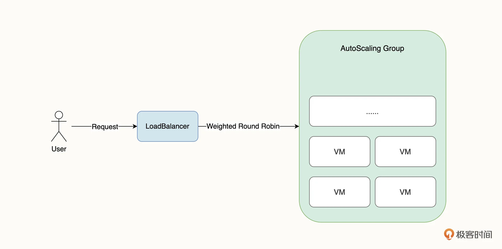

# 03-业务永不宕机，K8s如何实现自动扩容和自愈？

你好，我是王炜。

上一节，我们介绍了 K8s Pod 以及如何通过 Pod 部署容器镜像，学习了 K8s 交互工具Kubectl 的基本操作。

那么，K8s 到底有什么强大之处让大家趋之若鹜呢？它又能给我们的业务带来哪些新的变化？我认为，其中最重要也是最吸引人的就是它的自动扩容和自愈机制。

这节课，我会继续延展上节课的内容，从传统 VM 的扩容和自愈出发，分析这种架构的缺点。然后，我会以我们之前部署的 Pod 为例，带你一步步在 K8s 上配置扩容和自愈，让你直观地感受 K8s 的强大优势。

在开始今天的演练之前，你需要做好以下准备：

- 准备一台电脑（首选 Linux 或 macOS，Windows 也适用，注意操作差异）；

- 安装 Docker；

- 安装 Kubectl；

- 按上一节课的内容在本地创建 Kind 集群。

## 传统的扩容和自愈

在 VM 时代，我们的业务以进程的方式运行在虚拟机上，并由虚拟机对外提供服务。随着业务规模的扩大，我们需要支撑更多的访问流量，这时业务扩容就成了首先要考虑的问题。

在公有云环境下，VM 架构最典型的一种扩容方式是弹性伸缩组。意思是通过对虚拟机内存、CPU 等监控指标配置伸缩阈值，实现动态地自动伸缩。此外，我们一般还会结合虚拟机镜像、负载均衡器等云产品一并使用，如下图所示。



在这个架构中，负载均衡器是集群的唯一入口，它在接受访问流量后，一般会将流量通过加权轮训的方式转发到后端集群。负载均衡器一般是直接使用云厂商的产品，有一些团队也会自建高可用的 Nginx 作为集群入口。为了保证伸缩组节点的业务一致性，弹性伸缩组的所有 VM都使用同一个虚拟机镜像。

其次，要在 VM 粒度实现业务自愈，常见的方案是使用 Crontab 定时检查业务进程或者通过守护进程的方式来运行，例如 Node PM2。

## 传统扩容和自愈的缺点

但是，这种架构有一些显而易见的缺陷。最大的问题有两个：

1. 扩容慢；

2. 负载均衡无法感知业务健康情况。

扩容慢主要体现在两方面。首先是 VM 指标会有一定的延迟；其次，扩容的 VM 冷启动时间比较慢，弹性伸缩组需要执行购买 VM、配置镜像、加入伸缩组、启动 VM 等操作。这会让我们失去扩容的最佳时机，并最终影响用户体验。

负载均衡无法感知业务健康情况的意思是，VM 是否加入到弹性伸缩组接收外部流量，一般取决于 VM 的健康状态，但 VM 健康并不等于业务健康，这导致在扩缩容的过程中，请求仍然有可能会转发至业务不健康的节点，造成业务短暂中断的问题。

## K8s 的自动自愈

K8s 是如何解决这两个问题的呢。

在详细介绍 K8s 的自愈之前，我想先问你一个简单的问题，你希望自愈解决什么问题？

我想，你可能最希望自愈能够帮我们解决服务自动重启的问题。也就是说，当业务进程意外中断，或者节点产生故障时，系统可以快速识别，自动重启并恢复服务。其次，你可能还会希望自愈能够自动转移故障，也就是让业务不健康的节点不接收流量，保证用户体验。

听起来是不是很棒，而 K8s 的自动自愈功能都可以帮你解决上面的这些问题，我们终于能摆脱 7*24 小时 Oncall 了。

接下来我们进入实战环节。

还记得我们上节课学习的工作负载吗？在将镜像部署到 K8s 集群时，我们创建了一个 Pod 工作负载类型。在这节课的实战环节里，我们需要创建另一种工作负载类型：Deployment。

听起来似乎很陌生，别担心，我们先不讲概念，让我们先动手创建一个 Deployment 工作负载。

通常，我们需要像创建 Pod 那样先编写 Manifest，再通过 kubectl apply 命令来创建工作负载。但是由于 Deployment 的字段定义比较多，理解起来也相对复杂，这里我先提供另一种相对简单的办法，那就是 kubectl create 命令：

```
$ kubectl create deployment hello-world-flask --image=lyzhang1999/hello-world-fla
deployment.apps/hello-world-flask created
```

在这里，hello-world-flask 代表工作负载的名称，–image 代表镜像，也就是我们在上一节课部署的镜像，–replicas 指的是 Pod 副本数，你可以把它类比为弹性伸缩组的 VM 数量。

本质上，你可以理解为这条命令会生成 Deployment Manifest，然后自动执行 kubectl apply 将Manifest 应用到集群内，省略了我们手动编写 Manifest 的过程。你还可以为上面的命令增加 --dry-run 和 -o 参数，单纯输出 Manifest 内容。

```
$ kubectl create deployment hello-world-flask --image lyzhang1999/hello-world-fla
apiVersion: apps/v1
kind: Deployment
metadata:
 creationTimestamp: null
 labels:
   app: hello-world-flask
 name: hello-world-flask
spec:
 replicas: 2
 selector:
   matchLabels:
     app: hello-world-flask
 strategy: {}
 template:
   metadata:
     creationTimestamp: null
     labels:
       app: hello-world-flask
   spec:
     containers:
     - image: lyzhang1999/hello-world-flask:latest
       name: hello-world-flask
       resources: {}
status: {}
```

上面输出的 Manifest 其实就是我们应用到集群内的 Manifest 内容，可以看出，各参数都符合我们的预期。

然后，我们使用 kubectl create service 命令创建 Service：

```
$ kubectl create service clusterip hello-world-flask --tcp=5000:5000
service/hello-world-flask created
```

此外，我们还需要使用 kubectl create ingress 命令创建 Ingress：

```
$ kubectl create ingress hello-world-flask --rule="/=hello-world-flask:5000"
ingress.networking.k8s.io/hello-world-flask created
```

最后，别忘了部署 Ingress-nginx：

```
$ kubectl create -f https://ghproxy.com/https://raw.githubusercontent.com/lyzhang
namespace/ingress-nginx created
serviceaccount/ingress-nginx created
serviceaccount/ingress-nginx-admission created
......
```

这里出现了几个陌生的概念，例如 Deployment、Service 和 Ingress。别担心，现在你并不需要理解他们，这部分内容我会在接下来的课程中为你详细介绍。

现阶段，你只需要知道三件事：

1. Pod 会被 Deployment 工作负载管理起来，例如创建和销毁等；

2. Service 相当于弹性伸缩组的负载均衡器，它能以加权轮训的方式将流量转发到多个 Pod 副本上；

3. Ingress 相当于集群的外网访问入口。

接下来，让我们开始 K8s 自愈实验。

首先，我们要通过 kubectl get pods 列出 Pod：

```
$ kubectl get pods
NAME                                 READY   STATUS    RESTARTS   AGE
hello-world-flask-56fbff68c8-2xz7w   1/1     Running   0          3m38s
hello-world-flask-56fbff68c8-4f9qz   1/1     Running   0          3m38s
```

从返回结果可以看出，Deployment 为我们创建了两个 Pod 副本，它们拥有不同的名字。（与上一节课手动部署的 Pod 不同，通过 Deployment 创建的 Pod 带有随机后缀。）

由于之前我们已经通过 Kind 在本地创建了集群，也暴露监听了本地的 80 端口，所以集群的Ingress 访问入口是 127.0.0.1。

有了 Ingress，我们访问 Pod 就不再需要进行端口转发了，我们可以直接访问 127.0.0.1。下面的命令会每隔 1 秒钟发送一次请求，并打印出时间和返回内容：

```
$ while true; do sleep 1; curl http://127.0.0.1; echo -e '\n'$(date);done
Hello, my first docker images! hello-world-flask-56fbff68c8-4f9qz
2022年 9月 7日 星期三 19时21分03秒 CST
Hello, my first docker images! hello-world-flask-56fbff68c8-2xz7w
2022年 9月 7日 星期三 19时21分04秒 CST
```

在这里，“Hello, my first docker images” 后面紧接的内容是 Pod 名称。通过返回内容我们会发现，请求被平均分配到了两个 Pod 上，Pod 名称是交替出现的。我们要保留这个命令行窗口，以便继续观察。

接下来，我们模拟其中的一个 Pod 宕机，观察返回内容。

打开一个新的命令行窗口，执行下面的命令终止容器内的 Python 进程，这个操作是在模拟进程意外中止导致宕机的情况。

```
$ kubectl exec -it hello-world-flask-56fbff68c8-2xz7w -- bash -c "killall python3
```

然后，我们回到刚才的请求窗口查看返回内容，可以看到非常神奇的一幕：

```
Hello, my first docker images! hello-world-flask-56fbff68c8-4f9qz
2022年 9月 7日 星期三 19时27分44秒 CST
Hello, my first docker images! hello-world-flask-56fbff68c8-4f9qz
2022年 9月 7日 星期三 19时27分45秒 CST
Hello, my first docker images! hello-world-flask-56fbff68c8-4f9qz
```

所有的请求流量都被转发到了没有故障的 Pod，也就是说，故障成功地被转移了！

等待几秒钟，继续观察，我们会重新发现 hello-world-flask-56fbff68c8-2xz7w Pod 的返回内容，这说明 Pod 被重启恢复后，重新加入到了负载均衡接收外部流量：

```
Hello, my first docker images! hello-world-flask-56fbff68c8-2xz7w
2022年 9月 7日 星期三 19时27分52秒 CST
Hello, my first docker images! hello-world-flask-56fbff68c8-4f9qz
2022年 9月 7日 星期三 19时27分53秒 CST
Hello, my first docker images! hello-world-flask-56fbff68c8-2xz7w
```

然后，我们再次使用 kubectl get pods 查看 Pod：

```
$ kubectl get pods
NAME                                 READY   STATUS    RESTARTS   AGE
hello-world-flask-56fbff68c8-2xz7w   1/1     Running   1(1m ago)  3m38s
hello-world-flask-56fbff68c8-4f9qz   1/1     Running   0          3m38s
```

这里要注意看， hello-world-flask-56fbff68c8-2xz7w Pod 的 RESTARTS 值为 1 ，也就是说K8s 自动帮我们重启了这个 Pod。

好了，让我们重新来梳理一下全过程。首先， K8s 感知到了业务 Pod 故障，立刻进行了故障转移并隔离了有故障的 Pod，并将请求转发到了其他健康的 Pod 中。随后重启了有故障的Pod，最后将重启后的 Pod 加入到了负载均衡并开始接收外部请求。这些过程都是自动化完成的。

到这里，我们完成了 K8s 自愈的实验。有了 K8s 的自愈功能，我们就不再需要为潜在的业务中断问题而烦恼了。

## K8s 的自动扩容

除了自愈功能以外，K8s 还为我们提供了自动扩容的能力。

自动扩容依赖于 K8s Metric Server 提供的监控指标，首先我们需要安装它：

```
$ kubectl apply -f https://ghproxy.com/https://raw.githubusercontent.com/lyzhang1
serviceaccount/metrics-server created
clusterrole.rbac.authorization.k8s.io/system:aggregated-metrics-reader created
clusterrole.rbac.authorization.k8s.io/system:metrics-server created
......
```

安装完成后，等待 Metric 工作负载就绪：

```
$ kubectl wait deployment -n kube-system metrics-server --for condition=Available
deployment.apps/metrics-server condition met
```

Metric Server 就绪后，通过 kubectl autoscale 命令来为 Deployment 创建自动扩容策略：

```
$ kubectl autoscale deployment hello-world-flask --cpu-percent=50 --min=2 --max=1
```

这其中，–cpu-percent 表示 CPU 使用率阈值，当 CPU 超过 50% 时将进行自动扩容，–min代表最小的 Pod 副本数，–max 代表最大扩容的副本数。也就是说，自动扩容会根据 CPU 的使用率在 2 个副本和 10 个副本之间进行扩缩容。

最后，要使自动扩容生效，还需要为我们刚才部署的 hello-world-flask Deployment 设置资源配额。你可以通过下面的命令来配置：

```
$ kubectl patch deployment hello-world-flask --type='json' -p='[{"op": "add", "pa
deployment.apps/hello-world-flask patched
```

现在，Deployment 将会重新创建两个新的 Pod，你可以使用下面的命令筛选出新的 Pod：

```
$ kubectl get pod --field-selector=status.phase==Running
NAME                                 READY   STATUS    RESTARTS   AGE
hello-world-flask-64dd645c57-4clbp   1/1     Running   0          117s
hello-world-flask-64dd645c57-cc6g6   1/1     Running   0          117s
```

选择一个 Pod 并使用 kubectl exec 进入到容器内：

```
$ kubectl exec -it hello-world-flask-64dd645c57-4clbp -- bash
root@hello-world-flask-64dd645c57-4clbp:/app#
```

接下来，我们模拟业务高峰期场景，使用 ab 命令来创建并发请求：

```
root@hello-world-flask-64dd645c57-4clbp:/app# ab -c 50 -n 10000 http://127.0.0.1:
```

在这条压力测试的命令中，-c 代表 50 个并发数，-n 代表一共请求 10000 次，整个过程大概会持续十几秒。

接下来，我们打开一个新的命令行窗口，使用下面的命令来持续监控 Pod 的状态：

```
$ kubectl get pods --watch
NAME                                 READY   STATUS    RESTARTS   AGE
hello-world-flask-64dd645c57-9x869   1/1     Running   0          4m6s
hello-world-flask-64dd645c57-vw8nc   0/1     Pending   0          0s
hello-world-flask-64dd645c57-46b6s   0/1     ContainerCreating   0          0s
hello-world-flask-64dd645c57-vw8nc   1/1     Running             0          18s
```

–watch 参数会一直等待，你可以使用 ctrl+c 或关闭窗口来终止。

这里参数 --watch 表示持续监听 Pod 状态变化。在 ab 压力测试的过程中，会不断创建新的Pod 副本，这说明 K8s 已经感知到了 Pod 的业务压力，并且正在自动进行横向扩容。

## 总结

这节课，我先介绍了基于 VM 的扩容和自愈方案，可以看到，它们在扩容速度和流量管理上存在较大的不足之处。然后，我通过两个实际的例子向你直观地展示了 K8s 自愈和自动扩容的强大之处。

K8s 的自愈和扩容的对象都是 Pod，它是 K8s 的最小调度单位。在创建 Pod 的时候，我们并不是像上一节课那样直接创建 Pod 工作负载，而是通过创建 Deployment 工作负载来间接创建 Pod。通过这种方式，我们可以很方便地创建多个 Pod 副本，并且只需要关注 Deployment的状态就可以间接地控制 Pod 的状态。

此外，我还为你介绍了一种编写 Manifest 的方法，也就是使用 kubectl create deployment --dry-run=client -o yaml 命令，它会为我们输出详细的 Manifest 信息。这条命令适用于非常多的 K8s 对象，具体有哪些对象你可以使用 kubectl create --help 查看。在未来的工作中，当你需要编写 Manifest 又不记得语法时，它会对你非常有帮助。

除了 Deployment 工作负载，在自动扩容的实验过程中，我们还引出了好几个新概念，我们现阶段只需要知道它们的功能即可，在接下来的课程中我还会为你详细介绍。

## 思考题

最后，给你留一道思考题吧。

能不能分享一下你现在使用的自愈和扩容方案是什么呢？相比较 K8s ，它有什么优势和缺点？

欢迎你给我留言交流讨论，你也可以把这节课分享给更多的朋友一起阅读。我们下节课见。
