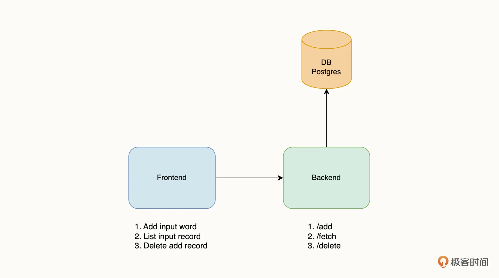
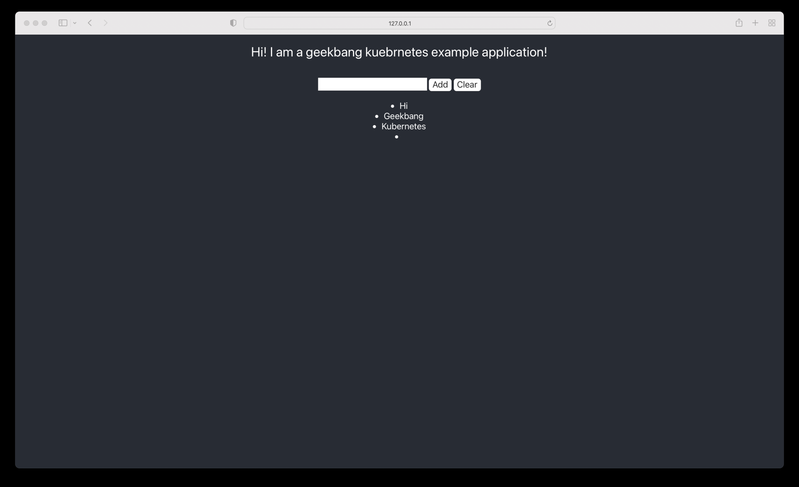
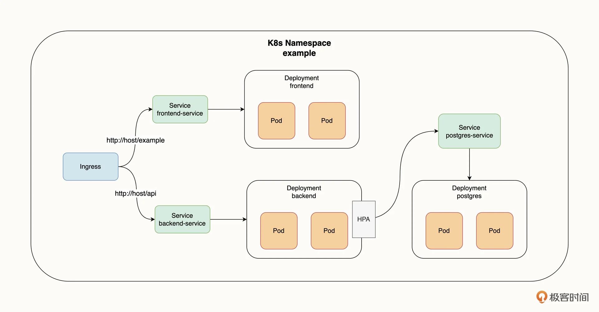
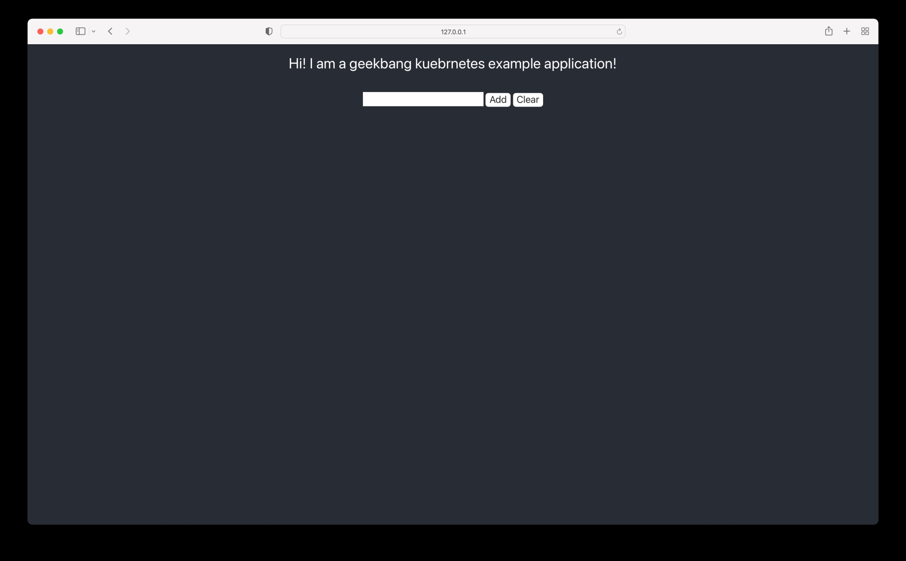

# 05 | K8s极简实战：示例应用介绍

你好，我是王炜。

上一章，我们以一个 Python 应用为例，学习了将应用迁移到云原生架构下的完整过程，也就是从容器化、部署到 K8s、弹性伸缩最后到 GitOps 的全过程。在实战的过程中，我没有太多地介绍概念，而是让你直接上手感受 K8s 和 GitOps 的强大之处。

这一章，我会设计一个更加接近真实业务的示例应用。这个应用会涵盖你在工作中常用的 K8s对象，包括 Deployment、Service、Ingress、HPA、Namespace、ConfigMap 等。在将这个应用部署到 K8s 的过程中，我们会逐渐深入到每个 K8s 对象中。

这节课，我们先来了解一下这个示例应用。

在开始学习之前，你需要做好以下准备：

- 准备一台电脑（首选 Linux 或 macOS，Windows 也适用，注意操作差异）；

- 安装 Docker；

- 安装 Kubectl；

- 安装 Kind。

## 架构介绍

### 应用架构

我设计的这个示例应用是一套微服务架构的应用，你可以在 GitHub 上获取源码，源码目录结构如下：

```
$ ls
backend  deploy   frontend
```

在这里，backend 目录为后端源码，frontend 目录为前端源码，deploy 目录是应用的 K8sManifest，前后端都已经包含构建镜像所需的 Dockerfile。

示例应用由三个服务组成：

1. 前端；

2. 后端；

3. 数据库。

其中，前端采用 React 编写，它也是应用对外提供服务的入口；后端由 Python 编写；数据库采用流行的 Postgres。应用整体架构如下图所示：



前端实现了三个功能，分别是存储输入的内容，列出输入内容记录以及删除所有的记录。这三个功能分别对应了后端的三个接口，也就是 /add, /fetch 和 /delete，最后数据会被存储在Postgres 数据库中。

示例应用的前端界面如下图所示：



### K8s 部署架构

为了方便你把示例应用直接部署到 K8s 集群内，我已经写好了 K8s Manifest 文件，你可以在GitHub 找到这些清单文件。应用的 K8s 部署架构图如下：



在这张架构图中，Ingress 是应用的入口，Ingress 会根据请求路径将流量分流至前后端的Service 中，然后 Service 将请求转发给前后端 Pod 进行业务逻辑处理，后端的工作负载Deployment 配置了 HPA 自动横向扩容。同时，Postgres 也是以 Deployment 的方式部署到集群内的。最后，所有资源都部署在 K8s 的 example 命名空间（Namespace）下。

在熟悉了应用架构之后，接下来我们就把它部署到 K8s 集群内。

## 部署应用

### 创建新的 K8s 集群

我们还是以部署到本地 Kind 集群为例，为了避免资源冲突，需要先把第一章实验过程创建的Kind 集群删掉。你可以用 kind delete cluster 来删除集群：

```sql
$ kind delete cluster
```

然后，重新创建一个 K8s 集群，将下面的内容保存为 config.yaml：

```
kind: Cluster
apiVersion: kind.x-k8s.io/v1alpha4
nodes:
- role: control-plane
 kubeadmConfigPatches:
 - |
   kind: InitConfiguration
   nodeRegistration:
     kubeletExtraArgs:
       node-labels: "ingress-ready=true"
 extraPortMappings:
 - containerPort: 80
   hostPort: 80
   protocol: TCP
 - containerPort: 443
   hostPort: 443
   protocol: TCP
```

接下来，使用 kind create cluster 重新创建集群：

```bash
❯ kind create cluster --config config.yaml
Creating cluster "kind" ...
✓ Ensuring node image (kindest/node:v1.23.4)
✓ Preparing nodes 📦
✓ Writing configuration 📜
✓ Starting control-plane 🕹️
✓ Installing CNI 🔌
✓ Installing StorageClass 💾
Set kubectl context to "kind-kind"
You can now use your cluster with:
kubectl cluster-info --context kind-kind
```

由于示例应用使用了 Ingress，所以我们需要为 Kind 部署 Ingress，你可以使用 kubectl apply-f 来部署 Ingress-Nginx：

```
$ kubectl create -f https://ghproxy.com/https://raw.githubusercontent.com/lyzhang
namespace/ingress-nginx created
serviceaccount/ingress-nginx created
serviceaccount/ingress-nginx-admission created
......
```

最后，再部署 Metric Server，以便开启 HPA 功能：

```
$ kubectl apply -f https://ghproxy.com/https://raw.githubusercontent.com/lyzhang1
serviceaccount/metrics-server created
clusterrole.rbac.authorization.k8s.io/system:aggregated-metrics-reader created
clusterrole.rbac.authorization.k8s.io/system:metrics-server created
......
```

准备好新的 K8s 集群后，就可以开始部署示例应用了。

### 部署示例应用

我们把示例应用所有的资源都部署在一个新的命名空间下，新的命名空间命名为 example。我们首先需要创建该命名空间，你可以使用 kubectl create namespace 来创建命名空间：

```
$ kubectl create namespace example
namespace/example created
```

然后，创建 Postgres 数据库，同样使用 kubectl apply 来创建：

```
$ kubectl apply -f https://ghproxy.com/https://raw.githubusercontent.com/lyzhang1
configmap/pg-init-script created
deployment.apps/postgres created
service/pg-service created
```

在上面这段代码中，-n 参数代表指定命名空间，也就是 example 命名空间，注意，后续创建资源时都需要指定这个命名空间。

然后再分别创建前后端 Deployment 工作负载和 Service：

```
$ kubectl apply -f https://ghproxy.com/https://raw.githubusercontent.com/lyzhang1
deployment.apps/frontend created
service/frontend-service created
$ kubectl apply -f https://ghproxy.com/https://raw.githubusercontent.com/lyzhang1
deployment.apps/backend created
service/backend-service created
```

接下来，为应用创建 Ingress 和 HPA 策略：

```
$ kubectl apply -f https://ghproxy.com/https://raw.githubusercontent.com/lyzhang1
ingress.networking.k8s.io/frontend-ingress created
$ kubectl apply -f https://ghproxy.com/https://raw.githubusercontent.com/lyzhang1
horizontalpodautoscaler.autoscaling/backend created
```

其实，除了可以按照上面的引导单独创建示例应用的每一个 K8s 对象以外，我们还可以使用另一种方法，那就是把这个 Git 仓库克隆到本地，然后使用 kubectl apply 一次性将所有示例应用的对象部署到集群内：

```
$ git clone https://ghproxy.com/https://github.com/lyzhang1999/kubernetes-example
Cloning into 'kubernetes-example'...
......
Resolving deltas: 100% (28/28), done.
$ kubectl apply -f deploy -n example
deployment.apps/backend created
service/backend-service created
configmap/pg-init-script created
......
```

这里的 -f 参数除了可以指定文件外，还可以指定目录，kubectl 将会检查目录下所有可用的Manifest，然后把它部署到 K8s 集群。-n 参数代表将所有 Manifest 部署到 example 命名空间。

最后，我们可以使用 kubectl wait 来检查所有资源是不是已经处于 Ready 状态了：

```
$ kubectl wait --for=condition=Ready pods --all -n example
pod/backend-9b677898b-n5lsm condition met
pod/frontend-f948bdc85-q6x9f condition met
pod/postgres-7745b57d5d-f4trt condition met
```

到这里，示例应用就部署完了。

打开浏览器访问 127.0.0.1，你应该能看到示例应用的前端界面，如下图所示：



你可以尝试在输出框中输入内容，如果点击 Add 按钮，下方的列表内会出现你输入的内容，点击 Clear 所有内容被清空，这就说明应用已经可以正常工作了。

## K8s 对象解析

在这个示例应用中，我们创建了一个新的命名空间来部署所有资源，这个命名空间是example。

此外，示例应用涉及到的资源比较多，为了更清楚地梳理它们之间的逻辑关系，我给你简单地总结一下。

首先，你可以使用 kubectl get all 来查看某个命名空间下的所有资源：

```
❯ kubectl get all -n example
NAME                            READY   STATUS    RESTARTS   AGE
pod/backend-648ff85f48-8qgjg    1/1     Running   0          29s
pod/backend-648ff85f48-f845h    1/1     Running   0          51s
pod/frontend-7b55cc5c67-4svjz   1/1     Running   0          14s
pod/frontend-7b55cc5c67-9cx57   1/1     Running   0          14s
pod/postgres-7745b57d5d-f4trt   1/1     Running   0          44m
NAME                       TYPE        CLUSTER-IP      EXTERNAL-IP   PORT(S)    A
service/backend-service    ClusterIP   10.96.244.140   <none>        5000/TCP   4
service/frontend-service   ClusterIP   10.96.85.54     <none>        3000/TCP   4
service/pg-service         ClusterIP   10.96.166.74    <none>        5432/TCP   4
NAME                       READY   UP-TO-DATE   AVAILABLE   AGE
deployment.apps/backend    2/2     2            2           42m
deployment.apps/frontend   2/2     4            4           43m
deployment.apps/postgres   1/1     1            1           44m
NAME                                  DESIRED   CURRENT   READY   AGE
replicaset.apps/backend-648ff85f48    2         2         2       51s
replicaset.apps/frontend-7b55cc5c67   2         2         2       54s
replicaset.apps/postgres-7745b57d5d   1         1         1       44m
NAME                                           REFERENCE             TARGETS    M
horizontalpodautoscaler.autoscaling/backend    Deployment/backend    0%/50%     2
horizontalpodautoscaler.autoscaling/frontend   Deployment/frontend   51%/80%   2
```

-n 参数表示指定一个命名空间，从返回结果可以看出，示例应用一共创建了 5 个 Pod、3 个Service、3 个 Deployment、3 个 Replicaset、2 个 HPA，是不是对有些概念有点陌生呢？别担心，我们还会在接下来的课程中详细介绍。

## 总结

在这节课，我为你准备了一个示例应用，并引导你创建了一个新的本地 Kind 集群，还完成了部署的操作。此外，我们还介绍了应用整体的架构设计，包括业务架构和 K8s 部署架构。

示例应用主要从真实项目出发，在我们这个应用里出现的大多数 K8s 对象，你也会在实际工作中用到它们，掌握它们有助于你把真实的应用迁移到 K8s。在接下来的课程里，我会从这个示例应用出发，为你详细介绍这里出现的每一个 K8s 对象类型，为未来的 GitOps 课程打下坚实的基础。

## 思考题

最后，给你留一道思考题吧。

请你尝试在示例应用中添加一些数据，然后使用 kubectl delete pod 删除 Postgres 的 Pod，删除后 K8s 将会重新创建 Pod，请你观察一下之前保存的数据还存在吗？为什么？

欢迎你给我留言交流讨论，你也可以把这节课分享给更多的朋友一起阅读。我们下节课见。
