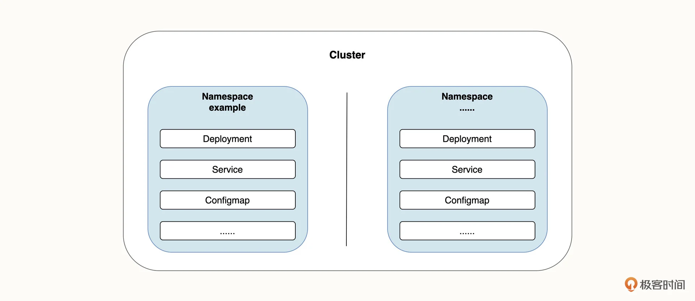
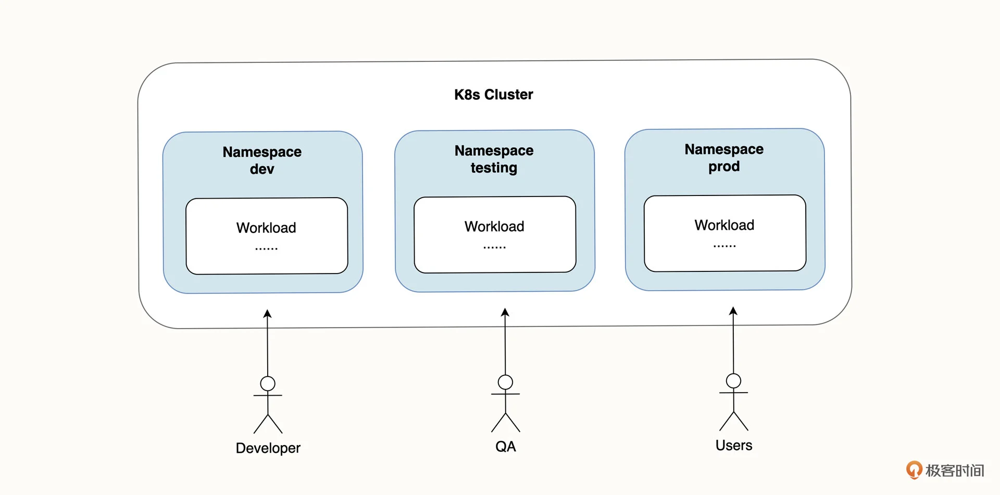
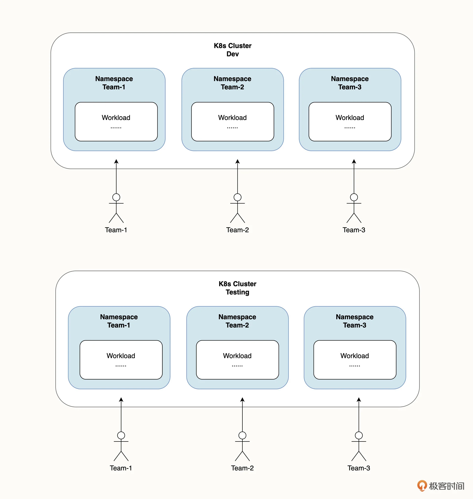

# 06-如何使用命名空间隔离团队及应用环境？

你好，我是王炜。今天是我们 K8s 极简实战模块的第一课，我们一起来看看如何使用命名空间隔离团队及应用环境。

随着团队和应用规模的扩大，我们部署的 K8s 资源会越来越多，管理和组织这些资源成为了首先要面对的问题。另外，当我们对同一个应用有多套环境诉求时，需要有一种隔离机制能让我们在同一个集群内部署多个相同名字的工作负载。而且，不同业务的工作负载会相互竞争资源，这进一步增加了集群管理的难度。

要解决上面的这些问题，我们需要有一个更高维度的抽象。无论是在同一个集群隔离多套环境，还是隔离不同团队的资源，本质上都是将集群虚拟成几个隔离的“子集群”来使用。这种在同一个集群中提供的虚拟“子集群”的隔离能力，我们称为命名空间（Namespace）。

这节课，我还是从实战的角度出发，为你详细介绍 K8s 极简实战模块中的第一个概念：命名空间。

在正式开始课程之前，你需要确保已经按照上一节“示例应用介绍”的引导在本地 Kind 集群部署了示例应用。

## 初识命名空间

### 架构图

为了方便你理解命名空间，我们一开始可以把 K8s 的命名空间比作是“子集群”。事实上，命名空间是集群的一种“软隔离”机制，它通过这种隔离机制，为我们管理和组织集群资源提供了便利。集群和命名空间的关系如图所示：



不同的命名空间具备一定的隔离性，业务应用的工作负载以及其他的 K8s 对象可以部署在特定的命名空间中，在不同命名空间中，相同类型的资源可以重名。利用这种特性，我们可以把集群虚拟的命名空间和现实中的不同团队、不同应用在逻辑上联系起来。

### 创建和删除

在一个 K8s 集群中，命名空间可以划分为两种类型：系统级命名空间和用户自定义命名空间。

系统级的命名空间是 K8s 集群默认创建的命名空间，主要用来隔离系统级的对象和业务对象，系统级的命名空间下面四种。

1. default：默认命名空间，也就是在不指定命名空间时的默认命名空间。

2. kube-system：K8s 系统级组件的命名空间，所有 K8s 的关键组件（例如 kube-proxy、coredns、metric-server 等）都在这个命名空间下。

3. kube-public：开放的命名空间，所有用户（包括未经认证）的用户都可以读取，这个命名空间是一个约定，但不是必须。

4. kube-node-lease：和集群扩展相关的命名空间。

在这几个命名空间中，除了 default 命名空间，你都不应该将业务应用部署在其他系统默认创建的命名空间下，也不要尝试去删除它们，这可能会导致集群异常。

在一个 K8s 集群中，你可以使用 kubectl get ns 命令来查看 K8s 的命名空间：

```
$ kubectl get ns
NAME                 STATUS   AGE
default              Active   16h
example              Active   16h
ingress-nginx        Active   16h
kube-node-lease      Active   16h
kube-public          Active   16h
kube-system          Active   16h
local-path-storage   Active   16h
```

从返回结果我们可以看出，示例应用创建了一个新的命名空间 example，同时，我们之前部署的 Ingress-Nginx 也创建了自己专属的命名空间。

此外，要获取 Namespace 的详情，例如获取命名空间级别的资源配额等详细信息，你可以使用 kubectl describe namespace 命令：

```
$ kubectl describe namespace example
Name:         example
Labels:       kubernetes.io/metadata.name=example
Annotations:  <none>
Status:       Active
No resource quota.
No LimitRange resource.
```

要创建一个命名空间，你可以使用 kubectl create namespace 命令：

```
$ kubectl create namespace my-namespace
namespace/my-namespace created
```

注意，命名空间的名字需要符合 DNS-1123 规范，其中最重要的点是字母只支持小写，另外除了特殊字符“-”以外，其他任何特殊字符都无法使用。当你尝试创建一个不符合规范的命名空间时，K8s 将返回错误：

```
$ kubectl create namespace my.namespace
The Namespace "my.namespace" is invalid: metadata.name: Invalid value: "my.namesp
```

除了使用 kubectl create namespace 命令，我们还可以通过 K8s Manifest 来创建命名空间，你需要将以下内容保存为 namespace.yaml：

```
apiVersion: v1
kind: Namespace
metadata:
 name: example
```

使用 kubectl apply -f namespace.yaml 命令应用这段 Manifest，它的效果和 kubectl createnamespace 是一样的。

最后，要删除命名空间，可以使用 kubectl delete namespace 命令：

```sql
$ kubectl delete namespace my-namespace
namespace "my-namespace" deleted
```

删除命名空间将会删除该命名空间下的所有资源，所以在实际项目中请谨慎操作。另外，由于删除动作是异步的，因此删除中的命名空间状态会由正常的 Active 转变为 Terminating，也就是“终止中的状态”。

### 如何使用

掌握了命名空间的创建和删除之后，接下来我们继续学习如何使用命名空间。

首先，要将 K8s 对象部署在我们指定的命名空间下，你可以在资源的 Manifest 中设置Namespace 字段，以示例应用的前端 Deployment 工作负载为例：

```
apiVersion: apps/v1
kind: Deployment
metadata:
 name: frontend
 namespace: example   # 设置 namesapce
 labels:
   app: frontend
spec:
 ......
```

从上面的内容可以看出，metadata.namespace 字段的值为 example，这意味着该资源将部署在指定 example 命名空间下。相反，如果不指定该字段，资源就会被部署到 default 命名空间下。

此外，还有一种指定资源命名空间的方法。还记得我们在上节课是怎么把示例应用部署到集群的吗？没错，我们还可以通过使用 kubectl apply -n 参数指定命名空间：

```
$ kubectl apply -f deploy -n example
```

这种方法可以一次性指定所有部署 K8s 资源的命名空间，这是一种更加常用的方案。

还需要注意的是，在为资源指定非 default 命名空间时，需要确保这个命名空间已经存在，否则 K8s 将会返回错误。

那么，等我们把资源部署到特定的命名空间之后，如何查看它们呢？

还记得我们之前是怎么查看 Deployment 工作负载的吗？之前的课程里，我们一直在使用kubectl get deployment 命令，这条命令实际上省略了命名空间的参数，完整的命令应该是：

```
$ kubectl get deployment -n default。
```

由于 default 是默认的命名空间，所以如果我们在部署、删除和查看 K8s 对象时没有指定命名空间，就会默认都指向 default。

但是如果我们要查看非 default 命名空间下的工作负载，自然就需要指定命名空间了。例如，要查看示例应用所在的 example 命名空间下所有 Deployment 工作负载：

```
$ kubectl get deployment -n example
NAME       READY   UP-TO-DATE   AVAILABLE   AGE
backend    2/2     2            2           17h
frontend   2/2     2            2           17h
postgres   1/1     1            1           17h
```

## 什么时候使用命名空间？

对于一些小型团队或者小型应用，直接使用 default 也是一种选择。不过，当你有下面的需求时，我建议你考虑使用命名空间。

- 环境管理：你可以使用命名空间来隔离开发环境、预发布环境和生产环境。例如用 dev、staging、prod 命名空间来区分这三个环境。命名空间的隔离特性可以让开发环境的的操作不会影响到其他环境的工作。实际上，对于这种情况，我更建议使用不同的集群进行硬隔离，命名空间的隔离方式只是一种选择。

- 隔离：当你有多个团队，或者多个产品线运行在同一个集群时，你可以使用命名空间来隔离这些团队或者产品线，让他们相互之间不受影响。你甚至可以为每一个开发分配一个命名空间，让他们独立进行开发工作。

- 资源控制：你可以在命名空间级别配置 CPU、内存等资源配额。通过这个方法，你可以为某个团队或者某条业务线设置总的资源配额，而不需要关注他们具体在每一个工作负载上怎么分配这些资源。此外，命名空间的资源配额还能够合理确保每一个项目所需要的资源配额，避免出现资源恶性竞争导致业务不稳定的情况。

- 权限控制：K8s 的 RBAC 可以帮助我们对某个用户仅授权一个或者多个命名空间，确保只有特定的用户能访问特定命名空间下的资源。

- 提高集群性能：命名空间有利于提高集群性能。在进行资源搜索时，命名空间有利于 K8sAPI 缩小查找范围，对减小搜索延迟和提升性能具有一定的帮助。

## 如何跨命名空间通信？

在使用命名空间隔离资源之后，就会涉及到如何通信的问题。我们之前说命名空间是一种“软隔离”机制，既然是软隔离，那么不同命名空间完全是可以相互通信的。

```xml
当 K8s 创建 Service 时，会创建相应的 DNS 解析记录，格式为：<service-name>.
<namespace-name>.svc.cluster.local。当业务容器需要和当前命名空间下其他服务
通信时，则可以省略 <namespace-name>.svc.cluster.local，也就是缩写为
<service-name> 就可以了。
```

同理，要跨不同的命名空间通信，我们可以指定完整的 Service URL 来实现。例如，要访问dev 命名空间下的 backend-service，完整的 URL 为：

```
backend-service.dev.svc.cluster.lcoal
```

当然，你也可以通过配置 K8s 的网络策略来限制这种访问方式。

## 如何规划命名空间？

合理的命名空间规划可以让资源管理变得更加轻松，命名空间可以对应到现实中不同的隔离逻辑，例如通过命名空间来区分环境、区分业务团队、区分业务用途等等。

所以，如何合理地规划命名空间是我们刚开始使用 K8s 就要考虑的问题。K8s 命名空间只提供一种组织方式，在实际的使用过程，你可以按照自己的团队情况、组织架构、业务线等维度来进行划分。

为了能让你在实际的工作中直接使用，我为你总结了以下几种 K8s 命名空间规划方案。

### 单一业务应用和团队

当团队规模在几人到十几人，业务应用只有 1-2 个时，你可以参考下图这种命名空间的规划方案：



在这个方案中，我们将 K8s 集群划分为 3 个命名空间，分别是 dev、testing 和 prod。

- dev：开发环境，用于开发人员日常开发。

- testing：测试环境，用于质量人员进行测试工作。

- prod：生产环境，用于对外提供生产服务。

注意，为了让 K8s Manifest 能部署到多个命名空间，一般我们不直接在 Manifest 的Namespace 字段里指定命名空间，而是在实际部署时指定命名空间：

```
$ kubectl apply -f deploy -n dev
deployment.apps/backend created
......
Error from server (BadRequest): error when creating "deploy/ingress.yaml": admiss
```

上面这段命令，实际上是将示例应用部署到了一个新的 dev 命名空间里。不过在你执行时会返回一个错误，这是因为在不同的命名空间下设置了相同的 Ingress 策略，我们可以暂时忽略它。在实际的业务场景中，不同环境的访问域名是不同的，自然也就不会出现这个问题。

这样，当需要将应用部署到 QA 环境时，只需要将 -n 参数替换为 testing 即可：

```
$ kubectl apply -f deploy -n testing
```

最后，再将应用部署到 Prod 生产环境，这样就完成了应用从开发、测试到上线的完整生命周期。

### 多业务应用和团队

在大型的组织架构下，往往会有多个业务应用和多个团队组成，他们开发的可能是同一个大型业务，也可能是独立的应用。在这种情况下，我建议你将团队和命名空间关联起来，并且在区分环境时使用不同的集群，具体规划方案可以参考下图：



这个方案的特点是，dev、testing、prod 环境分别用了 3 个独立的集群，然后会在每一个集群中为每个独立的团队分配一个命名空间，让团队和环境之间相互隔离。当然，如果不同的团队开发的是同一个业务，相当于只是给业务做了微服务的拆分，那么在 testing 和 prod 环境就不需要再划分独立命名空间，只需要有一个命名空间将所有微服务汇总部署起来即可。

## 总结

这节课，我通过深入介绍示例应用，分享了 K8s Namespace 的概念及其用法，包括创建、查看和删除命名空间。其次，当我们需要为资源指定部署的命名空间时，可以在 Manifest 指定或者使用 kubectl apply -n 指定命名空间。

命名空间是 K8s 中提供类似于“多租户”功能的一个设计，实际上，我们可以为不同租户的资源划分到对应的命名空间中，这样可以确保每个租户的资源是隔离的。

基于命名空间的特性，我还介绍了业务应用如何跨命名空间进行通信，它是通过完整的Service URL 来实现的。

最后，为了让你在工作中更好地规划命名空间，我为你举了两个实际的例子来说明，在不同规模的组织下如何对命名空间进行分配和管理。

K8s 的命名空间在集群纵向维度上看是最外层的概念，在实际工作中使用的频率是比较高的，希望你能多花一些时间掌握它。

## 思考题

最后，给你留一道思考题吧。

结合你对命名空间的理解以及团队现状，你会采用什么样的命名空间规划方式呢？为什么？

欢迎你给我留言交流讨论，你也可以把这节课分享给更多的朋友一起阅读。我们下节课见。
