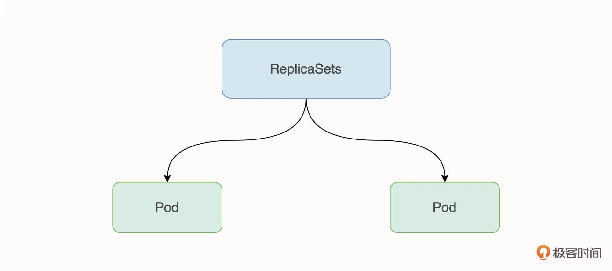
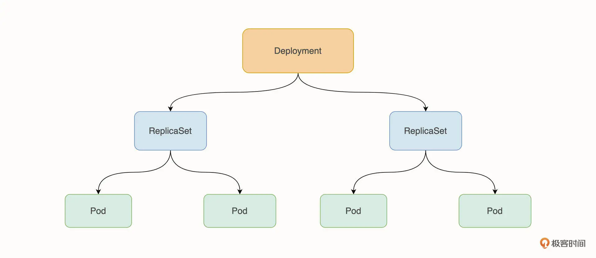
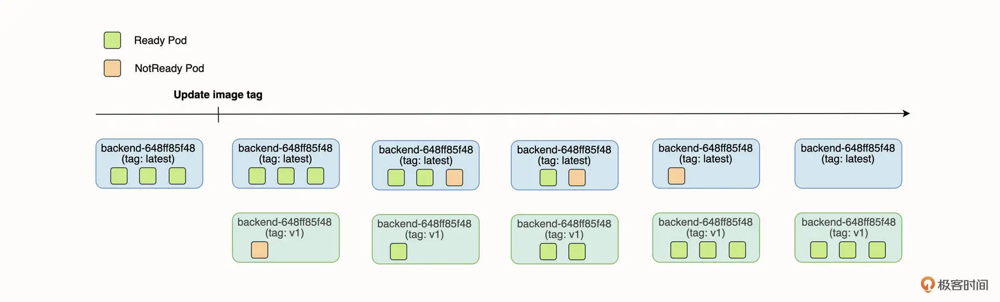

# 07 | K8s极简实战（二）：如何为业务选择最适合的工作负载类型？

你好，我是王炜。

上一节课，我带你认识了 K8s 资源的逻辑隔离机制，也就是命名空间。它可以帮助我们更好地组织 K8s 资源，同时具有一定的隔离特性。

工作负载是 K8s 运行的业务程序。还记得我们在上一模块说 K8s 的最小调度单位是 Pod 吗？虽然工作负载类型有好几种，但他们最终都是以 Pod 的形式运行的。当然，Pod 也是一种工作负载类型，不过我们之前有提到过，在实际的项目中，我们并不会直接使用 Pod 这个工作负载类型，而是通过其他的工作负载类型来间接使用它。

这节课，我们就来看看有哪些 K8s 常用的工作负载类型，以及如何使用它们。我仍然从示例应用出发，重点向你介绍 Deployment 工作负载，只要你掌握它，就可以满足工作中常见的业务场景。

在正式开始之前，你还是需要确保已经按照“示例应用介绍”的引导在本地 Kind 集群部署了示例应用。

## 工作负载类型

K8s 的工作负载包括：ReplicaSet、Deployment、StatefulSet、DaemonSet、Job、CronJob。在实际工作中，我们最常用到的是 Deployment，不过在正式介绍它之前，我们首先需要先了解另外一个工作负载：ReplicaSet。

### ReplicaSet

ReplicaSet 工作负载主要的作用是保持一定数量的 Pod 始终处于运行状态。当我们直接创建Pod 时，假设 Pod 所在的节点出现故障，除非手动重新创建它，否则 Pod 永远不会恢复。Pod 不具备自动恢复能力，这也是我们不推荐直接使用 Pod 的重要原因。

所以，我们需要更高维度的工作负载帮我们创建和维护 Pod，ReplicaSet 可以确保处于运行状态的 Pod 始终保持在期望的数量，让我们不必再需要担心突发故障导致的业务中断。ReplicaSet 和 Pod 的关系如图所示：



为了进一步说明 ReplicaSet 的特性，接下来，我们尝试创建 ReplicaSet 工作负载。先将下面的内容保存为 ReplicaSet.yaml：

```
apiVersion: apps/v1
kind: ReplicaSet
metadata:
 name: frontend
 labels:
   app: frontend
spec:
 replicas: 3   # 3 个副本数
 selector:
   matchLabels:
     app: frontend
 template:
   metadata:
     labels:
       app: frontend
   spec:
     containers:
     - name: frontend
       image: lyzhang1999/frontend:v1
```

然后，使用 kubectl apply 创建 ReplicaSet 工作负载：

```
$ kubectl apply -f ReplicaSet.yaml
replicaset.apps/frontend created
```

现在，我们尝试修改 ReplicaSet.yaml 的内容，将镜像版本从 v1 修改到 v2：

```
apiVersion: apps/v1
kind: ReplicaSet
metadata:
 name: frontend
 ......
spec:
 ......
 template:
   ......
   spec:
     containers:
     - name: frontend
       image: lyzhang1999/frontend:v2 # 修改镜像版本
```

再次运行 kubectl apply -f 使修改生效：

```
$ kubectl apply -f ReplicaSet.yaml
replicaset.apps/frontend configured
```

然后，我们使用 kubectl get pods 来查看所有 Pod 的镜像版本信息：

```
$ kubectl get pods --selector=app=frontend -o jsonpath='{.items[*].spec.container
lyzhang1999/frontend:v1 lyzhang1999/frontend:v1 lyzhang1999/frontend:v1
```

从返回结果可以看出，Pod 的镜像版本并没有被更新为 v2。这是因为 ReplicaSet 只负责维护Pod 数量，在数量没有变化的情况下，Pod 不会被更新。只有将旧的 Pod 杀死，ReplicaSet才会在重新创建 Pod 的时候使用新的镜像版本。

要验证这个过程，你可以使用 kubectl delete pod 来删除某一个 Pod：

```sql
$ kubectl get pods
NAME             READY   STATUS    RESTARTS   AGE
frontend-25kf4   1/1     Running   0          28s
frontend-j94fv   1/1     Running   0          28s
frontend-mbst5   1/1     Running   0          28s
$ kubectl delete pods frontend-25kf4
pod "frontend-25kf4" deleted
```

删除其中一个 Pod 之后，ReplicaSet 会发现 Pod 数量和预期数量相差 1 个 Pod，所以会重新创建一个 Pod 以满足预期要求。此时，我们再次查看所有 Pod 的镜像版本信息：

```
$ kubectl get pods --selector=app=frontend -o jsonpath='{.items[*].spec.container
lyzhang1999/frontend:v2 lyzhang1999/frontend:v1 lyzhang1999/frontend:v1
```

就可以从返回结果看出，Pod 重新创建后，镜像版本也随之更新了。

通过这个实验我们得出结论，ReplicaSet 只能确保 Pod 数量，在我们需要更新 Pod 的时候，并不能帮我们自动进行更新，这意味着无法实现期望状态和实际的状态的一致性。所以，在实际项目中，我们不会直接使用 ReplicaSet 工作负载，而是会使用更上层的 Deployment 工作负载。

### Deployment

Deployment 是众多工作负载类型中最重要、也是 K8s 里最常用的工作负载类型。在实际项目中，Deployment 工作负载能够满足绝大多数的业务诉求。

Deployment 可以看作是管理 ReplicaSet 的工作负载，就像 ReplicaSet 管理 Pod 一样，它可以创建、删除 ReplicaSet，而它对 ReplicaSet 的管理最终又会影响到 Pod。Deployment、ReplicaSet 和 Pod 三者的关系如下图所示：



Deployment 非常有用，它可以实现更新、回滚和横向扩容。比如，在我们第一次部署了 Pod之后，当需要更新 Pod 的镜像时，Deployment 可以通过不停机的滚动更新，避免旧的 Pod被同时关闭，防止服务停机。从上面这张架构图可以看出，滚动更新是通过创建多个ReplicaSet 实现的。

此外，Deployment 还可以提供横向伸缩能力，配合 HPA 自动进行扩缩容。

所以，在实际项目中，对于无状态应用，Deployment 是最佳的选择。在我们这个示例应用中，前后端以及数据库都是采用 Deployment 工作负载部署的，如果你在实际工作中需要使用它，也可以参考示例中的写法。Deployment 的字段和 Pod 比较相似，这里就不再为你一一介绍了。

接下来，我将以示例应用为例，带你进一步理解 Deployment 是如何管理 ReplicaSet 的。

在开始之前，请确认你已经按照“示例应用介绍”将演示应用部署到了 example 命名空间。

确认好之后，我们使用 kubectl describe deployment 来获取工作负载详情：

```
$ kubectl describe deployment backend -n example
Name:                   backend
Namespace:              example
......
Replicas:               2 desired | 2 updated | 2 total | 2 available | 0 unavail
StrategyType:           RollingUpdate
......
RollingUpdateStrategy:  25% max unavailable, 25% max surge
......
OldReplicaSets:  <none>
NewReplicaSet:
backend-648ff85f48 (2/2 replicas created)
```

在上面的返回内容中，我们要重点关注几个信息。首先， StrategyType 代表的是部署策略，它默认以 RollingUpdate 也就是滚动更新的方式对 Pod 进行逐个更新，它是默认的更新策略，不会造成业务停机。

RollingUpdateStrategy 是对滚动更新更加精细的控制。max surge 用来指定最大超出期望Pod 的个数，max unavailable 是允许 Pod 不可用的数量，以期望 8 个副本数的工作负载为例，max unavailable 的值为 25% ，也就是 2，max surge 的值为 25%，也是 2，那么在滚动更新时，更新策略是：

- 更新期间最多会有 10 个 Pod（8 个所需的 Pod + 2 个 maxSurge Pod）处于运行状态；

- 更新期间至少会有 6 个 Pod（8 个所需的 Pod - 2 个 maxUnavailable Pod）处于运行状态。

工作负载明细里的最后一行的 NewReplicaSet 指的是由 Deployment 创建并管理的ReplicaSet 名称。

为了更加直观地展示他们之间的关系，我们可以尝试更新 Deployment。先将我们之前部署的frontend HPA 最小 Pod 数量调整为 3，你可以使用 kubectl patch hpa 命令来调整：

```
$ kubectl patch hpa backend -p '{"spec":{"minReplicas": 3}}' -n example
horizontalpodautoscaler.autoscaling/backend patched
```

在正式修改 Deployment 之前，我们先使用 kubectl get replicaset --watch 来监控 ReplicaSet的变化状态，以便进一步的分析：

```
$ kubectl get replicaset --watch -n example
NAME                  DESIRED   CURRENT   READY   AGE
backend-648ff85f48    3         3         3       24h
frontend-7b55cc5c67   2         2         2       24h
postgres-7745b57d5d   1         1         1       24h
```

打开一个新的命令行终端，使用 kubectl set image 来更新 backend Deployment：

```
$ kubectl set image deployment/backend flask-backend=lyzhang1999/backend:v1 -n ex
NAME                  DESIRED   CURRENT   READY   AGE
backend-648ff85f48    3         3         3       25h
......
backend-6bf7dbbdbb    3         3         3       44s
backend-648ff85f48    0         0         0       25h
```

返回结果比较多，这里只截取了一部分。从最后返回的结果可以看出，旧的 ReplicaSetbackend-648ff85f48 期望的副本数从 3 降到了 0，新创建的 ReplicaSet backend-6bf7dbbdbb最后的副本数为 3，在滚动更新的过程中，新旧 ReplicaSet 同时存在，旧的 ReplicaSet 副本数在不断减少，新的 ReplicaSet 在不断地增加。

现在，我们结合 RollingUpdateStrategy 配置中的 maxSurge 和 maxUnavailable 来分析整个滚动更新的过程：



在上面的图中，绿色方块表示处于就绪状态的 Pod，红色方块表示处于未就绪状态的 Pod，上方从左到右的轴线是时间轴。在 Deployment 滚动更新的过程中，旧的 ReplicaSet 不断控制Pod 缩容，新的 ReplicaSet 不断控制 Pod 扩容，在某个时间点，新旧 ReplicaSet 会共存。

有了滚动更新的机制，我们再也不用担心因为发布导致的业务中断问题了。

如果你需要把业务迁移到 K8s，尤其是对于现代微服务应用，你应该将 Deployment 工作负载作为首选类型。

### StatefulSet

StatefulSet 和 Deployment 工作负载非常类似，但它主要用于部署“有状态”的应用，它的核心能力是保存 Pod 的状态，比如最常见的如存储状态。在出现故障 Pod 需要重建时，新的 Pod将恢复原来的状态。

在实际工作中，StatefulSet 主要解决以下两个问题。

- 副本之间有差异：相比较 Deployment 那样创建完全一致的 Pod 副本，StatefulSet 面向的场景会更复杂。例如一些中间件场景需要有主从节点，它会要求先启动主节点 Pod ，再启动从节点 Pod，StatefulSet 就可以很好地完成这类操作。此外，当 Pod 出现异常需要重建时，StatefulSet 可以确保 Pod 的名称一致性。

- 保持存储状态：StatefulSet 可以配合持久化存储一起使用，即便是 Pod 被删除，StatefulSet 仍然能够通过绑定关系找到持久化存储卷。

在实际的业务场景里，StatefulSet 经常用来部署中间件，例如 Postgres、MySQL、MongoDB、etcd 等。这些中间件有时候需要以主从的方式进行高可用部署，StatefulSet 为这些组件提供了很好的支持。

实际上，我们在工作中几乎不会以 StatefulSet 的形式部署业务系统。在一些特殊的环境下，比如 Demo 和测试环境，业务应用可能会需要数据库或者 MQ 消息队列，此时则需要使用StatefulSet 工作负载。即便是使用这些数据库和 MQ 等中间件，我们也不需要自己写StatefulSet Manifest，只需要找到对应中间件的 Helm Chart 直接安装即可。

最后我想说的是，在生产环境中，我并不推荐你使用 StatefulSet 来部署这些中间件，这是因为诸如数据库和消息队列中间件，除了需要持久化以外，还需要实现数据备份和容灾，这并不是 K8s 擅长的，也没必要重复造轮子。

对于常用的中间件，云厂商都为我们提供了对应的高可用产品。例如 MySQL 数据库实例，它们底层支持高可用，按量付费，并且几乎不需要付出额外的维护成本，直接使用它们是一种更好的技术选型方案。

### DaemonSet

DaemonSet 是一种非常特殊的工作负载，你可以把它理解为节点级的守护进程，它可以为集群的每个节点都创建一个 Pod。当节点被添加时，它会在新节点启动新的 Pod，相反地，当节点被删除时，Pod 也将会被删除。

DaemonSet 经常用于下面几种业务场景。

- 存储插件：在每一个节点运行存储守护进程，例如 Ceph。

- 网络插件代理：在每一个节点上运行网络插件，以便处理节点的容器网络通信。

- 监控和日志组件：为每一个节点采集日志或者监控指标，例如 Prometheus Node Exporter和 Fluentd。

从这些业务场景里我们会发现，DaemonSet 一般用来扩展 K8s 的能力，比如日志和监控组件，这些都是我们经常会使用的。和 StatefulSet 类似，我们在工作中也几乎不会以DaemonSet 的方式部署业务应用。

### Job/CronJob

刚才我们讲到的 Deployment、StatefulSet 和 DaemonSet 都有一个特点，那就是它们都主要针对长时间运行的应用。除非发生了错误，否则 Pod 将一直运行下去。

试想有一种场景，你需要运行一个批处理任务，运行结束即代表完成任务。如果你使用Deployment 和其他的工作负载，进程结束后， K8s 会认为出现了故障，于是不断重启 Pod。这是肯定不行的。像这种一次性的任务 Job 就派上用场了。

在实际的业务场景中，我们经常会使用 Job 来处理数据库迁移任务。下面是一个典型的 JobManifest 例子：

```
apiVersion: batch/v1
kind: Job
metadata:
 name: "migration-job"
 labels:
 annotations:
spec:
 backoffLimit: 4
 activeDeadlineSeconds: 200
 completions: 1
 parallelism: 1
 template:
   metadata:
     name: "migration-job-pod"
   spec:
     restartPolicy: Never
     containers:
     - name: db-migrations
       image: rancher/gitjob:v0.1.32
       command: ["/bin/sh", "-c"]
       args:
         - git clone ${DB_MIGRATION_SCRIPT_REPO} && sh migrate.sh
```

这段 Manifest 是一段示例内容，放在这里目的是为你提供参考，并不能真正工作。它的核心任务是启动一个包含 Git 客户端的容器，使用 git clone 命令来克隆数据库 migrate 脚本的仓库，然后运行脚本完成数据迁移。

接下来我们详细看看 Job 的一些特殊字段。

backoffLimit 代表 Job 运行失败之后重新运行的次数，默认值为 6。需要注意的是，Job 的重启时间是呈指数级增长的，例如，下一次 Job 重新运行的时间可能是 10s、20s、40s，最大时间为 6 分钟。

completions 字段表示 Job 的完成条件，默认值为 1，意味着当有一个 Pod 的状态为“完成”时，Job 也就完成了。

parallelism 字段表示并行，意思是同时启动几个 Pod 运行任务，默认值为 1 ，意味着默认只启动一个 Pod 运行任务。

restartPolicy 代表重启策略，如果我们把 restartPolicy 设置为 Never，意味着 Pod 运行失败后将不会被重新启动。除了 Never，我们还可以设置 OnFailure，意思是如果容器进程退出状态码非 0 ，那么 Pod 将会被自动重启，重新执行任务，而在 Deployment 中，restartPolicy 字段只能被设置为 Always。

当 Job 运行完成后，Pod 的状态将从 Running 转变为 Completed。但我们还可能遇到一种特殊情况，如果任务卡住或者长时间没反应怎么办呢？其实这时候我们可以使用activeDeadlineSeconds 字段控制 Pod 的最长运行时间。

在上面的配置中，如果运行时间超过 200 秒，那么 Pod 会被强制终止，并且在事件中显示的终止原因是 DeadlineExceeded。

还有一种和 Job 类似的工作负载类型是 CronJob，它们的区别在于 CronJob 可以设置和Linux Crontab 一致的表达式，并在特定的时间自动重复运行，例如每分钟自动运行一次，下面是 CronJob 的例子：

```
apiVersion: batch/v1
kind: CronJob
metadata:
 name: run-every-minute
spec:
 schedule: "* * * * *"
 jobTemplate:
   spec:
     template:
       spec:
         containers:
         - name: cronjob
           image: busybox:latest
           command:
           - /bin/sh
           - -c
           - echo Hello World
```

## 总结

在这节课，我为你介绍了 K8s 几种常见的工作负载类型。其中，Deployment 是最常用的一种工作负载，你可以多花点时间去理解它。Deployment 的功能非常强大，它可以和其他的 K8s对象一起工作，配置也相对复杂，我们还会在后续的课程中做进一步的补充。

此外，我还介绍了 Statefulset 和 DaemonSet。在实际的业务场景，我们几乎不会将业务应用以这两种工作负载的方式进行部署，所以我并没有为你进行深入介绍。不过，在 Demo 和测试场景中，业务应用要顺利运行往往还需要其他中间件的配合，例如数据库和中间件，这些中间件可以直接使用社区已经封装好的 Helm chart 进行部署，这部分内容也将在后续的课程中详细介绍。

除了上面这些针对长时间运行的应用，Job 和 CronJob 更适合处理一次性的任务，它们可以帮助你把一些批处理任务迁移到 K8s 中，比如典型的场景是数据库初始化工作以及传统的Crontab 定时任务。

## 思考题

最后，给你留一道思考题吧。

在前面 backend 滚动更新的例子中，示意图里新旧 ReplicaSet 共存期间一共有 4 个 Pod，但其实这并不准确，你能通过实践找出滚动更新过程最多有几个 Pod 同时存在吗？（提示：Terminating 终止状态也同时计入。）

欢迎你给我留言交流讨论，你也可以把这节课分享给更多的朋友一起阅读。我们下节课见。
