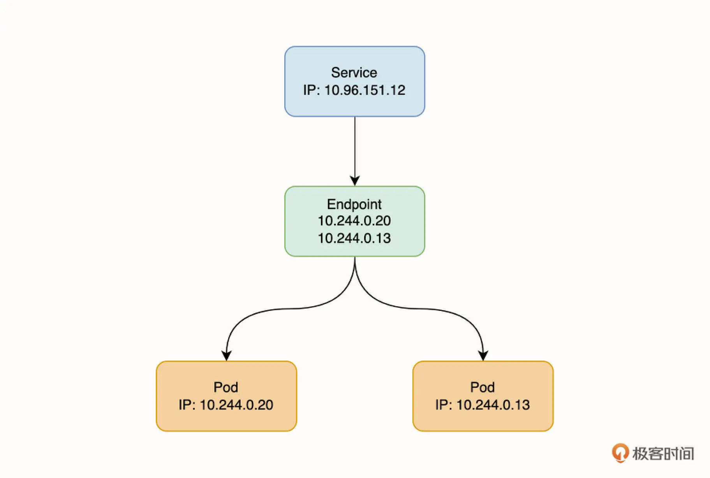
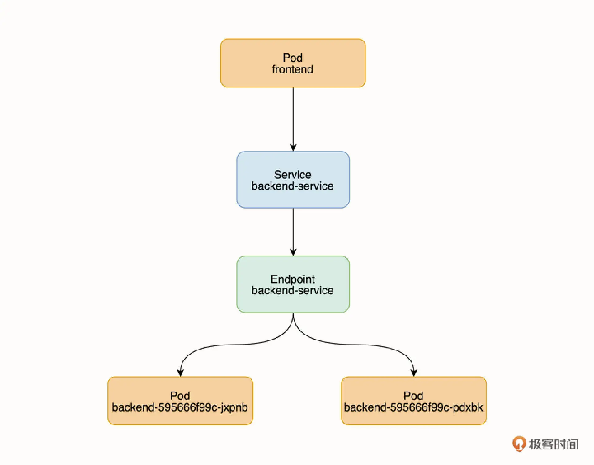

# 08 | K8s极简实战（三）：如何解决服务发现问题？

你好，我是王炜。

上一节课，我带你认识了 K8s 的几种工作负载，它们包括 Deployment、StatefulSet、DaemonSet、Job 和 CronJob。其中，Deployment 是我们在实际工作中最常用的一种工作负载类型。

现代业务应用发展至今，大部分系统都逐渐发展成为了大型的分布式微服务应用。每一个微服务各司其职，用户的一个请求往往需要由多个微服务之间相互调用才能够完成。当应用迁移到K8s 时，我们一般会将业务系统中的每一个微服务以某种 K8s 工作负载的形式进行部署，比如最常见的 Deployment。也就是说，在 K8s 环境下，微服务之间的调用可以理解为是工作负载之间的调用。

换句话说，在 K8s 环境下，微服务之间的调用实际上是 Pod 之间的调用。

要让 Pod 之间能够顺利相互调用，我们面临两个重要的挑战：

- Pod 之间如何找到对方？

- Pod 在重启、更新、销毁的过程中，如何确保 Pod 之间的调用不受影响？

这两个挑战实际上都可以归结为同一个问题，那就是服务发现。这节课，我们就来看看 K8s原生的服务发现机制：Service。

我还是从示例应用出发，重点向你介绍 Service 到底是如何帮助我们解决这两个问题的。Service 在实际的业务场景中出现的频率非常高，在将应用迁移到 K8s 的过程中，你也一定会用到这个对象。所以，我希望你能多花点时间来学习这节课。

在开始实践之前，你需要确保已经按照本章的第一讲“示例应用介绍”的引导在本地 Kind 集群部署了示例应用。

## Pod 之间如何通信？

### IP 地址通信

好了，接下来，请你回答一个问题。如果把 Pod 当做是运行业务进程的虚拟机，虚拟机之间要如何通信？

显然，如果虚拟机处于同一个 VPC 网络中，我们可以使用内网地址进行访问，如果不在同一个 VPC 网络下，我们则可以使用外网地址进行访问。

而在 K8s 里，每一个 Pod 就像虚拟机一样都拥有一个唯一的内网 IP 地址。通过 IP 地址，我们可以实现 Pod 之间的相互调用。

接下来，我们仍然以示例应用为例，进一步验证这个想法。

首先，我们获取示例应用后端服务 Pod 的 IP，它们位于 example 命名空间下，你可以使用kubectl get pod -o wide 命令来获取：

```
$ kubectl get pods --selector=app=backend -n example -o wide
NAME                       READY   STATUS    RESTARTS   AGE   IP            NODE
backend-595666f99c-6b92g   1/1     Running   0          14m   10.244.0.10   kind-
backend-595666f99c-ppnc4   1/1     Running   0          41s   10.244.0.13   kind-
```

从返回结果中，我们可以看到 Pod 的 IP 地址信息。为了验证 Pod 之间可以使用 IP 地址进行通信，我们尝试进入到前端服务的 Pod，然后通过 wget 来访问后端服务 Pod 的业务接口，以此来模拟前端服务请求后端服务的过程。你可以使用 kubectl exec 来获取前端 Pod 的容器终端：

```
$ kubectl exec -it $(kubectl get pods --selector=app=frontend -n example -o jsonp
/frontend # wget -O - http://10.244.0.10:5000/healthy
Connecting to 10.244.0.10:5000 (10.244.0.10:5000)
writing to stdout
{"healthy":true}
```

在上面的例子中，我们在前端容器里使用 wget 请求了 IP 为 10.244.0.10 的 Pod，也就是后端服务第一个 Pod backend-595666f99c-6b92g 的 healthy 接口。注意，因为在容器里 Python程序监听了 5000 端口，所以我们在请求的 IP 地址后面增加了端口号。

可以看到，返回的 JSON 为 {“healthy”:true} ，说明前端的 Pod 已经成功向 IP 为 10.244.0.10的后端 Pod 发起了请求。

你可能会问，既然 Pod 之间可以通过 IP 通信，那么我们是不是只需要在程序里面对需要调用的 Pod 的 IP 进行硬编码就可以了？然而并不是这样，我们接着往下看。

现在，我们首先使用 exit 命令退出前端 Pod 的终端，返回宿主机终端：

```
/frontend # exit
```

然后，我们使用 kubectl delete pod 来删除第一个 Pod backend-595666f99c-6b92g：

```sql
$ kubectl delete pods backend-595666f99c-6b92g -n example
pod "backend-595666f99c-6b92g" deleted
```

接下来，重新获取后端服务的所有 Pod：

```
$ kubectl get pods --selector=app=backend -n example -o wide
NAME                       READY   STATUS    RESTARTS   AGE   IP            NODE
backend-595666f99c-kfdmm   1/1     Running   0          42s   10.244.0.20   kind-
backend-595666f99c-ppnc4   1/1     Running   0          28m   10.244.0.13   kind-
```

我们会发现，在删除了第一个 Pod backend-595666f99c-6b92g 之后，ReplicaSet 重新创建了一个 Pod，名字是 backend-595666f99c-kfdmm。同时，IP 地址由原来的 10.244.0.10 变成了 10.244.0.20。

这说明 Pod 的 IP 是不稳定的，我们不能把 Pod IP 用作服务之间的调用地址。

那怎么才能解决这个问题呢？在解答这个问题之前，我想先请你回答一个问题：互联网域名除了好记、方便访问，还有什么功能？

对，就是 DNS 解析。我们知道，在访问一个域名的时候，DNS 服务器首先会解析 IP 地址，并且解析的 IP 地址我们是可以随时更换的。这么做的好处是，当我们做架构迁移尤其是当网关 IP 发生变化时，我们只需要用新的 IP 替换旧的 IP 地址就可以了。这样一来，用户永远只需要关注域名即可，不需要关注域名背后访问的是什么 IP 地址或哪台服务器。

再说回 K8s，那我们是不是也可以借鉴这种思想，在发出请求时不直接访问 Pod 的 IP，而是访问一个域名，然后将这个域名进一步解析成 Pod 的 IP，完成后续访问？答案是肯定的，它就是 K8s Service。

## Service：原生的服务发现机制

为了解决 Pod IP 不稳定的问题，Service 将一组来自同一个 ReplicaSet 创建的 Pod 组合在一起，并提供 DNS 的访问能力。也就是说，Pod 之间可以通过 Service 域名来进行访问，这种访问方式的好处是，无论 Service 背后一组的 Pod 如何变化，对于其他服务来说都是透明的，服务只需要关注访问 Service 即可，不用关心这个服务是由哪个 Pod 提供的。

这种集群内部的 DNS 能力非常重要，它除了能为我们提供稳定的访问能力，还能够提供负载均衡和会话保持的能力。Service 的工作原理如下图所示：



解释一下。Service 同样在集群内拥有唯一的 IP 地址，并且这个 IP 是稳定的。此外，Service本身并没有直接提供服务发现的能力，它需要借助 Endpoints 来实现。Endpoints 记录了一组Pod 的 IP 地址，Service 只需要查看自身所对应的 Endpoints 便能够找到具体的 Pod。

也就是说，无论 Pod 怎么变，Endpoints 都会实时更新它关联的 Pod IP，这样就实现了服务发现的功能。

借助 Service 的服务发现和稳定的 IP 地址能力，我们访问 Service IP 就相当于访问 Service所关联的 Pod。

### 示例应用：Service 示例

现在，我们回到示例应用。在“示例应用介绍”中，我们已经把前后端的 Service 部署到了集群，这里我以示例应用的后端 Service 为例，为你进一步介绍 Service。

首先，让我们来一起看一下 Service Manifest 的内容：

```bash
apiVersion: v1
kind: Service
metadata:
 name: backend-service
 labels:
   app: backend
spec:
 type: ClusterIP
 sessionAffinity: None
 selector:
   app: backend
 ports:
 - port: 5000
   targetPort: 5000
```

这里我们重点关注 selector 字段，这是一个 Pod 选择器，这个字段表示通过 Label 匹配Pod，也就意味着，只要是 Label 包含 app=backend 的 Pod ，都会被当成是 backend-service 的同一组逻辑 Pod。

还记得我们后端的 Deployment Manifest 吗？Deployment 定义的 Pod Label 和这里的selector Label 是对应的。这样，backend-service 就能够通过 Label 标签来匹配 backendDeployment 创建的所有 Pod 副本了：

```
apiVersion: apps/v1
kind: Deployment
metadata:
 name: backend
 ......
spec:
 ......
 template:
   metadata:
     labels:
       app: backend  # Pod Label 字段
```

现在，我们回到 Service ，在将 backend-service 应用到集群之后，我们可以得到一个Service 对象。

在 Service Manifest 中，type 字段代表 Service 的类型，ClusterIP 是我们在业务场景里面最常见的类型。此外，还有 NodePort 和 LoadBalancer 类型，我们会在后面再详细介绍。

sessionAffinity 字段代表的含义是会话保持，如果设置为 True，那么 Service 在转发请求时不再使用负载均衡方式，而是会通过客户端 IP 会话亲和性的方式来将请求转发到之前访问的Pod 上，通过这种方式来更好地适配一些要求保持会话的应用。

port 字段代表 Service 监听端口，targetPort 字段代表将请求转发到 Pod 时的目标端口。

### Endpoint 对象

除了 Service 对象以外，我们还提到了 Endpoints 对象。当我们在 Service 里使用 Pod 选择器时，我们并不需要主动去创建 Endpoints 对象。在创建 Service 之后，K8s 会自动帮助我们创建 Endpoint。

你可以通过 kubectl get Endpoints 来获取示例应用的 Endpoints 对象：

```
$ kubectl get endpoints -n example
NAME               ENDPOINTS                           AGE
backend-service    10.244.0.13:5000,10.244.0.20:5000   12h
frontend-service   10.244.0.16:3000,10.244.0.9:3000    12h
pg-service         10.244.0.8:5432                     12h
```

从返回结果我们可以发现，backend-service Endpoints 记录的 IP 正好是 backend Pod 的 IP地址，Endpoint 记录了 Pod 对象以及 IP 地址，下面是 backend-service Endpoint 的Manifest：

```bash
apiVersion: v1
kind: Endpoints
metadata:
 name: backend-service
 namespace: example
 ......
subsets:
 - addresses:
     - ip: 10.244.0.20
       targetRef:
         kind: Pod
         namespace: example
         name: backend-595666f99c-pdxbk
         ......
     - ip: 10.244.0.13
       targetRef:
         kind: Pod
         namespace: example
         name: backend-66b9754d65-jxpnb
         ......
   ports:
     - port: 5000
       protocol: TCP
```

### Service IP

现在，我们知道了 Service IP 是稳定的，并且它能为我们抽象一组 Pod 实现负载均衡。这就意味着我们只需要访问 Service IP 就可以找到对应的 Pod。所以接下来，我们来验证一下这个猜想。

首先，我们获取示例应用的后端 Service IP 地址：

```
$ kubectl get service -n example
NAME               TYPE        CLUSTER-IP      EXTERNAL-IP   PORT(S)    AGE
backend-service    ClusterIP   10.96.151.12    <none>        5000/TCP   12h
frontend-service   ClusterIP   10.96.173.32    <none>        3000/TCP   12h
pg-service         ClusterIP   10.96.191.239   <none>        5432/TCP   12h
```

从返回结果我们可以得知，backend-service 的 IP 地址是：10.96.151.12，接下来我们尝试在前端 Pod 内部访问这个 IP。

首先，进入示例应用的前端 Pod 容器终端：

```
$ kubectl exec -it $(kubectl get pods --selector=app=frontend -n example -o jsonp
/frontend #
```

接下来，使用 wget 请求示例应用后端的 /host_name 接口，这个接口将会返回 Pod 的名称：

```
/frontend # while true; do wget -q -O- http://10.96.151.12:5000/host_name && slee
{"host_name":"backend-595666f99c-pdxbk"}
{"host_name":"backend-595666f99c-jxpnb"}
{"host_name":"backend-595666f99c-pdxbk"}
{"host_name":"backend-595666f99c-jxpnb"}
```

上面的代码会以 1 秒钟 1 次的频率请求后端 Pod /host_name 接口，并打印后端接口的返回内容。在这个请求里面，我们还指定了 Service 监听端口 5000，你可以使用 ctrl+c 中断循环请求。

从返回结果可以看出，对 Service IP 的请求被转发到了后端的每一个 Pod，Pod 名字交替出现，说明负载均衡也是正常工作的。

到这里，你可能认为 Service 的任务已经完成了，但其实这离能够实际使用还差最后一步。

### Service 域名

因为，我们在写业务代码的时候是不知道被调用的 Service IP 的地址的，我们只有将 Service部署到集群才能知道它。 此外，如果删除了 Service 重建，IP 地址也将会出现变化。最后，当我们将 K8s 对象从 A 集群迁移到 B 集群时，Service IP 也会产生变化。这些问题会让Service IP 变得不可预测，最终使得我们在编码阶段没办法使用 Service。

这时候，我们就需要一个跟 IP 无直接关系的访问方式，那就是 Service 域名。

让我们回到这段 Service Manifest 内容：

```bash
apiVersion: v1
kind: Service
metadata:
 name: backend-service
 labels:
   app: backend
spec:
 type: ClusterIP
 selector:
   app: backend
 ports:
 - port: 5000
   targetPort: 5000
```

在这段 Service Manifest 内容里，我们将这个 Service 命名为了 backend-service，实际上这就是 Service 的域名。

在第 6 讲的跨命名空间通信的内容里我们提到，Service 在 K8s 集群内有自己独立的域名，完

```
整的格式是：{$service_name}.{$namespace}.svc.cluster.local。在示例应用的
例子中，backend-service 完整的域名是：backend-
service.example.svc.cluster.local。接下来我们在前端 Pod 容器终端里验证这个
```

猜想。

```
/frontend #while true; do wget -q -O- http://backend-service.example.svc.cluster.
{"host_name":"backend-595666f99c-jxpnb"}
{"host_name":"backend-595666f99c-pdxbk"}
{"host_name":"backend-595666f99c-pdxbk"}
{"host_name":"backend-595666f99c-jxpnb"}
```

从返回结果我们会发现，访问 Service 域名和 Service 的 IP 效果是一样的，最终 backend 服务的 Pod 都能收到我们发起的请求，Pod 和 Service 的请求链路如下图所示：



实际上，当请求发起方和目标 Service 在同一个命名空间下时，我们可以省略namesapce.svc.cluster.local，也就是说，只需要请求 Service 的全称即 backend-service 就可以了，你可以在 frontend Pod 里面继续验证：

```
/frontend #while true; do wget -q -O- http://backend-service:5000/host_name && sl
{"host_name":"backend-595666f99c-jxpnb"}
{"host_name":"backend-595666f99c-pdxbk"}
{"host_name":"backend-595666f99c-pdxbk"}
{"host_name":"backend-595666f99c-jxpnb"}
```

Service 的这种特性可以为我们提供可预测且不变的请求 URL，无论 Pod 怎么变化，Service总是能为我们提供服务发现和负载均衡机制。

总结来说，访问 Service 有下面这两种方式：

- 如果请求方和被请求的 Service 处于同一个命名空间，那么请求 URL 就等于 Service 名称；

- 如果请求方和被请求的 Service 不在一个命名空间下，那么请求 URL 等于

```
{$service_name}.{$namespace}.svc.cluster.local 或 {$service_name}.
{$namespace}。
```

## Service 的类型

在上面的例子中，我们创建的 Service 是最常用的 ClusterIP 类型，ClusterIP 类型会为Service 创建一个 VIP，并且提供集群内访问的能力。

之前我也有提过，Service 的类型除了 ClusterIP 以外，还有 NodePort、ExternalName 和Loadbalancer，下面我们分别介绍一下。

### NodePort

NodePort 可以将 Service 暴露在 K8s 的每一个节点的端口上，通过这种方式，你可以使用节点 “IP+ 端口号”的形式来访问服务。

不过，由于这种暴露方式会侵入到节点，并且还需要配置的端口在节点上没有被占用，所以我并不推荐这种 Service 暴露方式，我们在实际工作中也一般不会使用这种方式。

### Loadbalancer

Loadbalancer 是一种通过负载均衡器来暴露 Service 的方法，通过这种暴露方式，Service 会和云厂商的负载均衡器连接起来，使得 Service 可以通过负载均衡器提供的外网 IP 来进行访问。

对于业务服务，我不推荐你直接使用 Loadbalancer 来暴露服务。首先，因为 Loadbalancer具备独立的 IP 地址，所以云厂商通常会按照“时长 + 流量”的方式计费，这会带来高昂的成本。其次，一个 K8s 集群内通常会有多个业务 Service 需要暴露，所以这种方式会开通多个负载均衡器实例，这是没有必要的。

在实际的业务中，我们通常会在集群内安装一个入口网关，例如 Ingress-nginx，它会自带一个 Loadbalancer 类型的 Service，然后由 Ingress-nginx 来统一接收外部请求，并将请求转发到集群内部。我们只需要配置域名或路径规则即可实现一个 Loadbalancer IP 暴露集群所有Service 的效果。这种服务暴露方式后面还会详细介绍。

### ExternalName

ClusterIP、NodePort 和 Loadbalancer 类型都是通过 Pod 选择器将 Service 和 Pod 关联起来，然后将请求转发到对应的 Pod 中的。而 ExternalName 类型非常特殊，它不通过 Pod 选择器关联 Pod ，而是将 Service 和另外一个域名关联起来。下面是一个 ExternalName 类型的Service Manifest 的例子：

```
apiVersion: v1
kind: Service
metadata:
 name: backend-service
 namespace: default
spec:
 type: ExternalName
 externalName: backend-service.example.svc.cluster.local
```

当将上面的 Service 应用到集群之后，在 default 命名空间下访问 http://backend-serivce:5000 时，请求将会被转发到 example 命名空间下的 backend-service。我们会发现虽然目标 Service 和请求发起方不在同一个命名空间下，但可以通过这种方法屏蔽它们在不同命名空间的调用差异，使得两个服务看起来像是在同一个命名空间下。

此外，当我们需要通过 Service 名称的方式请求外部服务时，例如请求在集群外的数据库服务，也可以使用这种方法。

## 总结

在这节课中，我主要为你介绍了 K8s 环境下服务之间是如何进行调用的。通过 Pod IP 的方式调用服务存在一些无法解决的问题，例如 Pod IP 无法在编码阶段提前预知，Pod 更新镜像、驱逐和重新调度都会导致 Pod 重启，进而导致 IP 出现变化，通过 Service DNS 则可以完美地解决服务发现和服务间访问的问题。

通过本节课的实验，我们知道了在创建 Service 对象之后，同时也会创建 Endpoint 对象，它也是 Service 实现服务发现的关键。Service 同样拥有自己在集群内部的 IP 地址，在进行服务之间的调用时，我们推荐使用 Service。

在实际的业务场景中，Service 的域名写法一共有三种，当请求服务与被请求的 Service 在同一个命名空间下时，可以直接使用 Service 名称。当请求服务与被请求 Service 不在同一个命

```
名空间下时，可以使用 Service 的全称 {$service_name}.
{$namespace}.svc.cluster.local 或者 {$service_name}.{$namespace} 来请
```

求。

最后，我们还简单介绍了服务暴露的一些知识点，这里你只要了解一下就可以了，后面还会有更详细的介绍。

## 思考题

最后，给你留一道思考题吧。

在一些场景下，我们需要通过以 Service 的方式来访问一个外部 IP 地址，例如从 K8s 集群内以 Service 的方式访问外部数据库 IP，请你尝试写出对应的 Service 和 Endpoint。

提示：Service 的类型为 clusterIP，clusterIP 字段值可以为 None，Endpoint 的 addresses 数组下需要一个包含数据库 IP 字段的数组。

欢迎你给我留言交流讨论，你也可以把这节课分享给更多的朋友一起阅读。我们下节课见。
