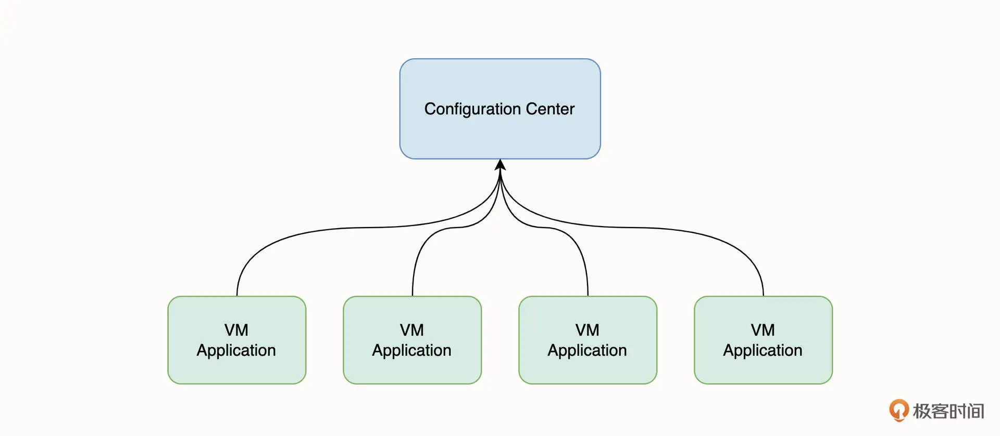
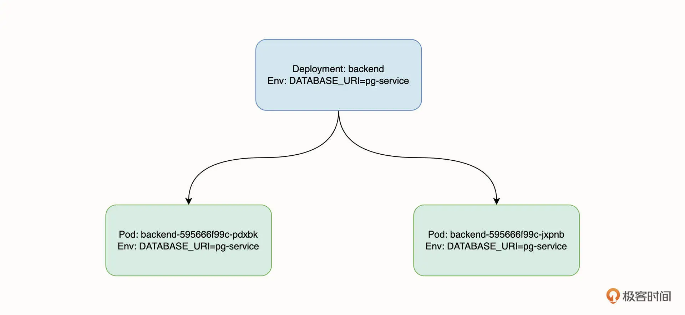
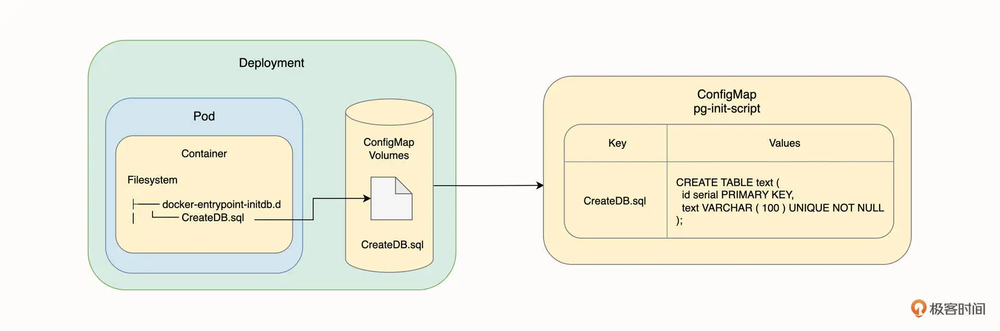

# 09 | 如何迁移应用配置？

你好，我是王炜。

上一节课，我们学习了如何使用 Service 来解决应用的服务发现问题。通过 Service URL，我们可以非常方便地进行服务之间的调用，还能够获得多副本负载均衡的能力。

除了服务发现，在实际的项目中，业务应用要想顺利启动往往还需要一些特殊的环境变量或者一份配置文件，例如记录了数据库连接信息、所依赖的微服务 URL、第三方应用的凭据信息的配置文件。

在应用迁移到 Kubernetes 的过程中，这些配置信息是必不可少的，如何对这些配置信息进行管理以及如何让应用顺利读取到配置信息是一个关键问题。

在这节课，我们就来看看 Kubernetes 应用读取配置信息的最佳实践。我们还是从示例应用出发，看看 Kubernetes 的 Env、ConfigMap 和 Secret 到底是如何解决应用的配置问题的。

在课程正式开始之前，你需要确保已经按照第 5 讲的引导在本地 Kind 集群部署了示例应用。

## 如何管理配置？

Kubernetes 环境下如何管理应用配置呢？在回答这个问题之前，我先提一个问题。当业务没有进行容器化，也没有迁移到 Kubernetes 的时候，配置都是怎么管理的？

这个问题的答案可能是非常多样的，不过大致可以总结为以下两种方式：

- 以配置文件的形式和业务代码一并存储；

- 利用配置中心存储应用配置。

其中，配置文件是一种静态的配置管理方式，这种管理方式在小型业务中比较常见。我们一般会将配置文件放在虚拟机的某个目录下，这类型的业务虚拟机数量一般较少，完全可以通过配置文件和手工管理的方式来实现。

但随着业务增长，尤其是当虚拟机从几台增长到几十上百台之后，配置文件的管理方式在灵活性方面就有所不足了。例如当我们需要更新业务应用时，需要同时修改所有虚拟机的配置文件，这种做法在配置热更新、审计和容灾方面有明显的缺陷。

为了解决上面这些问题，中大型的应用一般会采用配置中心管理配置。配置中心是一种运行时的动态配置管理方式，使用这种方式，配置文件并不会像第一种方式一样和业务一起打包，配置信息会被存储在一套外部的中心系统上。这种方式在配置管理上非常灵活，但从架构上来看也引入了更多的复杂性。配置中心和业务应用的架构如下图所示：



这张架构图代表了一种典型的场景，当业务应用启动后，它将主动连接到配置中心并且拉取配置信息，同时具备配置热更新的能力。

现在我们继续回到容器化的应用上。

类比第一种“以配置文件的形式和代码一并存储”的方案，我们要想让业务应用能在容器里读取到配置文件，容易想到的最简单的方式是，构建镜像时一并将配置文件拷贝到镜像里。这样在Pod 启动后，容器里自然会有一份配置文件以供载入业务进程。例如，我们可以在 Dockerfile中使用 COPY ，将 config.conf 配置文件复制到镜像内：

```
# syntax=docker/dockerfile:1
FROM python:3.8-slim-buster
......
WORKDIR /app
......
COPY config.conf config.conf  # 复制配置文件到镜像
......
CMD [ "python3", "-m" , "flask", "run", "--host=0.0.0.0"]
```

因为所有 Pod 都使用同一个镜像，所以它们自然都能读取到配置文件。但这是最佳实践吗？答案是否定的，为什么不建议这么做呢？我认为有三个原因。

首先，镜像往往代表的是一个业务进程，也就是说，只有当我们修改了业务的源码后，才有必要重新构建镜像。而配置文件一般并不会经常变更，所以我们也没必要将相对固定的配置文件一并复制到容器里。

其次，当配置文件被修改后，我们往往会希望配置能够尽快生效，而重新构建镜像、推送镜像以及更新 Pod 镜像版本的过程较长，很难满足我们对配置文件更新时效上的诉求。

最后，也是最重要的一点，配置文件里面记录的一般是和运维相关的机密信息，这些信息不应该向开发者暴露，这很容易导致安全问题。

所以，我们非常有必要将镜像和配置信息进行解耦。

既然在解耦后镜像内并没有这份配置文件，那我们是不是可以参考之前提到的第二种“配置中心”的动态方案呢？也就是我们在 Pod 启动时将必要的信息“动态注入”到容器里，这样是不是就实现了配置中心的效果呢？

是的，Kubernetes 为我们提供了环境变量、ConfigMap 和 Secret 来帮助我们解决业务应用的配置问题。同时，这也是管理应用配置信息最常用的方式。为了帮助你理解，我们把它们都比作是 Kubernetes 的“应用配置中心”。

## Kubernetes “应用配置中心”

接下来，我将继续以实战应用为例，介绍 Kubernetes 应用配置的三种方案。它们分别是：

- Env 环境变量

- ConfigMap

- Secret

其中，Env 可以向 Pod 注入环境变量，使得业务应用在容器内可以直接读取它们。ConfigMap经常用于为 Pod 注入配置文件，例如 ini、conf、.env 配置文件等。Secret 一般用来向 Pod 注入机密信息，例如第三方应用的 Token 等。

现在，我们先来学习最简单的配置方式，Env 环境变量。

### Env

环境变量是一种很常见的应用读取配置的方式，在非容器化应用的场景下，我们一般会为虚拟机配置环境变量以便业务程序进行读取。在 Kubernetes 环境下，业务进程是运行在容器里的，所以我们需要为容器设置环境变量，这样就可以实现同样的效果了。

此外，由于容器是由 Pod 管理的，而我们在实际项目中又不会直接使用到 Pod ，我们使用的是更上层的工作负载，例如 Deployment。所以，要为 Pod 配置环境变量，就变成了为上层的工作负载例如 Deployment 配置环境变量。

接下来，我以示例应用的后端服务 backend 为例，进一步解释环境变量的配置方法。下面是backend Deployment Manifest 的部分内容：

```
apiVersion: apps/v1
kind: Deployment
metadata:
 name: backend
 ......
spec:
 replicas: 1
 ......
   spec:
     containers:
     - name: flask-backend
       image: lyzhang1999/backend:latest
       imagePullPolicy: Always
       ports:
       - containerPort: 5000
       env:
       - name: DATABASE_URI
         value: pg-service
       - name: DATABASE_USERNAME
         value: postgres
       - name: DATABASE_PASSWORD
         value: postgres
```

注意一下 Containers 下的 Env 字段。在这段 Manifest 中，我们为 flask-backend 容器配置了三个环境变量，分别是 DATABASE_URI、DATABASE_USERNAME 和DATABASE_PASSWORD，它们分别代表数据库连接地址、账号和密码。

接下来，我们使用 kubectl exec 进入到其中一个后端服务的容器终端进行验证：

```
$ kubectl exec -it $(kubectl get pods --selector=app=backend -n example -o jsonpa
# env | grep DATABASE
DATABASE_URI=pg-service
DATABASE_USERNAME=postgres
DATABASE_PASSWORD=postgres
```

我们发现， backend 容器内新增了对应的环境变量，同时值也符合预期，说明环境变量配置成功。

在为 backend Deployment 工作负载配置好环境变量后，它管理的所有 Pod 都会被注入相应的环境变量信息，不管是触发弹性伸缩创建新的 Pod 或者 Pod 被重启时，这些 Pod 的环境变量都将保持一致。下图表示的是 Deployment 和 Pod 环境变量的从属关系：



在上面这个例子中，Pod 内的环境变量 DATABASE_URI 的值是 pg-service，它代表的是Postgres 数据库的连接地址。还记得我们在上一讲提到的 Service URL 吗？因为数据库和后端服务在同一个命名空间下，所以这里的 pg-service 也就是 Service 的名称。当然你也可以使用全称：pg-service.example.svc.cluster.local。

当容器内有这个环境变量之后，业务代码就可以直接读取了。这里以示例应用的 Python 后端app.py 为例：

```python
import os
db_uri = os.environ.get('DATABASE_URI')
```

在实际的项目中，我们可能需要配置多个环境变量，由于实际上 Env 是一个数组类型，所以你完全可以在 Deployment 的 Manifest 里为 Pod 配置多个环境变量。

Env 的配置方式兼容了一些业务应用需要读取特定环境变量的情况，当我们想要将这些类型的应用容器化并迁移到 Kubernetes 中时，就可以使用这种方式提供环境变量。而且，这对业务来说也没有任何侵入性，是一种值得推荐的配置管理方式。

这么看，Env 环境变量是不是有一点像我们前面介绍的配置中心的例子呢？在这里，所有 Pod的环境变量事实上都是从 Deployment 工作负载的 Env 字段继承的，我们在 Deployment 里申明的 Env 字段，就像是一个中心化的配置中心，负责对它自身管理的所有 Pod 下发配置。当我们要修改环境变量时，只需要修改 Deployment 的 Env 字段，就可以更新所有 Pod 的环境变量了。

### ConfigMap

虽然 Env 可以为 Pod 配置环境变量，但在实际的场景中，有一些业务应用并不是从环境变量读取配置信息，而是以文件的形式载入配置。在这种场景下，环境变量显然是不适用的。

这时，用 ConfigMap 就非常适合了。

ConfigMap 是一种类似于配置中心的“运行时”动态配置管理方式，它能够在 Pod 启动时，将ConfigMap 的内容以文件的方式挂载到容器里，这样，业务进程就能够顺利读取配置文件信息了。

现在，我们先回到示例应用的数据库，也就是 Postgres Deployment。

在介绍示例应用时我们有提到过，在示例应用的首页输入的任何内容，实际上都会保存在数据库中。那么，你一定会非常好奇这个数据库的表结构和字段是怎么被初始化的呢？

实际上，示例应用的数据库就使用了 ConfigMap，它将一段初始化表结构的 SQL 以文件的方式挂载到了容器内部的一个特殊的路径上，Postgres 在启动时会自动运行该目录的 SQL 来初始化表结构。

接下来，我以示例应用的数据库为例，带你进一步学习 ConfigMap 和它的使用方法。在部署示例应用时，我们已经部署了一个名为 pg-init-script 的 ConfigMap 到集群中。你可以使用kubectl get 命令获取这个 ConfigMap 的内容：

```sql
$ kubectl get configmap pg-init-script -n example -o yaml
apiVersion: v1
kind: ConfigMap
metadata:
 name: pg-init-script
 ......
data:
 CreateDB.sql: |-
   CREATE TABLE text (
       id serial PRIMARY KEY,
       text VARCHAR ( 100 ) UNIQUE NOT NULL
   );
```

这段 ConfigMap 主要描述了两个重要的信息。首先，ConfigMap 的名称为 pg-init-script，它是这段 ConfigMap 名称标识。其次，data 字段指定了 Key 和 Value 键值对，在这个例子中，CreateDB.sql 实际上是 Key，Value 值是一段 SQL 代码，这段 SQL 代码非常简单，它创建一个 text 表，并定义了 id 和 text 字段。

这段 ConfigMap 其实就可以认为是业务的配置文件，当我们将这段 ConfigMap 应用到集群之后，就可以在工作负载中进行引用了。引用的方式可以参考示例应用 Postgres Deployment：

```
apiVersion: apps/v1
kind: Deployment
metadata:
 name: Postgres
 ......
spec:
 ......
 template:
   ......
   spec:
     containers:
     - name: Postgres
       image: Postgres
       volumeMounts:
       - name: sqlscript
         mountPath: /docker-entrypoint-initdb.d
       ......
     volumes:
       - name: sqlscript
         configMap:
           name: pg-init-script
```

要在工作负载引用 ConfigMap，我们需要用到工作负载的 Volumes ，也就是卷的机制。

这里请你重点关注两个字段，分别是 volumes 字段和 volumeMounts 字段。volumes 字段代表的含义是以卷的方式使用 pg-init-script ConfigMap，并将卷命名为 sqlscript。volumeMounts 字段和 volumes 一般成对出现，代表的含义是将 sqlscript 卷挂载到容器的/docker-entrypoint-initdb.d 目录。

通过这种方式，我们声明的 ConfigMap 内容将以文件的方式挂载到容器内。具体到这个例子中，容器的 /docker-entrypoint-initdb.d 目录将会出现 CreateDB.sql 文件，内容是 ConfigMap的 SQL 语句，这个文件是通过 ConfigMap 挂载的方式“动态注入”到容器内的。

为了更好地帮助你理解，我为你画了一张 Deployment、Volumes 和 ConfigMap 之间的架构图，供你参考：



从架构图中我们知道，容器内部的文件系统的 CreateDB.sql 来自于我们在 Deployment 声明的 Volumes，而 Volumes 的文件内容又来自于 ConfigMap。

接下来我们进入 Postgres 容器来查看 CreateDB.sql 文件的内容，验证这个文件的内容是否和ConfigMap 的内容一致。你可以使用 kubectl exec 命令进入到 Postgres Deployment 的容器内部，并使用 ls 和 cat 命令来查看文件及其内容：

```sql
$ kubectl exec -it $(kubectl get pods --selector=app=database -n example -o jsonp
# ls  /docker-entrypoint-initdb.d
CreateDB.sql
# cat /docker-entrypoint-initdb.d/CreateDB.sql
CREATE TABLE text (
   id serial PRIMARY KEY,
   text VARCHAR ( 100 ) UNIQUE NOT NULL
);
```

通过返回结果我们可以得出结论，ConfigMap 的内容已经被挂载为文件，它的内容也符合我们的预期。所以，当 Postgres 工作负载启动后，SQL 语句将被自动运行，数据表结构也会被初始化。

需要注意的是，自动初始化 SQL 只是 Postgres 镜像的行为，并且 /docker-entrypoint-initdb.d目录也是 Postgres 镜像约定的用于存放自动初始化 SQL 的目录位置。

最后，我们来总结一下 ConfigMap 的特性和使用场景。ConfigMap 和之前提到的配置中心也非常类似，在声明 ConfigMap 配置之后，在工作负载中也可以将它以文件的方式挂载到 Pod的文件系统中。此外，以文件挂载的方式使用 ConfigMap 也支持热更新，这就意味着更新配置不需要重启 Pod 就能实时生效了。

所以，当业务应用需要配置文件的时候，ConfigMap 应当是我们的首选类型。

### Secret

再来看最后一种配置方案：Secret。

Secret 顾名思义是密钥的意思，它主要用来保存一些应用的机密信息。Secret 和 ConfigMap非常相似，它也能够以文件的形式挂载到容器内部，为业务应用提供配置文件。但它在内容形式上与 ConfigMap 有所不同，ConfigMap 是明文保存，Secret 是加密的。

Secret 的加密能力相对薄弱，它是以 Base64 来加密内容的，在实际的业务中使用场景也比较有限。不过由于它是一个独立对象类型，所以可以很方便地对一些“机密”的配置信息做权限控制，并且 Kubernetes 也是使用 Secret 来存储镜像拉取凭据的，所以我们还是需要简单了解Secret 的使用方法。

接下来，我们来尝试将 pg-init-script ConfigMap 修改为 Secret 类型，并在 PostgresDeployment 中引用 Secret，在这个过程中学习使用 Secret 类型。

要将 pg-init-script ConfigMap 修改为 Secret 非常简单，只需要将 Kind 类型修改为 Secret，并将 Data 的 Value 值进行 Base64 编码即可：

```
apiVersion: v1
kind: Secret
metadata:
 name: pg-init-script
 namespace: example
type: Opaque
data:
 CreateDB.sql: |-
   Q1JFQVRFIFRBQkxFIHRleHQgKAogICAgaWQgc2VyaWFsIFBSSU1BUlkgS0VZLAogICAgdGV4dCBWQ
```

接下来，我们将上面的内容保存为 secret.yaml 文件，并使用 kubectl apply -f 应用到集群内：

```
$ kubectl apply -f secret.yaml
secret/pg-init-script created
```

然后，使用 kubectl edit 直接编辑集群内的 Postgres Deployment 工作负载，将 volumes 字段从原来引用 ConfigMap 修改为从 Secret 引用，SecretName 为 pg-init-script：

```
$ kubectl edit deployment postgres -n example
......
volumes:
 - secret:
     secretName: pg-init-script
   name: sqlscript
......
```

注意，通过 kubectl edit deployment 修改工作负载时，在 Mac 和 Linux 环境下会进入 VIM 编辑器。你需要输入“i” 进入编辑模式，修改完成后，按下 “ESC” 退出编辑模式，输入“:wq” ，保存后退出。此时，修改会实时提交到 Kubernetes 集群。而在 Windows 环境下则将会弹出记事本，你可以编辑内容，保存后即可生效。

此时，我们重新进入 Postgres 容器，验证一下是不是已经把 Secret 挂载到了文件系统：

```sql
$ kubectl exec -it $(kubectl get pods --selector=app=database -n example -o jsonp
# ls docker-entrypoint-initdb.d
CreateDB.sql
# cat /docker-entrypoint-initdb.d/CreateDB.sql
CREATE TABLE text (
   id serial PRIMARY KEY,
   text VARCHAR ( 100 ) UNIQUE NOT NULL
);
```

从 cat 命令返回的内容我们可以确认，在将 Secret 挂载为文件时，Kubernetes 自动将 Secret进行了 Base64 解码操作，这种方式和使用 ConfigMap 挂载文件的效果是一样的。

在上面的案例中，我们使用的 Secret 是 Opaque 类型，它是一种常用于业务应用 Base64 编码的类型。此外，Secret 还有下面两种类型。

- kubernetes.io/dockerconfigjson ：可供存储 Docker Registry 私有仓库信息，用于为Kubernetes 提供镜像拉取凭据，当我们使用私有镜像仓库时，需要创建此类型的 Secret。

- kubernetes.io/service-account-token ：可供工作负载的 Service Account 引用。

其中，kubernetes.io/dockerconfigjson 类型的 Secret 我们在后续搭建私有镜像仓库时还会进一步介绍，而说到 kubernetes.io/service-account-token 类型，普通的业务应用几乎不会用到，所以稍作了解即可。

## 总结

好了，这节课，我们学习了如何在 Kubernetes 环境下为业务应用提供配置。在实际工作中，为了将业务和配置解耦，增强应用的可移植性和安全性，我们并不推荐将配置文件和业务一起打包到镜像中，而是建议通过 Env、ConfigMap 和 Secret 来为业务提供配置信息。

其中，Env 可以为 Pod 提供环境变量，它以键值对的方式注入 Pod，对于需要从环境变量读取配置信息的业务应用来说，这是非常有效的。

而对于需要读取配置文件的业务，我们推荐将配置文件内容写入到 ConfigMap，并在工作负载中以文件的方式将 ConfigMap 挂载到 Pod 的文件系统内，以此来为业务提供配置。ConfigMap 的内容可以是键值对，也可以是纯文本内容，无论你的业务应用配置文件是什么格式，理论上来说都适用。

使用 ConfigMap 的优点是，它可以作为唯一的配置信息来源，我们管理起配置来非常方便。此外，ConfigMap 还支持热加载，对业务应用非常友好。

最后关于 Secret，我们一共介绍了三种类型。其中 Opaque 类型是业务应用比较常用的，实际上它在使用的时候和 ConfigMap 并没有太大的差异，只是 Secret 的内容是 Base64 编码的。而 kubernetes.io/dockerconfigjson 类型可以为 Kubernetes 提供私有仓库拉取镜像的凭据，我们后面的课程还会进行介绍。

## 课后题

最后，给你留两道课后题吧。

1. 为 Deployment 指定 Env 环境变量除了通过声明单个键值对以外，还可以引用ConfigMap。请你查阅相关资料，结合本节课所学的内容，尝试写出对应的 ConfigMap 和Deployment 样例。（提示：Deployment 的 envFrom 字段。）

2. 对于一些复杂的业务应用的配置文件，手动将内容迁移到 ConfigMap 可能并不容易，请你查阅相关资料，并尝试使用 kubectl create configmap --from-file 从已有的配置文件创建ConfigMap。（提示：你可以通过 kubectl create configmap --help 来获得一些示例信息。）

欢迎你给我留言交流讨论，你也可以把这节课分享给更多的朋友一起阅读。我们下节课见。
