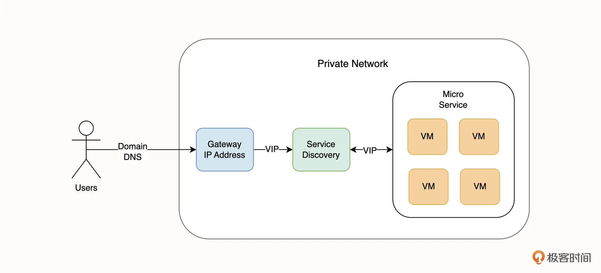
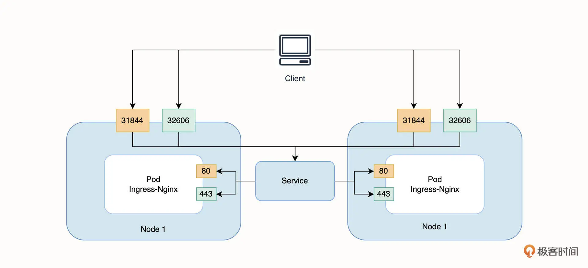
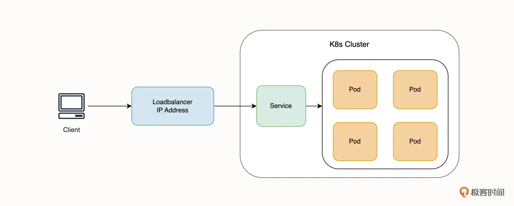
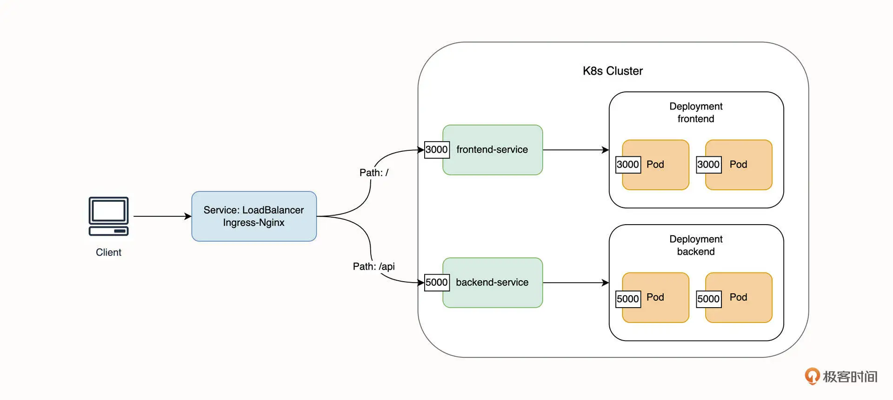

# 10-K8s极简实战（五）：如何将集群的业务服务暴露外网访问？

你好，我是王炜。

上一节课，我们学习了 Env、ConfigMap 和 Secret 三种管理应用配置的方法，了解了它们的适用场景。

当我们将应用顺利迁移到 Kubernetes 之后，接下来我们面临的第一个问题是，用户如何访问集群内部的业务服务呢？因为无论是 Pod 还是 Service，它的 IP 地址都是集群内的虚拟 IP 地址，也叫做 VIP，它实际上是一个内网 IP 地址，只能提供集群内的访问能力，并不能在公网环境下进行访问。

这节课，我们先来温习一下传统应用暴露公网的方式，然后结合示例应用，进一步学习如何对外暴露 Kubernetes 集群内的应用服务。

在开始之前，你需要确保已经按照第 5 讲“示例应用介绍”的引导在本地 Kind 集群部署了示例应用。

## 传统应用的服务暴露

我们先来回顾一下传统的微服务应用是如何对外暴露的。

一般来说，一个典型的微服务应用在系统的最外层会使用网关或者负载均衡器作为系统的入口，然后，根据路由规则和服务发现机制将流量转发到实际的后端微服务中（一般是业务进程所在的虚拟机上）。整体架构如下图所示。



在这个典型的微服务架构中，网关是系统唯一的入口。它将通过一个外网 IP 暴露业务系统，除了网关以外，整个业务系统的所有服务都在私有网络下，彼此通过 VIP 进行通信，外部无法访问除了网关以外的任何服务。通常，由于用户访问业务系统一般是使用域名，所以在网关前面还会有 DNS 解析步骤。

显然，在这种架构体系下，对外暴露业务只需要赋予网关服务一个公网 IP 地址就可以达到目的了。

## Kubernetes 服务暴露

那么，在 Kubernetes 里面有没有类似的机制呢？结合 Kubernetes Service 对象，如果我们能赋予 Service 一个公网 IP，是不是就可以暴露 Service 选择器所关联的 Pod 了呢？

这个思路完全正确，但我们怎么才能让 Service 获得一个公网 IP 呢？

在回答这个问题之前，我想先请你回想一下第 8 讲的内容。在讲解如何解决服务发现问题时，我有提到过 Service 的两种类型，我有提到过 Service 的两种类型，分别是 NodePort 和Loadbalancer。这两种类型都可以为 Service 赋予公网 IP。

接下来，我们深入了解一下这两种 Service 类型。

### NodePort

当 Service 被配置为 NodePort 类型之后，Kubernetes 会在每一个节点上监听指定的端口（一般是 30000-32767），当通过节点的公网 IP + 端口号的形式访问时，请求会被转发到对应的Service 当中。你可以理解为，NodePort 类型可以直接让 Service 在节点层面对外暴露。

在之前部署示例应用时，我们在本地为 Kind 集群安装了 Ingress-Nginx 组件，在 Kind 环境下，这个组件其实就是通过 NodePort 的方式暴露的。你可以通过 kubectl get service 来获取Ingress-Nginx 的 Service Manifest。

```bash
$ kubectl get service ingress-nginx-controller -n ingress-nginx -o yaml
apiVersion: v1
kind: Service
metadata:
 ......
 name: ingress-nginx-controller
 namespace: ingress-nginx
spec:
 ......
 ports:
 - appProtocol: http
   name: http
   nodePort: 31844
   port: 80
   protocol: TCP
   targetPort: http
 - appProtocol: https
   name: https
   nodePort: 32606
   port: 443
   protocol: TCP
   targetPort: https
 selector:
   app.kubernetes.io/component: controller
   app.kubernetes.io/instance: ingress-nginx
   app.kubernetes.io/name: ingress-nginx
 type: NodePort
```

在这段 Manifest 内容中，我们重点关注 Selector 字段，还有 Ports 字段下的 NodePort、Port 和 TargetPort。

Selector 是选择器，它将匹配 Pod 模板里的 Labels，作用是抽象一组 Pod 服务并将流量在这些 Pod 中做负载均衡。

Ports 字段下定义了两个数组。

第一个数组中的 Port 字段代表 Service 的访问端口，你可以理解为，是 Service 在集群内部的暴露端口。TargetPort 表示目标端口，作用是告诉 Service 将请求转发到 Pod 的哪个端口，你可以理解为，是业务进程在容器里的监听端口。显然 Nginx 在容器内的监听端口是 80。最后也是最重要的 NodePort 字段，它表示需要将服务暴露在 Kubernetes 节点的什么端口，这里具体的含义是将服务暴露在 Kubernetes 节点的 31844 端口上。

同理，Ports 的第二个数组也是代表类似的含义。

最后，这段 Service Manifest 实现的效果是，访问 Kubernetes 任何一个节点的公网IP+31844 端口或 32606 端口，请求流量都会被转发到 Ingress-Nginx Pod 的 80 端口或 443端口上。



NodePort 的暴露方式虽然可以直接复用 Kubernetes 节点的公网 IP，但我并不推荐你在生产环境使用它。主要的原因有两个。

首先，直接对外暴露服务不利于统一管理外部请求流量。

其次，一个端口只能绑定一个服务，并且默认的端口范围是有限的，所以在较大规模场景时使用容易产生端口冲突。如果你希望临时访问集群内的业务服务，建议你使用端口转发进行访问，它适用于大多数的临时场景。

### Loadbalancer

除了 NodePort 类型， Loadbalancer 类型也可以对外暴露 Service 服务，也就是我们常说的负载均衡器类型。

Loadbalancer 类型一般依赖于云厂商实现。当 Service 被声明为负载均衡器类型时，云厂商会创建一个负载均衡器实例并和集群的 Service 关联，借助负载均衡器的外网 IP 地址，实现Service 的对外暴露。此时，相当于每一个 Loadbalancer 类型的 Service 都具有一个外网 IP地址，所有流量先通过负载均衡器，再转发到对应的 Service 当中，如下图所示。



Loadbalancer 类型相比较 NodePort 有一定的优势。比如，理论上来说它暴露服务的数量不会受到端口数量的限制。从架构设计上来说，暴露服务和 Kubernetes 节点实现了解耦，是一个非常不错的选型。

需要注意的是，每声明一个 Loadbalancer 类型的 Service，都会创建一个新的负载均衡器实例，负载均衡器由于具有固定 IP 地址，所以费用也相对较高，并且还需要为流量额外付费。所以，在实际的项目中，我们一般不直接用 Loadbalancer 类型对外暴露服务，而是通过网关来实现服务暴露，这和我们之前提到的传统应用的服务暴露方式非常类似。这时候，就不得不提到 Ingress 了。

## Ingress

Ingress 是 Kubernetes 的一个内置对象，通常我们把 Ingress 看作 Service 之上的 Service。Ingress 对象只用来声明路由策略，并不处理具体的流量转发。要使得 Ingress 生效，我们还需要额外安装 Ingress-Controller，例如 Ingress-Nginx。

在生产环境中，Ingress-Nginx 一般就是以 Loadbalancer 类型来对外暴露的，Ingress-Nginx实际上充当的是网关的角色，这样做的好处是，我们只需要一个负载均衡器实例，通过路由策略，就可以对外暴露所有的业务服务。

### 示例应用的 Ingress

接下来，我们通过示例应用来进一步理解 Ingress 对象。在部署示例应用时，我们已经为本地集群部署了 Ingress-Nginx，并且将 Ingress 对象部署到了集群中，你可以通过 kuebctl getingress 来获取 Manifest。

```
$ kubectl get ingress frontend-ingress -n example -o yaml
apiVersion: networking.k8s.io/v1
kind: Ingress
metadata:
 ......
 name: frontend-ingress
 namespace: example
spec:
 ingressClassName: nginx
 rules:
 - http:
     paths:
     - backend:
         service:
           name: frontend-service
           port:
             number: 3000
       path: /?(.*)
       pathType: Prefix
     - backend:
         service:
           name: backend-service
           port:
             number: 5000
       path: /api/?(.*)
       pathType: Prefix
```

在这段 Ingress 配置中，我们重点关注 Paths 字段下的 Path 和 Backend 字段。

Paths 字段下有两个数组。第一个数组代表的路由策略是，当 URL 包含 / 前缀匹配时，那么将请求转发到 Backend 字段的配置的服务中，也就是转发到 frontend-service 的 3000 端口。同理，第二个数组的含义是，当 URL 包含 /api 前缀匹配时，那么将请求转发到 backend-service 的 5000 端口。

细心的你应该会发现，Ingress 指定的 Service 端口号其实就是 Service 对象的 Port 字段，这里我们可以结合 frontend-service 的内容进行对比。

```bash
apiVersion: v1
kind: Service
metadata:
 name: frontend-service
spec:
 type: ClusterIP
 selector:
   app: frontend
 ports:
 - port: 3000
   targetPort: 3000
```

也就是说，以 Paths 第一个数组的路由策略为例，当 Service 接收到 Ingress 转发过来的流量之后，Service 会继续将流量转发到符合选择器 Labals app=frontend Pod 的 3000 端口上，这样就完成了一个完整的请求链路。为了让你更好地理解，我画了张流量的链路图，你可以结合图例来进行理解。



你需要额外注意一个细节，在本地的 Kind 测试集群和示例应用中，Ingress-Nginx 是通过NodePort 的方式对外暴露的，这是因为我们在本地 Kind 集群中安装的是特殊版本的 Ingress-Nginx，而生产版本的 Ingress-Nginx 一般是通过 LoadBalancer 对外暴露的。

### 生产环境下部署 Ingress-Nginx

通常，在生产环境下，我们会使用云厂商直接提供的 Kubernetes 集群和部署生产版本的Ingress-Nginx。要部署生产版本的 Ingress-Nginx 可以使用下面的命令。

```
$ kubectl apply -f https://raw.githubusercontent.com/kubernetes/ingress-nginx/con
```

部署完成后，你可以通过 kubectl get svc 来获取 Ingress-Nginx 的外网 IP 地址。注意，需要指定 ingress-nginx 命名空间。

```
$ kubectl get svc -n ingress-nginx
NAME                                 TYPE          CLUSTER-IP     EXTERNAL-IP   P
ingress-nginx-controller             LoadBalancer  10.96.146.9    18.176.38.12  8
```

其中，EXTERNAL-IP 就是 Ingress-Nginx 的外网 IP 地址，这个 IP 也就是业务系统的唯一入口，我们可以将它配置到 DNS 域名解析的记录中，这样用户就可以通过域名的方式来访问业务应用了。

在多数实际项目中，Ingress 都是服务暴露的最佳实践。

## 总结

在这节课中，我们回顾了传统微服务应用的暴露方式。也就是，在最外层部署一个网关，把它作为业务系统的唯一入口。这种服务暴露方式具有很多优点，例如可以很方便地统一管理进入业务系统的流量，网关层面也可以做一些统一的认证和授权等。

在 Kubernetes 环境下，对外暴露服务则需要通过 Service 来实现。由于 Service 的 IP 默认是一个集群内的 IP，无法从外部访问，所以我们需要为 Service 赋予外网 IP 地址。其中，NodePort 类型可以通过 Kubernetes 节点外网 IP + 端口号的方式提供外网访问能力，不过并不推荐在生产环境使用这种方式。

LoadBalancer 类型则需要依赖云厂商的负载均衡器，一般由云厂商实现。在对 Service 配置为 LoadBalancer 类型后，云厂商将会异步创建负载均衡器实例，这种方式将暴露服务和Kubernetes 节点进行了解耦，是一种常用的服务暴露方式。

不过在生产环境下，我们也不推荐以 LoadBalancer 的方式暴露所有需要在外网访问的业务服务，因为这不利于统一管理访问流量，并且还要为多个负载均衡器实例支付高昂的费用。为了解决这个问题，我们引入了 Ingress 来暴露服务。

值得注意的是，要使用 Ingress 除了声明 Ingress 对象以外，还需要为集群安装 Ingress-Controller，例如最常见的 Ingress-Nginx。在生产环境下，Ingress-Nginx 正是通过LoadBalancer 类型的 Service 来自身暴露在公网环境的。

通过 Ingress 暴露服务的方式是我们在生产环境下最常用的方法，同时也是服务暴露的最佳实践。

## 思考题

最后，给你留两道思考题吧。

1. 你能简单分享目前项目使用的服务暴露方式吗？可以使用文字描述也可以尝试画一个架构图。

2. 请你将目前工作中业务服务的暴露方式和 Kubernetes Ingress 服务暴露方式做一个简单的比较。你认为它们的优劣势分别是什么？

欢迎你给我留言交流讨论，你也可以把这节课分享给更多的朋友一起阅读。我们下节课见。
