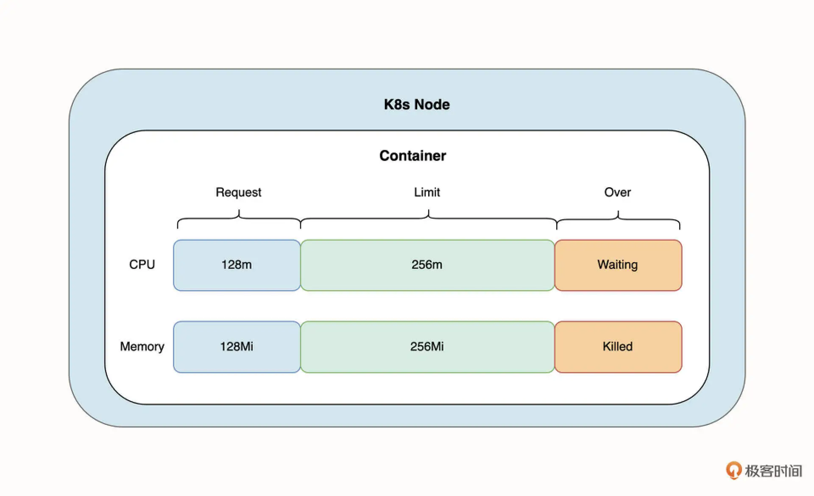
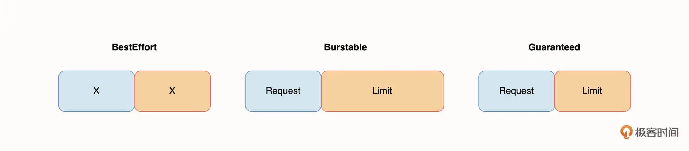
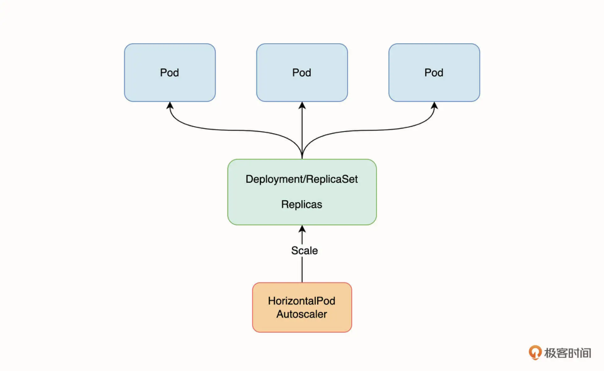

# 11 | K8s极简实战（六）：如何保障业务资源需求和自动弹性扩容？

你好，我是王炜。

在上一节课，我们一起学习了如何对外暴露集群内的业务应用，主要包括 NodePort 和Loadbalancer 两种暴露服务的方式。

当服务暴露在了外网，这意味着我们基本上已经将业务迁移到了 kubernetes 集群中，新的架构也正在接收生产流量了。此时，我们又要面临一些非常棘手的问题。如何保障业务对资源的需求？如何限制某些过于消耗资源的应用？如何弹性扩容？

在解释这些问题之前，我想先请你回顾一下第 3 讲的内容。在第三讲中，为了让你直观地了解 kubernetes 强大的能力，我们为应用配置了资源配额以及自动扩容（HPA），但我并没有对它们进行深入介绍。

这节课中，我将继续以示例应用为例，为你深入介绍 kubernetes 的资源配额管理和弹性扩容。有些 kubernetes 课程会把资源配额管理和弹性扩容看作两个独立部分，分开介绍。但实际上，这两者在真实的业务场景下有非常紧密的联系，我将尝试让你在一节课的时间里去理解它们。

在开始之前，你需要确保已经按照示例应用介绍的引导在本地 Kind 集群部署了示例应用。

## kubernetes 的资源配额

在传统微服务应用架构下，业务一般是运行在虚拟机之中的。业务所需的计算资源例如 CPU和内存由虚拟机直接提供，当业务需要更多的计算资源时，我们可以对虚拟机进行扩容。

但在 kubernetes 环境下，由于业务进程是运行在 Pod 的容器当中，而容器实际上又是运行在kubernetes 集群的节点（虚拟机）当中的，这就带来一个问题：当有多个 Pod 被调度到同一台节点时，如何避免资源竞争，保障每一个业务所需的资源呢？

在回答这个问题之前，我先举两个在 kubernetes 生产环境下非常典型的例子。

第一个例子，假设有一个业务在技术实现上存在一些问题，例如没有做好垃圾回收或者产生死锁，当运行一段时间后，它的内存和 CPU 消耗迅速飙升，直到把所在节点的资源全部耗尽。这时候，所有运行在这个节点上的 Pod 都会因为资源不足而宕机。

第二个例子，假设现在某一个 kubernetes 节点的配置是 2 核 4G 内存，现在已经有 2 个 Pod调度在了这台节点上，它们在某一时刻一共占用了 1.5 核 3.5G 内存的计算资源，节点的资源余量还有 0.5 核 0.5G 内存。此时，如果我们创建了一个需要 1 核 1G 资源的 Pod，而这个Pod 又恰好调度到了这个资源不足的节点上，那么业务进程将无法启动，Pod 会被一直重启。

这两个例子，其实可以对应资源配额管理的两个能力。第一个例子中缺少的是资源限制管理能力，这会导致 Pod 资源消耗无序扩张。第二个例子中缺少的是声明最小的资源用量的能力，这会导致 Pod 被调度到一台资源不足的节点上。

实际上，kubernetes 已经为我们提供了与之对应的两种开箱即用的资源管理能力，它们分别是资源的限制（Limit）和请求（Request）。

### CPU 和内存

要做好资源管理，首先得搞清资源管理的两个主要对象：CPU 和内存。

在 kubernetes 集群中，可用资源是所有节点资源的总和。举例来说，如果 kubernetes 集群有2 个节点，配置分别为 2 核 4G，那么理论上可用的总资源为 4 核 8G。不过，由于我们还需要扣除节点上系统消耗的资源，所以最终实际可用的总资源会小于理论计算的资源。

其中，我们最熟悉的 CPU 资源单位是“核数”。在一台虚拟机上，CPU 核数往往是一个整数，例如 1 核、2 核。但在 kubernetes 中，对于 CPU 有一个新的单位：m。核数和 m 的换算关系是：1 核 =1000m，举例来说，下面两种写法都是合法的。

- 1000m = 1 核

- 500m = 0.5 核

你可能会很好奇，为什么可以为 Pod 分配小于 1 核的 CPU 呢？实际上，m 代表的并不是将完整的 CPU 以“锁定”的方式配给 Pod，它计算的是“时间片”。也就是说，这是一种 CPU 的调度方法，数量越高，被分配到的 CPU 的计算时间片就越多，而那些被分配到较少 CPU 时间片的 Pod，则会因为得不到 CPU 的调度一直处于“阻塞”状态。

再看内存，它在 kubernetes 中常用的单位是 Mi，也就是我们熟悉的“兆”。例如，你可以使用下面两种写法。

- 128Mi = 128 兆

- 1Gi = 1024 兆

在 kubernetes 中，CPU 和内存这两种资源有很大的区别，其中一个最大的区别是：CPU 是可压缩的资源，而内存则是不可压缩的资源。如果你很难理解，我们换个角度解释一下：当节点的 CPU 资源不足时，Pod 因为得不到“时间片”会一直处于“阻塞”状态；但当节点的内存资源不足时，kubernetes 会尝试重启 Pod，或者进行重新调度。

### 如何查看 Pod 和节点资源消耗？

那熟悉了 CPU 和内存的相关概念，我们怎么才能获取集群 Pod 的资源用量呢？你可以使用kubectl top pods 命令来获取。

```
$ kubectl top pods -n example
NAME                        CPU(cores)   MEMORY(bytes)
backend-66b9754d65-86x6j    1m           36Mi
backend-66b9754d65-bxhs9    1m           32Mi
backend-66b9754d65-xm777    1m           32Mi
frontend-c6865dccc-5b4bz    1m           141Mi
frontend-c6865dccc-87rrw    1m           141Mi
frontend-c6865dccc-nrx7n    1m           144Mi
postgres-7745b57d5d-5lbzz   3m           56Mi
```

上面的返回结果列出了每一个 Pod 的 CPU 和内存消耗。从结果可以看出，CPU 的消耗非常低，这主要是因为我们部署的示例应用没有访问流量。

除了查看 Pod 的资源消耗以外，我们还可以查看节点的资源消耗，你可以使用 kubectl topnode 来查看。

```
$ kubectl top node
NAME                 CPU(cores)   CPU%   MEMORY(bytes)   MEMORY%
kind-control-plane   228m         4%     2229Mi          28%
```

同样地，节点的资源消耗和 Pod 的资源消耗在 CPU 和内存的单位上是一致的。

### Request 和 Limit

接下来，我们继续回到资源配额管理的话题上。

前面我提到过，kubernetes 的资源配额管理主要有两种能力：资源请求（Request）和资源限制（Limit）。

其中，Request 代表请求的资源用量，在一般场景下，它是保障业务稳定运行的最小资源，kubernetes 将保证最小资源的供应。还记得上面提到的第二个典型的例子吗？当 Pod 被分配到资源不足的节点时，将会被一直重启。这时候为 Pod 配置合理的 Request 资源就能很好地解决这个问题，kubernetes 会找到资源充足的节点并进行调度。

Limit 指的是资源占用的最大限制，配置 Limit 可以防止 Pod 在集群上占用过多的资源。同样地，它可以解决我们前面第一个例子里的问题：一个 Pod 消耗资源过多，导致其他 Pod 不可用。

接下来，我们以示例应用为例，来看一下如何为 Pod 配置 Request 和 Limit。下面是 BackendDeployment 的 Manifest。

```
apiVersion: apps/v1
kind: Deployment
metadata:
 name: backend
 ......
spec:
 ......
   spec:
     containers:
     - name: flask-backend
       image: lyzhang1999/backend:latest
       ......
       resources:
         requests:
           memory: "128Mi"
           cpu: "128m"
         limits:
           memory: "256Mi"
           cpu: "256m"
```

这里请你重点关注 resource.request 和 resource.limit 字段。在这个例子中，我们为 BackendPod 的容器请求了 128m CPU 和 128Mi 的内存用量，同时限制容器最大的资源是 256m CPU和 256Mi 的内存用量。下面这张图能够帮助你更好地理解它们之间的关系。



这张图展示了 Request 和 Limit 之间的关系。首先 Limit 作为限制资源，它一定大于或等于Request 的值。其次，当容器对 CPU 的用量超过 Limit 的限制时，将会进入“阻塞”状态，但当容器对内存的用量超过 Limit 时，Pod 将会被重启，以确保它不会对其他 Pod 造成影响。

由于在本地的 Kind 集群无法模拟内存超出限制的情况，所以如果你对这方面感兴趣，可以尝试开通一个云厂商的托管 kubernetes 集群，并将下面的 Pod 部署到集群内。

```
apiVersion: v1
kind: Pod
metadata:
 name: memory-demo
spec:
 containers:
 - name: memory-demo
   image: polinux/stress
   resources:
     requests:
       memory: "50Mi"
     limits:
       memory: "100Mi"
   command: ["stress"]
   args: ["--vm", "1", "--vm-bytes", "250M", "--vm-hang", "1"]
```

当 Pod 运行一段时间之后，通过 kubectl get pods 你将看到 OOMKilled 事件。

```
$ kubectl get pods
NAME            READY     STATUS      RESTARTS   AGE
memory-demo   0/1       OOMKilled     1          24s
```

需要注意的是，Pod 占用的内存超出限制时的终止行为并不是 kubernetes 主动去做的，它是由 Linux 内核的 OOM Killer 来执行的。

通常，我们为工作负载配置资源 Request 和 Limit 会出现下面三种情况。

- 未配置资源配额。

- 配置了资源配额，且 Request 小于 Limit。

- 配置了资源配额，且 Request 等于 Limit。

实际上，这三种配置方式不仅影响资源分配，还会影响 kubernetes 对工作负载的服务质量保证（QOS）。

## 服务质量（QOS）

服务质量是 Pod 层面的概念，它决定了 Pod 的调度和驱逐策略。关于驱逐，你可以简单地把它理解为当节点的资源不足时，它将从当前节点中选择一些 Pod 驱逐出去，并在其他节点进行重新调度。

而服务质量则决定了 kubernetes 驱逐 Pod 的顺序。

之前我们提到过，为工作负载配置资源 Request 和 Limit 有三种情况，它们也分别对应着三种服务质量。

- 未配置资源配额：服务质量为 BestEffort，字面意思是“尽力而为”，它在服务质量中优先级最低，当产生驱逐行为时候，kubernetes 首先驱逐这一类型的 Pod。

- Request 小于 Limit：服务质量为 Burstable，字面意思是“突发”，优先级介于 BestEffort 和Guaranteed 之间。

- Request 等于 Limit：服务质量为 Guaranteed，字面意思是“保证”，优先级最高。

下面这张图代表了这三种服务质量和资源配额的关系。



当 kubernetes 决定要驱逐 Pod 的时候，会按照从左到右的顺序进行驱逐。首先驱逐BestEffort 优先级的 Pod，如节点资源仍然不足，继续驱逐 Burstable 优先级的 Pod，最后是Guaranteed。

那么，在实际的工作中，我们怎么为不同的业务做资源配置和服务质量保证呢？这里我有一个经验可以供你参考。

首先，对于一些基础核心组件，例如中间件或者核心服务，我们可以将 Request 预估为一个较高的合理水平，并且将 Limit 配置为相同的值。这么做的好处是，可以保障核心服务所需的计算资源，并且还保证了它较高优先级的服务质量。即便是节点资源不足的情况下，也不容易因为被驱逐导致服务中断。

对于一些有明显的资源波峰的业务，例如 Java 服务，它在刚开始启动时会占用较多的 CPU和内存，平稳运行时 CPU 和内存则有回落。这时候，我们可以将 Request 配置为正常状态时所需的 CPU 和内存，将启动状态所需要的 CPU 和内存配置为 Limit，以应对突发的资源需要。

最后，在生产环境中，我强烈建议你为每一个工作负载配置资源限制。

当业务应用长时间接近资源配额限制时，意味着当前业务处于高峰期，为了保障业务的高可用和稳定性，我们还有一项非常重要的配置：水平扩容。

## 水平扩容（HPA）

Horizontal Pod Autoscaler（HPA）水平扩容指的是，当 Pod 的资源用量达到指定条件之后，自动对 Pod 进行横向扩容以增加副本数，通过 Service 负载均衡的能力，让后端能够承受更大的业务流量。同样地，如果 Pod 的负载减小，HPA 会自动缩容。

HPA 可以作用在 Deployment 和 StatefulSet，但它不能作用在无法缩放的工作负载上，比如Daemonset。以 Deployment 为例，HPA 主要实现了对 Deployment 工作负载 Replicas 字段的控制，进而通过控制 ReplicasSet 对 Pod 进行缩放操作，如下图所示。



HPA 的原理是，每隔一段时间在指标 API 里查询 Pod 的资源用量，并和 HPA 设置的缩放阈值进行比较，以此实现 Pod 的自动缩放。

要使 HPA 生效，有两个必要的条件，分别是安装 Metrics Server 和为工作负载配置资源Request。

条件满足后，我们就可以配置 HPA 策略了。在生产环境下，通常我们会基于两个指标来定义HPA 策略，它们分别是 CPU 和内存使用率。

### 基于 CPU 的扩容策略

在部署示例应用时，我们已经在本地 Kind 集群安装了 Metrics Server，并且为后端服务配置了基于 CPU 的 HPA 策略，你可以通过 kubectl get hpa 来获取详细内容。

```bash
$ kubectl get hpa backend -n example -o yaml
apiVersion: autoscaling/v2
kind: HorizontalPodAutoscaler
metadata:
 name: backend
 namespace: example
spec:
 maxReplicas: 10
 metrics:
 - type: Resource
   resource:
     name: cpu
     target:
       averageUtilization: 50
       type: Utilization
 - type: Resource
   resource:
     name: memory
     target:
       type: Utilization
       averageUtilization: 50
 minReplicas: 2
 scaleTargetRef:
   apiVersion: apps/v1
   kind: Deployment
   name: backend
......
```

在这里，scaleTargetRef 字段代表 HPA 的作用对象，这里可以看出它作用在 BackendDeployment 上。

metrics 字段的含义是“指定读取的指标”。这里有两个数组，第一个数组表示 HPA 以 CPU 为扩容指标，在一段时间里，当所有 Backend Pod 的 CPU 的平均使用率达到 50% 以上，就进行扩容操作。第二个数组表示 HPA 以内存为扩容指标，我们将在后续进行介绍。

minReplicas 字段的含义是“最小的副本数是 2”。请注意，当在工作负载里设置了 Replicas 字段并且和 HPA 的字段不一致时，最终将会以 HPA 的 minReplicas 为准。

maxReplicas 字段的含义是“最大扩容的副本总数是 10”。

HPA 会根据所有 Pod CPU 的平均用量，将副本数维持在 2-10 之间，进行动态调整。需要注意的是，用平均 CPU 用量作为扩容指标可能会出现一种情况：当某个 Pod 的 CPU 使用率非常高，而其他的 Pod 又比较低的情况，Pod 的 CPU 平均使用率可能不会触达 HPA CPU 阈值，这时候将不会触发自动扩容操作。

### 基于内存的扩容策略

除了基于 CPU 的扩容策略，我们还可以为工作负载配置基于内存的扩容策略。我们已经为示例应用 Backend Deployment 配置了基于内存的扩容指标。

```bash
apiVersion: autoscaling/v2
kind: HorizontalPodAutoscaler
metadata:
 name: backend
 namespace: example
spec:
 maxReplicas: 10
 metrics:
 ......
 - type: Resource
   resource:
     name: memory
     target:
       type: Utilization
       averageUtilization: 50
 minReplicas: 2
 scaleTargetRef:
   apiVersion: apps/v1
   kind: Deployment
   name: backend
......
```

基于内存的扩容和 CPU 类似，只是将 name=cpu 修改成了 name=memory，其他字段含义几乎一致，这里不再赘述。

在示例应用的 Python 后端应用中，我提前写好了一个可以大量消耗资源的接口，你可以在浏览器内访问：http://127.0.0.1/api/ab。

等待 30-40 秒后，我们用 kubectl top pods 来列出 Pod 的资源消耗情况。

```
$ ❯ kubectl top pods -n example
NAME                        CPU(cores)   MEMORY(bytes)
backend-66b9754d65-k84t5    1m           33Mi
backend-66b9754d65-ttg65    255m         36Mi
frontend-fc597b5d9-qcbfb    1m           152Mi
postgres-7745b57d5d-5lbzz   1m           55Mi
```

可以发现，其中有一个 Pod 的资源消耗量达到了 HPA 设定的阈值，现在，我们通过 kubectlget pods 获取 Pod 详情。

```
$ kubectl get pods -n example
NAME                        READY   STATUS    RESTARTS      AGE
backend-66b9754d65-5mtcp    1/1     Running   0             23s
backend-66b9754d65-b2dvc    1/1     Running   0             8s
backend-66b9754d65-k66rz    1/1     Running   1 (18m ago)   47m
backend-66b9754d65-klkqv    1/1     Running   0             23s
backend-66b9754d65-m74rd    1/1     Running   1 (18m ago)   23h
```

从返回结果来看，HPA 已经开始工作，并且已经创建出了新的 Pod 副本。

在生产环境下，我强烈建议你为业务应用配置 HPA 水平扩容策略，保证业务的可用性。

## 总结

在这节课，我们学习了如何通过 kubernetes 资源配额来保障业务的资源需求。通过为工作负载配置资源的请求（Request） 和限制（Limit），可以避免工作负载调度在了资源不足的节点，避免资源相互抢占的问题。值得注意的是，CPU 资源是可压缩资源，而内存则是不可压缩资源。这意味着，如果工作负载接近 CPU 的限制值，它只会出现等待的情况，而当内存出现超限的情况，Pod 将会被杀死并重启。

为工作负载设置资源配额的同时，也会影响工作负载的服务质量（QOS），工作负载的服务质量主要有三种：BestEffort、Burstable 和 Guaranteed。当节点资源不足时，kubernetes 会按照这个顺序依次对 Pod 进行驱逐。

在生产环境下，我推荐你为每一个工作负载都配置资源配额，尤其是对一些重要的中间件和核心服务，应当为它们配置足够的资源配额，并将 Request 和 Limit 配置为相等的值，保障它的服务质量。而对于有明显资源高低峰的业务（例如 Java 应用），它的特点是在启动时消耗的资源较高，但运行时消耗的资源会趋近平稳，所以我们可以将 Request 配置为启动后的资源消耗，Limit 配置为启动时所需的资源消耗，在确保业务所需资源的同时，这样做还能提高系统整体的资源利用率。

最后，我们还介绍了如何为业务配置水平扩容（HPA）策略。HPA 可以基于 CPU 和内存指标对 Pod 进行横向扩缩容，同时也是保障业务可用性的重要手段。当然，HPA 除了使用内置的CPU 和内存以外，还可以配置自定义指标，结合一些开源项目甚至能通过外部事件来触发扩缩容，感兴趣的同学可以进一步研究。不过，对于一般的业务来说，CPU 和内存指标基本上是够用的。

## 思考题

最后，给你留两道思考题吧。

1. 请你尝试对示例应用 Backend 工作负载进行下面两个实验。

- 将 request.cpu 配置为 32，request.memory 配置为 64Gi，观察 Pod 调度情况。1.

- 将 request.cpu 配置为 128m，request.memory 配置为 128Mi，limit.cpu 配置为 32，2.limit.memory 配置为 64Gi，再次观察 Pod 调度情况。

请你分享观察到的现象，并尝试解释为什么会有不同的调度结果。

（提示：你可以通过 kubectl describe pods POD_NAME -n example 来查看调度事件。）

2. 你认为在什么情况下，Guaranteed 优先级的 Pod 仍然会被驱逐？

欢迎你给我留言交流讨论，你也可以把这节课分享给更多的朋友一起阅读。我们下节课见。
