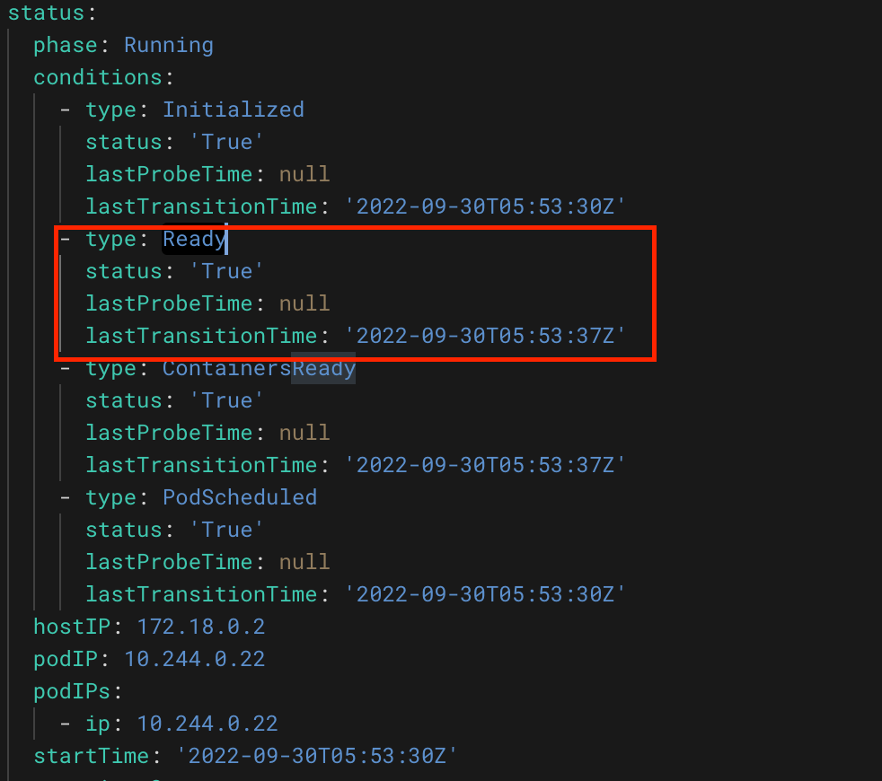
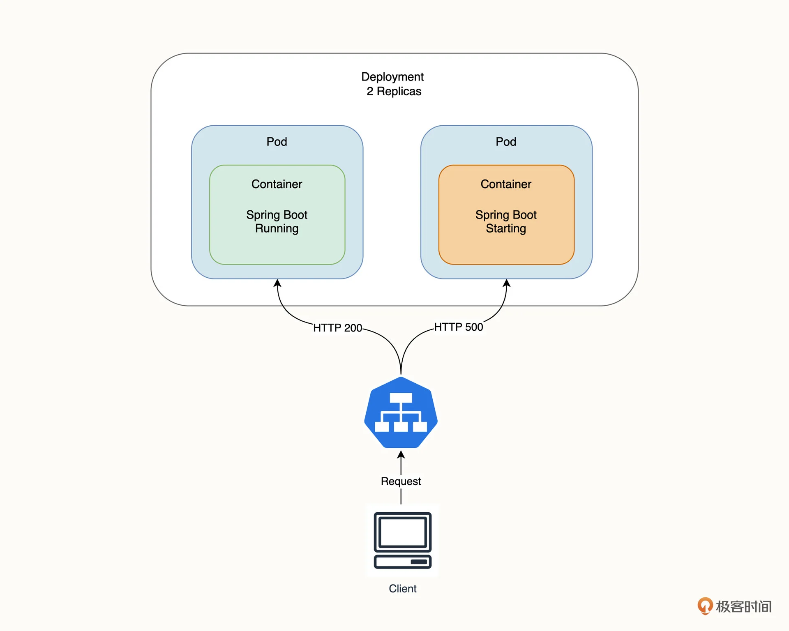
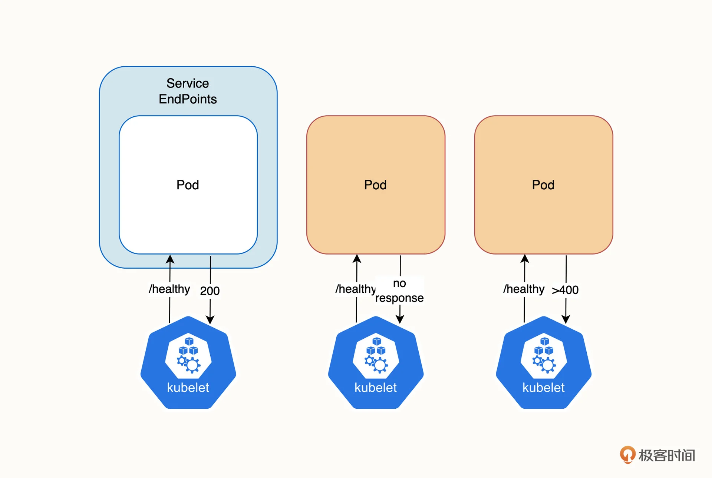
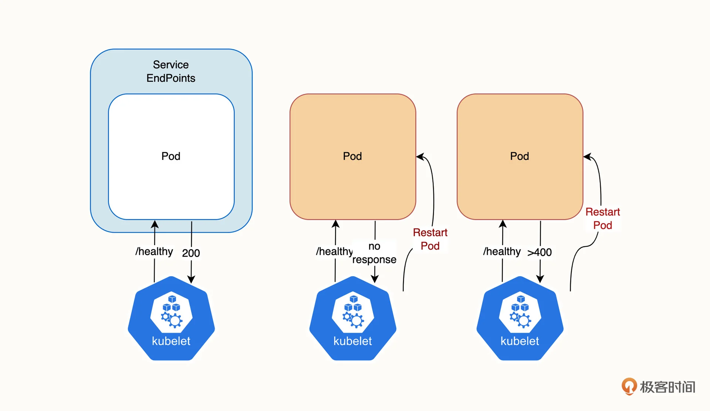
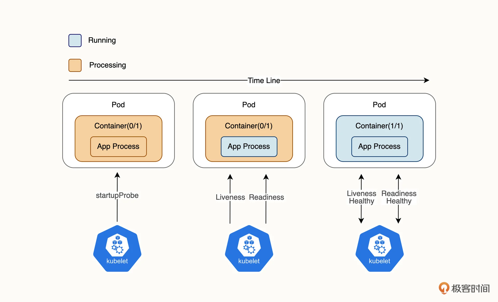

# 12 | 如何自动检查业务真实的健康状态？

你好，我是王炜。今天是 kubernetes 极简实战这一章的最后一课。

在上一节课中，我们学习了如何为工作负载配置资源配额，还详细介绍了资源 Request 和Limit 的含义和用法。此外，我们还重点学习了如何为业务配置水平扩容（HPA），当业务面临较大的请求流量时，它能够实现自动扩容。

当触发自动扩容时，工作负载的 Replicas 字段将被调整，然后 ReplicaSets 对象将创建新的Pod 副本，这些副本在未就绪（Ready）之前，我们观察到的现象是 kubernetes 不会将流量转发到这些 Pod 上。那么，你有没有考虑过，kubernetes 是怎么判断新创建的 Pod 是否已经处于“就绪”状态的呢？

对于启动时间比较慢的业务应用来说，启动阶段并不等于就绪，这是一个非常典型的场景，既然如此，我们怎么告诉 kubernetes 什么时候可以接收请求流量？

再说另一个我们上节课提到的场景，如果业务应用没有做好垃圾回收或者产生死锁，那么再运行一段时间后，它的内存和 CPU 消耗会迅速飙升。显然，这时候 Pod 已经处于不健康状态了，怎么让 kubernetes 识别并将它重启呢？

要解决这两个问题，我们需要使用到 kubernetes 的健康检查。

这节课，我会首先带你学习 Pod 的状态机制，然后通过示例应用，进一步介绍怎么为工作负载配置健康检查，最终解决我们刚才提出的这两个问题。

通过工作负载的健康检查，我们可以向 kubernetes 提供业务的真实状态，有了这些真实状态，kubernetes 就可以知道 Pod 什么时候已经准备好接收外部流量，什么时候存在异常需要重启了。

kubernetes 的健康检查类型一共有三种，分别是：Readiness、Liveness 和 StartupProbe。

下面我们来进一步看看它们的功能和配置方法。

## Pod 和容器的状态

要想弄懂 kubernetes 的健康检查，我们需要先理解 Pod 和容器的状态。

Pod 的生命周期一共有下面这 5 个状态。

- Pending：正在创建 Pod，例如调度 Pod 和拉取镜像的阶段。

- Running：运行阶段，至少有一个容器正在启动或运行。

- Succeeded：运行成功，并且不会重新启动，例如 Job 创建的 Pod。

- Failed：Pod 的所有容器都停止了，并且至少有一个容器退出状态码非 0。

- Unknown：无法获取 Pod 的状态。

我们最常接触到的 Pod 状态是 Pending 和 Running。Pending 代表 Pod 正在创建中，而Running 状态则要求至少有一个容器正在启动中或者正在运行。

而对于 Pod 中的容器，也有下面 3 种状态。

- Waiting：容器等待中，例如正在拉取镜像。

- Running：容器运行中，PID=1 的业务进程正在启动或运行。

- Terminated：容器终止中，例如正在删除 Pod。

是不是感觉有点混乱？没关系，现在我们只需要关注 Pod 和容器同时处于 Running 的状态，其他的暂时忽略就可以。

当 Pod 处于 Running 状态时，代表至少有一个容器处于启动或运行状态。所以，我们只需要关注容器的 Running 状态就可以间接决定 Pod 的状态。而当容器状态为 Running 时，代表PID=1 的业务进程正在启动或运行。

不过要注意的是，当业务进程还处于启动过程时，Pod 和容器都处于 Running 状态，但由于业务并没有完成启动，所以还不具备接收外部流量的条件。

这时候，光有一个 Running 状态是不够的，我们还需要一个能够描述 Pod 是否已经就绪并准备好接收外部请求的标识，它就是 Pod 的 Ready 字段。

### Ready 状态

在 kubernetes 中，Pod 的 Ready 字段用来标识是否已经就绪，它是由 kubelet 直接管理的，Ready 状态被记录在了 Pod Manifest 的 status.conditions 字段下。



你也可以通过 kubectl get pods 来查看 Pod 是否处于 Ready 状态。

```
$ kubectl get pods -n example
NAME                        READY   STATUS    RESTARTS        AGE
backend-5969f76d6c-jf9lq    0/1     Pending   0               102m
backend-86d76d8764-cl2pf    1/1     Running   0               109m
backend-86d76d8764-pgvhd    1/1     Running   0               109m
frontend-fc597b5d9-qcbfb    1/1     Running   2 (5h32m ago)   19h
postgres-7745b57d5d-5lbzz   1/1     Running   3 (5h32m ago)   15d
```

在返回结果的 Ready 字段中，1/1 表示运行中的容器数量和总容器数量，当这两者数量相等时，代表 Pod 处于 Ready 状态，说明 Pod 已经就绪并准备好了接收外部流量。

了解了 Ready 状态之后，我们回到健康检查的问题上来。

## 健康检查

还记得我在最开始提到的一个例子吗？现在来试想一下，在生产环境，我们为某个业务配置了CPU 限制，业务运行一段时间后，由于业务应用没有做好垃圾回收甚至产生死锁的情况，导致它的 CPU 占用率一直处在限制值附近。此时，虽然 Pod 的业务进程仍在运行，但实际上它已经无法得到更多的 CPU 时间片了。

我的问题是，这时候它能正常处理业务请求吗？毫无疑问，它处理业务会非常缓慢，甚至会完全不可用。

除了因为资源不足导致业务不可用以外，还有一类典型的场景：在进行水平扩容时，由于新创建的 Pod 的业务进程需要的启动时间较长（例如对于大型的 Java 应用，往往需要数分钟的启动时间），如果在业务启动时就将 Pod 标记为 Ready 状态并接收外部请求流量，将会有部分请求得到错误的返回，如下图所示。



所以，这两种情况都引出了一个非常有意思的场景：因为业务进程处于运行状态，Pod 和容器也处于 Running 状态，所以 kubernetes 会认为当前 Pod 是就绪的。但实际上，业务可能正处于“启动中”或者出现“资源不足”的情况，暂时无法对外提供服务。

这两个例子告诉我们，在一般情况下，Pod 就绪（Ready）不等于业务健康。

那么，如何才能让 kubernetes 感知到业务真实的健康状态呢？这时候我们就需要用到kubernetes 探针。

### 探针的检查方式

kubernetes 探针一共有三种方式来向 Pod 发起健康检查。

- HTTP 请求，通过向容器发起 HTTP 请求，并识别请求响应代码来判断业务状态。

- 在容器内运行命令，通过在容器里运行一条命令并检查命令的退出状态码来判断业务健康状态。

- TCP 端口状态判断，通过是否能够和指定端口建立连接来判断业务健康状态。

在这三种健康检查方式中，HTTP 请求的检查方式是我们在日常工作中最常用到的一种。学会了这一种，其他两种要配置起来也基本没问题了，所以我们以它为例做深入介绍。

至于后两种检查方式呢，我会帮你列出它们的使用场景供你了解，在未来工作中，如果有需要你可以再查找相关资料来做配置。它们的主要使用场景如下。

- 如果业务进程在启动过程中需要依赖 Pod 内的一个可执行文件的运行状态，例如判断容器内是否存在特定的文件，那么可以用运行命令的健康检查方式来进行判断。

- 如果业务进程无法提供 HTTP 请求，例如服务对外提供 GRPC、RPC 接口时，TCP 端口判断的方式就非常有用。

现在，我们继续来看三种 kubernetes 探针（Readiness、Liveness、StartupProbe），以及怎么配置 HTTP 的健康状态检查。

### Readiness

Readiness 又称为就绪探针，它用来确定 Pod 是否为就绪（Ready）状态，以及是否能够接收外部流量。例如，当某一些 Pod 出现短暂的延迟或不可用时，我们希望它不接收外部流量，这时候 Readiness 就非常有用。

Readiness 探针能够识别业务的健康状态，并通过健康状态来控制 Pod 是否接受外部请求流量。

我们以示例应用 Backend Deployment 服务为例，来看看怎么为工作负载配置 Readiness 探针。下面是 Backend Deployment Manifest 的部分内容。

```
apiVersion: apps/v1
kind: Deployment
metadata:
 name: backend
 ......
spec:
 ......
   spec:
     containers:
     - name: flask-backend
       image: lyzhang1999/backend:latest
       ......
       readinessProbe:
         httpGet:
           path: /healthy
           port: 5000
           scheme: HTTP
         initialDelaySeconds: 10
         failureThreshold: 5
         periodSeconds: 10
         successThreshold: 1
         timeoutSeconds: 1
```

这里要重点关注 readinessProbe 字段，它为 kubernetes Readiness 探针提供了必要的信息。

我们先来看第 14 行的 httpGet 下的几个字段，path 字段的含义是“通过请求 healthy 接口来判断”，Port 字段指定了 Python 后端服务的监听端口 5000，scheme 字段代表协议。探针请求的完整路径为：http://PodIP:5000/healthy，相当于以 Get 的方式主动访问业务接口，当接口返回 200-399 状态码时，则视为本次探针请求成功。

initialDelaySeconds 的含义是在容器启动之后，延迟 10 秒钟再进行第一次探针检查。

failureThreshold 的含义是，如果连续 5 次探针失败则代表 Readiness 探针失败，Pod 状态为NotReady，此时 Pod 不会接收外部请求。

periodSeconds 的含义是探针每 10 秒钟轮询检测 1 次。

successThreshold 的含义是只要探针成功 1 次就代表探针成功了，Pod 状态为 Ready 表示可以接收外部请求。

timeoutSeconds 代表探针的超时时间为 1 秒。

综合这些配置信息，我们可以得出几个重要的数字。在 Pod 启动之后，如果在 60 秒内（initialDelaySeconds + failureThreshold * periodSeconds） 不能通过健康检查， Pod 将处于非就绪状态。

当 Pod 处于正常的运行状态时，如果业务突然产生故障，健康检查会在 50 秒内（failureThreshold * periodSeconds） 识别出业务的不健康状态；当 Pod 业务恢复健康时，健康检查会在 10 秒内（successThreshold * periodSeconds） 识别出业务已恢复。

Readiness 探针的一个非常重要的作用是，它负责找出业务状态不健康的 Pod，并且将它从Service EndPoints 列表移除，使它无法接收到外部请求。如果 Pod 的 Readiness 探针一直无法通过，那么 Pod 将一直无法接收外部请求，如下图所示。



请注意，当 Readiness 探针向业务应用发出请求时，如果在超时时间内没有收到回复，或者收到的回复的状态码大于 400，那么认为本次探测失败。

试想一下，如果这时候业务已经无法自行恢复了，比如产生了死锁，此时 Readiness 探针也已经感知到业务不可用了，那我们能否更进一步，让 kubernetes 帮我们自动重启 Pod 来恢复业务呢？这就是我接下来要介绍的 Liveness 探针。

### Liveness

Liveness 又称为存活探针，相比 Readiness 探针，它还能够在检测到 Pod 处于不健康状态时自动将 Pod 重启。

在示例应用 Backend Deployment 中，我们也定义了 Liveness 探针。

```
spec:
 ......
   spec:
     containers:
     - name: flask-backend
       image: lyzhang1999/backend:latest
       ......
       livenessProbe:
         httpGet:
           path: /healthy
           port: 5000
           scheme: HTTP
         failureThreshold: 5
         periodSeconds: 10
         successThreshold: 1
         timeoutSeconds: 1
```

Liveness 探针和 Readiness 探针非常类似，Liveness 探针是通过 livenessProbe 字段来配置的，livenessProbe 字段下面的每个字段的作用和 Readiness 探针都几乎一致，这里就不再赘述了。

当 Liveness 探针失败时，它将自动重启业务不健康的 Pod，如下图所示。



需要注意的是，Liveness 和 Readiness 探针是独立并行的，它们之间并没有相互等待关系。

### StartupProbe

相比较 Liveness 和 Readiness 探针在运行阶段的探测特性，StartupProbe 是一种专门针对业务在启动阶段设计的探针。还记得我在之前提到的一个场景吗？对于一些大型的 Java 应用来说，往往需要数分钟时间才能够完成启动。

这意味着，对于启动非常慢的大型应用，如果我们按照上面的例子来配置 Readiness 和Liveness 探针，Pod 将因为探针失败而永远无法启动。

那么，怎么解决这个问题呢？你可能首先会想到，是不是调整探针第一次探测的延迟时间就可以了？比如将 initialDelaySeconds 字段的值从 10 秒钟修改到 120 秒。这当然是可以的，但如果启动时间不是 120 秒，或者你不太确定呢？那似乎可以在修改了 initialDelaySeconds 的基础上再将失败次数 failureThreshold 或者探测间隔 periodSeconds 加大。

这种做法虽然能解决问题，但缺点也是明显的，为了兼容应用启动慢的问题，我们主动降低了kubernetes 检测 Pod 健康状态的频率，这会延迟 kubernetes 感知故障的速度。

其实，Readiness 和 Liveness 主要用来检查的是处于运行过程中业务，因为启动过慢的问题而去调整 Readiness 和 Liveness 参数并不是最佳实践。这类问题我们可以通过 StartupProbe来解决。

StartupProbe 探针特别适用于业务应用启动慢的场景。当 Pod 启动时，如果配置了StartupProbe，那么 Readiness 和 Liveness 探针都将被临时禁用，直到 StartupProbe 探针返回成功才会启用 Readiness 和 Liveness 探针，这也就避免了 Readiness 和 Liveness 在应用启动阶段造成的干扰。也就是说，我们只要为业务配置合理的 StartupProbe 探针，就可以解决应用启动慢导致其他探针认为 Pod 不健康的问题。

StartupProbe 探针的配置方法和 Readiness、Liveness 探针也非常类似，下面是示例应用Backend Deployment Manifest 的部分内容。

```
spec:
 ......
   spec:
     containers:
     - name: flask-backend
       image: lyzhang1999/backend:latest
       ......
       startupProbe:
         httpGet:
           path: /healthy
           port: 5000
           scheme: HTTP
         initialDelaySeconds: 10
         failureThreshold: 5
         periodSeconds: 10
         successThreshold: 1
         timeoutSeconds: 1
```

StartupProbe 是通过 startupProbe 字段来配置的。在这个例子中，Pod 启动之后 10 秒会开始第一次探测，如果至少有 1 次探测成功，那么 StartupProbe 探针就成功，接下来才会继续启动 Readiness 和 Liveness 探针。

在我们刚才提到的 Java 应用的例子中，我们可以为 StartupProbe 配置足够大的initialDelaySeconds 来让业务有足够的时间完成启动过程。

如果一个工作负载内同时定义了这三种探针，情况会变得有些复杂，你可以结合下面这张图来理解。



Pod 启动时，三种探针的执行顺序主要可以分成三个阶段。

- 第一阶段：Pod 已启动，容器已启动，业务进程正在启动中，此时 StartupProbe 开始工作，由于 StartupProbe 还未成功，当前 Pod 的容器处于 Not Ready(0/1) 的状态。

- 第二阶段：随着时间推移，StartupProbe 探针成功，Readine 和 Liveness 探针开始并行工作，此时由于 Readine 探针还未成功，当前 Pod 的容器仍然处于 Not Ready(0/1) 的状态。

- 第三阶段：随着 Readine 和 Liveness 的探测成功，当前 Pod 的容器转为 Ready(1/1) 的状态，Service EndPoints 将 Pod 加入到列表当中，Pod 开始接收外部请求。

在为业务应用配置了探针之后，再结合我们上节课介绍的资源配额和水平扩容，基本上就可以保证业务在生产环境下的稳定性了。

## 总结

在这节课，我们学习了 kubernetes 的三种健康检查探针。其中，Readiness 就绪探针可以让kubernetes 感知到业务的真实可用状态，kubernetes 将根据业务的状态判断 Pod 是否处于Ready 就绪状态，以此来控制什么时候将 Pod 加入到 EndPoints 列表中接收外部流量。

Liveness 存活探针则更加彻底，当它感知到 Pod 不健康时，会重启 Pod。在大多数情况下，Liveness 可以实现对业务无感的服务重启，在第一时间发现故障的同时自动恢复业务，极大提升了业务系统的可用性。

最后，StartupProbe 探针主要用来解决服务启动慢的问题，对于一些大型的应用例如 Java 服务，我建议你为它们配置 StartupProbe，以确保在服务启动完成后再对它进行常规的就绪和存活健康检查。

在实际的业务场景中，我强烈建议你为业务工作负载配置这三种探针，这样可以最大程度地保障业务的高可用和稳定性。

## 思考题

最后，给你留两道思考题吧。

1. 在非 kubernetes 架构体系下，通常我们有哪些方案检查应用的健康状态呢？请你分享你了解的技术方案。

2. 请你尝试将后端 Deployment 的 Readiness 就绪探针由 HTTP 的方式修改为 TCP 的检查方式。

欢迎你给我留言交流讨论，你也可以把这节课分享给更多的朋友一起阅读。我们下节课见。
