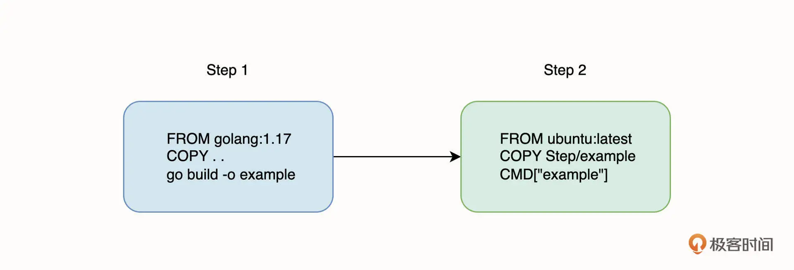
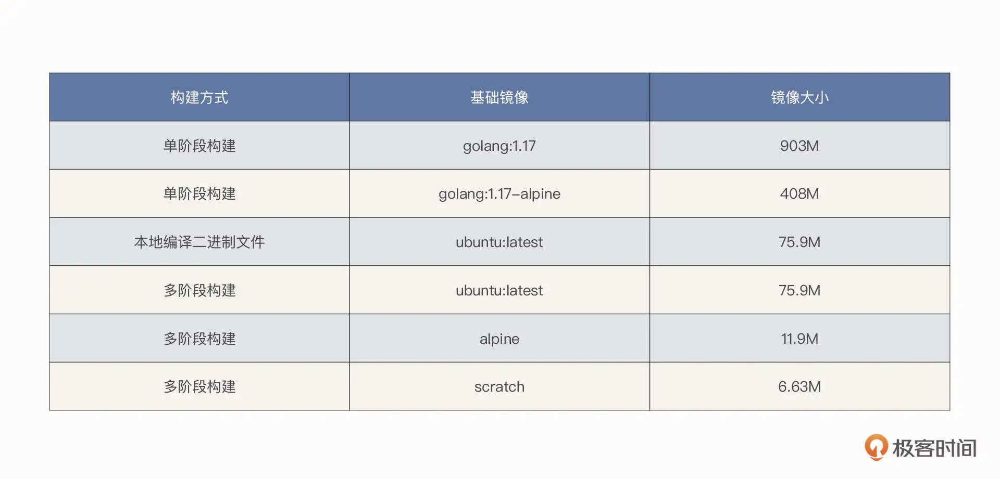

# 14 | 容器化：如何将镜像体积缩减90%？

你好，我是王炜。今天是我们容器化实践的第二课。

容器化的学习曲线是非常陡峭的，对于初学 Docker 的同学来说，短时间内很难针对已有业务编写合适的 Dockerfile。所以上节课，我直接给出了不同语言接近生产可用的 Dockerfile，但我并没有深入介绍里面涉及的一些构建技巧。

在这些案例中，我用到最多的就是通过“多阶段”的方式来构建镜像，但是对于“多阶段构建”，我们只知道了它的具体用法，并没有解释为什么要使用它。

在一般情况下，只知道“多阶段构建”的用法也是可以的。不过在现实生产过程中，我们可能面临一系列问题，例如，由于对镜像构建过程不够熟悉，很容易出现构建慢、构建镜像过大等问题，这会导致推送镜像变得缓慢，同时也会导致在 Kubernetes 更新应用镜像版本时拉取镜像的过程也变得缓慢，从而影响整体应用发布效率。所以，如何进一步借助多阶段构建来优化镜像大小就显得非常重要了。

这节课，我将带你深入了解“多阶段构建”，通过具体的实践，进一步理解它的最重要特性之一：减小镜像体积。在缩减镜像的实战过程中，我还会为你解释在上一节课用到的其他构建技巧。

在正式开始今天的学习之前，你需要确保已经在本地安装了 Docker，并将我提前准备好的示例应用仓库克隆到本地：https://github.com/lyzhang1999/gitops.git。

## 从构建 Golang 镜像开始

我还是以上一节课 Golang 的应用为例。你需要先将示例应用仓库克隆到本地，然后进入Golang 示例应用。

```
$ cd gitops/docker/13/golang
```

对于大多数 Docker 初学者来说，首要目标是能够成功构建镜像，所以，大部分人在最开始编写的 Dockerfile 的时候都以“能用”作为首要目标，内容和 Golang 应用中的 Dockerfile-1 文件类似。

```
# syntax=docker/dockerfile:1
FROM golang:1.17
WORKDIR /opt/app
COPY . .
RUN go build -o example
CMD ["/opt/app/example"]
```

这个 Dockerfile 描述的构建过程非常简单，我们首选 Golang:1.17 版本的镜像作为编译环境，将源码拷贝到镜像中，然后运行 go build 编译源码生成二进制可执行文件，最后配置启动命令。

接下来，我们使用 Dockerfile-1 文件来构建镜像。

```
$ docker build -t golang:1 -f Dockerfile-1 .
```

构建成功后，使用 docker images 来查看镜像大小。

```
$ docker images
REPOSITORY                      TAG               IMAGE ID       CREATED
golang                          1                 751ee3477c3d   5 minutes ago
```

从返回的结果来看，这个 Dockerfile 构建的镜像大小非常惊人，Golang 示例程序使用 gobuild 命令编译后，二进制可执行文件大约 6M 左右，但容器化之后，镜像达到 900M，显然我们需要进一步优化镜像大小。

### 替换基础镜像

怎么做呢？我们构建的 Golang 镜像的大小很大程度是由引入的基础镜像的大小决定的，在这种情况下，替换基础镜像是一个快速并且非常有效的办法。例如，将 Golang:1.17 基础镜像替换为 golang:1.17-alpine 版本。

```
# syntax=docker/dockerfile:1
FROM golang:1.17-alpine
WORKDIR /opt/app
COPY . .
RUN go build -o example
CMD ["/opt/app/example"]
```

一般来说，Alpine 版本的镜像相比较普通镜像来说删除了一些非必需的系统应用，所以镜像体积更小。

接下来，我们使用 Dockerfile-2 文件来构建镜像。

```
$ docker build -t golang:2 -f Dockerfile-2 .
```

构建成功后，查看镜像大小。

```
$ docker images
REPOSITORY                      TAG               IMAGE ID       CREATED
golang                          2                 bbaa9e935080   4 minutes ago
golang                          1                 751ee3477c3d   5 minutes ago
```

通过对比发现，新的 Dockerfile-2 构建的镜像比 Dockerfile-1 构建的镜像在大小上缩减了50%，只有 408M 了。

### 重新思考 Dockerfile

让我们进一步分析一下 Dockerfile-2 文件的内容。

```
# syntax=docker/dockerfile:1
FROM golang:1.17-alpine
WORKDIR /opt/app
COPY . .
RUN go build -o example
CMD ["/opt/app/example"]
```

从这段 Dockerfile 可以看出，我们在容器内运行了 go build -o example，这条命令将会编译生成二进制的可执行文件，由于编译的过程中需要 Golang 编译工具的支持，所以我们必须要使用 Golang 镜像作为基础镜像，这是导致镜像体积过大的直接原因。

既然如此，那么我能不能不在镜像里编译呢？这样不依赖镜像的编译工具，再使用一个体积更小的镜像来运行程序，构建出来的镜像自然就会变小了。

思路完全没错，那么我们要怎么做呢？最简单的办法就是在本地先编译出可执行文件，再将它复制到一个更小体积的 ubuntu 镜像内。

具体做法是，首先在本地使用交叉编译生成 Linux 平台的二进制可执行文件。

```
$ CGO_ENABLED=0 GOOS=linux GOARCH=amd64 go build -o example .
$ ls -lh
-rwxr-xr-x  1 wangwei  staff   6.4M 10 10 16:58 example
......
```

接下来，使用 Dockerfile-3 文件构建镜像。

```
# syntax=docker/dockerfile:1
FROM ubuntu:latest
WORKDIR /opt/app
COPY example ./
CMD ["/opt/app/example"]
```

因为不再需要在容器里进行编译，所以我们直接引入了不包含 Golang 编译工具的 ubuntu 镜像作为基础运行环境，接下来使用 docker build 命令构建镜像。

```
$ docker build -t golang:3 -f Dockerfile-3 .
```

构建完成后，使用 docker images 来查看镜像大小。

```
$ docker images
REPOSITORY                      TAG               IMAGE ID       CREATED
golang                          3                 b53404869778   3 minutes ago
golang                          2                 bbaa9e935080   4 minutes ago
golang                          1                 751ee3477c3d   5 minutes ago
```

从返回内容可以看出，这种构建方式生成的镜像只有 76M，在体积上比最初的 917M 缩小了几乎 90% 。镜像的最终大小就相当于 ubuntu:latest 的大小加上 Golang 二进制可执行文件的大小。

不过，这种方式将应用的编译过程拆分到了宿主机上，这会让 Dockerfile 失去描述应用编译和打包的作用，不是一个好的实践。

其实，我们仔细分析上面的构建方法，会发现它的本质是把构建和运行拆分为两个阶段，构建由本地环境的编译工具提供支持，运行由 ubuntu 镜像提供支持。

那么，能不能将这个思想迁移到 Dockerfile 的构建过程中呢？说到这里，我相信你已经能联想到我们上节课提到的“多阶段构建”了，思路是不是非常一致？

## 多阶段构建

在我们上节课的镜像构建案例中，多阶段构建的本质其实就是将镜像构建过程拆分成编译过程和运行过程。第一个阶段对应编译的过程，负责生成可执行文件；第二个阶段对应运行过程，也就是拷贝第一阶段的二进制可执行文件，并为程序提供运行环境，最终镜像也就是第二阶段生成的镜像如下图所示。



通过这张原理图，我相信你已经发现了一个很有意思的结论。以 Golang 示例应用为例，多阶段构建其实就是将 Dockerfile-1 和 Dockerfile-3 的内容进行合并重组，最终完整的多阶段构建的 Dockerfile-4 内容如下。

```
# syntax=docker/dockerfile:1
# Step 1: build golang binary
FROM golang:1.17 as builder
WORKDIR /opt/app
COPY . .
RUN go build -o example
# Step 2: copy binary from step1
FROM ubuntu:latest
WORKDIR /opt/app
COPY --from=builder /opt/app/example ./example
CMD ["/opt/app/example"]
```

这段内容里有两个 FROM 语句，所以这是一个包含两个阶段的构建过程。

第一个阶段是从第 4 行至第 7 行，它的作用是编译生成二进制可执行文件，就像我们之前在本地执行的编译操作一样。

第二阶段在第 10 行到 13 行，它的作用是将第一阶段生成的二进制可执行文件复制到当前阶段，把 ubuntu:latest 作为运行环境，并设置 CMD 启动命令。

接下来，我们使用 docker build 构建镜像，并将其命名为 golang:4。

```
$ docker build -t golang:4 -f Dockerfile-4 .
```

构建完成后，使用 docker images 查看镜像大小。

```
$ docker images
REPOSITORY                      TAG               IMAGE ID       CREATED
golang                          4                 8d40b16bb409   2 minutes ago
golang                          3                 b53404869778   3 minutes ago
golang                          2                 bbaa9e935080   4 minutes ago
golang                          1                 751ee3477c3d   5 minutes ago
```

从返回结果我们可以看到，golang:4 镜像大小和 golang:3 镜像大小几乎一致，大约为 76M。

到这里，对镜像大小的优化已经基本上完成了，镜像大小也在可接受的范围内。在实际的项目中，我也推荐你使用 ubuntu:latest 作为第二阶段的程序运行镜像。

不过，为了让你深入理解多阶段构建，我们还可以尝试进一步压缩构建的镜像大小。

### 进一步压缩

当我们使用多阶段构建时，最终生成的镜像大小其实取决于第二阶段引用的镜像大小，它在上面的例子中对应的是 ubuntu:latest 镜像大小。

要进一步缩小体积，我们可以继续使用其他更小的镜像作为第二阶段的运行镜像，这就要说到Alpine 了。

Alpine 镜像是专门为容器化定制的 Linux 发行版，它的最大特点是体积非常小。现在，我们尝试使用它，将第二阶段构建的镜像替换为 Alpine 镜像，修改后的文件命名为 Dockerfile-5，内容如下。

```
# syntax=docker/dockerfile:1
# Step 1: build golang binary
FROM golang:1.17 as builder
WORKDIR /opt/app
COPY . .
RUN CGO_ENABLED=0 go build -o example
# Step 2: copy binary from step1
FROM alpine
WORKDIR /opt/app
COPY --from=builder /opt/app/example ./example
CMD ["/opt/app/example"]
```

由于 Alpine 镜像并没有 glibc，所以我们在编译可执行文件时指定了 CGO_ENABLED=0，这意味着我们禁用了 CGO，这样程序才能在 Alpine 镜像中运行。

接着我们使用 Dockerfile-5 构建镜像，并将镜像命名为 golang:5。

```
$ docker build -t golang:5 -f Dockerfile-5 .
```

构建完成后，使用 docker images 查看镜像大小。

```
$ ❯ docker images
REPOSITORY                      TAG               IMAGE ID       CREATED
golang                          5                 7b2de55bf367   About a minute a
golang                          4                 8d40b16bb409   2 minutes ago
golang                          3                 b53404869778   3 minutes ago
golang                          2                 bbaa9e935080   4 minutes ago
golang                          1                 751ee3477c3d   5 minutes ago
```

从返回的结果我们得知，使用 Alpine 镜像作为第二阶段的运行镜像后，镜像大小从 76M 降低至了 12M。

不过，由于 Alpine 镜像和常规 Linux 发行版存在一些差异，作为初学者，我并不推荐你在生产环境下把 Alpine 镜像作为业务的运行镜像，具体原因我们还会在下节课做深入介绍。

### 极限压缩

从前面的操作可以看出，如果把 Alpine 镜像作为第二阶段的镜像，得到的镜像已经足够小了，相比较 7M 的可执行文件大小，镜像只增加了 5M 大小。

但是我们有没有可能再极端一点，让多阶段构建的镜像大小和二进制可执行文件的大小保持一致呢？

答案是肯定的，我们只需要把第二个阶段的镜像替换为一个“空镜像”，这个空镜像称为 scratch镜像，我们将 Dockerfile-4 第二阶段的构建替换为 scratch 镜像，修改后的文件命名为Dockerfile-6，内容如下。

```
# syntax=docker/dockerfile:1
# Step 1: build golang binary
FROM golang:1.17 as builder
WORKDIR /opt/app
COPY . .
RUN CGO_ENABLED=0 go build -o example
# Step 2: copy binary from step1
FROM scratch
WORKDIR /opt/app
COPY --from=builder /opt/app/example ./example
CMD ["/opt/app/example"]
```

注意，由于 scratch 镜像不包含任何内容，所以我们在编译 Golang 可执行文件的时候禁用了CGO，这样才能让编译出来的程序在 scratch 镜像中运行。

接着，我们使用 docker build 构建这个镜像，将其命名为 golang:5，然后再查看镜像大小，你会发现镜像和 Golang 可执行文件的大小是一致的，只有 6.6M。

```
$ docker build -t golang:6 -f Dockerfile-6 .
$ docker images
REPOSITORY                      TAG               IMAGE ID       CREATED
golang                          6                 aa61f2cff23d   35 seconds ago
golang                          5                 7b2de55bf367   About a minute a
golang                          4                 8d40b16bb409   2 minutes ago
golang                          3                 b53404869778   3 minutes ago
golang                          2                 bbaa9e935080   4 minutes ago
golang                          1                 751ee3477c3d   5 minutes ago
```

scratch 镜像是一个空白镜像，甚至连 shell 都没有，所以我们也无法进入容器查看文件或进行调试。在生产环境中，如果对安全有极高的要求，你可以考虑把 scratch 作为程序的运行镜像。

### 如何复用构建缓存？

到这里，相信你已经理解多阶段构建的实际意义了。不过，因为上面的 Dockerfile 还可以做进一步的优化，我还想再插播一个知识点。比如，在第一阶段的构建过程中，我们先是用 COPY. . 的方式拷贝了源码，又进行了编译，这会产生一个缺点，那就是如果只是源码变了，但依赖并没有变，Docker 将无法复用依赖的镜像层缓存。在实际构建过程中，你会发现 Docker 每次都会重新下载 Golang 依赖。

这就引出了另外一个构建镜像的小技巧：尽量使用 Docker 构建缓存。

要使用 Golang 依赖的缓存，最简单的办法是：先复制依赖文件，再下载依赖，最后再复制源码进行编译。基于这种思路，我们可以将第一阶段的构建修改如下。

```
# Step 1: build golang binary
FROM golang:1.17 as builder
WORKDIR /opt/app
COPY go.* ./
RUN go mod download
COPY . .
RUN go build -o example
```

这样，在每次代码变更而依赖不变的情况下，Docker 都会复用第 4 行和第 5 行产生的构建缓存，这可以加速镜像构建过程。

## 总结

好了，总结一下。这节课，我以构建 Golang 镜像为例子，向你展示了减小镜像体积的具体方法，不管是最常见的更换基础镜像，还是多阶段构建，都可以有效地减小镜像体积。但是不同构建方法对应的镜像大小仍然有很大差异。



更换基础镜像是一个简单快速的方法，但这种方法节省的空间有限，尤其是对于编译型的语言来说，因为在编译过程需要编译工具链的支持，但这些工具链只在编译过程有用，因此当启动镜像时，这些工具除了占用空间以外没有任何实际的作用。

为了进一步缩小镜像的体积，我为你介绍了多阶段镜像构建方法，它巧妙地将构建和运行环境拆分开来，大大缩小了最终生成的镜像体积。在实际工作中，我强烈推荐你使用它。

另外，我还在多阶段构建介绍了一种尽量利用 Docker 缓存的构建技巧，虽然这种方法对于缩小镜像没有帮助，但它能够加快镜像构建的速度。

不过要强调的是，镜像并不是越小越好，我们需要同时兼顾镜像的可调试、安全、可维护性等角度来选择基础镜像，并将镜像大小控制在合理的范围内。

我会在下一节课详细介绍不同基础镜像之间的差异以及如何选择它们。

## 思考题

最后，给你留两道思考题吧。

1. 请你尝试将 Dockerfile-6 文件的 13 行 CMD [“/opt/app/example”] 修改成 CMD/opt/app/example，重新构建镜像后使用 docker run 启动它，你会得到什么信息？又为什么这两种写法会有差异呢？

2. 如果你熟悉 Golang，请你尝试删除 Dockerfile-5 文件第 7 行的 CGO_ENABLED=0，重新构建镜像并启动它，你会得到什么信息？此时，如果再将第 10 行的 FROM alpine 替换为ubuntu 重新构建并启动呢？结合 Alpine 镜像的特点，请你尝试解释为什么会出现这种现象？

欢迎你给我留言交流讨论，你也可以把这节课分享给更多的朋友一起阅读。我们下节课见。
