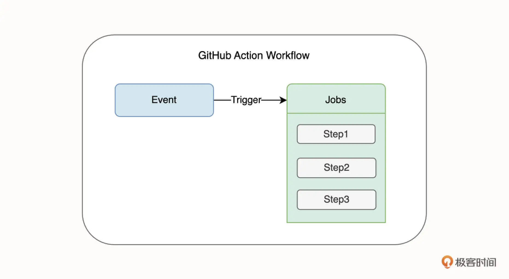
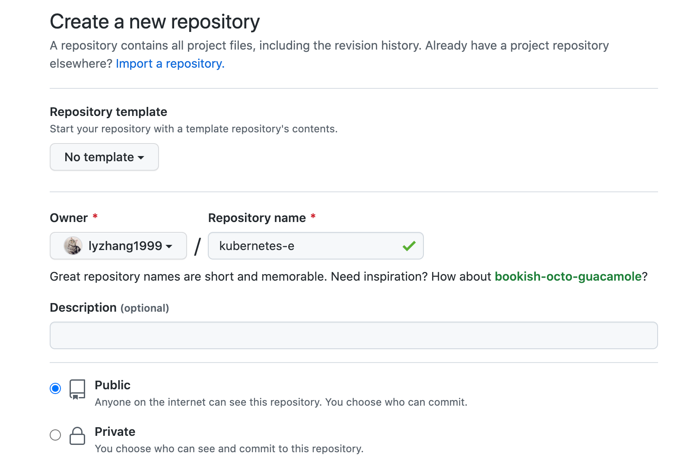
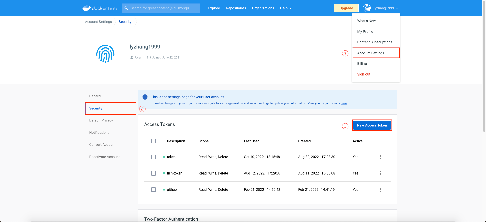
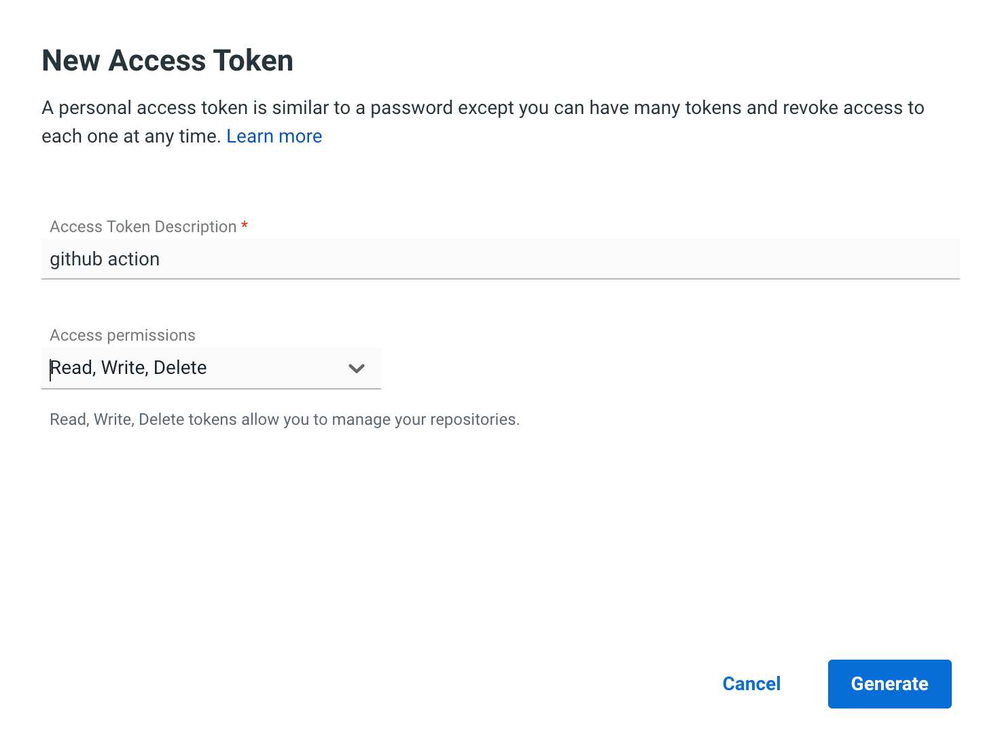
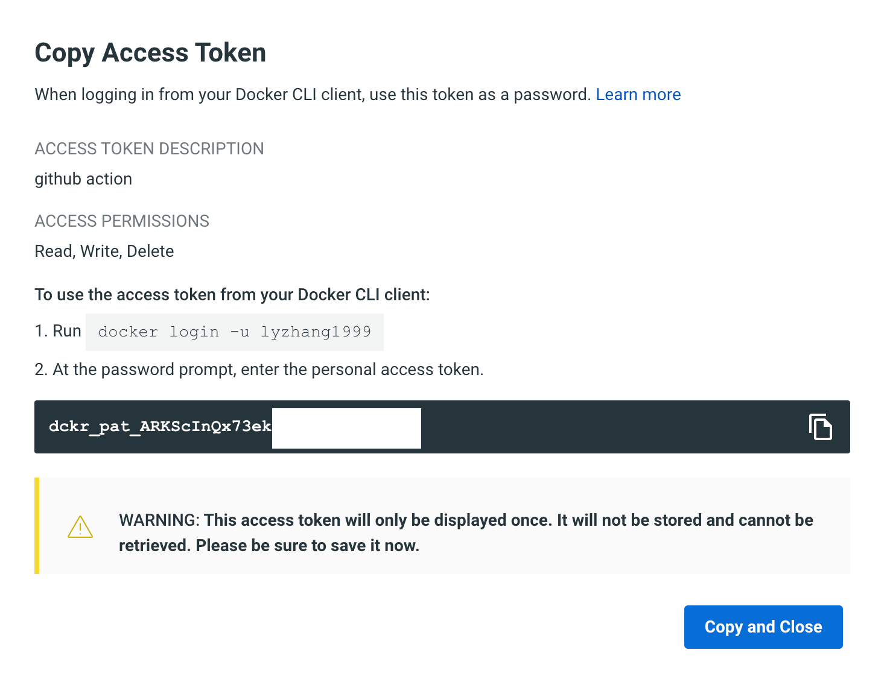
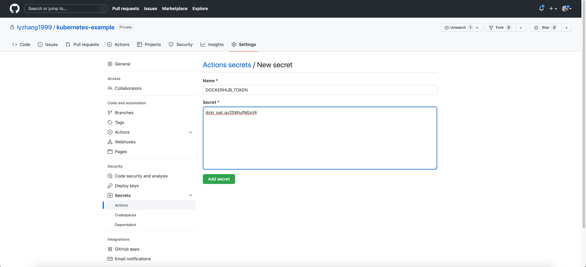
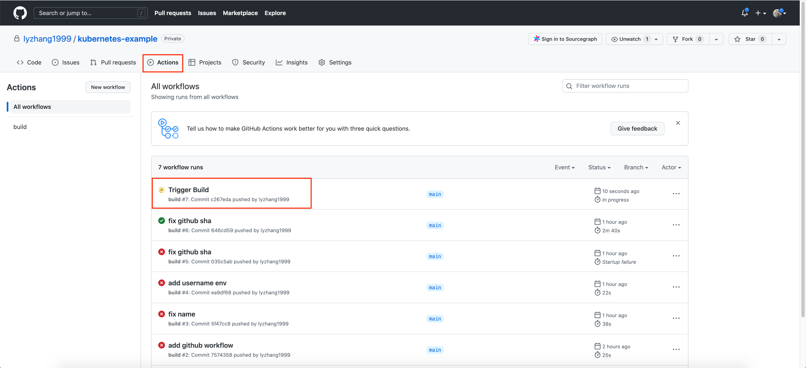
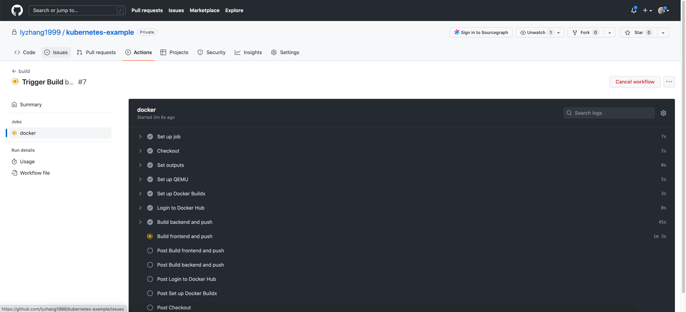
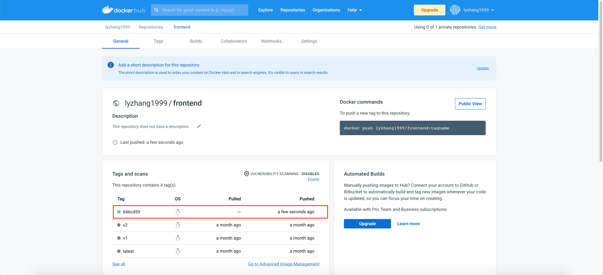

# 16 | 自动构建：如何使用GitHubAction构建镜像？

你好，我是王炜。

前面几节课，我们一起学习了容器化的最佳实践。从本质上来说，我们一直都在学习编写Dockerfile 的技巧，以及如何构建出更适合生产环境的镜像。

在之前的课程中，我们编写完 Dockerfile 之后，会在本地通过 docker build 命令来构建镜像，然后把它推送到 Docker Hub 的镜像仓库中。不过实际上，在完整的 GitOps 的环节中，我们并不会用这种手动的方式来构建镜像，通常我们会使用工具完成自动构建。

如果你熟悉 DevOps 流程，会知道在提交代码之后会触发一个自动化流程，它就是我们常说的CI (Continuous integration)，持续集成。持续集成会自动帮助我们做一些编译、构建、测试和打包工作。在将业务进行容器化改造之后，我们会有更多构建 Docker 镜像的工作，所以为了提高效率，在 GitOps 工作流中，我们同样可以在持续集成的阶段实现自动化的镜像构建。

所以，从这节课开始，我将带你学习 GitOps 工作流中的第一个自动化阶段：自动构建镜像。

这节课我会以 K8s 极简实战中的示例应用为例，带你从零开始配置 GitHub Action 自动构建镜像的工作流，它是组成 GitOps 工作流中的重要的一环。

## 什么是 GitHub Action？

在正式使用 GitHub Action 自动构建镜像之前，你需要先了解一些基本概念，我们直入主题，重点介绍这节课会涉及的概念和用法。

为了帮助你更好地理解 GitHub Action，我为你画了一张示意图。



这张图中出现了几个基本概念：Workflow、Event、Job 和 Step，我们分开来讲解。

### Workflow

Workflow 也叫做工作流。其实，GitHub Action 本质上是一个是一个 CI/CD 工作流，要使用工作流，我们首先需要先定义它。和 K8s Manifest 一样，GitHub Action 工作流是通过 YAML 来描述的，你可以在任何 GitHub 仓库创建 .github/workflows 目录，并创建 YAML 文件来定义工作流。

所有在 .github/workflows 目录创建的工作流文件，都将被 GitHub 自动扫描。在工作流中，通常我们会进一步定义 Event、Job 和 Step 字段，它们被用来定义工作流的触发时机和具体行为。

### Event

Event 从字面上的理解是“事件”的意思，你可以简单地把它理解为定义了“什么时候运行工作流”，也就是工作流的触发器。

在定义自动化构建镜像的工作流时，我们通常会把 Event 的触发器配置成“当指定分支有新的提交时，自动触发镜像构建”。

### Jobs

Jobs 的字面意思是一个具体的任务，它是一个抽象概念。在工作流中，它并不能直接工作，而是需要通过 Step 来定义具体的行为。此外，你还可以为 Job 定义它的运行的环境，例如ubuntu。

在一个 Workflow 当中，你可以定义多个 Job，多个 Job 之间可以并行运行，也可以定义相互依赖关系。在自动构建镜像环节，通常我们只需要定义一个 Job 就够了，所以在上面的示意图中，我只画出了一个 Job。

### Step

Step 隶属于 Jobs，它是工作流中最小的粒度，也是最重要的部分。通常来说，Step 的具体行为是执行一段 Shell 来完成一个功能。在同一个 Job 里，一般我们需要定义多个 Step 才能完成一个完整的 Job，由于它们是在同一个环境下运行的，所以当它们运行时，就等同于在同一台设备上执行一段 Shell。

以自动构建镜像为例，我们可能需要在 1 个 Job 中定义 3 个 Step。

- Step1，克隆仓库的源码。

- Step2，运行 docker build 来构建镜像。

- Step3，推送到镜像仓库。

### 费用

GitHub Action 在使用上虽然很方便，但天下并没有免费的午餐。对于 GitHub 免费账户，每个月有 2000 分钟的 GitHub Action 时长可供使用（Linux 环境），超出时长则需要按量付费，你可以在这里查看详细的计费策略。

## 为示例应用创建 GitHub Action Workflow

了解了 GitHub Action 的相关概念，接下来我们就进入到实战环节了。

我以 K8s 极简实战模块的示例应用为例，看看如何配置自动构建示例应用的前后端镜像工作流。在这个例子中，我们创建的工作流将实现以下这些步骤。

- 当 main 分支有新的提交时，触发工作流。

- 克隆代码。

- 初始化 Docker 构建工具链。

- 登录 Docker Hub。

- 构建前后端应用镜像，并使用 commit id 作为镜像的 tag。

- 推送到 Docker Hub 镜像仓库。

下面，我们来为示例应用创建工作流。

### 创建 build.yaml 文件

首先，我们要将示例应用仓库克隆到本地。

```
$ git clone https://github.com/lyzhang1999/kubernetes-example.git
```

进入 kubernetes-example 目录。

```
$ cd kubernetes-example
```

然后，在当前目录下新建 .github/workflows 目录。

```
$ mkdir -p .github/workflows
```

接下来，将下面的内容保存到 .github/workflows/build.yaml 文件内。

```bash
name: build
on:
 push:
   branches:
     - 'main'
env:
 DOCKERHUB_USERNAME: lyzhang1999
jobs:
 docker:
   runs-on: ubuntu-latest
   steps:
     - name: Checkout
       uses: actions/checkout@v3
     - name: Set outputs
       id: vars
       run: echo "::set-output name=sha_short::$(git rev-parse --short HEAD)"
     - name: Set up QEMU
       uses: docker/setup-qemu-action@v2
     - name: Set up Docker Buildx
       uses: docker/setup-buildx-action@v2
     - name: Login to Docker Hub
       uses: docker/login-action@v2
       with:
         username: ${{ env.DOCKERHUB_USERNAME }}
         password: ${{ secrets.DOCKERHUB_TOKEN }}
     - name: Build backend and push
       uses: docker/build-push-action@v3
       with:
         context: backend
         push: true
         tags: ${{ env.DOCKERHUB_USERNAME }}/backend:${{ steps.vars.outputs.sha_
     - name: Build frontend and push
       uses: docker/build-push-action@v3
       with:
         context: frontend
         push: true
tags: ${{ env.DOCKERHUB USERNAME }}/frontend:${{ steps.vars.outputs.sha
```

请注意，你需要将上面的 env.DOCKERHUB_USERNAME 环境变量替换为你的 Docker Hub用户名。

我简单介绍一下这个工作流。

这里的 name 字段是工作流的名称，它会展示在 GitHub 网页上。

on.push.branches 字段的值为 main，这代表当 main 分支有新的提交之后，会触发工作流。

env.DOCKERHUB_USERNAME 是我们为 Job 配置的全局环境变量，用作镜像 Tag 的前缀。

jobs.docker 字段定义了一个任务，它的运行环境是 ubuntu-latest，并且由 7 个 Step 组成。

jobs.docker.steps 字段定义了 7 个具体的执行阶段。要特别注意的是，uses 字段代表使用GitHub Action 的某个插件，例如 actions/checkout@v3 插件会帮助我们检出代码。

在这个工作流中，这 7 个阶段会具体执行下面几件事。

1. “Checkout”阶段负责将代码检出到运行环境。

2. “Set outputs”阶段会输出 sha_short 环境变量，值为 short commit id，这可以方便在后续阶段引用。

3. “Set up QEMU”和“Set up Docker Buildx”阶段负责初始化 Docker 构建工具链。

4. “Login to Docker Hub”阶段通过 docker login 来登录到 Docker Hub，以便获得推送镜像的权限。要注意的是，with 字段是向插件传递参数的，在这里我们传递了 username 和password，值的来源分别是我们定义的环境变量 DOCKERHUB_USERNAME 和 GitHubAction Secret，后者我们还会在稍后进行配置。

5. “Build backend and push”和“Build frontend and push”阶段负责构建前后端镜像，并且将镜像推送到 Docker Hub，在这个阶段中，我们传递了 context、push 和 tags 参数，context

```
和 tags 实际上就是 docker build 的参数。在 tags 参数中，我们通过表达式 ${{
env.DOCKERHUB_USERNAME }} 和 ${{ steps.vars.outputs.sha_short }} 分
```

- 别读取了 在 YAML 中预定义的 Docker Hub 的用户名，以及在“Set outputs”阶段输出的short commit id。

### 创建 GitHub 仓库并推送

创建完 build.yaml 文件后，接下来，我们要把示例应用推送到 GitHub 上。首先，你需要通过这个页面来为自己创建新的代码仓库，仓库名设置为 kubernetes-example。



创建完成后，将刚才克隆的 kubernetes-example 仓库的 remote url 配置为你刚才创建仓库的Git 地址。

```
$ git remote set-url origin YOUR_GIT_URL
```

然后，将 kubernetes-example 推送到你的仓库。在这之前，你可能还需要配置 SSH Key，你可以参考这个链接来配置，这里就不再赘述了。

```
$ git add .
$ git commit -a -m 'first commit'
$ git branch -M main
$ git push -u origin main
```

### 创建 Docker Hub Secret

创建完 build.yaml 文件后，接下来，我们需要创建 Docker Hub Secret，它将会为工作流提供推送镜像的权限。

首先，使用你注册的账号密码登录 https://hub.docker.com/。然后，点击右上角的“用户名”，选择“Account Settings”，并进入左侧的“Security”菜单。



下一步点击右侧的“New Access Token”按钮，创建一个新的 Token。



输入描述，然后点击“Genarate”按钮生成 Token。



点击“Copy and Close”将 Token 复制到剪贴板。请注意，当窗口关闭后，Token 无法再次查看，所以请在其他地方先保存刚才生成的 Token。

### 创建 GitHub Action Secret

创建完 Docker Hub Token 之后，接下来我们就可以创建 GitHub Action Secret 了，也就是说我们要为 Workflow 提供 secrets.DOCKERHUB_TOKEN 变量值。

进入 kubernetes-example 仓库的 Settings 页面，点击左侧的“Secrets”，进入“Actions”菜单，然后点击右侧“New repository secret”创建新的 Secret。



在 Name 输入框中输入 DOCKERHUB_TOKEN，这样在 GitHub Action 的 Step 中，就可以通过 ${{ secrets.DOCKERHUB_TOKEN }} 表达式来获取它的值。

在 Secret 输入框中输入刚才我们复制的 Docker Hub Token，点击“Add secret”创建。

### 触发 GitHub Action Workflow

到这里，准备工作已经全部完成了，接下来我们尝试触发 GitHub Action 工作流。还记得我们在工作流配置的 on.push.branches 字段吗？它的值为 main，代表当有新的提交到 main 分支时触发工作流。

首先，我们向仓库提交一个空 commit。

```
$ git commit --allow-empty -m "Trigger Build"
```

然后，使用 git push 来推送到仓库，这将触发工作流。

```
$ git push origin main
```

接下来，进入 kubernetes-example 仓库的“Actions”页面，你将看到我们刚才触发的工作流。



你可以点击工作流的标题进入工作流详情页面。



在工作流的详情页面，我们能看到工作流的每一个 Step 的状态及其运行时输出的日志。

当工作流运行完成后，进入到 Docker Hub frontend 或者 backend 镜像的详情页，你将看到刚才 GitHub Action 自动构建并推送的新版本镜像。



到这里，我们便完成了使用 GitHub Action 自动构建镜像的全过程。最终实现效果是，当我们向 main 分支提交代码时，GitHub 工作流将自动构建 frontend 和 backend 镜像，并且每一个commit id 对应一个镜像版本。

## 总结

总结一下，这节课，我为你介绍了构成 GitOps 工作流的第一个自动化阶段：自动化构建镜像。为了实现自动化构建镜像，我们学习了 GitHub Action 工作流及其基本概念，例如Workflow、Event、Jobs 和 Steps。

在介绍 GitHub Action 相关概念时，我故意精简了一部分概念，比如 Runner、多个 Jobs 以及Jobs 相互依赖的情况。在现阶段，我们只需要掌握最简单的自动构建镜像的 YAML 写法以及相关概念就足够了。

在实战环节，我们创建了一个 build.yaml 文件用来定义 GitHub Action 工作流，总结来说，它定义了工作流的：

1. 工作流名称

2. 在什么时候触发

3. 在什么环境下运行

4. 具体执行的步骤是什么

需要注意的是，在创建 build.yaml 文件后，你需要创建自己的仓库，并将 kubernetes-example 的内容推送到你的仓库中，以便进行触发工作流的实验。其次，为了给 GitHubAction 工作流赋予镜像仓库的推送权限，我们还需要在 Docker Hub 中创建 Token，并将其配置到仓库的 Secrets 中。在配置时，需要注意 Secret Name 和工作流 Step 中的 ${{secrets.DOCKERHUB_TOKEN }} 表达式相互对应，以便工作流能够获取到正确的 Secrets。

配置完成后，当我们向 Main 分支推送新的提交时，GitHub Action 工作流将会被自动触发，工作流会自动构建 frontend 和 backend 镜像，并且会使用当前的 short commit id 作为镜像的Tag 推送到 Docker Hub 中。

这意味着，每一个提交都会生成一个 Docker 镜像，实现了代码和制品的对应关系。这种对应关系给我们带来了非常大的好处，例如当我们要回滚或更新应用时，只需要找到代码的commit id 就能够找到对应的镜像版本。

## 思考题

最后，给你留一道简单的思考题吧。

docker/build-push-action 插件还有其他的一些高级配置，请你结合 docker/build-push-action@v3 插件文档，尝试改造 build.yaml，使其同时支持构建 linux/amd64 和linux/arm64 两个平台的镜像，并和我分享改动之后的 YAML。

欢迎你给我留言交流讨论，你也可以把这节课分享给更多的朋友一起阅读。我们下节课见。
