# 18 | 自托管构建：如何使用Tekton构建镜像？

你好，我是王炜。

前两节课，我们分别介绍了如何使用 GitHub Action Workflow 和 GitLab CI 来自动构建镜像，它们配置起来相对简单，作为平台自带的功能，也不需要花费额外的维护成本。并且，它们都和 Git 仓库深度整合，这就让触发流水线变得非常简单了。

对于构建次数较少的团队来说，在免费额度范围内使用它们是一个非常好的选择。但是对于构建次数非常频繁的中大型团队来说，综合考虑费用、可控和定制化等各方面因素，他们可能会考虑使用其他自托管的方案。

这节课，我们就来介绍其中一种自动构建镜像的自托管方案：使用 Tekton 来自动构建镜像。Tekton 是一款基于 Kubernetes 的 CI/CD 开源产品，如果你已经有一个 Kubernetes 集群，那么利用 Tekton 直接在 Kubernetes 上构建镜像是一个不错的选择。

我会首先带你了解 Tekton 的基本概念，然后我们仍然以示例应用为例，从零开始为示例应用配置构建镜像的流水线，并结合 GitHub 为 Tekton 配置 Webhook 触发器，实现提交代码之后触发 Tekton 流水线并构建镜像，最后推送到镜像仓库的过程。

在学完这节课之后，你将基本掌握 Tekton 的流水线以及触发器的用法，并具备独立配置它们的能力。

在开始今天的学习之前，你需要具备以下前提条件。

- 在本地安装了 kubectl。

- 已经按照第 16 讲将 kubernetes-example 示例应用代码推送到了自己的 GitHub 仓库中。

## 准备 Kubernetes 集群

由于我们在实践的过程中需要 Kubernetes 集群的 Loadbalancer 能力，所以，首先你需要准备一个云厂商的 Kubernetes 集群，你可以使用 AWS、阿里云或腾讯云等任何云厂商。这里我以开通腾讯云 TKE 集群为例演示一下，这部分内容比较基础，如果你已经有云厂商Kubernetes 集群，或者熟悉开通过程，都可以跳过这个步骤。

首先，登录腾讯云并在这个页面打开 TKE 控制台，点击“新建”按钮，选择“标准集群”。

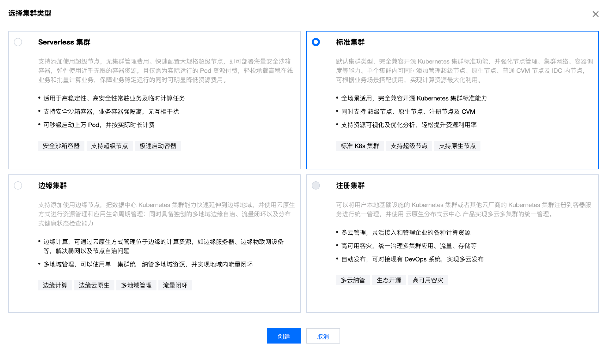

在创建集群页面输入“集群名称”，“所在地域”项中选择“中国香港”，集群网络选择“Default”，其他信息保持默认，点击下一步。

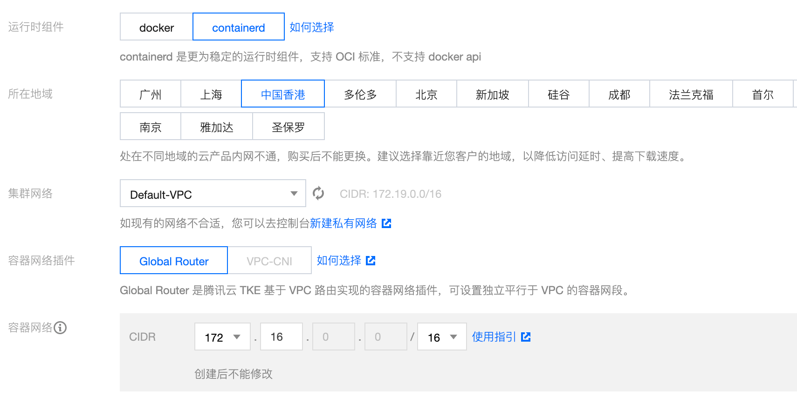

接下来进入到 Worker 节点配置阶段。在“机型”一栏中选择一个 2 核 8G 的节点，在“公网带宽”一栏中将带宽调整为 100Mbps，并且按量计费。

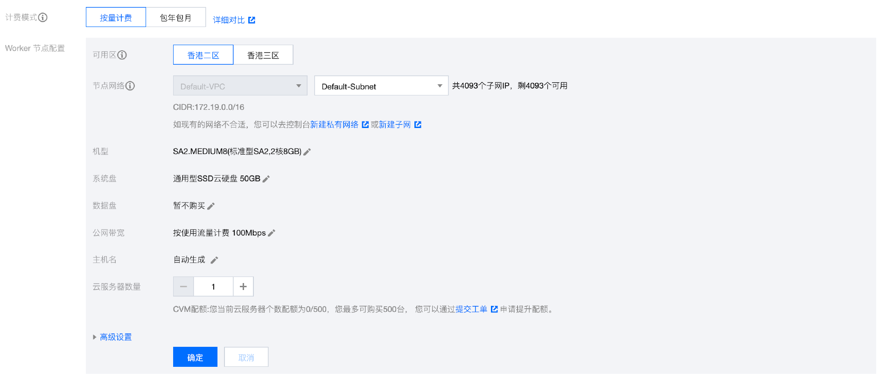

点击“下一步”。后续的页面都保持默认选择，点击“完成”创建 Kubernetes 集群。这里需要等待几分钟直至集群准备就绪。

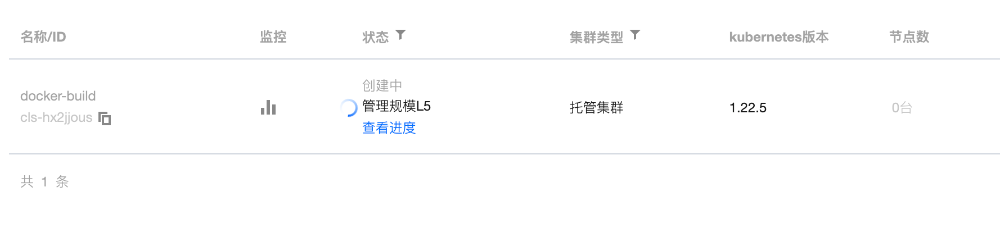

点击集群名称“docker-build”进入集群详情页，在“集群 APIServer 信息”一栏找到“外网访问”，点击开关来开启集群的外网访问。

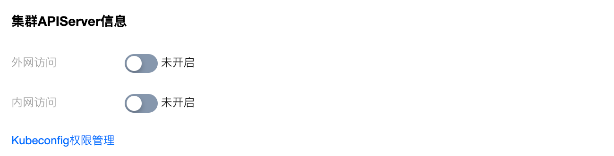

在弹出的新窗口中，选择“Default”安全组并选择“按使用流量”计费，访问方式选择“公网 IP”，然后点击“保存”开通集群外网访问。

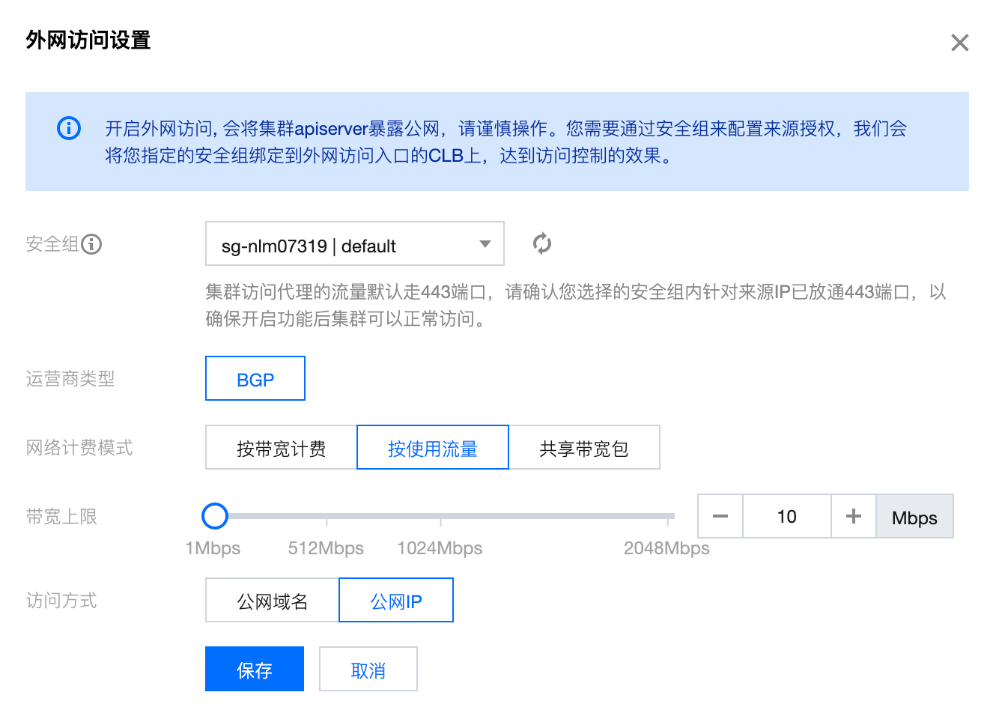

等待“外网访问”开关转变为启用状态。

接下来，在“Kubeconfig”一栏点击“复制”，复制集群 Kubeconfig 信息。

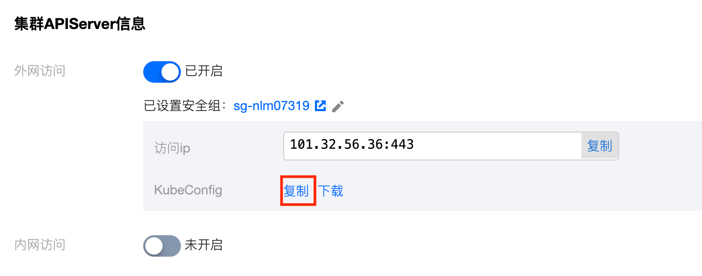

接下来，将集群证书信息内容写入到本地的 ~/.kube/config 文件内，这是 kubectl 默认读取kubeconfig 的文件位置。

为了避免覆盖已有的 kubeconfig，首先你需要备份 ~/.kube/config 文件。

```
$ mv ~/.kube/config ~/.kube/config-bak
```

然后新建 ~/.kube/config 文件，将刚才复制的 Kubeconfig 内容写入到该文件内。

最后，执行 kubectl get node 来验证 kubectl 与集群的联通性。

```
$ kubectl get node
NAME           STATUS   ROLES    AGE     VERSION
172.19.0.107   Ready    <none>   5m21s   v1.22.5-tke.5
```

待 Node 信息返回后，我们的 Kubernetes 集群也就准备好了。

## 安装组件

准备好云厂商 Kubernetes 集群之后，接下来我们需要安装两个组件，分别是 Tekton 相关的组件以及 Ingress-Nginx。

### Tekton

首先，安装 Tekton Operator。

```
$ kubectl apply -f https://storage.googleapis.com/tekton-releases/pipeline/latest
namespace/tekton-pipelines created
podsecuritypolicy.policy/tekton-pipelines created
......
```

等待 Tekton 所有的 Pod 就绪。

```
$ kubectl wait --for=condition=Ready pods --all -n tekton-pipelines --timeout=300
pod/tekton-pipelines-controller-799f9f989b-hxmlx condition met
pod/tekton-pipelines-webhook-556f9f7476-sgx2n condition met
```

接下来，安装 Tekton Dashboard。

```
$ kubectl apply -f https://storage.googleapis.com/tekton-releases/dashboard/lates
serviceaccount/tekton-dashboard created
role.rbac.authorization.k8s.io/tekton-dashboard-info created
......
```

然后，分别安装 Tekton Trigger 和 Tekton Interceptors 组件。

```
$ kubectl apply -f https://storage.googleapis.com/tekton-releases/triggers/latest
podsecuritypolicy.policy/tekton-triggers created
clusterrole.rbac.authorization.k8s.io/tekton-triggers-admin created
......
$ kubectl apply -f https://storage.googleapis.com/tekton-releases/triggers/latest
deployment.apps/tekton-triggers-core-interceptors created
service/tekton-triggers-core-interceptors created
......
```

等待所有 Tekton 的所有组件的 Pod 都处于就绪状态，Tekton 就部署完成了。

```
$ kubectl wait --for=condition=Ready pods --all -n tekton-pipelines --timeout=300
pod/tekton-dashboard-5d94c7f687-8t6p2 condition met
pod/tekton-pipelines-controller-799f9f989b-hxmlx condition met
pod/tekton-pipelines-webhook-556f9f7476-sgx2n condition met
pod/tekton-triggers-controller-bffdd47cf-cw7sv condition met
pod/tekton-triggers-core-interceptors-5485b8bd66-n9n2m condition met
pod/tekton-triggers-webhook-79ddd8d6c9-f79tg condition met
```

### Ingress-Nginx

安装完 Tekton 之后，我们再来安装 Ingress-Nginx。

```
$ kubectl apply -f https://ghproxy.com/https://raw.githubusercontent.com/kubernet
namespace/ingress-nginx created
serviceaccount/ingress-nginx created
serviceaccount/ingress-nginx-admission created
......
```

等待所有 Ingress-Nginx Pod 处于就绪状态，Ingress-Nginx 就部署完成了。

```
$ kubectl wait --for=condition=AVAILABLE deployment/ingress-nginx-controller --al
deployment.apps/ingress-nginx-controller condition met
```

### 暴露 Tekton Dashboard

配置好 Tekton 和 Ingress-Nginx 之后，为了方便访问 Tekton Dashboard，我们要通过Ingress 的方式暴露它，将下列内容保存为 tekton-dashboard.yaml。

```
apiVersion: networking.k8s.io/v1
kind: Ingress
metadata:
 name: ingress-resource
 namespace: tekton-pipelines
 annotations:
   kubernetes.io/ingress.class: nginx
   nginx.ingress.kubernetes.io/ssl-redirect: "false"
spec:
 rules:
   - host: tekton.k8s.local
     http:
       paths:
         - path: /
           pathType: Prefix
           backend:
             service:
               name: tekton-dashboard
               port:
                 number: 9097
```

然后，执行 kubectl apply 将它应用到集群内。

```
$ kubectl apply -f tekton-dashboard.yaml
ingress.networking.k8s.io/ingress-resource created
```

接下来，获取 Ingress-Nginx Loadbalancer 的外网 IP 地址。你可以使用 kubectl get service来获取。

```
$ kubectl get services --namespace ingress-nginx ingress-nginx-controller --outpu
43.135.82.249
```

由于之前我在 Ingress 策略中配置的是一个虚拟域名，所以需要在本地配置 Hosts。当然你也可以将 Ingress 的 host 修改为实际的域名，并且为域名添加 DNS 解析，也能达到同样的效果。

以 Linux 系统为例，要修改 Hosts，你需要将下面的内容添加到 /etc/hosts 文件内。

```
43.135.82.249 tekton.k8s.local
```

然后，你就可以通过域名 http://tekton.k8s.local 来访问 Tekton Dashboard 了。

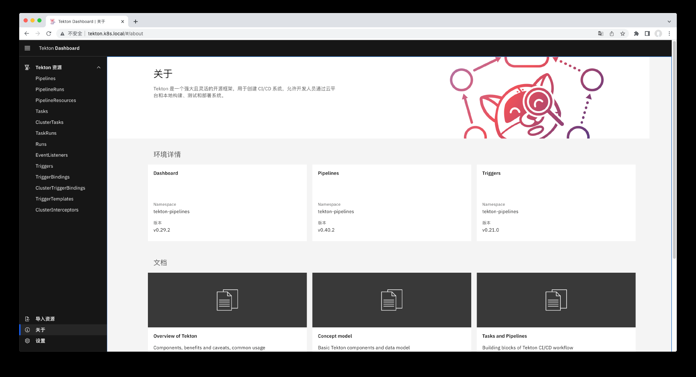

## Tekton 简介

在正式创建 Tekton 流水线之前，你需要先了解一些基本概念，你可以结合下面这张图来理解一下。

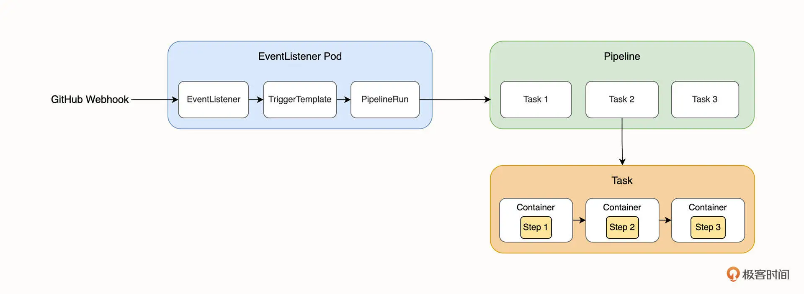

在上面这张图中，从左往右依次出现了这几个概念：EventListener、TriggerTemplate、PipelineRun、Pipeline、Task 以及 Step，接下来，我就简单介绍一下它们。

### EventListener

EventListener 顾名思义是一个事件监听器，它是外部事件的入口。EventListener 通常以HTTP 的方式对外暴露，在我们这节课的例子中，我们会在 GitHub 创建 WebHook 来调用Tekton 的 EventListener，使它能接收到仓库推送事件。

### TriggerTemplate

当 EventListener 接收到外部事件之后，它会调用 Trigger 也就是触发器，而 TriggerTemplate是用来定义接收到事件之后需要创建的 Tekton 资源的，例如创建一个 PipelineRun 对象来运行流水线。这节课，我们会使用 TriggerTemplate 来创建 PipelineRun 资源。

### Step

Step 是流水线中的一个具体的操作，例如构建和推送镜像操作。Step 接收镜像和需要运行的Shell 脚本作为参数，Tekton 将会启动镜像并执行 Shell 脚本。

### Task

Task 是一组有序的 Step 集合，每一个 Task 都会在独立的 Pod 中运行，Task 中不同的 Step将在同一个 Pod 不同的容器内运行。

### Pipeline

Pipeline 是 Tekton 中的一个核心组件，它是一组 Task 的集合，Task 将组成一组有向无环图（DAG），Pipeline 会按照 DAG 的顺序来执行。

### PipelineRun

PipelineRun 实际上是 Pipeline 的实例化，它负责为 Pipeline 提供输入参数，并运行Pipeline。例如，两次不同的镜像构建操作对应的就是两个不同的 PipelineRun 资源。

## 创建 Tekton Pipeline

可以看出，Tekton 的概念确实比较多，抽象也不好理解。别担心，接下来我们就实际创建一下流水线，在这个过程中不断加深理解。

### 概述

我们先来看看这节课创建的 Tekton 流水线最终可以实现的效果，如下图所示。

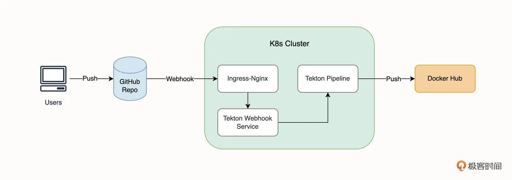

简单来说，当我们向 GitHub 推送代码时，GitHub 将以 HTTP 请求的方式通知集群内的Tekton 触发器，触发器通过 Ingress-Nginx 对外暴露，当触发器接收到来自 GitHub 的事件推送时，将通过 TriggerTemplate 来创建 PipelineRun 运行 Pipeline，最终实现镜像的自动构建和推送。

### 创建 Task

好，下面我们正式开始实战。在创建 Pipeline 之前，我们需要先创建两个 Task，这两个Task 分别负责“检出代码”还有“构建和推送镜像”。

首先创建检出代码的 Task。

```
$ kubectl apply -f https://ghproxy.com/https://raw.githubusercontent.com/lyzhang1
task.tekton.dev/git-clone created
```

这个 Task 是 Tekton 官方提供的插件，它和 GitHub Action 的 checkout 插件有一点类似，主要作用是检出代码。在这里，我们不需要理解它具体的细节。

然后，创建构建和推送镜像的 Task。

```
$ kubectl apply -f https://ghproxy.com/https://raw.githubusercontent.com/lyzhang1
task.tekton.dev/docker-socket configured
```

简单介绍一个这个 Task，关键内容如下。

```bash
apiVersion: tekton.dev/v1beta1
kind: Task
metadata:
 name: docker-socket
spec:
 workspaces:
   - name: source
 params:
   - name: image
     description: Reference of the image docker will produce.
   ......
 steps:
   - name: docker-build
     image: docker:stable
     env:
       ......
       - name: IMAGE
         value: $(params.image)
       - name: DOCKER_PASSWORD
         valueFrom:
           secretKeyRef:
             name: registry-auth
             key: password
       - name: DOCKER_USERNAME
         valueFrom:
           secretKeyRef:
             name: registry-auth
             key: username
     workingDir: $(workspaces.source.path)
     script: |
       cd $SUBDIRECTORY
       docker login $REGISTRY_URL -u $DOCKER_USERNAME -p $DOCKER_PASSWORD
       if [ "${REGISTRY_URL}" = "docker.io" ] ; then
         docker build --no-cache -f $CONTEXT/$DOCKERFILE_PATH -t $DOCKER_USERNAM
         docker push $DOCKER_USERNAME/$IMAGE:$TAG
         exit
       fi
       docker build --no-cache -f $CONTEXT/$DOCKERFILE_PATH -t $REGISTRY_URL/$RE
       docker push $REGISTRY_URL/$REGISTRY_MIRROR/$IMAGE:$TAG
     volumeMounts: # 共享 docker.socket
       - mountPath: /var/run/
         name: dind-socket
 sidecars: #sidecar 提供 docker daemon
   - image: docker:dind
     ......
```

spec.params 字段用来定义变量，并最终由 PipelineRun 提供具体的值。

spec.steps 字段用来定义具体的执行步骤，例如，我们在这里使用 docker:stable 镜像创建了容器，并将 spec.params 定义的变量以 ENV 的方式传递到容器内部，其中DOCKER_PASSWORD 和 DOCKER_USERNAME 两个变量来源于 Secret，我们将在后续创建。

spec.steps[0].script 字段定义了具体执行的命令，这里执行了 docker login 登录到 DockerHub，并且使用了 docker build 和 docker push 来构建和推送镜像。我们对 Docker Hub 和其他镜像仓库做了区分，以便使用不同的 TAG 命名规则。

spec.sidecars 字段为容器提供 Docker daemon，它使用的镜像是 docker:dind。

仔细回想一下上节课的内容你会发现，这个 Task 定义的具体行为和 GitLab CI 定义的流水线非常类似，它们都是指定一个镜像，然后运行一段脚本，并且都是用 DiND 的方式来构建和推送镜像的。

### 创建 Pipeline

创建完 Task 之后，由于它们实现的具体功能是独立的，所以我们需要将他们联系起来。也就是说，我们希望 Pipeline 先克隆代码，再构建和推送镜像。所以，下面我们需要创建 Pipeline来引用这两个 Task。

```
$ kubectl apply -f https://ghproxy.com/https://raw.githubusercontent.com/lyzhang1
pipeline.tekton.dev/github-trigger-pipeline created
```

这里我也简单介绍一下这个 Pipeline。

```
apiVersion: tekton.dev/v1beta1
kind: Pipeline
metadata:
 name: github-trigger-pipeline
spec:
 workspaces:
   - name: pipeline-pvc
   ......
 params:
   - name: subdirectory # 为每一个 Pipeline 配置一个 workspace，防止并发错误
     type: string
     default: ""
   - name: git_url
   ......
 tasks:
   - name: clone
     taskRef:
       name: git-clone
     workspaces:
       - name: output
         workspace: pipeline-pvc
       - name: ssh-directory
         workspace: git-credentials
     params:
       - name: subdirectory
         value: $(params.subdirectory)
       - name: url
         value: $(params.git_url)
   - name: build-and-push-frontend
     taskRef:
       name: docker-socket
     runAfter:
       - clone
     workspaces:
       - name: source
         workspace: pipeline-pvc
     params:
       - name: image
         value: "frontend"
       ......
   - name: build-and-push-backend
     taskRef:
       name: docker-socket
     runAfter:
       - clone
     workspaces:
       - name: source
         workspace: pipeline-pvc
     params:
       - name: image
         value: "backend"
       ......
```

首先，spec.workspaces 定义了一个工作空间。还记得我们提到的每一个 Task 都会在独立的Pod 中运行吗？那么不同的 Task 如何共享上下文呢？答案就是 workspaces。实际上它是一个 PVC 持久化卷，这个 PVC 将会在 Pod 之间复用，这就让下游 Task 可以读取到上游 Task写入的数据（比如克隆的代码）。

spec.params 定义了 Pipeline 的参数，参数的传递顺序是：PipelineRun->Pipeline->Task。

spec.tasks 定义了 Pipeline 引用的 Task，例如在这里分别引用了 git-clone 和 docker-socket两个 Task，并且都指定了同一个 workspaces pipeline-pvc，然后指定了 params 向 Task 传递了参数值。

在 build-and-push-frontend 和 build-and-push-backend Task 中，都指定了 runAfter 字段，它的含义是等待 clone Task 执行完毕后再运行。

所以，Pipeline 对 Task 的引用就形成了一个有向无环图（DAG），在这个 Pipeline 中，首先会检出源码，然后以并行的方式同时构建前后端镜像。

### 创建 EventListener

创建完 Pipeline 之后，工作流实际上就已经定义好了。但是我们并不希望手动来运行它，我们希望通过 GitHub 来自动触发它。所以，接下来需要创建 EventListener 来获得一个能够监听外部事件的服务。

```
$ kubectl apply -f https://ghproxy.com/https://raw.githubusercontent.com/lyzhang1
eventlistener.triggers.tekton.dev/github-listener created
```

EventListener 的具体作用是：接收来自 GitHub 的 Webhook 调用，并将 Webhook 的参数和TriggerTemplate 定义的参数对应起来，以便将参数值从 Webhook 一直传递到 PipelineRun。

### 暴露 EventListener

在 EventListener 创建完成之后，Tekton 将会拉起一个 Deployment 用来处理 Webhook 请求，你可以通过 kubectl get deployment 命令来查看。

```
$ kubectl get deployment
NAME                 READY   UP-TO-DATE   AVAILABLE   AGE
el-github-listener   1/1     1            1           22m
```

同时，Tekton 也会为 el-github-listener Deployment 创建 Service，以便接受来自外部的HTTP 请求。

```
$ kubectl get service
NAME                  TYPE           CLUSTER-IP      EXTERNAL-IP    PORT(S)
el-github-listener    ClusterIP      172.16.253.54   <none>         8080/TCP,9000
```

为了能够让 GitHub 将事件推送到 Tekton 中，我们需要暴露 el-github-listener Service。我使用了 Ingress-Nginx 来对外暴露它。

```
$ kubectl apply -f https://ghproxy.com/https://raw.githubusercontent.com/lyzhang1
ingress.networking.k8s.io/ingress-resource created
```

这个 Ingress 的内容比较简单，具体如下。

```
apiVersion: networking.k8s.io/v1
kind: Ingress
metadata:
 name: ingress-resource
 annotations:
   kubernetes.io/ingress.class: nginx
   nginx.ingress.kubernetes.io/ssl-redirect: "false"
spec:
 rules:
   - http:
       paths:
         - path: /hooks
           pathType: Exact
           backend:
             service:
               name: el-github-listener
               port:
                 number: 8080
```

在 Ingress 策略中，我们没有使用 host 定义域名，而使用了 path 来匹配路径。这样，Tekton接收外部 Webhook 的入口也就是 Ingress-Nginx 的负载均衡器 IP 地址了，具体的地址为http://43.135.82.249/hooks。

### 创建 TriggerTemplate

不过 EventListener 并不能独立工作，它还需要一个助手，那就是 TriggerTemplate。TriggerTemplate 是真正控制 Pipeline 启动的组件，它负责创建 PipelineRun。

我们可以通过下面的命令来创建 TriggerTemplate。

```
$ kubectl apply -f https://ghproxy.com/https://raw.githubusercontent.com/lyzhang1
triggertemplate.triggers.tekton.dev/github-template created
```

### 创建 Service Account 和 PVC

下一步，由于触发器并没有具体的执行用户，所以我们还需要为触发器配置权限，也就是创建Service Account。同时，我们也可以一并创建用于共享 Task 之间上下文的 PVC 。

```
$ kubectl apply -f https://ghproxy.com/https://raw.githubusercontent.com/lyzhang1
serviceaccount/tekton-build-sa created
clusterrolebinding.rbac.authorization.k8s.io/tekton-clusterrole-binding created
persistentvolumeclaim/pipeline-pvc created
role.rbac.authorization.k8s.io/tekton-triggers-github-minimal created
rolebinding.rbac.authorization.k8s.io/tekton-triggers-github-binding created
clusterrole.rbac.authorization.k8s.io/tekton-triggers-github-clusterrole created
clusterrolebinding.rbac.authorization.k8s.io/tekton-triggers-github-clusterbindin
```

### 设置 Secret

最后，我们还需要为 Tekton 提供一些凭据信息，例如 Docker Hub Token、GitHub WebhookSecret 以及用于检出私有仓库的私钥信息。

将下面的内容保存为 secret.yaml，并修改相应的内容。

```
apiVersion: v1
kind: Secret
metadata:
 name: registry-auth
 annotations:
   tekton.dev/docker-0: https://docker.io
type: kubernetes.io/basic-auth
stringData:
 username: "" # docker username
 password: "" # docker hub token
---
# github webhook token secret
apiVersion: v1
kind: Secret
metadata:
 name: github-secret
type: Opaque
stringData:
 secretToken: "webhooksecret"
---
apiVersion: v1
kind: Secret
metadata:
 name: git-credentials
data:
 id_rsa: LS0tLS......
 known_hosts: Z2l0aHViLm......
 config: SG9zd......
```

解释一下，你主要需要修改的是下面这几个字段。

- 将 stringData.username 替换为你的 Docker Hub 的用户名。

- 将 stringData.password 替换为你的 Docker Hub Token，如果你还没有创建好，可以在上一节课找到相应内容。

- 将 data.id_rsa 替换为你本地 ~/.ssh/id_rsa 文件的 base64 编码内容，这将会为 Tekton 提

```
供检出私有仓库的权限，你可以使用 $ cat ~/.ssh/id_rsa | base64 命令来获取。
```

- 将 data.known_hosts 替换为你本地 ~/.ssh/known_hosts 文件的 base64 编码内容，你可以

```
通过 $ cat ~/.ssh/known_hosts | grep "github" | base64 命令来获取。
将 data.config 替换为你本地 ~/.ssh/config 文件的 base64 编码内容，你可以通过 $ cat
~/.ssh/config | base64 命令来获取。
```

然后，运行 kuebctl apply，同时将这 3 个 Secret 应用到集群内。

```
$ kubectl apply -f secret.yaml
secret/registry-auth created
secret/github-secret created
secret/git-credentials created
```

## 创建 GitHub Webhook

到这里，Tekton 的配置就已经完成了。接下来还剩最后一步：创建 GitHub Webhook。

打开你在 GitHub 创建的 kubernetes-example 仓库，进入“Settings”页面，点击左侧的“Webhooks”菜单，在右侧的页面中按照下图进行配置。

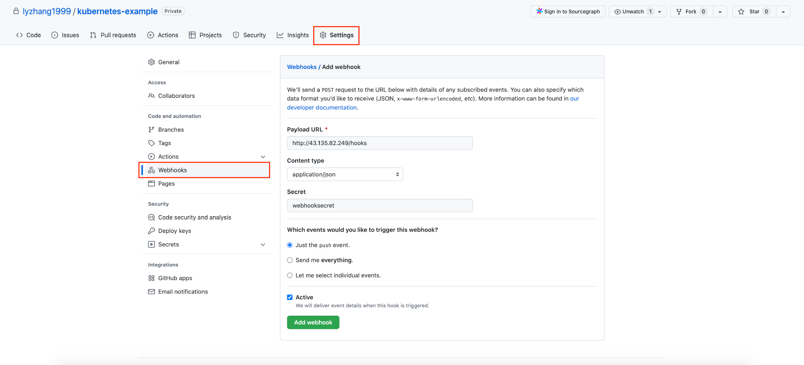

输入 Webhook 地址，也就是“ Ingress-Nginx 网关的负载均衡器地址 + hooks 路径”，并且将“Content type”配置为“application/json”。

点击“Add webhook”创建。

## 触发 Pipeline

到这里，所有的准备工作就已经完成了。现在我们向仓库提交一个空的 commit 来触发Pipeline。

```
$ git commit --allow-empty -m "Trigger Build"
[main 79ca67e] Trigger Build
$ git push origin main
```

完成推送后，打开 http://tekton.k8s.local/ 进入 Tekton 控制台，点击左侧的“PipelineRun”，你会看到刚才触发的 Pipeline。

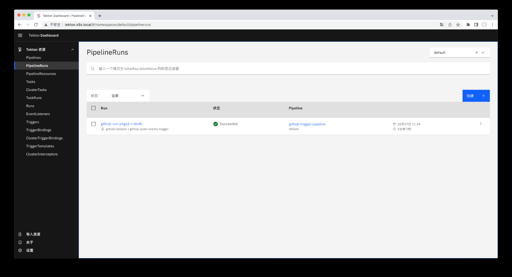

点击 PipelineRun 的名称进入详情页面，可以看到 Pipeline 包含 3 个 Task 及其输出的日志信息。

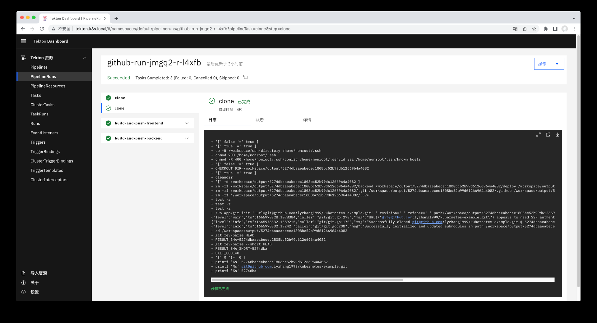

到这里，我们就成功地将 GitHub 和 Tekton Pipeline 结合，并通过 GitHub Webhook 触发了Pipeline，实现了镜像的自动构建和推送，和上一节课实现的效果一样，每次有新的提交时都会触发构建，并且每个 commit id 对应一个镜像版本。

## 总结

总结一下。在这节课，我们介绍了如何通过 Tekton Pipeline 来自动构建和推送镜像。

Tekton 的概念繁多，并且比较抽象，完全掌握这些概念有一定难度。为了方便理解和记忆，你可以把 Tekton 的概念和 GitHub Action 做类比，例如，Task 有点像 GitHub Action 的插件，git-clone Task 实际上和我们在 GitHub Action 引用的 actions/checkout@v3 插件功能是类似的。

其次，Tekton Pipeline 和 GitHub Action Workflow 也比较类似，Tekton Pipeline 通过引用和组合不同的 Task 形成了一个流水线。而 GitHub Action Workflow 则是通过引用并组合插件来完成一个工作流。

相比较而言，它们之间最大的差异还是在触发器上。GitHub Action Workflow 的触发器内置到了工作流中，只需要在工作流声明什么时候可以被触发即可。而 Tekton 则需要借助EventListener 和 TriggerTemplate 这两个组件来接收外部 Webhook 事件并触发 Pipeline。所以 Tekton 复杂的配置也主要集中在这两块。

Tekton 虽然配置相对复杂，但它是一次性配置，如果你已有 Kubernetes 集群，那么使用Tekton 来构建镜像是一个不错的选择，这种方案使得镜像构建成本几乎为零，并且扩展性强。

在前面几节课，我们都是使用 Docker Hub 作为镜像存储仓库的。但实际上，它同样也需要收费，在镜像存储方面，我们同样也可以使用自托管方案来进一步降低成本。

在下一节课，我们会详细介绍这部分的内容。

## 课后题

最后，给你留一道思考题吧。

在一个 Tekton Task 中，Step 是在同一个 Pod 不同的容器里运行的，我们知道 Pod 的容器启动是没有顺序的，那么 Tekton 是如何控制 Step 的运行顺序的呢？

```
提示：你可以在 Pipeline 运行时，查看 Task 拉起的 Pod Manifest 查找线索（kubectl get
pods $POD_NAME -o yaml）。
```

欢迎你给我留言交流讨论，你也可以把这节课分享给更多的朋友一起阅读。我们下节课见。
