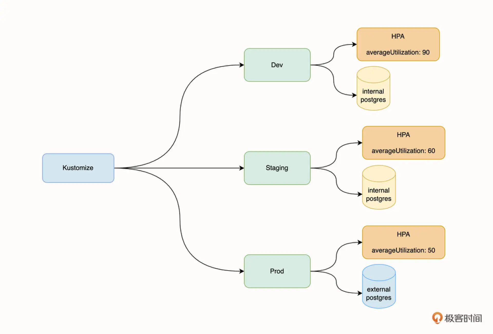

# 20 | 应用定义：如何使用Kustomize定义应用？

你好，我是王炜。

从这节课起，我们开始学习 Kubernetes 的应用定义。

在之前部署“示例应用”时，我们通过 YAML 来编写 Kubernetes Manifest，并使用 kubectlapply 命令来部署 Kubernetes 对象。如果把 Kubernetes 比作是操作系统，那么要在系统上运行应用就需要标准的应用格式，例如 Windows EXE 或 Linux Binary 可执行文件。而在Kubernetes 中，标准的应用定义格式则是 YAML 编写的 Manifest 文件。

但是，在实际使用 Kubernetes 时，我们一般都会面临多环境的问题。例如通常我们会把环境分为开发、测试、预发布和生产环境。由于 YAML 是一种“静态”的配置语言，它并不像编程语言一样使用变量来计算最终结果，所以在多环境的情况下，常规方式需要我们编写多套应用定义。

显然，这种直接把多套应用部署到不同环境的方式并不优雅。一是因为多套应用定义很难维护和统一，最后会导致环境之间的差异越来越大；二是因为在大部分情况下，不同环境的Kubernetes 对象都是相同的，只在一些和环境相关的配置上有差异，编写多套应用定义会导致维护成本增加。

而 Kustomize 正是针对这种场景而设计的应用定义模型。我们只需要定义一套 Kustomize 应用就能够实现对多环境的适配。

在这节课，我仍然以示例应用为例，并把它从原始的 Kubernetes Manifest 改造成 Kustomize的应用定义方式，在实践的过程中，带你了解如何使用 Kustomize 来应用定义。

在进入实战之前，你需要先将示例应用的代码仓库克隆到本地，仓库里也包含这节课的代码，供你参考。

## 实战简介

首先，我们先来看看将示例应用改造成 Kustomize 之后的效果，如下图所示。



示例应用经过 Kustomize 的改造之后，将包含下面 3 个环境。

- Dev，开发环境。

- Staging，预发布环境。

- Prod，生产环境。

这三个环境部署的应用都是同一套，但在配置上有所不同。首先，开发环境对稳定性要求一般，所以我们使用在 Kubernetes 集群内部署的 postgres 示例，并且将 HPA 自动伸缩策略的触发条件配置为 “CPU 平均使用率 90% 时触发”，这可以进一步提高开发环境的资源利用率。

预发布环境对稳定性要求相对而言更高一些，我们同样可以使用在 Kubernetes 集群部署的postgres 实例，但 HPA 触发条件是 “CPU 平均使用率为 60%”，这可以让 HPA 及时介入，确保稳定性。

生产环境对稳定性要求最高，所以一般情况下我们会使用云厂商提供的数据库服务来替代自托管的数据库。另外，HPA 的触发条件也更低，为 50%，在系统产生一定压力时，就让 HPA 提前介入工作。

## 改造示例应用

接下来，我们开始改造示例应用，下面所有的命令默认都在示例应用根目录下执行。

### 创建基准和多环境目录

首先，进入示例应用目录并列出文件。

```
$ cd kubernetes-example
$ ls
backend  deploy   frontend
```

其中，deploy 目录是我们之前编写的 Kubernetes Manifest，我们列出该目录下的文件。

```
$ ls deploy
backend.yaml  database.yaml frontend.yaml hpa.yaml      ingress.yaml
```

这里的 backend.yaml 是后端部署文件，database.yaml 是 postgres 实例部署文件，frontend.yaml 是前端部署文件，hpa.yaml 是 HPA 配置文件，ingress.yaml 是 Ingress 策略配置文件。

接下来，我们在示例应用的根目录下创建 kustomize 目录并进入。

```
$ mkdir kustomize && cd kustomize
```

然后在 kustomize 目录下创建两个目录，分别是 base 和 overlay 目录。

```
$ mkdir base overlay
```

其中，base 是基准目录，它将用来存放 3 个环境共同的 Kubernetes Manifest；overlay 是多环境目录，用来存放不同环境差异化的 Manifest 文件。

然后，我们进入 overlay 目录，再创建 dev、staging 和 prod 目录，它们分别对应三个环境。

```
$ cd overlay && mkdir dev staging prod
```

现在，示例应用的 Kustomize 目录的结构看起来是下面这样的。

```
.
├── base
└── overlay
   ├── dev
   ├── prod
   └── staging
```

### 环境差异分析

上面我提到过 base 目录是基准目录，这意味着不同环境在部署时，都会引用这个目录的Kubernetes Manifest。根据我们之前“实战简介”里提到的，开发、预发布和生产环境除了数据库和 HPA 的差异以外，其他的 Manifest 都是通用的。

接下来，我们具体分析一下数据库和 HPA 的差异。

首先，在开发和预发布环境中，我们使用的是部署在 Kubernetes 下的 postgres 实例。所以，对于开发和预发布环境，我们需要部署 postgres Deployment，而在生产环境则不需要部署postgres。显然，postgres Deployment 不是这三个环境的通用资源，不需要被加入到基准目录中。

其次，对于 HPA 配置，它们的 Manifest 内容是相似的，只有对象中的 averageUtilization 字段值不同。所以在这种情况下，我们可以认为 HPA 是通用资源，不同环境只需要对averageUtilization 字段值进行修改即可。

这里要注意一个小细节，在生产环境下，由于后端使用的是外部数据库服务，所以它的数据库连接信息肯定也是不同的。还记得我们是怎么为后端配置数据库连接信息的吗？答案是Deployment Env 环境变量。这也就意味着，不同环境的 Deployment Manifest 和 HPA 的情况非常类似，内容差不多，只有一些值有差异。所以，我们也可以认为后端的 Deployment 也是通用资源。

将环境差异分析清楚之后，我们就可以开始为基准目录（base）添加资源了。

### 为 Base 目录创建通用 Manifest

经过上面的分析，我们可以得出结论，base 目录需要包含的通用 Manifest 有下面这几个文件：

- backend.yaml

- frontend.yaml

- hpa.yaml

- ingress.yaml

我们将 deploy 目录下的这几个文件拷贝到 kustomize/base 目录。

```
$ cp deploy/backend.yaml deploy/frontend.yaml deploy/hpa.yaml deploy/ingress.yaml
```

同时，我们还需要在 base 目录下额外创建一个文件，它可以告诉 Kustomize 哪些 Manifest需要被引用。将下面的内容保存为 kustomization.yaml 文件。

```
apiVersion: kustomize.config.k8s.io/v1beta1
kind: Kustomization
resources:
 - backend.yaml
 - frontend.yaml
 - hpa.yaml
 - ingress.yaml
```

现在，base 目录应该包含下面这些文件。

```
$ ls base
backend.yaml       frontend.yaml      hpa.yaml           ingress.yaml       kusto
```

到这里，base 目录所需的通用 Manifest 就创建好了。

### 为开发环境目录创建差异 Manifest

创建完 base 目录之后，接下来我们要创建不同环境对应的目录，也就是 kustomize/overlay目录下的 dev、staging 和 prod 目录创建差异化的 Manifest。

首先我们看 kustomize/overlay/dev 目录，也就是开发环境。它独特的 Manifest 文件有database.yaml ，此外我们还要修改 HPA averageUtilization 字段的配置文件。

先将 deploy/database.yaml 文件复制到该目录下。

```
$ cp deploy/database.yaml kustomize/overlay/dev
```

然后，最重要的一点，开发环境在复用 base 目录的 hpa.yaml 时，还需要改变其中一个字段的值。Kustomize 的价值就体现在这里，它可以对 Manifest 的某个值进行覆写。

在开发环境，要覆写 hpa.yaml 的 averageUtilization 字段，我们只需要提供差异部分的Manifest 即可。在 dev 目录下创建 hpa.yaml，并将下面的内容写入到该文件。

```bash
apiVersion: autoscaling/v2
kind: HorizontalPodAutoscaler
metadata:
 name: frontend
spec:
 metrics:
 - type: Resource
   resource:
     name: cpu
     target:
       type: Utilization
       averageUtilization: 90
---
apiVersion: autoscaling/v2
kind: HorizontalPodAutoscaler
metadata:
 name: backend
spec:
 metrics:
 - type: Resource
   resource:
     name: cpu
     target:
       type: Utilization
       averageUtilization: 90
```

在这段内容中，我们只提供了 spec.metrics 字段的内容，Kustomize 将对 dev 目录和 base 目录下相同名称的资源进行对比并合并，相同的字段以 dev 目录下的内容为准，这样就实现了覆盖操作。

简单总结一下就是，我们需要为 Kustomize 提供不同环境下 Manifest 差异的部分，并提供资源类型和名称用于比对。

最后，我们还需要在 kustomize/overlay/dev 目录下创建一个文件，用来向 Kustomize 提供环境的差异信息。具体做法是将下面的内容保存为 kustomization.yaml 文件。

```
apiVersion: kustomize.config.k8s.io/v1beta1
kind: Kustomization
bases:
 - ../../base
 - database.yaml
patchesStrategicMerge:
 - hpa.yaml
```

其中，bases 字段顾名思义就是我们之前定义的通用资源目录的路径，并且相对于通用资源，开发环境还需要额外部署 database.yaml Manifest 来提供数据库服务。

patchesStrategicMerge 是 Kustomize 提供的一种修改合并资源的方法，这里应用我们创建的hpa.yaml，可以定制开发环境的 HPA CPU 策略。

最终，kustomize/overlay/dev 目录包含下面三个文件。

```
$ ls kustomize/overlay/dev
database.yaml      hpa.yaml           kustomization.yaml
```

### 为预发布环境创建差异 Manifest

预发布环境和开发环境类似，它对应 kustomize/overlay/staging 目录。除了 HPAaverageUtilization 字段配置差异以外，其他配置是相同的。

我们可以直接将 kustomize/overlay/dev 目录下的 database.yaml、hpa.yaml 和kustomization.yaml 文件拷贝到 kustomize/overlay/staging 目录。

```
$ cp -r kustomize/overlay/dev/ kustomize/overlay/staging/
```

最后，还需要把 kustomize/overlay/staging/hpa.yaml 文件的 averageUtilization 字段修改为60。

```bash
......
spec:
 metrics:
 - type: Resource
   resource:
     name: cpu
     target:
       type: Utilization
       averageUtilization: 60
---
......
spec:
 metrics:
 - type: Resource
   resource:
     name: cpu
     target:
       type: Utilization
       averageUtilization: 60
```

最终，kustomize/overlay/staging 目录也同样包含三个文件。

```
$ ls kustomize/overlay/dev
database.yaml      hpa.yaml           kustomization.yaml
```

### 为生产环境创建差异 Manifest

生产环境对应 kustomize/overlay/prod 目录，它比较特别，和开发环境、预发布环境相比有下面这三个差别。

- 不需要部署 postgres Deployment。

- HPA averageUtilization 字段不同。

- 后端服务数据库连接信息不同。

对于第一点，我们处理起来非常简单，只要不在 kustomize/overlay/prod 目录下创建database.yaml 文件即可。第二点的处理方式和前面两个环境一致，只需要提供 HPA 差异部分即可。对于第三点，我们需要提供后端服务里 Deployment 文件 Env 环境变量字段的差异文件。

接下来我们实操一下。首先，将 kustomize/overlay/dev 目录下的 hpa.yaml 拷贝到kustomize/overlay/prod。

```
$ cp kustomize/overlay/dev/hpa.yaml kustomize/overlay/prod/hpa.yaml
```

然后将 kustomize/overlay/prod/hpa.yaml 文件的 averageUtilization 字段修改为 50。

接下来，将下面的内容保存为 kustomize/overlay/prod/deployment.yaml 文件。

```
apiVersion: apps/v1
kind: Deployment
metadata:
 name: backend
spec:
 template:
   spec:
     containers:
     - name: flask-backend
       env:
       - name: DATABASE_URI
         value: "10.10.10.10"
       - name: DATABASE_USERNAME
         value: external_postgres
       - name: DATABASE_PASSWORD
         value: external_postgres
```

deployment.yaml 文件的作用是修改 Env 环境变量，为生产环境的 Pod 提供外部数据库的连接信息。

最后，还需要在 kustomize/overlay/prod 目录下创建 kustomization.yaml 文件，内容如下。

```
apiVersion: kustomize.config.k8s.io/v1beta1
kind: Kustomization
bases:
 - ../../base
patchesStrategicMerge:
 - hpa.yaml
 - deployment.yaml
```

最终，kustomize/overlay/prod 目录包含下面三个文件。

```
$ ls kustomize/overlay/dev
deployment.yaml    hpa.yaml           kustomization.yaml
```

到这里，我们就完成了对示例应用的改造。kustomize 目录的结构如下所示。

```
kustomize
├── base
│   ├── backend.yaml
│   ├── frontend.yaml
│   ├── hpa.yaml
│   ├── ingress.yaml
│   └── kustomization.yaml
└── overlay
   ├── dev
   │   ├── database.yaml
   │   ├── hpa.yaml
   │   └── kustomization.yaml
   ├── prod
   │   ├── deployment.yaml
   │   ├── hpa.yaml
   │   └── kustomization.yaml
   └── staging
       ├── database.yaml
       ├── hpa.yaml
       └── kustomization.yaml
```

## 部署

从 1.14 版本开始，kubectl 内置了对 Kustomize 的支持。所以部署 Kustomize 应用同样也可以使用 kubectl。

在这里，我们尝试在一个集群内同时部署开发环境和生产环境，环境之间通过命名空间来做环境隔离。

### 部署开发环境

在部署开发环境之前，我们首先需要创建 dev 命名空间。

```
$ kubectl create ns dev
namespace/dev created
```

然后，部署 Kustomize 开发环境到 dev 命名空间，你可以使用 kubectl apply -k 命令。

```
$ kubectl apply -k kustomize/overlay/dev -n dev
configmap/pg-init-script created
service/backend-service created
service/frontend-service created
service/pg-service created
deployment.apps/backend created
deployment.apps/frontend created
deployment.apps/postgres created
horizontalpodautoscaler.autoscaling/backend created
horizontalpodautoscaler.autoscaling/frontend created
ingress.networking.k8s.io/frontend-ingress created
```

部署完成后，你可以查看我们为开发环境配置的后端服务 HPA averageUtilization 字段值。

```
$ kubectl get hpa backend -n dev --output jsonpath='{.spec.metrics[0].resource.ta
90
```

返回值为 90，符合预期。

同时，你也可以查看我们是否部署了数据库，也就是 postgres 工作负载。

```
$ kubectl get deployment postgres -n dev
NAME       READY   UP-TO-DATE   AVAILABLE   AGE
postgres   1/1     1            1           46s
```

可以看到，postgres 工作负载存在，符合预期。

最后，你可以查看 backend Deployment 的 Env 环境变量，检查是否使用了集群内的数据库实例。

```
$ kubectl get deployment backend -n dev --output jsonpath='{.spec.template.spec.c
{"name":"DATABASE_URI","value":"pg-service"} {"name":"DATABASE_USERNAME","value":
```

返回结果同样符合预期。

### 部署生产环境

在部署生产环境之前，我们首先需要创建 prod 命名空间。

```
$ kubectl create ns prod
namespace/prod created
```

然后，同样使用 kubectl apply -k 来部署生产环境。

```
$ kubectl apply -k kustomize/overlay/prod -n prod
service/backend-service created
service/frontend-service created
deployment.apps/backend created
deployment.apps/frontend created
horizontalpodautoscaler.autoscaling/backend created
horizontalpodautoscaler.autoscaling/frontend created
ingress.networking.k8s.io/frontend-ingress created
```

从创建的资源来看，相比较开发环境，生产环境并没有部署 postgres Deployment 和 postgresService，这同样也符合生产环境资源定义预期。

部署完成后，你可以查看我们为生产环境配置的后端服务 HPA averageUtilization 字段值。

```
$ kubectl get hpa backend -n prod --output jsonpath='{.spec.metrics[0].resource.t
50
```

返回值为 50，符合预期。

同时，你也可以查看是否部署了数据库，也就是 postgres 工作负载。

```
$ kubectl get deployment postgres -n prod
Error from server (NotFound): deployments.apps "postgres" not found
```

可以发现，postgres 工作负载并不存在，符合预期。

最后，你可以查看 backend Deployment 的 Env 环境变量，以便检查是否使用了外部数据库。

```
$ kubectl get deployment backend -n prod --output jsonpath='{.spec.template.spec.
{"name":"DATABASE_URI","value":"10.10.10.10"} {"name":"DATABASE_USERNAME","value"
```

返回结果同样符合预期。

最后，要删除环境，你可以使用 kubectl delete -k 命令。

```sql
$ kubectl delete -k kustomize/overlay/dev -n dev
configmap "pg-init-script" deleted
service "backend-service" deleted
service "frontend-service" deleted
service "pg-service" deleted
deployment.apps "backend" deleted
deployment.apps "frontend" deleted
deployment.apps "postgres" deleted
horizontalpodautoscaler.autoscaling "backend" deleted
horizontalpodautoscaler.autoscaling "frontend" deleted
ingress.networking.k8s.io "frontend-ingress" deleted
```

此外，你还可以直接删除整个命名空间，这会删除该命名空间所有的资源。

```sql
$ kubectl delete ns dev
namespace/prod deleted
```

## 总结

这节课，我们以示例应用为例子，介绍了如何使用 Kustomize 定义应用。

Kustomize 从实际的场景出发，为我们提供了多环境的解决方案，它除了具备 KubernetesManifest 声明式的优势以外，还具有可重用的特性。其次，由于 Kustomize 没有模板语言，直接使用已有的 Manifest 来生成配置，所以将标准的 Kubernetes 应用改造成 Kustomize 应用相对简单。

在将示例应用改造成 Kustomize 的过程中，我设计了 3 套环境，分别是开发、预发布和生产环境，不同环境在配置上存在一些差异，我们也借此理清了 Kustomize 中基准目录和环境目录的概念。

在创建不同的环境目录时，你需要提供两种类型的文件，首先是 kustomization.yaml 文件，其次是用来描述和基准目录差异的文件，Kustomize 将会对比差异，并且进行覆盖操作。需要注意的是，在这节课我主要介绍了 patchesStrategicMerge 这种覆盖方式，这种方式可以覆盖我们大部分的使用场景，不过 Kustomize 还有其他的一些覆盖策略，例如 PatchesJson6902 和PatchTransformer 等，你可以点击这个链接进一步了解。

最后，由于 kubectl 内置了 Kustomize 的支持，所以你可以直接用它来部署或删除 Kustomize应用。

在下一节课，我将会带你学习除了 Manifest、Kustomize 以外的第三种应用定义方式：Helm。

## 思考题

最后，给你留两道思考题吧。

1. 请你尝试使用 Kustomize 的 patchesJson6902 策略来修改生产环境数据库的 3 个环境变量（提示：示例应用 kustomize/oveylay/prod 目录下有参考答案）。

2. 在实际工作中，我们需要经常更新工作负载的镜像版本，请你结合 Kustomize 这个文档，尝试使用 kustomize/oveylay/dev 目录下的 kustomization.yaml 来修改 frontend 和backend Deployment 的镜像版本。

欢迎你给我留言交流讨论，你也可以把这节课分享给更多的朋友一起阅读。我们下节课见。
