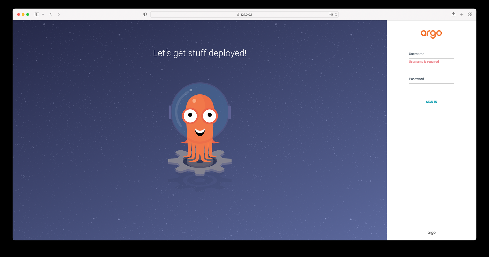
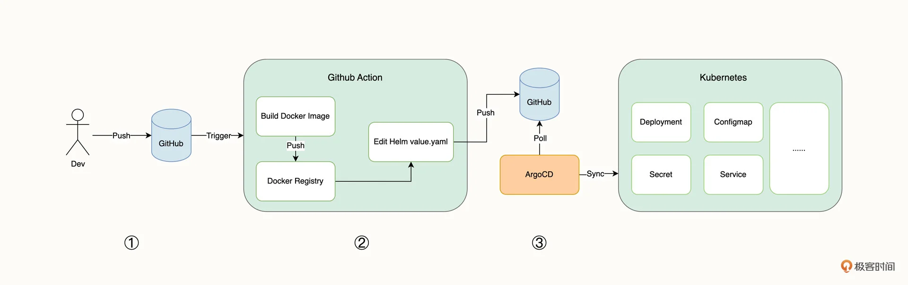
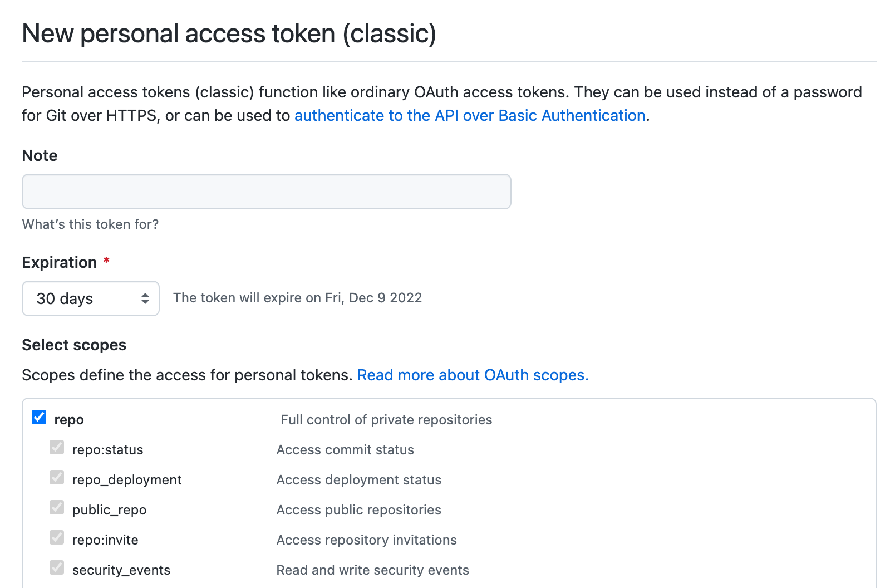
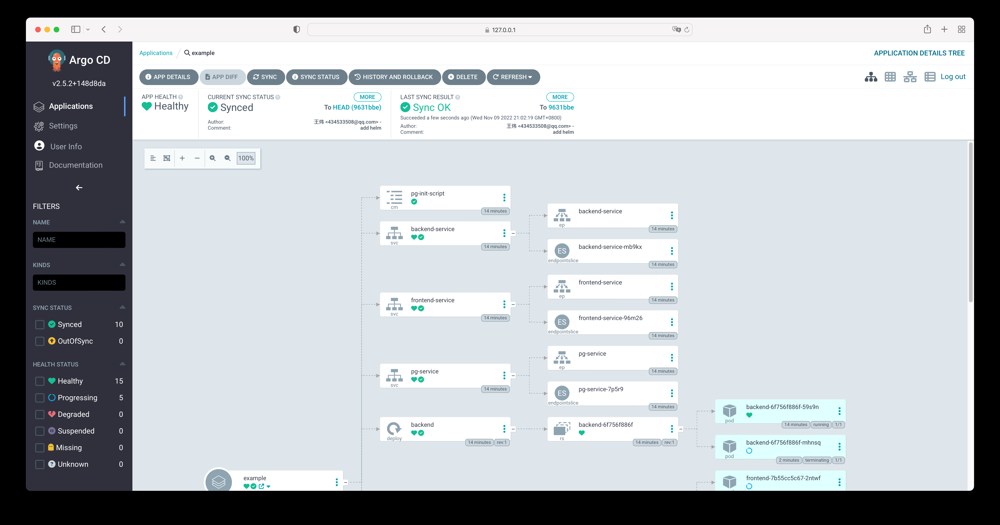
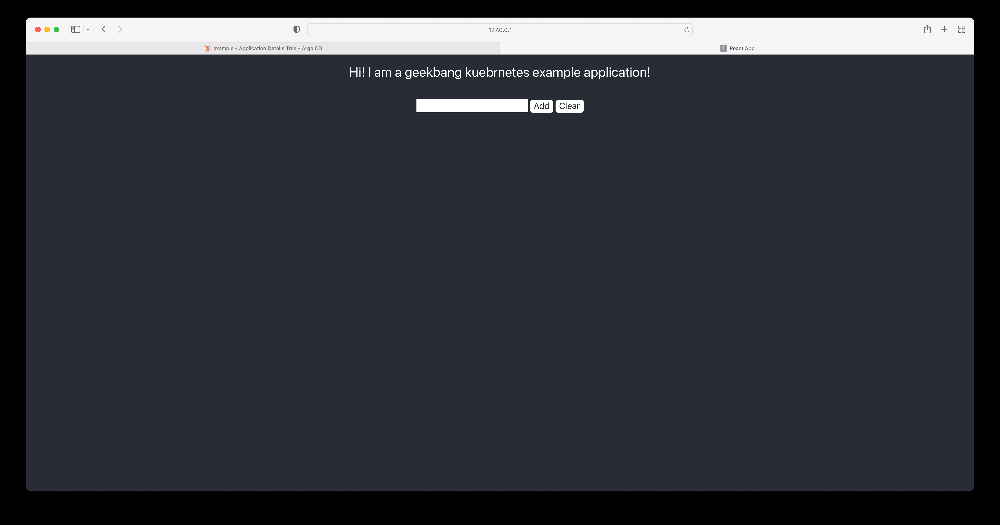
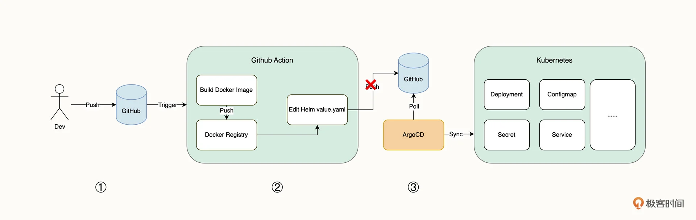
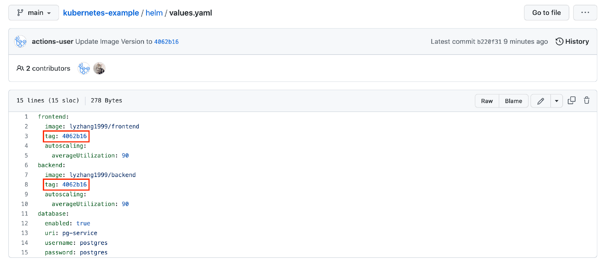
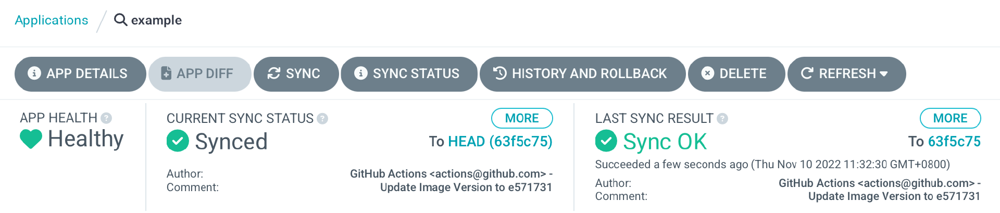
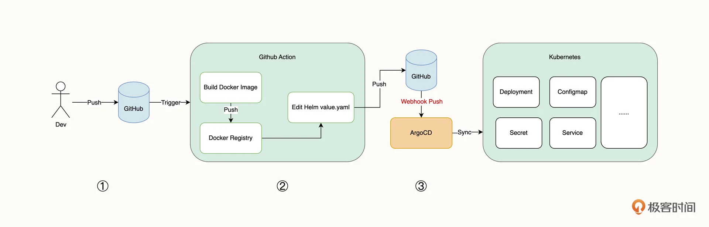
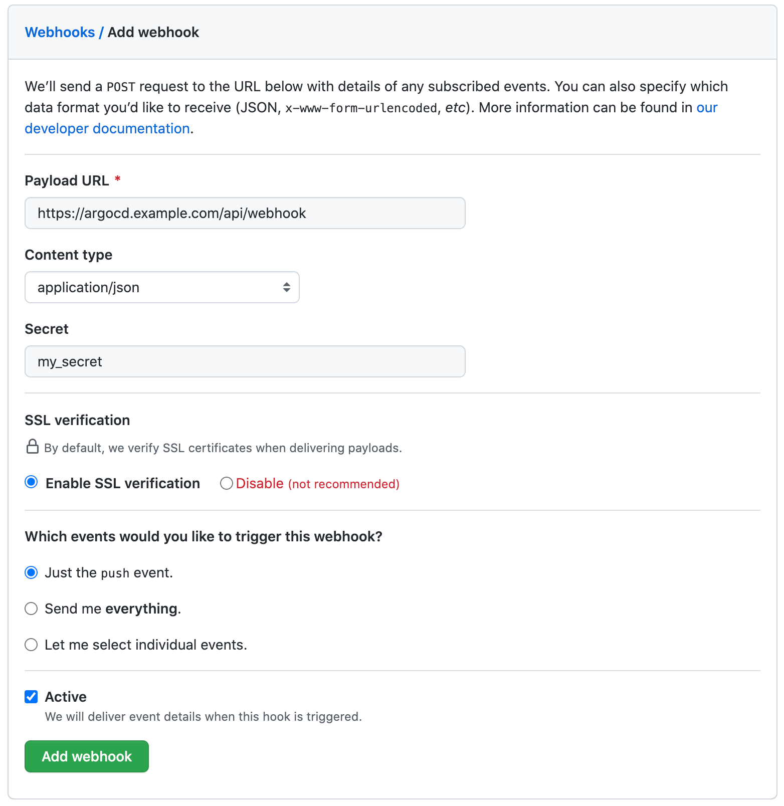

# 22 | 如何使用ArgoCD快速打造生产可用的GitOps工作流？

你好，我是王炜。

在之前的课程中，我们学习了如何使用 Kustomize 和 Helm 和来定义应用。其中，Helm Chart在实际工作中使用较多，它有两种存储方式，一种是以源码的方式存储在 Git 仓库中，另一种是以 tgz 压缩包的方式存储在专用的 OCI 仓库中。

此外，在自动化镜像构建部分，我还向你介绍了如何使用 GitHub Action、GitLab CI 以及自托管 Tekton 来自动构建镜像。

当我们具备这些 GitOps 的核心基础后，接下来我们就可以根据实际场景，选择合适的技术栈来构建 GitOps 流水线了。

在这节课，我仍然会以示例应用为例，使用 GitHub Action 和 Helm 分别作为自动构建镜像和应用定义的工具，并通过 ArgoCD 来构建一个完整的 GitOps 工作流。

在开始今天的学习之前，你需要准备好下面这几个条件。

- 按照第 2 讲的内容在本地配置好 Kind 集群，安装 Ingress-Nginx，并暴露 80 和 443 端口。

- 配置好 Kubectl，使其能够访问 Kind 集群。

- 克隆 kubernetes-example 示例应用代码并推送到自己的 GitHub 仓库中，然后按照第16 讲的内容配置好 GitHub Action 和 DockerHub Registry。

## ArgoCD

在“从零上手 GitOps”这一章，我使用了 FluxCD 来构建 GitOps 流水线。FluxCD 的主要特点是比较轻量，但同时也缺少友好的 UI 控制台。相比较而言，在社区和维护方面，ArgoCD 更为活跃。所以，在生产环境下，我推荐你使用 ArgoCD 来构建 GitOps 工作流。

### 安装 ArgoCD

要使用 ArgoCD，首先需要在 Kind 集群安装它，你可以通过下面的命令来安装。

首先，创建 argocd 命名空间。

```
$ kubectl create namespace argocd
namespace/argocd created
```

然后，部署 ArgoCD。

```
$ kubectl apply -n argocd -f https://ghproxy.com/https://raw.githubusercontent.co
customresourcedefinition.apiextensions.k8s.io/applications.argoproj.io created
customresourcedefinition.apiextensions.k8s.io/applicationsets.argoproj.io created
customresourcedefinition.apiextensions.k8s.io/appprojects.argoproj.io created
......
```

最后，等待 argocd 命名空间所有的工作负载处于就绪状态。

```
$ kubectl wait --for=condition=Ready pods --all -n argocd --timeout 300s
pod/argocd-application-controller-0 condition met
pod/argocd-applicationset-controller-57bfc6fdb8-x5jxc condition met
......
```

请注意，由于云厂商 Kubernetes 版本存在差异，所以如果你在安装过程中发现 argocd-repo-server 工作负载一直无法启动，可以尝试删除 argocd-repo-server DeploymentseccompProfile 节点的内容。

```
apiVersion: apps/v1
kind: Deployment
metadata:
 name: argocd-repo-server
spec:
 template:
   spec:
     securityContext:
       seccompProfile:
         type: RuntimeDefault
```

### 安装 ArgoCD CLI

为了更加方便地配置 ArgoCD，官方还为我们提供了 CLI 工具。不同操作系统的安装方法有所差异，这里以 MacOS 和 Windows 为例简单介绍。

MacOS 可以通过 Brew 来安装。

```
$ brew install argocd
```

也可以在这个链接下载最新版本的 Binary 二进制文件，并移动到 /usr/local/bin/ 目录下。

Windows 则需要在下载过后，将可执行文件移动到 PATH 下。

更详细的方法可以查看这份文档。

### 本地访问 ArgoCD

要在本地访问 ArgoCD，最简单的方式是通过端口转发来完成。你可以使用下面的命令来进行端口转发。

```
$ kubectl port-forward service/argocd-server 8080:80 -n argocd
Forwarding from 127.0.0.1:8080 -> 8080
Forwarding from [::1]:8080 -> 8080
```

接下来，使用浏览器打开：http://127.0.0.1:8080，这样就可以访问 ArgoCD 控制台了，如下图所示。



ArgoCD 的默认账号为 admin，密码可以通过下面的命令来获取。

```
$ kubectl -n argocd get secret argocd-initial-admin-secret -o jsonpath="{.data.pa
Gn4b2PFG6vKm1ADm
```

登录后，即可访问 ArgoCD 的控制台。

## GitOps 工作流总览

到这里，你是不是已经迫不及待想要构建工作流了？别急，在创建 GitOps 工作流之前，我们先来认识一下一个完整 GitOps 工作流都需要哪些关键步骤。



我们可以把这个完整的 GitOps 工作流分成三个部分来看。

第一部分是开发者推送代码到 GitHub 仓库，然后触发 GitHub Action 自动构建。

第二部分是 GitHub Action 自动构建，它包括下面三个步骤。

```
1. 构建示例应用的镜像。
2. 将示例应用的镜像推送到 Docker Registry 镜像仓库。
3. 更新代码仓库中 Helm Chart values.yaml 文件的镜像版本。
```

第三部分的核心是 ArgoCD，它包括下面两个步骤。

```
4. 通过定期 Poll 的方式持续拉取 Git 仓库，并判断是否有新的 commit。
5. 从 Git 仓库获取 Kubernetes 对象，与集群对象进行实时比较，自动更新集群内有差异的资源。
```

在之前的课程中，我们已经为示例应用创建好了 GitHub Action 来自动构建镜像，但还缺少自动更新 Helm Chart values.yaml 文件的镜像版本逻辑，我会在稍后进行配置。

现在，我们开始创建 GitOps 工作流中的第三部分，也就是创建 ArgoCD 应用，实现Kubernetes 资源的自动同步。

## 创建 ArgoCD 应用

我们以示例应用为例子来创建 ArgoCD 应用，这里主要分成两个步骤。

1. 配置仓库访问权限。

2. 创建 ArgoCD 应用。

其中，如果你的示例应用仓库是公开的，可以跳过第一步。

### 配置 ArgoCD 仓库访问权限（可选）

在实际场景下，我们存放应用定义的仓库一般都是私有仓库，这就需要为 ArgoCD 配置仓库访问权限。

你可以通过下面的 ArgoCD CLI 工具来为 ArgoCD 添加仓库访问权限。

在使用 ArgoCD CLI 工具之前，你需要先执行 argocd login 命令登录。

```
$ argocd login 127.0.0.1:8080 --insecure
Username: admin
Password:
'admin:login' logged in successfully
```

注意，这里我们指定了 ArgoCD 的服务端地址为 127.0.0.1:8080，并且使用了 --insecur 参数来跳过 SSL 认证，你需要保持在上面运行的端口转发命令才能够顺利登录。

登录成功后，通过 argocd repo add 命令添加你的示例应用仓库。

```
$ argocd repo add https://github.com/lyzhang1999/kubernetes-example.git --usernam
Repository 'https://github.com/lyzhang1999/kubernetes-example.git' added
这里要注意将仓库地址修改为你实际的 GitHub 仓库地址，并将 $USERNAME 替换为 GitHub
账户 ID，将 $PASSWORD 替换为 GitHub Personal Token。你可以在这个页面创建 GitHub
```

Personal Token，并赋予仓库相关权限，如下图所示。



### 创建 ArgoCD 应用

接下来，就可以创建 ArgoCD 应用了。ArgoCD 同时支持使用 Helm Chart、Kustomize 和Manifest 来创建应用，这里我们以示例应用的 Helm Chart 为例。

你可以通过 argocd app create 命令来创建应用。

```
$ argocd app create example --sync-policy automated --repo https://github.com/lyz
application 'example' created
```

这里我简单解释一下每个参数的作用。

–sync-policy 参数代表设置自动同步策略。automated 的含义是自动同步，也就是说当集群内的资源和 Git 仓库 Helm Chart 定义的资源有差异时，ArgoCD 会自动执行同步操作，实时确保集群资源和 Helm Chart 的一致性。

–repo 参数表示 Helm Chart 的仓库地址。这里的值是示例应用的仓库地址，注意需要替换成你实际的 Git 仓库地址。

–revision 参数表示需要跟踪的分支或者 Tag，这里我们让 ArgoCD 跟踪 main 分支的改动。

–path 参数表示 Helm Chart 的路径。在示例应用中，存放 Helm Chart 的目录是 helm 目录。

–dest-namespace 参数表示命名空间。这里指定了 gitops-example 命名空间，注意，这是一个不存在的命名空间，所以我们额外通过 --sync-option 参数来让 ArgoCD 自动创建这个命名空间。

最后，–dest-server 参数表示要部署的集群，https://kubernetes.default.svc 表示 ArgoCD所在的集群。

### 查看 ArgoCD 同步状态

创建好应用之后，GitOps 工作流中的自动同步部分也就建立起来了。现在，你可以打开ArgoCD 控制台，进入左侧的“Application”菜单来查看示例应用详情。



在应用详情页面，我们需要重点关注三个状态。

1. APP HEALTH：应用整体的健康状态，它包含下面三个值。

- Progressing：处理中1.

- Healthy：健康状态2.

- Degraded：宕机3.

2. CURRENT SYNC STATUS： 应用定义和集群对象的差异状态，也包含下面三个值。

- Synced：完全同步1.

- OutOfSync：存在差异2.

- Unknown：未知3.

3. LAST SYNC RESULT：最后一次同步到 Git 仓库的信息，包括 Commit ID 和提交者信息。

### 访问应用

当应用健康状态变为 Healthy 之后，我们就可以访问应用了。

在这之前，如果你已经在 example 命名空间下手动部署了示例应用，为了避免 Ingress 策略冲突，你需要先删除这个命名空间。

```sql
$ kubectl delete ns example
```

然后，使用浏览器访问 http://127.0.0.1，你应该能看到示例应用的界面，如下图所示。



到这里，ArgoCD 部分就配置完成了。

## 连接 GitOps 工作流

在完成 ArgoCD 的应用配置之后，我们就已经将示例应用的 Helm Chart 定义和集群资源关联起来了，但整个 GitOps 工作流还缺少非常重要的一部分，就是我在上面提到的自动更新Helm Chart values.yaml 文件镜像版本的部分，我在下面这张示意图中用“”把这个环节标记了出来。



在这部分工作流没有打通之前，提交的新代码虽然会构建出新的镜像，但是 Helm Chart 定义的镜像版本并不会产生变化，这会导致 ArgoCD 不能自动更新集群内工作负载的镜像版本。

要解决这个问题，我们还需要在 GitHub Action 中添加自动修改 Helm Chart 并重新推送到仓库操作。

接下来，我们修改示例应用的 .github/workflows/build.yaml 文件，在“Build frontend andpush”阶段后面添加一个新的阶段，代码如下。

```sql
- name: Update helm values.yaml
 uses: fjogeleit/yaml-update-action@main
 with:
   valueFile: 'helm/values.yaml'
   commitChange: true
   branch: main
   message: 'Update Image Version to ${{ steps.vars.outputs.sha_short }}'
   changes: |
     {
       "backend.tag": "${{ steps.vars.outputs.sha_short }}",
       "frontend.tag": "${{ steps.vars.outputs.sha_short }}"
     }
```

在这里，我使用了 GitHub Action 中 yaml-update-action 插件来修改 values.yaml 文件并把它推送到仓库。如果你是使用 GitLab 或者 Tekton 构建镜像，可以调用 yq 命令行工具来修改YAML 文件，再使用 git 命令行将变更推送到仓库。

到这里，一个完整的 GitOps 工作流就建立好了。

### 体验 GitOps 工作流

接下来，你可以尝试修改 frontend/src/App.js 文件，例如修改文件第 49 行的“Hi! I am ageekbang”。修改完成后，将代码推送到 GitHub 仓库 main 分支，此时，GitHub Action 会自动构建镜像，并且还会更新代码仓库中 Helm values.yaml 文件的镜像版本。



ArgoCD 默认每 3 分钟会拉取仓库检查是否有新的提交，你也可以在 ArgoCD 控制台手动点击Sync 按钮来触发同步。



ArgoCD 同步完成后，我们可以在“LAST SYNC RESULT”一栏中看到 GitHub Action 修改values.yaml 的提交记录，当应用状态为 Healthy 时，我们就可以访问新的应用版本了。


从截图可以看出，前端界面输出内容为“Hi, I am GitOps workflow”，说明 ArgoCD 已经将新版本的应用部署到集群中了。

自此，我们体验了提交代码到构建镜像、修改应用定义和更新自动化的全流程。

## 生产建议

在生产环境下，我也给你提几个 ArgoCD 的配置建议，你可以根据实际情况来配置。

### 建议一：修改默认密码

默认情况下，ArgoCD 会在部署时生成一个随机密码，为了方便记忆和增加密码强度，你可以使用下面的命令来修改密码。

```sql
$ argocd account update-password
*** Enter password of currently logged in user (admin):
*** Enter new password for user admin:
```

要注意是的是，在修改密码前，你需要先使用 argocd login 登录到 ArgoCD 服务端。

### 建议二：配置 Ingress 和 TLS

在生产环境下，为了更方便地访问 ArgoCD，你可以为它配置 Ingress，你可以将下面的Ingress 对象部署到集群内。

```
apiVersion: networking.k8s.io/v1
kind: Ingress
metadata:
 name: argocd-server-ingress
 namespace: argocd
 annotations:
   cert-manager.io/cluster-issuer: letsencrypt-prod
   kubernetes.io/ingress.class: nginx
   kubernetes.io/tls-acme: "true"
   nginx.ingress.kubernetes.io/ssl-passthrough: "true"
   nginx.ingress.kubernetes.io/backend-protocol: "HTTPS"
spec:
 rules:
 - host: argocd.example.com
   http:
     paths:
     - path: /
       pathType: Prefix
       backend:
         service:
           name: argocd-server
           port:
             name: https
 tls:
 - hosts:
   - argocd.example.com
   secretName: argocd-secret # do not change, this is provided by Argo CD
```

此外，你还需要安装 Cert-manager，具体方法可以参考第 19 讲的内容。

### 建议三：使用 Webhook 触发 ArgoCD

在这节课的例子中，我们在创建应用的时候提供了参数 --sync-policy=automated。这时候，ArgoCD 会默认以 3 分钟一次的频率来自动拉取仓库的更改，在生产环境下，这个同步频率可能并不能满足快速发布的要求。

如果 ArgoCD 可以在公网进行访问，那么你就可以使用 ArgoCD 提供的 Webhook 触发方式来解决这个问题了，如下图所示。



和主动 Poll 模型不同的是，源码仓库在收到开发者推送代码的事件后，将实时通过 HTTP 请求来通知 ArgoCD，也就是图中红色字体的部分。

要使用 Webhook 通知的方式，首先你需要在源码仓库进行配置。以 GitHub 为例，首先进入仓库的“Settings”页面，点击左侧的“Webhook”菜单进入配置页面，如下图所示。



在 Payload URL 中输入你的 ArgoCD Server 外网访问域名，/api/webhook ArgoCD 专门用于接收外部 Webhook 消息的固定路径。

Content type 选择 application/json，并在 Secret 中输入你要配置的 Webhook 的密钥，这个密钥需要提供给 ArgoCD 来校验 Webhook 来源是否合法。

接下来点击“Add webhook” 就可以保存了。

接下来，你还需要为 ArgoCD 提供 GitHub Webhook 密钥，使用下面的命令来编辑 argocd-secret 对象。

```
$ kubectl edit secret argocd-secret -n argocd
```

并将 GitHub Webhook 的密钥加入到 Secret 对象的内容里。

```
apiVersion: v1
kind: Secret
metadata:
 name: argocd-secret
 namespace: argocd
type: Opaque
data:
...
stringData:
 # 加入这一项
 webhook.github.secret: my-secret
```

注意，stringData 可以直接输入 Webhook Secret 内容而不需要进行 Base64 编码。

如果你使用的是其他的代码托管平台，例如 GitLab，可以参考这份文档进行配置。

### 建议四：将源码仓库和应用定义仓库分离

为了方便演示，我将示例应用的源码和 Helm Chart 存储在了同一个 Git 仓库，实际上，这并不是一个好的实践。

这种方案有两个比较大的问题。首先，当我们手动修改 Helm Chart 并推送到 Git 仓库之后，在业务代码不变的情况下也会触发应用镜像构建，这个过程是没有必要的。

其次，在有一定规模的团队中，开发和发布过程是分开的，应用定义仓库一般只有基础架构部门或者 SRE 部门具有修改权限，将源码和应用定义放在同一个 Git 仓库不利于权限控制，开发者也很容易误操作。

所以，基于上面这两个问题，我强烈建议你将业务代码和应用定义分开存储。

### 建议五：加密 GitOps 中存储的秘钥

在示例应用中，我使用的是 DockerHub 公开仓库，所以 Kubernetes 集群不需要镜像拉取凭据就可以拉取到镜像。

在实际生产环境下，一般我们会使用内部自建例如 Harbor 私有仓库。所以在大部分情况下，我们会在 Helm Chart 里增加一个包含镜像拉取凭据的 Secret 对象。

```
apiVersion: v1
kind: Secret
metadata:
 name: regcred
type: kubernetes.io/dockerconfigjson
data:
 .dockerconfigjson: >-
   eyJhdXRocyI6eyJodHRwczovL2luZGV4LmRvY2tlci5pby92MS8iOnsidXNlcm5hbWUiOiJseXpoY
```

这样，当 ArgoCD 部署应用时，会一并将拉取凭据部署到集群中，这就解决了镜像拉取权限的问题。

但是，Secret 对象并没有加密功能，这可能会导致凭据泄露。所以，我们需要对这些敏感信息进行加密处理。关于如何加密秘钥，我会在后续“多环境管理和安全”章节为你详细介绍。

## 总结

在这节课，我以示例应用为例，将 GitHub Action、应用定义以及 ArgoCD 连接起来，构建了完整的 GitOps 工作流。

通过这个例子我们会发现，建立完整的 GitOps 工作流涉及到下面这几个技术：

1. Docker 镜像

2. CI 构建

3. 镜像仓库

4. 应用定义

5. Kubernetes

6. ArgoCD

在建立 GitOps 工作流的过程中，通常有两个难点。第一是如何进行技术选型和组合，第二是如何将它们连接起来。

我先总结一下如何解决第一个问题：技术选型和组合。

在这节课的例子中，我使用了 GitHub Action 作为 CI 构建工具，此外，你还可以选择 GitLabCI 或者自托管的 Tekton 。对于镜像仓库，我使用了 DockerHub 来存储镜像，你也可以使用GitHub Package 或者自建 Harbor 来存储镜像。最后，在应用定义方面，我使用了 HelmChart 作为例子，你还可以选择 Kustomize 甚至是 Kubernetes Manifest 。

在建立 GitOps 的过程中，你可以根据团队实际的情况，对这些技术栈任意组合。

对于如何连接的问题，它最底层的追问是，在构建好镜像并将其推送到镜像仓库之后，怎么通知 ArgoCD 部署新镜像版本。

在这节课的例子中，我在 GitHub Action 里修改了 values.yaml 文件，并将其推送到了 Git 仓库，所以会产生新的 commit，进而达到通知 ArgoCD 的效果。

这种方式虽然能解决问题，但在一些场景下可能并不适合。例如，在开发和发布相对独立的场景下，因为权限和安全的问题可能并不允许 CI 直接修改应用定义。在这种情况下，我们就可以使用另外一种方式来通知 ArgoCD，也就是 Argo CD Image Updater。它可以通过监听镜像版本的更新来触发 ArgoCD 同步，我们会在下一节课详细介绍。

## 思考题

最后，给你留一道思考题吧。

在 ArgoCD 自动同步完成后，应用的“CURRENT SYNC STATUS”会从“Synced”很快变为“OutOfSync”，这是为什么呢？如何解决？

欢迎你给我留言交流讨论，你也可以把这节课分享给更多的朋友一起阅读。我们下节课见。
