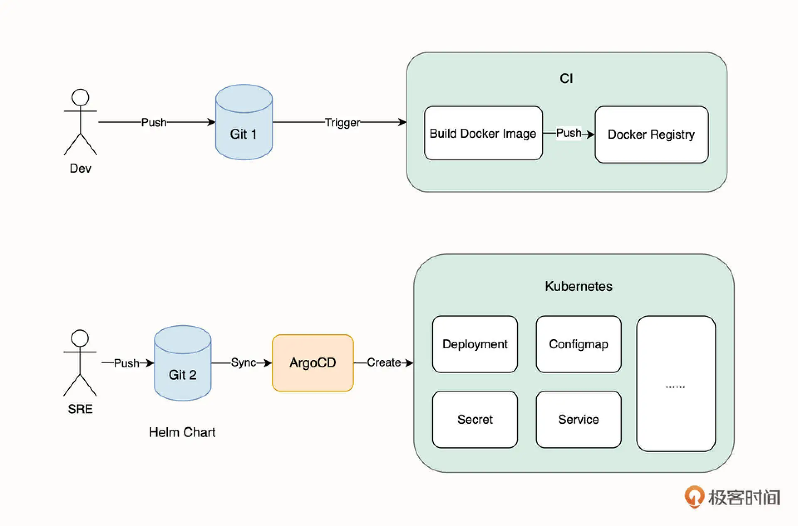
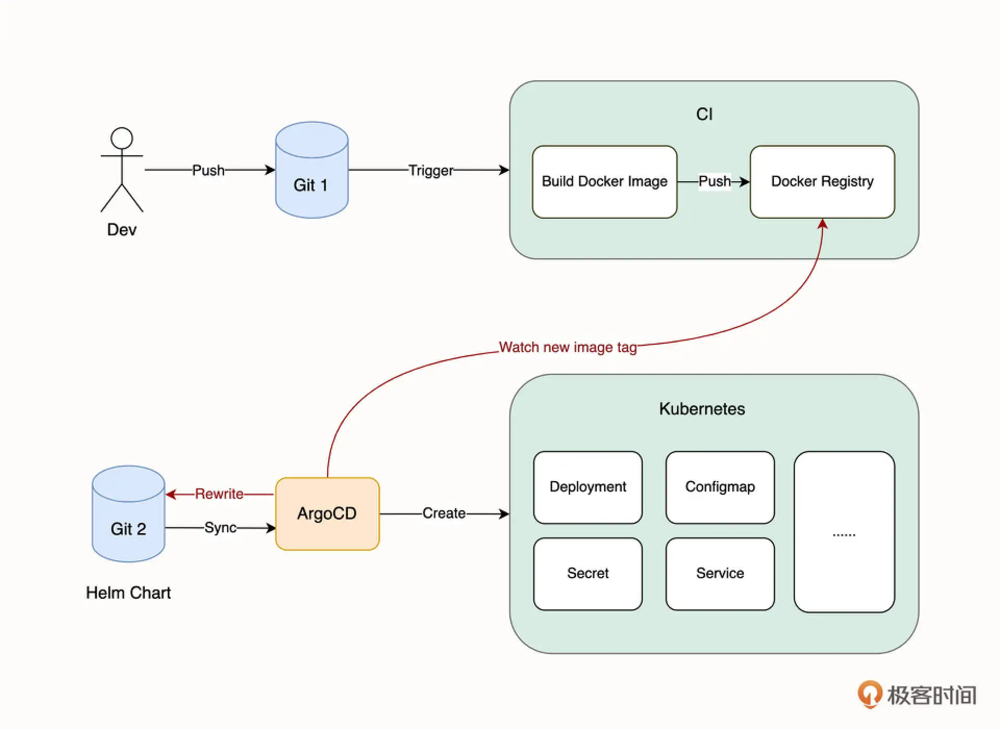
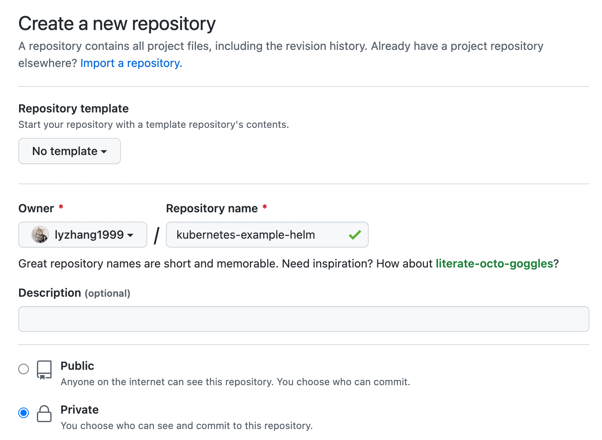
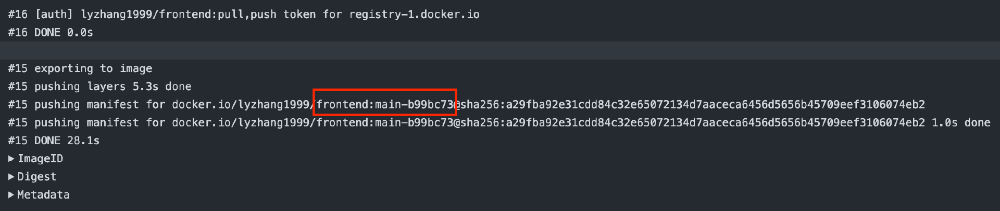
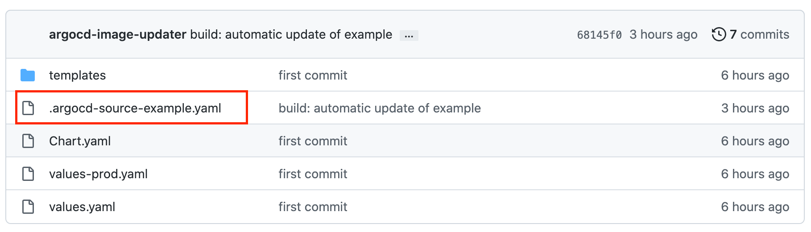

# 23 | 如何监听镜像版本变化触发GitOps？

你好，我是王炜。

上一节课，我带你学习了如何使用 ArgoCD 来创建生产可用的 GitOps 工作流。值得注意的是，我们创建的 GitOps 工作流有下面两个重要的特点。

1. 源码和 Helm Chart 在同一个仓库下。

2. 在 CI 阶段更新了 Helm Chart 镜像版本。

在开发和发布分工明确的团队中，我更推荐你将源码和应用定义分离，考虑到安全性和发布的严谨性，也尽量不要通过 CI 直接修改应用定义。

更合理的研发规范设计应该是这样的：开发负责编写代码，并通过 CI 生成制品，也就是Docker 镜像，并对生成的制品负责。而基础架构部门或者 SRE 团队则对应用定义负责。在发布环节，开发可以随时控制要发布的镜像版本，而无需关注其他的应用细节，他们之间的工作流程图如下。



从上面这张工作流程图我们可以看出，开发和 SRE 团队各司其职，只操作和自己相关的 Git仓库，互不干扰。但 SRE 团队要怎么知道开发团队什么时候发布以及发布什么版本的镜像呢？

最原始的办法是：开发在需要发布的时候将镜像版本告诉 SRE 团队，SRE 团队手动修改Helm Chart 镜像版本并推送到 Git 仓库，等待 ArgoCD 同步完成。

这种办法虽然有效，但沟通效率低且容易出错，我们需要一种自动化的机制来替代这个过程。

借助 ArgoCD Image Updater，我们可以让 ArgoCD 自动监控镜像仓库的更新情况，一旦工作负载的镜像版本有更新，ArgoCD 就会自动将工作负载升级为新的镜像版本，并且还可以自动将镜像的版本号回写到 Helm Chart 仓库中，保持应用定义和集群状态的一致性。

这节课，我会进一步改造在上一节课创建的 GitOps 工作流，并加入 ArgoCD ImageUpdater，实现自动监听镜像变更以及回写 Helm Chart。

在开始今天的学习之前，你需要做好如下准备。

- 按照第一章第 2 讲的内容在本地配置好 Kind 集群，安装 Ingress-Nginx，并暴露 80 和443 端口。

- 配置好 Kubectl，使其能够访问 Kind 集群。

- 按照上一节课的内容在集群内安装 ArgoCD 和 CLI 工具。

- 克隆 kubernetes-example 示例应用代码并推送到自己的 GitHub 仓库中，然后按照第16 讲的内容配置好 GitHub Action 和 DockerHub Registry。

- 将示例应用 .github/workflows/argocd-image-updater.yaml 文件的env.DOCKERHUB_USERNAME 字段修改为你的 DockerHub 用户名。

## 工作流总览

在正式进入实战之前，我先简单介绍一下我们最终要实现的效果，如下图所示。



相比较上一节课的 GitOps 工作流，这节课实现的效果主要有下面两个差异。

1. 将一个 Git 仓库拆分成了两个，一个存放源码，一个存放 Helm Chart。

2. 不再使用 CI 更新 Helm Chart 镜像版本，而是使用 ArgoCD Image Updater 来自动监控镜像仓库的变更。

此外，由于在日常开发中，我们一般会采用多分支进行开发，这就随时可能产生新的镜像版本。为了将开发过程和需要发布到生产环境的镜像区分开，我们会为 Main 分支构建出来的镜

```
像增加一个 Prefix 标识，例如 main-${commit_Id}，并配置 ArgoCD Image Updater 只监
```

控包含特定标识的镜像版本。

最终实现的效果是，当开发将代码提交到 Git 仓库 Main 分支后，将触发自动构建，并将新的镜像版本推送到镜像仓库。ArgoCD Image Updater 会以 Poll 的方式每 2 分钟检查一次工作负载的镜像是否有新的版本，如果有，那么就将工作负载的镜像更新为最新版本，并将镜像版本号写入到存放 Helm Chart 的仓库中。

## 安装和配置 ArgoCD Image Updater

监听镜像版本的变更需要用到 ArgoCD Image Updater，而它要求和 ArgoCD 一起协同工作，所以在安装之前，请务必先确保在集群内已经安装好 ArgoCD。

### 安装 ArgoCD Image Updater

你可以通过下面的命令进行安装。

```bash
kubectl apply -n argocd -f https://ghproxy.com/https://raw.githubusercontent.com/
serviceaccount/argocd-image-updater created
role.rbac.authorization.k8s.io/argocd-image-updater created
rolebinding.rbac.authorization.k8s.io/argocd-image-updater created
......
```

### 创建 Image Pull Secret（可选）

由于 ArgoCD 会主动 Poll 镜像仓库来检查是否存在新版本，如果你使用的是私有镜像仓库，那么你需要创建 Secret 对象，以便为 ArgoCD 提供访问镜像仓库的权限。

以 DockerHub 仓库为例，执行下面的命令来创建 Secret 对象。

```
$ kubectl create -n argocd secret docker-registry dockerhub-secret \
 --docker-username $DOCKER_USERNAME \
 --docker-password $DOCKER_PERSONAL_TOKEN \
 --docker-server "https://registry-1.docker.io"
secret/dockerhub-secret created
```

```
注意将 $DOCKER_USERNAME 和 $DOCKER_PERSONAL_TOKEN 替换为 Docker Hub 用户名和
```

个人凭据。

如果你忘记如何创建 Docker Personal Token 了，可以查看第 16 讲的内容。另外关于如何为其他镜像仓库类型配置凭据，你可以查看这份文档。

## 创建 Helm Chart 仓库

接下来，我们需要为示例应用的 helm 目录单独创建一个 Git 仓库，在将 kubernetes-example克隆到本地后，执行下面的命令。

```
$ cp -r ./kubernetes-example/helm ./kubernetes-example-helm
```

然后，进入 kubernetes-example-helm 目录并初始化 Git。

```
$ cd kubernetes-example-helm && git init
```

前往 GitHub 创建一个新的仓库，将其命名为 kubernetes-example-helm。



将 kubernetes-example-helm 提交到远端仓库中。

```
$ git add .
$ git commit -m "first commit"
$ git branch -M main
$ git remote add origin https://github.com/lyzhang1999/kubernetes-example-helm.gi
$ git push -u origin main
```

## 创建 ArgoCD Application

创建好 kubernetes-example-helm 仓库之后，接下来我们需要使用它创建一个新的应用。

### 删除旧应用（可选）

在正式创建新的应用之前，为了避免 Ingress 策略冲突，如果你已经按照上节课的内容创建了ArgoCD example 应用，需要先删除应用及其资源，你可以使用下面的命令来删除应用。

```sql
$ argocd app delete example --cascade
```

### 配置仓库访问权限

此外，上节课我们创建 ArgoCD 应用时，虽然同样配置了仓库访问权限，但这里的步骤额外还实现了一个重要的功能：为 ArgoCD Image Updater 提供回写 kubernetes-example-helm 仓库的权限。

要配置仓库访问权限，你可以使用 argocd repo add 命令。

```
$ argocd repo add https://github.com/lyzhang1999/kubernetes-example-helm.git --us
Repository 'https://github.com/lyzhang1999/kubernetes-example-helm.git' added
```

注意要将仓库地址修改为你新创建的用于存放 Helm Chart 的 GitHub 仓库地址，并将

```
$USERNAME 替换为 GitHub 账户 ID，将 $PASSWORD 替换为 GitHub Personal Token。你可
```

以在这个页面创建 GitHub Personal Token，并赋予仓库相关权限。

### 创建 ArgoCD 应用

接下来我们正式创建 ArgoCD 应用。在上一节课中，我们是使用 argocd app create 命令创建的 ArgoCD 应用 。实际上，它会创建一个特殊类型的资源，也就是 ArgoCD Application，它和 K8s 其他标准的资源对象一样，也是使用 YAML 来定义的。

在这里，我们直接使用 YAML 来创建新的 Application，将下面的文件内容保存为application.yaml。

```sql
apiVersion: argoproj.io/v1alpha1
kind: Application
metadata:
 name: example
 annotations:
   argocd-image-updater.argoproj.io/backend.allow-tags: regexp:^main
   argocd-image-updater.argoproj.io/backend.helm.image-name: backend.image
   argocd-image-updater.argoproj.io/backend.helm.image-tag: backend.tag
   argocd-image-updater.argoproj.io/backend.pull-secret: pullsecret:argocd/docke
   argocd-image-updater.argoproj.io/frontend.allow-tags: regexp:^main
   argocd-image-updater.argoproj.io/frontend.helm.image-name: frontend.image
   argocd-image-updater.argoproj.io/frontend.helm.image-tag: frontend.tag
   argocd-image-updater.argoproj.io/frontend.pull-secret: pullsecret:argocd/dock
   argocd-image-updater.argoproj.io/image-list: frontend=lyzhang1999/frontend, b
   argocd-image-updater.argoproj.io/update-strategy: latest
   argocd-image-updater.argoproj.io/write-back-method: git
spec:
 destination:
   namespace: gitops-example-updater
   server: https://kubernetes.default.svc
 project: default
 source:
   path: .
   repoURL: https://github.com/lyzhang1999/kubernetes-example-helm.git
   targetRevision: main
 syncPolicy:
   automated: {}
   syncOptions:
     - CreateNamespace=true
```

然后，使用 kubectl apply 命令创建 ArgoCD Application，效果等同于使用 argocd app create命令创建应用。

```
$ kubectl apply -n argocd -f application.yaml
application.argoproj.io/example created
```

ArgoCD Image Updater 通过 Application Annotations 标签来实现对应的功能，我简单解释一下每一个标签的作用。

- argocd-image-updater.argoproj.io/image-list：指定需要监听的镜像，这里我们指定示例应用的前后端镜像 lyzhang1999/frontend 和 lyzhang1999/backend，同时为前后端镜像法指定了别名，分别为 frontend 和 backend。这里的别名非常重要，会影响下面所有的设置。

- argocd-image-updater.argoproj.io/update-strategy：指定镜像更新策略。注意，latest 并不代表监听 latest 镜像版本，而是以最新推送的镜像作为更新策略。此外，semver 策略可以识别最高语义化版本的标签，digest 策略可以用来区分同一 Tag 下不同镜像 digest 的变更。

- argocd-image-updater.argoproj.io/write-back-method：表示将镜像版本回写到镜像仓库。注意，这里对仓库的写权限来源于使用 argocd repo add 命令为 ArgoCD 配置的仓库访问权限。

- argocd-image-updater.argoproj.io/< 镜像别名 >.pull-secret：为不同的镜像别名指定镜像拉取凭据。

- argocd-image-updater.argoproj.io/< 镜像别名 >.allow-tags：配置符合更新条件的镜像Tag，在这里我们使用正则表达式匹配那些镜像 Tag 以 main 开头的镜像版本，其他镜像版本则忽略。

- argocd-image-updater.argoproj.io/< 镜像别名 >.helm.image-name：配置 Helm Chartvalues.yaml 镜像名称所在的节点，在示例应用中，backend.image 和 frontend.image 是values.yaml 配置镜像名称的节点，ArgoCD 在回写仓库时会覆盖这个值。

- argocd-image-updater.argoproj.io/< 镜像别名 >.helm.image-tag：配置 Helm Chartvalues.yaml 镜像版本所在的节点，在示例应用中，backend.tag 和 frontend.tag 是values.yaml 配置镜像版本的节点，ArgoCD 在回写仓库时将会覆盖这个值。

## 体验 GitOps 工作流

接下来，你可以尝试修改 frontend/src/App.js 文件，例如修改文件第 49 行的“Hi! I am ageekbang”内容。修改完成后，将代码推送到 GitHub 的 main 分支。

此时会触发两个 GitHub Action 工作流。其中，当 build-every-branch 工作流被触发时，它将构建 Tag 为 main 开头的镜像版本，并将其推送到镜像仓库中，如下图所示。



和我们上一节课介绍的另一个 GitHub Action 工作流不同的是，它也不会去主动修改kubernetes-example-helm 仓库的 values.yaml 文件，在完成镜像推送后工作流也就结束了。

与此同时，ArgoCD Image Updater 将会每 2 分钟从镜像仓库检索 frontend 和 backend 的镜像版本，一旦发现有新的并且以 main 开头的镜像版本，它将自动使用新版本来更新集群内工作负载的镜像，并将镜像版本回写到 kubernetes-example-helm 仓库。

在回写时，ArgoCD Image Updater 并不会直接修改仓库的 values.yaml 文件，而是会创建一个专门用于覆盖 Helm Chart values.yaml 的 .argocd-source-example.yaml 文件。



当我们看到这个文件时，说明 ArgoCD Image Updater 已经触发了镜像更新，并且成功将镜像版本回写到了镜像仓库。同时，这个文件记录了详细的覆盖 values.yaml 值的策略。

```
helm:
 parameters:
 - name: frontend.image
   value: lyzhang1999/frontend
   forcestring: true
 - name: frontend.tag
   value: main-b99bc73
   forcestring: true
 - name: backend.image
   value: lyzhang1999/backend
   forcestring: true
 - name: backend.tag
   value: main-b99bc73
   forcestring: true
```

这样，当 ArgoCD 在做自动同步时，会将这份文件的内容覆盖 values.yaml 对应的值，比如frontend.tag 的值会被覆盖为 main-b99bc73，这样，回写后的 Helm Chart 和集群内资源对象就仍然能够保持一致性。

到这里，我们就完成了通过监听新镜像版本来触发 GitOps 工作流的整个过程。

## 总结

在这节课，我为你介绍了如何使用 ArgoCD Image Updater 实现自动监听镜像版本并触发GitOps 工作流。

在这个例子中，我们将应用源码和应用定义（Helm Chart）拆分成了两个仓库，在开发和发布角色相对独立的研发流程下，这种方式既能够保持他们之间职责独立，权责清晰，同时还保留了开发随时发布生产环境的能力。

值得注意的是，在实际的业务场景中，我们一般会使用多分支的模式来开发。这意味着每个分支的每个提交都会产生新的镜像版本，所以，为了区分开发过程的镜像和需要被发布到生产环境的镜像，我在这节课的例子中约定了以 main 开头的镜像版本即为需要发布到生产环境的镜像版本。你可以根据项目的实际情况做调整，例如使用诸如 v1.0.0 的版本号来区分，同时更新 argocd-image-updater.argoproj.io/< 镜像别名 >.allow-tags 字段的正则表达式。

总结来说，在这种仓库分离的场景下，要将开发者的提交和发布过程自动化地连接起来，双方需要重点关注生产环境的镜像版本策略，并将它配置到 ArgoCD 应用的 Annotations 注解内，这样便能够让 ArgoCD Image Updater 代替人工来自动监控需要发布到生产环境的镜像。

## 思考题

最后，给你留一道思考题吧。

如果在 Helm Chart 内使用了固定的 latest 镜像版本，并且在 CI 过程也只会覆盖更新 latest 版本的镜像，这种场景下如何配置 ArgoCD Image Updater 的 update-strategy 的策略呢？

提示：当新的镜像覆盖 latest 版本后，digest 会产生变化。

欢迎你给我留言交流讨论，你也可以把这节课分享给更多的朋友一起阅读。我们下节课见。
