# 24 | 生产稳定的秘密武器：如何实施蓝绿发布？

你好，我是王炜。今天是我们 GitOps 高级发布策略的第一课。

在之前的课程里，我们通过构建 GitOps 工作流实现了自动发布。不过，我们并没有专门去关注新老版本在做更新时是如何切换流量的，这是因为 Kubernetes 的 Service 和 Pod 滚动更新机制自动帮助我们完成了这部分的工作。

在实际的生产环境中，为了提高发布的可靠性，我们通常需要借助发布策略来更加精细地控制流量切换。在几种发布策略中，蓝绿发布是较为简单且容易理解的一种，所以，我将从它开始来介绍如何在 GitOps 工作流中实施蓝绿发布。

那么，什么是蓝绿发布呢？

蓝绿发布核心思想是：为应用提供两套环境，并且可以很方便地对它们进行流量切换。

在一次实际发布过程中，新版本的应用将以“绿色”环境部署到生产环境中，但在流量切换之前它并不接收外部流量。当我们完成“绿色”环境的测试之后，可以通过流量切换的方式让“绿色”环境接收外部请求，而旧的“蓝色”环境并不会立即销毁，而是作为灾备来使用。一旦发布过程产生故障，我们就可以将流量立即切换到旧的“蓝色”环境下。

这种部署方式比较适合那些存在兼容问题，或者因为状态原因导致不能很好地使用Kubernetes 滚动更新的应用。还有的项目希望在更新时部署一个新的版本，同时控制流量切换过程；或者是在发布出现问题时快速回滚。蓝绿发布也是不错的选择。

在这节课，首先我会通过一个例子来说明如何通过手动的方式来实施蓝绿发布。然后，我会结合 Argo Rollout 这款工具进一步向你介绍如何自动化蓝绿发布过程。

在开始之前，你需要具备以下前提条件。

- 按照第一章第 2 讲的内容在本地配置好 Kind 集群，安装 Ingress-Nginx，并暴露 80 和443 端口。

- 配置好 Kubectl，使其能够访问 Kind 集群。

## 蓝绿发布概述

为了更好地帮助你理解蓝绿发布，在正式进入实战之前，我们先来了解它的整体架构，如下图所示。

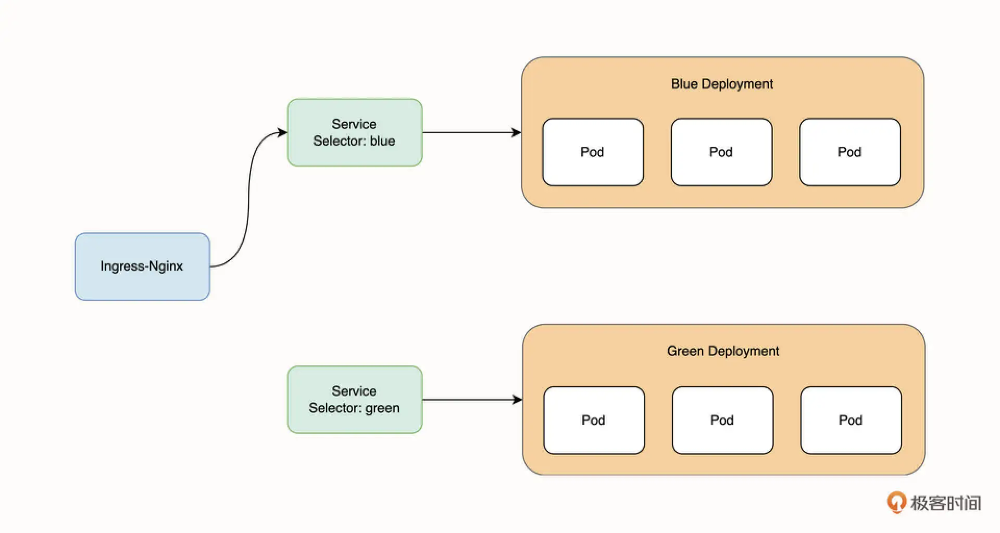

在上面这张架构图中，我们对同一个应用部署了两个版本的环境，称之为蓝绿环境，流量通过Ingress-Nginx 进入到 Service，然后再由它将流量转发至 Pod。在没有切换流量之前，“蓝色”环境负责接收外部请求流量。

需要进行流量切换时，只要调整 Ingress 策略就可以让“绿色”环境接收外部流量，如下图所示。

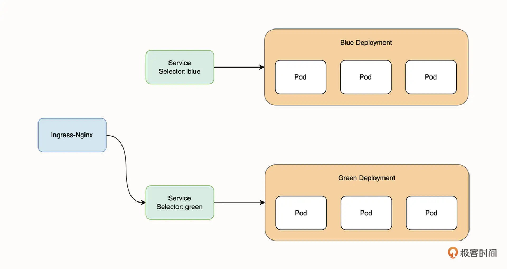

## 蓝绿发布实战

接下来，我们进入蓝绿发布实战。我会通过一个例子来说明如何使用 Kubernetes 原生的Deployment 和 Service 来进行蓝绿发布，实战过程主要包含下面几个步骤。

1. 创建蓝色环境的 Deployment 和 Service。

2. 创建 Ingress 策略，并指向蓝色环境的 Service。

3. 访问蓝色环境。

4. 创建绿色环境的 Deployment 和 Service。

5. 更新 Ingress 策略，并指向绿色环境。

6. 访问绿色环境。

### 创建蓝色环境

首先，我们需要创建蓝色环境，将下面的内容保存为 blue_deployment.yaml。

```bash
apiVersion: apps/v1
kind: Deployment
metadata:
 name: blue
 labels:
   app: blue
spec:
 replicas: 3
 selector:
   matchLabels:
     app: blue
 template:
   metadata:
     labels:
       app: blue
   spec:
     containers:
     - name: demo
       image: argoproj/rollouts-demo:blue
       imagePullPolicy: Always
       ports:
       - containerPort: 8080
---
apiVersion: v1
kind: Service
metadata:
 name: blue-service
 labels:
   app: blue
spec:
 ports:
 - protocol: TCP
   port: 80
   targetPort: 8080
 selector:
   app: blue
 type: ClusterIP
```

在上面这段 Manifest 中，我们使用了 argoproj/rollouts-demo:blue 镜像创建了蓝色环境的Deployment 工作负载，并且创建了名为 blue-service 的 Service 对象，同时通过 Service 选择器将 Service 和 Pod 进行了关联。

然后，使用 kubectl apply 命令将示例应用部署到集群内。

```
$ kubectl apply -f blue_deployment.yaml
deployment.apps/blue created
service/blue-service created
```

部署完成后，等待工作负载 Ready。

```
$ kubectl wait pods -l app=blue --for condition=Ready --timeout=90s
pod/blue-79c9fb755d-9b6xx condition met
```

当看到上面的输出后，代表绿色环境已经准备好了。

接下来，我们再创建蓝色环境的 Ingress 策略。将下面的内容保存为 blue_ingress.yaml 文件。

```
apiVersion: networking.k8s.io/v1
kind: Ingress
metadata:
 name: demo-ingress
spec:
 rules:
 - host: "bluegreen.demo"
   http:
     paths:
     - pathType: Prefix
       path: "/"
       backend:
         service:
           name: blue-service
           port:
             number: 80
```

然后，通过 kubectl apply 将其应用到集群内。

```
$ kubectl apply -f blue_ingress.yaml
ingress.networking.k8s.io/demo-ingress created
```

在上面创建的 Ingres 策略中，我们指定了 bluegreen.info 作为访问域名。所以，在访问蓝色环境之前，你需要先在本地配置 Hosts 才能访问。

```
127.0.0.1 bluegreen.demo
```

如果你用的是 Linux 或者 MacOS 系统，请将上面的内容添加到 /etc/hosts 文件。

如果你用的是 Windows 系统，需要将上面的内容添加到C:\Windows\System32\Drivers\etc\hosts 文件。

此外，你还可以使用 SwitchHosts 这款开源工具来管理 Hosts 配置。

### 访问蓝色环境

配置完 Hosts 之后，接下来我们就可以访问蓝色环境了。使用浏览器访问http://bluegreen.demo，你应该能看到如下所示的页面。

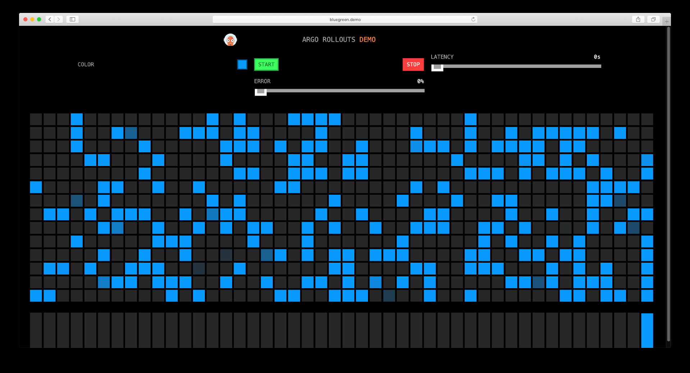

在这个页面里，浏览器每秒钟会向后端发出 50 个请求，蓝色的方块代表后端返回接口的内容为 blue，对应 blue 版本的镜像，代表蓝色环境。

### 部署绿色环境

现在，假设我们需要发布新版本，也就是部署绿色环境。你可以将下面的内容保存为green_deployment.yaml。

```bash
apiVersion: apps/v1
kind: Deployment
metadata:
 name: green
 labels:
   app: green
spec:
 replicas: 3
 selector:
   matchLabels:
     app: green
 template:
   metadata:
     labels:
       app: green
   spec:
     containers:
     - name: demo
       image: argoproj/rollouts-demo:green
       imagePullPolicy: Always
       ports:
       - containerPort: 8080
---
apiVersion: v1
kind: Service
metadata:
 name: green-service
 labels:
   app: green
spec:
 ports:
 - protocol: TCP
   port: 80
   targetPort: 8080
 selector:
   app: green
type: ClusterIP
```

在这段 Manifest 中，我们用 argoproj/rollouts-demo:green 镜像创建绿色环境的Deployment，并且创建了名为 green-service 的 Service 对象。

接下来，使用 kubectl apply 来将它应用到集群内。

```
$ kubectl apply -f green_deployment.yaml
deployment.apps/green created
service/green-service created
```

部署完成后，等待工作负载 Ready。

```
$ kubectl wait pods -l app=green --for condition=Ready --timeout=90s
pod/green-79c9fb755d-9b6xx condition met
```

当看到上面的输出后，代表绿色环境已经准备好了。

### 切换到绿色环境

现在，当绿色环境已经准备好接收外部流量时，我们就可以通过调整 Ingress 策略来切换流量了。将下面的内容保存为 green_ingress.yaml。

```
apiVersion: networking.k8s.io/v1
kind: Ingress
metadata:
 name: demo-ingress
spec:
 rules:
 - host: "bluegreen.demo"
   http:
     paths:
     - pathType: Prefix
       path: "/"
       backend:
         service:
           name: green-service
           port:
             number: 80
```

在上面这段 Ingress Manifest 中，我们将 backend.service 字段由原来的 blue-service 修改为了 green-service，这表示将 Ingress 接收到的外部请求转发到绿色环境的 Service 中，以此达到流量切换的目的。

现在，将这段 Ingress 策略应用到集群内。

```
$ kubectl apply -f green_ingress.yaml
ingress.networking.k8s.io/demo-ingress configured
```

重新返回浏览器，你将会看到请求将逐渐从蓝色切换到绿色，如下图所示。

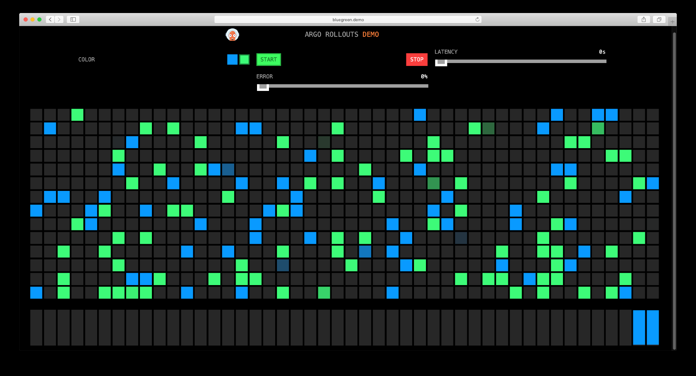

过几秒钟后，请求已经完全变为绿色，这表示流量已经完全从蓝色环境切换到了绿色环境。

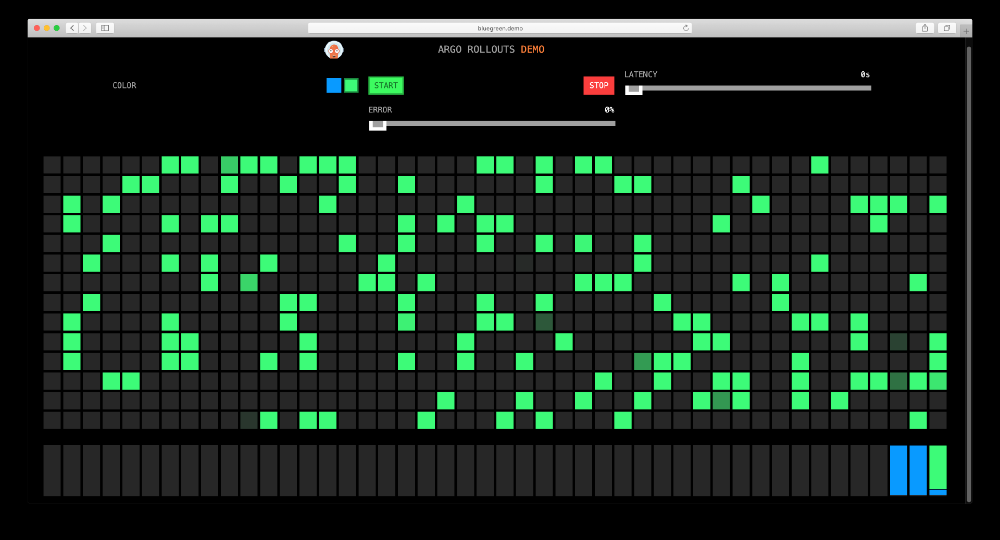

到这里，蓝绿发布就已经完成了。

## 蓝绿发布自动化

到这里，我们都是通过创建 Kubernetes 原生对象并修改 Ingress 策略的方式来完成蓝绿发布的。这存在一些缺点，首先，在更新过程中，我们一般只关注镜像版本的变化，而不会去操作Ingress 策略；其次，这种方式不利于将蓝绿发布和 GitOps 流水线进行整合。

接下来，我们来看看如何通过 Argo Rollout 工具来自动化蓝绿发布的过程。

### 安装 Argo Rollout

Argo Rollout 是一款专门提供 Kubernetes 高级部署能力的自动化工具，它可以独立运行，同时也可以和 ArgoCD 协同在 GitOps 流水线中来使用。

在使用之前，我们需要先安装它，你可以通过下面的命令进行安装。

```
$ kubectl create namespace argo-rollouts  # 创建命名空间
$ kubectl apply -n argo-rollouts -f https://ghproxy.com/https://github.com/argopr
```

安装完成后，等待 Argo Rollout 工作负载就绪。

```
$ kubectl wait --for=condition=Ready pods --all -n argo-rollouts --timeout=300s
pod/argo-rollouts-7f75b9fb76-wh4l5 condition met
```

当看到上面的这段输出后，说明 Argo Rollout 已经准备完成了。

### 创建 Rollout 对象

和手动实施蓝绿发布的过程不同的是，为了实现自动化，Argo Rollout 采用了自定义资源（CRD）的方式来管理工作负载。如果你暂时还不理解 CRD 也没关系，你只需要知道它是一种扩展 Kubernetes 对象的方式就可以了。

首先，我们需要先创建 Rollout 对象。将下面的内容保存为 blue-green-service.yaml 文件。

```
apiVersion: argoproj.io/v1alpha1
kind: Rollout
metadata:
 name: bluegreen-demo
 labels:
   app: bluegreen-demo
spec:
 replicas: 3
 revisionHistoryLimit: 1
 selector:
   matchLabels:
     app: bluegreen-demo
 template:
   metadata:
     labels:
       app: bluegreen-demo
   spec:
     containers:
     - name: bluegreen-demo
       image: argoproj/rollouts-demo:blue
       imagePullPolicy: Always
       ports:
       - name: http
         containerPort: 8080
         protocol: TCP
       resources:
         requests:
           memory: 32Mi
           cpu: 5m
 strategy:
   blueGreen:
     autoPromotionEnabled: true
     activeService: bluegreen-demo
```

如果你仔细观察，会发现在这个 Rollout 对象中，它大部分的字段定义和 Kubernetes 原生的Deployment 工作负载并没有太大的区别，只是将 apiVersion 从 apps/v1 修改为了argoproj.io/v1alpha1，同时将 kind 字段从 Deployment 修改为了 Rollout，并且增加了strategy 字段。在容器配置方面，Rollout 对象同样也使用了 argoproj/rollouts-demo:blue 来创建蓝色环境。

需要留意的是，strategy 字段是用来定义部署策略的。其中，autoPromotionEnabled 字段表示自动实施蓝绿发布，activeService 用来关联蓝绿发布的 Service，也就是我们在后续要创建的 Service 名称。

总结来说，当我们将这段 Rollout 对象应用到集群内之后，Argo Rollout 首先会创建Kubernetes 原生对象 ReplicaSet，然后，ReplicaSet 会创建对应的 Pod。为了帮助你理解，你可以将它与之前手动实施蓝绿发布过程中创建的 Deployment 工作负载进行对比，如下图所示。

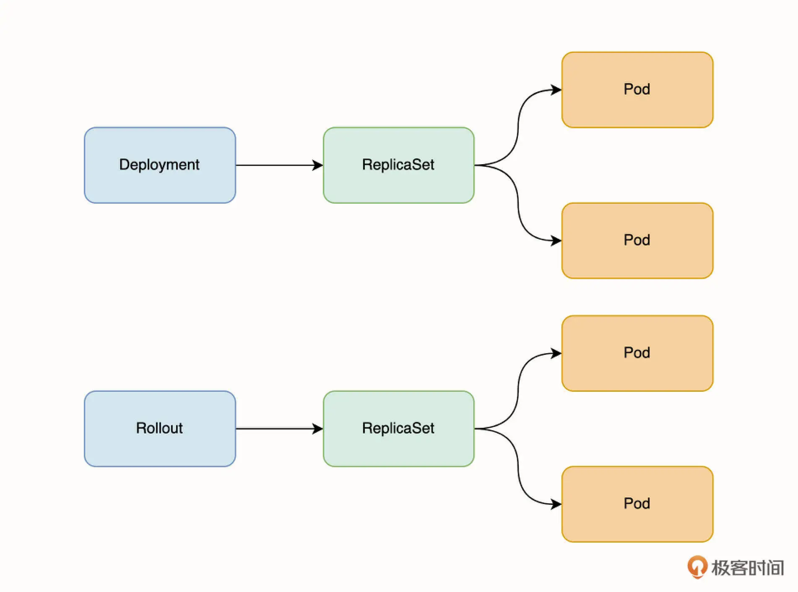

从上面这张图我们可以看出，它们的最核心的区别在于 ReplicaSet 是由谁管理的。很显然，在这个例子中，Rollout 对象管理 ReplicaSet 对象，进而达到了管理 Pod 的目的。

在理解了它们的关系之后，接下来我们创建 Rollout 对象。和普通资源一样，你可以通过kubectl apply 来创建。

```
$ kubectl apply -f blue-green-rollout.yaml
rollout.argoproj.io/bluegreen-demo created
```

### 创建 Service 和 Ingress

创建好 Rollout 对象之后，我们还需要创建 Service 和 Ingress 策略，这和之前手动实施蓝绿发布的过程是一致的。

首先，创建 Service。将下面的内容保存为 blue-green-service.yaml 文件。

```bash
apiVersion: v1
kind: Service
metadata:
 name: bluegreen-demo
 labels:
   app: bluegreen-demo
spec:
 ports:
 - port: 80
   targetPort: http
   protocol: TCP
   name: http
 selector:
   app: bluegreen-demo
```

然后，将它应用到集群内。

```
$ kubectl apply -f blue-green-service.yaml
service/bluegreen-demo created
```

最后，创建 Ingress 对象。将下面的内容保存为 blue-green-ingress.yaml 文件。

```
apiVersion: networking.k8s.io/v1
kind: Ingress
metadata:
 name: bluegreen-demo
spec:
 rules:
 - host: "bluegreen.auto"
   http:
     paths:
     - pathType: Prefix
       path: "/"
       backend:
         service:
           name: bluegreen-demo
           port:
             number: 80
```

和之前创建的 Ingress 对象不同的是，这里我们使用了 bluegreen.auto 域名，以便和之前创建的 Ingress 域名区分开。

然后，使用 kubectl apply 命令将它应用到集群内。

```
$ kubectl apply -f blue-green-ingress.yaml
ingress.networking.k8s.io/bluegreen-demo created
```

同样地，为了能够访问 bluegreen.auto 域名，你还需要添加 Hosts 策略。

```
127.0.0.1 bluegreen.auto
```

### 访问蓝色环境

配置完 Hosts 之后，接下来我们就可以访问由 Argo Rollout 创建的蓝色环境了。使用浏览器访问 http://bluegreen.auto，你应该能看到和手动实施蓝绿发布一样的页面。

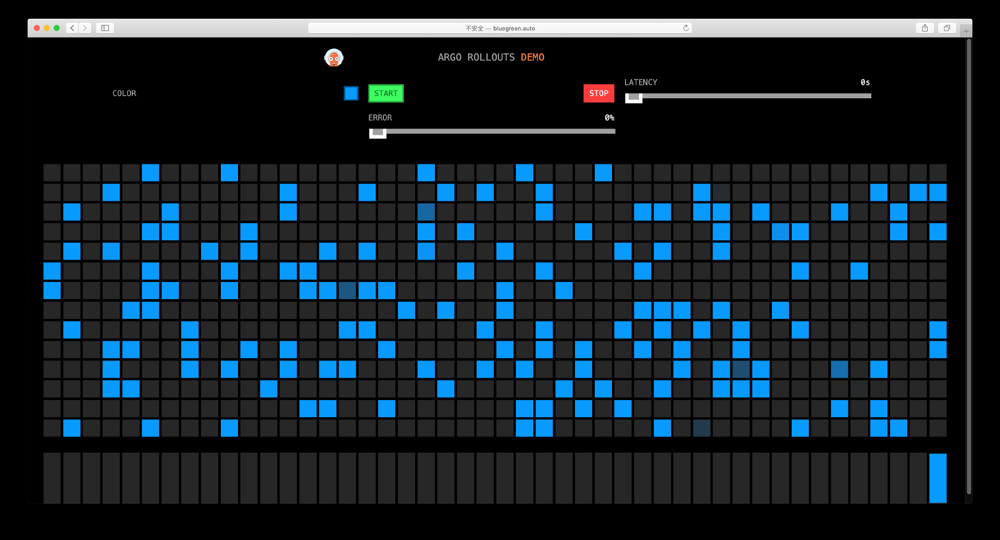

### 蓝绿发布自动化

现在，假设我们需要更新到绿色环境，在 Argo Rollout 的帮助下，你只需要修改 Rollout 对象中的镜像版本就可以了，流量切换过程将由 Argo Rollout 自动控制。

要更新到绿色环境，你需要编辑 blue-green-rollout.yaml 文件的 image 字段，将 blue 修改为green 版本。

```
containers:
- name: bluegreen-demo
 image: argoproj/rollouts-demo:green
```

然后，使用 kubectl apply 将这段 Rollout 对象重新应用到集群内。

```
$ kubectl apply -f blue-green-rollout.yaml
rollout.argoproj.io/bluegreen-demo configured
```

现在，返回到浏览器，等待十几秒后，你应该就能看到请求里开始出现绿色环境了。

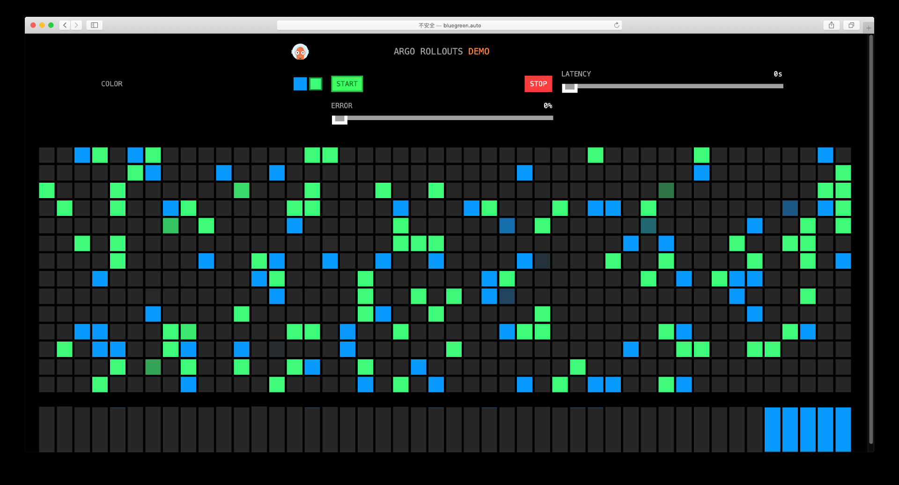

几秒钟后，所有请求都变成了绿色方格，这表示蓝绿发布的自动化过程已经完成。

相比较手动的方式，在使用 Argo Rollout 进行蓝绿发布的过程中，我们不再需要手动去切换流量，除了更新镜像版本以外，我们也无需关注其他的 Kubernetes 对象。

### 访问 Argo Rollout Dashboard

要访问 Argo Rollout Dashboard，首先你需要安装 Argo Rollout 的 kubectl 插件，以 MacOS为例，你可以通过下面的命令来安装。

```
$ brew install argoproj/tap/kubectl-argo-rollouts
```

Linux 或 Windows 系统可以通过直接下载二进制可执行文件的方式来安装，你可以在这个链接下载，并将它加入到 PATH 环境变量中，详细的步骤你可以参考这份文档。

插件安装完成后，你可以通过下面的命令来检查安装是否成功。

```bash
$ kubectl argo rollouts version
kubectl-argo-rollouts: v1.3.0+93ed7a4
 BuildDate: 2022-09-19T02:51:42Z
 GitCommit: 93ed7a497b021051bf6845da90907d67c231e703
 GitTreeState: clean
 GoVersion: go1.18.6
 Compiler: gc
 Platform: darwin/amd64
```

当看到上面的输出结果后，说明插件安装成功了。

接下来，我们可以使用 kubectl argo rollouts dashboard 来启用 Dashboard。

```
$ kubectl argo rollouts dashboard
INFO[0000] Argo Rollouts Dashboard is now available at http://localhost:3100/roll
```

然后，使用浏览器访问 http://localhost:3100/rollouts 打开 Dashboard，如下图所示。

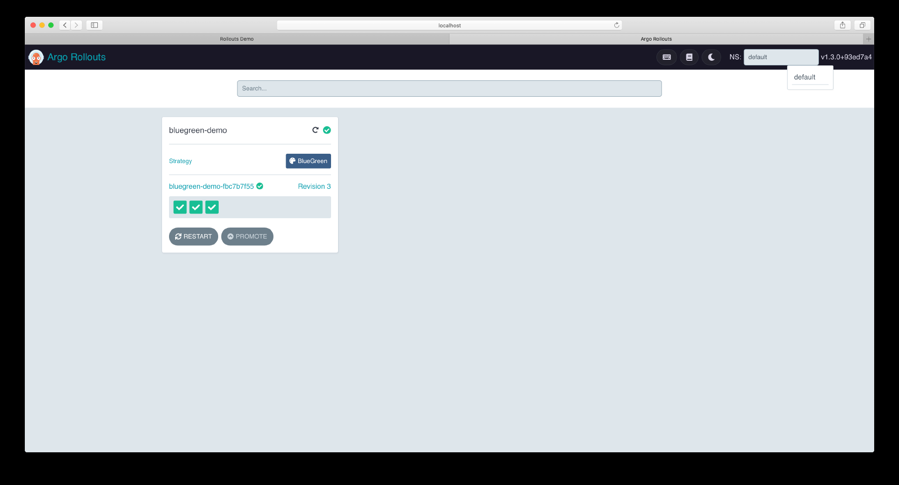

点击进入 Rollout 的详情界面，在这里，你能够以图形化的方式来查看 Rollout 的信息或进行回滚操作。

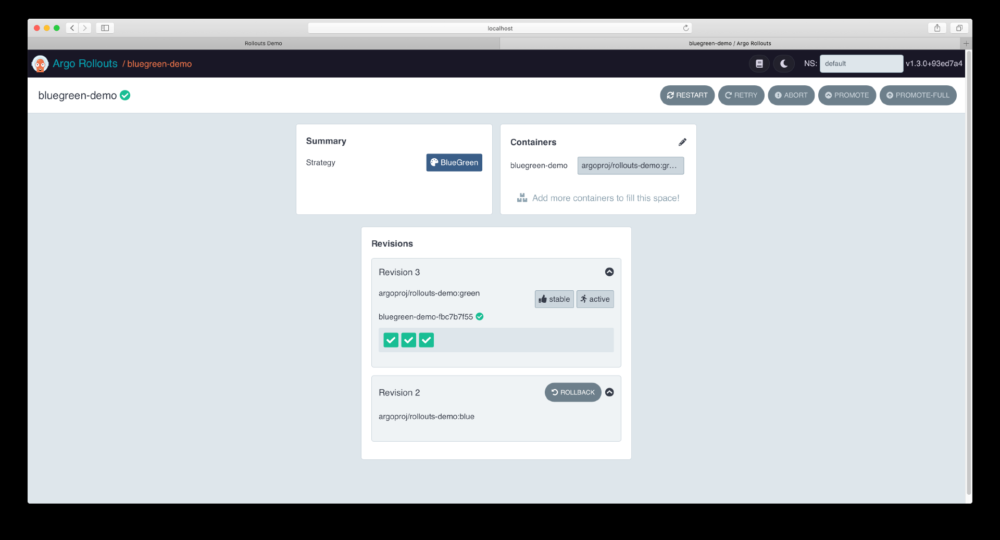

## 自动化原理

那么，Argo Rollout 为什么能够帮助我们自动切换流量呢？接下来，我为你详细分析一下它的工作原理。

在刚开始创建蓝色环境时，Ingress、Service 和 Rollout 的关系是下图这样。

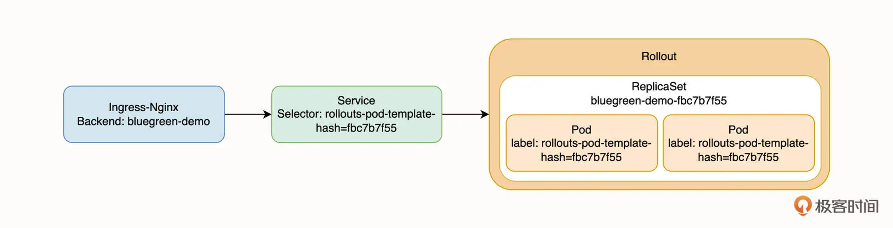

在这个例子中，当 Rollout 对象创建后，Argo Rollout 将会随之创建 ReplicaSet 对象，名称为blue-green-fbc7b7f55，这个 ReplicaSet 会在创建 Pod 时额外为 Pod 打上 rollouts-pod-template-hash=fbc7b7f55 的标签，同时为 Service 添加 rollouts-pod-template-hash=fbc7b7f55 选择器，这样，就打通了从 Ingress 到 Pod 的请求链路。

当我们修改 Rollout 对象的镜像版本后，Argo Rollout 将会重新创建一个新的 ReplicaSet 对象，名称为 bluegreen-demo-7d6459646d，新的 ReplicaSet 也会在创建 Pod 时额外为 Pod打上 rollouts-pod-template-hash=7d6459646d 标签。这时候蓝绿环境的 ReplicaSet 同时存在。

当绿色环境的 Pod 全部就绪之后，Argo Rollout 会将 Service 原来的选择器删除，并添加rollouts-pod-template-hash=7d6459646d 的选择器，这样就将 Service 指向了绿色环境的Pod，从而达到了切换流量的目的。同时，Argo Rollout 还会将蓝色环境的 ReplicaSet 副本数缩容为 0，但并不删除它，而是把它作为灾备。如下图所示。

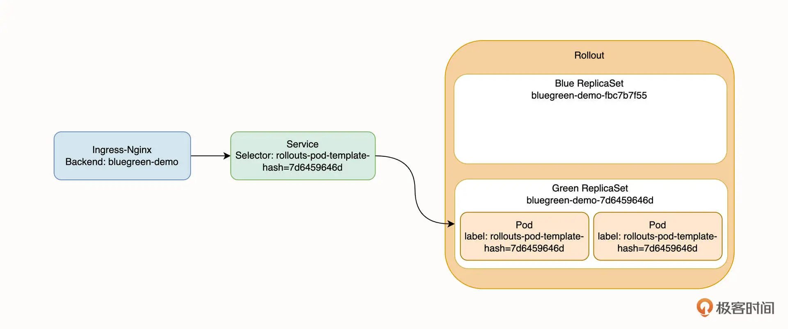

这样，当我们需要重新回滚到蓝色环境时，Argo Rollout 只需调整蓝色环境的 ReplicaSet 副本数并且修改 Service 的选择器，就可以达到快速回滚的目的。

## 总结

这节课，我首先通过手动的方式带你实践了蓝绿发布的过程。这个过程的核心是部署两套Deployment 和 Service，同时通过修改 Ingress 策略来实现切换流量。

但手动的方式并不适合与 GitOps 流水线结合使用，所以我们又介绍了通过 Argo Rollout 将蓝绿发布自动化的方法。

要将手动过程切换到自动化过程其实也非常简单，我们只需要安装 Argo Rollout，并修改Deployment 对象的 apiVersion 和 Kind 字段，然后增加 strategy 字段配置蓝绿发布策略就可以了。

然后，我还为你分析了 Argo Rollout 实现自动化蓝绿发布的原理。和手动修改 Ingress 策略来实现的蓝绿发布不同的是，它主要是通过自动修改 Service 的选择器来对流量进行切换的。这种方式将蓝绿发布的过程变成了更新镜像的操作，极大降低了蓝绿发布的门槛。

最后，你需要注意的是，如果你希望在微服务架构下实施蓝绿发布，那么情况会复杂得多，你需要关注整个微服务链路的蓝绿流量的切换过程，并且在数据库层面也需要考虑对蓝绿发布的支持和适配情况，使数据库在升级过程中能够同时支持蓝绿（新旧）应用。

在下一节课，我会向你介绍在生产环境下更常见的一种发布方式：金丝雀发布。

## 思考题

最后，给你留两道思考题吧。

1. 在手动实施蓝绿发布的过程中，当流量切换到绿色环境时，如何将蓝色环境的副本数缩容至0 ？

2. 在上面的例子中，一旦更新 Rollout 对象的镜像版本，蓝绿发布过程就会自动进行。请你动手试试，如何使用 Rollout 对象的 autoPromotionEnabled 参数和 Argo Rollout kubectl 插件，实现手动控制蓝绿发布呢？（小提示：你可以参考这个链接。）

欢迎你给我留言交流讨论，你也可以把这节课分享给更多的朋友一起阅读。我们下节课见。
