# 25 | 生产稳定的秘密武器：如何实施金丝雀发布？

你好，我是王炜。

上一节课，我们介绍了什么是蓝绿发布以及如何实施蓝绿发布。蓝绿发布是一种通过资源冗余来换取回滚效率的发布方式，结合 Argo Rollout ，能够很方便地实现自动化的流量切换。

但是它的缺点也是比较明显的：当新环境准备好之后，流量将进行全量切换，无法对新环境进行小规模的流量验证。

为了更好地了解新环境的性能和潜在的问题，最好的办法是让新的环境接收一小部分生产流量。通常，我们会把一定比例的生产流量转发到新的环境，以此来验证新环境的表现。这种发布方式就叫做金丝雀发布，又叫做灰度发布。

- 在矿物开采早期，由于缺少有毒气体探测器，矿工下井之后的死亡率非常高。后来，人们发现金丝雀鸟对有害气体非常敏感，于是把金丝雀鸟投入到矿井中充当探测器的角色，以此来保护矿工。

新环境就像金丝雀鸟，首当其冲“探测”生产环境的潜在问题，以此来提升发布的安全性。

在这节课，我会先通过一个例子来说明如何以手动的方式来实施金丝雀发布，然后，我会结合Argo Rollout 这款工具来进一步介绍如何自动化金丝雀发布过程。

在开始今天的学习之前，你需要具备以下前提条件。

- 按照第 2 讲的内容在本地配置好 Kind 集群，安装 Ingress-Nginx，并暴露 80 和 443 端口。

- 配置好 Kubectl 使其能够访问 Kind 集群。

- 按照第 24 讲的内容安装好 Argo Rollout 以及 kubectl 插件。

## 金丝雀发布概述

为了更好地帮助你理解金丝雀发布，在正式进入实战之前，我们先来了解一下它的整体架构，如下图所示。

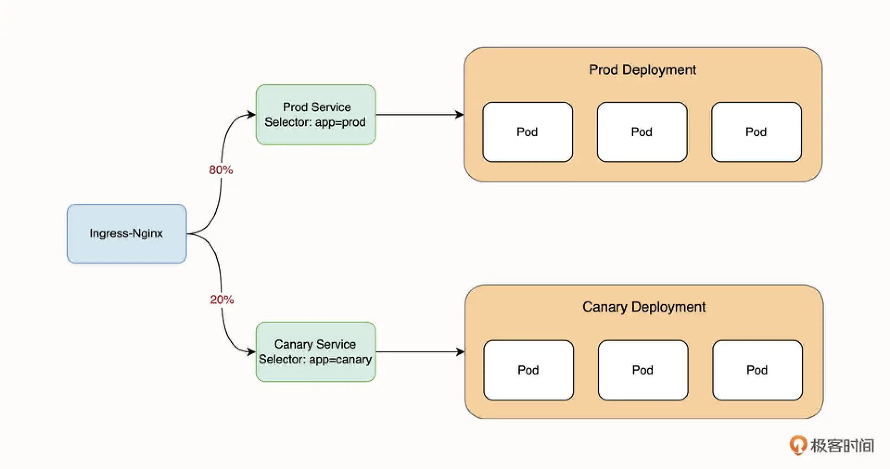

在上面这张架构图中，我们会对同一个应用部署两套环境，一套是 Prod 生产环境，另一套是Canary 金丝雀环境。这两套环境分别由不同的 Service 通过选择器进行关联，最外层通过Ingress-Nginx 网关将流量按不同的比例转发到 Service 当中。比如，图中 20% 的流量将会转发到金丝雀环境，80% 的流量会转发到生产环境，这实际上是一种流量负载均衡的算法。

除了以不同比例分发流量以外，金丝雀发布还可以通过特定的 Header 来进行识别和分发流量，如下图所示。

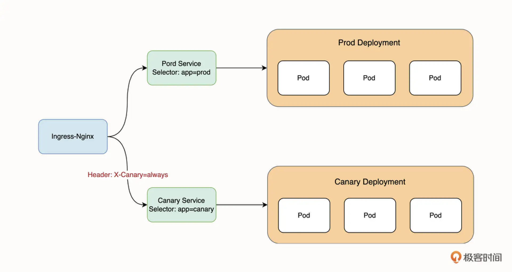

正如上面的图所示，常规流量将仍然访问生产环境，而请求头中带有 X-Canary 的请求将会被转发到金丝雀环境，以此将流量进行区分。

这两种方式在发布过程中具有极强的灵活性，第一种以不同比例分发流量的方式可以很方便地进行灰度验证，避免大规模故障。第二种识别特定请求的方式则更加精准，可以很方便地控制让什么类型的用户访问金丝雀环境，例如对不同地域、不同性别、年龄的用户进行金丝雀实验。

## 金丝雀实战

接下来，我们进入金丝雀发布的实战环节。我会通过一个例子来说明如何使用 Kubernetes 原生的 Deployment 和 Service 来进行金丝雀发布，实战过程主要包含下面几个步骤。

1. 创建生产环境的 Deployment 和 Service。

2. 创建生产环境 Ingress 策略，并指向生产环境的 Service。

3. 访问生产环境。

4. 创建金丝雀环境的 Deployment 和 Service。

5. 创建金丝雀环境 Ingress 策略，并实现按比例分发和识别特殊流量分发。

6. 访问生产环境。

### 创建生产环境

首先，我们需要先创建生产环境。将下面的内容保存为 prod_deployment.yaml 文件。

```bash
apiVersion: apps/v1
kind: Deployment
metadata:
 name: prod
 labels:
   app: prod
spec:
 replicas: 1
 selector:
   matchLabels:
     app: prod
 template:
   metadata:
     labels:
       app: prod
   spec:
     containers:
     - name: demo
       image: argoproj/rollouts-demo:blue
       imagePullPolicy: Always
       ports:
       - containerPort: 8080
---
apiVersion: v1
kind: Service
metadata:
 name: prod-service
 labels:
   app: prod
spec:
 ports:
 - protocol: TCP
   port: 80
   targetPort: 8080
 selector:
   app: prod
 type: ClusterIP
```

在上面这段 Manifest 中，我们使用了 argoproj/rollouts-demo:blue 镜像来模拟创建生产环境的Deployment 工作负载，并且创建了名为 prod-service 的 Service 对象，同时通过 Service 选择器将 Service 和 Pod 进行了关联。

然后，使用 kubectl apply 命令将示例应用部署到集群内。

```
$ kubectl apply -f prod_deployment.yaml
deployment.apps/prod created
service/prod-service created
```

部署完成后，等待工作负载 Ready。

```
$ kubectl wait pods -l app=prod --for condition=Ready --timeout=90s
pod/prod-96bc479bb-mxj6v condition met
```

当看到上面的输出后，代表生产环境已经准备好了。

接下来，再创建生产环境的 Ingress 策略。将下面的内容保存为 prod_ingress.yaml 文件。

```
apiVersion: networking.k8s.io/v1
kind: Ingress
metadata:
 name: prod-ingress
spec:
 rules:
 - host: "canary.demo"
   http:
     paths:
     - pathType: Prefix
       path: "/"
       backend:
         service:
           name: prod-service
           port:
             number: 80
```

然后，通过 kubectl apply 将其应用到集群内。

```
$ kubectl apply -f blue_ingress.yaml
ingress.networking.k8s.io/prod-ingress created
```

在上面创建的 Ingres 策略中，我们指定了 canary.demo 作为访问域名。所以，在访问生产环境之前，你需要先在本地配置 Hosts 才能访问。

```
127.0.0.1 canary.demo
```

### 访问生产环境

配置完 Hosts 之后，接下来我们就可以访问生产环境了。使用浏览器访问http://canary.demo，你应该能看到像下面截图的页面。

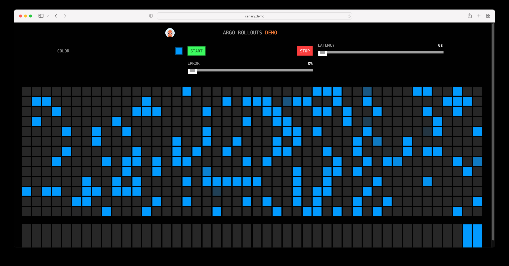

在这个页面里，浏览器每秒钟会向后端发出 50 个请求，蓝色的方块代表后端返回接口的内容为 blue，对应的是 argoproj/rollouts-demo:blue 版本的镜像，用来模拟生产环境。

### 部署金丝雀环境

现在，假设我们需要以金丝雀发布的方式来更新环境，首先需要先创建金丝雀环境。你可以将下面的内容保存为 canary_deployment.yaml。

```bash
apiVersion: apps/v1
kind: Deployment
metadata:
 name: canary
 labels:
   app: canary
spec:
 replicas: 1
 selector:
   matchLabels:
     app: canary
 template:
   metadata:
     labels:
       app: canary
   spec:
     containers:
     - name: demo
       image: argoproj/rollouts-demo:green
       imagePullPolicy: Always
       ports:
       - containerPort: 8080
---
apiVersion: v1
kind: Service
metadata:
 name: canary-service
 labels:
   app: canary
spec:
 ports:
 - protocol: TCP
   port: 80
   targetPort: 8080
 selector:
   app: canary
 type: ClusterIP
```

在这段 Manifest 中，我们用 argoproj/rollouts-demo:green 镜像来模拟创建金丝雀环境的Deployment，并且创建了名为 canary-service 的 Service 对象。

接下来，使用 kubectl apply 将它应用到集群内。

```
$ kubectl apply -f canary_deployment.yaml
deployment.apps/canary created
service/canary-service created
```

部署完成后，等待工作负载 Ready。

```
$ kubectl wait pods -l app=canary --for condition=Ready --timeout=90s
pod/canary-579d4b57d6-fpg29 condition met
```

当看到上面的输出后，代表金丝雀环境已经准备好了。

### 配置金丝雀策略

现在，生产环境和金丝雀环境都已经准备好，接下来我们需要配置金丝雀环境的 Ingress 策略。将下面的内容保存为 canary_ingress.yaml 文件。

```
apiVersion: networking.k8s.io/v1
kind: Ingress
metadata:
 name: canary-ingress-canary
 annotations:
   kubernetes.io/ingress.class: nginx
   nginx.ingress.kubernetes.io/canary: "true"
   nginx.ingress.kubernetes.io/canary-weight: "20"
   nginx.ingress.kubernetes.io/canary-by-header: "X-Canary"
spec:
 rules:
 - host: "canary.demo"
   http:
     paths:
     - pathType: Prefix
       path: "/"
       backend:
         service:
           name: canary-service
           port:
             number: 80
```

相比较生产环境的 Ingress 策略，这段金丝雀环境的 Ingress 策略在 metadata.annotations 字段上有明显的差异，下面我简单介绍一下。

nginx.ingress.kubernetes.io/canary 字段的值为 true，表示启用金丝雀发布策略。

nginx.ingress.kubernetes.io/canary-weight 字段的值为 20，表示将 20% 的流量转发到金丝雀环境当中，实际上这是负载均衡的加权轮询机制。

nginx.ingress.kubernetes.io/canary-by-header 字段的值为 X-Canary，代表当 Header 中包含X-Canary 时，则无视流量比例规则，将请求直接转发到金丝雀环境中。

所以，上面的 Ingress 策略实际上同时配置了基于请求流量比例以及请求头的金丝雀策略。

现在，将金丝雀环境的 Ingress 策略应用到集群内。

```
$ kubectl apply -f canary_ingress.yaml
ingress.networking.k8s.io/canary-ingress-canary created
```

重新返回浏览器，你将会看到生产环境（蓝色方块）和金丝雀环境（绿色方块）的流量比例将按照配置的 4:1 来分布，如下图右下角所示。

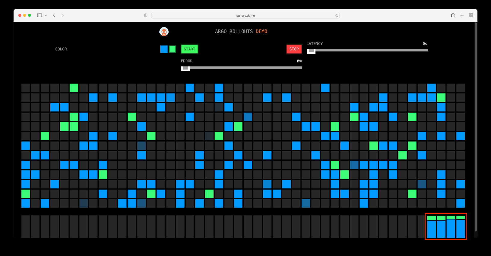

现在，你只需要调整金丝雀环境的 Ingress 策略，分次提升 canary-weight 的值直到 100%，也就实现了一次完整的金丝雀发布过程。

## 金丝雀发布自动化

上面提到手动金丝雀发布过程比较麻烦，我们除了需要手动创建生产和金丝雀两个环境以外，还需要手动配置 Ingress 策略，如果想要调整金丝雀环境的流量比例，那么就需要多次修改Ingress 策略。这种发布方式效率很低，并且最后将金丝雀环境提升为生产环境时也需要手动处理。

但是借助 Argo Rollout 的自动金丝雀发布功能，就能很好地解决这些问题。

在使用 Argo Rollout 之前，你需要先在集群里安装它，并在本地安装好 Argo Rollout kubectl插件，具体流程你可以参考第 24 讲的内容。

### 创建 Rollout 对象

为了实现自动化的金丝雀发布过程，我们需要用到 Rollout 对象。它可以帮助我们自动管理金丝雀发布过程中涉及到的 ReplicaSet、Service 和 Ingress 对象。

首先，你需要将下面的内容保存为 canary-rollout.yaml 文件。

```
apiVersion: argoproj.io/v1alpha1
kind: Rollout
metadata:
 name: canary-demo
 labels:
   app: canary-demo
spec:
 replicas: 1
 selector:
   matchLabels:
     app: canary-demo
 template:
   metadata:
     labels:
       app: canary-demo
   spec:
     containers:
     - name: canary-demo
       image: argoproj/rollouts-demo:blue
       imagePullPolicy: Always
       ports:
       - name: http
         containerPort: 8080
         protocol: TCP
       resources:
         requests:
           memory: 32Mi
           cpu: 5m
 strategy:
   canary:
     canaryService: canary-demo-canary
     stableService: canary-demo
     canaryMetadata:
       labels:
         deployment: canary
     stableMetadata:
       labels:
         deployment: stable
     trafficRouting:
       nginx:
         stableIngress: canary-demo
         additionalIngressAnnotations:
           canary-by-header: X-Canary
     steps:
       - setWeight: 20
       - pause: {}
       - setWeight: 50
       - pause:
           duration: 30s
       - setWeight: 70
       - pause:
           duration: 30s
```

然后，将它应用到集群内。

```
$ kubectl apply -f canary-rollout.yaml
rollout.argoproj.io/canary-demo created
```

在上面这段 Rollout 对象中，spec.template 字段和 Deployment 工作负载的字段定义是一致的，在这里，我们使用了 argoproj/rollouts-demo:blue 镜像来创建生产环境的工作负载，并定义了 strategy.canary 字段，它代表使用金丝雀发布的策略。其他的字段我也简单介绍一下。

canaryService 表示金丝雀 Service 的名称，我们会在稍后创建它。

stableService 表示生产环境 Service 的名称，同样也需要在稍后创建。

canaryMetadata 和 stableMetadata 字段表示在金丝雀发布时，会将额外的标签增加到 Pod中，它可以区分不同环境的 Pod。

trafficRouting.nginx 字段表示使用 Ingress-Nginx 来管理流量，同时，trafficRouting.nginx.stableIngress 字段用来指定 Ingress 名称，这个 Ingress 需要我们提前创建。

trafficRouting.nginx.additionalIngressAnnotations 字段用来配置特定的金丝雀流量识别策略，这里的含义是当请求头出现 X-Canary 时，就将流量转发到金丝雀环境中。

此外，还有一项重要的配置：canary.steps，它是用来描述如何进行自动化金丝雀发布。

在这个例子中，自动化金丝雀的配置如下。

1. 将金丝雀环境的流量比例配置为 20%。

2. 暂停金丝雀发布，直到手动批准。

3. 将金丝雀环境的流量比例配置为 50%，并持续 30 秒。

4. 将金丝雀环境的流量比例配置为 70%，并持续 30 秒。

5. 完成金丝雀发布，此时金丝雀环境成为新的生产环境，并接收所有的生产流量。

### 创建 Service 和 Ingress 对象

接下来，我们还需要创建 Service 和 Ingress 对象。首先创建用于生产环境的 canary-demo 和金丝雀环境的 canary-demo-canary Service 对象，将下面的内容保存为 canary-demo-service.yaml 文件。

```bash
apiVersion: v1
kind: Service
metadata:
 name: canary-demo
 labels:
   app: canary-demo
spec:
 ports:
 - port: 80
   targetPort: http
   protocol: TCP
   name: http
 selector:
   app: canary-demo
---
apiVersion: v1
kind: Service
metadata:
 name: canary-demo-canary
 labels:
   app: canary-demo
spec:
 ports:
 - port: 80
   targetPort: http
   protocol: TCP
   name: http
 selector:
   app: canary-demo
```

然后，将它应用到集群内。

```
$ kubectl apply -f canary-demo-service.yaml
service/canary-demo created
service/canary-demo-canary created
```

最后，创建 Ingress 对象。将下面内容保存为 canary-demo-ingress.yaml 文件。

```
apiVersion: networking.k8s.io/v1
kind: Ingress
metadata:
 name: canary-demo
 labels:
   app: canary-demo
 annotations:
   kubernetes.io/ingress.class: nginx
spec:
 rules:
   - host: canary.auto
     http:
       paths:
         - path: /
           pathType: Prefix
           backend:
             service:
               name: canary-demo
               port:
                 name: http
```

在这里，我们把 canary.auto 作为生产环境和金丝雀环境的域名，并且将后端 Service 配置为canary-demo。

使用 kubectl apply 命令将它应用到集群内。

```
$ kubectl apply -f canary-demo-ingress.yaml
ingress.networking.k8s.io/canary-demo created
```

同样地，为了能够访问 canary.auto 域名，你还需要添加 Hosts 策略。

```
127.0.0.1 canary.auto
```

### 访问生产环境

配置好 Hosts 之后，就可以访问生产环境了。使用浏览器访问 http://canary.auto，你应该能看到和手动部署生产环境一样的界面，如下图所示。

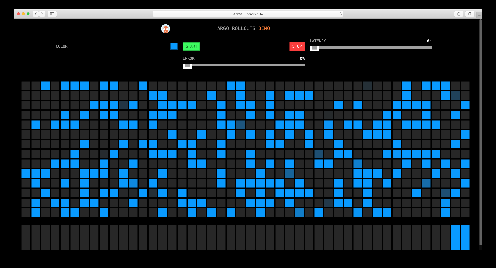

### 金丝雀发布自动化

现在，我们已经创建好了生产环境。接下来，我们继续进行自动化的金丝雀发布。

假设我们需要更新生产环境，并需要将生产环境的 argoproj/rollouts-demo:blue 镜像更新为argoproj/rollouts-demo:green 镜像。此时，你只需要修改 Rollout 对象的 image 字段，将blue 修改为 green 即可。

```
containers:
- name: canary-demo
 image: argoproj/rollouts-demo:green
```

然后，使用 kubectl apply 将 Rollout 对象重新应用到集群内。

```
$ kubectl apply -f canary-rollout.yaml
rollout.argoproj.io/canary-demo configured
```

现在，返回浏览器，等待十几秒后，你应该能看到代表金丝雀环境的绿色方块开始出现，并大致占到总请求数的 20%，如下图右下角所示。

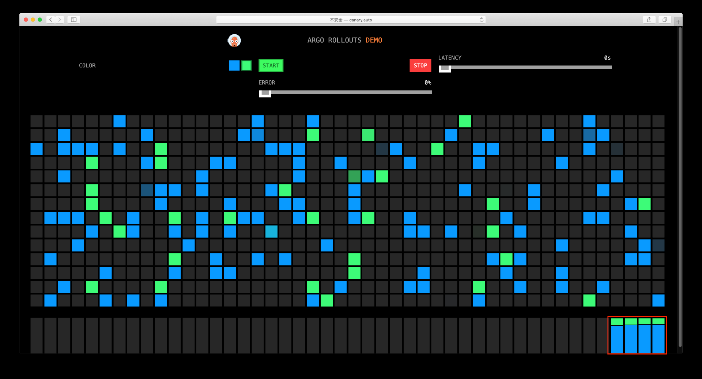

同时，我们在 Rollout 对象中还配置了 canary-by-header 参数，所以当我们使用特定的Header 请求时，流量将被转发到金丝雀环境中，你可以使用 curl 来验证。

```
$ for i in `seq 1 10`; do curl -H "X-Canary: always" http://canary.auto/color; do
"green""green""green""green""green""green""green""green""green""green"
```

从上面的请求命令我们会发现，当 Header 中携带了 X-Canary: always 之后，将返回 green字符串，也就是金丝雀环境的 green 镜像。

到这里，自动金丝雀发布的第一阶段就已经完成了。接下来，我们结合 Argo RolloutDashboard，继续进行自动金丝雀发布剩下的阶段。

### 访问 Argo Rollout Dashboard

要访问 Argo Rollout Dashboard，你需要先安装 Argo Rollout kubectl 插件，具体流程你可以参考第 24 讲的内容。

接下来，我们可以使用 kubectl argo rollouts dashboard 来启用 Dashboard。

```
$ kubectl argo rollouts dashboard
INFO[0000] Argo Rollouts Dashboard is now available at http://localhost:3100/roll
```

然后，使用浏览器访问 http://localhost:3100/rollouts，打开 Dashboard。

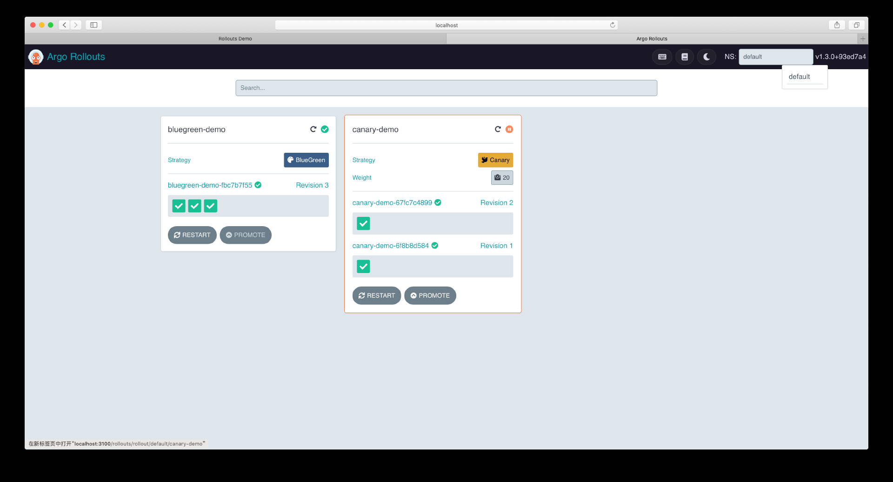

接下来，点击卡片进入 canary-demo 详情，在这里我们将看到金丝雀发布的完整步骤以及当前所处的阶段。

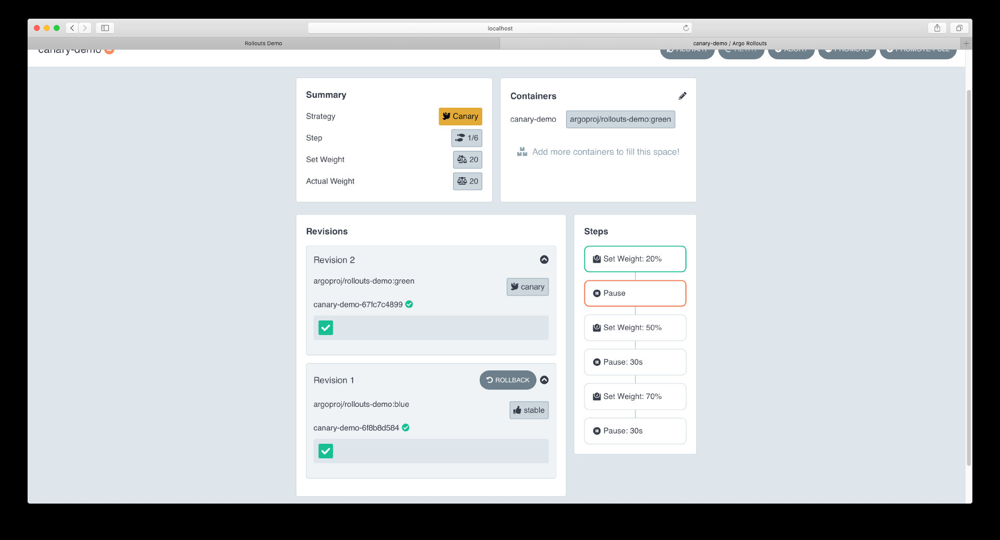

从上面的截图我们可以看出，金丝雀发布一共有 6 个阶段，当前处于第二个暂停阶段，这和我们在 Rollout 里的定义是一致的。

接下来，我们通过手动批准的方式让金丝雀发布进入下一个步骤。你可以使用 kubectl argorollouts promote 命令来让金丝雀发布继续运行。

```
$ kubectl argo rollouts promote canary-demo
rollout 'canary-demo' promoted
```

之后，金丝雀发布将会按照我们预定的步骤运行。首先将金丝雀环境的流量比例设置为50%，停留 30 秒，然后将金丝雀环境的流量比例设置为 70%，再停留 30 秒，最后将金丝雀环境提升为生产环境。当金丝雀发布完成之后，Argo Rollout 将同时自动对老的环境进行缩容操作，如下图所示。

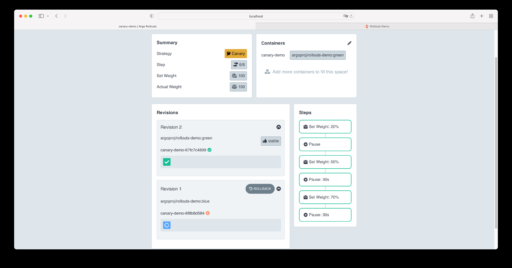

到这里，一次完整的自动化金丝雀发布就已经完成了。

## 自动化原理

Argo Rollout 实际上是在不同的金丝雀发布阶段，通过修改 ReplicaSet、Service 和 Ingress对象来实现自动化的。

在刚开始创建生产环境时，Ingress、Service 和 Rollout 对象的关系如下图所示。

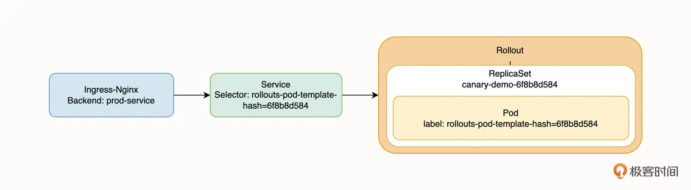

上面的这条流量链路比较简单，首先，最外层 Ingress 在接收到流量后会将其转发到生产环境的 Service，Service 又通过选择器来匹配被 Rollout 对象管理的 Pod。

当我们修改了 Rollout 的镜像版本并进行金丝雀发布时，Rollout 对象会创建一个新的金丝雀环境的 ReplicaSet 对象，并修改 Service 的标签选择器来匹配到金丝雀环境的 Pod。然后，再生成一个额外的 Ingress 对象来匹配需要转发到金丝雀环境的流量，包括按权重以及匹配Header 的规则，如下图所示。

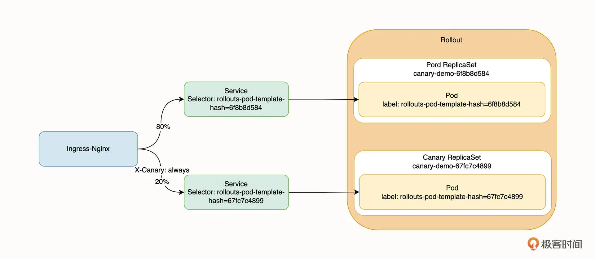

当处于不同的金丝雀阶段时，Argo Rollout 会自动修改 Ingress 对象的nginx.ingress.kubernetes.io/canary-weight 注解的值，以此来控制不同比例的流量进入金丝雀环境。

最后，当金丝雀发布的所有阶段都完成之后，Argo Rollout 还会自动将金丝雀环境提升为生产环境。具体的做法是，修改金丝雀环境的 Ingress 策略，将nginx.ingress.kubernetes.io/canary-weight 注解的值修改为 0，同时将旧生产环境的 Service的选择器修改为匹配金丝雀环境的 Pod，最后再将旧的生产环境的 ReplicaSet 缩容为 0，达到将金丝雀环境提升为生产环境的目的，如下图所示。

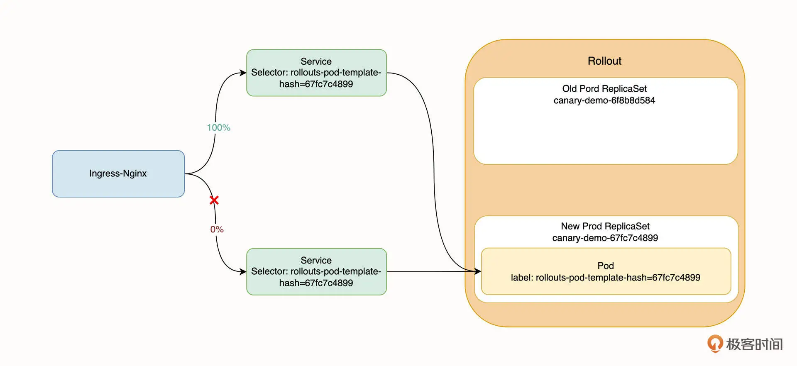

## 总结

这节课，我为你介绍了什么是金丝雀发布以及如何通过手动的方式来实践它。它和蓝绿发布有一点类似，比如在发布过程都需要同时部署两套环境。不同的是，金丝雀发布的核心是通过为Ingress-Nginx 添加注解来实现的。

在金丝雀发布的过程中，主要有两种流量分发方式。第一种是通过流量的比例进行分发，第二种是通过特定的 Header 来识别。

以手动的方式来实施金丝雀部署比较繁琐，并且效率低下。所以，我们还介绍了如何通过Argo Rollout 来自动化金丝雀发布过程。

通过 Rollout 对象，我们可以把金丝雀发布的过程完整地定义出来，比如将金丝雀发布分成若干个阶段，每个阶段使用不同的流量比例并且持续不同的时间。同时，还可以为金丝雀发布配置手动确认的过程。

在实际的业务场景中，通常我们会尽量拉长金丝雀发布的时间，比如持续数小时渐进式地发布，以便更多的流量流向金丝雀环境。其次，通过特定的 Header 来识别流量是一种非常好的工程实践，比如你可以将特定地域、性别、年龄的用户作为目标群体来进行金丝雀发布，让特定的用户才能访问新的版本。如果你仔细留意过，会发现自己在使用一些大型应用的时候，很可能都作为“灰度”用户曾经参与了金丝雀发布过程。

最后，要在 GitOps 实践金丝雀发布也非常容易，你只需要将工作负载的 Kind 和 apiVersion字段分别修改成 Rollout 和 argoproj.io/v1alpha1 就可以了。结合 ArgoCD，你就可以很方便地在 GitOps 工作流中使用金丝雀发布了。

## 思考题

最后，给你留一道思考题吧。

在手动实施蓝绿发布的过程中，如何将金丝雀环境提升为生产环境？

欢迎你给我留言交流讨论，你也可以把这节课分享给更多的朋友一起阅读。我们下节课见。
