# 26 | 生产稳定的秘密武器：如何实施自动化渐进式交付？

你好，我是王炜。

在上一节课，我为你介绍了什么是金丝雀发布以及如何实施自动化金丝雀发布。

在实施金丝雀发布的过程中，我们通过 Argo Rollout 的金丝雀策略将发布过程分成了 3 个阶段，每个阶段金丝雀的流量比例都不同，经过一段时间之后，金丝雀环境变成了新的生产环境。实际上，这也是一种渐进式的交付方式，它通过延长发布时间来保护生产环境，降低了发生生产事故的概率。

不过，这种渐进式的交付方式存在一个明显的缺点：无法自动判断金丝雀环境是否出错。

这可能会导致一种情况，当金丝雀环境在接收生产流量之后，它产生了大量的请求错误，在缺少人工介入的情况下，发布仍然按照计划进行，最终导致生产环境故障。

为了解决这个问题，我们希望渐进式交付变得更加智能，一个好的工程实践方式是：通过指标分析来自动判断金丝雀发布的质量，如果符合预期，就继续金丝雀步骤；如果不符合预期，则进行回滚。这样，也就能够避免将金丝雀环境的故障带到生产环境中了，这种分析方法也叫做金丝雀分析。

这节课，我们就来学习如何将 Argo Rollout 和 Prometheus 结合，实现自动渐进式交付。

在开始今天的学习之前，你需要做好下面这些准备。

- 按照第一章第 2 讲的内容在本地配置好 Kind 集群，安装 Ingress-Nginx，并暴露 80 和443 端口。

- 配置好 Kubectl，使其能够访问 Kind 集群。

- 按照第 24 讲的内容安装好 Argo Rollout 以及 kubectl 插件。

## 自动渐进式交付概述

为了更好地帮助你理解自动渐进式交付，我给你画了一张整体的架构和流程图，如下所示。

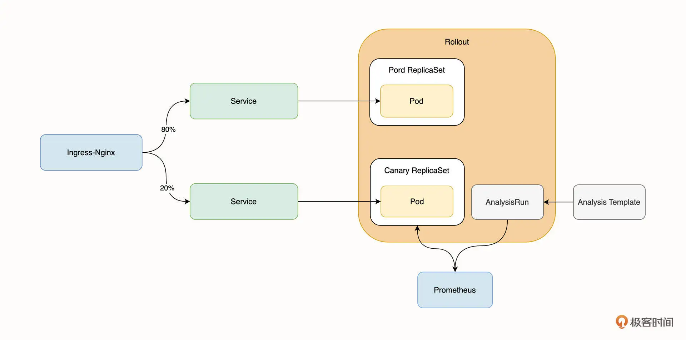

相比较金丝雀发布，自动渐进式交付增加了 Prometheus、Analysis Template 和 AnalysisRun对象。其中，Analysis Template 定义用于分析的模板，AnalysisRun 是分析模板的实例化，Prometheus 是用来存储指标的数据库。

在这节课的例子中，我设计的自动渐进式交付流程会按照下面这张流程图来进行。

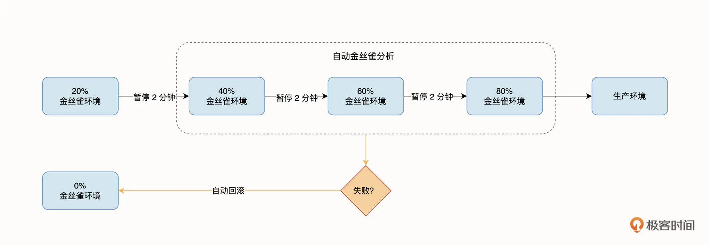

自动渐进式交付开始时，首先会先将金丝雀环境的流量比例设置为 20% 并持续两分钟，然后将金丝雀环境的流量比例设置为 40% 并持续两分钟，然后再以此类推到 60%、80%，直到将金丝雀环境提升为生产环境为止。

从第二个阶段开始，自动金丝雀分析开始运行，在持续运行的过程中，如果金丝雀分析失败，那么金丝雀环境将进行自动回滚。这样就达到了自动渐进式交付的目的。

## 自动渐进式交付实战

接下来，我们进入到渐进式交付的实战环节，实战过程大致分成下面几个步骤。

1. 创建生产环境，包括 Rollout 对象、Service 和 Ingress。

2. 创建用于自动金丝雀分析的 AnalysisTemplate 模板。

3. 安装 Prometheus 并配置 Ingress-Nginx。

4. 修改镜像版本，启动渐进式交付。

### 创建生产环境

首先，我们需要创建用于模拟生产环境的 Rollout 对象、Service 和 Ingress。将下面的内容保存为 rollout-with-analysis.yaml 文件。

```
apiVersion: argoproj.io/v1alpha1
kind: Rollout
metadata:
 name: canary-demo
spec:
 replicas: 1
 selector:
   matchLabels:
     app: canary-demo
 strategy:
   canary:
     analysis:
       templates:
       - templateName: success-rate
       startingStep: 2
       args:
       - name: ingress
         value: canary-demo
     canaryService: canary-demo-canary
     stableService: canary-demo
     trafficRouting:
       nginx:
         stableIngress: canary-demo
     steps:
     - setWeight: 20
     - pause:
         duration: 2m
     - setWeight: 40
     - pause:
         duration: 2m
     - setWeight: 60
     - pause:
         duration: 2m
     - setWeight: 80
     - pause:
         duration: 2m
 template:
   metadata:
     labels:
       app: canary-demo
   spec:
     containers:
     - image: argoproj/rollouts-demo:blue
       imagePullPolicy: Always
       name: canary-demo
       ports:
       - containerPort: 8080
         name: http
         protocol: TCP
       resources:
         requests:
           cpu: 5m
           memory: 32Mi
```

上面的内容相比较第 25 讲金丝雀发布的 Rollout 对象并没有太大差异，只是在 canary 字段下面增加了 analysis 字段，它的作用是指定金丝雀分析的模板，模板内容我们会在稍后创建。另外，这里同样使用了 argoproj/rollouts-demo:blue 镜像来模拟生产环境。

然后，使用 kubectl apply 命令将它应用到集群内。

```
$ kubectl apply -f rollout-with-analysis.yaml
rollout.argoproj.io/canary-demo created
```

接下来，我们还需要创建 Service 对象。在这里，我们可以一并创建生产环境和金丝雀环境所需要用到的 Service ，将下面的内容保存为 canary-demo-service.yaml。

```bash
apiVersion: v1
kind: Service
metadata:
 name: canary-demo
 labels:
   app: canary-demo
spec:
 ports:
 - port: 80
   targetPort: http
   protocol: TCP
   name: http
 selector:
   app: canary-demo
---
apiVersion: v1
kind: Service
metadata:
 name: canary-demo-canary
 labels:
   app: canary-demo
spec:
 ports:
 - port: 80
   targetPort: http
   protocol: TCP
   name: http
 selector:
app: canary-demo
```

然后，使用 kubectl apply 命令将它应用到集群内。

```
$ kubectl apply -f canary-demo-service.yaml
service/canary-demo created
service/canary-demo-canary created
```

最后，再创建 Ingress 对象。将下面的内容保存为 canary-demo-ingress.yaml 文件。

```
apiVersion: networking.k8s.io/v1
kind: Ingress
metadata:
 name: canary-demo
 labels:
   app: canary-demo
 annotations:
   kubernetes.io/ingress.class: nginx
spec:
 rules:
   - host: progressive.auto
     http:
       paths:
         - path: /
           pathType: Prefix
           backend:
             service:
               name: canary-demo
               port:
                 name: http
```

在这个 Ingress 对象中，指定了 progressive.auto 作为访问域名。

然后，使用 kubectl apply 命令将它应用到集群内。

```
$ kubectl apply -f canary-demo-ingress.yaml
ingress.networking.k8s.io/canary-demo created
```

### 创建 AnalysisTemplate

由于我们在 Rollout 对象中指定了名为 success-rate 的金丝雀分析模板，所以我们还需要创建它。将下面的内容保存为 analysis-success.yaml 文件。

```
apiVersion: argoproj.io/v1alpha1
kind: AnalysisTemplate
metadata:
 name: success-rate
spec:
 args:
 - name: ingress
 metrics:
 - name: success-rate
   interval: 10s
   failureLimit: 3
   successCondition: result[0] > 0.90
   provider:
     prometheus:
       address: http://prometheus-kube-prometheus-prometheus.prometheus:9090
       query: >+
         sum(
           rate(nginx_ingress_controller_requests{ingress="{{args.ingress}}",sta
           /
           sum(rate(nginx_ingress_controller_requests{ingress="{{args.ingress}}"
         )
```

这里我简单介绍一下 AnalysisTemplate 对象字段的含义。

首先 spec.args 字段定义了参数，该参数会在后续的 query 语句中使用，它的值是从 Rollout对象的 canary.analysis.args 字段传递进来的。

spec.metrics 字段定义了自动分析的相关配置。其中，interval 字段为频率，每 10 秒钟执行一次分析。failureLimit 字段代表“连续 3 次失败则金丝雀分析失败”，此时要执行回滚动作。successCondition 字段代表判断条件，这里的 result[0] 是一个表达式，代表的含义是当查询语句的返回值大于 0.90 时，说明本次金丝雀分析成功了。

最后，spec.metrics.provider 字段定义了分析数据来源于 Prometheus，还定义了 PrometheusServer 的连接地址，我们将在稍后部署 Prometheus。

query 字段是金丝雀分析的查询语句。这条查询语句的含义你可以简单地理解成：在 60 秒内HTTP 状态码不为 4xx 和 5xx 的请求占所有请求的比例。换句话说，当 HTTP 请求成功的比例大于 0.90 时，代表一次金丝雀分析成功。

### 访问生产环境

接下来，为了访问生产环境，你还需要先配置 Hosts。

```
127.0.0.1 progressive.auto
```

接下来，使用浏览器访问 http://progressive.auto，你应该能看到如下页面。

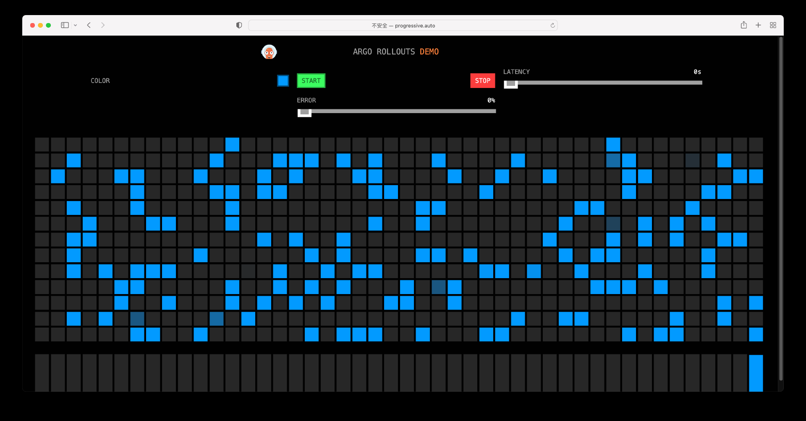

### 安装 Prometheus

Prometheus 是 Kubernetes 平台开源的监控和报警系统。由于金丝雀分析需要用到Prometheus 来查询指标，所以我们需要先部署它。这里我使用 Helm 的方式进行部署。

```
$ helm repo add prometheus-community https://prometheus-community.github.io/helm-
$ helm upgrade prometheus prometheus-community/kube-prometheus-stack \
--namespace prometheus  --create-namespace --install \
--set prometheus.prometheusSpec.podMonitorSelectorNilUsesHelmValues=false \
--set prometheus.prometheusSpec.serviceMonitorSelectorNilUsesHelmValues=false
Release "prometheus" does not exist. Installing it now.
......
STATUS: deployed
```

在上面的安装命令中，我使用 --set 对安装参数进行了配置，这是为了让它后续能够顺利获取到 Ingress-Nginx 的监控指标。

然后，你需要等待 prometheus 命名空间下的工作负载处于就绪状态。

```
$ kubectl wait --for=condition=Ready pods --all -n prometheus
pod/alertmanager-prometheus-kube-prometheus-alertmanager-0 condition met
pod/prometheus-grafana-64b6c46fb5-6hz2z condition met
pod/prometheus-kube-prometheus-operator-696cc64986-pv9rg condition met
pod/prometheus-kube-state-metrics-649f8795d4-glbcq condition met
pod/prometheus-prometheus-kube-prometheus-prometheus-0 condition met
pod/prometheus-prometheus-node-exporter-mqnrw condition met
```

到这里，Prometheus 就部署完成了。

### 配置 Ingress-Nginx 和 ServiceMonitor

为了让 Prometheus 能够顺利地获取到 HTTP 请求指标，我们需要打开 Ingress-Nginx Metric指标端口。

首先需要为 Ingress-Nginx Deployment 添加容器的指标端口，你可以执行下面的命令来完成。

```
$ kubectl patch deployment ingress-nginx-controller -n ingress-nginx --type='json
deployment.apps/ingress-nginx-controller patched
```

然后，为 Ingrss-Nginx Service 添加指标端口。

```
$ kubectl patch service ingress-nginx-controller -n ingress-nginx --type='json' -
service/ingress-nginx-controller patched
```

最后，为了让 Prometheus 能够抓取到 Ingress-Nginx 指标，我们还需要创建 ServiceMonitor对象，它可以为 Prometheus 配置指标获取的策略。将下面的内容保存为 servicemonitor.yaml文件。

```
apiVersion: monitoring.coreos.com/v1
kind: ServiceMonitor
metadata:
 name: nginx-ingress-controller-metrics
 namespace: prometheus
 labels:
   app: nginx-ingress
   release: prometheus-operator
spec:
 endpoints:
 - interval: 10s
   port: prometheus
 selector:
   matchLabels:
     app.kubernetes.io/instance: ingress-nginx
     app.kubernetes.io/name: ingress-nginx
 namespaceSelector:
   matchNames:
   - ingress-nginx
```

然后，通过 kubectl 将它部署到集群内。

```
$ kubectl apply -f servicemonitor.yaml
servicemonitor.monitoring.coreos.com/nginx-ingress-controller-metrics created
```

当把 ServiceMonitor 应用到集群后，Prometheus 会按照标签来匹配 Ingress-Nginx Pod，并且会每 10s 主动拉取一次指标数据，并保存到 Prometheus 时序数据库中。

### 验证 Ingress-Nginx 指标

接下来，我们验证 Prometheus 是否已经成功获取到了 Ingress-Nginx 指标，这将决定自动金丝雀分析是否能成功获取到数据。

我们可以进入 Prometheus 控制台验证是否成功获取了 Ingress-Nginx 指标。首先，使用kubectl port-forward 命令将 Prometheus 转发到本地。

```
$ kubectl port-forward service/prometheus-kube-prometheus-prometheus 9090:9090 -n
Forwarding from 127.0.0.1:9090 -> 9090
Forwarding from [::1]:9090 -> 9090
```

接下来，使用浏览器打开 http://127.0.0.1:9090 进入控制台，在搜索框中输入nginx_ingress，如果出现一系列指标，则说明 Prometheus 和 Ingress-Nginx 已经配置完成，如下图所示。

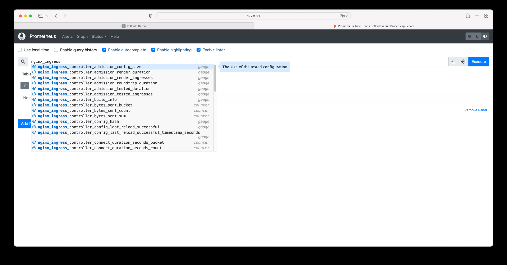

## 自动渐进式交付实验

现在，所有的准备工作都已经完成了，接下来我们进行自动渐进式交付实验。

让我们重新回忆一下我在前面提到的这张流程图。

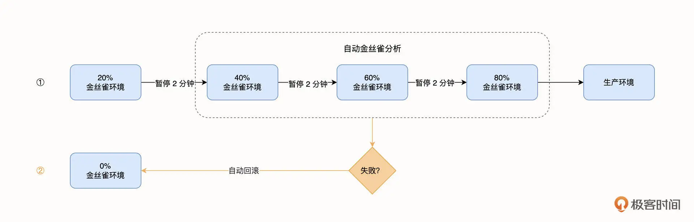

在实验过程过程中，我会按照这张流程图分别进行两个实验。

1. 自动渐进式交付成功（图中①号链路）。

2. 自动渐进式交付失败（图中②号链路）。

### 自动渐进式交付成功

接下来，我们进行自动渐进式交付成功的实验。

要开始实验，只要更新 Rollout 对象的镜像版本即可。在第 25 讲中，我提到了编辑 Rollout对象并通过 kubectl apply 的方法来更新镜像版本。这节课，我们使用另一种更新镜像的方法，通过 Argo Rollout kubectl 插件来更新镜像。

```
$ kubectl argo rollouts set image canary-demo canary-demo=argoproj/rollouts-demo:
rollout "canary-demo" image updated
```

接下来，使用浏览器打开 http://progressive.auto 返回应用，过一会儿看到绿色方块开始出现，流量占比约为 20%，如下图所示。

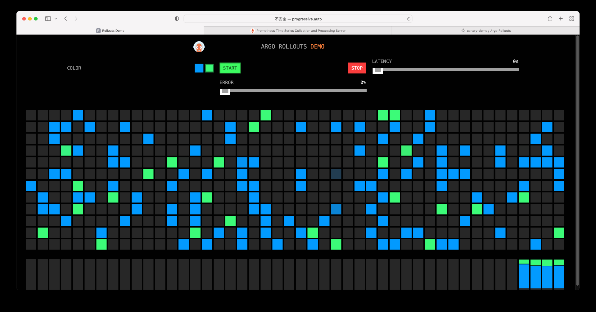

现在，你可以尝试打开 Argo Rollout 控制台。

```
$ kubectl argo rollouts dashboard
INFO[0000] Argo Rollouts Dashboard is now available at http://localhost:3100/roll
```

使用浏览器访问 http://localhost:3100/rollouts 进入控制台，观察自动渐进式交付过程。可以看到目前处在 20% 金丝雀流量的下一阶段，也就是暂停 2 分钟的阶段。

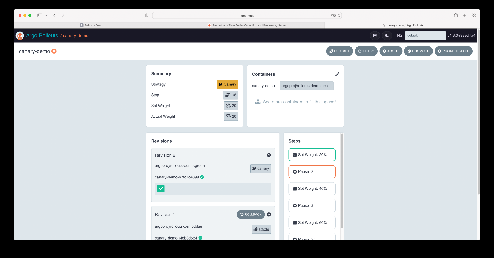

2 分钟后，将进入到 40% 金丝雀流量阶段，从这个阶段开始，自动金丝雀分析开始工作，直到最后金丝雀发布完成，金丝雀环境提升为了生产环境，这时自动分析也完成了，如下图所示。

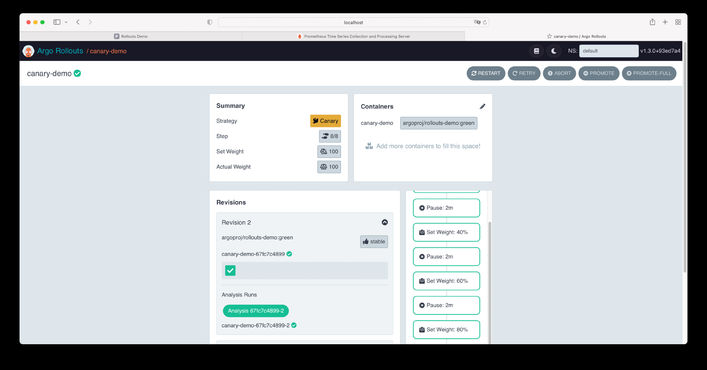

到这里，一次完整的自动渐进式交付就完成了。

### 自动渐进式交付失败

在上面的实验中，由于应用返回的 HTTP 状态码都是 200 ，所以金丝雀分析自然是会成功的。

接下来，我们来尝试进行自动渐进式交付失败的实验。

经过了自动渐进式交付成功的实验之后，当前生产环境中的镜像为 argoproj/rollouts-demo:green，我们继续使用 Argo Rollout kubectl 插件来更新镜像，并将镜像版本修改为yellow 版本。

```
$ kubectl argo rollouts set image canary-demo canary-demo=argoproj/rollouts-demo:
rollout "canary-demo" image updated
```

接下来，重新返回 http://progressive.auto 打开应用，等待一段时间后，你会看到请求开始出现黄色方块，如下图所示。

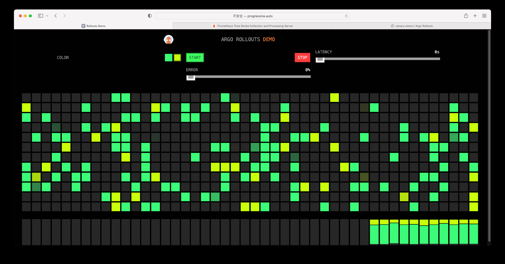

接下来，我们让应用返回错误的 HTTP 状态码。你可以滑动界面上的 ERROR 滑动块，将错误率设置为 50%，如下图所示。

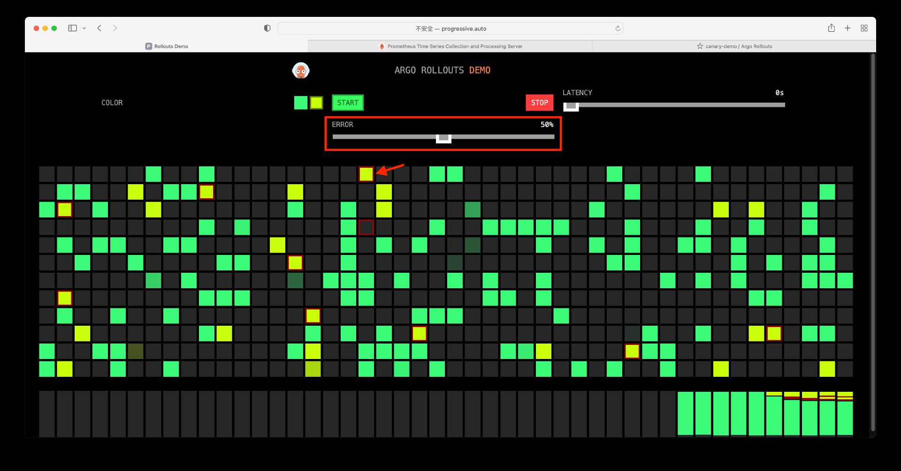

现在，你会在黄色方块中看到带有红色描边的方块，这代表本次请求返回的 HTTP 状态码不等于 200，说明我们成功控制了一部分请求返回错误。

2 分钟后，金丝雀发布会进入到 40% 流量的阶段，此时自动分析将开始进行。现在，我们进入 Argo Rollout 控制台。

```
$ kubectl argo rollouts dashboard
INFO[0000] Argo Rollouts Dashboard is now available at http://localhost:3100/roll
```

使用浏览器打开 http://localhost:3100/rollouts，进入发布详情，等待一段时间后，金丝雀分析将失败，如下图所示。

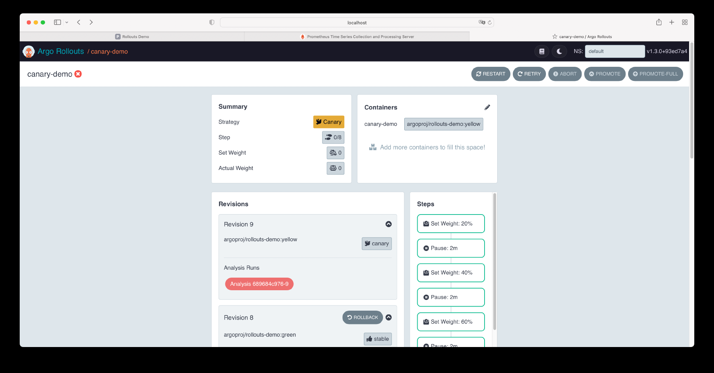

此时，Argo Rollout 将执行自动回滚操作，这时候重新返回 http://progressive.auto 打开应用，你会看到黄色方块的流量消失，所有请求被绿色方块取代，说明已经完成回滚了，如下图所示。

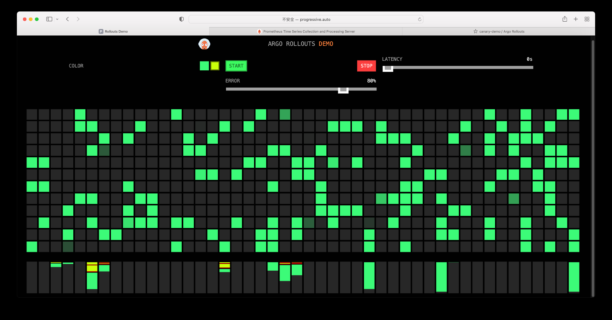

到这里，一次完整的渐进式交付失败实验就完成了。

## 总结

这节课，我为你介绍了什么是渐进式交付，以及如何借助 ArgoCD 实施渐进式交付，它的发布流程和我们在 25 讲提到的金丝雀发布非常类似。

不同的是，渐进式交付在金丝雀发布的过程中加入了自动金丝雀分析，它可以验证新版本在生产环境中的表现，而这是单纯的金丝雀发布所无法实现的。借助渐进式交付，我们可以在发布过程通过指标实时分析金丝雀环境，兼顾发布的安全性和效率。

值得注意的是，为了能够查询到示例应用的 HTTP 指标，我开启了 Ingress-Nginx 的指标开关，这样所有经过 Ingress-Nginx 的流量都会被记录下来，结合 Prometheus ServiceMonitor实现了 HTTP 请求指标的采集。

此外，为了让 ArgoCD 在渐进式交付时顺利运行金丝雀分析，我们还需要创建AnalysisTemplate 对象，它实际上是 PromQL 编写的查询语句，ArgoCD 在交付过程中会用这条语句去 Prometheus 查询，并将返回的结果和预定义的阈值进行对比，以此控制渐进式交付应该继续进行还是回滚。

在实际的业务场景中，如果你希望验证多个维度的指标，你可以创建多个 AnalysisTemplate并将它配置到 Rollout 对象中，进一步提高分析的可靠性。另外，你还可以在金丝雀发布的steps 阶段里配置“内联”的分析步骤，比如在金丝雀环境 20% 和 40% 流量阶段的下一阶段分别运行不同的金丝雀分析，具体配置方法你可以参考这份文档。

这节课我并没有深入介绍 Prometheus。在生产环境下，我们通常会使用它来构建强大的监控和告警系统，我将在后续的课程为你详细介绍。

## 思考题

最后，给你留一道思考题吧。

当自动分析失败导致回滚时，是否有必要将镜像版本回写到 GitOps 应用定义的仓库中呢？

欢迎你给我留言交流讨论，你也可以把这节课分享给更多的朋友一起阅读。我们下节课见。
