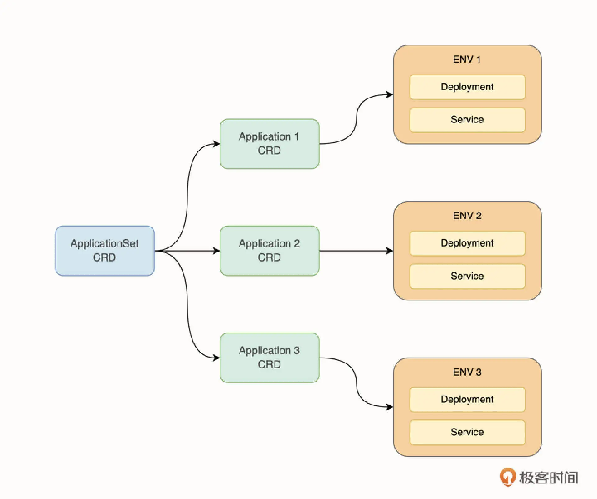
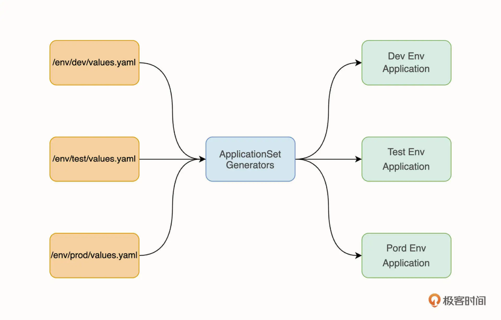
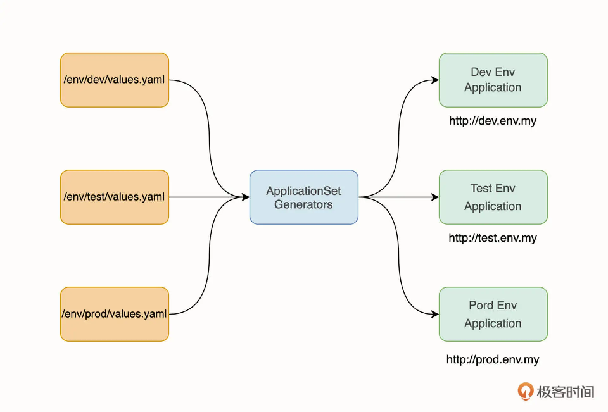
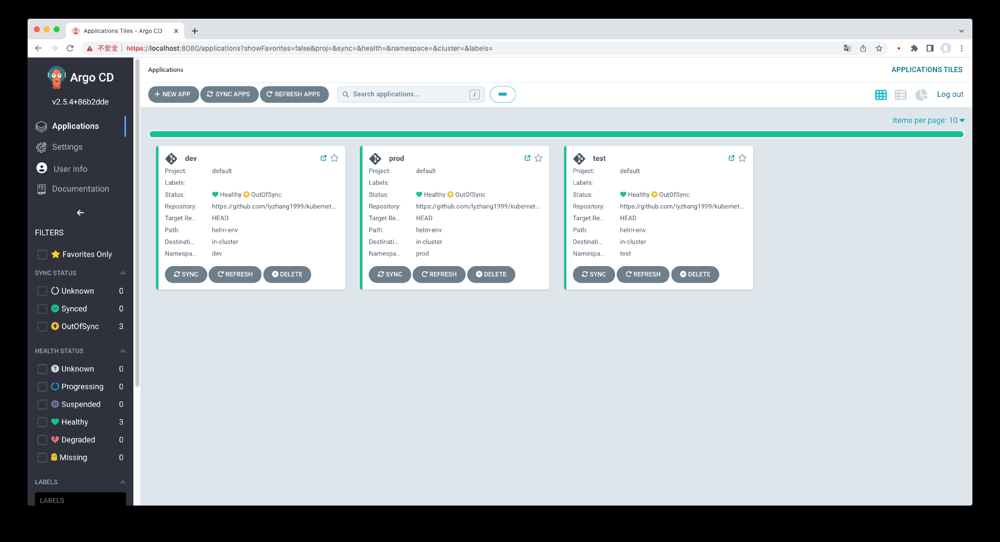
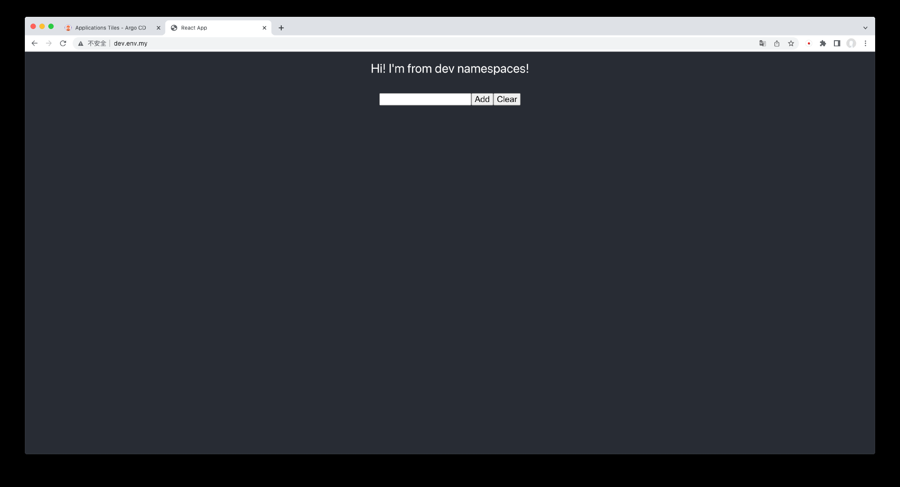
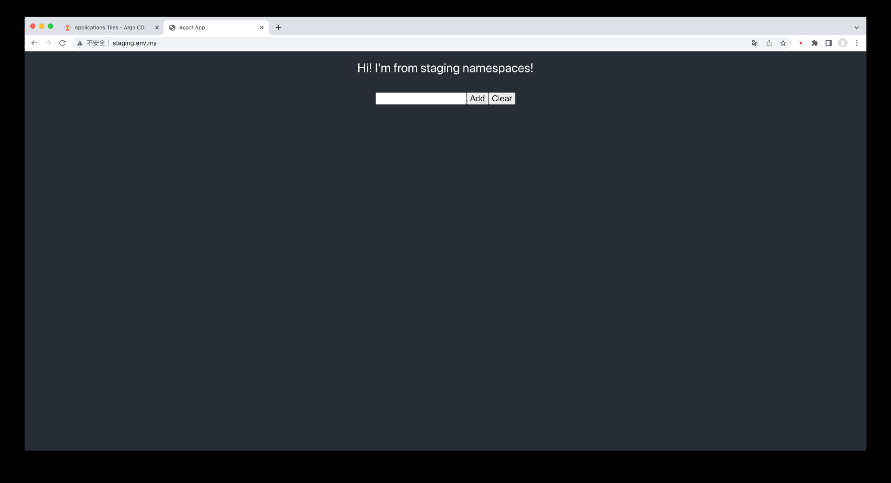

# 27 | 开发互不干扰，如何实现自动多环境管理？

你好，我是王炜。

从这节课开始，我们开始学习 GitOps 的多环境管理和安全方面的内容。

聊起多环境，你可能会立即想到下面几个常见的环境：

- 开发环境

- 测试环境

- 预发布环境

- 生产环境

为了让不同职责的人员在不同的环境下独立工作，我们一般会将不同环境隔离。通常，开发环境主要用于开发人员的日常开发，测试环境则是为测试团队而准备的，预发布是正式发布到生产环境之前的最后一道防线，除了数据以外，应该尽量和生产环境保持一致。

当然，对有些团队来说，他们可能还希望开发人员之间相互隔离，也就是为每一个开发者分配一个独立的开发环境，使他们互不干扰。

在非云原生技术架构体系下，环境一般是由特定的团队人工维护的。所以，要想得到一个新的环境，由于文档和技术方面的原因，过程并不简单。但是，在云原生的业务架构体系下，应用是通过标准的 Kubernetes 对象被“定义”出来的。所以，在这种情况下，得到一个新的环境就变得非常容易了。

在之前介绍的 GitOps 工作流中，我们都是以部署单个环境作为例子的。那么，如果我希望为同一个应用创建新的环境，甚至是为不同的开发者创建隔离的开发环境，怎么做才最合适呢？除了手动创建重复的 ArgoCD 应用，还有没有更好的技术方案？

这节课，我们来看看如何使用 ArgoCD ApplicationSet 来实现 GitOps 自动多环境管理，并通过 ArgoCD Generator 来达到“代码即环境”的效果。

在开始之前，你需要在本地的 Kind 集群安装下面两个组件。

- 安装 ArgoCD。

- 安装 Ingress-Nginx。

此外，你还需要克隆示例仓库，并将它推送到你的 Git 仓库中。

## 自动多环境管理概述

在正式进入实战之前，我们先来了解一下使用 ArgoCD ApplicationSet 来实现自动多环境管理的整体架构，如下图所示。



在这张架构图中，我们会创建一个 ApplicationSet 对象，它是一个 Application 集合。它可以生成 Application CRD 资源，进而自动创建多个 ArgoCD 应用。不同应用实际上就对应了不同的环境。

那么，ApplicationSet 怎么知道要创建几个 Application 对象呢？这就需要用到 ApplicationSetGenerators 了。

ApplicationSet Generators 是一个可以自动生成 Application 对象的生成器，它可以通过遍历Git 仓库中的目录来决定生成几个 Application 对象。这么说有点抽象，你可以结合下面这张图来进一步理解。



假设我们现在有一个 Helm 应用的 Git 仓库，env 目录下存放了不同环境的 values.yaml 配置文件，那么，ApplicationSet Generators 就可以遍历这些目录，并且自动创建不同环境的Application 对象，这样就实现了目录和环境的映射关系。也就是说，当我们需要创建一个新的环境时，只需要创建一个目录以及配置文件 values.yaml 就可以了！

这样，不管是为同一个应用创建不同的环境，还是为不同的开发者创建隔离的开发环境，都可以把创建环境等同于创建目录，实现了“代码即环境”。

## 自动多环境管理实战

在实际创建 ApplicationSet 对象之前，我们先来看一下示例仓库。你需要注意的是，这节课所需要用到的示例应用在 helm-env 目录下。

### 示例应用简介

在将示例应用克隆到本地之后，进入 helm-env 目录，它的目录结构是下面这样的。

```
.
├── Chart.yaml
├── applicationset.yaml
├── env
│   ├── dev
│   │   └── values.yaml
│   ├── prod
│   │   └── values.yaml
│   └── test
│       └── values.yaml
└── templates
   ├── frontend.yaml
   └── ingress.yaml
```

从它的目录结构可以看出，它由 Chart.yaml、applicationset.yaml、env 目录和 templates 目录组成，熟悉 Helm 的同学应该一眼就能看出，其实它是一个 Helm Chart。不同的是，Helm的配置文件 values.yaml 并没有放在 Chart 的根目录，而是放在了 env 目录下。

templates 目录存放着示例应用的 Kubernetes 对象，为了简化演示过程，这节课我们只部署前端相关的对象，也就是 frontend.yaml。

此外，在这个示例应用中，ingress.yaml 会用来部署 Ingress 对象，它的内容如下。

```
apiVersion: networking.k8s.io/v1
kind: Ingress
metadata:
 name: frontend
 annotations:
   kubernetes.io/ingress.class: nginx
spec:
 rules:
   - host: {{ .Release.Namespace }}.env.my
     http:
       paths:
         - path: /
           pathType: Prefix
           backend:
             service:
               name: frontend-service
               port:
                 number: 3000
```

需要注意的是，我在 Ingress 对象中使用了 Helm 的内置变量，也就是Release.Namespace，它实际上指的是 Helm Chart 部署的命名空间，我把它和域名做了拼接。在这节课的例子中，不同的环境将会被部署到独立的命名空间下，这样也就使不同的环境具备了独立的访问域名，如下图所示。



### ApplicationSet 简介

我们再来看下 ApplicationSet。ApplicationSet 是这节课介绍的重点，它可以自动生成多个Application 对象，不同的 Application 对象实际上对应了不同的环境。

示例应用目录下有一个名为 applicationset.yaml 的文件，它定义了 ApplicationSet 的内容。

```bash
apiVersion: argoproj.io/v1alpha1
kind: ApplicationSet
metadata:
 name: frontend
 namespace: argocd
spec:
 generators:
 - git:
     repoURL: "https://github.com/lyzhang1999/kubernetes-example.git"
     revision: HEAD
     files:
     - path: "helm-env/env/*/values.yaml"
 template:
   metadata:
     name: "{{path.basename}}"
   spec:
     project: default
     source:
       repoURL: "https://github.com/lyzhang1999/kubernetes-example.git"
       targetRevision: HEAD
       path: "helm-env"
       helm:
         valueFiles:
         - "env/{{path.basename}}/values.yaml"
     destination:
       server: 'https://kubernetes.default.svc'
       namespace: '{{path.basename}}'
     syncPolicy:
       automated: {}
       syncOptions:
         - CreateNamespace=true
```

这里我们分成两部分来介绍，第一部分是 spec.generators，第二部分是 spec.template。

Generators 指的是生成器。这里，我们使用 Git 生成器，并指定了 Helm Chart 仓库地址。请注意，你需要将这个地址替换为自己的仓库地址，如果仓库为私有权限，那么还需要在ArgoCD 控制台配置仓库的凭据信息，具体你可以参考第 22 讲的内容。

revision 的值的 HEAD，指的是远端最新修改的版本。files 字段是配置的重点，它通过通配符“*”号来匹配 env 目录下的 values.yaml 文件，并为 template 字段下的 path 变量提供值。

接下来我们继续看 template 字段。你可以简单地理解为，template 实际上就是在为Application 配置模板，结合生成器，它能够动态生成 Application 对象。例如，metadata.name 字段配置了每一个 Application 的名称，在这个例子中，path.basename 变量对应三个值，分别是 env 下子目录的名称，也就是 dev、test 和 prod。

source.repoURL 字段表示 Helm Chart 的来源仓库，你也需要将它替换为你的仓库地址。

此外，在 helm.valueFiles 里同样也用到了这个变量，在这里，我们为不同的环境指定了不同的 values.yaml，这样就实现了环境隔离。

最后，destination.namespace 字段也使用了变量，它配置了部署应用的命名空间。

最终，在这个例子中，ApplicationSet 会根据目录结构生成三个 Application 对象，而Application 对象又会在不同的命名空间下部署示例应用，它们分别对应 dev、test 和 prod 环境。

### 部署 ApplicationSet

现在，我们尝试部署 ApplicationSet 对象。

你可以使用 kubectl apply 命令来部署它。

```
$ kubectl apply -f applicationset.yaml
applicationset.argoproj.io/frontend created
```

部署完成后，打开 ArgoCD 控制台，你会看到 ApplicationSet 创建了三个应用，名称分别为dev、test 和 prod，并且它们分别被部署在了不同的命名空间下，如下图所示。



还要注意的是，在进入 ArgoCD 控制台之前，你需要进行端口转发操作，并获取 ArgoCDadmin 登陆密码，具体操作你可以参考第 22 讲。

到这里，ApplicationSet 就已经创建成功了。

### 访问多环境

接下来，我们尝试访问这三个环境。

在访问之前，你需要配置下面这三个 Hosts。

```
127.0.0.1 dev.env.my
127.0.0.1 test.env.my
127.0.0.1 prod.env.my
```

具体的配置方法你可以参考第 24 讲的内容。

Hosts 配置完成后，接下来我们尝试访问开发环境。打开浏览器访问 http://dev.env.my ，你应该能看到下图所示的界面。



然后，你还可以访问测试环境。访问链接为 http://test.env.my ，同样地，你能看到相同的应用界面，只不过返回的内容中命名空间来源产生了变化，如下图所示。


到这里，我们就成功使用 ApplicationSet 创建了多个隔离环境。当我们需要对不同的环境进行更新时，只需要更新 env 目录下对应环境的 values.yaml 文件，就可以触发 ArgoCD 自动同步了，不同环境之间互不影响。

此外，当我们需要创建新的环境时，只需要在 env 目录下增加一个目录和 values.yaml 文件就可以了，ArgoCD 会根据配置自动创建新的环境。

## 创建新环境实验

接下来，我们尝试创建一个新的环境。

首先，在 env 目录下创建 staging 目录，表示预发布环境。你可以通过下面的命令来创建它。

```bash
cd helm-env/env
mkdir staging
```

然后，将 dev 目录下的 values.yaml 复制到 staging 目录下。

```
$ cp dev/values.yaml staging
```

接下来，将修改提交到远端仓库。

```
$ git add .
$ git commit -m 'add stagign'
$ git push origin main
```

稍等几分钟，ArgoCD 将自动同步，并为我们创建新的 staging 环境，如下图所示。



到这里，我们就完成了一次创建新环境的全过程。怎么样？创建环境是不是瞬间变得非常简单？

## 总结

这节课，我们学习了如何通过 ApplicationSet 来创建和管理多环境。在实际的业务场景中，我们通常会有多环境的业务需求，相比较传统的创建环境的方式，使用 ApplicationSet 大大简化了拉起一个新环境的过程。

“代码即环境”听起来虽然比较抽象，但实现起来并没有这么困难。借助应用定义，结合 Git 仓库，我们很容易就可以实现多环境管理。需要注意的是，在众多 GitOps 多环境管理的方案中，你可能还会看到另一种在这节课没有介绍的方案：通过分支来管理多环境。

我也为你简单对比一下这两种方式。就我的经验来看，采用多分支来管理 GitOps 中的多环境并不能够很好地同时解决可维护性和唯一可信源的问题。首先，分支管理模型会使我们面临差异和合并的问题，这对长期维护来说成本较高，并且在更新环境时，需要切换到不同的分支去操作，这更容易导致人为的错误。其次，分支的管理方式没有目录管理方式来得直观。

所以，在实际的项目中，我推荐你按照这节课的讲解以目录的方式来管理不同的环境。

多环境除了可以用来区分开发环境、测试环境和生产环境之外，还可以很方便地为每一位开发者提供独立的开发环境。

在这节课的例子中，由于所有环境都共用 Helm Chart 的 Template 目录，所以对于应用而言，我们只需要维护 Template 目录就可以间接管理所有的环境了。而对于不同的环境，我们可以使用环境目录下的 values.yaml 文件进行差异化的配置。这样就同时兼顾了可维护性和环境的差异化配置。

## 思考题

最后，给你留一道思考题吧。

在实际的项目中，我们一般会将环境进行硬隔离，并将它们部署到不同的集群中。请你尝试修改 ApplicationSet，让每个环境在不同的集群中运行。

提示：你需要为 ArgoCD 添加集群，并将 destination 字段配置为集群名称 name 来代替server，通过目录名和集群名的映射来实现最终目标。

欢迎你给我留言交流讨论，你也可以把这节课分享给更多的朋友一起阅读。我们下节课见。
