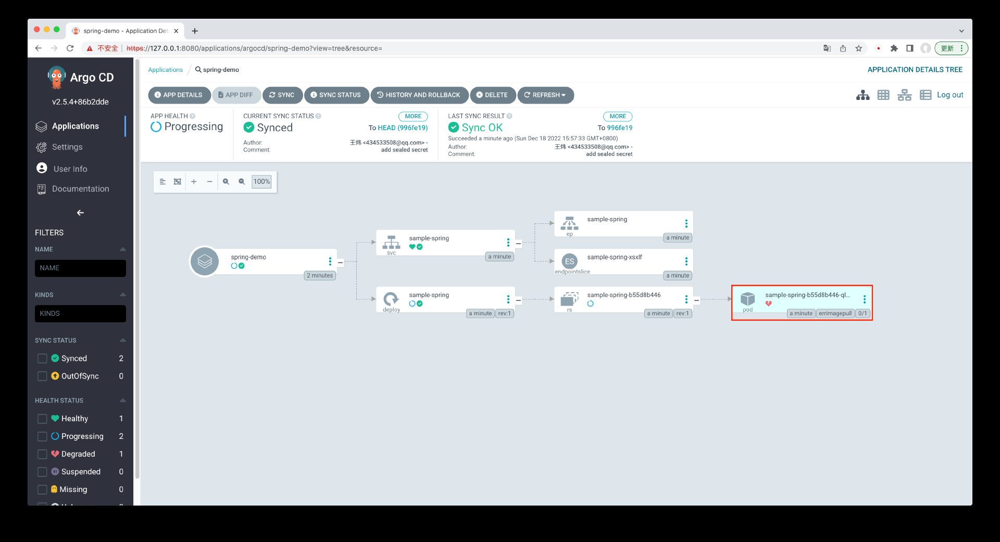
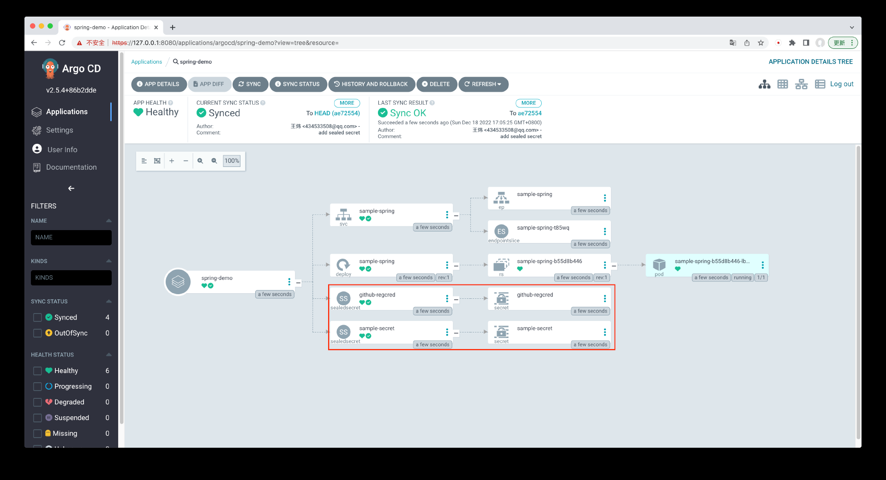
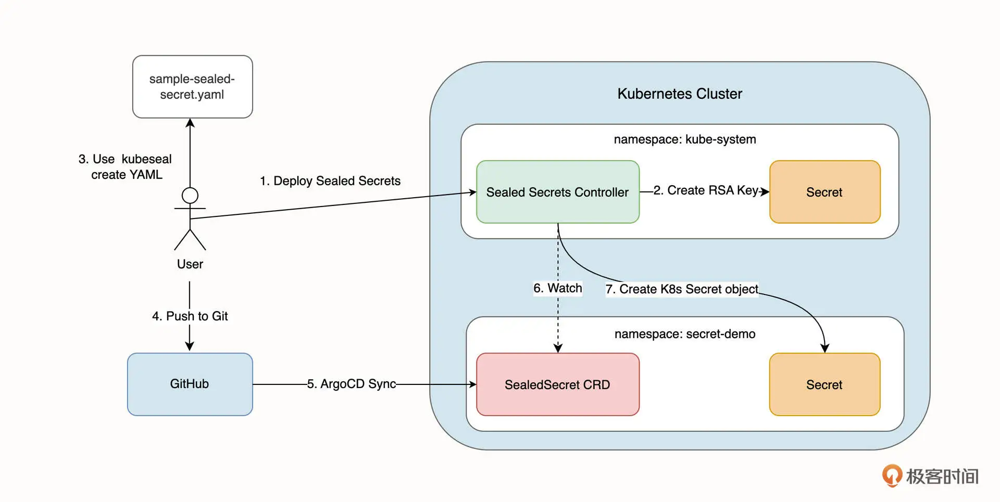

# 29 | 安全提升：如何解决GitOps的秘钥存储问题？

你好，我是王炜。

在上节课，我为你介绍了在 GitOps 工作流中需要特别关注的安全问题。其中，由于 Git 仓库是 GitOps 工作流的唯一可信源，同时也包含了 Kubernetes 对象以及机密信息，所以，我们首先需要关注它的安全问题。

在实际的业务场景下，出于安全需要，Git 仓库往往会包含下面这些机密信息。

1. 镜像拉取凭据的 Secret 对象，它可以为集群提供拉取镜像的权限。

2. 外部数据库连接信息。

3. 外部中间件如 MQ 连接信息。

4. 第三方服务的 API KEY，例如云厂商和短信服务商。

在 GitOps 工作流中，这些机密信息都会通过 Kubernetes 对象存放在 Git 仓库，在大部分情况下它们是 Configmap 或 Secret 对象。虽然 Secret 被设计为存储 Kubernetes 的机密信息，但它只是 Base64 编码后的结果，不具备加密性质，这也就意味着机密信息完全是以明文的方式暴露的，这是非常不安全的。所以，我们有必要对这些机密信息进行加密。

这节课，我们就来学习加密 Git 仓库中机密信息的方法，进一步提升 GitOps 的安全性。

在开始之前，你需要在本地的 Kind 集群安装好 ArgoCD，然后克隆示例仓库，并将它推送到你的 Git 仓库中。

## GitOps 密钥管理方案

在 GitOps 工作流中，常用的密钥管理方案有下面三种。

1. Sealed-Secrets

2. External-Secrets

3. Vault

其中，Sealed-Secrets 在易用性方面有比较大的优势，社区活跃度也比较高，也更容易和GitOps 工作流结合，我会在这节课做重点介绍。它的工作原理也非常简单，它利用非对称加密算法对 Secret 对象进行加密，使用的时候在集群内自动进行解密，这样就可以将加密后的密钥安全地存储在 Git 仓库中。

External-Secrets 需要外部密钥管理服务的支持，例如 AWS Secrets Manager、GoogleSecrets Manager、Azure Key Vault 等，如果在你的项目里用到了这些密钥管理服务，可以考虑使用它。

Vault 是 HashiCorp 开源的一款密钥管理工具，要将它和 ArgoCD 结合使用需要额外的插件，配置起来比较繁琐。

## 安装 Sealed-Secrets

接下来，我们来看看如何把 Sealed-Secrets 集成到 GitOps 工作流中，并将它结合 ArgoCD 一起使用。

Sealed-Secrets 分为两部分，本地的 CLI 工具和运行在集群的控制器，在使用之前我们需要先安装它们。

### 安装 CLI 工具

kubeseal 命令行工具是本地和集群 Sealed-Secrets 服务交互的工具，我们需要用它来加密机密信息。

我们以 MacOS 系统为例，你可以使用 Brew 进行安装。

```
$ brew install kubeseal
```

如果你使用的是 Linux 或 Windows，可以在这个链接将可执行文件下载到本地。

### 安装 Controller 控制器

Sealed-Secrets 控制器负责对加密的信息进行解密，并生成 Kubernetes 原生的 Secret 对象。这里我推荐你以 Helm 的方式来安装它。

首先，添加 Sealed-Secrets 的 Helm 仓库。

```
$ helm repo add sealed-secrets https://bitnami-labs.github.io/sealed-secrets
```

然后，通过 helm install 命令来安装它。

```
$ helm install sealed-secrets -n kube-system --set-string fullnameOverride=sealed
```

接下来，等待工作负载处于 Ready 状态。

```
$ kubectl wait deployment -n kube-system sealed-secrets-controller --for conditio
```

## 示例应用介绍

在这节课，我编写了一个简单的 Deployment 工作负载，它包含我要介绍的两种密钥类型，分别是镜像拉取凭据和 Kubernetes Secret 对象。

工作负载的 Deployment 内容如下。

```
apiVersion: apps/v1
kind: Deployment
metadata:
 name: sample-spring
spec:
   ......
   spec:
     imagePullSecrets:
     - name: github-regcred
     containers:
     - name: sample-spring
       image: ghcr.io/lyzhang1999/sample-kotlin-spring:latest
       ports:
       - containerPort: 8080
         name: http
       env:
         - name: PASSWORD
           valueFrom:
             secretKeyRef:
               key: password
               name: sample-secret
```

其中，我将这节课的示例应用镜像存放到了 GitHub Package 仓库中，也就是域名为 ghcr.io的镜像仓库中，同时设置了私有仓库类型。在没有向 Kubernetes 集群提供拉取凭据的情况下，是无法拉取镜像的，这意味着直接将这个工作负载部署到集群将得到 ImagePullBackOff的事件。

imagePullSecret 是镜像拉取凭据，这个凭据我们将会在稍后通过 kubeseal 创建。

此外，我还为工作负载配置了 Env 环境变量，它的值来源于名为 sample-secret 的 Secret 对象。这个 Secret 对象我们也会在稍后通过 kubeseal 来创建。

## 创建 ArgoCD 应用

为了让 Sealed-Secrets 和 GitOps 工作流结合，我们首先需要创建 ArgoCD 应用。

在将示例应用仓库克隆到本地并推送到你自己的 Git 仓库之后，你需要修改 sealed-secret/application.yaml 文件，将 repoURL 替换为你的 Git 仓库地址。

```
apiVersion: argoproj.io/v1alpha1
kind: Application
metadata:
 name: spring-demo
spec:
  project: default
  source:
    # 替换为你的 Git 仓库地址，注意将仓库权限设置为公开，并使用 https 协议
    repoURL: https://github.com/lyzhang1999/kubernetes-example.git
```

然后，进入 sealed-secret 目录，并通过 kubectl apply 命令将它应用到集群内。

```
$ cd sealed-secret
$ kubectl apply -f application.yaml
```

现在，你应该能在 ArgoCD 的控制台看到这个应用，如下图所示。



要注意的是，在进入 ArgoCD 控制台之前需要进行端口转发操作，并获取 ArgoCD admin 登录密码，具体操作你可以参考第 22 讲。

但由于我们并没有为集群提供 imagePullSecret，所以 Kubernetes 集群无法拉取镜像，你会看到右下角的 Pod 抛出了 ImagePullBackOff 的错误。

## 创建加密后的 Secret 对象

接下来，我们对两种 Secret 对象进行加密，它们分别是镜像拉取凭据和普通 Secret 对象。然后我们要将加密后的 Secret 对象推送到 Git 仓库中，以便 ArgoCD 将它一并部署到集群内。

### 创建 Image Pull Secret 对象

为了让 Kubernetes 集群能够顺利拉取镜像，我们首先来为集群创建镜像拉取凭据。

在这节课的示例应用中，我已经将镜像拉取凭据的原始 Kubernetes Secret 对象存放在了sealed-secret/image-pull-secret.yaml 文件中。

```
kind: Secret
type: kubernetes.io/dockerconfigjson
apiVersion: v1
metadata:
 name: github-regcred
data:
 .dockerconfigjson: eyJhdXRocyI6eyJnaGNyLmlvIjp7InVzZXJuYW1lIjoibHl6aGFuZzE5OTki
```

在上一讲我们提到，这个 Secret 对象实际上只经过 Base64 编码，它并不安全。你可以尝试将它进行 Base64 解码，这样就能够得到我的 GitHub Token 了，但它只有拉取镜像的权限。

接下来，进入示例应用的 sealed-secret 目录，我们来尝试创建加密后的 Secret 对象。你可以使用 kubeseal 命令来创建。

```
$ kubeseal -f image-pull-secret.yaml -w manifest/image-pull-sealed-secret.yaml --
```

简单解释一下这个命令。首先，-f 参数指定了原始 Sceret 对象文件，也就是 image-pull-secret.yaml。-w 参数表示将加密后的 Secret 对象写入 manifest 目录的 image-pull-sealed-secret.yaml 文件内，这样 ArgoCD 就可以将它一并部署到集群内。–scope 参数表示加密后的Secret 对象可以在集群的任何命名空间下使用。

然后，你可以查看 manifest/image-pull-sealed-secret.yaml 文件，加密后的 Secret 对象如下。

```
apiVersion: bitnami.com/v1alpha1
kind: SealedSecret
metadata:
 annotations:
   sealedsecrets.bitnami.com/cluster-wide: "true"
 creationTimestamp: null
 name: github-regcred
spec:
 encryptedData:
   .dockerconfigjson: AgBgEUOxC1i2AuZJ2LzPiSfYblycy71NGv1SapA46ugFlWyKRaUg+WQGDH
 template:
   metadata:
     annotations:
       sealedsecrets.bitnami.com/cluster-wide: "true"
     creationTimestamp: null
     name: github-regcred
   type: kubernetes.io/dockerconfigjson
```

从文件的内容我们可以看出，原始的 Secret 对象被转化为了 SealedSecret 对象，并且增加了encryptedData 字段，它可以存放加密后的内容。

### 创建 Secret 对象

除了创建镜像凭据以外，我们还需要创建为工作负载提供密码的 Secret 对象。我将原始的Secret 对象存放在了 sealed-secret/sample-secret.yaml 文件下。

```
apiVersion: v1
kind: Secret
metadata:
 name: sample-secret
data:
 password: YWRtaW4K
```

这个 Secret 对象非常简单，password 字段记录了我们提供的机密信息，解码后实际上是admin 字符串。

接下来，我们创建加密后的 Secret 对象。同样地，使用 kubeseal 命令来创建。

```
$ kubeseal -f sample-secret.yaml -w manifest/sample-sealed-secret.yaml --scope cl
```

运行命令后，在 manifest 目录下生成 sample-sealed-secret.yaml 文件，它包含加密后的Secret 内容。

### 推送到代码仓库

现在，我们将刚才创建的加密后的文件推送到 Git 仓库中。

```
$ git add .
$ git commit -a -m 'add secret'
$ git push origin main
```

进入 ArgoCD 控制台的应用详情，手动点击 “SYCN”按钮同步刚才我们新增的 Secret 对象。现在，你应该能看到应用状态变成了 Healthy 健康状态，并且 Sealed-Secret 控制器对刚才创建的 SealedSecret 对象进行了解密，还重新创建了原始的 Kubernetes Secret 对象以供Deployment 工作负载使用，如下图所示。



现在，镜像已经顺利被拉取下来，工作负载也已经正常启动了。

## 验证 Secret

除了镜像凭据以外，我们还创建了为工作负载提供密码的 Secret 对象，它是通过 Env 环境变量注入到 Pod 中的。接下来，我们来验证应用是否能够顺利获取到来自 Secret 对象提供的密码。

首先，对示例应用进行端口转发操作。

```
$ kubectl port-forward svc/sample-spring 8081:8080 -n secret-demo
```

然后，打开一个新的命令行窗口，并访问示例应用的获取环境变量接口。

```
$ curl http://localhost:8081/actuator/env/PASSWORD
{"property":{"source":"systemEnvironment","value":"******"},"activeProfiles":[],"
```

从返回结果我们可以发现，应用已经成功获取到了 PASSWORD 环境变量，这说明 Sealed-Secret 控制器也已经生成了原始的 Secret 对象。

通过上面的实验我们知道，在 GitOps 工作流中，当我们在集群内安装了 Sealed-Secret 控制器之后，只需要在 Git 仓库存储加密后的 SealedSecret 对象即可，不再需要存储原始的Kubernetes Secret 对象了。

## 原理解析

Sealed-Secret 的整体工作原理比较简单，下面，我画了一张架构图来帮助你理解整个过程。



你可以按照架构图上的序号来依次理解每一个步骤。

由于加解密过程涉及到非对称加密，所以当我们在集群内安装 Sealed-Secret 控制器时，控制器会在集群范围内查找私钥 / 公钥对，如果没找到，则会生成一个新的 RSA 密钥对，并存储在部署 Sealed-Secret 命名空间下的 Secret 对象中，你可以通过下面的命令来查看。

```
$ kubectl get secret -n kube-system
NAME                                   TYPE                 DATA   AGE
sealed-secrets-keyj78wj                kubernetes.io/tls    2      131m
```

上面输出的结果中，以 sealed-secrets 开头的 Secret 对象就是存储 RSA 密钥的对象。

要获取 RSA 密钥，你可以进一步查看。

```
$ kubectl get secret sealed-secrets-keyj78wj -n kube-system -o yaml
```

当我们在本地使用 kubeseal 加密一个 Secret 对象时，kubeseal 会从集群内下载 RSA 公钥，并使用它来加密 Secret 对象，然后生成加密后的 SealedSecret CRD 资源，也就是SealedSecret 对象。

当集群内控制器监听到有新的 SealedSecret 对象被部署时，它会使用集群内的 RSA 私钥来解密信息，并且在集群内重新生成 Secret 对象，以便提供给工作负载使用。

## 生产建议

由于 Sealed-Secret 的加解密过程需要使用 RSA 密钥对，而 RSA 密钥对又是在部署控制器时自动生成的，所以，你需要额外留意存储 RSA 密钥的 Kubernetes Secret 对象。

尤其是在需要进行集群迁移时，你需要对它进行备份，如果遗失，将无法对 Git 仓库存储的SealedSecret 对象解密，你需要重新从原始的 Secret 对象那里生成加密后的 SealedSecret对象。

要对已有的 RSA 密钥进行备份，首先你可以导出存储它的 Secret 对象，并保存为 backup-sealed-secret-rsa.yaml 文件。

```
$ kubectl get secret -n kube-system -l sealedsecrets.bitnami.com/sealed-secrets-k
```

接下来，将它重新部署到新的集群内。

```
$ kubectl apply -f backup-sealed-secret-rsa.yaml
```

然后，再部署 Sealed-Secret 控制器。此时，因为 kube-system 命名空间下已存在 RSA 密钥对，Sealed-Secret 会默认使用它作为解密的密钥，这样就完成了集群的迁移工作。

## 总结

这节课，我们学习了如何使用 Sealed-Secret 来加密 GitOps 工作流的 Secret 对象。

Sealed-Secret 主要包含两个部分，分别是 CLI 工具和运行在 Kubernetes 集群内的控制器。其中，CLI 工具负责加密原始的 Secret 对象并生成 SealedSecret CRD 对象，运行在集群中的控制器主要负责解密以及重新生成原始的 Secret 对象。

在示例应用中，我对两种类型的密钥进行了加密，它们分别是镜像拉取凭据和普通的Kubernetes Secret 对象。在实际的项目中，这两种类型的密钥是经常会用到的。

在将密钥进行加密后得到 SealedSecret CRD 对象后，将它存放到 Git 仓库中便能够和GitOps 工作流进行结合。需要特别注意的是，由于在 Sealed-Secret 控制器在首次部署到集群时会重新生成 RSA 密钥对，所以当你要对集群进行迁移时，务必要将存储 RSA 密钥的Secret 对象进行备份，并将它部署到新的集群中。这样在安装 Sealed-Secret 控制器时便能够自动使用已有的 RSA 密钥，从而顺利执行解密过程。

此外，出于安全考虑，Sealed-Secret 控制器默认每 30 天会生成新的 RSA 密钥对，但旧的RSA 密钥对并不会被删除，所以通过旧的 RSA 密钥加密的 Secret 对象依然可以被解密。

最后，如果你对密钥的安全性要求极高，并且为了满足安全标准而必须要使用第三方的密钥管理系统，例如 AWS Secrets Manager，那么你可以尝试使用 External-Secrets 的方案，这里就不再详细介绍了，感兴趣的同学可以尝试实践。

## 思考题

最后，给你留一道思考题吧。

在现存的应用场景下，我们需要加密的 Secret 对象在集群里往往已经存在了。

你可以动手模拟这个场景：先创建一个 Secret 对象部署到 Kubernetes 集群中，再将它加密并应用到集群内，随后查看 Sealed-Secret Pod 日志，这时候你是否能顺利生成 Secret 对象呢？

提示，你可以执行下面的命令来生成 Secret 对象并查看 Pod Sealed-Secret 控制器的日志。

```
$ echo -n admin | kubectl create secret generic mysecret --dry-run=client --from-
# 查看 Sealed-Secret 的日志
$ kubectl logs -l app.kubernetes.io/name=sealed-secrets -n kube-system
# 查看 Secret，检查 ownerReferences 字段即可判断 Secret 是否由 Sealed-Secret 生成
$ kubectl get secret mysecret -o yaml
```

最后，尝试为 Secret 对象增加 sealedsecrets.bitnami.com/managed: “true” 的注解，重新应用到集群，这次 Sealed-Secret 能否成功生成 Secret 对象呢？

欢迎你给我留言交流讨论，你也可以把这节课分享给更多的朋友一起阅读。我们下节课见。
