# 32 | 监控：如何快速搭建业务HTTP健康状态监控？

你好，我是王炜。

在上一节课，我们学习了如何使用 Loki 从零搭建日志系统。Loki 的功能非常强大，它除了能够查询日志以外，还能够帮助我们从日志中分析 HTTP 请求的性能。

HTTP 请求性能是建立业务可观测性的基础指标，例如，我们通常需要分析目前系统整体的可用性情况、接口请求成功和失败的比例、平均响应时间、实时 QPS、p99 延迟信息等等，这些指标通常也会组成 HTTP 请求的监控面板。

不过，在生产环境下，我并不推荐你通过日志来分析 HTTP 请求指标。主要的原因有两点，首先在微服务场景下，我们关注的是系统整体的可用性，通过单个服务的日志来获取的指标不能反映整体情况。其次，不同的服务输出的日志信息有较大差异，我们很难从这些存在差异的日志信息中得到一致的分析指标。

所以，要获得完整的 HTTP 请求性能指标，我们需要从整体而不是单个服务的维度来考虑。

通常，我们在写业务代码的时候会编写一些拦截器，方便对某些方法实现统一调用。在Kubernetes 环境下，我们可以把什么认作是所有 HTTP 请求的拦截器呢？没错，它就是Kubernetes Ingress。

在之前的课程中，我提到了如何使用 Ingress-Nginx 来暴露服务，实际上它是 Kubernetes 集群 HTTP 请求的统一入口。由于所有 HTTP 流量都会经过它，所以我们只要能获得 Ingress-Nginx 的请求指标，也就相当于获得了所有服务的 HTTP 请求指标了。

这节课，我将带你学习如何从零搭建 HTTP 请求状态监控，并借助 Prometheus 和 Grafana构建性能监控面板，进一步提升分布式系统的可观测性。

在开始今天的实战之前，你需要做好以下准备。

- 按照第一章第 2 讲的内容在本地通过配置文件创建 Kind 集群，并在集群内安装好Ingress-Nginx。

- 配置 Kubectl 使其能够访问 Kind 集群。

## 安装必要组件

为了获取 Kubernetes 集群所有的 HTTP 请求指标以及建立监控面板，我们必须安装三个组件，它们分别是：

1. Prometheus

2. Ingress-Nginx

3. Grafana

接下来，我们分别安装这几个组件。

### Prometheus

作为 CNCF 的毕业项目，Prometheus 在 Kubernetes 的监控领域基本上已经成为了事实标准，它定义了一种通用的度量格式。在采集指标数据时，Prometheus 会以“拉模型”来主动请求业务系统输出指标的 HTTP 接口，将指标数据存储在时序数据库中，并提供查询功能。

首先，你需要确保已经按照上一节课的内容安装了 Loki-Stack。

```
$ helm upgrade --install loki --namespace=loki-stack grafana/loki-stack --create-
```

要安装 Prometheus，你还是可以使用 Helm。

```
$ helm repo add prometheus-community https://prometheus-community.github.io/helm-
$ helm upgrade prometheus prometheus-community/kube-prometheus-stack \
--namespace prometheus  --create-namespace --install \
--set prometheusOperator.admissionWebhooks.patch.image.registry=docker.io --set p
--set prometheus.prometheusSpec.podMonitorSelectorNilUsesHelmValues=false \
--set prometheus.prometheusSpec.serviceMonitorSelectorNilUsesHelmValues=false
Release "prometheus" does not exist. Installing it now.
......
STATUS: deployed
```

接下来，等待 Prometheus 所有组件处于 Ready 状态。

```
$ kubectl wait --for=condition=Ready pods --all -n prometheus --timeout=300s
pod/alertmanager-prometheus-kube-prometheus-alertmanager-0 condition met
pod/prometheus-kube-prometheus-operator-696cc64986-hjglk condition met
pod/prometheus-kube-state-metrics-649f8795d4-gzths condition met
pod/prometheus-prometheus-kube-prometheus-prometheus-0 condition met
pod/prometheus-prometheus-node-exporter-5zvml condition met
```

当所有 Pod 准备就绪后，代表 Prometheus 已经安装完成了。

### 配置 Ingress-Nginx 和 ServiceMonitor

为了让 Prometheus 顺利地获取到 HTTP 请求指标，我们需要打开 Ingress-Nginx Metric 指标端口。

注意，在进行配置之前，请先确认已经按照第 2 讲的内容在 Kind 集群里安装了 Ingress-Nginx。

接下来，我们首先需要为 Ingress-Nginx Deployment 添加容器的指标端口，你可以执行下面的命令来完成。

```
$ kubectl patch deployment ingress-nginx-controller -n ingress-nginx --type='json
deployment.apps/ingress-nginx-controller patched
```

然后，为 Ingrss-Nginx Service 添加指标端口。

```
$ kubectl patch service ingress-nginx-controller -n ingress-nginx --type='json' -
service/ingress-nginx-controller patched
```

最后，为了让 Prometheus 能够抓取到 Ingress-Nginx 指标，我们还需要创建 ServiceMonitor对象，它可以为 Prometheus 配置指标获取策略。具体做法是把下面的内容保存为 service-monitor.yaml 文件。

```
apiVersion: monitoring.coreos.com/v1
kind: ServiceMonitor
metadata:
 name: nginx-ingress-controller-metrics
 namespace: prometheus
 labels:
   app: nginx-ingress
   release: prometheus-operator
spec:
 endpoints:
 - interval: 10s
   port: prometheus
 selector:
   matchLabels:
     app.kubernetes.io/instance: ingress-nginx
     app.kubernetes.io/name: ingress-nginx
 namespaceSelector:
   matchNames:
- ingress-nginx
```

然后，通过 kubectl 将它部署到集群内。

```
$ kubectl apply -f servicemonitor.yaml
servicemonitor.monitoring.coreos.com/nginx-ingress-controller-metrics created
```

当把 ServiceMonitor 应用到集群后，Prometheus 会按照标签来匹配 Ingress-Nginx Pod，并且会每 10s 主动拉取一次指标数据然后保存到 Prometheus 时序数据库中。

### 访问 Grafana

在上一节课，我们介绍了如何借助 Grafana 查询日志，实际上，Grafana 不仅可以用来查看日志，还可以让 Prometheus 的监控指标可视化。

在访问 Grafana 之前，我们首先需要从 Secret 对象中获取登录密码。

```
$ kubectl get secret --namespace prometheus prometheus-grafana -o jsonpath="{.dat
prom-operator
```

然后，通过端口转发的方式来访问 Grafana 。

```
$ kubectl port-forward --namespace prometheus service/prometheus-grafana 3000:80
```

使用浏览器访问 http://127.0.0.1:3000，输入用户名 admin 和上面获取的密码。登录之后，你应该能看到 Grafana 的界面如下。

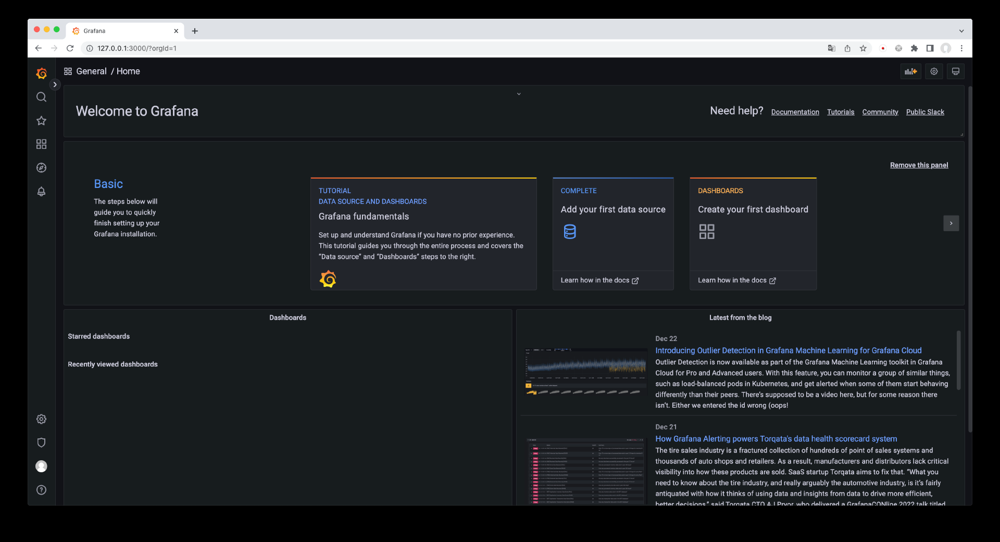

### 配置 Loki 数据源 (可选)

我们安装的 kube-prometheus-stack 在默认情况下已经帮我们配置好了 Grafana 的数据源，在生产环境下，通常我们希望能够在同一个 Grafana 控制台中同时查询 Loki 日志和监控指标。

如果你之前已经安装了 Loki，那么可以通过下面的方式为 Grafana 添加 Loki 数据源。

点击 Grafana 界面中左下角的“齿轮”按钮，然后点击右上角的“Add data source”，如下图所示。

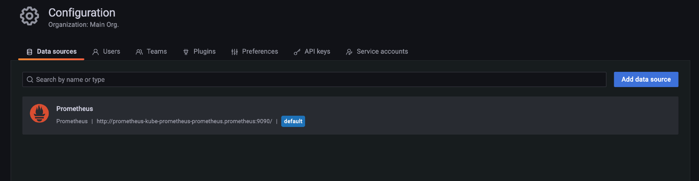

然后，选择 Loki 进入配置界面。

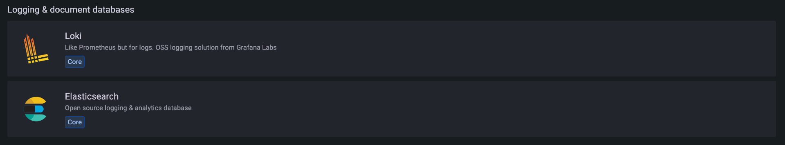

如果你已经按照上一节课的内容安装了 Loki，那么你可以在配置界面的“URL”表单中输入：“http://loki.loki-stack:3100”，其他配置项保持默认，如下图所示。

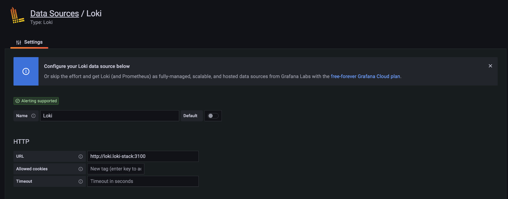

接着，点击表单下方的“Save & test”按钮测试 Loki 的连通性，如果出现下面截图中的内容，代表 Loki 数据源配置成功了。这样，你就可以通过“Explore”模块同时查询日志和指标数据了。

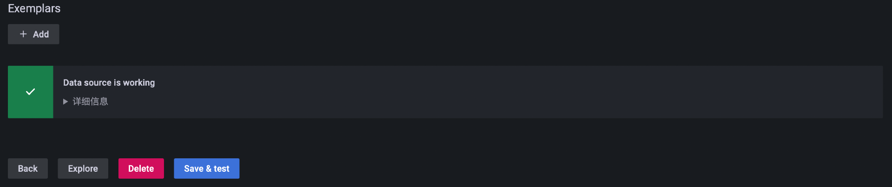

## 部署示例应用

为了方便获得 HTTP 请求接口数据，我们需要先部署我提前写好的示例应用，你可以通过下面的命令来部署它。

```
$ kubectl apply -f https://ghproxy.com/https://raw.githubusercontent.com/lyzhang1
deployment.apps/log-example created
service/log-example created
ingress.networking.k8s.io/log-example created
```

部署完成后，我们要配置本地的 Hosts，方便从本地访问 log-example 服务。

```
127.0.0.1 log-example.com
```

然后，通过 curl 来访问示例应用。

```
$ curl http://log-example.com/http
OK!
```

当看到返回内容为 OK 时，代表示例应用已经部署完成了。

## 查询指标和创建 Dashboard

在部署完示例应用之后，接下来就可以尝试在 Grafana 查询指标信息了，你需要进入到Grafana 的“Explore”模块。默认情况下，查询的数据源为 Prometheus，如果你点击下拉框切换，会发现 Loki 也能作为数据源被我们选中。

在确认数据源为 Prometheus 之后，现在我们就可以查询相关的指标信息了。点击“Metric”下拉框，输入“nginx”关键字，Grafana 会自动帮我们列出所有 Ingress-Nginx 的指标信息，如下图所示。

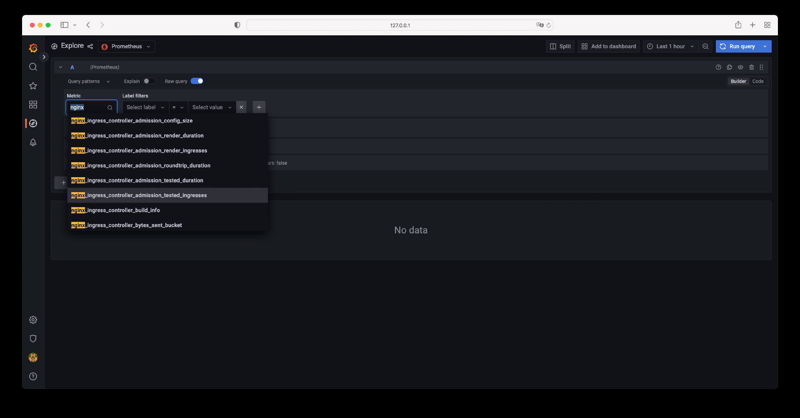

你可以选择其中一个指标来查询。

不过，对于新人来说，我们并不理解这几十个指标到底是什么意思，更别提复杂的指标查询还需要编写 PromQL 查询语句了。那我们要怎么在不了解 PromQL 的前提下搭建业务 HTTP 指标监控呢？

别担心，社区其实早就有现成的解决方案了，那就是 Grafana Dashboard。

Grafana Dashboard 更加面向用户，它以图形化的方式展示一组指标，也支持导入已有的Dashboard。这意味着，我们可以用社区现成的 Dashboard 来建立指标监控体系。

下面，我就带你创建两个 Dashboard，它们分别是：

1. Ingress-Nginx 核心指标 Dashboard

2. HTTP 请求性能 Dashboard

### Ingress-Nginx 核心指标 Dashboard

你可以通过下面的步骤来创建 Ingress-Nginx 核心指标 Dashboard。

点击左侧 Grafana “Dashboard” 模块，选择“Import”导入面板。

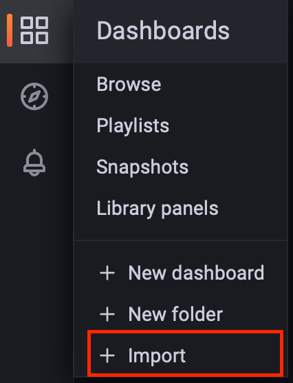

然后，使用浏览器打开下面的链接。

https://ghproxy.com/https://raw.githubusercontent.com/kubernetes/ingress-nginx/main/deploy/grafana/dashboards/nginx.json。

复制输出的内容，它是一段 JSON 配置文件。

接下来，将内容复制到 Grafana 导入页面的“Import via panel json”表单内，并点击“Load”按钮。

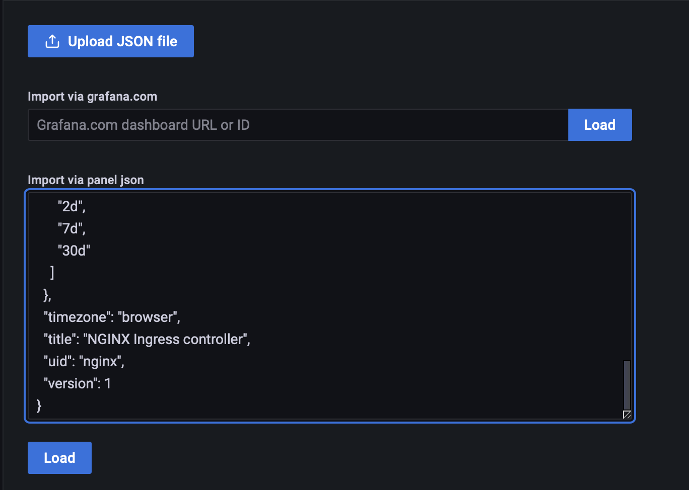

然后，在“Prometheus”下拉框中选择数据源“Prometheus”，然后点击“Import”按钮导入Dashboard。

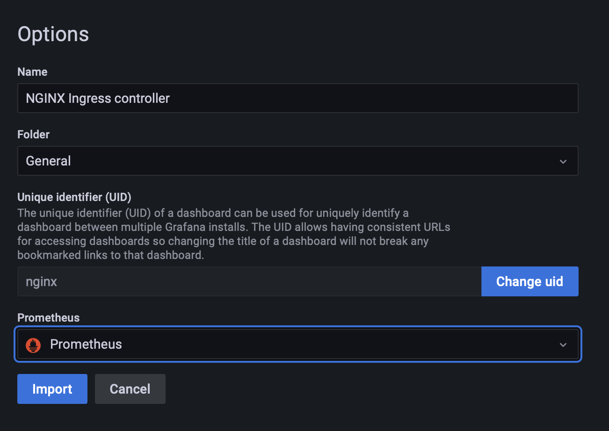

导入成功之后，你就能看到 Ingress-Nginx 的核心指标了。

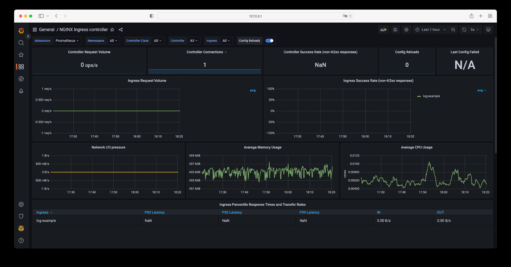

此时，点击右上角“保存”图标来保存 Dashboard。

在导入 Dashboard 之后，可能你看不到任何数据，我们尝试访问示例应用来生成 HTTP 请求数据。打开一个新的命令行终端，并执行下面的命令。

```
$ while true; do ; curl http://log-example.com/http ; echo -e '\n'$(date);done
OK!
2022年12月26日 星期一 19时38分08秒 CST
```

回到的 Dashboard，等待片刻，你会看到生成的核心指标，如下图所示。

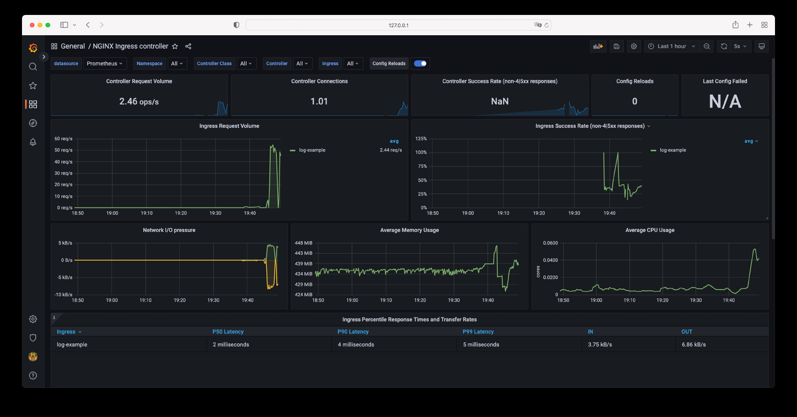

这里我简单介绍一下几个核心指标。

1. Controller Request Volume：网关每秒处理的事务数（TPS）。

2. Ingress Request Volume：每秒的请求数，按 Ingress 策略分组。

3. Ingress Success Rate：网关请求成功的比例。

4. Network I/O pressure：网关网络出入流量。

此外，你还可以看到 Ingress-Nginx 的 CPU 和内存占用情况，以及 Ingress P50、P90、P99延迟。

借助 Ingress-Nginx 核心指标 Dashboard，我们能够一目了然地看到服务整体的 HTTP 请求指标，对判断系统整体可用性有非常大的帮助。

### HTTP 请求性能 Dashboard

除了把握系统整体情况，在实际的场景中，我们还需要深入了解接口维度的指标，它可以帮助我们在更小的粒度上排查系统的故障和瓶颈。

要从接口维度了解 HTTP 请求指标，你可以导入请求性能 Dashboard，用浏览器打开下面的链接。

https://ghproxy.com/https://raw.githubusercontent.com/kubernetes/ingress-nginx/main/deploy/grafana/dashboards/request-handling-performance.json

然后，继续按照上面的方法导入 Dashboard。

导入完成后，你将看到 Dashboard 展示的内容，如下图所示。

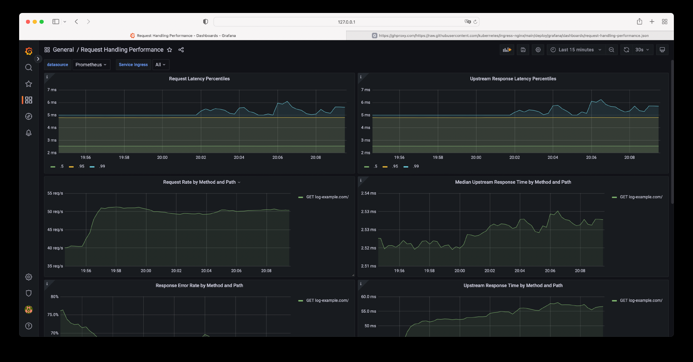

在这个 Dashboard 中，你能看到更加详细的 HTTP 请求数据，例如按接口分组的 TPS、响应速度、错误率、错误码分组、返回数据包大小等。

### 其他内置的 Dashboard

HTTP 指标监控可以帮助我们发现业务和接口层面的问题，但在生产环境下，我们还需要观察Kubernetes 自身的性能和指标。

在部署 kube-prometheus-stack 之后，实际上 Grafana 已经帮我们内置了一系列的Kubernetes Dashboard，这些 Dashboard 主要用来监控 Kubernetes 集群的整体性能，例如节点 CPU 和内存状态、节点压力、磁盘和网络、命名空间的资源消耗等等。

要查看这些内置的 Dashboard，你可以点击 Grafana 的 “Search Dashboard”按钮。

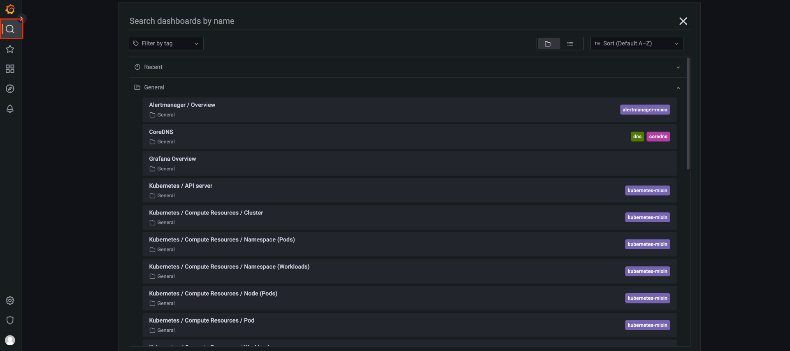

在这个界面，我们会发现有非常多不同维度的 Dashboard，例如集群维度、节点维度、命名空间维度以及 Pod 维度等。

例如，你可以打开“Kubernetes/Compute Resources/Namespace(Pods)” Dashboard，你会看到我们部署的示例应用 log-example 的 CPU 和内存消耗的实时监控。

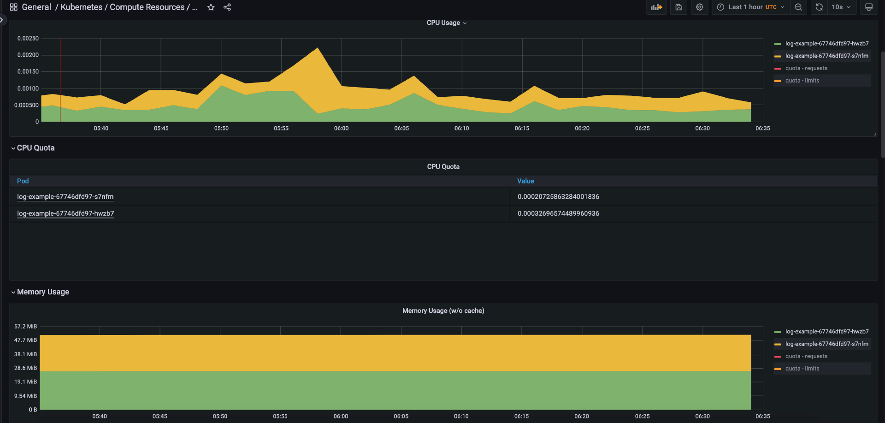

此外，“Kubernetes/Compute Resources/Cluster” Dashbord 可以帮助我们观察集群的实时性能，例如集群 CPU 和内存使用情况以及不同命名空间的资源消耗情况。

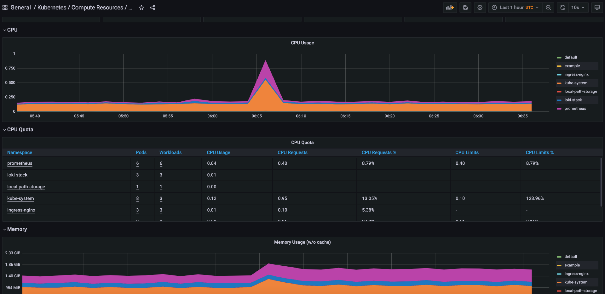

你可以自行探索其他内置的 Dashboard ，总之，在生产环境下，它们都是很常用的。它们可以帮助我们快速排查集群、节点和工作负载层面的问题。

### Dashboards 市场

Grafana 以丰富的生态受到社区的喜爱，除了内置的 Dashboard 以外，实际上还有更多丰富的 Dashboard 可供我们选择，它们都来自 Dashboard 市场。

Dashboard 市场是 Grafana 官网提供的用来下载第三方 Dashboard 的网站，在这里，你可以找到你想要的几乎任何 Dashboard。需要注意的是，它们是由第三方共享以及维护的，所以你需要自行分辨它们的质量。

要查找 Dashboard，你可以打开这个网站：https://grafana.com/grafana/dashboards/

那选择好一个 Dashboard 之后，要怎么导入呢？这里有两种办法。

第一种方法是下载 JSON 来导入，这和我们之前导入 Ingress-Nginx 的 Dashboard 是一样的，你可以在 Dashboard 的详情页面下载 JSON。

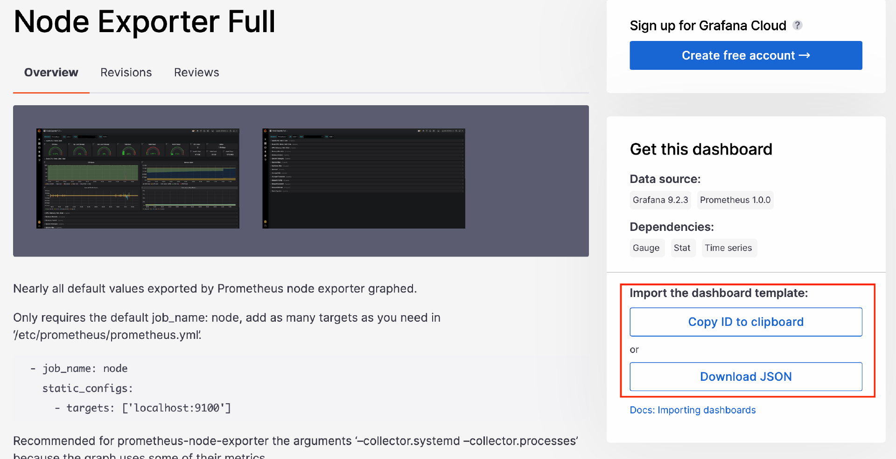

这里我再介绍一下第二种导入方法，那就是通过 ID 来导入。这种导入方法相比较用 JSON 导入更加简单。你可以点击 Dashboard 详情页的 “Copy ID to clipboard” 按钮将 ID 复制到剪切板。

然后，进入 Grafana 导入界面，在“Import via grafana.com” 输入框中粘贴 ID，并点击左侧的“Load”按钮。

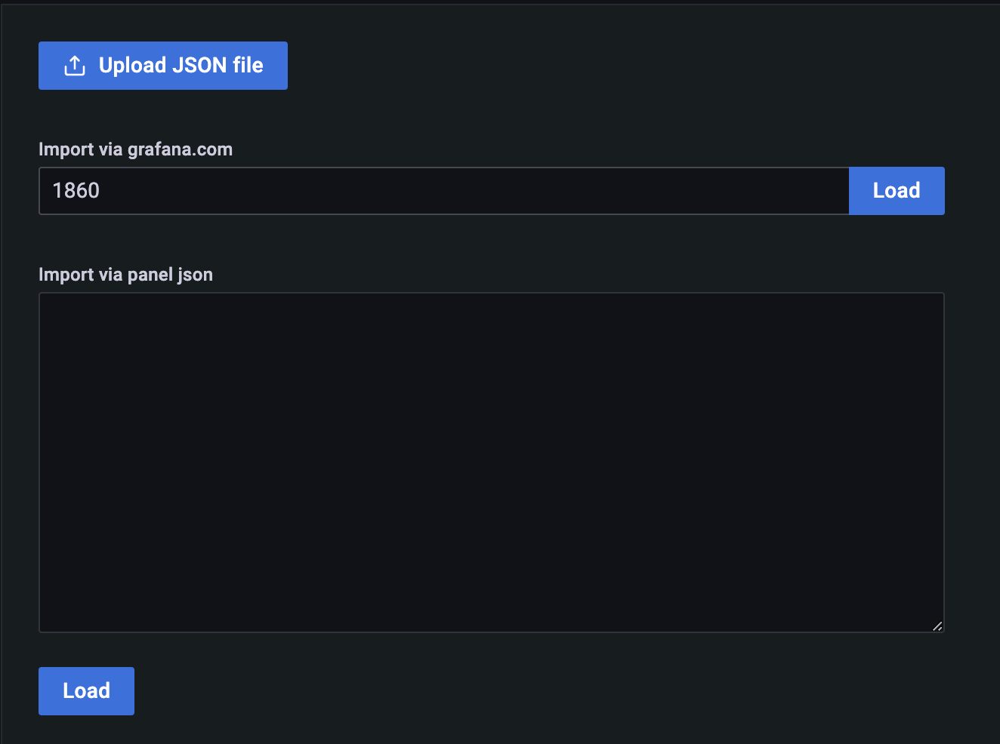

在最后一步选择 Prometheus 作为数据源即可，如下图所示。

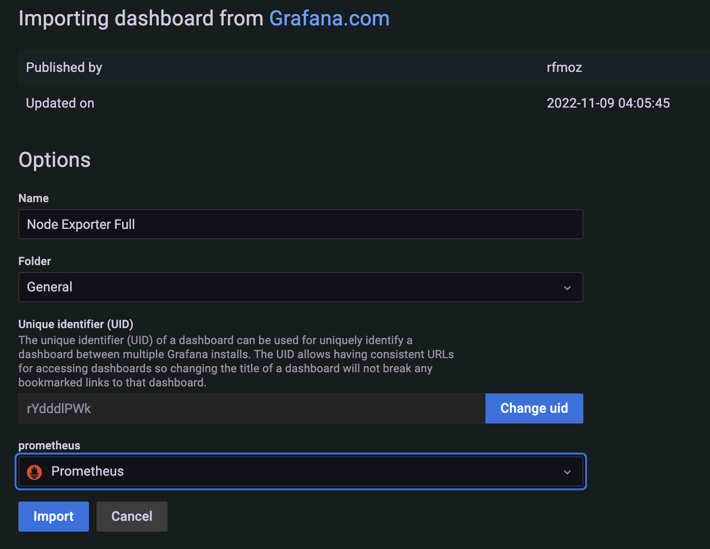

这样，Dashboard 就导入完了。

你需要额外注意的是，Dashboard 数据展示依赖于 Prometheus 指标数据的支持，如果没有相应的指标，导入的 Dashboard 也将没有数据。

## 总结

这节课，我们学习了如何借助 Prometheus、Grafana 和 Ingress-Nginx 快速搭建业务的 HTTP请求性能监控。得益于 Ingress-Nginx 提供的统一网关，我们能够很方便地从网关层面观察业务接口的性能指标。

为了能够让 Prometheus 获取到 Ingress-Nginx 的性能指标，我们通过 patch 的方式暴露了Ingress-Nginx 的 Metrics 接口，并创建了 ServiceMonitor 对象来告诉 Prometheus 如何抓取指标数据。

在查询监控指标方面，由于 Ingress-Nginx 提供的指标非常多，所以我不推荐你直接去查询它们，你可以借助 Grafana Dashboard 来观察 HTTP 请求的性能表现。同时，我还介绍了两个核心 Dashboard，它们分别是 Ingress-Nginx 核心指标 Dashboard 和 HTTP 请求性能Dashboard。

核心 Dashboard 主要用来监控 Ingress-Nginx 本身的性能情况和整体的请求指标，Ingress-Nginx 作为业务的唯一入口，它的稳定性是我们需要重点关注的。请求性能 Dashboard 则是在接口层面为我们提供了更详细的 HTTP 请求指标信息。

需要注意的是，Ingress-Nginx 的指标数据最小的粒度是 Ingress 策略的 path，在大多数场景下，它可能无法为你提供精确到业务接口的 uri path，如果你想获得这部分数据，我建议你修改 Ingress-Nginx 的日志格式，并结合我们上一节课的内容从日志里获取这部分信息。

除了 HTTP 指标相关的 Dashboard 以外，我还介绍了几个内置的 Dashboard，它们可以在集群层面为我们提供更加详细的监控信息，当我们遇到不同级别的故障时，例如集群、节点或者Pod 故障，你可以通过它们来进一步发现故障的原因。

最后，虽然 Dashboard 简化了查询指标的方式，但我们并不能长时间值守在 Dashboard 观察指标，我们需要一种能够自动发现问题并进行通知的机制，也就是告警。

在下一节课，我们就深入可观测性之告警，我会带你从零搭建起基于 HTTP 指标的自动报警。

## 思考题

最后，给你留两道思考题吧。

1. 请你尝试将 Ingress-Nginx 的日志格式修改为 logfmt，并尝试从日志中获取接口的请求性能数据。

2. 在生产环境下，业务通常也希望将一些性能指标发送到 Prometheus，请你结合相关资料，聊一聊怎么让 Prometheus 抓取到业务指标？

欢迎你给我留言交流讨论，你也可以把这节课分享给更多的朋友一起阅读。我们下节课见。
