# 33 | 告警：如何搭建基于HTTP状态告警？

你好，我是王炜。

上一节课，我们学习了如何借助 Ingress-Nginx Dashboard 快速搭建业务 HTTP 状态监控。它内置了多项 HTTP 请求指标，例如 TPS、请求成功率、P99 延迟等，这些指标对于我们掌握业务整体的可用性有非常大的帮助。

不过，在生产环境下，人工实时观察这些指标是不现实的，我们需要有一种能够自动发现异常指标的机制，它能在发现异常时发出通知。

这种机制也就是我们常说的告警。

这节课，我会继续深入可观测性，以 HTTP 请求成功率为例，带你从零搭建该指标的告警策略，并在这个过程中进一步讲解告警策略的配置方法，让你掌握给任意指标配置告警策略的能力。

在开始今天的学习之前，你需要按照第 32 讲的内容部署示例应用，并配置好 Prometheus和 Ingress-Nginx Dashboard。

## 选择告警指标

对于初学者来说，上手编写一段 PromQL 并不容易，为了降低实战门槛，我们直接从Dashboard 中选择已有的指标配置告警策略。

首先，对 Grafana Service 进行端口转发。

```
$ kubectl port-forward --namespace prometheus service/prometheus-grafana 3000:80
```

然后，使用浏览器访问 http://127.0.0.1:3000 打开">http://127.0.0.1:3000，使用账号密码admin/prom-operator 登录，点击左侧的 Dashboards 界面，搜索 “nginx” 并进入 Ingress-Nginx Dashboard，如下图所示。

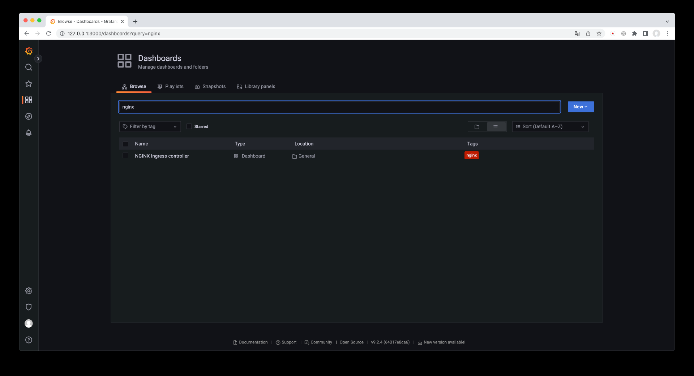

进入 Ingress-Nginx Dashboard 之后，会看到界面中展示了丰富的 HTTP 请求指标。在生产环境下，我们一般会非常关注业务 HTTP 请求的总体成功情况，所以，这里我们选择反映接口的请求成功率的 Controller Success Rate 指标，并为它配置告警策略。

选择好指标后，接下来我们需要获取该指标的 PromQL 语句进一步配置告警策略。

点击 Controller Success Rate 指标的标题展开操作菜单，并选择"Inspect"->"Query"查看指标PromQL 语句。

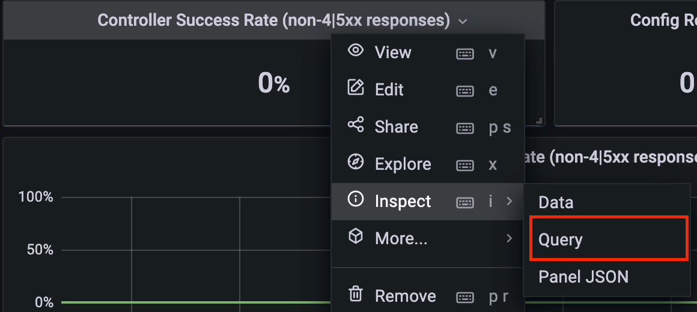

在弹出的界面中，Expr 字段实际上就是这个指标的查询语句。

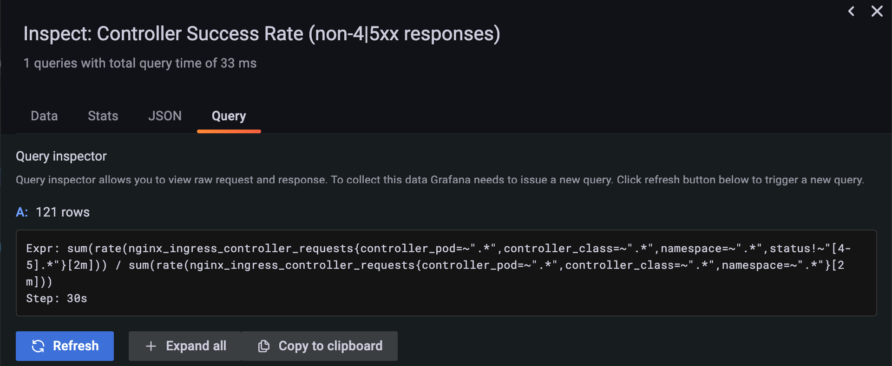

这条 PromQL 查询语句相对比较复杂，如果你现在还不能理解也没关系，我们现阶段只需要知道它反映了 HTTP 接口的总体可用性就可以了。接下来，我们将 Expr 字段的内容复制下来，方便在配置告警策略时使用。

## 配置告警策略

接下来，我们开始为 HTTP 请求成功率指标配置告警策略。

要配置告警策略，你需要创建 PrometheusRule CRD 对象，将下面的内容保存为 rule.yaml 文件。

```
apiVersion: monitoring.coreos.com/v1
kind: PrometheusRule
metadata:
 labels:
   release: prometheus
 name: http-success-rate
 namespace: prometheus
spec:
 groups:
 - name: nginx.http.rate
   rules:
   - expr: |
       sum(rate(nginx_ingress_controller_requests{controller_pod=~".*",controlle
     for: 1m
     alert: HTTPSuccessRateDown
     annotations:
       summary: "HTTP 请求成功率小于 90%"
       description: "HTTP 请求成功率小于 90%，请及时处理"
```

在这段内容里，我们重点关注 labels、expr、for 和 annotations 字段。

labels 字段需要匹配 Prometheus CRD 对象中的 ruleSelector 配置，你可以通过下面的命令来查看 Prometheus CRD 的 ruleSelector 配置。

```
$ kubectl get Prometheus prometheus-kube-prometheus-prometheus -n prometheus -o j
{"matchLabels":{"release":"prometheus"}}
```

如果你是通过其他方式部署的 Prometheus，那么一定要确保 PrometheusRule 的 labels 和Prometheus CRD 的 ruleSelector 配置一致，否则 PrometheusRule 可能不会生效。

expr 字段用来配置告警策略，它实际上是一个断言语句，它代表当 HTTP 请求成功率小于等于 90% 的时候，就发出告警。

for 字段表示 expr 表达式会在持续多久之后发出告警，例如持续 1 分钟满足条件则发出告警。

annotations 字段用来配置发出的告警信息，除了固定的告警信息以外，这里还可以使用 Gotemplate 表达式来访问 Prometheus 内置的 labels 来实现动态的告警内容，例如

```
{{$labels.instance}}、{{ $labels.job }} 和 {{ $labels.pod }} 等，详细信
```

息你可以参考这份文档。

最后，将 PrometheusRule 应用到集群内。

```
$ kubectl apply -f rule.yaml
prometheusrule.monitoring.coreos.com/http-success-rate created
```

### 检查 PrometheusRule 是否生效

在将 PrometheusRule CRD 应用到集群之后，接下来我们需要检查配置是否生效。你可以进入 Prometheus 控制台进行查看。

在访问控制台之前，首先需要对 Prometheus Service 进行端口转发。

```
$ kubectl port-forward --namespace prometheus service/prometheus-kube-prometheus-
```

接下来，打开浏览器，访问 http://127.0.0.1:9001 ，你应该能看到 Prometheus 控制台界面。点击菜单栏的 Alert 进入告警页面。

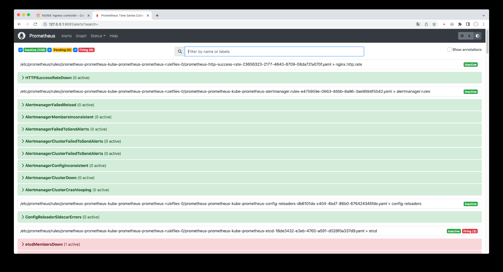

在 Alert 页面中，如果看到我们刚才配置的 HTTPSuccessRateDown，右侧的状态为Inactive，说明告警配置成功了，告警状态为未激活，说明是正常状态。你可以进一步展开并查看详情。

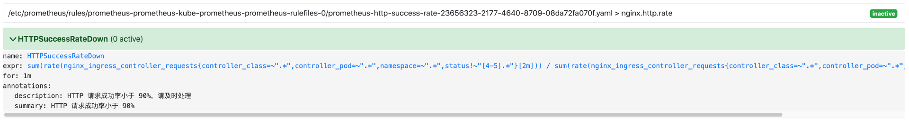

从详情页面中我们可以看到告警策略的语句和描述信息。

到这里，我们已经成功配置了 HTTP 请求成功率的告警策略。

## 配置通知

配置完告警策略之后，我们还需要配置告警通知，这样当告警生效时，Prometheus 才会将告警信息发送给我们。

Prometheus 通知的拓展性非常强，你可以将通知发送到常见的渠道里，例如企业微信、钉钉和飞书等。不过，我想先向你介绍适用性最强且配置相对简单的邮箱通知。

### 获取邮箱 SMTP 密码

要让 Prometheus 以邮件的方式发送通知，首先需要提供邮箱的 SMTP 信息，以便Prometheus 调用邮箱服务器发送邮件。

以 QQ 邮箱为例，首先我们进入设置页面，然后进入设置页面中的“账户”菜单，如下图所示。

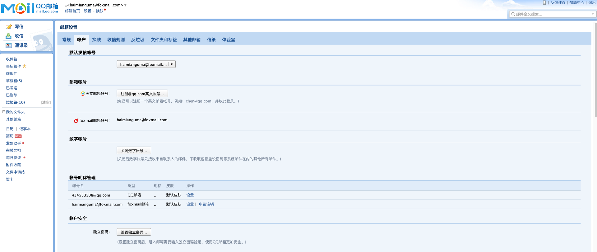

然后，在“账户”菜单中找到 SMTP 设置，开启 SMTP 并生成授权码。

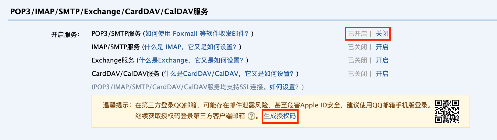

在生成授权码后，你将得到一串密码，我们把它复制并保存下来。

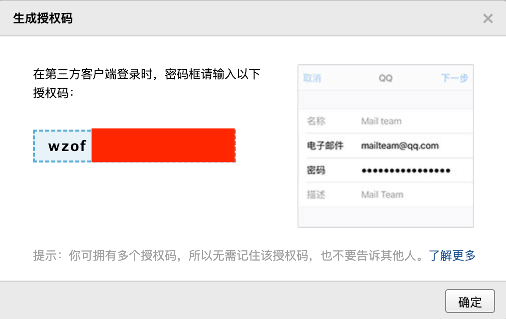

### 配置 Prometheus 发信邮箱

获得邮箱的 SMTP 密码之后，我们需要配置 Prometheus SMTP 发信邮箱。

你需要将下面的内容保存为 alertmanager.yaml 文件。

```
global:
 resolve_timeout: 5m
 smtp_from: 邮箱账户
 smtp_auth_username: 邮箱账户
 smtp_auth_password: 授权码
 smtp_require_tls: false
 smtp_smarthost: 'smtp.qq.com:465'
route:
 receiver: 'email-alert'
 group_by: ['job']
 routes:
 - receiver: 'email-alert'
   group_wait: 50s
   group_interval: 5m
   repeat_interval: 12h
receivers:
- name: email-alert
 email_configs:
 - to: 接收邮箱
```

注意，你需要把上面的 smtp_from、smtp_auth_username、smtp_auth_password 和email_configs.to 修改为你实际的邮箱信息。为了方便测试发送和接收邮件，你可以将smtp_from、smtp_auth_username 和 email_configs.to 字段配置都配置为同一个邮箱账户。

当告警被触发时，为了避免频繁接收到通知，我们配置了 repeat_interval 字段，它表示在 12小时之内只发送一次相同的告警信息。

此外，receivers.email_configs 字段也可以配置多个接收邮箱。

接下来，将 alertmanager.yaml 文件内容进行 Base64 编码。

```
$ cat alertmanager.yaml | base64
Z2xvYmFsOgogIHJlc29sdmVfdGltZW91dDogNW0KICBzbXRwX2Zyb206IGhhaW1pYW5ndW1hQGZveG1ha
```

然后，使用 kubectl edit 命令编辑 Prometheus Secret。

```
$ kubectl edit secret -n prometheus alertmanager-prometheus-kube-prometheus-alert
# Please edit the object below. Lines beginning with a '#' will be ignored,
# and an empty file will abort the edit. If an error occurs while saving this fil
# reopened with the relevant failures.
#
apiVersion: v1
data:
 alertmanager.yaml: Z2xvYmFsOgogIHJlc29sdmVfdGltZW91dDogNW0.... # 替换内容
kind: Secret
```

然后将 alertmanager.yaml 字段后面的内容替换为上一步生成的 Base64 字符串，保存修改。

接下来，你还需要进入 Alertmanager 控制台检查配置是否生效。

在访问 Alertmanager 控制台之前，你需要先进行端口转发操作。

```
$ kubectl port-forward svc/prometheus-kube-prometheus-alertmanager -n prometheus
```

然后，使用浏览器打开 http://127.0.0.1:9093/#/status，检查配置信息是否生效。

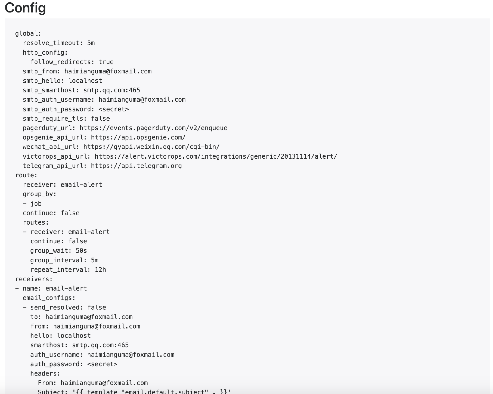

更新 Secret 可能需要几分钟后才能生效，如果你看到了刚才我们配置的邮箱信息，说明邮箱配置成功了。

## 触发告警

要触发告警，我们首先需要访问上一节课部署的示例应用，以便产生 HTTP 请求指标数据。

在示例应用中，我特意随机返回了 400 和 500 的状态码，所以 HTTP 请求成功率一定会小于90%，这样我们就可以触发告警了。

接下来，使用下面的命令来访问示例应用。

```
$ while true; do ; curl http://log-example.com/http ; echo -e '\n'$(date);done
```

现在，你可以进入 Grafana 控制台并打开 Ingress-Nginx Dashboard 查看 HTTP 指标信息，等待几分钟后，你将看到实时的指标。

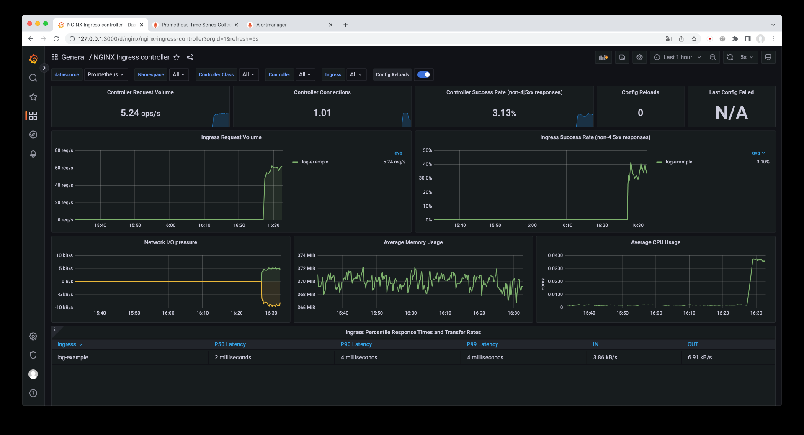

从 Dashboard 中我们可以看到 Controller Success Rate 指标，此时请求成功率小于 90%，这符合我们的预期。

接下来，使用浏览器重新打开 http://127.0.0.1:9091/alerts，进入 Prometheus Alerts 界面，你将看到我们配置的告警策略处于 Pending 状态。

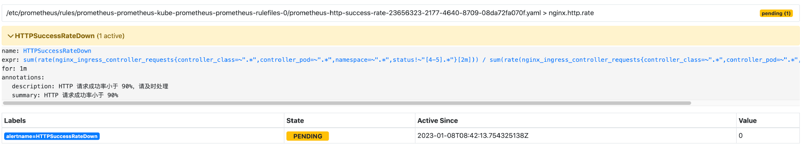

这是因为 Prometheus 检测到了 HTTP 的请求成功率低于阈值，但由于告警的持续时间还没有达到预定义的时长，所以并不会发送通知。

等待 1 分钟后，告警状态从 Pending 变成了 Firing 状态，表示告警正在生效。

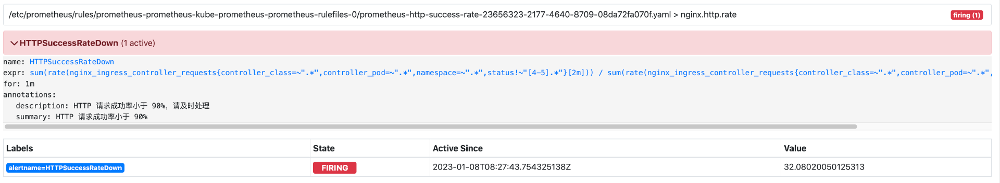

此时，打开邮箱，你应该能看到 Prometheus 发送的告警通知邮件。

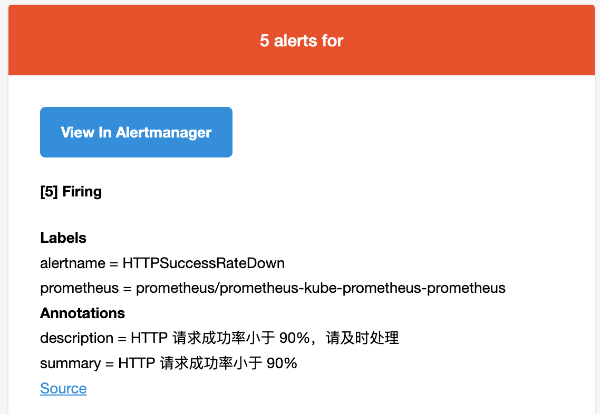

至此，我们就完成了从创建告警策略、配置邮件通知、触发告警和接收邮件告警通知的全过程。

## CPU 使用率告警

在生产环境下，除了配置 HTTP 指标告警策略以外，我还建议你配置 Pod CPU 使用率告警，这会帮助我们提前感知业务 Pod 是否正处于流量高峰，并提前做好应对措施。

你需要将下面的内容保存为 cpu-rule.yaml 文件。

```
apiVersion: monitoring.coreos.com/v1
kind: PrometheusRule
metadata:
 labels:
   release: prometheus
 name: cpu-usage
 namespace: prometheus
spec:
 groups:
 - name: cpu.usage
   rules:
   - expr: |
       round( 100 * sum( rate(container_cpu_usage_seconds_total{container_name!=
     for: 1m
     alert: ContainerCPUUsage
     annotations:
       summary: "Pod {{ $labels.pod }} CPU 使用率超过限制值 80%"
       description: "Namespace {{ $labels.namespace }}, Pod {{ $labels.pod }}, 容
```

在这个告警策略中，我们用容器的 CPU 使用量 / 容器的资源 Limit 值来计算容器的 CPU 使用率，当这个值大于 80% 的时候，触发报警。

需要注意的是，要让这个告警策略生效，你需要为工作负载配置资源的 request 和 limit，在示例应用中，我已经提前配置好了。

annotations 字段和我们之前配置的 HTTP 请求成功率的通知消息有所不同，这里我们使用了Go Template 模板，并读取了内置的 labels 变量。这样，当告警被触发的时候，Prometheus会自动填充这些变量，我们可以在告警通知里面直接得到命名空间、Pod 名称、容器名以及当前 CPU 的使用率。

接下来，我们访问示例应用来触发告警策略。

```
$ while true; do ; curl http://log-example.com/http ; echo -e '\n'$(date);done
```

1-2 分钟后，你可以重新打开 Prometheus Dashboard，并查看 ContainerCPUUsage 告警策略的状态，你应该能看到告警正处于 Pending 状态。

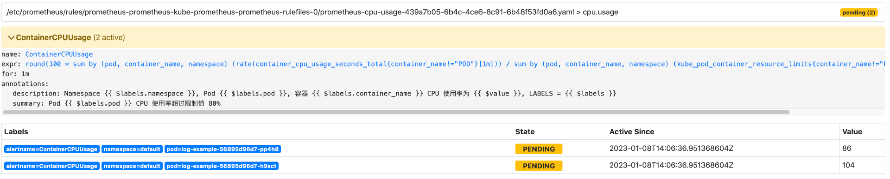

展开告警详情，会显示当前正处于 CPU 使用率告警的 Pod 信息。

等待 1 分钟后，此时 Pending 状态将变成 Firing 状态，并将收到 CPU 使用率告警的邮件通知，如下图所示。

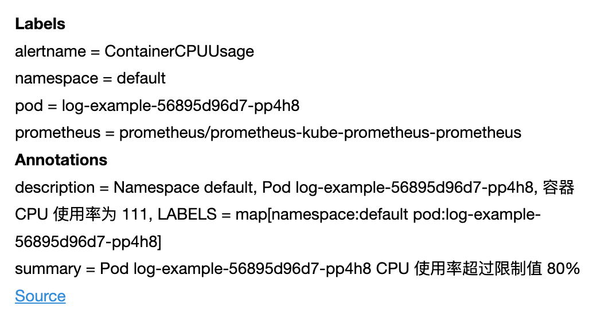

至此，容器 CPU 使用率告警策略就配置完成了。

### 其他告警策略集合

要从零编写 Prometheus 告警策略并不容易，这里，我为你介绍一个社区维护的PrometheusRules 集合仓库，你可以在这个仓库中找到大部分需要在生产环境中配置的告警策略。

此外，这个集合仓库还提供了官网，你也可以在这里通过关键字来查找告警策略。

## 其他通知方式

除了邮件通知，我们还可以配置其他的通知方式，例如企业微信、钉钉或者飞书。不过，要使用 Prometheus 原生的扩展方式配置这些通知比较复杂，这里我介绍一种通过PrometheusAlert 项目来配置通知的方式，它配置起来相对简单，并且支持丰富的第三方通知。

### 安装 PrometheusAlert

首先，我们需要安装 PrometheusAlert 项目，你可以使用下面的命令来安装。

```
$ kubectl create ns monitoring
$ kubectl apply -n monitoring -f https://ghproxy.com/https://raw.githubuserconten
configmap/prometheus-alert-center-conf created
deployment.apps/prometheus-alert-center created
service/prometheus-alert-center created
```

然后，等待工作负载就绪。

```
$ kubectl wait --for=condition=Ready pods --all -n monitoring
pod/prometheus-alert-center-75b7b6465-26zvd condition met
```

### 配置 PrometheusAlert

安装完成后，PrometheusAlert 会默认开启钉钉和企业微信通知的开关，但并没有开启飞书开关。这里我以飞书通知为例介绍一下配置方法。

首先我们需要启用飞书通知开关。要启用飞书通知，你需要编辑 PrometheusAlert 存储配置的configmap。

```
$ kubectl edit configmap prometheus-alert-center-conf -n monitoring
#是否开启飞书告警通道,可同时开始多个通道0为关闭,1为开启
open-feishu=0
```

找到 open-feishu 配置项，并将 0 修改为 1，保存配置。

然后，要让配置立即生效，你可以删除旧的 Pod。

```sql
$ kubectl delete pod -l app=prometheus-alert-center -n monitoring
pod "prometheus-alert-center-75b7b6465-26zvd" deleted
```

这样，飞书通知的开关也就开启了。

### 创建飞书机器人

下一步，我们需要创建飞书机器人。首先，你需要创建一个群聊，然后点击群聊“设置”，选择“群机器人”。

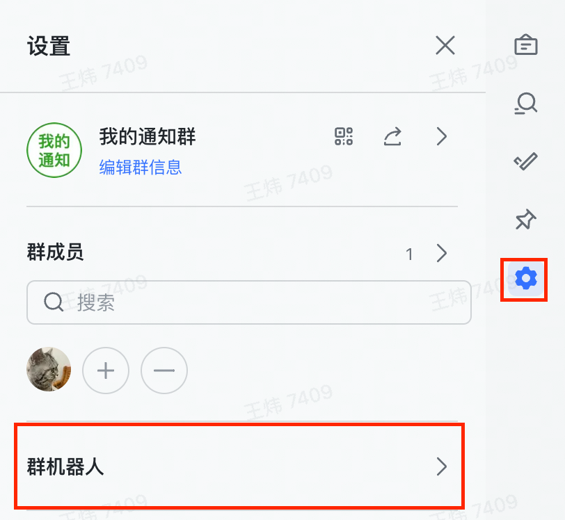

在弹出的界面中，选择“添加机器人”，然后选择“自定义机器人”。

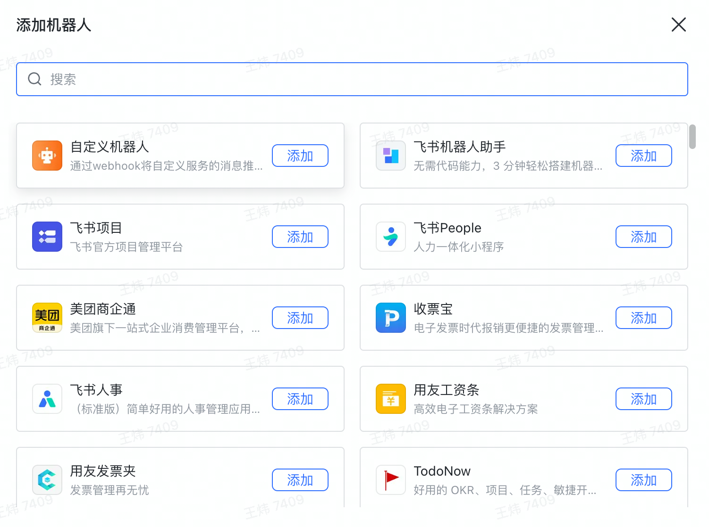

接下来，点击“添加”完成机器人创建过程，此时你将得到一个 webhook 地址，例如：https://open.feishu.cn/open-apis/bot/v2/hook/xxxx-xxx，将它复制下来备用。

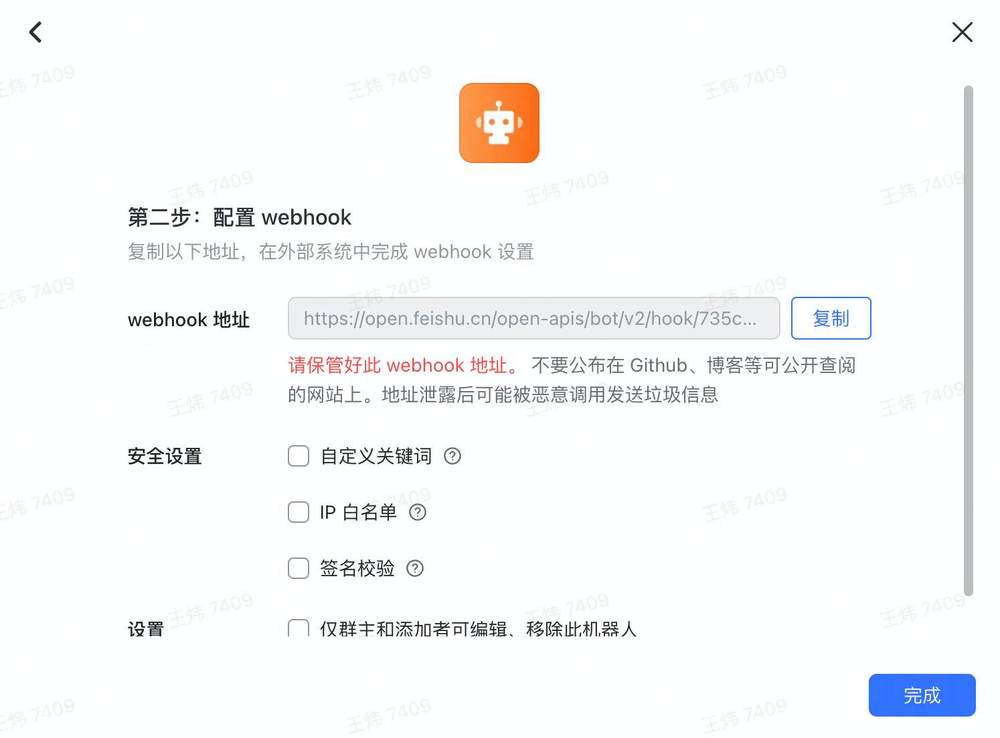

### 配置 Alertmanager

接下来，我们还需要配置 Alertmanager，让所有通知都转发到 PrometheusAlert 去处理。

将下面的内容保存为 prometheusAlert.yaml 文件。

```
global:
 resolve_timeout: 5m
route:
 group_by: ['instance']
 group_wait: 10m
 group_interval: 1m
 repeat_interval: 12h
 receiver: 'web.hook.prometheusalert'
receivers:
- name: 'web.hook.prometheusalert'
 webhook_configs:
- url: 'http://prometheus-alert-center.monitoring:8080/prometheusalert?type=fs&
```

从这段配置内容中我们会发现，这里本质上是使用了 Alertmanager 的 webhook 功能，将所有告警以 HTTP 的方式发送到了 PrometheusAlert，并由它来发送通知。

请注意，你需要将 url 字段中的 fsurl 参数替换为之前创建的飞书 webhook 地址。

当然你也可以使用其他的通知方式，例如企业微信或者钉钉，只需要构造不同的 url 参数就可以了，你可以参考这个链接。

然后，将该文件内容进行 base64 编码。

```
$ cat prometheusAlert.yaml| base64
Z2xvYmFsOgogIHJlc29sdmVfdGltZW91dDogNW0Kcm91dGU6CiAgZ3JvdXBfYnk6IFsnaW5zdGFuY2UnX
```

接下来，编辑 Alertmanager 的 Secret 文件。

```
$ kubectl edit secret -n prometheus alertmanager-prometheus-kube-prometheus-alert
# Please edit the object below. Lines beginning with a '#' will be ignored,
# and an empty file will abort the edit. If an error occurs while saving this fil
# reopened with the relevant failures.
#
apiVersion: v1
data:
 alertmanager.yaml: Z2xvYmFsOgogIHJlc29sdmVfdGltZW91dDogNW0.... # 替换内容
kind: Secret
......
```

将 alertmanager.yaml 字段后面的内容替换为上一步生成的 Base64 字符串，保存修改。

为了让配置立即生效，你可以删除旧的 Alertmanager Pod。

```sql
$ kubectl delete pod -l app.kubernetes.io/name=alertmanager -n prometheus
pod "alertmanager-prometheus-kube-prometheus-alertmanager-0" deleted
```

### 触发告警

接下来，仍然使用下面的命令来访问示例应用，以便触发告警。

```
$ while true; do ; curl http://log-example.com/http ; echo -e '\n'$(date);done
```

等待几分钟后，你将在飞书收到告警通知。

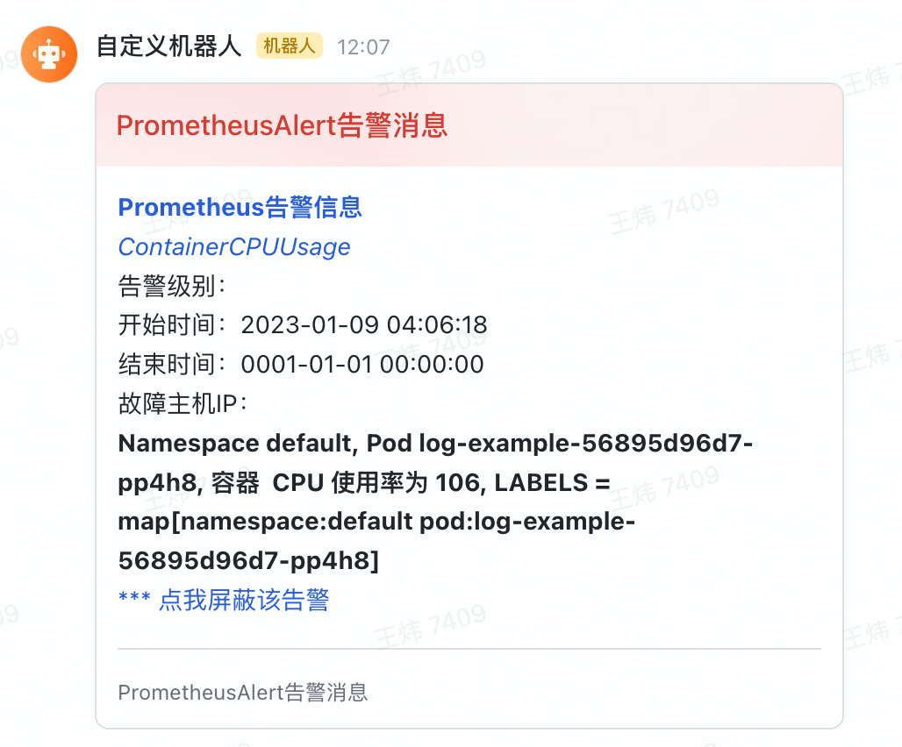

到这里，我们就完成了使用 PrometheusAlert 发送告警通知的全过程。

PrometheusAlert 支持的通知类型有非常多，除了常见的 IM，还支持短信和电话通知，你可以参考这个文档进行配置。

## 总结

这节课，我们学习了如何创建 Prometheus 告警策略，并通过配置邮件通知来接收告警。

对于新手来说，编写 PromQL 并不是一件容易的事，所以我教你了一个小技巧，也就是通过查看 Dashboard 的指标来获得查询语句，并将它配置成 PrometheusRule 对象，这样就完成了指标告警配置。通过这种方式，理论上你可以对任何 Dashboard 中已有的指标配置告警策略。

在配置通知方面，我首先介绍了通用性最强也最简单的邮箱配置方法，不同的邮箱配置稍有差异，不过你只需要找到邮箱的 SMTP 服务器、账号和密码也就可以了。此外，我还介绍了PrometheusAlert 项目，通过它你可以配置丰富的通知渠道，配置过程也相对比较简单。

最后，我还提到了社区维护的 PrometheusRules 集合仓库，如果你想找到更多现成的告警策略并深入学习 PromQL，那么从这里开始是一个不错的起点。

到这里，GitOps 的可观测性专题也就全部结束了。通过为业务系统配置日志、监控和告警策略，我相信你已经能全方位掌握业务的健康状态，也具备提前发现问题和解决业务隐患的能力了。

## 思考题

最后，给你留一道思考题吧。

你认为在生产环境下，我们还需要对哪些指标配置告警呢？说说你的理解。

欢迎你给我留言交流讨论，你也可以把这节课分享给更多的朋友一起阅读。我们下节课见。
