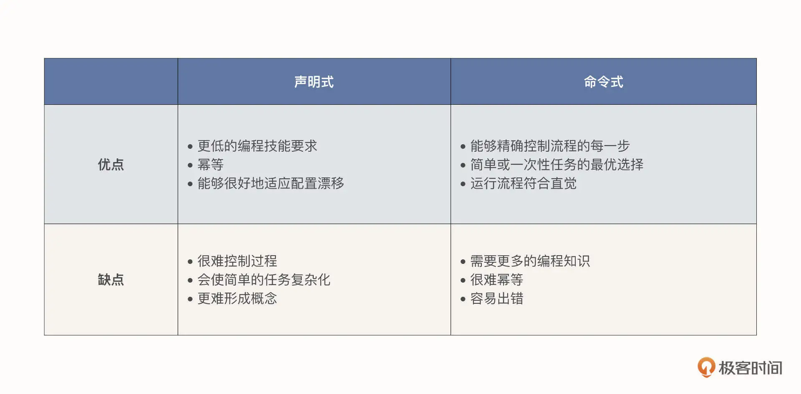
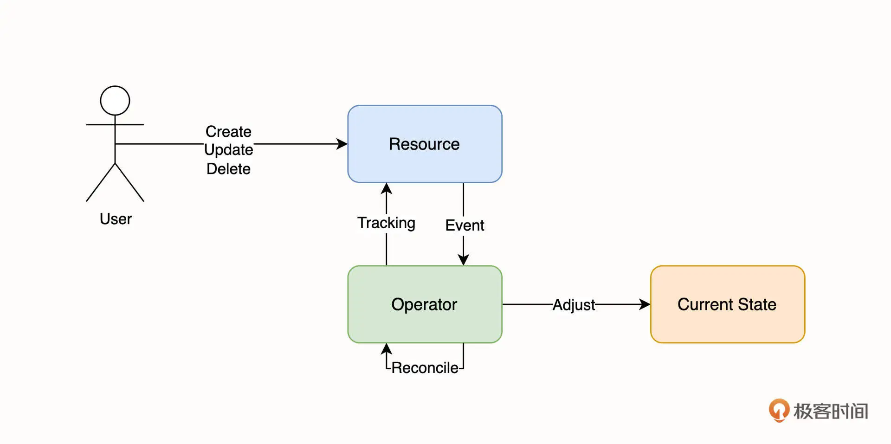

# 40 | 命令式和声明式，谁才是驱动云原生的“引擎”？

你好，我是王炜。

这节课我们来聊聊命令式和声明式。

命令式和声明式常用于描述编程范式，两者最直观的区别是：命令式是描述代码执行步骤的，它通过代码流程控制来实现程序的输入和输出，是一种过程导向的思想。而声明式则不直接描述执行步骤，它描述的是期望的状态和结果，由程序内部逻辑控制来实现，是一种结果导向的思想。

举例来说，使用 docker run 命令启动一个容器，这就是最简单的命令式。

当业务逻辑简单且只有一个单体应用的容器时，使用命令式是简单且直观的。但随着系统越来越复杂，加上微服务数量的增长，服务之间就可能会产生依赖问题。例如所有服务都依赖于MySQL 和 RabbitMQ 服务，那么在启动其他服务前就必须先启动这两个服务，这时候要想人为记住服务依赖和启动顺序，以此执行 docker run 启动服务就变得困难起来。用户需要一种方法来“声明”微服务之间的依赖和启动关系。

为了解决这个问题，“声明式”的服务编排系统出现了，在 Kubernetes 之前，其实还有很多容器编排方案，比较知名的有 Docker 自家的方案 Docker-compose，你可以通过一个 YAML 文件来声明式描述服务之间的依赖关系，Docker-compose 会自动帮你处理它们的启动顺序和依赖。

在这节课，我们就来看看什么是命令式和声明式、声明式的优势、Kubernetes 实现声明式的核心基础以及还有哪些成功的声明式项目。

## 什么是命令式？

在命令式的范式中，一般是通过运行一组特定的命令来实现控制流，然后利用赋值和变量来存储中间状态，以便后续流程的使用。它也可能使用流程控制命令如 for 循环来对条件进行判断，这是命令式编程范式的思想。

在云原生时代之前，软件部署和运维通常都使用命令式的方法来管理，也就是通过远程的方式将命令发送到基础设施并运行。如果命令结果正常，则运行结束，如果命令运行失败，程序则会发送进一步的指令来执行其他操作。

要想实现简单的流程和状态，命令式毫无疑问是不错的选择，因为命令式只需要执行一个或一组特定的有序命令就可以完成。例如使用 FTP 指令将网站上传到生产环境：

```
ftp 192.168.1.1
put index.html /usr/share/nginx/html
```

当我们面对更复杂的部署场景，例如多集群、优雅停止、控制流量和回滚等部署流程时，工程师一般会编写一系列的 Shell 脚本来实现目标。很显然，大量的 Shell 脚本的管理和运行完全取决于运维工程师本人，也很容易因为人为错误导致生产故障。

## 什么是声明式？

相比较命令式的编程范式，声明式不直接描述运行过程，而是描述期望结果，推导和中间过程由程序内部逻辑实现，对用户相对透明。它会对外提供一套声明式的定义模板来描述期望的最终状态。

例如，我们在开发中很常见的 SQL 语句就可以理解为是一种“声明式”的思想。

```sql
SELECT * FROM users WHERE name like "%cici"
```

SQL 语句让用户自己去定义想要什么数据（也就是最终期望的状态）。具体数据库如何存储数据、如何使用更高效的算法和索引来查找数据都由数据库决定，最终返回的数据集则是我们期望看到的结果。

再举个例子，有一些团队会因为复杂度而放弃 Kubernetes 使用 Docker-compose 作为容器编排方案。实际上它和 Kubernetes 一样，也是声明式的容器编排工具。比如，下面这个 YAML文件定义了三个服务的端口和依赖关系。

```
version: '2.2'
services:
 mysql:
   image: mysql:latest
   environment:
     - MYSQL_USER=username
     - MYSQL_PASSWORD=password
   volumes:
     - ./mysql/docker-entrypoint-initdb.d:/docker-entrypoint-initdb.d
   ports:
     - "3306:3306"
 redis:
   image: redis:latest
   volumes:
     - redis-data:/data
   ports:
     - "6379:6379"
 api-backend:
   image: api-backend:latest
   depends_on:
     - mysql
     - redis
   ports:
     - "8080:8080"
```

在这个 Docker-compose 的例子中，depends_on 字段定义了容器的依赖关系，api-backend服务会等待 MySQL 和 Redis 服务都启动完成之后才会在最后启动。

试想一下， 如果你希望通过命令式来实现上面这段定义的目标，你首先需要理解依赖关系，然后通过手动的方式来启动 MySQL 和 Redis 服务，最后再手动启动 api-backend 服务，整个启动过程都需要等待并人为判断运行状态，非常麻烦。

类似地，如果我们现在要创建一个 nginx 容器，你可以使用命令式也就是 kubectl 来创建容器。

```
$ kubectl create deployment nginx --image=nginx
```

当然，你也可以通过 YAML 文件以声明式的方式来创建 nginx 容器。

```
apiVersion: apps/v1
kind: Deployment
metadata:
 labels:
   app: nginx
 name: nginx
spec:
 replicas: 1
 selector:
   matchLabels:
     app: nginx
 template:
   metadata:
     labels:
       app: nginx
   spec:
     containers:
     - image: nginx
       name: nginx
```

然后使用 kubectl apply -f 命令来把这段 YAML 应用到集群内。

## 命令式和声明式的对比

讲到这里，我相信你已经能理解什么是命令式和声明式了。那么，为什么 IT 系统的运维和部署会从传统的命令式转变为声明式呢？

在理解声明式的优势之前，我先举一个生活化的例子。

假设你现在要去一个朋友的家，在以前，你需要问你的朋友，告诉他你的位置，并让他给出具体的路线：先从大路一直走，走到底然后左转，50 米之后然后右转等等，你可以把它理解为命令式的模式。

现在，有了现代的导航软件，我们不再需要记这么繁琐的路线了。你只需要将目的地输入导航软件，GPS 会实时计算你的路线，并根据你的位置实时给出最佳路线，最终带你到达目的地。你可以把它理解为声明式的思想。

可见，声明式相比较命令式没有了中间过程，对开发者屏蔽了分叉的逻辑和错误处理，让用户的心智负担更小，自然也就更受欢迎了。

此外，声明式还为我们提供了更好的幂等性，这意味着即便是多次执行，每次产生的结果也都是相同的。由于我们定义的只是最终所需的状态，因此无论怎么操作，都会得到相同的结果，这就给我们带来了巨大的便利和灵活性。尤其是当我们把声明式的工具集成到 CI/CD 流程之后，你会发现我们不再需要手动判断发布条件，只需要在流水线中执行它就可以了。

当然，声明式还有其他的一些好处，他们包括：

- 版本控制

- 便于管理定义与环境的配置漂移

- 更容易重复运行

- 集中式的管理

- 更高的部署透明度

我画了一个表格对比了它们的优缺点，你可以看一下。



## Kubernetes 实现声明式的核心基础

Kubernetes 是最具代表性的声明式的容器调度系统，那么，它具体是如何实现声明式的呢？为什么修改 YAML 文件能够实时修改 Pod 的状态？下面，我们就简单介绍一下它的工作原理，让你进一步理解声明式的实现方式。

Kubernetes 实现声明式的方式可以用下面这张图来总结。



首先，我们作为用户可以通过 kubectl 来创建、删除和修改资源，例如 DeploymentManifest。此时，运行在集群内的 Deployment Operator 会通过消息队列接收到资源的变更操作，触发 Reconcile 协调函数，比对当前资源实际状态和描述状态的差异，并调整资源。

在这个过程中，Reconcile 协调函数是最重要的一个环节，你可以把它理解为是一个一直循环的函数。

```go
import (
 ctrl "sigs.k8s.io/controller-runtime"
 cachev1alpha1 "github.com/example/memcached-operator/api/v1alpha1"
 ...
)
func (r *MemcachedReconciler) Reconcile(ctx context.Context, req ctrl.Request) (c
 _ = context.Background()
 ...
 // Lookup the Memcached instance for this reconcile request
 memcached := &cachev1alpha1.Memcached{}
 err := r.Get(ctx, req.NamespacedName, memcached)
 ...
}
```

对于 Kubernetes 内置的对象，例如 Deployment、StatefulSet 和 Service，它们由Kubernetes 内置的 Operator 来实现业务逻辑。对于 CRD（自定义资源），你同样可以通过这种机制来扩展自己的 Operator。

总结来说，Kubernetes 其实就像基础设施的数据库，由 etcd 存储基础设施的 Manifest 描述文件，Kubernetes 提供了一种通用的机制让 Operator 能够实时获取到状态变更信息，至于状态对比以及如何让基础设施达到预期状态，则都交由业务自己实现。

这种机制是一项巨大的创新，它就像插件机制，能够让我们基于 Kubernetes 开发各种各样的Operator。

## 其他声明式的项目

声明式的思想让很多云原生项目大获成功，除了 Kubernetes 以外，我再介绍几个比较知名的项目，你在实施 GitOps 流水线的时候也可能会用到。

### Terraform

Terraform 是一个基础设施自动编排工具，它旨在实现“基础设施即代码”的思想，允许使用声明式配置文件来创建基础设施，例如 AWS EC2、S3 Bucket、Lambda、VPC 等。

它主要有以下几个功能。

- 基础架构即代码（Infrastructure as Code）：使用 HCL 高级配置语法描述基础架构，使得基础设施可以像代码一样进行版本控制、共享和重用。

- 执行计划（Execution Plans）：生成执行计划的步骤并显示，有效避免人为误操作。

- 资源图表（Resource Graph）：生成所有资源的拓扑结构和依赖关系，确保被依赖的资源优先执行，并且以并行的方式创建和修改依赖，保证创建资源高效地执行。

- 变更自动化（Change Automation）：当模板中的资源发生变化时，Terraform 会生成新的资源拓扑图，确认无误后，只需要一个命令即可自动化完成变更操作，避免人为误操作。

例如，我们可以通过声明式配置文件创建 AWS S3。

```
provider "aws" {
 region = "cn-north-1"
 shared_credentials_file = "~/.aws/credentials"
 profile = "bjs"
}
resource "aws_s3_bucket" "b" {
 bucket = "my-tf-test-bucket"
 acl = "private"
 tags = {
   Name = "My bucket"
   Environment = "Dev"
 }
}
```

上面的 HCL 声明文件中使用 aws provider（基础设施提供商），并创建了一个名为“my-tf-test-bucket”的私有 S3 存储桶，同时配置了标签。然后，运行 terraform plan 和 terraform apply 命令就可以创建定义好的资源了。

使用 Terraform HCL 能够实现对大部分基础设施的创建和修改，将原来需要在控制台进行的操作变更为了对代码的编写和定义，实现了“代码即基础设施”。

### Ansible

Ansible 是使用 Python 开发的自动化运维工具，在容器和 Kubernetes 没有流行之前，它可能是最流行的自动化运维工具了。它的核心原理是将声明式的 YAML 文件转化成 Python 脚本上传至服务端运行，以此实现自动化工作。

Ansible 主要由以下几个结构组成。

- 模块：由不同功能的自动化脚本组成。

- 模块程序：与模块不同，当多个模块使用相同的代码时，Ansible 将这些功能存储为模块实用程序，以最大程度地减少重复和维护，模块程序只能用 Python 或 PowerShell 编写。

- 插件：提供 Ansible 增强能力，也可以编写自定义插件。

- 清单：一组需要被管理的远程服务器列表，例如 IP 或域名。

- Playbooks：声明式自动化编排脚本。

和直接编写 Python 脚本不同，Ansible 将各种底层能力封装成为模块，通过声明式 Playbooks进行脚本编排，同时具有自定义插件的能力。

例如，以下 Playbooks 声明了将本地 Jar 包上传至远程服务器，并终止当前运行的 Java 进程，最后运行新的 Jar 程序包。

```sql
 tasks:
 # 获取本地 target 目录的 Jar 包
 - name: get local jar file
   local_action: shell ls {{ pwd }}/target/*.jar
   register: file_name
 # 上传 jar 包至远程服务器
 - name: upload jar file
   copy:
    src: "{{ file_name.stdout }}"
    dest: /home/www/
   when: file_name.stdout != ""
 # 获取 java-backend 包运行的pid
 - name: get jar java-backend pid
   shell: "ps -ef | grep -v grep | grep java-backend | awk '{print $2}'"
   register: running_processes
 # 发送退出信号
 - name: Send kill signal for running processes
   shell: "kill {{ item }}"
   with_items: "{{ running_processes.stdout_lines }}"
 # 等待 120 秒，确认进程是否已结束运行
 - wait_for:
     path: "/proc/{{ item }}/status"
     state: absent
     timeout: 120
   with_items: "{{ running_processes.stdout_lines }}"
   ignore_errors: yes
   register: killed_processes
 # 仍未退出，强制杀死进程
 - name: Force kill stuck processes
   shell: "kill -9 {{ item }}"
   with_items: "{{ killed_processes.results | select('failed') | map(attribute='
 # 启动新的jar包
 - name: start java-backend
   shell: "nohup java -jar /home/www/{{ file_name.stdout }} &"
```

在声明式的 Playbooks 中，把执行的部署行为转变为简单的声明对应模块并提供参数即可完成，例如使用 Copy 模块上传文件，Shell 模块运行命令，wait_for 模块运行等待。相比传统的编写 Shell 部署脚本，Playbooks 通过模块封装降低了书写难度，同时使部署脚本变得标准化。

## 总结

总结一下，这节课，我带你学习了什么是命令式和声明式、两者的特点与差异、Kubernetes实现声明式的核心基础以及其他声明式的项目。

命令式的思想比较适合简单或一次性的任务，在大部分情况下，这种任务不需要进行复杂命令编排，只需要执行一组命令即可完成。但命令式比较难实现幂等，如果要实现幂等，你需要书写大量的判断语句来控制运行流。

而声明式则比较适合复杂的任务，在大多数由声明式实现的系统中，它支持幂等，并且能够很好地适应配置漂移的问题，也就是描述状态和实际状态不一致的情况。此外，由于它的业务和循环控制逻辑并不对使用者暴露，所以它没有很高的编程经验要求。

Kubernetes 的流行使得声明式的思想变得无处不在，它就像是一个基础设施的数据库，能够让我们以较低的上手难度轻松地在 Kubernetes 平台构建声明式的 Operator，并实现自己的业务逻辑，这种类似插件式的扩展方式是 Kubernetes 在开发者群体受欢迎的重要因素。如果你有兴趣构建自己的 Operator，可以参考 Kubebuilder 项目。如果你想在本地写一个类似kubectl 的工具，则可以参考 Client-go 项目。
