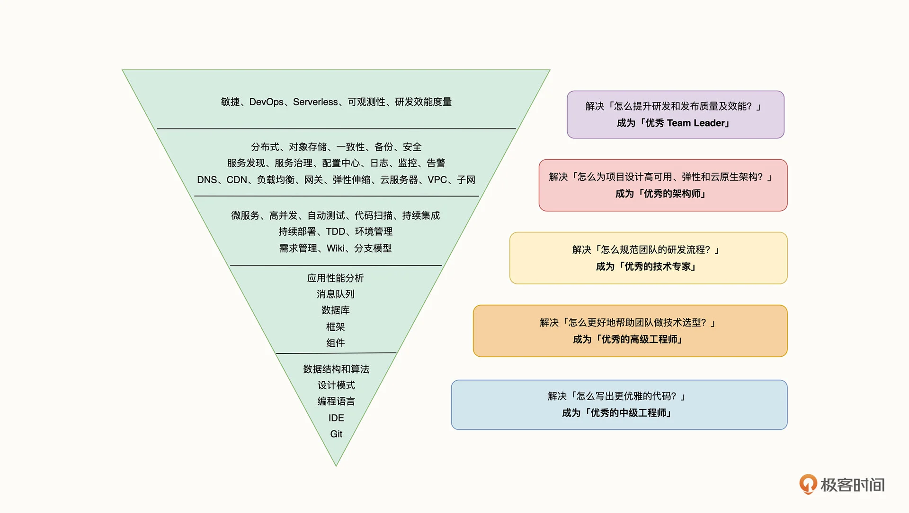
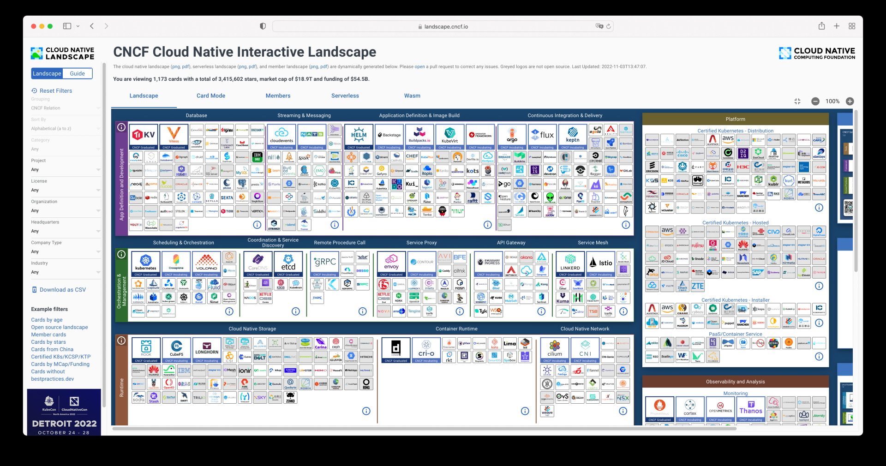
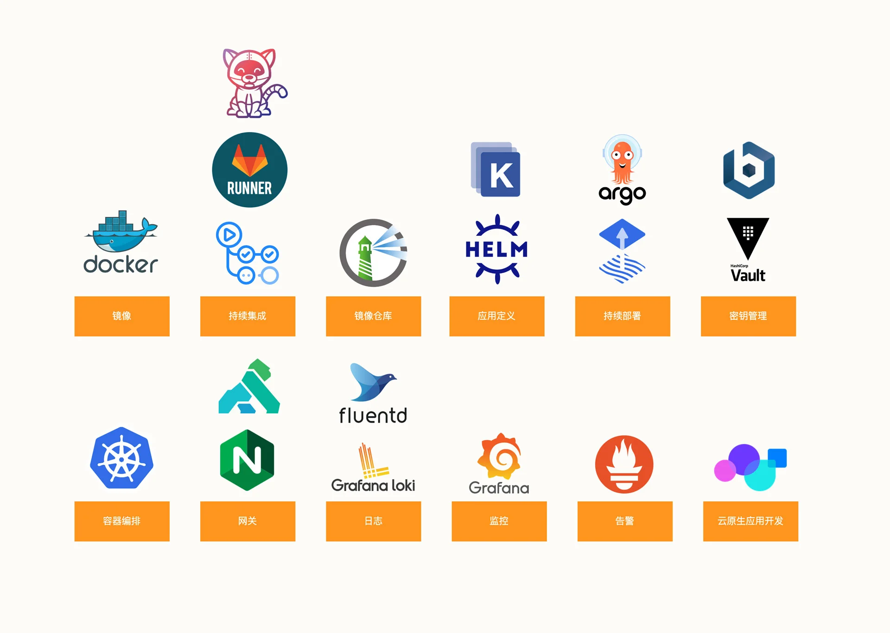
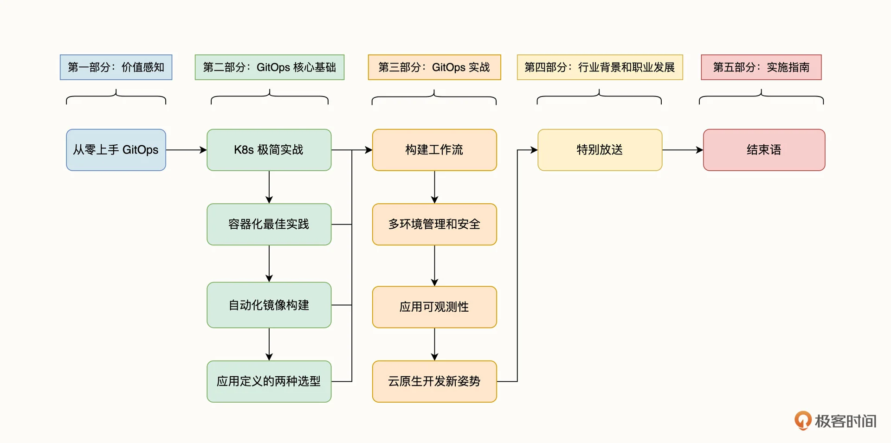

# 开篇词 | 30-60K，转型云原生架构师和SRE需要哪些能力？

你好，我是王炜，欢迎和我一起学习云原生的核心技术。

先来简单介绍一下我自己吧。作为前腾讯云 CODING 架构师，现在深圳氦三科技的联合创始人，同时也是中国云原生社区深圳站的负责人，我见证了云原生在国内从萌芽到蓬勃发展的整个阶段。

近几年，我出版了云原生持续部署领域书籍《Spinnaker 实战：云原生多云环境的持续部署方案》，参与编写了云原生服务网格领域书籍《深入理解 Istio：云原生服务网格进阶实战》，还有《软件研发效能权威指南》的云原生开发部分。

同时，我也是云原生开发工具 Nocalhost 项目的核心作者（它是 CNCF “Application Definition& Image Build” 领域内国内首个 CNCF Sandbox 项目）。

## 我们为什么需要学习云原生技术？

回想我早期的职业生涯，我既在大公司从事过职责单一的一线开发工作，也在中小型公司担任过开发和运维多职能的角色。这一路上有些问题其实一直在困扰着我：

1. 怎么写出更优雅的代码？

2. 怎么更好地帮助团队做技术选型？

3. 怎么规范团队的研发流程？

4. 怎么为项目设计高可用、弹性和云原生的架构？

5. 怎么提升研发和发布的质量及效能？

仔细思考这些问题，你会发现它们从上到下变得越来越抽象，对技术的广度和深度的要求也越来越高，每一个问题，其实都代表了个人职业发展中新的台阶。你能解决哪个层面的问题，很大程度上决定了你的职业高度。

就像下面这张图一样，这五个问题分别对应了五个职级及其所要求的技能：

面对如此庞大的知识体系，仍然按照传统的技术路径从下到上学习并实现职业晋升是非常困难的，所以我不推荐你这样做。

原因主要有下面三点。

第一，有很大一部分底层的架构已经被更高维度的技术取代或覆盖了。第二，有一些架构方法在今天已经有了标准的最佳实践，直接学习最佳实践能够起到事半功倍的效果。最后，现代化的业务系统变得越来越复杂，传统的架构技术已经逐渐显现出瓶颈。

这些瓶颈最直观的表现是：业务系统的发布效率变低、性能下降、停机时间增加以及反复出现生产故障。

就拿上面这张图中第四层“成为优秀的架构师”来说吧。它要求我们具备负载均衡、服务发现、弹性伸缩、配置中心、监控、持续集成和持续部署等技能。如果在传统的学习路径下，你可能会被要求掌握：Nginx、HAProxy、Eureka、Zuul、Hystrix、Zabbix、Jenkins、弹性伸缩组、虚拟机镜像等。

但在今天，它们可能并不是最优的选择。

我们知道计算机界有一句名言：任何问题都可以通过加一个中间层来解决。而容器和云原生技术，正是解决这些传统架构瓶颈的中间层，它是一个更高层面的抽象。

借助云原生技术，你可以很容易就构建起自动化的持续构建和部署流程，让每天几十上百次的发布频率成为现实。利用云原生技术的可观测性，找到性能瓶颈变得不那么困难。借助 K8s和容器技术，你可以实现业务系统的自愈、自动扩容和零停机。而这些都是传统架构难以实现的。

## 转型云原生架构师到底难不难？

聊起云原生技术，我相信你已经不止一次听到过镜像、容器、Docker 和 K8s 这些技术名词了，有远见的同学甚至可能还单独学习过 Docker 或 K8s 相关的课程。当你非常兴奋地学完这些内容，想要把它们用在工程实践中时，你马上会发现一个棘手的问题：云原生技术的复杂度远远不止于此。

正如 CNCF 给出的云原生全景图呈现给我们的，云原生技术包括数十个垂直领域，每一个垂直领域都有数十款工具可供选择，这对于刚刚燃起学习热情的同学来说无疑是一个打击。我们不知道该从哪里学起。

作为云原生架构师或者 SRE，在云原生工程实践中，为了构建研发和发布工作流，你不得不在下面这些垂直领域持续深耕，并掌握一系列技术和工具：

也就是说，要进行云原生工程化实践，你需要至少掌握上面 12 个领域中的十几款产品。在这些领域中，你还要学会对不同的开源产品做技术选型，掌握配置方法，并将它们连接起来，形成研发和发布工作流。只学习一两项技术是远远不够的。

可以看出，云原生的工程化确实有一定难度，这也是转型云原生架构师和 SRE 最大的障碍。

## 如何从零入门云原生？

既然如此，现在入门云原生还来不来得及？我们要如何从零开始入门云原生呢？

你还记得我们最开始是怎么学习编程的吗？我相信大部分人都是从输出一段“Hello World”开始的。在我看来，对于刚入门云原生技术的同学来说，在学习过程能够得到有效的输出反馈是非常重要的。但在单独学习一两项技术时，因为我们无法很好地结合完整的工程实践，得到的输出结果并不直观，所以很难理解它的核心价值，自然也难以运用到实际的项目中去。

换一个角度来说，要入门云原生领域，也许从单项技术着手并不是很好的一个切入点。我们应该站在整体工程实践的视角去学习，快速得到工程化的输出反馈。

那么问题来了，要从零入门云原生领域，或是要转型云原生架构师和 SRE，我们应该学习什么工程实践才能达到这个目的呢？

在我看来，我们使用的大部分的云原生技术，最终都可以组合起来，演进成为一个标准的工程实践方法：GitOps。

从知识体系上来说，GitOps 背后的技术几乎覆盖了“成为优秀的架构师”的所有能力。我们不再需要从头学习架构上的细节，这对传统的架构领域来说是一种降维打击。

GitOps 的核心思想是，通过 Git 以声明式的方式来定义环境和基础设施。

现在请你试想一下这样的系统架构：当我提交代码后，环境也随之变更，同样地，当我回滚代码时，环境也随之回滚。业务启动时会自动以多副本负载均衡的方式运行，有效避免了单点故障。当业务处于流量高低峰时，会自动进行扩容和缩容操作；当业务宕机时会自动识别并重启；当请求异常比例超过阈值时会自动发出告警。

我想，这一定是你理想的业务架构。但是对于传统的技术架构来说，实现以上任意一点可能都是有难度的。而 GitOps 工程实践作为云原生技术的集大成者，可以帮助我们一次性实现上面提到的所有架构能力。构建高可用、高并发、自动自愈的弹性应用架构不再是大厂专属了！

## 课程特色

当然，GitOps 工程实践的背后完整涵盖了 12 个云原生的垂直领域和技术，要从零开始学习并不是一件容易的事。

为了让你快速掌握这 12 个领域的十几种技术，专栏的设计遵循“动手实践”和“学以致用”的原则。我们会从实际的业务场景出发，通过模拟真实业务的微服务示例应用，从零开始带你一步一步构建 GitOps 工作流，最终系统性地将这 12 个领域连接起来，让你通过实践的方式循序渐进掌握它们。

在课程结构方面，为了激发你的学习兴趣，我会利用“峰终定律”来巩固你对 GitOps 工程实践的记忆。所以在专栏一开始，我会先用短短 4 节课来“浓缩”整个专栏，让你一开始就感受到GitOps 的魅力。然后，我才会深入展开每一个领域的细节，帮助你建立起长期记忆。

- 诺贝尔奖得主，心理学家 Daniel Kahneman，经过研究发现，人对事物体验的判断由两个因素决定：高峰时与结束时的感觉，这就是峰终定律（Peak-End Rule）。

在代码方面，专栏遵循“学了就能用”的原则，从最基础的 Docker 和 K8s，到持续构建、镜像仓库、应用定义、日志、监控和告警等领域，我都为你提供了全套的参考代码。专栏中的所有例子都是从真实的业务场景中提炼出来的，你只要稍加改造就可以用在工作当中，即便你完全没有云原生基础也能够快速入门！

在技术选型方面，我会遵循最佳实践，选择几乎已经成为事实标准的工具来构建 GitOps 工作流，同时也为你提供多种技术方案的组合选型，并进一步介绍高级部署策略（例如灰度发布、安全策略等）。

最后，除了关注技术本身，我还会在职业发展上为你提供建议。比如怎么快速通过 CNCF 考试获得行业认可，如何构建自己的云原生知识体系等，帮助你制定长期的职业发展路线。

## 学习路径

基于上面提到的课程特点，我将专栏分成了下面五个部分，还为你制定了清晰的学习路径和计划。跟着这条路径，就可以高效地解决“怎么学”的问题：

第一部分：价值感知

在价值感知部分，我会在很短的时间内带你从零构建 GitOps 工作流，让你直观地感受 GitOps在实际场景中的业务价值。包括自动扩容、自愈、自动部署和快速回滚等内容，通过有效的输出反馈来激发你的学习兴趣。

第二部分：GitOps 核心基础

在 GitOps 核心基础部分，我会带你更细致地学习 GitOps 工作流中涉及到的核心技术栈。在这里，我会以一个接近实际业务的微服务架构应用为例，重点介绍 Docker 和 K8s 在真实业务场景下的最佳实践。同时，我还会介绍如何实现自动构建镜像以及如何进行应用定义。

这一部分我遵循的是“从实践出发”的原则，会尽量避免介绍那些超纲和生僻的知识点，降低你的学习门槛和心理负担。

第三部分：GitOps 实战

在 GitOps 实战部分，我会向你介绍如何打造生产可用的企业级 GitOps 工作流。它们包括高级部署策略、多环境管理、安全和密钥管理以及云上开发环境。

另外，我还会进一步扩展应用可观测性方面的内容，包括日志、监控和告警。掌握了这部分内容，你也就具备入门原生架构师以及 SRE 所要求的技术能力了。

第四部分：行业背景和职业发展

当你掌握了 GitOps 工程实践之后，就是时候向你介绍一些概念和背景知识了。所以，在这部分内容中，我会让你进一步理解工程实践背后的底层逻辑。

另外，我还会在职业发展方向上为你提供建议，并帮助你构建云原生知识体系。

第五部分：实施指南

在实施指南部分，我会向你介绍如何在公司落地 GitOps。这部分内容更多关注组织、管理和开发者等非技术角度出发，帮助你将所学习的知识迁移到工作当中，解决实际的业务问题，提升技术能力，助力职业发展。

最后，如果你也希望突破传统的职业发展路径，那么一定不能错过容器和云原生领域。我相信这个专栏会帮助你建立完整的云原生知识体系，让你一次性学习 12 个领域的技术，并掌握云原生架构师和 SRE 的必需技能：GitOps。我们可以通过构建 GitOps 工作流，打造高可用、高并发、自动自愈、可观测的弹性应用架构体系，同时实现环境即代码（Environment asCode）的秒级发布和回滚。

现在，让我们开始从零上手 GitOps，感受云原生工程实践之美吧！
