# 热点加餐 | AI绘图工具Midjourney鲜为人知的高级用法

你好，我是王炜。

相信你能感受到最近 AIGC 的火爆，我们今天也“蹭个热点”，和你分享一些我最近关于 AI 绘图工具 Midjourney 的使用心得。

Midjourney 是最近一款爆火的 AI 绘图工具，他通过人工智能和机器学习技术来生成精美的图片，释放个人的创造力，使得人人都能成为图片的创造者。

在使用方面，Midjourney 没有自己的 APP，而是依托于 Discord 实现与用户的交互，从生成图片、缩放、分辨率调整、艺术风格和参数设置等都可以在 Discord 内来实现。

我们这篇加餐将从 Midjourney 最简单的用法开始介绍，逐步深入到 Midjourney 的高级用法，让你在进行图片创作的时候能够更快地生成自己想要的结果。

## Quick Start

在使用 Midjourney 之前，你需要先加入 Midjourney 的 Discord。加入后，找到 newbies 开头频道，这是一个公开的频道，新用户可以在该频道免费试用 Midjourney，如下图所示。

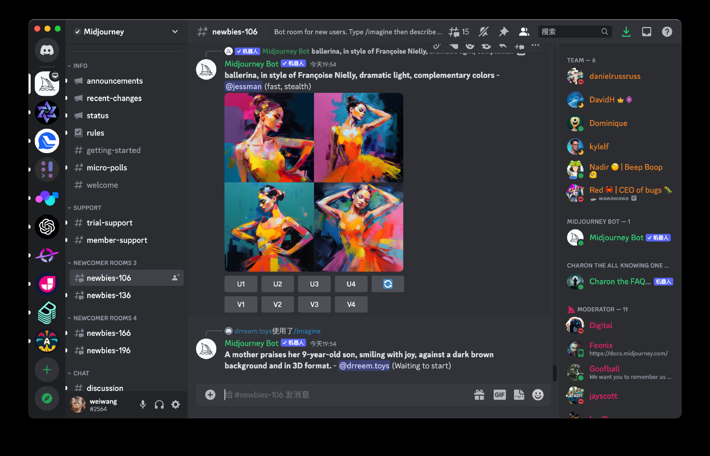

在进入所选频道后，便能够开始生成图片了。在输入框中 /imagine，并按下回车，在 prompt里输入自己的题词，例如：A full moon in the night sky，稍等片刻后，Midjourney 的机器人将会回复一条图片消息，也就是生成的图片。

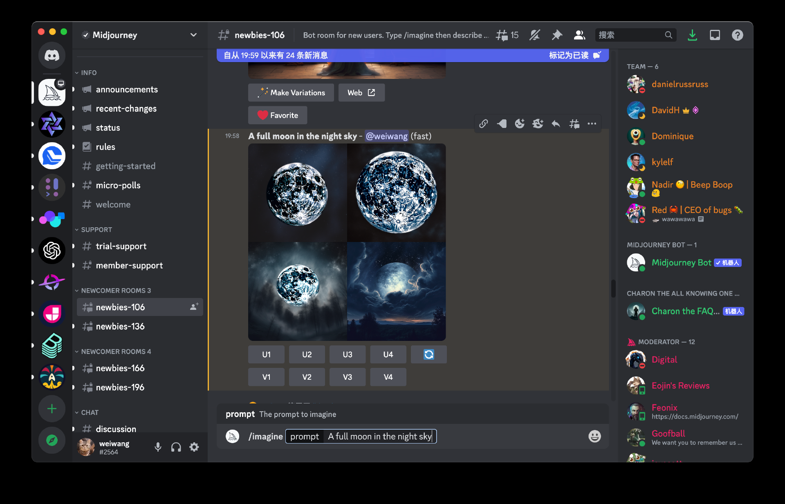

需要注意的是，由于该频道是公共频道，所以你可以看到不断有用户发送 Prompt 以及Midjourney 生成的图片消息。

在生成的图片下方，有两排按钮，分别是以 U 和 V 开头的按钮，按钮的编号代表图片的序号。U 代表的含义是放大某张图片，并添加更多细节。V 代表的含义是根据所选图片风格进行变换，并生成新的图片。此外，如果你对生成的图片不满意，你还可以点击图片下方的刷新按钮来重新生成图片。

例如，我对第四张图片比较满意，那么可以点击 U4 按钮来让 Midjourney 生成高清的图片，如图所示。

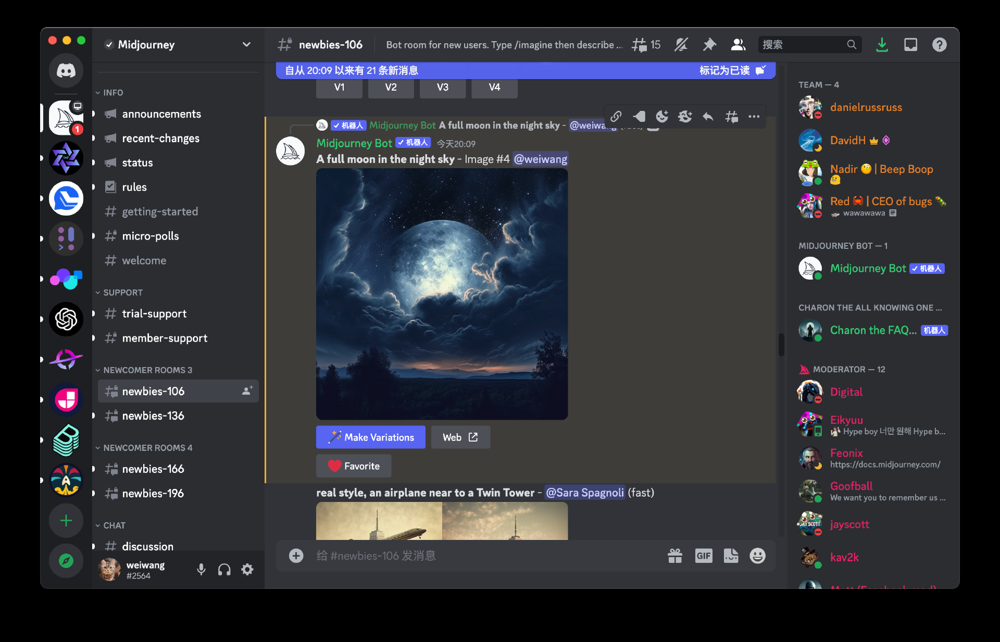

你可以点击图片消息下方的“Web”按钮在浏览器中打开图片。此外，“Make Variations”按钮还能基于当前图片的风格再进行创作，并重新生成 4 张类似风格的图片，如下图所示。

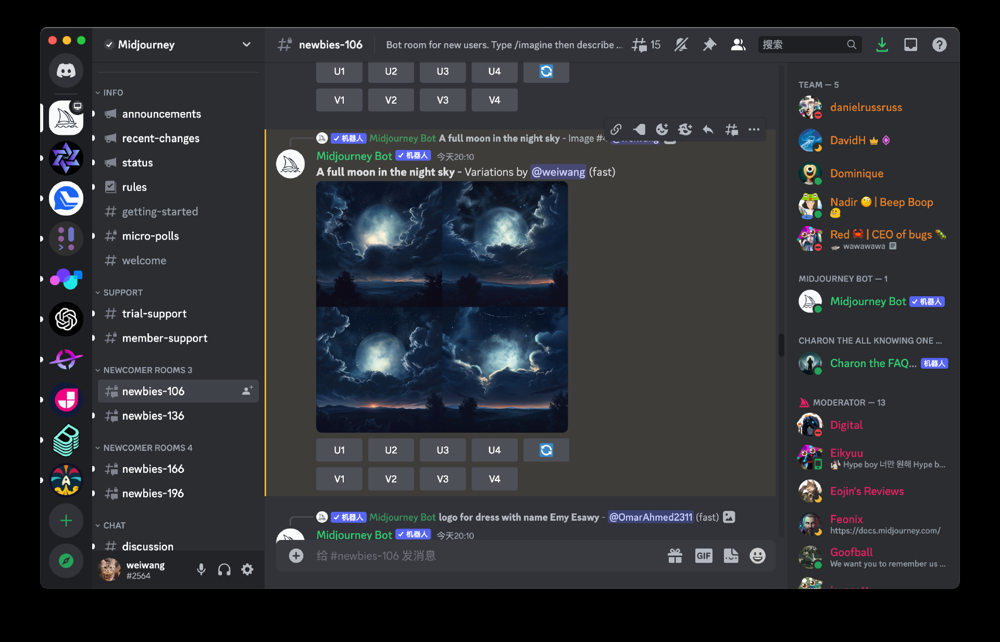

以上就是 Midjourney 的最初级的用法。

## 进阶：Midjourney 控制参数

由于创作本身是一项艺术行为，他既有随机的部分，又有主观的部分。所以，在生成图片时，Midjourney 提供了许多参数来控制图片生成结果。

### 图片长宽比

Midjourney 默认生成的图片长宽比是 1:1，在公众号首图、文章配图和视频制作的图片场景下可能并不适用。此时，就需要使用 --ar 参数来设置图片的长宽比。

例如，你可以在 Prompt 里加入 --ar 4:3 或 --ar 16:9 来生成符合尺寸的图片，例如：/imagineprompt:A full moon in the night sky --ar 16:9，生成结果如下图所示。

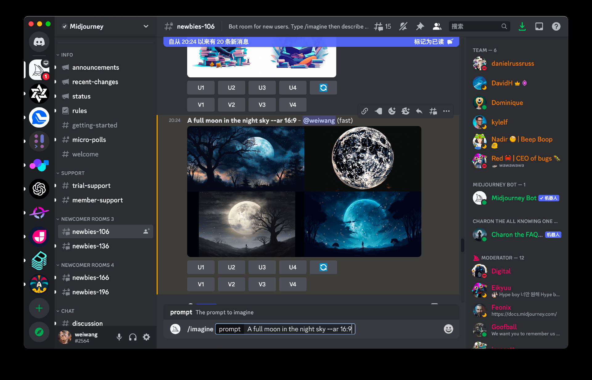

### 图片细节质量

在尝试初次创作时，为了找到我们想要的图片风格，我们往往会希望 Midjourney 更快速地产生结果。此时，你可以通过 --q 参数来控制图片的细节质量，并减少图片细节来加速生成过程，例如：/imagine prompt:A full moon in the night sky --ar 16:9 --q 0.5，生成结果如下图所示。

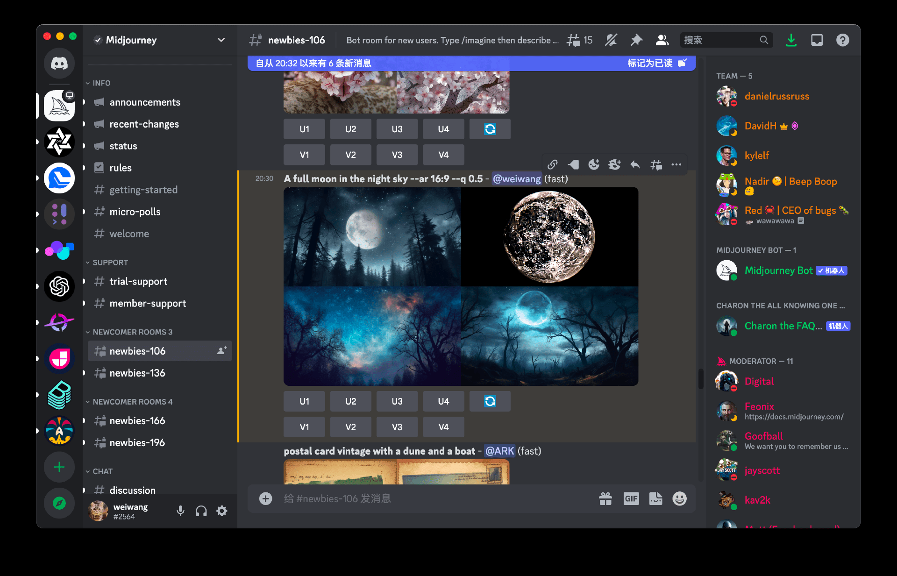

相比较默认 1 的质量值，0.5 的质量值在图片细节上省略了许多，所以在生成时间上也更快了，这可以加速我们基于图片结果进行二次创作。

### 提前停止任务

由于 Midjourney 生成图片的结果是渐进式的，在最开始，它会生成模糊且缺失细节的图片，然后一步一步进行清晰化和增强，最终生成完整的结果。

使用 --stop 参数能够让图片生成任务在特定的进度下停止，默认值为 100。当值低于 100时，也能够进一步提升图片生成的速度。你可以使用 Prompt：/imagine prompt:A full moon inthe night sky --ar 16:9 --stop 0-100 来控制提前停止任务。

例如，以下是 Prompt /imagine prompt:A full moon in the night sky --ar 16:9 --stop 10 和/imagine prompt:A full moon in the night sky --ar 16:9 --stop 80 两条指令生成的图片差异，如下图所示。

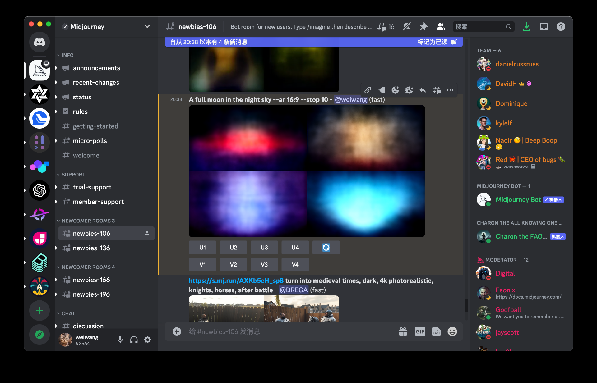

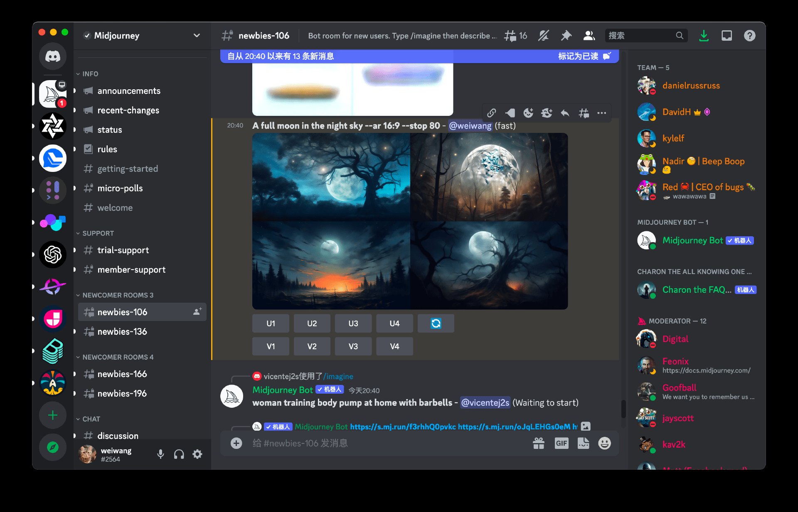

### 图片风格

Midjourney 生成的图片有其独特的风格，他具有对题词的服从性和创造性，你可以用 --s 参数来控制 Midjourney 生成图片的风格，控制它生成结果更接近题词或者更具有创造性。默认该值为 100，该值范围可以是 0-1000，值越大，创造性越好，但也会与题词更不相符。

例如，以下两张图片是 --s 参数分别为 100 和 1000 时的差异对比，Prompt 为 /imagineprompt:A full moon in the night sky --ar 16:9 --s 100 或 1000。

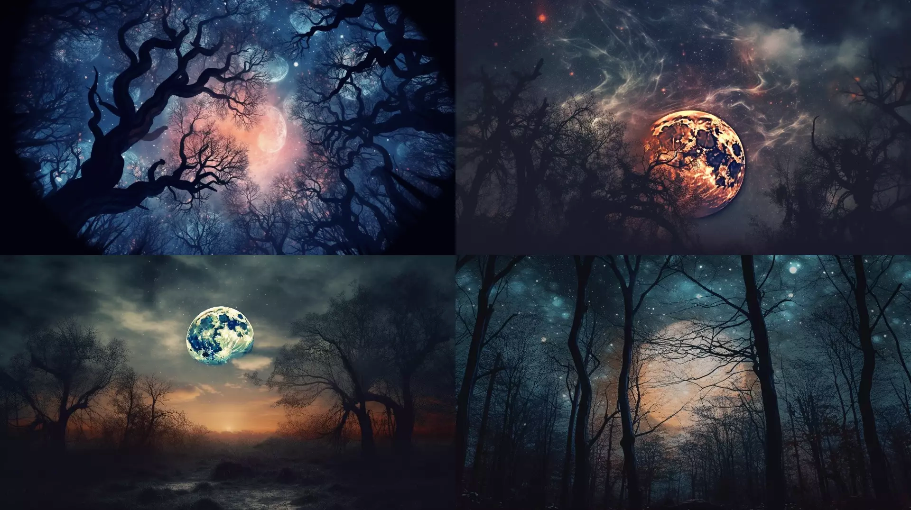

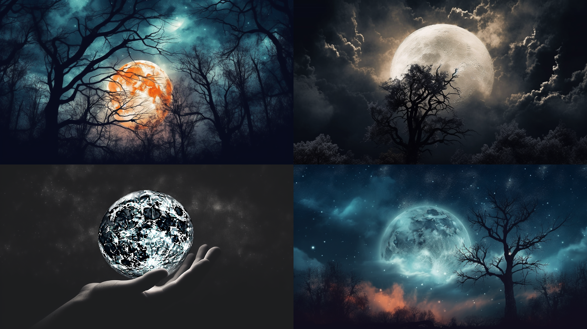

### 生成固定元素重复的图片

在生成壁纸或者无缝的图片场景下，通常我们希望能够对某一个元素进行重复和复制，并生成无缝隙的图片，有点类似于 CSS 中的 background-repeat，你可以通过 --tile 参数来实现。

例如，下图是 Prompt：/imagine prompt:A full moon in the night sky --ar 16:9 --tile 生成的结果。

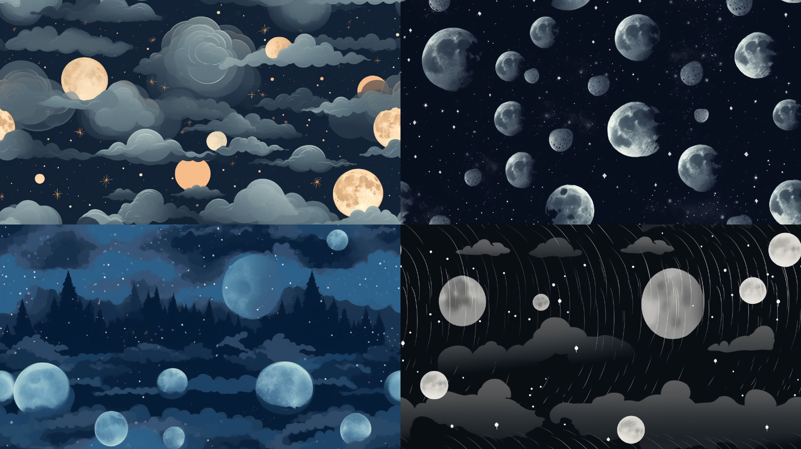

### 图像的多样性

图片多样性可以控制生成的结果是否具有更可靠和可重复的特性，它可以通过 --c 参数来控制，值的范围是 0-100，默认为 0 ，这意味着在默认情况下，Midjourney 倾向于生成可重复的图片结果。

例如，以下是 Prompt：/imagine prompt:A full moon in the night sky --ar 16:9 --c 100 生成的结果。

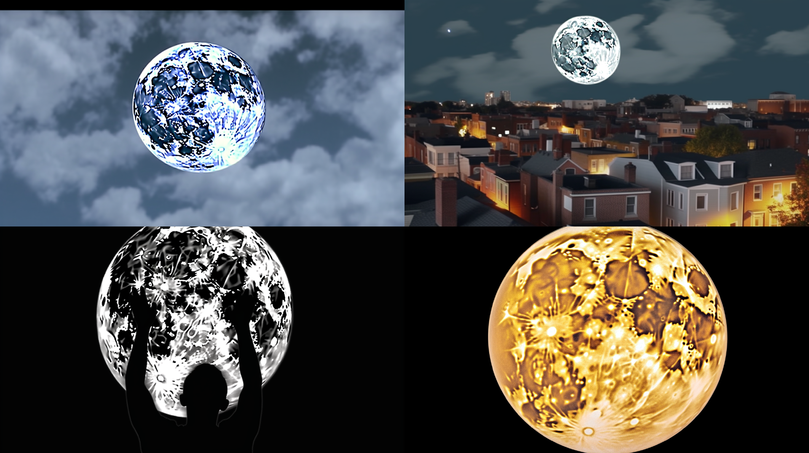

### 在生成的图片上增加新的元素

在 Midjourney 生成图片时，会在内部使用一个随机种子作为生成图片的基础。这意味着，每次提词生成的图片都是有差异的。在故事性的视频场景下，我们通常希望在 Midjourney 生成结果的基础上再增加一些新的元素，这时候就可以使用种子来实现。

首先，我们通过 Prompt 来生成图片：/imagine prompt:A snowy mountain and stars in thesky --ar 16:9，并在生成的图片下方选择其中的一张图片对其进行放大（U 按钮），得到结果。

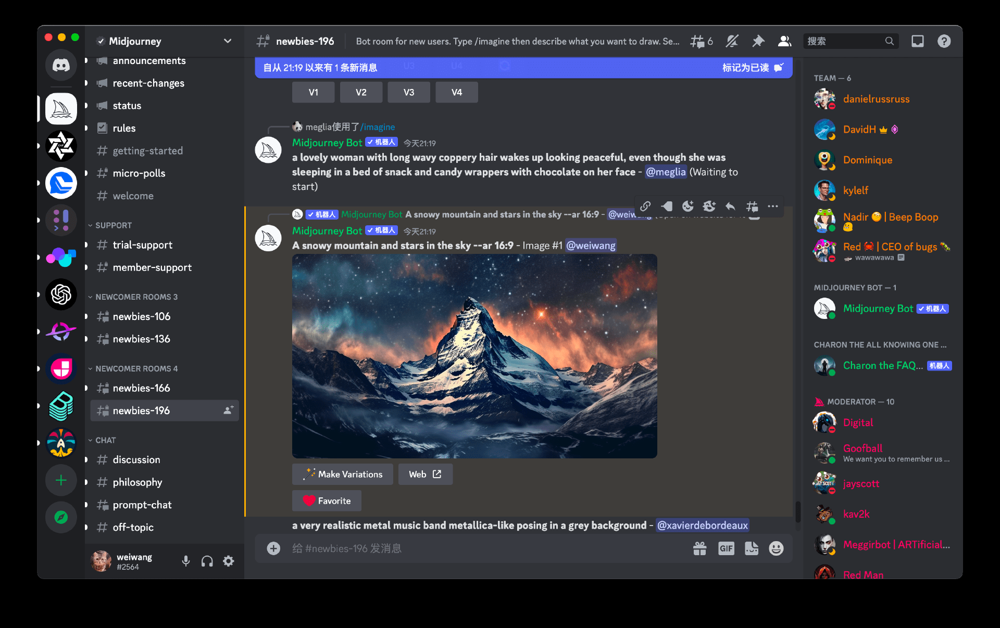

要获取该图片的种子参数，你需要在消息的右上角点击“添加反应”按钮，选择“信封”图标来获取。

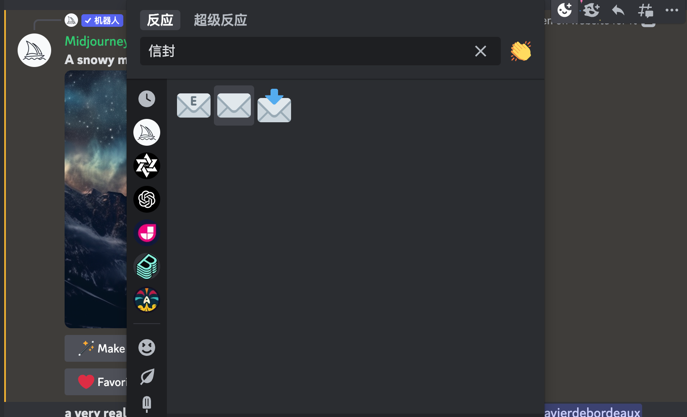

此时，Midjourney 将会向你发送一条私信，包含该图片的种子参数。

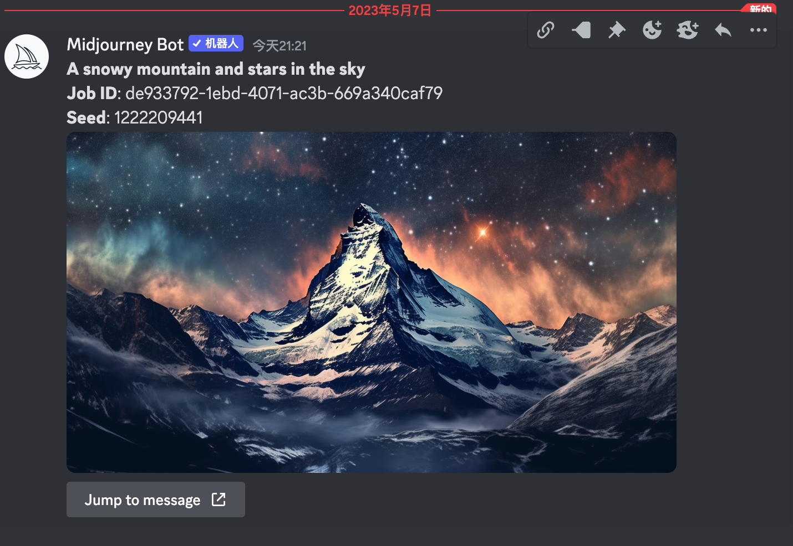

接下来，要基于该图添加新的元素，只需要使用 --samesed 参数即可，新的 Prompt为：/imagine prompt:A snowy mountain and stars in the sky, and sky with a spaceship --ar16:9 --seed 1222209441

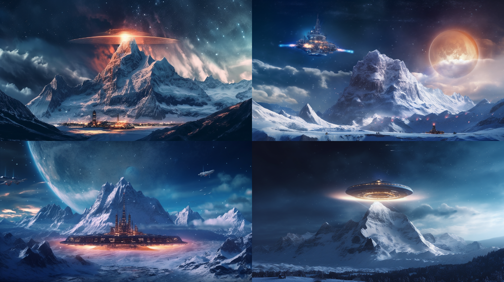

从生成结果可以看出，新图片的风格和内容与原图有较大的相似性，并增加了新的元素。

此外，在 Prompt 不变的情况下，当使用相同的 seed 值时，将生成与原结果一致的图片。

## 高级用法

除了使用参数来控制图片输出外，还有其他的一些技巧能够实现对图像输出的控制。

### 元素权重

元素权重是用来告诉 Midjourney 图像中那部分内容是需要突出的重点内容。例如，Prompt:/imagine prompt:A man and a beer --ar 16:9 将生成以下图片。

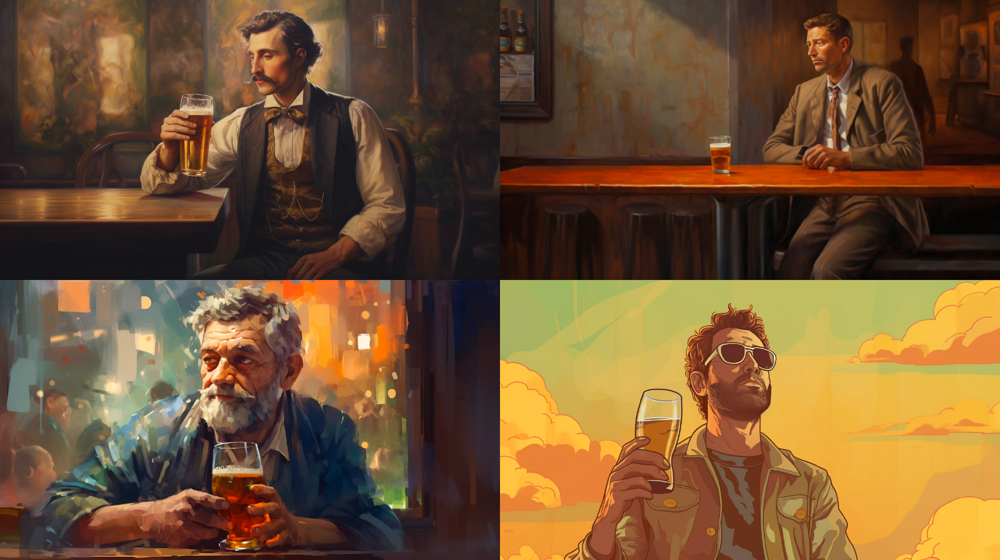

接下来，我们尝试使用权重，例如，我们希望更突出 beer 而弱化 man，那么 Prompt 可以修改为：/imagine prompt:[a man]::1 and [a beer]::5 --ar 16:9，生成的图片如下所示。

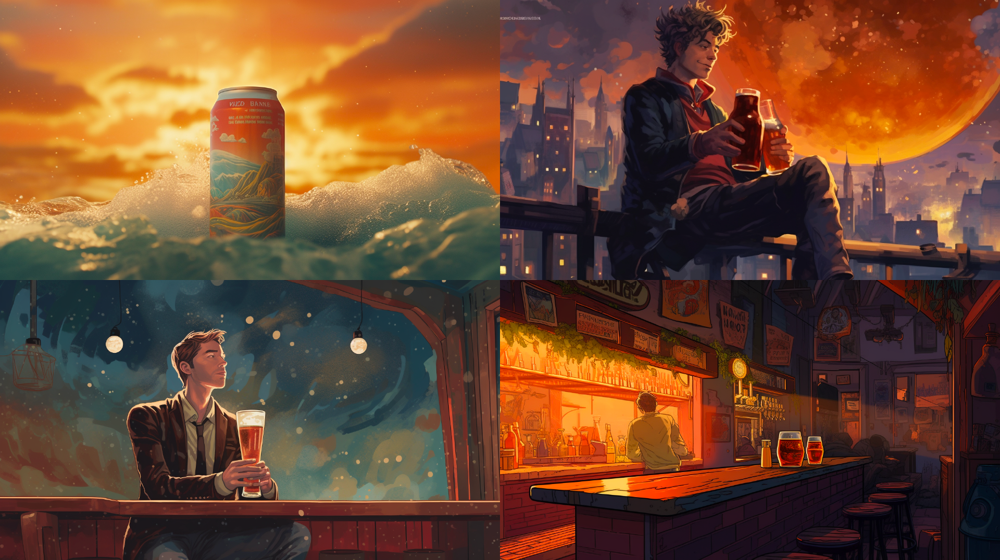

此外，你还可以使用负权重来弱化某一元素。

### 删除元素

要删除图像中的元素，你可以使用 --no 参数来实现。例如，删除图像中红色的部分，Prompt可以是：/imagine prompt:[a man]::1 and [a beer]::5 --no red --ar 16:9，生成的图像如下所示。

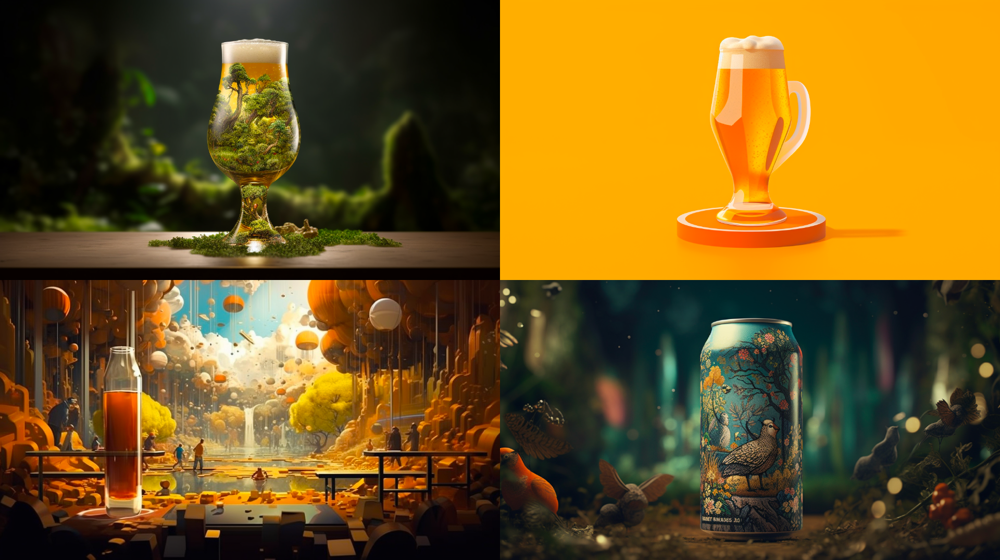

### 风格偏好

随着我们对 Midjourney 使用越来越深，我们往往会有自己喜好的照片风格。例如，在生成人物图像时候，我们可以增加相机或拍摄的参数，使得 Midjourney 生成的图片就像是自己拍摄出来的。

例如，在生成图片时，可以在 Prompt 使用以下关键字。

1. 图像质量：8K, HD, high detail, ultra high definition, wide-shot

2. 相机：Canon EOS R6 Mark II Mirrorless

3. 光圈、快门和 ISO 参数：f/8, ISO 100, 1/250 second, 85mm lens

4. 照明：cinematic light/cinema lighting（电影光）、natural lighting（自然光）和 studiolighting（工作室照明）效果

5. 景深：bokeh

6. 特定风格：Manga（日本动漫）、Classicism（古典）、Diagram（图表）等

比如，在生成人像图片时，使用以下 Prompt：/imagine prompt:Asian girls with fair skinphotographed on the street, 8K, HD, high detail, ultra high definition, Photography::4 well-lit,sharp-focus, high-quality, unique, award-winning, Canon EOS R6 Mark II Mirrorless, f/8, ISO100, 1/250 second, close-up, natural light, professional, flattering, headshot::3 grainy,deformed, watermark::-2 --ar 16:9 生成的图像如下。

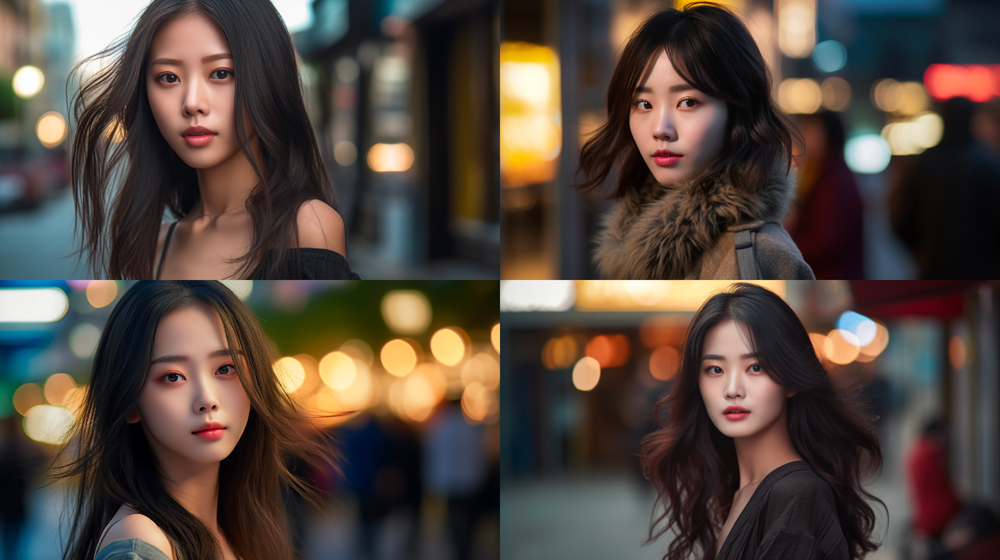

此外，在生成商业宣传拍摄照片时，使用以下 Prompt：/imagine prompt:Food photography,washing strawberries and blackberries and grapes, in a luxurious Michelin kitchen style,studio lighting, bokeh, ultra detailed, 8K --ar 16:9 生成的图像如下。

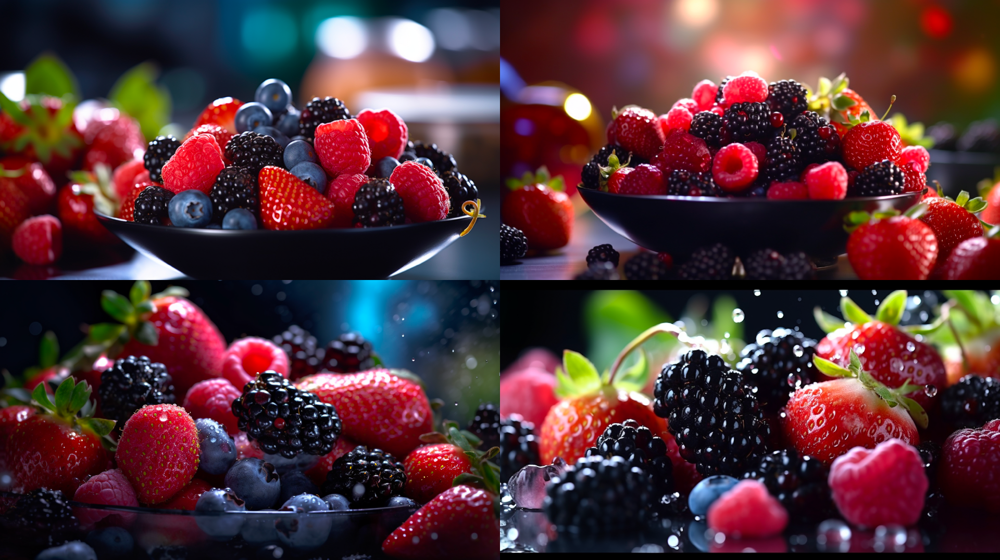

在生成风景类图像时，以下 Prompt：/imagine prompt:Lake Seealpsee in Switzerland,surrounded by plants and colorful flowers, beautiful summer day, depth of field, highlydetailed, highly contrast, Lomography ISO 100, 8K, HD, high detail --ar 30:1 生成的图像如下。

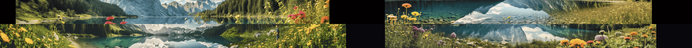

### 风格参数化

以生成人像图片为例子，当我们想要特定风格的图像时，往往会需要手动在 Prompt 中加入一长串的关键字。Midjourney 可以将这些关键字配置成选项参数，这样每次在生成相同风格的图像时，只需要在 Prompt 后面带上参数即可。

在输入框中输入 /prefer option set 搜索命令，点击弹框中的选项，如下图所示。

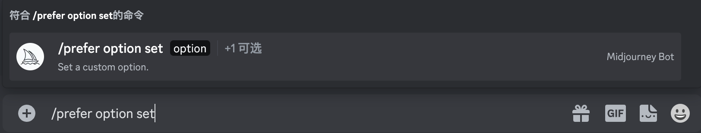

/prefer option set 命令接收两个参数，一个是参数的名称，例如输入 Portrait，代表生成人像图片的选项，如下图所示。

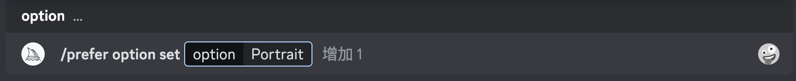

然后，按下 tab 按钮两次，直到出现 values 设置框，并将以下内容复制到 values 输入框中。

```
8K, HD, high detail, ultra high definition, Photography::4 well-lit, sharp-focus,
```

如下图所示。

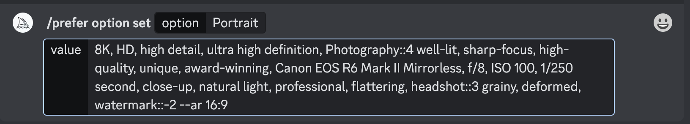

按下回车后，设置参数成功，如下图所示。

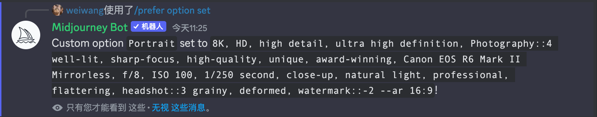

接下来，再次生成相同风格的照片时，便能够直接参数，使用以下 Prompt：/imagineprompt:The girl taking a selfie under the Paris Tower, dressed in casual fashion withsophisticated makeup. --Portrait 便能够自动在后面追加参数值。

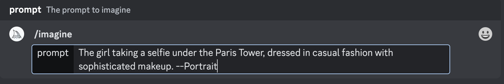

生成的照片如下图所示。

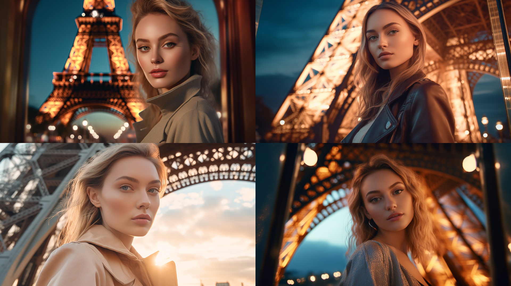

这节课到这里也就结束了，我们从 Midjourney 的参数和 Prompt 的角度介绍了一些常规和高级用法。总结来说，Midjourney 的 AI 图像生成能力取决于我们给的 Prompt，在这点上和ChatGPT 非常类似，Prompt 的质量决定了图像的生成质量。

最后，如果你想进一步深入了解 Midjourney ，可以参考这两个资源链接：MidjourneyPrompt，以及Prompt 和风格指南。当然也期待你在留言区分享一下你关于 Midjourney 或者其他 AI 工具的使用心得，我们一起交流进步。
