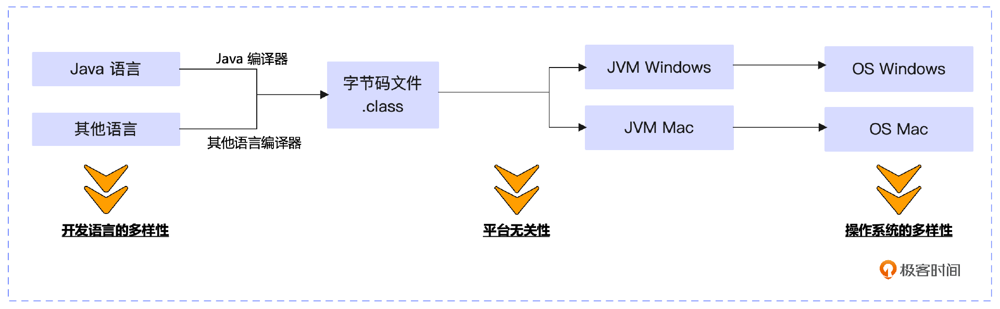
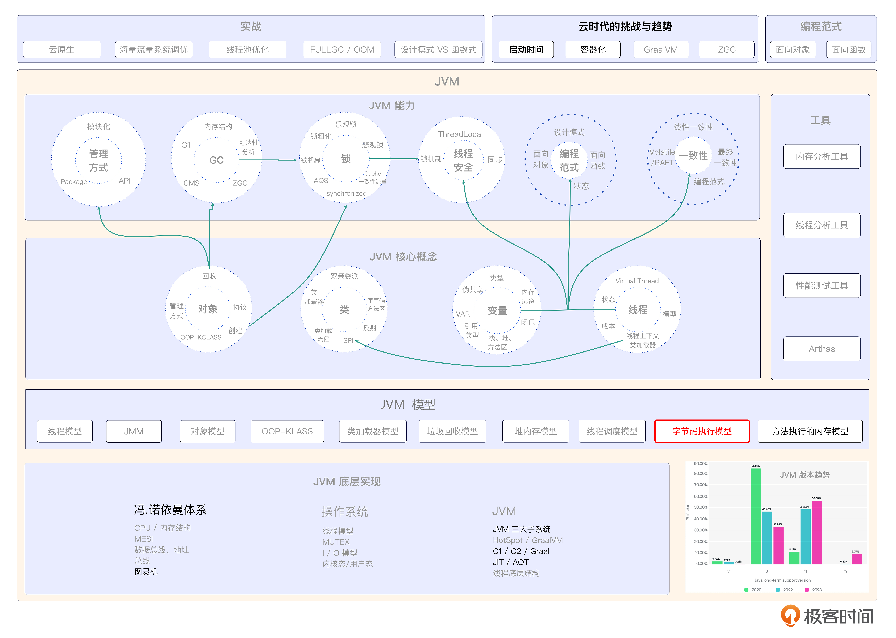

# 05 | 机器与语言：JVM中的字节码

你好，我是康杨。今天我们来聊聊 JVM 的语言——字节码。

在前面的介绍中，我们提到过 Java 语言的平台无关性，这也是 Java 能够快速崛起的原因之一。我们只需要用 Java 语言完成业务逻辑的开发，JVM 就会帮助我们完成在物理服务器上的运行，而不用去关心底层硬件平台的差异性，能够达成这种效果的关键角色就是字节码。

借助字节码，JVM 屏蔽了上层编程语言（Java、Scala ）和下层硬件平台的多样性。而 JVM被认为是字节码的运行时。



## 字节码是什么?

Java 源代码经过编译器编译后，就会生成 JVM 字节码，它是 Java 程序在 JVM 上执行的中间表示形式。JVM 字节码是一种基于栈的指令集架构（Stack-based Instruction SetArchitecture）。每个字节码指令都会在 JVM 上执行一系列的操作，如加载、存储、运算、跳转等。

它使用基于操作数栈和局部变量表的执行模型。具有以下特点：

- 独立于具体的硬件和操作系统，不同平台上的 JVM 可以解释和执行相同的字节码文件。

- 相对于机器码和源代码，JVM 字节码是一种更高级别的抽象，并且比机器码更容易阅读和编写（理解）。

- JVM 字节码通过运行时的即时编译器或解释器执行。

JVM 字节码使 Java 语言具备了跨平台的能力，只需编写一次 Java 程序，然后在不同平台上安装相应的 JVM，就能在这些平台上运行相同的字节码。这种特性为 Java 程序提供了很高的可移植性和兼容性。值得注意的是，其他编程语言也可以编译成 JVM 字节码，利用 JVM 的优势。这些编程语言叫做基于 JVM 的语言，例如 Kotlin、Groovy 等。

这些语言的代码编译后也会生成和 Java 程序相同的 JVM 字节码。

## 获取字节码

接下来，让我们看一下字节码到底长什么样。我们先编写一个简单的 Java 类作为示例，创建

```java
一个名为 HelloWorld 的 Java 文件，将以下代码添加到文件里。
public class HelloWorld {
   public static void main(String[] args) {
       System.out.println("Hello, World!");
   }
}
```

接下来，编译 Java 源代码。使用 Java 编译器把 Java 源代码编译成字节码文件。在命令行中

```
执行 javac HelloWorld.java 命令，会生成一个名叫 HelloWorld.class 的字节码文件。
```

## 查看字节码文件

```java
我们使用 Java 反编译工具，如 javap，来查看字节码文件的内容。在命令行中执行 javap
-c HelloWorld 命令，会显示 HelloWorld 类的字节码内容，包括方法和指令。
public class HelloWorld {
 public HelloWorld();  // 构造函数
   Code:
      0: aload_0      // 将局部变量表中的this加载到操作数栈上
      1: invokespecial #1 // 调用java/lang/Object类的构造函数
      4: return        // 返回
 public static void main(java.lang.String[]);  // 主方法
   Code:
      0: getstatic     #2 // 获取java/lang/System.out的静态字段
      3: ldc           #3 // 加载字符串"Hello, World!"到操作数栈上
      5: invokevirtual #4 // 调用java/io/PrintStream类的println方法
      8: return        // 返回
}
在上述示例中，你可以看到 HelloWorld 类的构造函数和 main 方法的字节码。每个方法都
以 Code: 开头，后面就是一系列的指令。
```

## 字节码指令集

这些字节码指令都会在 JVM 上执行一系列的操作，如加载、存储、运算、跳转等。下面我们就一一来看下这些指令。

### 栈操作指令

操作数栈是 JVM 中的一个临时数据存储区域，用来存储局部变量和中间计算结果。栈操作指令主要负责操作这个操作数栈，包括 push、pop、swap、dup 等。

不过为了提高代码的性能，我们应该尽量减少对栈的操作，因为每次压入或弹出栈帧都需要消耗一定的时间和空间。而且在编写字节码的时候，要确保操作数栈的深度没有超过类文件的最大栈深度，否则将会抛出 StackOverflowError 异常，这个异常表示操作数栈溢出。

### 加载和存储指令

加载和存储指令用来在操作数栈和局部变量表之间传递数据。加载指令把数据从局部变量表加载到操作数栈，而存储指令则将操作数栈顶的数据存储到局部变量表。

在操作局部变量的时候，尽量使用索引为 0～3 的变量，这样可以使用更紧凑的字节码指令，如 iload_0、iload_1 等。

### 数学指令

数学指令主要用于执行基本的算术运算，加、减、乘、除、模等，可以根据操作数的类型，比如 int、long、float、double 等，选择相应的数学指令，避免在循环中进行重复计算，尽量把计算结果缓存起来以提高性能。

### 类型转换指令

类型转换指令用来把一种数值类型转换成另一种类型。比如，使用 i2f 指令把 int 类型转换成float 类型。只在确实需要的时候执行类型转换，并尽量减少不必要的类型转换操作，以避免性能损失。

### 对象和数组操作指令

对象和数组操作指令涉及对象和数组的创建、访问和更新。这些指令包括 new、getfield、putfield、getstatic、putstatic 等。 编写代码的时候要遵守封装原则，保护对象的状态和行为，避免直接访问对象的成员变量。使用数组时，确保数组索引在有效范围内，以避免数组访问异常。

### 控制转移指令

控制转移指令用于更改程序的执行顺序。根据不同的条件，可以选择相应的指令，例如 ifeq、ifgt、goto、tableswitch 等。 在条件分支较多的情况下，尽量使用 tableswitch 或lookupswitch 指令。使用简洁的控制语句，减少嵌套的深度。

### 方法调用和返回指令

方法调用和返回指令处理方法的调用和返回过程。这些指令包括 invokevirtual、invokespecial、invokestatic、invokeinterface、invokedynamic、return 等。减少没有意义的方法调用，例如不必要的 getter 和 setter。对于已知目标方法的调用，尽量使用 invokevirtual和 invokestatic，而不是 invokeinterface。

### 异常处理指令

异常处理指令用来创建、抛出和处理异常。这些指令包括 athrow、catch 等。 尽量减少异常抛出，通过合理的检查和处理避免异常出现。对于已知的异常情况，尽量使用正常的控制流程进行处理，而不是依赖异常。

## 字节码是如何执行的？

在 Java 开发中，理解 JVM 如何执行字节码对于性能优化、问题排查具有重要意义。下面我将通过一个包含乘法和除法运算的简单 Java 程序，深入解析 JVM 是如何执行字节码的，还有字节码运算的最佳实践、需要注意的点、可以优化的点，以及在现实环境中的应用实例。

示例代码如下：

```java
public class Calculator {
   public static void main(String[] args) {
       int a = 6;
       int b = 2;
       int multiply = a * b;
       int divide = a / b;
       System.out.println("The result of multiplication is: " + multiply);
       System.out.println("The result of division is: " + divide);
   }
}
```

在这段示例代码中，我定义了两个整型变量 a 和 b，进行了一次乘法运算和一次除法运算，然后输出了结果。接下来我们详细了解一下 JVM 是怎么执行乘法和除法运算的字节码的。

```java
首先，使用 javap -c Calculator 命令获取字节码。
public static void main(java.lang.String[]);
   Code:
      0: bipush        6
      2: istore_1
      3: iconst_2
      4: istore_2
      5: iload_1
      6: iload_2
      7: imul
      8: istore_3
      9: iload_1
     10: iload_2
     11: idiv
     12: istore 4
     14: getstatic     #2
     17: new           #3
     20: dup
     21: invokespecial #4
     24: ldc           #5
     26: invokevirtual #6
     29: invokevirtual #7
     32: return
```

我们来解析一下这些字节码。

```
0、2：bipush 6 和 iconst_2，把常数 6 和 2 分别压入操作数栈， istore_1 和
istore_2 把这两个常数存储到本地变量表对应的索引位置 1 和 2 里，相当于执行代码
int a = 6; int b = 2。
5、6、7： iload_1 和 iload_2 将本地变量表中的变量 a 和 b 加载到操作数栈，imul
操作符执行栈顶两个元素的乘法，istore_3 将乘法结果存储到本地变量表索引 3 的位
置，相当于执行代码 int multiply = a * b。
9、10、11：与乘法操作类似，执行除法后，用 istore 4 将结果存储到本地变量表索引
4 位置，相当于执行代码 int divide = a / b。
```

- 14-32：获取可打印输出的对象，输出乘除运算结果。

### 需要注意的点

写 Java 代码的时候要避免用大数做除法，比如 Integer 自动拆装箱导致的 NPE 问题，在进行除法运算时务必做除数为 0 的判断。

### 优化点

```
采用乘以反数的方式替代除法计算可以提高运算效率，例如 a / 2 可以优化为 a * 0.5。
```

我们对于 Java 代码需要有深度的理解，更好地利用 JVM 字节码能够帮助我们快速排查问题，优化程序的性能。像 Spring、MyBatis 等框架底层也大量使用字节码生成技术来提高代码执行效率。

## 如何优化字节码？

假设我们需要操作一个大的字符串数组，可能会使用下面的模式。

```java
public class StringProcessor {
   public static void main(String[] args) {
       String[] words = {"big str" ,"big str "} ; //大字符串数组
       for (String word : words) {
           if (word != null && !word.isEmpty()) {
               System.out.println(word.toUpperCase());
           }
       }
   }
}
```

这种写法的问题在于当数组非常大，而且元素有很多为空或为空串的时候，可能会有性能问题。原因是它仍需要遍历每个单词，检查是否为空或空字符串，这是不必要的，我们可以通过JVM 字节码动态生成一个新的字符串数组，把空的和空字符串剔除再进行操作。

```java
import java.lang.reflect.*;
import java.util.*;
import java.util.stream.Collectors;
import java.util.stream.Stream;
public class OptimizedStringProcessor {
   public static void main(String[] args) {
       List<String> words = Stream.of("big str").collect(Collectors.toList()); /
               List<String> filteredWords = (List<String>) Proxy.newProxyInstanc
                   if (method.getName().equals("get")) {
                       String word = (String) method.invoke(words, methodArgs);
                       if (word == null || word.isEmpty()) {
                           return null;
                       } else {
                           return word.toUpperCase();
                       }
                   } else {
                       return method.invoke(words, methodArgs);
                   }
               });
       for (String word : filteredWords) {
           if (word != null) {
               System.out.println(word);
           }
       }
   }
}
```

使用这种方式，原始的字符串数组会先经过动态代理的处理，也就是利用动态代理生成类的字节码，重新定义获取元素的方法，剔除空元素，将非空元素转为大写，大大提升了性能，还能使代码更加整洁。在实际项目中，特别是大数据处理场景，了解并恰当应用字节码技术可以带来巨大的性能优势。

## 重点回顾

JVM 字节码是 JVM 可直接执行的机器码形式，它是 Java 源码编译而来的，其实就是一个字节序列。因为它屏蔽了上层编程语言和下层硬件平台的差异性，所以 Java 语言借助它拥有了跨平台的能力。此外它使用操作数栈和局部变量表的执行模型，使 Java 具有了很高的可移植性和兼容性。除了 Java，其他基于 JVM 的语言也可以编译为 JVM 字节码。

了解并恰当应用字节码技术可以优化性能，提升代码的简洁性。最佳实践包括减少栈操作、合理使用加载和存储指令、避免重复计算、减少类型转换、封装原则、控制转移的简洁性、减少不必要的方法调用和异常处理。在实际项目中，了解 JVM 如何执行字节码对于性能优化和问题排查具有重要意义。

## 思考题

如何利用字节码进行程序优化？请把你的想法分享到评论区，也欢迎你把这节课的内容分享给其他朋友，我们下节课再见！

## 点亮你的知识框架图


