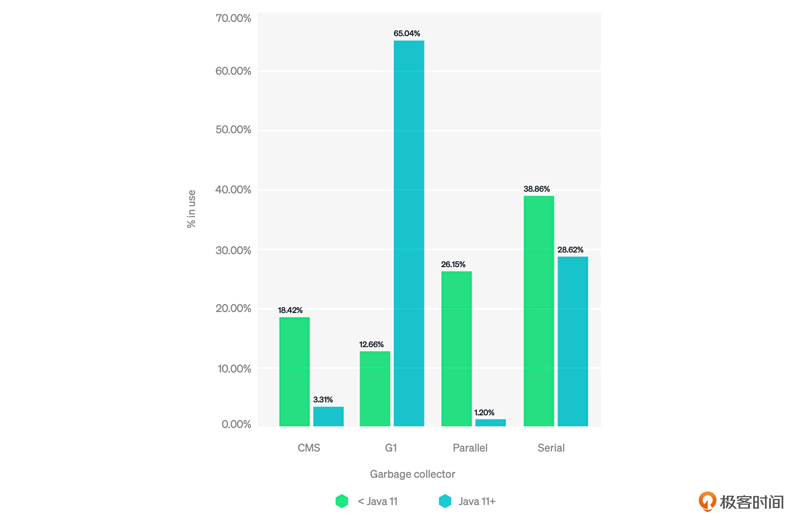
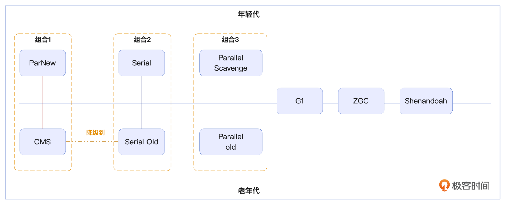
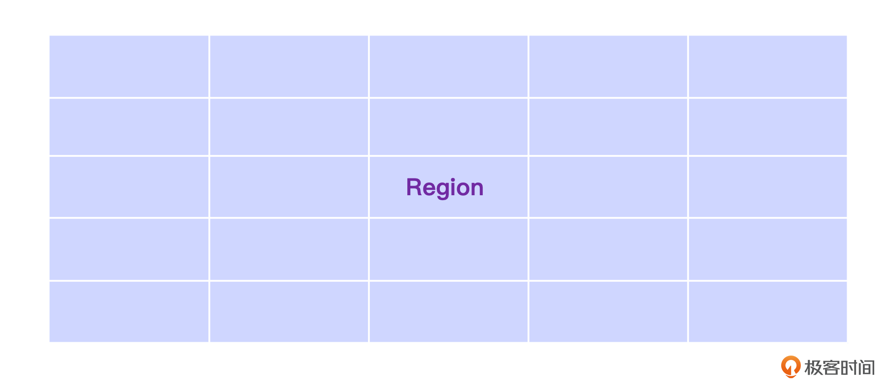
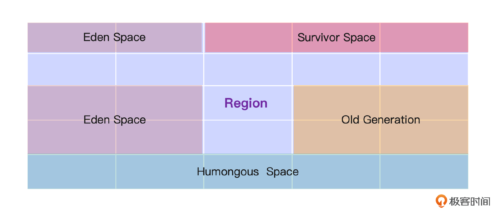
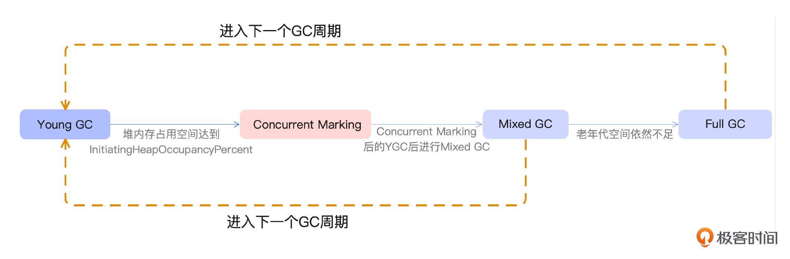
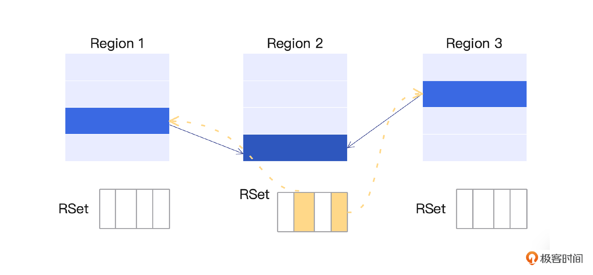
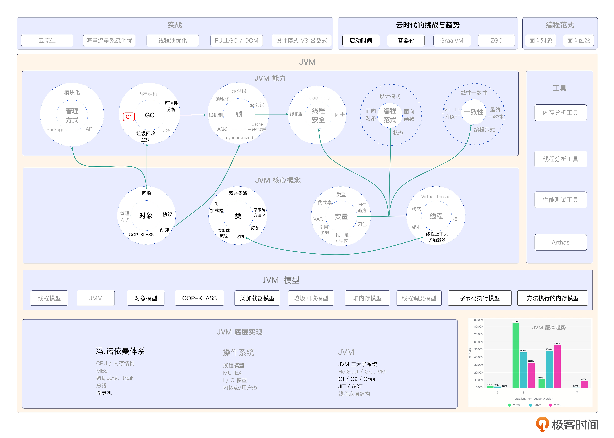

# 15 | 垃圾回收器：为什么G1被叫做GC中的王者？

你好，我是康杨。

今天我们继续聊 GC 的话题。我们将选择一个具体的垃圾回收器进行深入的分析，这个选定的主角就是 G1，也被称为 Garbage First。

## 为什么选择 G1？

在当前的生产环境中，JDK 8 仍是被广泛采用的版本，在 JDK 8 时代，CMS 和 G1 这两种垃圾回收器不分伯仲，在不同业务场景中，各有优劣。而造成这种现象的原因是我们正处在一个时代的转型期，也就是从物理机到虚拟机再到云时代的转型期，目前正是多代并存的历史节点，也就是在实际生产环境中既有使用传统的物理服务器的业务，也有使用虚拟机的业务，更有已经大规模迁移到云平台的业务。

底层基础设施变迁，对我们如何使用 JVM 也在产生着潜移默化的影响。而 New Relic 最新发布的 2023 年的报告给我们指明了一个方向。



报告中指出在 JDK 11 及以上的版本中，G1 一骑绝尘，使用率占比达到 65% 。所以在这个CMS 垃圾收集器逐步淡出历史舞台，而 ZGC 还未完全成熟的阶段，G1 垃圾收器注定将在未来的一段时间内扛起主流垃圾收集器的大旗，成为兼顾延迟与吞吐的最佳选择。而现实中，在JDK 11 逐渐登上历史舞台的背景下，越来越多的系统，通过升级到 G1 以实现性能的提升。这也是我们今天选择 G1 作为介绍对象的原因。

## G1 是什么？

G1 有很多里程碑式的创新，下图是一个缩减版的垃圾收集器全景图。



从图中可以看出，G1 之前每个垃圾收集器一般只是负责新生代或老年代的垃圾回收，然后通过组合的方式来完成 GC 的整体职责。而 G1 是第一个同时支持年轻代和老年代垃圾回收的垃圾回收器。在此之后，其他的垃圾回收器也遵循了这样的发展路线。

## G1 垃圾回收算法

### G1 内存划分

区别于其他采用分代收集算法的垃圾回收器，G1 中的年轻代、老年代是一种逻辑划分，而不再是物理划分，也就是说年轻代和老年代不再是连续的内存地址空间，而是一组 Region 的集

```
合。这里的 Region 是 G1 中最小内存分配单元，你可以通过 -XX:G1HeapRegionSize=n
```

来设置 Region 的大小，可以设定为 1M、2M、4M、8M、16M、32M。

需要注意的是，JVM 中规定 Region 的大小必须是 2 的整数幂，并且不能超过 32M。如下图所示，当你采用 G1 作为垃圾收集器时，JVM 会将堆内存划分为一个个大小相同的 Region 进行管理。所以合理设置 Region 的大小，是用好 G1 的一个非常重要的因素。



### 垃圾回收算法

G1 采用的是分代收集和区域（Region）划分相结合的垃圾回收算法。在最小的物理内存单元是 Region 的基础上，依据分代收集算法，G1 将堆内存在逻辑层面划分为 4 个区域，分别是Eden Space、Survivor Space、Old Generation 以及 Humongous Space。Eden Space 与Survivor Space 的组合，就是我们通常说的年轻代，而 Humongous Space 是 G1 专门提出来的一个区域，用于专门存储程序中的大对象。

一个对象的大小如果超过了 Region 容量的一半，就会被直接存放至 Humongous 区域。当对象的大小远超 Region 大小的时候，JVM 会分配连续的 Humongous Region 用来存放这个对象。



- G1的内部布局图

### GC 模式

基于上面提到的内存划分和垃圾回收算法，在 G1 中存在三种 GC 模式，分别是 Young GC、Mixed GC 和 Full GC。



- 三者之间的关系

和所有采用分代收集算法的垃圾回收器一样，当 Eden 区的内存空间无法支持新对象的内存分配时，G1 会触发 Young GC。

```
当需要分配对象到 Humongous 区域或者堆内存的空间占比超过 -
XX:G1HeapWastePercent 设置的 InitiatingHeapOccupancyPercent 值时，G1 会
```

触发一次 concurrent marking，它的作用就是计算老年代中有多少空间需要被回收，当发现垃

```
圾的占比达到 -XX:G1HeapWastePercent 中所设置的 G1HeapWastePercent 比例时，在
```

下次 Young GC 后会触发一次 Mixed GC。所谓 Mixed GC 是指回收年轻代的 Region 以及一部分老年代中的 Region。

在 Mixed GC 过程中，如果发现老年代空间还是不足，此时如果 G1HeapWastePercent 设定

```
过低，可能引发 Full GC。-XX:G1HeapWastePercent 默认是 5，意味着只有 5% 的堆是
```

“浪费”的。如果浪费的堆的百分比大于 G1HeapWastePercent，则运行 Full GC。Full GC 是在日常生产中需要格外关注的情况，因为它不仅会影响用户体验，更有可能引发雪崩。课程最后一章我也为你详细讲解怎么避免 Full GC 的发生。

### 预期停顿模型

在以 Region 为最小管理单元以及所采用的 GC 模式的基础上，G1 建立了停顿预测模型，即

```
Pause Prediction Model 。这也是 G1 非常被人所称道的特性。借助 -
XX:MaxGCPauseMillis 参数，你可以设定一个 G1 收集过程目标停顿时间，默认值是
```

200ms，不过它不是硬性条件，只是期望值。作为一个响应时间优化的 GC 算法，这也是它和CMS 一个非常大的不同。

### 如何定位一个待回收对象

在第 13 讲中，我们提到了 GC 如何借助 OopMap 定位待回收对象。在 G1 定位待回收对象的时候，还有两个重要的工具，分别是 Remembered Set（记忆集）和 Card Table（卡表）。

### Remembered Set（记忆集）

每个 Region 都有对应的 Remember Set。主要记录某个 Region 里的对象被别的 Region 的对象引用的情况。这样，当开始扫描时，只需要将某个 Region 的 GC roots set 中加上remember set，就能保证没有遗漏。



### Card Table（卡表）

Card Table 也是 G1 用于处理跨 Region 引用的一种方式，主要应用在并发标记阶段。Java 堆被分为很多小块，也叫做 Card（卡片），每张卡片默认大小就是 512Byte，每张卡记录了从某个地址开始连续 512 字节内存范围的变化情况。当在写入对象引用的时候，JVM 会把含有这个引用的卡标记为“dirty”，如果卡中的对象发生了改变，那么对应的卡就会被标记，这样在进行垃圾回收的时候，可以找出可能的跨区引用，避免引用丢失。

Remembered Set 和卡表的主要作用就是为了处理和跟踪跨 Region 引用关系，避免在进行局部垃圾回收时，出现引用丢失导致应用出错。这两个概念的使用无需程序员关心，都是由JVM 和 G1 收集器自动完成的。但是正是借助记忆集和卡表的功能，G1 会在运行期间计算出每个 Region 回收的性价比。从而借助停顿预测模型，找出用户预期时间内最高回收收益的Region 组合。

## G1 的 JVM 参数解析

为了更好地使用 G1，让我们一起来看看 G1 中有哪些重要的 JVM 参数需要配置，以及如何配置。

### -XX:+UseG1GC

这个参数告诉 JVM，我们计划使用 G1 作为垃圾回收器，所以它是使用 G1 的必设参数。

### -XX:G1HeapRegionSize

G1 垃圾回收器用这个参数来设置每个 Region 的大小。在不设定此参数的情况下，JVM 会根据整个堆的大小自动设定 Region 大小，JVM 尝试为 G1 创建约 2048 个 Region。在选择合适的 G1HeapRegionSize 值时，下面 2 点需要考虑。

1. 首先是堆的大小，堆越大，每个 Region 的大小就越大。

2. 其次是暂停时间的要求，如果需要更短的 GC 暂停时间，可以考虑把 Region 设小一些。最后就是对象的大小：如果应用有很多大对象，Region 就应该设置得大一些。

所以，如果你的应用分配的堆比较大，并且需要创建大量大对象的时候，可以考虑适当把这个值调大。而如果你的应用对暂停时间有很高的要求，比如金融交易系统，那么可以适当调低这个值，使我们的堆利用率和 GC 的暂停时间达到良好的平衡。G1HeapRegionSize 值对 G1 非常关键，在设置之前最好结合具体的业务和负载情况，根据监控和性能测试来动态调整和优化。

### -XX:MaxGCPauseMillis

这是 G1 收集器的目标停顿时间，单位为毫秒，默认值为 200。JVM 将尽其所能不超过这个设置值。G1 会尽量达成，即使达不成，也会通过逐渐调整虚拟机的状态来尽力达成。

比如，对于 Young GC 来说，就是通过减少 Eden space 的个数，来降低 Eden space 的处理时间。减少 Eden 的总空间时，会引发更加频繁地 Young GC，也会同步加快 Mixed GC 的执行频率，因为 Mixed GC 是由 Young GC 触发的，或者说是借机同时执行的。频繁 GC 会对应用的吞吐量造成影响，每次 Mixed GC 回收时间太短，回收的垃圾量太少，可能导致 GC 的垃圾清理速度赶不上应用产生的速度，从而引发 Full GC，这是要极力避免的。

所以暂停时间不是设置的越小越好，也不能设置得偏大却指望 G1 自己会尽快处理。这样可能会导致一次全部并发标记后触发的 Mixed GC 次数变少，但每次的时间变长，STW（stop theword）时间变长，这样对应用的影响更加明显。

### -XX:InitiatingHeapOccupancyPercent

这个参数简称 IHOP，是 G1 通过整个堆占用情况来决定是否需要对老年代启动并发标记的阈值。默认值是 45，也就是当整个堆空间有 45% 的空间被占用时，JVM 会启动并发标记。

使用 G1 时，对这个值的设置非常重要。如果我们设置得过高，将导致并发标记的启动过于迟缓，可能没有完成标记就需要进行 Full GC。而设置过低的话，会导致过于频繁地并发标记，增加 CPU 的负载，从而影响整个系统的性能。

在实际的业务场景中，如果你的应用对象创建并存活到老年代的速度比较快，或者并发标记所需的时间比较长，我们可以通过降低 IHOP 的值来避免 FULL GC。而如果你的业务场景中，并发标记完成得很快，或者对象生产的速度不高，我们可以通过提高 IHOP 的值，减少并发标记的次数，从而减少 STW 的次数提升整个系统的性能。

具体实践中，你可以先通过日志查看历次 Young GC 的信息，观察每次 Young GC 后，老年代的使用率，取一个业务高峰期老年代的平均使用率作为 IHOP 的初始值，然后通过业务压力测试、调优，动态调整这个值，来达到最佳的效果。从 JDK 9 开始，IHOP 的默认值虽然也被

```
设定为 45，但是 G1 会根据运行情况动态调节 IHOP 的值，当然你也可以通过 -XX:-
G1UseAdaptiveIHOP参数来关闭这个功能。
```

### -XX:ParallelGCThreads

这个参数设置了 GC 的线程数，一般情况下，可以设置为和 CPU 内核数相同的数字。

### -XX:ConcGCThreads

这个参数设置并行 GC 的线程数，默认值是 ParallelGCThreads 除以 4 的值，也就是在非STW 期间的 GC 工作线程数，当然其他的线程很多工作在应用上。当并发周期时间过长时，可以尝试调大 GC 工作线程数，但是这也意味着这期间应用所占的线程数减少，会对吞吐量有

## ConcGCThreads = (3 + ParallelGCThreads) ÷ 4

一定影响，可以设置为

- 。

## 重点回顾

作为一个承前（CMS）启后（ZGC）的垃圾收集器，在可预见的未来，G1 注定会成为备受Java 程序员关注的垃圾收集器。它很多里程碑式的特性，也必然会成为你日常进行系统优化的利器。通过将堆内存化整为零，G1 以 Region 作为最小的内存分配和回收的单元，从而有效减少了 GC 的范围，并通过引入 global concurrent marking 机制、建立预期停顿模型，实现对内存回收的精细化的管理，从而具备了“低延迟”和“可预测”的能力。

由于 G1 在垃圾回收过程中，采用的是标记复制的算法而不是标记清除，所以垃圾回收中的空间碎片化问题，在 G1 中得到了有效的解决。

当然这些优势的背后，也增加了一些潜在的成本，由于采用 Region 作为最小内存管理单元，而且 G1 为每一个 Region 都建立了一个独立的 Remembered Set，当程序中对象创建或变动频繁的时候，G1 的管理成本相比其他垃圾回收器必然会增高。

而且 G1 也不是银弹，使用不当，依然可能引发 Full GC。尤其是在使用 JDK 8 的时候，到底是选择 CMS 还是 G1，还是需要基于程序的特性，比如对象生成速度以及分配给 JVM 的内存，需要你结合实际的压测数据进行综合的调优和慎重的选择。

最后你在使用和配置 G1 的 JVM 参数的时候，还需要重点关注几个方面。

1. 首先是选择合适的堆大小，保证系统有足够的内存供应用程序运行，但也要避免过大导致长时间的 GC。

2. 其次选择合理的目标停顿时间，通过定制 GC 停顿时间，实现吞吐量和停顿时间的平衡。

3. 线程数和 CPU 核心数一致也要重点关注，选择合适的并行线程数可以有效利用硬件资源，提高 GC 效率。

4. 合理设置 Region 的大小，避免过大或者过小，从而影响整体 GC 的性能。

最后我们用一张图来总结 G1 的特点。


## 思考题

G1 的特性有哪些？G1 中的内存是如何管理的？

欢迎你把思考后的结果分享到评论区，也欢迎你把这节课的内容分享给其他朋友，我们下节课再见！

## 点亮你的知识框架图


