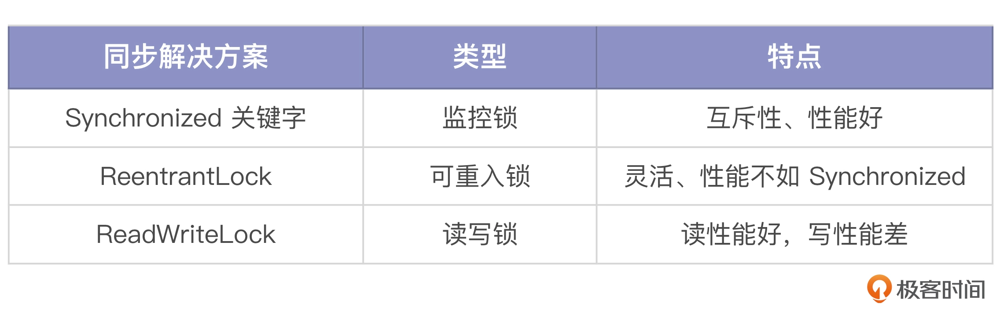
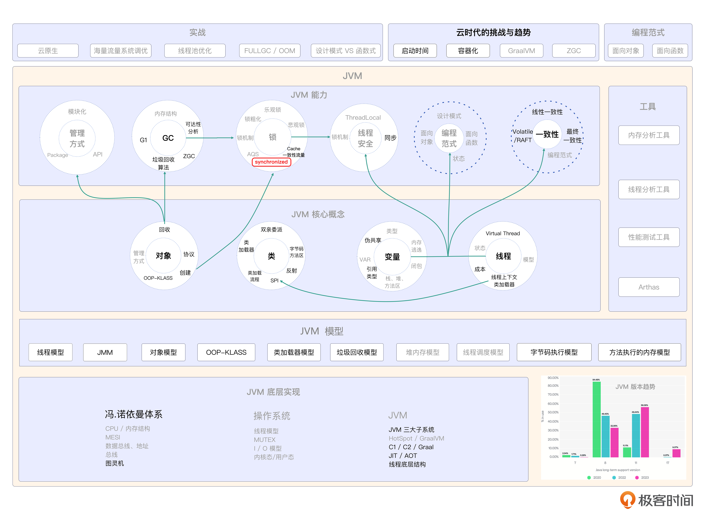

# 24 | Synchronized：同步锁的原理及应用

你好，我是康杨。

Java 中的同步锁机制是 Java 并发编程的基础，它可以保证在多线程环境下对共享资源的互斥访问。在 Java 中，同步锁机制主要由 Synchronized 关键字实现。今天我将详细聊一聊同步锁的原理，以及在 JDK 源码中的应用，并给出最佳实践。

## 锁的状态与类型

Synchronized 是 Java 中最具代表性的互斥同步手段之一，它在底层实现上并不依赖于 Lock接口及其实现类。Synchronized 所依赖的是 JVM 内部的监视器锁（monitor）。在竞争程度较低的场景下，Synchronized 可以提供较高的性能。在 JVM 对 Synchronized 进行优化后，如使用偏向锁、轻量级锁等，能使其在无竞争和轻度竞争情况下避免重量级锁使用操作系统互斥量带来的性能消耗。

Synchronized 属于 JVM 的内置锁，Synchronized 方法或代码块在编译后，会在字节码层面有一对 monitorenter 和 monitorexit 指令，分别表示获取锁和释放锁。

当一个线程试图获取某个对象的监视器（也叫做监控锁或同步锁）时，它会执行 monitorenter指令。这个指令会把对象引用加载到操作数栈中，然后尝试获取这个对象所指向的对象的锁。如果获取成功，那么这个线程将成为该对象的所有者，其他线程必须等待锁被释放才能获取。当线程退出同步代码块或调用 wait() 方法时，monitorexit 指令负责释放锁。

### 锁的状态及 JVM 视角

从 JVM 的角度来看，锁的状态可以分为 0、1、2、3 四种，分别表示无锁状态、偏向锁状态、轻量级锁状态和重量级锁状态。这些状态反映了锁的不同竞争程度和性能特点。锁还有一个计数器，用于记录线程进入同步块的层数。

### 锁的类型

Java 中的锁主要分为三种：偏向锁、轻量级锁和重量级锁。这三种锁在不同的场景下具有不同的性能特点。

- 偏向锁：偏向锁是一种针对单线程访问的优化手段。当一个线程首次访问某个对象时，偏向锁会尝试获取该对象的锁。如果后续的访问仍然是这个线程，那么偏向锁就不需要再次获取锁，从而减少了锁的竞争开销。

- 轻量级锁：主要针对多线程访问的场景。当多个线程同时访问某个对象时，轻量级锁通过自旋等待的方式实现锁的获取，以降低线程的阻塞程度。

- 重量级锁：重量级锁是一种比较传统的锁优化手段，它在锁的竞争激烈时能够提供更好的性能。当轻量级锁的自旋等待时间超过一定阈值时，锁会升级为重量级锁。

### 锁的状态及特点

锁的状态可以分为四种：无锁状态（Unlocked）、偏向锁状态（Monitor 锁）、轻量级锁状态（Lock 锁），以及一种重量级锁状态（Heavyweight Lock）。

### 无锁状态

在无锁状态下，线程可以自由地访问共享资源，无需进行同步。在此状态下，Mark Word 的内容是对象的哈希码（HashCode）, GC 分代年龄和锁标志位是 01。其他线程可以更改对象头的状态。

### 偏向锁状态

在偏向锁状态下，只有第一个访问共享资源的线程可以成功获取锁，其他线程会被阻塞。这种锁具有较高的性能，因为它避免了不必要的锁竞争。偏向锁会检查 Mark Word 中的 ThreadId是否指向当前线程，如果是，则执行同步代码。如果不是，则查看对象标记是否为可偏向，如果是，则尝试使用 CAS 将当前线程的 ID 记录在对象头中，如果成功，则执行同步代码。

### 轻量级锁状态

在轻量级锁状态下，所有尝试访问共享资源的线程都会自旋等待，直到锁被释放。这种锁在多线程访问时可以减少线程的阻塞，提高程序的运行效率。然而，当自旋等待时间超过一定阈值时，轻量级锁会升级为重量级锁，此时锁的竞争程度会变得更高，性能开销也会相应增加。

当有其他线程尝试获取同一对象锁，此时 Mark Word 复制到新建的栈帧作为 Displaced MarkWord，同时使用 CAS 将对象头部的 Mark Word 替换为指向轻量级锁的指针，如果成功，则获取锁，如果失败，则自旋。

### 重量级锁状态

在重量级锁状态下，线程会被阻塞，直到锁被释放。这种锁在高并发场景下能够有效地防止资源的竞争，但性能开销相对较大。当锁膨胀为重量级锁时，线程会进入阻塞状态，即将自己加入到锁的等待队列中，并释放 CPU 资源。

## Synchronized VS JMM

Java 同步锁的底层实现主要依赖于 Java 内存模型（JMM）中的主内存和工作内存。主内存中存储了共享变量和锁的状态，而工作内存中存储了线程的局部变量。当线程要访问共享变量时，会首先从主内存中获取共享变量的副本，然后在自己的工作内存中进行操作。如果多个线程同时访问同一个共享变量，那么会通过锁机制来保证互斥访问。

## 其他同步解决方案

### ReentrantLock

ReentrantLock 是一种可重入锁，它与 Synchronized 关键字相比，提供了更多的灵活性，比如可以显式地获取和释放锁。ReentrantLock 还支持公平锁和非公平锁两种模式，这使得它在某些场景下比 Synchronized 关键字更具优势。但是，ReentrantLock 的性能可能不如Synchronized 关键字，因为它需要维护一个锁对象。

以下是一个使用 ReentrantLock 的示例：

```java
import java.util.concurrent.locks.ReentrantLock;
public class ReentrantLockExample {
  private final ReentrantLock lock = new ReentrantLock();
  private int counter = 0;
  public void incrementCounter() {
       lock.lock(); // 获取锁
       try {
           counter++; // 执行临界区代码
           System.out.println("Counter: " + counter);
       } finally {
           lock.unlock(); // 释放锁
       }
   }
   public static void main(String[] args) {
       ReentrantLockExample example = new ReentrantLockExample();
       // 创建两个线程来访问共享资源
       Thread t1 = new Thread(() -> {
           for (int i = 0; i < 10; i++) {
               example.incrementCounter();
           }
       });
       Thread t2 = new Thread(() -> {
           for (int i = 0; i < 10; i++) {
               example.incrementCounter();
           }
       });
       // 启动线程
       t1.start();
       t2.start();
       // 等待线程执行完毕
       try {
           t1.join();
           t2.join();
       } catch (InterruptedException e) {
           e.printStackTrace();
       }
       System.out.println("Final Counter: " + example.counter);
   }
}
在这个示例中，我们使用了 ReentrantLock 来保护  counter  变量。通过使用  lock()  和
 unlock()  方法，我们可以显式地获取和释放锁。此外，我们还看到 ReentrantLock 支持公
```

平锁和非公平锁两种模式，这可以通过构造函数参数进行设置。

### ReadWriteLock

ReadWriteLock 是一种读写锁，它可以同时允许多个线程读取共享资源，但是只允许一个线程写入共享资源。与 Synchronized 关键字相比，ReadWriteLock 提供了更好的读性能，但是写性能可能较差。

以下是一个使用 ReadWriteLock 的示例：

```java
import java.util.concurrent.locks.ReadWriteLock;
import java.util.concurrent.locks.ReentrantReadWriteLock;
public class ReadWriteLockExample {
   private final ReadWriteLock lock = new ReentrantReadWriteLock();
   private int counter = 0;
   public void incrementCounter() {
       lock.writeLock().lock(); // 获取写锁
       try {
           counter++; // 执行临界区代码
           System.out.println("Counter: " + counter);
       } finally {
           lock.writeLock().unlock(); // 释放写锁
       }
   }
   public void readCounter() {
       lock.readLock().lock(); // 获取读锁
       try {
           System.out.println("Counter: " + counter);
       } finally {
           lock.readLock().unlock(); // 释放读锁
       }
   }
   public static void main(String[] args) {
       ReadWriteLockExample example = new ReadWriteLockExample();
       // 创建两个线程，一个用于写入，一个用于读取
       Thread t1 = new Thread(() -> {
           for (int i = 0; i < 10; i++) {
               example.incrementCounter();
           }
       });
       Thread t2 = new Thread(() -> {
           for (int i = 0; i < 10; i++) {
               example.readCounter();
           }
       });
       // 启动线程
       t1.start();
       t2.start();
       // 等待线程执行完毕
       try {
        t1.join();
        t2.join();
       } catch (InterruptedException e) {
         e.printStackTrace();
      }
      System.out.println("Final Counter: " + example.counter);
   }
}
```

在这个示例中，我们使用了 ReentrantReadWriteLock 作为读写锁。与 ReentrantLock 类似，

```
ReentrantReadWriteLock 也支持公平锁和非公平锁两种模式。通过使用  writeLock()  和
 readLock()  方法，我们可以获取和释放写锁和读锁。这样，当一个线程需要写入共享资源
```

时，它可以获取写锁；当一个线程需要读取共享资源时，它可以获取读锁。这种设计使得在读操作远多于写操作的场景下，ReadWriteLock 能够提高程序的并发性能。

在实际应用中，我们需要根据具体的业务场景选择合适的同步解决方案，以实现更高的程序性能。



## 在 JDK 源码中的应用

在 JDK、Apache 等开源项目，乃至大部分的 Java 开源项目中，synchronized 关键字都会被广泛应用。在 JDK 中的经典应用就是 StringBuffer 和 Vector 对象，这两个对象的所有主要方法都被 synchronized 保护，以实现线程安全。以下是 StringBuffer 的一个示例:

```
public synchronized StringBuffer append(String str) {
toStringCache = null;
super.append(str);
return this;
}
```

在这段代码中，当某个线程进入 append 方法时，它将获得 StringBuffer 对象的锁；其他线程，如果要调用任何其他的 synchronized 实例方法（如 insert、delete 等），都必须等待这个线程释放锁资源。

## 最佳实践

1. 尽量减少同步范围

在编写多线程程序时，应尽量减少同步范围，只对确实需要同步的代码进行同步。这样可以减少锁的竞争，提高程序的性能。

2. 使用静态同步方法

如果一个方法只需要同步一次，那么可以使用静态同步方法。静态同步方法会在类加载时获取锁，避免了每次调用时都获取锁的开销。

3. 使用锁的可重入性

如果一个线程需要多次访问同一个同步方法或代码块，那么可以使用锁的可重入性。这样，线程在访问完一个同步方法或代码块后，不需要再次获取锁，从而减少了锁的竞争。

## 重点回顾

Java 同步锁机制是 Java 并发编程的基础，它可以保证在多线程环境下对共享资源的互斥访问。Synchronized 关键字是 Java 同步锁机制的核心，它通过锁的状态和锁的获取释放机制，实现了线程之间的同步。此外还有两种常用的同步解决方案：ReentrantLock 和ReentrantLock，它们的特点与职能不同，在实际编程中，我们应根据具体的需求，选择合适的同步解决方案，以提高程序的性能。

## 思考题

学而不思则罔，学完这节课之后，我给你留两个问题。

1. ReentrantLock 和 Synchronized 有哪些相同点和不同点？

2. Synchronized 锁的状态有哪些？

希望你认真思考，然后把思考后的结果分享到评论区，我们一起讨论，如果有收获的话，也欢迎你把这节课的内容分享给需要的朋友，我们下节课再见！

点亮你的知识框架图


