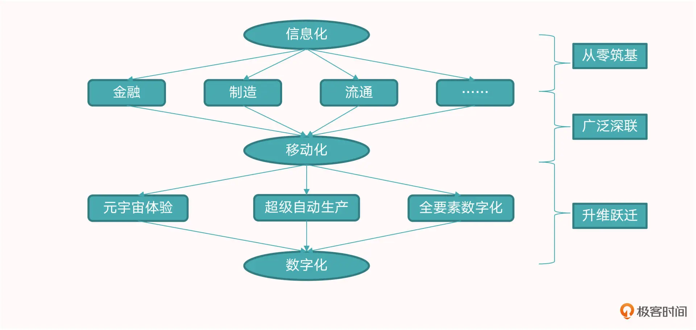

# 02-数字化与信息化，为啥一定要去刻意区分呢？

你好，我是付晓岩。

上一讲我们从全局视角聊了什么是数字化，得出了一个结论：数字化和数字化转型，不是要刻意地去做什么，而是一种自然趋势。这一讲咱们更接地气些，看看你身边的数字化。

谈到身边的数字化时，我们的第一反应往往是，是不是得先界定下信息化和数字化。

除了信息化和数字化，我们还听到过电子化、电算化、移动化、金融科技、互联网 +、万物互联、元宇宙等等类似的概念，它们又是啥关系呢？首先，它们有区别，因为和技术的应用领域、和发展阶段相关。其次，它们要表达的，又都是通过软件、数据、网络要实现的那些事儿。

真要精确区分它们，确实非常不容易，我们可能得翻遍各类技术文件。这也是我们谈起数字化时感觉很难、分不清楚、和个体没啥关系的一个原因。但其实在我看来，我们不是要做深度研究的技术人员或者专门研究技术发展史的人员，也没必要精确区分它们，只要搞清楚数字化的整体发展方向就够了。

所以，这节课咱们就先从信息化这个说法出发，先看看重点行业的信息化，然后再拉近到我们的现实生活看看移动化（因为我们对移动化比信息化更有体感，也更容易感受到技术的影响），从这个趋势我们再去看数字化。

## 重点行业的信息化

我们逐一看下军事领域、金融领域、制造业和运输领域的信息化，这些基本就代表了信息化在重点行业的发展情况。

最早应用信息化的领域，应该是军事。

最早的可编程电子计算机就是用来计算弹道的。而且，军事领域的信息化水平一直就很高。对大规模软件构建比较重要的架构、工程理论，军事领域一直就非常重视。比如 C4ISR（Command、Control、Communication、Computer、Intelligence、Surveillance、Reconnaissance）、TAFIM（Technical Architecture Framework of InformationManagement，信息管理技术架构框架）等早期架构方向的研究，就是在军事领域诞生的。

因为如今信息技术的发达，今年爆发的俄乌战争几乎成了网络直播的战争，并将我们常听到的很多技术，比如人工智能（AI），应用到了战场上。

金融领域也是信息化的重要应用领域。

如果只把大型主机的使用作为分界线，金融领域的信息化历史也有 50 多年了。同时，金融领域在信息化上的投入也很大，2020 年、2021 年国内银行业的信息化投入都在 2000 亿以上。现在，银行业务的信息化程度非常高，几乎所有的业务都可以通过软件在网上去办理。可以想下，你有多久没去银行办过业务了，有多久没用过自动提款机了？这都是银行信息化投入的产出。

接下来，我们再看看信息化程度参差不齐，但在不断提高的制造业。

领先的大型制造企业，从 ERP（企业资源规划）、CRM（客户关系管理）、MES（制造执行系统）等核心软件到各种内部管理用的支持类软件，一应俱全；从人工智能到低代码、RPA（机器人过程自动化）也都有应用。

有些我们平时注意不到的轻工业企业，也在悄然成为信息化领域的优秀案例。比如，最近在跨境电商领域比较出名的服装企业 SHEIN，有自己独特的 MES 系统，实现对打版设计以及供应链的高效管理。

当然，很多小型企业的生产还没有业务系统支持，还是简单的线下生产方式，缺少信息系统或者软件的支持。

最后，看下信息化程度也不低的运输领域。

除了物流企业现在几乎是离不开软件之外，无人驾驶这个热门领域一直备受关注。比如，美团、京东、阿里、行深智能、智行者等企业纷纷试水无人配送赛道（比如，美团的无人配送车）。类似的新闻我们也见过很多了。

这样看一波，信息化为今天的经济发展提供了莫大的助力，但是也遗留下一些时代性的问题。比如，大量的信息系统是割裂的，无论是在一个企业内部，还是在行业这个层级上。这都是需要我们在后续的数字化过程中要去解决的。

刚刚这几个重点领域的信息化，一般都是企业主导的，接下来咱们转移到一个你更有体感的话题，移动化，再来感受下技术的发展方向。

## 无处不在的移动化

在 1996~2000 年我上大学的时候，校园里的手机还是凤毛麟角般的稀罕物，手机就是打电话、发短信的通讯设备。到了 2010 年前后，伴随着网络的发展，智能手机逐渐爆发了，无数的应用开始抢占这个巴掌大的无线世界。一个比传统互联网更方便的新空间——移动空间，诞生了。

这个移动空间将什么信息化了？太多了，从最初的购物，到后来的影视、游戏、社交、出行、旅游、办公、医疗、金融、政务，等等。各个领域都希望通过移动化更好地接触到你、服务你，把你变成他们的客户。现在你已经很难找到一个领域，是没有被移动化覆盖的了。

可以这么说，移动化已经无处不在了，它帮助了信息化去发挥它的价值。那么，我们是不是也要区分下移动化和信息化呢？我觉得大可不必。你只要看清楚了移动化的大方向，就够了。

如果你所在的企业也要服务一些客户，特别是 C 端客户，那么你能够有意识在产品设计、企业服务方面注意如何移动化，或者如何利用移动端帮助自己改善业务，也就足够了。如果你只是在企业内部工作，不需要考虑服务客户的事情，那只要去看看自己所从事的工作，是不是可以利用移动端来提效，比如利用手机的通讯软件做好在线协同，也就够了。

所以，就概念而言，是不是区分数字化、信息化真的没那么重要。只要把握住大方向，就能让自己的思考没错，在个人的能力转变和储备的规划上也不会出错。

问题来了，我们说看数字化的整体发展方向就够了，那整体方向是啥呢？

在我看来，数字化是面向未来的，是面向 2035 远景目标的，整体方向就是面向虚拟与现实的深度结合，将全部生产要素逐渐数字化，为老百姓提供更为惊艳的生活和工作体验。

## 再进一步的数字化

首先是 AR 和 VR 这对儿未来世界的小兄弟。

AR 可以跟现实场景融合，应用场景可以有很多。比如，导航地图上的 AR 方向箭头，之前火爆的口袋精灵游戏等。VR 则是全虚拟的环境，除了游戏应用之外，元宇宙也基本上属于 VR类型的。

目前，AR、VR 也被很多企业用在了实际工作中。比如，米其林工厂在新员工培训中就用到了AR 技术，来培训或指引复杂操作，比如配合 3D 眼镜做一些日常巡检工作提示检查点。

元宇宙，随着数字化的浪潮再度兴起，而且已经得到了不少地方政府的大力支持。比如，已经成立有元宇宙产业园、元宇宙母基金，还有元宇宙的技术岗位认证出现，元宇宙会议甚至虚拟地产也有案例。2021 年 12 月，美国空军高层就举办了一场 250 人参加的元宇宙会议。

AR 和 VR 打造的是三维空间，而移动渠道是二维空间，所以现在的体验还不够好。但是，从双碳（碳达峰和碳中和）的角度看，大力发展 AR 和 VR 技术，咱们可以少出差，也可以更方便地实现生活和工作不必在同一个城市，能有效地提高工作效率，降低生活成本，也更有助于应对疫情等突发事件，发展空间还是很广阔的。

其次是超级自动化、RPA 这些可以提升工作效率，能够减少人工干预环节的技术。

超级自动化的应用，现在不仅局限于自动化汽车等大型制造业，随着工业机器人的普及，就算是普通纺织企业也一样可以有大量的自动化设备服务于柔性制造生产线。这方面最富想象力的产品莫过于人形机器人的研发了，它具有不受特定生产线形态限制的潜力，可以快速更换用途。尽管通用型人工智能面对的挑战依然很大，但目前已经有比较“像人”的样机出现了。

RPA 虽然听起来比超级自动化要低不止一个量级，但是自从 2019 年左右火起来之后，这两年持续有各类极富效果的应用出现，金融、贸易、制造、政务等各个领域都有案例。比如，银行在利用 RPA 从行内业务系统中直接获取法人客户、工商注册等信息，自动将报备信息录入到人民银行的系统中，完成账户备案。最近某银行公布的数据显示，该行部署了 352 个 RPA 应用，可节省人工 4400 小时。

在我看来，RPA 其实应该是未来各领域业务系统设计的基本方向，具备可录放行为或者可直接编辑行为的业务系统是将来的发展方向。

说到这里，不得不再提一提低代码。将来我们会需要越来越多的软件，那如何能够实现“开发左移”，让业务人员也能进行一定程度的开发工作呢？在全民编程时代到来之前，恐怕低代码就是一项很好的解决方案。

最后，我们再看一个很受关注的数字化项目——数字人民币。

法定货币的数字化是件很有意思的事情。现有的货币已经高度电子化了，大部分支付行为都发生在电子化的银行账户上，那数字人民币与电子化的银行存款相比有哪些区别呢？

首先是个很专业的区别，前者是 M0，后者是 M1（M0 和 M1 是反映货币供应量的两个指标）。对普通老百姓来说，大概知道有这么个区别就行了。

第二个有意思的地方就是，数字人民币其实是一条信息记录，而不只是一个数字。从技术上来讲，一条数字人民币的信息记录可以包含多个字段，不同的字段可以记录不同的信息。而电子化的人民币，真的就是一个数，没法承载更多的信息。

银行的一条涉及账务变动的账务记录所能包含的字段，往往是根据自身业务规则设定的，一般也不具有开放性，其他合作方很难用来做账务信息以外的应用。仅仅这一点，就会赋予数字人民币很大的想象空间。货币的数字化是全社会深度数字化中的重要组成部分，可以基于数字货币的特点，让数字经济有更加精准的运行，并增加丰富的政策实现手段。

除了以上这些外，当然还有量子计算、人工智能等，咱们就不去一一展开了。

## 总结

今天，我从信息化、移动化和面向未来的数字化这几个角度，跟你聊了下目前技术在各行各业以及在你身边的应用。我把这些给你整理到了一张脑图中：

以前我们经常挂在嘴边的信息化，实际上是我们从无到有的开始应用计算机，这改变了很多行业的工作模式。客观地讲，很多企业的计算机应用，还是处在“筑基”这个阶段。

不过，最近 10 年左右移动互联网的发展，大规模推动了企业、个人之间连接的发展，改变了很多行业。尤其是在消费领域，不少企业是被潮流裹挟着，同时进行信息化和移动化这两件事情。

如今，以 AR、VR 等形态展现出来的元宇宙、从工业发端开始泛化的超级自动化、以法定数字货币为代表的全要素数字化，已经把数字化的节奏带出来了，计算机应用从平面走向立体的升维跃迁已经展现在不那么遥远的前方。

当然，和你分享这些应用场景，不是为了让你死记硬背，而是要达成两个目的：一，我们无需去刻意区分这些名词、概念，看清楚大方向就够了；二，数字化的未来已经在一些应用趋势中显露出来了，并不是完全飘在天上的。我们要面向未来去看现在的技术应用趋势，这样可以更好地参与其中。

## 思考题

你认为最有前途的、且当前已经出现了的数字化技术，是什么？你认为它可以给数字化发展带来什么样的前景呢？

欢迎你在评论区留言，我们一起讨论。如果这一讲对你破除对数字化的认知“迷雾”有所帮助，欢迎你把它分享给你的朋友，我们一起交流、碰撞。
