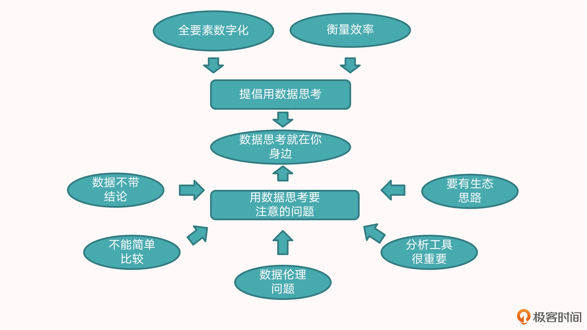

# 03-数据：用数据思考问题，到底是什么意思？

你好，我是付晓岩。

今天我们开始进入到“技能提升篇”的内容。在开篇词中，我提到将数字化这个大概念，转换到个人身上的数字工作技能，就是需要我们具备数据思维、数据工具技能和基于网络的生态思维。接下来的 3 讲，我会分别给你讲解这 3 个技能的培养。今天，我们先学习数据思维相关的内容。

数据思维，其实就是用数据思考问题，那和咱们常说的 “心里有点儿数儿”是不是一个意思呢？我觉得挺接近的。这样一对比，是不是觉得“数据思维”很好理解了？

今天这一讲，我们就掰开了看看用数据思考这个问题，看看到底从何而来，其中又有哪些需要注意的问题。

## 为什么提倡用数据思考？

我们先看看，为啥数据思维近几年被越来越多的提起。

首先，从发展趋势上看，所有生产要素都会逐渐数字化。全要素数字化，这是国家政策指明的方向。如果你读过数字化转型相关的国家政策，就会发现，里面频繁提到了数据要素。而且，在政策定位中，数据是最重要的新生产要素，还会参与到分配中。也就是说，通过数据是可以获得收入的。

其次，我们都希望办事情能够有效率，这要靠数据的比较和计算来分析。有效率，就是少浪费、多产出。也就是，同样的产出成本更低，或者同样的成本产出更多。无论是企业生产还是个人生活，都是如此。通过数据的比较和计算，可以帮助我们找到提升效率的最优解。

所以，用数据思考是个几乎人人都有的习惯，不要一到谈论数字思维，就忽然晕了。其实，高大上的东西往往都藏在你的现实生活中，只不过是有人把它们给抽象、提炼了。要理解高大上，回到你自己的生活中去就好了。

数据思维、数据要素，都是顺应发展趋势来的，并不是刻意为之。这个道理就像之前人们算账用算盘，后来用计算器，现在直接用手机一样。

## 怎么直观理解用数据思考？

要直观地理解用数据思考问题离我们有多近，可以直接看个点外卖的例子。

在外卖软件中，你首先会感受到的是所有商家都被分类了，而且维度有很多，维度之间也会有交叉，比如有美食、中餐、外卖、折扣等分类，而一个商家也会同时出现在多个分类中。这些分类满足了你要定位自己需求的想法。

当你进入外卖的分类后，数据思考就开始了：

- 你想找到销量最高的，这可能是基于月度销售数据去比较的；

- 你想找个大家都爱吃的，这可能是基于评分和好评数量综合计算的结果；

- 如果你想快点吃到，这是基于距离数据进行比对的；

- 如果你选了智能推荐，这里边就是由你也不知道的算法决定的了，可能跟你以前做过的选择有关，也可能是其他数据决定的。

你看，用数据思考一直发生在你的身边，并不一定非要到神秘的数学公式中去找。

点外卖这件事情，大量的数据由服务方替你准备了，商家信息、菜品信息、道路信息、消费者提供的各类评价信息等等。有了数据，尤其是更新频率高、质量高的海量数据，你的生活、工作都会非常方便。当然，这些方便还是要靠服务方来提供的，对于在服务方工作的人来讲，用好数据思考，还涉及到对数据的敏感性和分析数据的经验，这两部分可以靠刻意的训练和实战来获得。

## 用数据思考问题，有哪些需要注意的？

你几乎天天都在用数据去思考问题，现在也大力提倡用数据去思考，那有没有什么问题要注意呢？我们一起来看最需要关注的 5 个问题。

第一，数据本身是不带有任何结论的，结论是被计算方式甚至是意愿赋予的。

我们看个计算当期利润的例子。投入成本是 120 元、赚了 100 元，那代表是亏钱吗？如果不采用分期摊销的方式，现在算利润的话就是亏钱的。但如果采用分期摊销的方式，那当期就是盈利的，后边才有可能是亏钱的。当期利润是正是负，取决于计算方式，并没有对错之说。

至于意愿，对创业企业来讲就更明显了。无论企业是亏是赚，资本往往会从预期上解读一个企业是否值得被投资。也就是说，资本关注的重点并非看得见的收入，而是看不见的“预期”，这就是很主观的结论了。

所以，用数据思考问题，我们一定要明白数据很客观，但对数据的分析则未必。

第二，数据是不能简单进行比较的。

这种事情常发生在我们做决策的时候。比如，同样是在学校读了四个月的书，为什么有人考满分，有人考不及格？为什么一个赛道的企业同样是跑了三年，有人盆满钵满，有人已经走向破产？学习时长可以统计，考试结果也能得到，公司的存续时间、资产负债表、损益表、现金流量表也都有。但是，数据的比较结果，能很充分地支持你的决策吗？这些数据是别人取得成功的原因，还是仅仅是个结果呢？

这说明，我们做决策需要数据，但是更需要分析数据背后的东西。现实里，我们却经常急于根据不充分的信息做出复杂决策，然后交给试错来决定自己的命运，错用了数据。

第三，数据应用要越来越注意伦理问题。

首当其冲的是隐私问题。精准营销就是一个典型的例子。

精准营销，讲究从位置、标签、喜好等多个维度去细分用户行为，然后实现个性化推荐、千人千面。这里面就涉及大量用户信息的收集，甚至是过度收集，难免会触犯隐私问题的边界。而跨境、出海等场景下的数据应用问题，因为不同国家的规定不一样，会更复杂。

除了隐私问题，还有数据的不当使用问题。

比如近两年一直被提到的大数据杀熟。更严重的还有来自算法的“歧视”。比如，算法是不是因为一个人曾经服过刑而得出某种不必要的结论，或者基于性别产生不合理的结论。这些不恰当的计算结果甚至会改变一个人的命运。比如智能算法不知道为啥就判定一个人不应该被贷款。目前，国内外都开始对算法的责任进行立法界定，算法产生不应有的“歧视”，是会被追责的。

现在有可解释 AI 这么一个领域，通过一套复杂的白盒模型，来解释黑盒算法得出的结论，来判断 AI 对数据的计算结果是否合理。

第四，就个人工作而言，用好数据分析工具是很重要的。

数据的分析最好还是通过软件来进行，这样工作效率、工作记录都更容易保持。有些企业会为员工提供多种基于本企业定制的数据分析工具，比如搞数据中台或者数据平台的企业，一般会基于数据基础设施提供一些数据工具供员工使用。

当然，没有这些平台的也不要紧，大部分常见的数据分析工作，Excel 之类的电子表格工具都可以搞定。比如，用好了数据透视图，你就会发现自己的数据处理能力上了一个大台阶。

第五，对企业而言，利用数据越来越需要有生态的思路了。

没有谁家的数据是绝对够用的，为了更好地服务客户，都需要借助外部数据的力量。比如，电商的数据被认为是最多的，但是他们也要有外部数据的支持，也同样会采购数据。再比如，银行的数据量也很庞大，但是为了判断客户信用，一样需要征信数据、工商数据、税务数据、金融市场数据、水电费数据等，综合去反应客户的实际经营情况。其他行业也有类似的现象。

涉及数据生态，是需要国家支持的。比如，建立跨行业数据库分享公共信息，就不是单一企业可以主导的，需要国家政策支持。如今，这些行动正在展开，各数据交易所陆续成立，东数西算工程也启动了。企业如何利用数据要素，已经是可以向外看，也必须向外看的问题了。

关于用数据思考需要注意的问题，我再给你分享一个案例。最近有家企业找到我，他们最近一个季度的利润数据表现不好，想让我帮忙分析下原因。在分析的时候，其实我们就需要注意上面的几个问题。

数据本身是不带结论的，表现不好这件事儿到底是不是不好，其实需要对比环境来看的，也就是要看看外部数据。如果大家都一样，说明问题在环境，不要急着对自己下刀。再拉长周期，看看最近三年的季度数据，是不是有啥隐蔽问题没发现。比如，你可能发现销售费用跟利润的相关性越来越差了，那意味着可以省省销售费用了，当前的渠道未必是有效的，或者没有深度运营，这些数据未必在当期会很直接地看出来。

对比外部时不能简单地直接比，比如，两个公司策略不同，一个重视研发，一个重视销售，那数据是没有可比性的，要从行业层面去看趋势数据。对比这些数据，我用的工具很简单，电子表格，通过趋势图看就很直观。

## 总结

今天，我通过“用数据思考问题”、外卖的例子，这种简单、直接的方式带你去理解了数据思维。我们的生活和工作已经被不同程度的数字化了，我们每天也都在利用数据进行很多决策，完全不必被“数据思维”这个词搞晕了。

但是用数据思考问题，说难也难，因为这里面有多方面的问题需要我们去注意。除了数据分析固有的问题外，还有来自法律、伦理、政策方面的变化，也需要关注。

全要素数字化，会带来全社会更深入的连接，数据会更有价值，同时它的使用也会与以往大不相同。所以，用数据思考问题，绝不是只考虑分析数据，更要考虑数据使用的合规性、合理性。

今天的内容我总结了一张图，你可以用来回顾下：

## 思考题

你平时使用较多的数据分析工具是什么呢？你可以将其分享在留言区，最好可以再说说你的使用场景。这样我们都能多接触、多注意自己伸手可及的数据分析工具，一起走上有效利用数据的道路。

欢迎你在评论区留言，我们一起讨论。如果这一讲对你理解数据思维有所帮助，欢迎你把它分享给你的朋友，我们一起交流、碰撞。
