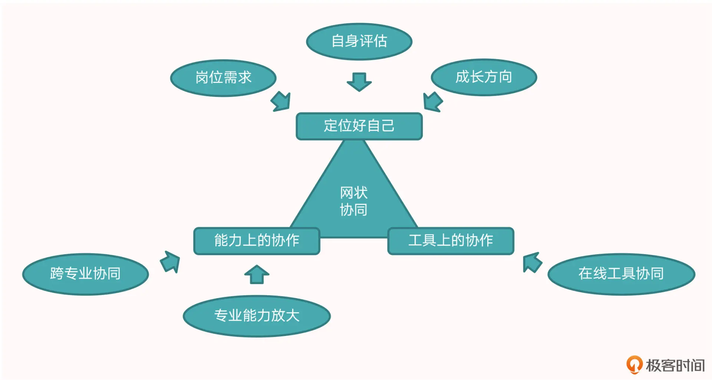

# 05-网络：重视协作，构建属于自己的生态

你好，我是付晓岩。

上一讲我们学习的是为了用好数据，需要提升自己的数据建模和软件工具使用能力。相比其他时代，数字时代基于网络的社会连接能力更强了。每个人都生活在一个或大或小的生态中，生态的大小取决于你认识的人、你形成的影响力。本质上，生态关系是一种协同关系，是为了形成更好地应对环境变化的关系，是通过协作来提高效率、降低风险。

所以，今天这一讲我会带你跳出自身技能的提升，按照搞好生态建设的三个基本要点，定位好自己、能力上的协作和工具上的协作，和你分享怎么高效协作，怎么构建自己的生态。当然，从应对数字化转型的角度出发，我会专注于怎么用好数据这个点。如果你要建造其他方面的生态，也可以仿照这种模式去思考。

## 定位好你自己

我们发起协作，要达成的目的无非这么两个：

- 增益其所不能。我们自己做不了，得求助别人。

- 众行远。合作可以提升效率，大家一起可以走得更远。

无论是出于哪个目的，合作的前提都是先评估好自己的能力。你可能会觉得这没啥好强调的，但往往踩坑的都是这些自以为没问题的地方。这些年，我见过无数个案例，有企业的也有个人的，因为在合作前没有做好评估、完全凭感觉，最终导致资源的浪费。

那么，就用好数据来讲，如何定位好自己呢？

首先，评估自己的岗位对数据能力的需求是什么。日常工作里，我们经常是被安排到某个工作岗位上，这就导致很多人其实不清楚自己的岗位到底需要的能力是什么。同时，企业对于岗位的定义有时不够严谨，对岗位能力的评估也经常跟不上变化。尤其是在数字化转型这个大趋势下，现有的业务岗位需要什么样的变化，需要集成什么样的与数据相关的能力，这是很多岗位都面临的问题。

比如，现在财务类工作中有很多 RPA 的应用场景，从自动采集数据到自动处理报表。一些企业甚至提出了“人手一个机器人”的口号，将 RPA 的应用定制向业务侧延伸。那么，在这种企业环境下，财务类岗位能力中就增加了 RPA 应用技能。除了 RPA，对电子表格或者企业提供的数据工具的应用能力，是不是也要增加呢？

如果企业没有明确这些岗位的能力需求，你就只能是自己摸索了。不要小看对岗位的评估，这会直接影响你的工作成效和职业发展。

其次，评估自己的能力。没有多少工作是人、岗完全匹配的，很多时候能力缺口都是靠自学。我们要通过评估来决定自己的学习方向。

以我自己为例。做业务架构师的时候，我除了在公司项目上边干边讲、极为战训结合的学习机会外，还自己看了几十本与系统设计、系统架构、流程设计、数据建模、软件工程相关的图书，觉得沾边、是经典、有用就去读。现在想想，如果我能先体系化地梳理出自己的能力缺口，学习效率肯定会高很多。后来在跟我的图书读者交流，发现有些人已经在有意识地用脑图等方式来规划自己的技能图谱了，非常了不起。

总结一下：你要根据岗位能力要求评估的是，为了补充能力，要学习什么。比如，如果想深入了解数据的作用，那就要学习下数据建模。根据评估自己的能力属于零基础还是需要精进，你可以为列个学习清单。然后，基于清单来规划自己的时间，持续投入学习。

做好了岗位能力和个人能力的评估后，相当于你已经做好了个人定位，也就有了协作的基础。咱们继续来学习能力上的协作。

## 能力上的协作

能力上的协作，可以按照协作目的分成跨专业协同和专业能力放大两种。

### 跨专业协同

我们先看“跨专业协同”。这个思路很简单，你做不了的就得由别人来做。不过在今天来看，“跨专业协同”中，业务和技术的边界正在被逐渐打破，基于原有职能的分工也正在调整。

如果从数据全生命周期的角度来看，用好数据，包括要在采集、存储、计算、应用等多个环节都做好，但每个环节的能力要求都是有差异的。以前，除了应用环节，业务人员只要提需求，具体实现交给技术人员就好了。但是，技术人员对业务的理解是有限的，而且不同类型的技术要求的能力也是千差万别。那么，对企业而言，用好数据就是个不同岗位之间的能力协作问题。对个人而言，也是如此，是基于岗位之间的“能”与“不能”的协作。

但因为数字化提倡用技术重塑企业价值创造过程，所以现在提倡的是业务与技术的深度融合。业务人员只操心业务、技术人员只操心技术，有点儿不够用了。对于数据来说，除了存储，采集、计算和应用等环节都需要业务人员操心了。只有了解了在不同的环节中有哪些实现场景，有什么样的技术发展趋势，才能在客户管理、营销、交付、售后、风控等不同环节，提出有质量、有想象力的需求，让对数据应用的讨论再深入些。

这和要求技术人员多了解些业务是一样的，不了解业务环境做不出好的应用，不了解数据的前世今生也提不出好需求。其实，回过头去看自己的工作经历，相信你都能发现，想做好自己的本职工作就需要多了解上下游。只不过是，这个规律如今已经扩展到业务和技术之间的上下游关系了。

### 专业能力放大

关于“专业能力放大”，我想和你重点说说业务侧。毕竟，在传统行业中，业务侧人员居多，数字化转型其实最终的重担是落在业务人员身上的，是业务人员思维与行为的转型最终促成了企业的转型，希望我这么说不会给业务人员带来过大的压力。但事实确实如此，我希望广大技术人员也能去协助推动这一过程。对于技术侧来讲，专业能力放大，其实最常见的是“外包”，通过“外包”解决技术侧人力资源不足的问题。

现在我们都开始认识到数据的重要性了，那不免都得聊聊数据治理问题。没有数据治理，就很难有好的数据。这就涉及到部门之间的另一种协作，本质上相同的能力之间的协作。比如，在数据治理这件事上，所有业务部门干的事情都是一样的，只是在基于各自的业务领域执行同一个任务而已。

所以是相同专业能力通过协同的放大，没有这种协同，就无法完成整个企业的数据治理。想想你遇到的数据问题，比如：

- 别的部门的数据可能会帮得到你，但是你不知道对方有数；

- 知道对方有数，对方可能不觉得有必要支持你；

- 对方觉得可以支持你，但是他的数据质量很差，却没精力提升；

- 部门也想提升数据质量，但是对于数据的定义需要多个部门共同进行，自己搞不定。

要解决这些问题，需要“众人拾柴火焰高”。各部门一起做好本职工作，数据质量就会提升很快。

上述的协同关系不只是在介绍企业的工作，这些协同也一样会发生在个人身上。其实，每个人自己也都是个企业，而且人与人之间的合作比企业更容易发生、路径也更短，可以更容易地定位自己的能力和别人能力之间的结合。

互联网的发展极大地拓展了人与人之间的网状关系，使人与人之间的认识变得更容易了，这也是“网红经济”迅速发展的原因之一。数字化转型在思维层面要考虑的一件事，就是如何把网络从乐趣变成你自己生活、工作的基本思维方式之一，学会给自己编织网状协同关系。聚焦到数据这个点，最简单的生态利用，就是多结交网络资源，积极探讨工作问题，向经验丰富的先行者学习。

此外，结成网络还有一个方式是尽量增加自己的发声。数字时代最好的 IP 还是自己的知识。你可以通过自媒体形式、专业的社区平台，多发表基于自己实践经验的理解，多讲多传播，提升自己的影响力。这样一来，你可以形成更高质量的网络。

## 工具上的协作

基于能力的定位，可以更好地明确协同关系。在协同关系明确的基础上，我们需要在工具上也进一步协同下，把流水线的工作转换成可以并发执行的工作。工具上的协同，其实现在已经发展得不错了，很多办公软件（包括电子表格）已经具备在线协同的功能了。

关于工具协同，我和你分享一个最需要注意的问题，也就是数据安全。控制好数据的使用范围，不该协同的不要协同。比如，在不同部门的协同中，客户信息是否出现了不必要的扩散甚至泄露。毕竟对数据安全、数据合规的要求越来越高了，很容易触犯法律边界。我们一定要注意，效率不能压倒一切，至少不能压倒数据安全。

## 总结

今天，我从建立网状协同的角度和你分享了怎么用好数据。可以发现，用好数据并非一个单纯的能力问题，它反映了数字化转型带来的一个变化：如果说以前我们更多的是关注自己能力的提升，那么在数字化时代，必须要关注的是协同而不仅是单兵的能力。

说到协同，就必须包括自己的定位、岗位的确定、协作关系的建立和网状生态的拓展，管理自己跟管理企业是一样的。

今天的内容我总结了一张图，你可以用来回顾下：

## 思考题

今天的思考题，希望你分享下为了构建自己的生态、形成更高质量网络，都尝试过哪些努力？

欢迎你在评论区留言，我们一起讨论。如果这一讲对你理解数字化时代的协作这件事儿有所帮助，欢迎你把它分享给你的朋友，我们一起交流、碰撞。
