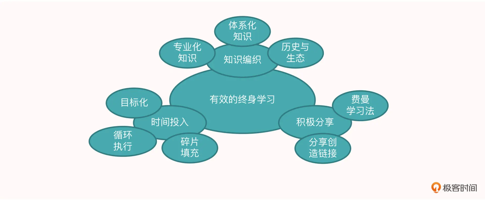

# 07-如何避免陷入学乱了、学杂了的窘境？

你好，我是付晓岩。

前面几讲我们一起学习了不少内容，涉及数据思维、数据建模、网络生态、软件技能等等。不知道你的学习感受是怎样的？是不是觉得要学的内容可真多呀？甚至感觉很是烦躁？要知道，这些内容已经是我精简过的了，可以说是数字化技能的最小化版本。

其实，我和你一样。虽然我也赞同终身学习，但每天都被浩如烟海的资料折磨得很惨，我也是一直保持着“痛并快乐着”的心态，努力跟上时代的脚步。今天呢，就来和你分享下我的学习心法。我会从知识编织、时间投入和积极分享这三个方面来分析这个问题，希望能帮助你走出越学越乱、越学越杂的窘境。

## 知识编织

既然是学习，我们就从读书这件事儿说起吧。

你读过多少书了？我估计不算少。以前一些介绍高效能人士的书中曾经说过，阅读比较勤奋的CXO 级人物们，每周至少会读一本书，这个效率还是挺高的了，毕竟他们的时间是很紧张的，一年下来，总归会有 30～50 本。如果久久为功，在职业生涯进入巅峰状态时，很可能是有 600～1000 本图书的阅读量作为基础了。

如果你也羡慕这些人不仅事业成功还学富五车的话，那抓紧动起来吧，除了在实践中学习，还得在书本中学习。实践也许学习快，但是知识的深化还是需要通过阅读来完成对理论的学习，而且，知识获取的广度也离不开阅读。举个例子，我们讲数据能力的时候提到了数据模型，你见过有人没阅读过相关资料就能把这件事学得明明白白的吗，几乎没有，多少都得通过阅读补充很多信息来提升建模水平。

但是这么多书，这么多知识，是不是读了就完事儿了呢？显然不是，有个比方你一定经常听人提起，就是要把珍珠串成项链，否则，价值就难以提升，知识如果能够深度连接起来才是我们说的智慧。

那要怎样才能够把知识连接起来呢？这就是我要跟你聊的第一个点，知识编织。

知识编织这个概念，不知道你是否听说过，其实很好理解。一横一纵编织起来，这就是知识编织了。横的是纬线，纵的是经线。在我们所有要学的内容里面，专业知识是一根一根水平的纬线，那么经线就是具有贯穿能力、可以帮助你理解“上下四方、古往今来”的东西，总结起来包括体系化知识、历史和生态。

我和你分享知识编织，其实是想强调我们要重视对经线知识的学习。纬线知识是显而易见的，我们都知道，但是往往忽略了对经线知识的学习。所以接下来，我会具体展开刚才提到的经线知识三维度。

### 体系化知识

体系化知识，我主要指的是哲学类的。哲学是研究认知的学科，而认知正是我们学习其他学科的目的，不就是为了了解才去学习吗？那对于认知本身的技能，确实是应该关注的。但是现在我们很多人都存在的问题是，对实用型能力的关注太多，对哲学类知识的关注太少。

如果你仔细品味下，大多数知识研究的都是规律，看事物在某个框架或者环境下是如何运作的。那怎样才能总结或者认知规律呢？这就是哲学可以帮助你的。

如果你在学习面向对象的语言编程，那不妨去看看维特根斯坦大约在 1921 年写的一本很薄的书，《逻辑哲学论》。不用读完，读前边几十页就够了，你会发现他讲的面向对象的思想非常透彻，可能超越了今天大多数讲面向对象的书，虽然维特根斯坦那时候根本不知道将来的计算机长啥样。

我开始接触哲学类书籍是在上学的时候，比我接触企业架构要早。在我看来，企业架构就是个认知过程，是认知企业的过程。我也一直强调要先把企业架构当成思维模式去学，但是很多人是把它当成落地模式去学的，这就是认知上的偏差。后果就是对方法论的各种怀疑，甚至可能轻易地放弃一个你本可以有机会用好的工具。但是企业架构实际上是个思维模式，通过它尽量清晰地认知企业，再去根据环境寻找落地方案。

到数据方面的学习也是如此，数据的一些建模方式还是很成熟的，跨环境应用相对还好些，但是在数据治理上，就需要因企施策了。这里的考验是，到底是数据治理的知识束缚了你，还是你能驾驭得了这些知识。要把数据治理做好，你还得了解企业的管理环境，能够结合管理实际去落实治理措施。你看，这就回到了我们前面说的，各类知识在本质上都像是在研究事物在某个框架下的运行规律，那你如何把数据治理和企业管理两个学科编织在一起呢？这考验的就是你的认知能力了。所以，学点儿体系化知识，尤其是哲学，会有帮助的。

### 历史

那么历史类呢？其实喜欢读历史的人不少，不过相当一部分可能都当故事看了，并没有系统地去尝试总结规律。有一句话，“日光之下并无新事”，其实就是在提醒我们适当关注历史中透露出来的规律性。我们都在往前走，通常情况下，对前路的期望越大，可能越缺乏合适的参考物。而且，我不得不说，由于信息的有限性，我们往往对参考物的误解多于对它的正确认知。我们常常听到“XX 学不了”的说法，其实反应的问题就是信息的有限性。不是人家的做法你学不了，而是你往往并没有了解人家做法的前因后果、详细过程，所以才学不了。

那么，从历史视角看相对会好些，会让你从某个特殊个体身上抽离出来，历史会帮你更好地看清方向，让你逐渐树立在某个方向下找寻自己落地策略的信心。

咱们看一下数据方面的例子。很多大银行兴师动众搞数据治理，这个事儿你可能觉得学不了。但是，如果从数据处理技术或者说数据行业发展的历史上来看，数据质量、数据治理的方向已经是确定的了，那大银行做的事情是没错的，也是大家都得干的，那剩下要做的其实就是参照他们已经做完的事情，看看自己的实施顺序和节奏应该怎样。

如果你认真做起来，你会发现没有什么是你真不能做的，或许只有它们的开销你确实负担不起，但是这些事情落在你身上未必就需要那么大的开销，因为你也没有大银行那么多的系统。你看，这不就是一次看清了趋势、再从特殊个体身上抽离出来的历史视角的认知吗？

### 生态

生态对知识编织的作用主要体现在知识的互补上。之前讲过数字时代的工作技能之一就是网络意识要强。知识太多了，没有人能都学过来。但是工作有时很无奈，工作中遇到的挑战和问题，他们不会在乎你会什么。当问题找上门，我们总要解决它，怎么办？这个时候，就要将你需要、但未必有机会深入学习的知识，找到好的伙伴，补充进你的知识体系里。这就是生态思维，这里没有你我，只有基于定位的协同。如果你不能建好协同，就很难高效扩展自己的能力范围。

好了，关于知识编织我们就讲到这里。将专项知识作为纬线，将体系化知识、历史、生态作为经线，你就可以逐渐完成对你自己知识的编织，使你的知识不再是零散的点，而是一张随时准备好去兜住你目标的网。

## 时间投入

知识编织的愿景很好，但是怎么去实现呢？还是要踏踏实实地去积累自己的纬线知识和经线知识。这时最大的挑战就来了，特别是对于已经参加工作的人来讲，那就是时间上的投入。我们老说，时间是最公平的，没有人有额外的时间，但是人和人在利用时间上的差异却非常大，这时候怎么管理自己的时间就很关键。

说起时间管理，很多人都会跟自律联系起来。确实，管理时间自律是很重要的。不过，时间本身是一种资源，也许对待时间更合适的方式是将其作为一种投入来看。

为了取得预期目标，你要持续投入，就像企业经营一样，你自己就是个企业，在管理自己的各种预算，其中最特殊的就是不可再生的时间资源。那么，为了提高资源投入效率，就必须把它跟产出挂钩，这样才能衡量结果。换句话说，就是不要把看多少本书当目标，这不是明确的产出，而是要跟某种效果结合起来。比如，我能不能写出一篇文章，认真分析某个问题？我能不能做一次内部分享？做一次公开分享？有没有可能写一本书？这样更加具体的效果，更有可衡量性，也更有阶段性成果，可以看到自己点滴累积的成长。

所以，时间投入真的可以是计划性的，以某一个目标为阶段性终点，通过常见的“PDCA”循环，也就是“计划 - 执行 - 检查 - 改进”的方式，不断检验自己在执行过程中的问题，改进执行方法，最终通过效果来衡量。日积月累，自己反而更容易成长为管理时间的高手。

这种做法，尤其是在大块时间的管理方面，尤为重要。为了能力上的精进，我们必须自己挤出大块时间来学习，因为深层次的能力提升离不开系统化学习，这是一定要有大块时间投入的，否则很难系统化。

时间投入中的另一个关键部分是对碎片化时间的利用。我们大块时间很少，但是碎片化时间确实挺多，但碎片化时间大多是用来补充信息的，在已有的基础上去持续更新自己，因此这种学习很难产生系统化的效果。关于这种“灵机一动”产生效果的案例，很多时候是故事性比较强的叙事手法，它较少提及到故事的主人公已经有了在系统化方面的深厚积累。比如，苹果砸了牛顿的故事，不论故事的真伪，我们都明白，牛顿已经投入了大量时间在研究上。

## 积极分享

懂得了知识编织，也能投入时间，我们是不是就一定能学有所成呢？怎么确保学习效果呢？这里就要提到一个学习方法了，那就是费曼学习法。

费曼学习法主张通过分享的方式来确认自己的学习成果，也就是说，你自己觉得懂了，还不算数，你要能给别人讲明白才算是真的理解。分享的目标就是让别人充分理解并认可你分享的内容。

比如，你对数字化转型的理解，对数字化转型中人的技能变化方向的理解，对这些方面的思考，并不是你自己逻辑上觉得理顺了就可以，而是要跟别人一起探讨下，毕竟这些问题会涉及众多方面，并非一个人能有效覆盖的。通过分享，你不仅可以更好地组织自己的认知，还能很好地获得外部的反馈，通过分享还可能找到志同道合的合作伙伴，建立起自己的生态。

## 总结

好了，今天的课程就到这里。我从知识编织、时间投入、积极分享三个方面跟你聊了高效学习这件事。知识只有构成体系，才能更好地解决问题，不会掉入我们常说的“学杂了”、“学乱了”这个窘境中。学习注定是一场马拉松，马拉松并不仅仅考验毅力，不是坚持下去成绩就会好，而是有战术要求的。终身学习也一样，要勤奋，也要有方法。

今天的内容我总结了一张图，你可以用来回顾下：

## 思考题

今天我们讲学习，你一定也有自己的学习心得和方法，那就赶紧分享一下吧，就像课里提到的积极分享，期待在留言区看到你的精彩发言。关于今天的内容，也欢迎你积极互动，在留言区和我一起讨论。
