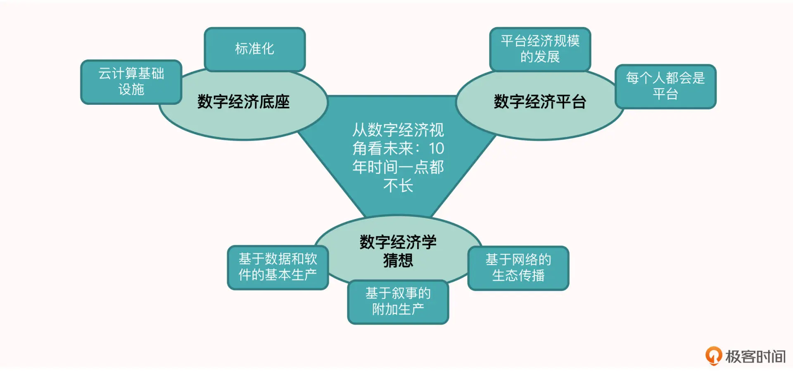

# 09-数字经济：数字化会带来哪些变化？

你好，我是付晓岩。今天这一讲我们从经济的视角，来聊聊数字化会给我们带来哪些变化。

一听说“经济”，是不是又感觉高大上，跟自己没啥关系？其实，“经济”一词在中国古语中，经常被理解为“经世济民”、“经纶济世”，意思就是努力让社会繁荣、人民安居。可以说，经济跟每个人都息息相关，我们每天都生活在经济之中。而数字化会改变我们的生产、生活模式，说的也是经济的改变。

数字经济是国家层面数字化转型中最重要的部分了，这意味着新经济模式将会全面取代旧经济模式。上一次的经济模式切换，是 200 多年前从农业经济向工业经济的转变，我们只能从各种图书、网络资料中去回顾了。而这次向数字经济的转换，我们有机会成为一名亲历者了，可以去感受变化带来的冲击，甚至可以去影响这些变化。至于变化是剧烈的还是温柔的，我们是否能在变化中抓住瞬间的机会，很大程度上取决我们迎接它的姿态。

那怎么调整好姿态呢？说到底是要调整我们的思维和行为：行为和为我们提供生产、生活环境的东西有关，比如数字经济底座、数字经济平台；思维和数字经济学有关，是一个比较新话题。好，数字经济底座、数字经济平台和数字经济学，就是我今天要和你分享的主要内容了。

## 数字经济底座的建立

如果说数字经济对我们未来的生活、工作影响很大，你肯定会关心它的发展节奏。咱们就先看看它的发展节奏取决于什么。

新的经济模式必然需要新的基础设施。所以，我认为决定数字经济发展节奏的第一条，肯定是它的底座。

数字经济既然是以数据、软件、网络为关键元素的经济形态，那必然需要庞大的算力、传输、存储功能来支持。据统计，2020 年我国的数据量已经达到 8060EB，占全球数据总量的18%。等我们在京津冀、长三角、粤港澳大湾区、成渝、内蒙古、贵州、甘肃、宁夏 8 地建设的算力网络国家枢纽节点，张家口等地建设的 10 个国家数据中心集群都完工运行，我们的数据总量还将进一步上升。虽然数据总量不能简单地像矿藏储量那样被计算价值，但是数据量的提升会给基于数据的应用的发展带来巨大潜力。

那这么重要的基础设施，什么时候会真正产生影响呢？按照数据中心一般的建设周期计算，可能要等到下一个五年计划开始（也就是 2026 年）的时候了，也就是至少五年以后才会大规模投产。这么大规模的建设，以及对相关产业的拉动，你想想会影响多少人的职业发展呢？

新建的大型数据中心目前大多是云计算数据中心，所以必然会带来公有云的进一步发展。当然，其形式也可能是行业云、生态云等形式，基于互联的“逻辑一朵云”。总之，这个趋势下，上云的企业将大幅增加，整个经济形态的虚拟或者说计算部分，都将构建在云基础设施之上，成为云原生虚拟经济空间。当然，这要取决于云计算基础设施的发展速度，目前的国家政策是鼓励 5 年内实现 20 万家企业上云。这个速度不能算是很快，等到算力价格大幅度下降时，这个速度就加快了。但是这不仅要等到云设施的完善，还要等到云上应用的进一步完善，也就是云上的 SaaS 软件这块。

云上的 SaaS，也是企业大规模用云需要具备的“基础条件”。你可能会说现在不是有很多SaaS 服务商吗？

是的，但他们正在“头疼”中。大多数企业业务的标准化程度、管理的精细化程度都还不足。这就导致了应用软件的设计很难标准化，加上上云本身的费用，使得很多 SaaS 软件的开发很难走向能够持续盈利的标准化模式。这同样也不会让企业满意，因为他们总觉得自己的需求没有被充分满足。到这里，你就能看到标准化的意义了。只有充分推动国家层面的标准化建设，才能逐步让行业业务统一、规范起来，使得行业级的应用变得容易做一些。

国家政策鼓励行业龙头企业联合软件企业设计行业通用软件，等这些龙头企业执行政策要求时，一定会体会到标准化的重要性。不过，结合基础设施的建设，基于云基础设施实现的行业标准化，也还需要数年甚至十年以上的时间才能真正见效。乐观估计，也得在数据中心五年建设周期的基础上再加五年，也就是十年后，基于云的标准化 SaaS 软件可能会真正的大放异彩。毕竟这个时间不仅取决于软件研发水平，更是由行业和企业管理的标准化水平来决定的。

你可能又要说了，10 年这个时间太长了，跟我眼前没啥关系。但我认为一点都不长，因为时间过得实在是太快了。人生中真正能用来做事的十年没有几个，却没有哪个十年是经得起消磨的。十年的时间一旦被消磨，其导致的差异将是巨大且难以弥补的。

比如说，10 年时间足够一个人从初级的软件使用者成长为业务与技术复合型人才了。如果你总是犹豫这个必然的发展方向跟你有没有关系，而不行动起来，那这 10 年时间产生的差距就很难弥补了。

综上，云计算基础设施和标准化是数字经济的底座，他们的发展速度和水平决定了规模化数字经济的发展速度和水平。从这个时间节奏看，你有充足的时间转变自己。10 年后，也可能用不了那么久，你的新同事就都属于数字原生一代的“新人”了。而他们可能不需要花我们现在这么大力气去转变自己，因为他们本来就是我们未来的样子。

## 数字经济平台的建立

在上一讲我们学习数字化相关的政策时，提到“数字经济从形态上来说，是一种平台经济”。从政策层面看，国家也在鼓励行业龙头企业搭建产业平台，推动产业的数字化转型。同时，也有建议龙头企业将自身科技团队转化为技术公司的。

所以，可以预见的是，平台经济的规模会越来越大，但这未必代表平台企业会越来越大。因为有可能是更多的平台企业基于生态互联、基于国家的跨行业数据库、跨行业数据应用建立起的平台通道，成为跨行业合作。以这些龙头企业为基础，整个生态逐渐连接起来，而且是深度地连接。这是通过数据、网络和软件实现连接的特点，能做到你中有我，我中有你。所以我在这门课程中，一直在和你强调要重视网络带来的生态思维。

平台经济带来的生产模式的变化，需要更好的人机协同的工作模式。比如，大量的制造业都在转向以销定产，就是根据订单进行灵活的生产安排。他们往往都是基于软件去安排生产，比如美的、SHEIN。对于个人来讲，无论是在这样的企业里工作，还是尝试理解这样的商业模式，都需要新的视角。

为了帮助你规划自己调整姿态的最低节奏，咱们也可以看看平台经济可能的发展速度。平台经济还是要建立在云基础设施上的，无论是大型企业自己搞公有云，还是通过国家推动 “新基建”方式建立的云。从时间节奏上来看，未来五年行业级平台数量会增加，但是真正的生态快速发展很有可能是在未来 5~10 年这个阶段中发生。这时，如何运营基于网络的生态，会是很多企业必须要做的，也是你要去学习的。

你可能会觉得有点奇怪，我们今天不就是在做这些吗？

是的。可以仔细观察下，我们周围经常这么想问题的人到底有多少呢？你可能身处互联网行业，身处被它们“带”了节奏的行业，但还有更多的行业还没有渗透这么深，它们还处在转型的初期，还在犹豫到底什么该做什么不该做。

随着企业数字化程度的加深，企业内部线下的人际关系处理转变成了在线协作、在线沟通。这种在线从基于社交软件的生活在线，全面转化成生活、工作完整在线，网络带给人们的行为转变会持续发力。那时，我们才会真正感受到基于网络的平台经济的不同。这些不同，不仅仅体现在点外卖、打车的便利性上，更是让每个人都意识到自己也许有能力在短时间内可以触达几乎整个社会。

面对如此大的可能性，你要如何经营自己，如何管理自己的生态？你自己，有没有可能成为平台经济中的一个“平台”呢？

到这里，我们就从数字经济底座、数字经济平台的角度分析了要转变的行为，那思维应该如何转变呢？这就要从数字经济学的维度来看了。

## 数字经济学的猜想

我们一直在说，数字经济是新的经济模式，那它的基本逻辑是什么呢？要回答这个问题，咱得稍微绕个弯子，先分析下经济学的基本任务，然后再解释数字经济。

加拿大经济学家迈克尔·帕金写了一本畅销世界的教科书《经济学》。他在第一章开头就写道：“从你每天早上醒来的一刻到你每天晚上再睡下的一刻，你的生活充满了选择。”著名经济学家梁小民教授也曾说：“经济学就是一门选择的科学。”

所谓选择，也就是做什么、不做什么。那么，决定选择的是什么呢？机会成本，也就是做一件事但不做另一件事的成本是什么。举个简单的例子。投资中买国债是很安全的，假设买国债的收益是每年能拿到百分之三的利息，如果你做其他事儿拿不到这个受益，就不合适了。这就是机会成本。

机会成本看似简单，但其背后却是经济学思维的基本逻辑，是资源的配置效率。经济学的一个基本假定就是资源是有限的，所以资源怎么用最有效率就是经济学关注的一大重点。这也引申出了已经讨论很多年的一个问题：计划和市场谁更有效率。

从效率出发，经济学也会关注社会循环的过程，尤其是其中的生产和交换，这两大基本环节。有生产才有可以消费的东西，有交换（交易）才能得到想要的东西。而交换的基础则是信息的传播，信息的传播效率决定了你什么时候才能知道一个新产品的存在。如果连这个产品都不知道，自然就没办法消费。

那么，生产和交换在数字经济中会表现成什么样子呢？让我们一起来猜猜。

数字经济下的生产，我认为可能会包括基本生产与附加生产两部分：

- 基本生产部分，可以按照国家政策引申去理解。数据是新生产要素，软件是生产工具，不过不要简单理解为这里没有关于实物的生产。

- 附加生产部分，则可以参考诺贝尔经济学奖得主，罗伯特･希勒（Robert Shiller) 撰写的《叙事经济学》一书中对“叙事”的描述，“叙事”会成为一种附加生产方式。

从数据的角度看，我们也许可以称“叙事”为衍生数据，也就是在基本生产的基础上衍生出来的对生产成果的描述，所以是附加生产。说是附加生产，是因为它可能决定了传播的效率和持久度。但是，“叙事”同样也有两面性，不当“叙事”会演变成我们常说的“过度包装”。

生产过程之后，就进入交换，而交换中越来越重要的就是基于网络的生态。所以，运营这个词在今天才会大量被提起，运营的核心逐渐指向生态的维护。

如果你觉得这段介绍有些抽象，把它转换到你自己的身上就好理解了。基本生产，就是指你的个人能力，附加生产就是你个人 IP 的塑造。我一直认为数字化时代是一个个性化的时代，个体能力在持续增强。你的 IP 就是你在数字世界中的定位和辨识度，每个人或多或少都会有自己的 IP，之后就是基于网络的个人生态构建。

这样是不是就好理解了。小到个人，大到企业，这都是数字时代需要考虑的基本逻辑。

## 总结

今天，从数字经济底座、数字经济平台和数字经济学猜想这三个角度，我和你分享了数字化发展可能带来的变化，以及你该如何面对这些变化。

一句话总结，数字经济是一个基于当前经济中已经出现的商业形态、进一步演化扩大而成的新经济模式。理解了基本生产和附件生产，再结合网络生态就可以理解它的基本模式了。

虽然经济学的范畴远不止于此，还会涉及分配、消费等，进而会延伸到公平、效率、体验，以及经济学的基本问题之一：增长。但是，万变不离其宗，掌握数字时代观察事物的基本分析模式，具有更好的全面视野，而不是总觉得什么都跟自己关系不大，就能更好地理解变化。

所以，我们不要简单地去学习技能，而是全面感受大势的变化，调整好姿态，迎接数字时代。

我把今天的内容总结了一张图，你可以参考下：

## 思考题

你如何看待平台商业模式的发展前景呢？你觉得自己所在的企业是平台经济中的“平台”吗？

欢迎你在评论区留言，我们一起讨论，也欢迎你把它分享给你的朋友，我们一起交流、碰撞。
