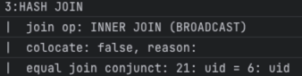
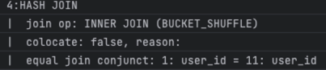
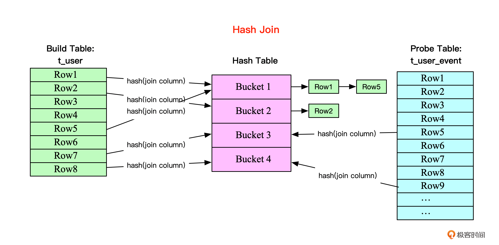
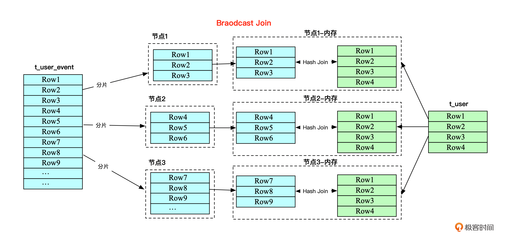
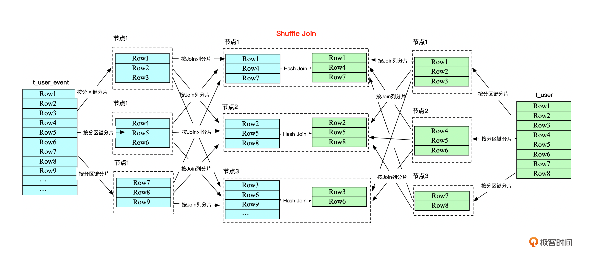
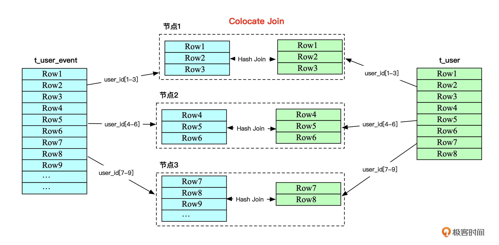
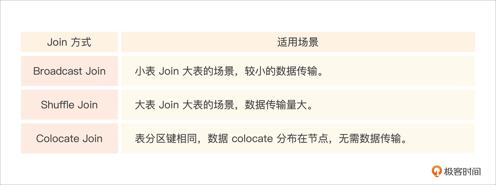

# 06 | 数据分区后，如何应对Join？

你好，我是彭旭。

上一讲，我们介绍了在分布式数据库中合理地分库分表或者分区的方法，还讲了如何裁剪查询时需要扫描的数据，优化查询性能。

但是，分区也会带来一个新的问题。数据表之间通常存在关联关系，一个完整的业务通常需要关联多个表，才能得到最终需要的业务数据。

这节课，我们就来看看数据分区后，分布式数据库是如何处理这种数据关联场景的。

相信这节课，你一定能了解分布式数据库连接的几种方式，以及它们各自的性能表现和适用场景。

## 分布式数据库的几种 Join 方式

为了更好地理解 Join 的各种方式，我给你准备了一个例子。

这是一个基于分布式数据库存储的用户行为管理系统。假设系统包含如下两个表，都以分区 /分片形式存储。

用户表：以 user_id 分区。

```sql
CREATE TABLE t_user
(
   `app_id`      UInt32 COMMENT '应用id',
   `user_id`     UInt32 COMMENT '用户ID',
   `name`        String COMMENT '姓名',
   `email`       String COMMENT '邮箱',
   `avatar`      String COMMENT '头像url',
   `phone`       String COMMENT '手机号',
   `address`     String COMMENT '地址',
   `create_date` DateTime COMMENT '创建时间'
)
```

用户行为表：以 user_id 分区。

```sql
CREATE TABLE t_user_event
(
   `app_id`      UInt32 COMMENT '应用id',
   `device_id`   String COMMENT '设备ID',
   `event_time`  DateTime COMMENT '事件时间',
   `event`       String COMMENT '事件名称',
   `event_json`  String COMMENT '事件详情',
   `user_id`     UInt32 COMMENT '用户ID',
   `create_date` DateTime COMMENT '创建时间'
)
```

现在有个营销需求，我们需要查询出 2024 年 1 月 1 日登录过的用户清单，然后向其发送一个优惠邮件。一个简单的 Join SQL 就可以查询出来我们需要的数据。

```sql
SELECT
   u.app_id,
   u.user_id,
   u.email
FROM t_user u , t_user_event as ue
   where u.user_id = ue.user_id
   and ue.event = 'login'
   and DATE(ue.event_time) = '2024-01-01';
```

然后，基于表的统计信息，数据库的 CBO 会选择一个合适的执行计划，也就是 cost 最小的Join 方式来查询数据。

以 StarRocks 为例，在两个表数据量相差较大的情况下，比如 t_user 表数据量在几万行级别，t_user_event 表数据量在百万到千万以上，那么这个 SQL 的执行计划有一个片段就是这样的：



可以看到，这里采用了一种叫做 Broadcast Join 的方式。

当两个表的数据量相当时，这个 SQL 的执行计划又变成了下面这张图。此时 StarRocks 采用了另外一种叫做 Bucket Shuffle Join 的方式。



总结一下，这里涉及到了 Hash Join、Broadcast Join、Bucket Shuffle Join 这几个概念。而实际上 “Bucket Shuffle Join” 又是 “Shuffle Join” 的一种特殊形式。好了，下面我们就一个个说说这些 Join。

### Hash Join

事实上，Hash Join 是传统关系型数据库中一种高效的 Join 方式。它会对一张表的 Join 列进行哈希处理，将具有相同哈希值的数据行放入同一个桶中，然后将另一张 Join 表的 Join 列同样 Hash 后再进行匹配，最终实现数据连接。

你可以看下这张图，辅助理解。



我们例子里的 SQL，Hash Join 大概可以分为 3 步。

1. 确定 Build Table 和 Probe Table。

Build Table 就是用来构建 Hash 表的数据表。构建 Hash 表之后，Probe Table 会使用 Join 列探测 Hash 表，探测成功就获得一行连接好的数据。

通常情况下，小表会作为 Build Table，大表作为 Probe Table。这里 t_user 表数据量较少，所以它就作为 Build Table。另外一张 t_user_event 就作为 Probe Table。

2. 构建 Hash Table。

将 Build Table（t_user）的每一行数据基于 Join 列（这里是 user_id）进行 Hash 计算后映射到一个 Hash 桶，构建一个 Hash Table。Hash Table 数据一般缓存在内存，如果内存放不下，就需要用到磁盘空间。

3. 探测。

使用相同的 Hash 函数将 Probe Table（t_use_event）的 Join 列映射到 Hash Table 中的某个桶，映射成功之后再从桶里面看看能否找到 Join 列相同的记录。注意，并不是 Hash 映射成功了就 Join 成功，因为 Hash 冲突可能导致一个桶有多条记录。

如果找到了和 Join 列相等的记录，那就算成功匹配，将这一行数据作为结果返回。

其实，Hash Join 是表连接的基础，实际上，另外的 Broadcast Join、Shuffle Join 也只是在Hash Join 上穿上了分布式的皮，接着往下看。

### Broadcast Join

顾名思义，Broadcast Join 就是广播连接，意味着将 Join 的 A 表的所有数据通过广播的方式分发到 Join 的 B 表所有所在的节点。这种情况下，因为需要网络传递整个 A 表的数据到 B 表所在的 N 个集群的节点，所以 A 表的数据量一般较小，而 B 表数据量较大。换句话说，广播连接适用于小表连接大表的情况。

下面这个图就描述了小表 t_user 与大表 t_user_event 进行广播连接的过程。t_user 表的所有数据都会复制到 t_user_event 表分区数据所在的每个节点的内存，然后与这个节点上t_user_event 表存储的分区数据进行 Hash Join。



好，我再问一个问题。我们知道了，Broadcast Join 适合小表连接大表的场景，那么如果两个分布式表都是大表呢？这时候执行引擎就会选用 Shuffle Join。

### Shuffle Join

Shuffle Join 将 Join 的 A、B 表都按照 Join 列重新进行分区，然后将 A、B 表分区后的数据匹配 Join 列放到同一个节点。这样就可以将两个大表的 Join 分而治之，划分为多个小表的Join，充分利用集群资源并行化。

像下面这个图一样。



Shuffle Join 将原来已经分区的表数据打乱，重新按照 Join 列分区后，将两个表相同 Join 列的分区传输到同一个节点。所以，有可能出现需要将 A、B 表的所有数据都在集群中传输一次的情况，那可能就会影响性能。那应该怎么办呢？

在分区或分桶的场景下，我们假设 A、B 表做 Join，如果 Join 列是 A 表的分区 / 分桶列，那么 A 表的数据其实可以不用去移动。B 表通过向 A 表的数据分桶发送数据就可以完成 Join 的计算。这就是 Bucket Shuffle Join，它相当于在 Shuffle Join 上减少了 A 表的数据传输，提升了性能。

再进一步，其实还有一个最理想的 Join 模式 Colocate Join。它会将数据与计算都本地化，最大化提升性能。

### Colocate Join

在我们的例子中，t_user 表与 t_user_event 表都是基于 use_id 分区的。如果两个表分区 / 分桶的数量相同，而且正好相同分区范围的数据都由同一个服务器节点存储，那么这两个表的Join 是不是就只需要在每个节点分别 Join，然后再将 Join 后的数据汇总就得到 Join 结果了呢？

就像下面这张图。



t_user 与 t_user_event 两个表的数据由 user_id 分成了 3 个分片，正好两个表的 user_id[1-3]分片数据都分布在节点 1，user_id[4-6]分片的数据都分布在节点 2，user_id[7-9]分片的数据都分布在节点 3，以此类推。

这样两个表由 user_id 做 Join 的时候，相同 user_id 范围的数据正好分布在同一个节点机器了，所以整个分布式表的连接都可以转化为多个本地表的连接，也无需在集群间传输数据，大大提升了连接性能。

好了，最后来总结一下，在分布式数据库中，这几种表 Join 方式的适用场景。



了解了几种 Join 方式之后，咱们再看看课程里要讲到的几种数据库表是如何 Join 的。

## HBase 表如何 Join？

HBase 虽然是一个数据库，但是本身是不提供 SQL 语言支持的，所以原生上是不支持多表Join 的。我们只能通过程序查询出主表数据，再根据主表数据补充子表相关内容。

不过，Phoneix 为 HBase 提供了一个 SQL 引擎，能够将 SQL 转化为 HBase 原生的 API 进行数据操作。但是，我的建议是避免在 Phoenix 中使用 Join 操作，尤其是处理大型数据集时。因为 Phoenix 的 Join 操作相对于传统关系型数据库更复杂，而且可能对性能产生很大影响。

由于 HBase 的优化目标是大规模数据集的读写性能，而非复杂关联查询，所以，执行 Join 可能导致查询速度下降并影响整个集群性能。

## ClickHouse 表如何 Join？

ClickHouse 在使用模式上是建议使用一个大宽表的模式，而尽量避免 Join。这样能更好地利用 ClickHouse 的并行计算和向量化查询优势。尽量避免 Join 操作，避免数据在不同表之间进行频繁的关联操作，从而减少查询的复杂度，提高系统的整体性能。

不过，很多时候还是避免不了 Join，我们简单说说。

ClickHouse 中因为涉及分布式表与本地表，如果两个分布式表进行 Join，那么假设为 A JoinB，处理过程大致如下。

1. 将 SQL 中分布式表 A 转化为 A 的本地表，然后 SQL 分发到各个节点执行。

2. 在每个节点执行 SQL 时候发现，B 也是分布式表，然后就会去其他所有节点执行 B 对应的子查询，拉取数据。拉取到数据后再本地执行 Join 操作，Join 成功后得到数据。

3. 最后将第 2 步所有节点 Join 成功后得到的数据汇总，返回最后的结果。

你应该发现了，这个过程其实就是两个遍历循环，类似一个笛卡尔乘积的 Join，这样开销就很大了。所以，我们应该尽量避免这种分布式表之间的 Join。不过据字节跳动的一些分享，他们内部对 ClickHouse 做了一些改造，也实现了将两个分布式表之间的 Join 转化为 ColocateJoin。顺着这个方向，你也可以思考下，如果是你会怎么做？

话说回来，如果某些业务场景确实需要在 ClickHouse 中进行一些关联多表的复杂查询，建议可以先试用 Spark、Flink 之类的任务，将数据先进行预处理形成大宽表。然后基于这个宽表查询，毕竟这也是 ClickHouse 擅长的。

## StarRocks 表如何 Join

前面我们例子中查看 SQL 执行计划的时候，StarRocks 自动为两个表的 Join 选择了最高效的一种 Join 方式。根据官方的一些性能基准测试，StarRocks 在多表连接上的性能要超过ClickHouse。对于星型或者雪花模型进行建模的支持上，StarRocks 的支持要更好。

StarRocks 基于代价的执行引擎会自动帮我们选择哪个表作为驱动表、使用什么样的 Join 方式。执行引擎会基于统计的信息，自动帮我们重写，优化 Join 与查询。

不过有一点要注意，如果需要用到 Colocate Join，StarRocks 在创建需要关联的表时，需要

```
为这些表指定同样的配置参数值 colocate_with ，并且，这几个关联的表需要满足几个条
```

件。

1. 设置同样的分桶键，分桶键的类型、数量、顺序完全一致。

2. 设置相同的分桶数量，以便相同键的数据划分到同一个桶。

3. 设置相同的分区副本数，这样就能够保证每个节点上都能够同时具备这几个关联表的一个副本。

看下具体代码。

```sql
CREATE TABLE t_user_event
(
   `event`       varchar(64) COMMENT '事件名称',
   `event_time`  date COMMENT '事件时间',
   `user_id`     bigint COMMENT '用户ID',
   `app_id`      bigint COMMENT '应用id',
   `device_id`   varchar(64) COMMENT '设备ID',
   `event_json`  varchar(64) COMMENT '事件详情',
   `create_date` date COMMENT '创建时间'
)
DUPLICATE KEY(`event`,`event_time`)
PARTITION BY (`event`,`event_time`)
DISTRIBUTED BY HASH(user_id)
PROPERTIES (
   "replication_num" = "1",
   "colocate_with" = "user_id"
);
```

## 小结

不同类型的 Join 对查询性能影响很大，我们在业务设计过程中应该尽量避免复杂的 Join。比如阿里巴巴 Java 编码规范就禁止在业务系统中超过 3 个表的 Join。这也是为什么之前复杂的存储过程在逐步消亡。

Colocate Join 是分布式数据库中大表 Join 的一个最优解。它通过优化数据分布，将分布式的表连接转化成了多个小的本地表连接。其次是 Bucket Shuffle Join，最后是 Shuffle Join。

小表与大表连接则使用 Broadcast Join，不过可能带来集群网络传输上的压力。

数据库层面看，HBase 不支持 SQL 语言，只提供了一些数据访问 API。ClickHouse 则优选宽表的查询。StarRocks 则对 Join 支持更好，如果业务上存在星型 / 雪花模型的需求，比如事实表与多个维度表的灵活分析，可以选用 StarRocks。

## 思考题

考虑到数据传输、本地化，Colocate Join 是正常情况下性能最优的一个选择。但是从并行度与扩展度上来讲，你觉得 Colocate Join 一定优于 Shuffle Join 吗？

欢迎你在留言区和我交流。如果觉得有所收获，也可以把课程分享给更多的朋友一起学习。欢迎你加入我们的读者交流群，我们下节课见！
