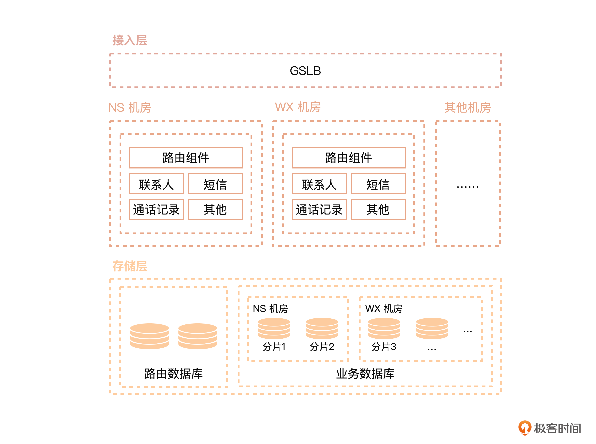
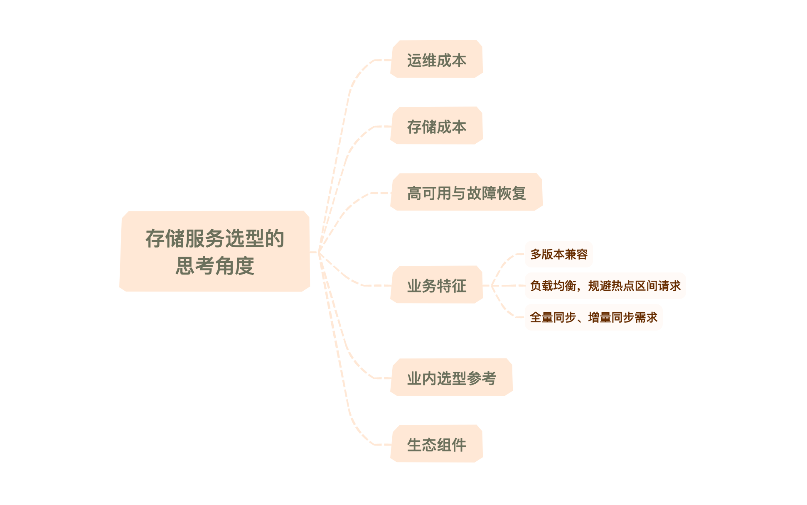

# 07 | 从一个手机云服务数据存储的需求开始

你好，我是彭旭。

前面的课程我们介绍了一些数据库基础知识，也对比了一下我们要介绍的几个数据库。

这节课开始，我们就要介绍 HBase 相关的内容了，让我们从一个实际的案例出发。

这节课，我先介绍一个手机云服务数据存储的系统架构的演进，在存储成本、可伸缩性、数据备份等方面的需求。

后面的课程再来看看 HBase 是如何满足这些需求的。希望这几节课能够给你一个选型的参考，同时也在学习的过程中理解 HBase 的用法与原理。

## 基于 MySQL 的手机云服务架构

2017 年左右我在魅族开始负责 Flyme 系统的云服务，云服务包括用户的通话记录、短信、联系人的同步等。当时 Flyme 系统的总用户数近亿，月活千万级。最开始，Flyme 采用 MySQL存储这些用户的数据。

云服务的业务很复杂，尤其是同步协议这块，在同步策略上包括慢同步、快同步。一次同步也分为了 4 个阶段，分别为 Request、Submitdata、Getdata、Result。

因为我们专栏主要聚焦在数据库存储，所以我们简化一下业务逻辑，主要聚焦在存储层。简化版本的系统架构如下图所示。

可以看到这个简化版本的架构分为 3 层。

第 1 层是接入层，叫做 GSLB（Global Server Load Balancing，全局服务器负载均衡），用来做请求的路由，将用户请求定位到最近的机房。

第 2 层是服务层，由多个单元化的机房组成。每个机房部署了一套完整的服务，能够单独提供所有的服务。

第 3 层是存储层。注意，这里有一个路由数据库，这个路由数据库搭配了路由组件，为用户找到数据所在的机房。每个机房存储了一部分用户的数据，所有机房的用户数据加起来才是一份完整的数据。这就相当于每个机房都只是一个横向的用户数据分片。当然，每个机房的数据库都做了主备容灾。

高峰时期总计有一百多台 MySQL 服务器，用分库分表的方式来存储用户的云服务数据，这些服务器分布在南沙、无锡、香港等多地的机房。

每个客户端发起的用户请求，都会通过 GSLB 找到用户数据所在的机房，然后，客户端就会请求对应机房的服务。业务层也有一个路由组件，为用户找到数据对应机房提供最后一层保障。

服务层访问数据库的时候，会通过一个自定义的数据源来获取用户对应数据库的连接。当时我们的技术团队自己研发了一个分库分表的路由 SDK，这个 SDK 会查询一个元数据库，找到用户数据所在的数据库实例。然后，它就能和数据库实例建立 JDBC 连接了，最后，把建立的JDBC 连接返回给服务层进行数据读写操作。

不过，当用户量与数据量越来越大，这个系统就暴露出了一些问题。

首先，存储成本高。高峰期一百多台 MySQL 服务器，都用的是 SSD 磁盘，每年成本数百万。

其次，运维成本高。随着用户量、数据量增加，就需要手动增加数据库实例，配置新增加的数据库实例接收新用户，或者将旧用户的元数据、云服务数据迁移到新的数据库实例。每次新增数据库实例都需要运维、开发一起在凌晨非业务高峰期协助、上线、验证，维护成本高。

最后，开发成本高。团队研发了各种路由组件（如 GSLBRouting、FilterRouting、DBRouting）来保障用户的请求，希望在各种场景下都能够路由到用户数据所在的机房，研发存在很高的学习、理解成本以及新业务研发成本。

这时企业也开始了降本增效，那么，有没有一个存储方案能够在降低各种成本的同时，仍然能够提供实时高并发的随机存取呢？

这节课请你先代入角色，和我一起看一下这个新的存储方案需要考虑的一些关键点。

### 关键一：运维成本

显然，需要解决的最大痛点在于数据量增长时，如何实现无需侵入业务系统，无需研发资源介入的动态扩展。不再跟过去一样，需要运维、开发一起多方协同在凌晨停机进行扩容，甚至还需要迁移数据。

动态扩容、弹性伸缩这两个在云原生时代运维的标准配置，也是我们新的存储方案必须要解决的问题。

### 关键二：存储成本

为了保障请求的及时响应，在 MySQL 存储中我们基本都采用 SSD 磁盘，这带来了极大的成本压力。这每年数百万的硬件成本，随着数据量的增长还需要不断地扩容。所以，如果能够使用普通的机械硬盘，也能达到一定程度上的实时响应，还能节省很大一部分硬件成本。

而且从业务角度来看，大部分的同步请求都是在手机后台进行的，所以对实时性的要求不像那些包含用户互动要求的服务高。另外，考虑到有些服务也不只在手机端后台进行，也有一些用户交互的界面，比如在 Web 端也能做联系人的查询与更新，我们也希望能做到秒级的实时存取。

### 关键三：高可用与故障恢复

其实前面说的多机房本身是一个单元化的设计，因为我们希望做到多机房的高可用与灾备。

虽然服务上是无状态的，可以基于容器 K8s 部署弹性伸缩，但是因为存储成本的巨大压力，如果每个机房都存储一份完整数据，那整个成本需要翻倍，有几个机房就翻几倍。

所以，新的存储引擎能否在降低成本的同时，满足多机房的数据实时复制呢？换句话说，就是支持数据分片以及多集群间数据复制，从而实现多机房的高可用与故障恢复。

### 关键四：多版本兼容

我们知道，存在手机客户端版本的业务，用户一般都不会及时升级甚至不升级。这就导致同一时间会存在很多个不同的客户端版本，而服务端一般只有一个版本。那么服务端升级的时候就需要考虑各个客户端版本的兼容。从存储层面来说，每个客户端版本的数据结构可能不一致。所以服务端需要维护一个最全面的客户端字段表。

还有，当需要调整服务端表结构来适配客户端字段调整需求的时候，因为表数据量很大，如果直接执行 DDL 修改语句，就会长时间锁住整张表，那就只能走大表 DDL 的模式。也就是说，需要新建一个表，然后把数据从旧表导出，批量写入新表。最后再做个新旧表切换。

所以这里引申出一个需求，存储引擎能否支持表的动态 schema，适应不同客户端多版本，不同字段的需求。

### 关键五：负载均衡与规避热点区间请求

云服务的数据也符合“局部性原理”。一般来说，新用户产生的数据比较多，而且使用上也更频繁。所以存储引擎需要能够将这些新用户数据打散分布到集群的各个节点，充分利用集群的能力。

### 关键六：全量同步与增量同步需求

云服务同步的时候，简单来说，会涉及两种同步场景。

第 1 个是新手机启用的时候，需要从云端做个全量同步到手机。第 2 个是使用过程中一些数据的修改需要增量同步。

所以，数据库需要支持基于用户 ID 的批量拉取，也支持修改了数据后的单行或者多行的实时读写。也就是说，对数据的写入需要做到强一致性。

当然，还有一些其他的保障性需求，比如在迁移过程中如何保障数据的一致性，如何双写以保障系统的顺利平滑过渡，这里就不再展开。

## 选型结果

基于这些需求，我们开始选型一些分布式数据库，如 HBase、Cassandra、MongoDB 等。经过一系列的评估验证，最后选定了 HBase。

除了 HBase 能够很好地满足上面提到的功能性与非功能性需求外，选定 HBase 其实还有几个原因。

首先，团队内部本身当时有用 HBase 做一些服务的存储引擎，比如时光机。所以团队在HBase 的使用与运维上有了一定的知识储备。注意，这个很重要，否则一旦集群出现问题，可能会出现不知道从何着手的情况。

其次，业内有些手机厂商就是使用 HBase 来做云服务的存储的，所以 HBase 作为云存储的方案其实是经过了验证的。

再次，云服务存储都是根据用户 ID 做数据存取的，后面你会看到，这种情况下，将用户 ID 作为 HBase 的行键前缀，可以很好地将每次需要读写的数据限定在一定的范围内。

最后，HBase 作为 Hadoop 生态的一部分，后续也可以更方便地与 Hadoop 生态的组件进行集成和协作，做数据分析。

后面我们做了一些 POC，也验证了 HBase 能够满足上面提到的各种需求，能够降低成本，性能也能基本满足，所以最后就确定了 HBase。

接下来的几节课，我们会开始介绍 HBase 的原理与使用。你可以在学习过程中一起思考HBase 是如何满足上面这些需求的。

## 小结

HBase 的出现是为了弥补 Hadoop 生态体系中实时随机存取能力的不足，为大数据时代的数据库带来了深远的影响。在数据存储上提供了 PB 级以上的能力，同时在性能上也只是稍弱于传统关系型数据库。

现在，很多公司也都有使用 HBase 作为核心业务的存储系统，比如阿里、小米、腾讯等。所以其实我们在云服务迁移中选用 HBase 可以说是一个水到渠成的结果。

当然整个迁移过程也遇到了一些问题，比如 HBase 如果 Region 拆分不合理，可能导致热点问题，又或者如果 Major Compact 发生在业务高峰期，对系统响应时长影响会很大，甚至引起系统雪崩。当然这些问题都可以通过合理设计去避免。

如果你想在生产环境使用 HBase，用在高并发的 OLTP 系统上，一定需要深入了解 HBase 的原理，知道一些调优手段，然后针对各个业务场景去测试性能能否满足。比如在云服务场景下，用户的实时要求没那么高，那些使用 HBase 对性能的影响，其实用户是无感知的。

## 思考题

本文我们描述了 Flyme 云服务从 MySQL 迁移到 HBase 的原因，你还在哪些场景碰到过使用HBase 做为存储引擎吗？

欢迎你在留言区和我交流。如果觉得有所收获，也可以把课程分享给更多的朋友一起学习。欢迎你加入我们的读者交流群，我们下节课见！
