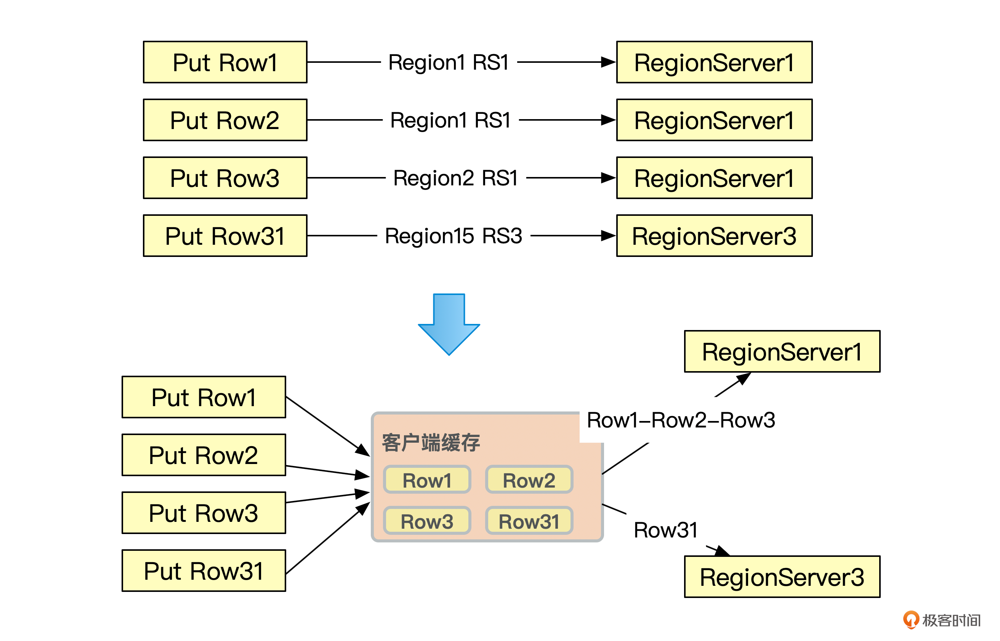
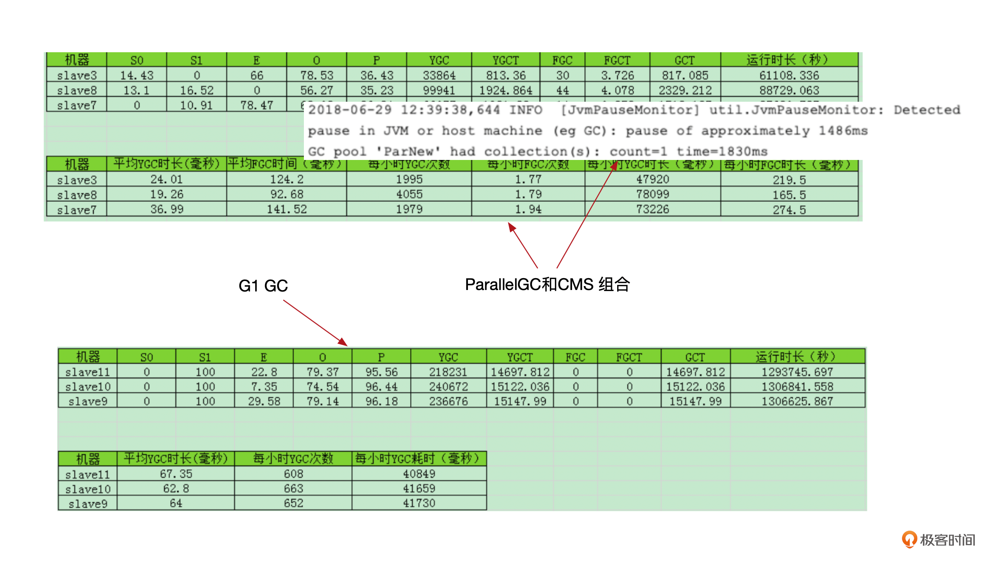

# 12 | 还有哪些调优可以提升性能？

你好，我是彭旭。

上节课我们整体了解了手机云服务系统基于 HBase 存储的架构设计，以及迁移过程遇到的一些问题。

这节课我们聚焦在性能问题上，看看还有哪些调优的手段。

首先从客户端着手。不过，客户端实际上不能调优性能，只能用来减轻服务端的压力。

## 客户端调优

那客户端怎么减轻服务端压力呢？

第一个方法，批量提交。HBase 客户端对数据的变更等都需要跟 RegionServer 进行 RPC 通信。默认情况下，每一个操作都会发起一个跟 RegionServer 的 RPC 请求。

像下面这张图一样。Put 插入 4 行数据，需要跟 RegionServer 服务器进行 4 次 RPC 通信。



为了提高数据传输效率，减少建立连接的时间和 I/O 消耗。我们可以使用 BufferedMutator，将数据的变更在客户端缓存，等变更的数据量达到配置的缓存大小后，再批量发送到服务端，减少 RPC 调用次数。

可以看到，启用客户端缓存后，这 4 行数据的修改从原来的 4 个 RPC 请求，减少到了 2 个RPC 请求。

当然，客户端缓存数据有一个风险，就是客户端程序如果出现故障，比如宕机，那修改的数据可能就会丢失。

第二个方法，就是设置合理的重试次数与间隔。当客户端捕获到了非 DoNotRetryIOException子类的异常后，HBase 客户端就会发起重试，客户端重试的目标是请求出错后能够得到及时响应，但是也要避免重试过多、过快，给服务端带来过大的压力，导致服务端雪崩。

HBase 客户端重试机制的核心是退避算法。退避算法是指每次重试的间隔时间会按照一个递增的规则进行增长。重试次数与每次重试的间隔由两个配置决定。

1. hbase.client.pause：重试的休眠时间系数，如 100 毫秒。

2. hbase.client.retries.number：最大重试次数，1.x.x 默认为 35，2.x.x 调整到了 15，建议减少，如 5。

## 服务端调优

客户端调优比较简单，其实也解决不了核心问题，所以，重点还是服务端调优。而服务端调优主要是让单次读写更快。

我们先从存储上看看有什么优化。

### 存储层：HDFS 配置多磁盘

前面提到，HBase 能够使用机械磁盘存储的很大一个原因，是通过 LSM 将随机写入转化为了顺序写入。其实还有一个原因就是，存储的数据节点可以配置多磁盘读写。

挂载多个磁盘后，数据可以并行地从这些磁盘读写，提升系统吞吐量与性能。避免少数个磁盘引起的性能瓶颈。

因为 HBase 其实是基于 HDFS 存储，所以我们可以在 HDFS 的 hdfs-site.xml 文件里面配置多磁盘路径。下面这段代码演示了如何配置多磁盘。

```xml
 <!--指定HDFS DataNode数据存储的路径，一般建议一台机器挂载多个盘，一方面可以增大存储容量，另
   一方面可以减少磁盘单点故障以及磁盘读写压力-->
 <property>
   <name>dfs.datanode.data.dir</name>
   <value>
     /home/hadoop/data01/dn,/home/hadoop/data02/dn,/home/hadoop/data03/dn,/home/
   </value>
   <final>true</final>
</property>
```

其实 HBase 作为一个 HDFS 客户端，是通过 RPC 请求来读取 HDFS 数据的，这里可以通过开启短路径读，将 RPC 请求转化为本地文件读写。

### 网络层：开启短路径读（Short Circuit Local Reads）

我们知道，HBase 集群的每个节点，一般都会同时部署 HDFS 的 DataNode 和 HBase 的RegionServer。这样有利于计算与数据在同一个节点发生。

如果 HBase RegionServer 作为 HDFS 客户端读取数据的时候，数据与 RegionServer 在同一个节点，这个就叫做“本地读”，反过来就叫做“远程读”，也就是 RegionServer 需要去其他的HDFS 节点读取数据。

当然，HBase 会有一些数据本地化的策略。比如 Major Compact 的时候，会将多个小的StoreFile 合并成一个大的 StoreFile，这个大的 StoreFile 就会存放在负责该分区的RegionServer 的同一个节点的 DataNode 上。

但是默认情况下，不管“本地读”还是“远程读”，都需要经过一层 RPC 到 HDFS 的数据读取。开启短路径读配置后，在“本地读”的场景下，就可以“消除”掉这个 RPC 调用，转化为一个本地文件读取。

短路径读用到了一种叫做 Unix Domain Socket 的进程间通信方式，让同一台机器上的两个进程以 Socket 的方式通信，用来传递文件描述符。

举个例子吧，我们假设，机器上的两个用户 A 和 B，A 拥有访问某个文件的权限而 B 没有，而 B 又需要访问这个文件。借助 Unix Domain Socket，可以让 A 打开文件，得到一个文件描述符，然后把文件描述符传递给 B，这样就可以让 B 即使没有文件的权限也能读取文件内容。

在我们的场景里面，A 就是 HDFS 的 DataNode，B 就是 RegionServer，需要读取的文件就是某个存储在 DataNode 的 StoreFile。

短路径读同样也是 HDFS 层的一个优化，需要在 hdfs-site.xml 文件里面配置，具体如下。

```xml
<property>
 <name>dfs.client.read.shortcircuit</name>
 <value>true</value>
</property>
<property>
 <name>dfs.domain.socket.path</name>
 <value>/data/hadoop/dn_socket</value>
</property>
```

好，看完存储层的优化，再来看看模型层有什么优化。

### 模型层：DDL 优化

前面几节课，其实有提到一些建表层面的优化，这里再来整体整理一下。

先来看一个建表的语句。

```
create 's_opt' , {NAME => 'cf', DATA_BLOCK_ENCODING => 'FAST_DIFF', BLOOMFILTER =
```

你可以看到，前面提到的使用数据块编码、布隆过滤器、数据压缩、预分区，都是在建表的时候指定。

通过数据块编码与压缩，我们可以优化数据的存储空间与提取，提升数据的读写吞吐量。

通过预分区，让分区均衡地分布在集群节点。这里预分区后，一般也会禁止自动分区与主压缩，避免系统业务高峰期分区 Split 或者 Compact 引起系统抖动。

注意到建表语句里面还引入了一个叫做 IN_MEMORY_COMPACTION 的配置，这个配置把LSM 的逻辑引入了 MemStore。通过在内存中合并 MemStore，减少将数据刷写到磁盘的次数，降低了写入导致的额外开销，减少了磁盘空间的占用。并且在数据仍然在内存中时就去除冗余。

这个配置降低了 MemStore 刷盘的频率，从而提升了写入性能。此外，磁盘上的数据越少，对于块缓存的压力就越小，命中率就会更高，最终读取的响应时间也会更短。

最后，较少的磁盘写入意味着后台执行的 Compaction 操作也会减少，减少了资源的占用。总的来说，内存合并的效果就像是一个催化剂，可以让系统整体运行速度更快。当然这里的副作用是内存的占用会增加。

IN_MEMORY_COMPACTION 有 4 个选项。

1. NONE: 不启用。

2. BASIC: 默认的策略，这个策略不清理多余的数据版本，而是将数据索引修改为一个更加紧凑的实现，在所有的读写模式下都能够带来收益，单元格越小收益越明显。

3. EAGER: 这个策略会过滤重复的数据，清理多余的版本，类似于 LSM 对 StoreFile 做的合并处理逻辑，该模式适用于数据更新频繁或工作集较小的场景。

4. ADAPTIVE: 通常系统会根据数据 Cell 的重复情况来决定是否使用 Eager 策略，该策略计算重复 Cell 的比例，如果比例超出阈值，则使用 Eager 策略，否则使用 Basic 策略。

最后再来看看应用层 JVM 内存方面的调优。

### 应用层：JVM 调优

我们知道，JVM 的 GC 会引起应用程序的“暂停”，引起系统响应的抖动。配置不当的 JVM 内存也容易出现 OOM 异常。所以配置合适的 JVM 内存与 GC 算法非常重要。因为读写主要由HBase RegionServer 提供服务，所以这里我们以 RegionServer 为例，来看看 JVM 内存参数如何配置。

首先，配置 JVM 内存参数时，我们需要给机器预留 10% 以上的内存，避免服务器内存占用过高，内存使用量排第 1 的进程被系统强制 Kill。

其次，HBase 堆内存配置一般 16G 以上，通常在 32G。因为默认 MemStore 刷新阈值是128M，太小的堆内存，MemStore 总大小容易超过堆内存的全局 MemStore 最大值比例，导致需要刷新输出，产生大量小文件，影响读写性能。

最后就是选用合适的 GC 策略，Java 8 GC 一般有两个选择，一个是 ParallelGC 跟 CMS，另外一个是 G1 GC。

这里我在一个生产集群下面，在硬件配置相同的不同节点上，采用不同的 GC 策略做了一个测试，下面这个图列出了两个 GC 策略下，GC 耗时的一个对比。



从测试结果可以看出 G1 GC 的两个优势。

第一个是 GC 时长的对比，相比之下，CMS 每小时的 GC 耗时差不多是 G1 GC 的两倍。

第二个是 CMS GC 下，RegionServer 的日志里面，经常会有图中这种 pause，也就是 “stop-the-word” 的日志，这个会影响到请求的响应时长。

所以，一般生产环境都建议使用 G1 GC 了。这里也有一个建议的 JVM 内存配置参数。

```
-XX:+UseG1GC -Xmx24g -Xms24g -XX:MaxDirectMemorySize=26g -XX:SurvivorRatio=3 -XX:
```

### 小结

从调优效果来说，最有效的还是表的分区，将表的数据均衡的分区并分布到集群中，还有设计合适的行键来减少数据读取时需要扫描的数据量。再次强调，基于行键的单行读取性能是最好的，其次是少数行的区间扫描。

当写入数据量很大时，可以启用编码与压缩，减少数据传输带宽占用以及磁盘存储空间。一般压缩算法压缩比例都能达到 50% 以上，但是会带来 CPU 资源的占用。

垃圾回收上，JDK11 开始推出了低延迟的垃圾回收器 ZGC，但是 JDK8 仍然最兼容 HBase、Hadoop 的版本，生产环境一般都在使用 JDK8，所以 G1 GC 仍然是 HBase 垃圾回收的首选。

最后，系统层面也有一些配置需要注意，否则很有可能引起系统不可用，包括禁用 swap 空间和用户可打开的最大文件数。启用 swap 空间后，CPU 可能需要处理大量的页面置换工作，导致 CPU 100%。HDFS 读取数据的时候，可能需要打开成千上万个文件，如果超过了配置的用户可打开的最大文件数，会抛出 “Too many open files” 异常。

## 思考题

其实很多时候 RegionServer 的压力都是不合理的客户端请求造成的，比如一次 Scan 太多数据，你觉得 Scan 操作应该如何调优。

欢迎你在留言区和我交流。如果觉得有所收获，也可以把课程分享给更多的朋友一起学习。欢迎你加入我们的读者交流群，我们下节课见！
