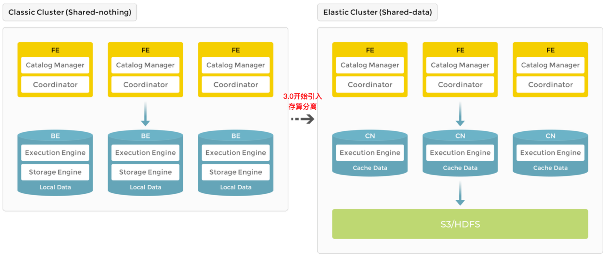
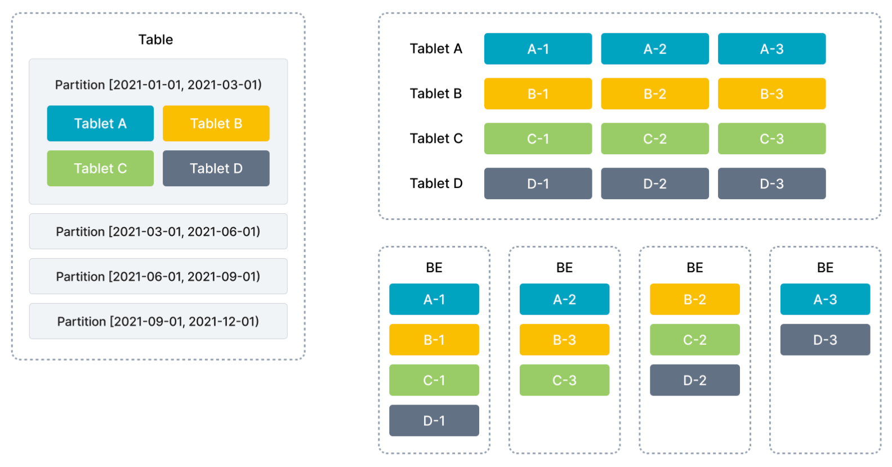

# 14 | 技术上，StarRocks如何应对CDP需求？

你好，我是彭旭。

上一讲我们分析了 CDP 的业务场景，CDP 从各个渠道收集用户业务数据、行为数据后，根据规则为用户生成标签画像。显然收集、清洗后的数据越多，就能产生更多的标签，对用户的画像也就越丰满。所以这节课，我们先来看一下 StarRocks 在技术架构上是怎样满足亿级数据的存储与快速分析的。

学完这一讲后，希望你能了解几个知识点。

1. StarRocks 集群包含哪些组件，每个组件的作用，组件之间如何协作。

2. 为什么要存算分离，存算分离有什么优缺点。

3. StarRocks 如何分布数据。

首先来看一下 StarRocks 的系统架构。

## StarRocks 系统架构

提到 StarRocks 就不得不说 Doris，Doris 最初是百度为解决凤巢广告系统，报表统计的需求而开发的，后来贡献给 Apache，成为开源社区的一员。2020 年百度 Doris 团队的一部分成员离职创业，他们基于 Apache Doris 开发了一款商业化闭源产品，命名为 DorisDB。这就是StarRocks 的前身。

后来因为 DorisDB 和 Apache Doris 名字很像，为了避免版权纠纷，DorisDB 改名为StarRocks。

StarRocks 在设计和架构上参考了 Impala、Presto 这类 MPP 分析引擎的思想，甚至在组件功能上也非常相似。

我们先来看看一个典型的 StarRocks 集群有哪些组件，每个组件的负责什么功能。

第一个叫做 FE（Frontend），FE 人如其名，从功能上来说，类似餐馆的“传菜员”，接收前端的请求并处理后传递给 BE。从图中可以看到，FE 包含两个组件：Catalog Manager 和Coordinator。

Catalog Manager 主要用来管理元数据，比如数据库、表、列、索引、分区等的定义和属性。

Coordinator 接收客户端的请求，对 SQL 语句进行解析与执行计划优化，然后将任务分发给集群节点执行。这个过程也会与 Catalog Manager 协作，获取元数据来优化查询的执行计划与数据分发策略，提升查询的效率与准确性。

FE 节点有几种角色类型：Leader、Follower、Observer。其中，Leader 负责管理元数据的读写服务，有权限进行读写操作。Follower 在 Leader 失败的时候，能够参与选举。Observer 不参与选举，只用来同步日志，扩展读性能。

第二个组件叫做 BE（Backend）。BE 就是餐馆真正的“厨师”，负责数据查询请求，像烹饪食物一样，经过处理和计算，最终呈现用户需要的数据结果。BE 也包含两个组件：ExecutionEngine 和 Storage Engine。

Execution Engine 负责执行查询计划中具体操作的关键组件，通过数据的读取、过滤、计算和聚合等操作，实现高效的数据处理和查询执行，系统的性能与响应速度就由它来决定。

Storage Engine 负责数据的存储、压缩、索引、分区、数据多副本的一致性保障等，通过高效的数据存储与管理，为前端提供可靠的存储与服务保障。

你会发现，StarRocks 的组件不多，相对分工也清晰，所以后来它在架构升级，从支持“存算一体”到 3.0 以后同时支持“存算分离”的时候，其实就只需要替换掉里面的 Storage Engine。

## 从存算一体到存算分离

我一直觉得数据库追求性能是最核心的要素，但是后来看到 Snowflake 因为产品对弹性扩展性、多云支持的亮点，上市后估值高峰期超过千亿美元，这才发现，原来大家对成本的诉求也是如此巨大。

那 StarRocks 支持存算分离又有哪些出发点呢？

我认为最主要的问题就是成本问题。StarRocks 使用多副本来保障数据可靠与高可用，导致存储资源扩容的需求可能大过计算资源，而扩容时一般是存储与计算同时扩容，这样会导致更昂贵的计算资源浪费。

而官方还提到了两点。

- 存算一体架构需要维护多数据副本的一致性，增加了系统的复杂度。存算一体模式下，扩缩容会触发数据重新平衡，弹性体验不佳。

这两个问题，其实只是把实现下沉到了云存储层去实现，简化了数据库层的逻辑。

在存算分离架构下，BE 被移除了 Storage Engine 组件，这时候 BE 叫做 CN（ComputeNode），CN 节点本地不存储数据，不过可以缓存数据，数据可以存储在兼容 AWS S3 协议的对象存储系统（其实国内的阿里云 OSS、腾讯云 COS、百度云 BOS、华为云 OBS 以及MinIO 等都兼容）和 HDFS 上。

总结一下，StarRocks 支持“存算一体”与“存算分离”架构，FE 与 BE 各司其职，支持集群部署，一般 FE 要求奇数个节点以便选举，BE 节点的数量则取决于数据规模与计算需求。

这里提一下，一个 FE 节点可以应对 10 到 20 个 BE 节点，所以 FE 建议部署 3 个节点，组成HA 模式，即可以满足大部分需求。

那在集群中，数据又如何分布呢？

## 数据分布

前面课程我们有提到，StarRocks 的数据支持分区分桶。

一个表的数据，根据一列或者多列进行分区，比如我们的用户行为表，可以根据事件时间分区，注意自从 V3.0 起，StarRocks 支持表达式分区，这种情况下自动创建分区数量上限默认为 4096，你可以通过修改配置参数 max_automatic_partition_number 来调整这个值。

分区后，每个分区还可以根据一列或者多列进行 Hash 分桶，比如用户行为表，根据事件时间分区后，再以用户 ID Hash 分桶。

这样我们可以通过分区键，在统计查询的时候，过滤掉不需要扫描的分区，同时分区后，Hash 分桶又可以避免数据倾斜，避免存在热点问题。

分桶后的数据片段叫做 Tablet，这也是 Bigtable 的叫法。

类似 HBase 的 Region，Tablet 是数据分布与均衡的最小单元。

默认情况下，StarRocks 会为每个 Tablet 维护 3 个副本，分布在不同的 BE 上。与 HBase 不同的是，Tablet 副本也分为 Leader 与 Follower。Leader 可以提供读写服务，Follower 提供读服务，所以增加副本数，可以提升数据的并发查询能力，当然带来的开销就是写入成本的增加。

当 BE 节点扩缩容时，StarRocks 会自动进行 Tablet 的迁移，当有新的节点加入时，一些Tablet 会自动分配到新节点上，这样可以让数据在整个集群中更均匀地分布。而当节点减少时，原本在即将下线的机器上的 Tablet 会被自动移动到其他节点上，确保数据的备份副本数量保持不变。

- 图片源于网络

上面这个图就是一个典型的案例。先基于时间分区，然后每个分区又分为了 4 个 Tablet，每个Tablet 有 3 个副本，均衡的分布在不同的 BE 上。

我们知道，分区分桶一方面是为了能够在查询的时候，尽可能多的“裁剪”数据，另外一方面是数据均匀分布后，能够利用集群的能力并发加速查询。

现在回到我们的 CDP 需求场景。

### 场景一：SQL 生成，统计类和规则类标签

这个场景需要扫描用户属性表，连接用户行为表，或者直接扫描用户行为表来统计。

用户属性表的查询，要么是全表扫描，用来统计标签；要么是基于用户唯一 ID 的查询，用来查询用户信息。而且用户唯一 ID 是表的唯一键，所以这里我们可以用用户唯一 ID 来同时作为分区分桶键。

用户行为表，查询一般以事件时间为条件，统计某个类型的事件发生次数等。由于某些类型的事件较多可能引发数据倾斜，所以用户行为表，可以先以事件时间分区，然后以事件类型加上用户唯一 ID 做分桶，这样便于统计，又将数据均匀地分布到集群。这里建议是如果使用某个列分桶有可能存在数据倾斜，就可以组合多个列分桶。

### 场景二：查询同时存在多个标签的用户

比如给珠海、女性、中消费的用户群体推送一个 100 无门槛线下餐饮券，这里需要查询 3 个标签，假设为位置、性别、消费等级，找出每个标签中值分别为珠海、女性、中消费的用户ID，再取交集。

所以针对标签表的查询条件是，标签 ID 和标签值，所以可以使用标签 ID 分区。由于标签值是一个低基数列（也就是 count distinct 少），为了避免数据倾斜，可以使用标签值加用户唯一 ID作为分桶，这样数据均衡分布到集群，利用集群能力加速查询。

当然这里其实还有一个更优的查询办法，使用 bitmap 作为数据结构存储，这个在后面的课程会介绍到。

好了，到这里你应该已经对 StarRocks 的物理架构与数据模型有了一定了解，接下来我们从性能上来看看 StarRocks 为什么能够成为 CDP 数据存储与分析的一个轻量级选择。

## StarRocks 如何处理大量数据和保证高性能？

惟客数据为多个行业，包括地产、商业中心、零售、金融的很多客户搭建过企业内部的 CDP系统。这些客户中，有些企业用户量达到几千万，用户事件近 10 亿，构建的客群标签历史记录可以达到百亿级，数据体量 TB 级。

显然，就数据记录和存储量来说，StarRocks 可以轻松支撑这个级别的系统分析需求。

首先，StarRocks 是一个列式数据库，支持对数据进行压缩和存储优化，CDP 表设计中，数据量最大的应该是用户行为事件表，这个表的数据是大量类似、趋同的事件，基于列的压缩效率会很高。通过编码与压缩后，能够减少存储空间的占用，并提高数据读取的效率。通过使用StarRocks 集群，可以提供接近 PB 级别的数据存储能力。

其次，基于 MPP 架构，配合分区分桶的数据分布，StarRocks 使得单个查询请求可以充分利用所有执行节点的资源，所以单个查询的性能可以随着集群的水平扩展而不断提升。

最后，StarRocks 全新设计了基于代价的优化器 CBO（Cost Based Optimizer）、使用全面的向量化执行引擎、支持混合行列存储、优化了数据缓存，这些使得 StarRocks 在单表或者多表的查询性能上都能提供较优的性能，据官方资料，在 ClickHouse 提供的一个基准测试ClickBench 中，StarRocks 在多场景查询性能上，能够与 ClickHouse 交叉登顶。

## 小结

从物理上来说，部署 StarRocks 只需要部署 FE、BE 两个进程，一般是集群式部署，FE 与BE 分布在不同的节点，有意思的是 BE 部署完成后，需要手动通过 SQL 客户端执行命令连接到 FE，然后将 BE 添加进集群。

在存算分离架构下，BE 被移除了 Storage Engine 组件，这时候叫做 CN（ComputeNode），数据存储从本地存储 (local storage) 升级为共享存储 (shared storage)。CN 会执行数据导入、查询计算、缓存数据管理等任务。

数据分布上，StarRocks 支持分区分桶，推荐使用表达式分区，当然也支持 Range、List、Hash 分区。分区分桶键一般与查询条件强相关，分桶时如果可能存在数据倾斜，可以组合多个列。

从性能上来说，CDP 的亿级数据量，一般查询都能够在秒级返回，在后面的课程里，我们也会用实际场景来测试一下其性能。

## 思考题

结合我们前面基础篇表分区与表连接的相关知识，你觉得用户属性表与用户行为表设计还有优化的地方吗？

欢迎你在留言区和我交流。如果觉得有所收获，也可以把课程分享给更多的朋友一起学习。欢迎你加入我们的读者交流群，我们下节课见！
