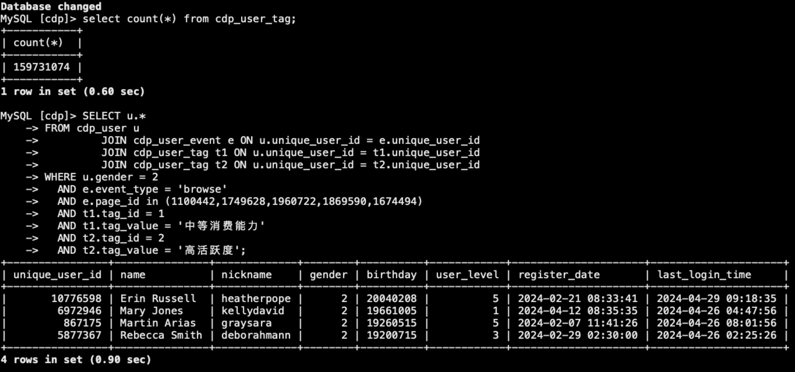
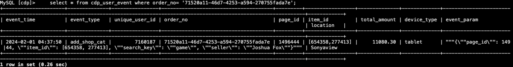
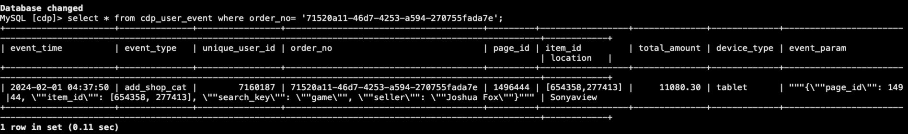
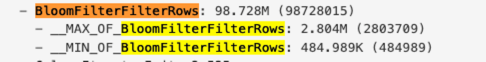
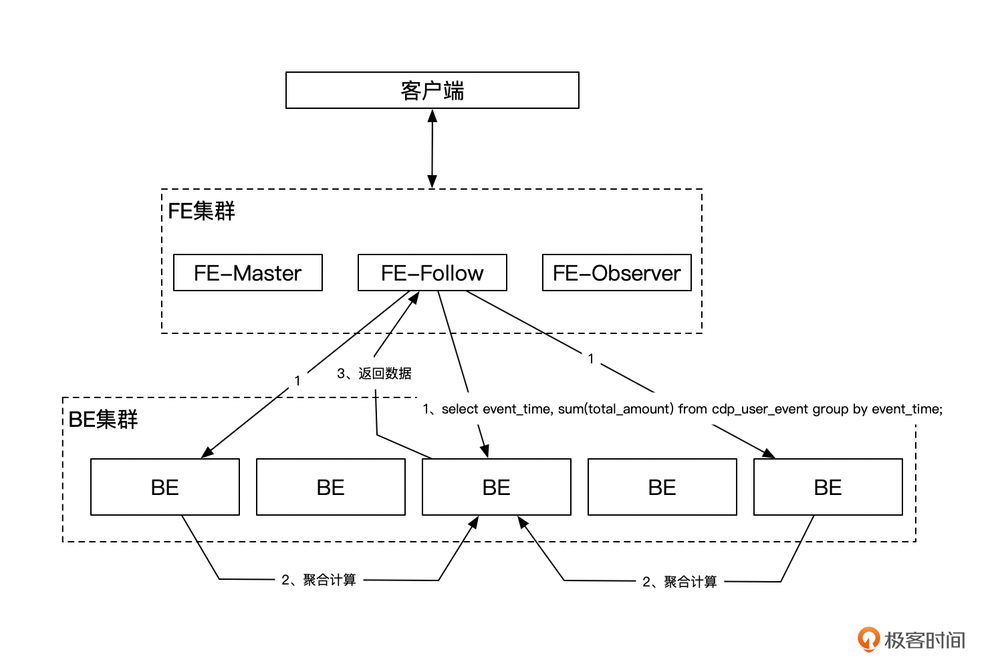

# 16 | 性能上如何优化数据查询？

你好，我是彭旭。

上一讲我们在 StarRocks 里选择了适合 CDP 的存储模型。这一讲我们来看看 CDP 的几个场景，在 StarRocks 下，能否优化、如何优化。

## CDP 在 StarRocks 下的性能测试

为了让你对 StarRocks 性能有一个更直观的感受，我们先来准备一下测试数据。

### 数据准备

上一讲，我们为 CDP 的几个表准备好了 DDL 语句，还剩下一个标签表没有定义。

但在讲数据如何分区的时候，我们推测的结论是可以用“标签值 + 用户唯一 ID”作为分桶。所以，标签表最终具体建表 DDL 就像这样。

```sql
CREATE TABLE cdp_user_tag (
   tag_id BIGINT NOT NULL COMMENT 'tag唯一标识符',
   tag_value VARCHAR(128) NOT NULL  COMMENT 'tag值',
   tag_name VARCHAR(32) NOT NULL  COMMENT 'tag名称',
   unique_user_id BIGINT NOT NULL COMMENT '用户全局唯一ID，ONE-ID',
   tag_category INT NOT NULL  COMMENT 'tag分类'
)
DUPLICATE KEY(tag_id,tag_value)
PARTITION BY (tag_id)
DISTRIBUTED BY HASH(tag_value,unique_user_id)
PROPERTIES (
"replication_num" = "1"
);
```

你可以在这里找到完整的 CDP 建表 DDL 脚本。我也准备了一个测试数据集，包含 2 千万用户与 1 亿的事件。或者你可以用我准备的脚本，自己生成测试数据。

准备好数据集后，你可以使用 StarRocks 提供的 Stream Load，将数据导入 StarRocks 集群，比如下面的命令，将数据导入 cdp_user_event 事件表。

```bash
curl --location-trusted -u root: \
   -H "Expect:100-continue" \
   -H "label:cdp_user_event_batch1" \
   -H "column_separator:#" \
   -H "timeout:3000" \
   -T /Users/xupeng/workspace/python/bigdata/cdp/cdp_user_event_data_part1.csv -
   http://127.0.0.1:8030/api/cdp/cdp_user_event/_stream_load
```

这段代码有三个需要注意的地方。首先，由于事件表存在 JSON 字段，所以这里的 CSV 的分隔符使用了 # 号，在 cdp_user 表数据导入时，记得把它修改为逗号。其次，由于数据量较大，所以我将通过 timeout 的参数从默认超时时间 600 秒改成了 3000 秒。另外，导入的地址为 StarRocks 的 FE HTTP Port，默认为 8030。

数据导入后，再来看一下如何用 SQL 生成 CDP 用户标签。

### SQL 标签

我们的事件表里面包含了用户的登录、消费，以及其他事件。在实际业务场景下，一般会基于登录、消费这两个事件构建用户的消费等级与活跃度标签。

比如用户消费等级标签。假定消费金额 10 万以上为高消费群体，5 万到 10 万为中等消费群体，其它为低消费群体。那可以使用如下 SQL，基于事件表，为所有用户构建消费等级标签。

```sql
INSERT INTO cdp_user_tag (tag_id, tag_value, tag_name, unique_user_id, tag_catego
SELECT
   1 as tag_id,
   CASE
       WHEN total_amount >= 100000 THEN '高消费能力'
       WHEN total_amount >= 50000 THEN '中等消费能力'
       ELSE '低消费能力'
   END AS tag_value,
   '消费能力标签' AS tag_name,
   unique_user_id,
   1 AS tag_category
FROM (
   SELECT e.unique_user_id, SUM(e.total_amount) AS total_amount
   FROM cdp_user_event e
   GROUP BY e.unique_user_id
) AS subquery
```

对于用户活跃度的计算，这里假定 60 天内活跃次数超过 10 次的为高活跃度用户，5 次到 10次的为中等活跃用户，5 次以下的为低活跃用户，下面的 SQL 即为用户构建了活跃度标签。

```sql
INSERT INTO cdp_user_tag (tag_id, tag_value, tag_name, unique_user_id, tag_catego
SELECT 2,
          CASE
              WHEN SUM(CASE WHEN DATEDIFF(CURRENT_TIMESTAMP(), e.event_time) <=
              WHEN SUM(CASE WHEN DATEDIFF(CURRENT_TIMESTAMP(), e.event_time) <=
              ELSE '低活跃度'
          END AS tag_value,
          '活跃度标签' AS tag_name,
          e.unique_user_id,
          2 AS tag_category
   FROM cdp_user_event e
GROUP BY e.unique user id
```

在我的 StarRocks 测试集群里，包含了 3 台 8 核 32G 的服务器，部署了一个 FE 与 3 个BE，在执行这两条 SQL 生成标签时，服务器 CPU 会有 1-2 个核心瞬间压力较大，但是 SQL基本都在秒到分钟级内执行完成。考虑到这两个 SQL 都需要扫描 1 亿数据量的表，然后插入2 千万左右的数据，这个性能其实已经算是不错的了。

除了这两个标签之外，我还构建了性别、位置两个标签，具体构建标签的全部 SQL 都可以在这里找到。最终标签表 cdp_tag 数据量约 1.6 亿行。

### SQL 人群圈选

标签准备好后，再来看一下第二个场景。我们以“给浏览过高端手机、女性、中消费、高活跃的用户群体推送一个 100 无门槛手机抵扣券”为例，怎么样通过 SQL 找出这部分人群呢？

假设高端手机的页面 ID 列表为[1100442,1749628,1960722,1869590,1674494]，使用如下SQL 即可以圈出我们需要发送手机抵扣券的人群 ID。

```sql
SELECT u.unique_user_id
FROM cdp_user u
        JOIN cdp_user_event e ON u.unique_user_id = e.unique_user_id
        JOIN cdp_user_tag t1 ON u.unique_user_id = t1.unique_user_id
        JOIN cdp_user_tag t2 ON u.unique_user_id = t2.unique_user_id
WHERE u.gender = 2
 AND e.event_type = 'browse'
 AND e.page_id in (1100442,1749628,1960722,1869590,1674494)
 AND t1.tag_id = 1
 AND t1.tag_value = '中等消费能力'
 AND t2.tag_id = 2
AND t2.tag value = '高活跃度';
```

在我的测试集群中，这个圈人的 SQL 其实也只用了 1 秒左右的时间就能输出结果，如下图所示：



## StarRocks 高性能原因

好了，依托 StarRocks 提供的高性能，我们其实已经能够满足一个中等规模 CDP 的性能需求了。那么 StarRocks 是怎么做到的呢？ 其实有很多原因。

### 基于代价的优化器 CBO

首先，StarRocks 提供了基于 Cascades 框架的 CBO（Cost-based Optimizer）。

在 RBO（Rule-based Optimizer）已经退出舞台的情况下，数据库存储引擎都已经采用了CBO 来优化查询，选择最优的查询计划。

通过 CBO 分析各种数据信息，来评估成本，帮助在众多执行计划中选出最经济的方案，提高复杂查询的速度和效果。比如将谓词下推到具体的 Scan 算子上，减少需要扫描的数据；比如Join 时，选择合适的驱动表，减少需要链接的数据量；比如分布式表 Join 的时候，选择合适的 Join 方式，是 Broadcast Join 还是 Colocate Join。

### 索引

其次，还记得讲 StarRocks 数据模型时候表的排序列吗？StarRocks 会自动构建一个基于排序列的稀疏索引，稀疏索引是一种索引结构，用于在数据库中快速查找记录。与普通索引不同的是，稀疏索引只包含部分记录的引用，而不是所有记录的引用。这样可以减少索引的大小，提高查询效率。在 StarRocks 中索引粒度是 1024，也就是每 1024 行记录索引一条。

如果排序列过长，或者数量比较多，StarRocks 会截取排序列的前 36 个字节作为索引，所以也叫做前缀索引，与关系型数据库一样，你需要将查询中常见的过滤字段放在排序列的前面。区分度越大，频次越高的查询字段应当被放置于更前面。

此外，StarRocks 还可以显式地创建两种索引。

第一种是 bitmap 位图索引。位图索引也出现在了很多关系型数据库中，bitmap 就是一个由 0和 1 组成的数组，每个位置上的数字只能是 0 或者 1。数组中的每个位置对应数据表中的一行记录，根据该行记录的取值情况来确定该位置上的数字是 0 还是 1。

位图索引适合用在基数较低，值大量重复的列、枚举类型的列，比如城市列。如果列基数较高，可以使用第二种布隆过滤器（Bloom Filter）索引。

前面课程我们已经详细介绍了布隆过滤器的原理，是用来快速判断表的数据文件中是否可能包含要查询的数据，如果不包含就跳过，从而减少扫描的数据量。

比如在我们的事件表，order_no 这一列就用的是 uuid，基数很高，所以非常适合使用布隆过滤器索引，你可以使用如下 DDL 为表 cdp_event 建立 order_no 列的布隆过滤器索引。

```sql
ALTER TABLE cdp_user_event SET ("bloom_filter_columns" = "order_no");
```

使用布隆过滤器索引后，根据 order_no 查询，从下面的两张图可以看到性能大概提升了有50% 以上。





有意思的是，如果你对比创建布隆过滤器前后的执行计划，会发现执行计划没有任何变化。不过如果你查询前使用 SET enable_profile = true; 开启 Profile，你就可以在 Web UI 的查询列表里面找到 SQL 执行的 profile。

从 Profile 里面可以看到一段布隆过滤器过滤掉了多少行数据的记录。



和关系型数据库的索引方式相比，StarRocks 更突出的地方是将索引融入到了表模型。所以在建表的时候，我们需要在如何分区、如何使用排序键上考虑得更多。

### Query Cache

CBO 与索引优化，能够让单条 SQL 性能得到很好的保障，但是对于 OLAP 数据库来说，对并发的支持相对没那么好。所以，StarRocks 提供了 Query Cache 机制，让其对并发的支持得到了大大提升。

Query Cache 的作用是把查询过程中的本地聚合中间结果缓存在内存中，以在后续查询中复用。

值得注意的是，Query Cache 和 Query Result Cache 不同。它缓存的是查询过程中的聚合中间结果而不是最终结果，因此大大提高了缓存的命中率。即使是不完全一致的查询，QueryCache 也能发挥加速作用。

Query Cache 默认是关闭的，那什么时候可以开启 Query Cache？举几个例子。

1. 语义上等价的查询：比如有几个子查询被多个场景复用。

2. 扫描分区重合的查询：比如我们 CDP 事件表是基于事件时间列分区的，如果需要统计一段时间区间的每日销售额，会基于查询谓词“事件时间”来切割分区，并将分区聚合的中间结果缓存，这样相当于每个分区只需要统计一次，就能在各种日期区间的查询中被复用。

3. 查询的数据以按分区追加的形式导入，如果数据涉及到更新、删除，会导致缓存失效，不过如果以追加形式导入，StarRocks 会维护一个多版本的缓存，多版本缓存机制会尝试把Query Cache 中缓存的结果与磁盘上存储的增量数据合并，确保新查询能够获取到最新版本的 Tablet 数据。不过多版本缓存受限条件较多，比如更新模型、主键模型就不支持。

你可以使用如下命令来开启 Query Cache。

```
--打开 Query Cache
set enable_query_cache=true;
--设置并行度pipeline_dop为较小值
set pipeline_dop=1;
```

这里有个 pipeline_dop（Degree of Parallelism，并行度）的概念，如果分桶数量过小，当 BE需要处理的 Tablet 数量小于 pipeline_dop 参数的取值时，Query Cache 就无法生效。不过从3.0 版本开始，StarRocks 就能支持根据查询并发度自适应调节 pipeline_dop。

### MPP 分布式执行框架

最后，StarRocks 最重要也是最直接的一个性能提升点，就是使用 MPP 来充分利用集群的能力。

StarRocks 采用 MPP (Massively Parallel Processing) 分布式执行框架。通过将任务分散到多个节点上并行执行，充分利用所有执行节点的资源，提高数据处理速度和性能，而且查询性能能够随着集群水平扩展不断提升。



## 小结

当你选用合适的表模型、设计好分区分桶键后，StarRocks 会基于排序列给你构建一个前缀索引，这个前缀索引跟关系型数据库的索引类似，此时只要你的查询条件带有分区分桶键或者排序列，一般就能够获得较好的性能，在上亿数据行的情况下，做到毫秒级的响应。

除了前缀索引外，StarRocks 还支持 bitmap 与布隆过滤器索引，能够分别在低基数列场景与高基数列场景提升查询性能。

StarRocks 拥有强大的 CBO 查询优化器，CBO 通过采集统计表的行数、列数据大小、列基数等信息，基于这些信息进行代价估算，能够在数万级别的执行计划中，选择代价最低的执行计划，提升复杂查询的效率和性能。

当然，StarRocks 还有很多其他优秀的点，比如支持物化视图加速查询、全面向量化引擎等能够在不同场景对性能有所帮助，所有这些设计组合起来，造就了性能强大的 StarRocks 引擎。

## 思考题

StarRocks 稀疏索引的索引粒度是 1024，为什么选择 1024，可以更改这个值吗？更改了会有什么影响呢？

欢迎你在留言区和我交流。如果觉得有所收获，也可以把课程分享给更多的朋友一起学习。欢迎你加入我们的读者交流群，我们下节课见！
