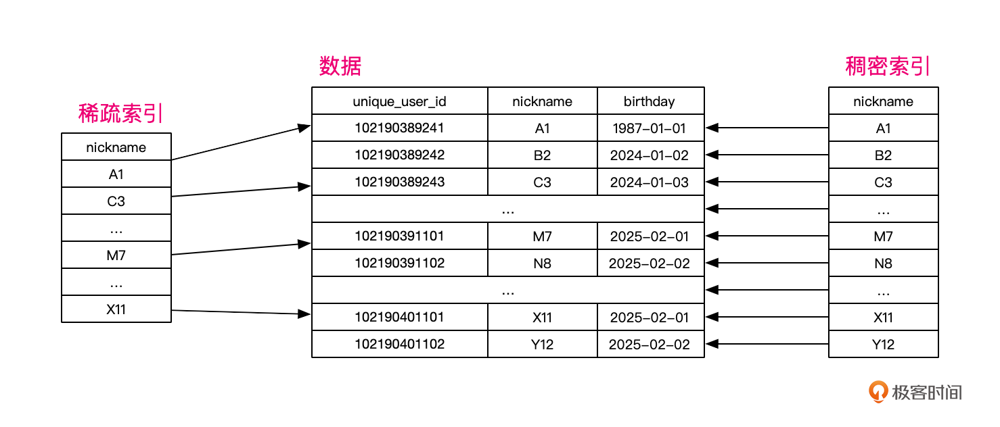
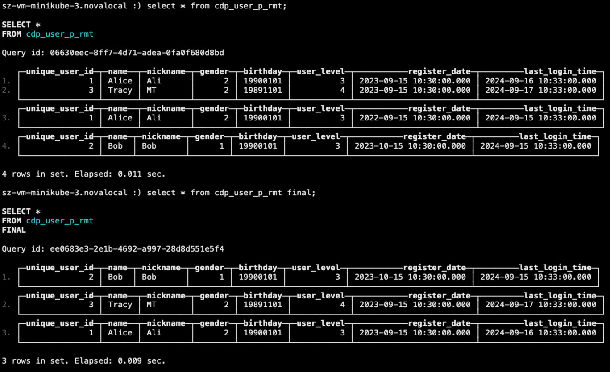
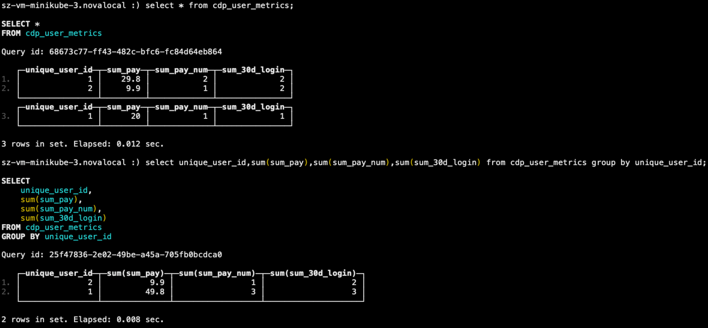
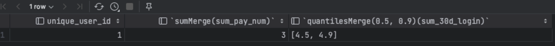
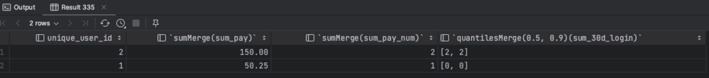
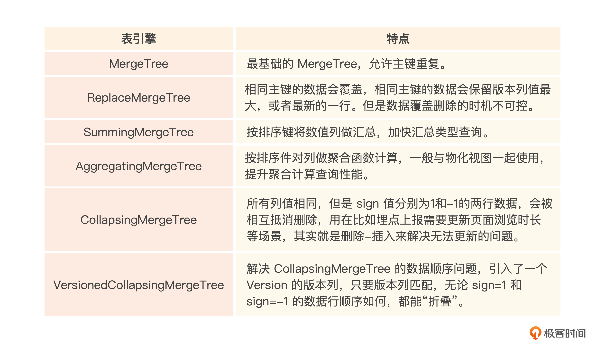

# 18 | ClickHouse应该如何选用表引擎？

你好，我是彭旭。

我们在上节课讲 ClickHouse 的极致性能的时候，提到了 ClickHouse 支持灵活多样的表引擎，而每个表引擎都有自己的适用场景。

表引擎决定了数据表最终数据存储的模式，能够支撑的数据量大小，数据读写的方式等等。如果选择了不恰当的表引擎，可能会导致数据的存储结构不合理，影响数据的读写效率，甚至限制系统对大规模数据的支持能力。

这一讲，我们就来认识一下 ClickHouse 最强大的 MergeTree 表引擎系列。

## MergeTree

MergeTree 以及其家族（MergeTree）的其他引擎系列是 ClickHouse 中使用最多，最强大的引擎。

先来看一个使用 MergeTree 引擎创建 CDP 用户表的示例。

```sql
CREATE TABLE cdp_user (
   unique_user_id UInt64 COMMENT '用户全局唯一ID，ONE-ID',
   name String COMMENT '用户姓名',
   nickname String COMMENT '用户昵称',
   gender Int8 COMMENT '性别：1-男；2-女；3-未知',
   birthday String COMMENT '用户生日：yyyyMMdd',
   user_level Int8 COMMENT '用户等级：1-5',
   register_date DateTime64 COMMENT '注册日期',
   last_login_time DateTime64 COMMENT '最后一次登录时间'
) ENGINE = MergeTree()
PARTITION BY register_date
PRIMARY KEY unique_user_id
ORDER BY unique_user_id;
```

你可以看到，建表 DDL 相比关系型数据库来说，多了一个表引擎的声明以及指定表的分区键、主键、排序键的语句。

主键由关键字 PRIMARY KEY 指定，如果没有使用 PRIMARY KEY 显式指定的主键，ClickHouse 会使用排序键 ORDER BY 指定的列作为主键。

需要注意的是，如果同时指定了主键与排序键，那么排序键必须包含主键的所有列，比如主键为（a,b），排序键就必须为 (a,b,**)。

和关系型数据库的主键具备唯一性不同，ClickHouse 可以存在相同主键的数据行。这也是ClickHouse 为了性能而做出的考量。

因为强制执行主键唯一性约束会增加数据插入的复杂性和额外的性能开销。所以，你在数据模型设计或者查询操作中需要进行适当地处理，确保数据的准确性和完整性。比如增加自增 ID字段，查询的时候使用主键去重等。

MergeTree 表引擎在数据写入的时候，会以数据片段的形式写入磁盘。比如一个批量 insert 的数据形成一个数据片段，数据片段写入后不可修改。类似 LSM 树，ClickHouse 会在后台定期合并这些数据片段，避免片段过多，影响性能。

ClickHouse 会为主键创建一个稀疏索引来加快数据检索，稀疏索引会选择性地记录某些记录的索引信息，从而减少索引的大小，提高查询效率。

那与稀疏索引相对应的是什么呢？就是稠密索引。传统关系型数据库一般使用稠密索引，也就是每一行数据，都会创建一条对应的索引记录。



显然，稀疏索引更适合批量数据的处理与查询，而稠密索引更适合单行或者少数行数据的查询。

ClickHouse 的稀疏索引默认每 8192 行数据创建一个索引标记，你也可以通过建表参数index_granularity 修改这个默认值。

## ReplacingMergeTree

前面提到 MergeTree 的主键没有唯一性约束。所以即使多行数据的主键相同，它们还是能够正常写入。

不过，在我们 CDP 的数据模型中，用户表 cdp_user 的 unique_user_id 需要是唯一的，该怎么办呢？这时候就需要合并树家族的 ReplacingMergeTree 引擎出马了。

ReplacingMergeTree 建表语句与 MergeTree 相同，只需要替换掉表引擎就好，不过需要指定一个列作为版本列。

当排序键相同的数据行插入时，它会删除重复行，保留版本列值最大的一行。如果没有指定版本列，则会保留最后插入的一行。

通常来说，ReplacingMergeTree 删除重复行，是因为两种情况。

- 一起批量插入的数据，属于同一个数据片段的数据，所以会在插入时候按排序键去重。

- 分批插入的数据，属于不同的数据片段，需要依托后台数据片段合并的时候才进行。

所以即使你用了 ReplacingMergeTree 表引擎，在查询表数据的时候，仍然可能会查询到重复数据，不过只要使用 final 关键字去重即可。或者你也可以使用如下命令强制合并分区，这样数据片段就会合并。

```
optimize TABLE cdp_user_metrics FINAL;
```

以我们的 cdp_user 为例，下面是一个使用 last_login_time 作为版本列的建表语句。分两次INSERT 插入数据，也就是将数据行拆分成了两个数据片段。你可以观察一下它删除重复行的表现。

```sql
drop table cdp_user_p_rmt;
CREATE TABLE cdp_user_p_rmt (
   unique_user_id UInt64 COMMENT '用户全局唯一ID，ONE-ID',
   name String COMMENT '用户姓名',
   nickname String COMMENT '用户昵称',
   gender Int8 COMMENT '性别：1-男；2-女；3-未知',
   birthday String COMMENT '用户生日：yyyyMMdd',
   user_level Int8 COMMENT '用户等级：1-5',
   register_date DateTime64 COMMENT '注册日期',
   last_login_time DateTime64 COMMENT '最后一次登录时间'
) ENGINE = ReplacingMergeTree(last_login_time)
PARTITION BY register_date
PRIMARY KEY unique_user_id
ORDER BY unique_user_id;
INSERT INTO cdp_user_p_rmt (unique_user_id, name, nickname, gender, birthday, use
VALUES (1, 'Alice', 'Ali', 2, '19900101', 3, '2022-09-15 10:30:00', '2024-09-15 1
, (2, 'Bob', 'Bob', 1, '19900101', 3, '2023-10-15 10:30:00', '2024-09-15 10:33:00
INSERT INTO cdp_user_p_rmt (unique_user_id, name, nickname, gender, birthday, use
VALUES (1, 'Alice', 'Ali', 2, '19900101', 3, '2023-09-15 10:30:00', '2024-09-16 1
      (3, 'Tracy', 'MT', 2, '19891101', 4, '2023-09-15 10:30:00', '2024-09-16 10
      (3, 'Tracy', 'MT', 2, '19891101', 4, '2023-09-15 10:30:00', '2024-09-17 10
select * from cdp_user_p_rmt;
select * from cdp_user_p_rmt final;
```

最后两条 SELECT 语句的查询结果如下。可以看到使用 final 关键字后，unique_user_id=1 的两条记录，只保留了最后插入的一条。

注意，unique_user_id=3 的两行数据，由于是同一个 INSERT 语句插入，也就是属于同一个数据片段，所以插入时就已经去重。虽然插入了两条相同记录，但是查询时，不用 final 关键字就能去重。



这里提一下，有很多资料说，ReplacingMergeTree 是以数据分区为单位删除重复数据。当分区合并时，同一分区内的重复数据会被删除；不同分区之间的重复数据不会被删除。

事实上， 我在 ClickHouse 24.3.2.23 这个版本的使用过程中，发现不同分区的重复数据也会被删除，其实在我上面的测试 SQL 中，插入的第 1 条与第 3 条数据就属于排序键相同，分区不同，最终结果仍然可以依赖 final 关键字去重。

## SummingMergeTree

回到我们 CDP 需求里面，用户指标属性表 cdp_user_metrics 存储的是一些消费总金额、30天总登录次数等统计值，在 StarRocks 里面我们使用聚合模型来存储以节省空间，加快汇聚查询。

在 ClickHouse 里面同样有两种聚合模型的表引擎：SummingMergeTree 和AggregatingMergeTree。

SummingMergeTree 的建表语句同样与 MergeTree 相同，只需要替换掉表引擎，不过可以指定多个汇聚列。SummingMergeTree 会按排序键分组，将重复行的数值字段做汇总计算。

```
ENGINE = SummingMergeTree((sum_pay,sum_pay_num))
```

如果没有指定汇聚列，ClickHouse 会把所有不在排序键中的数值类型的列都进行汇总。

与 ReplacingMergeTree 删除重复行的逻辑一样，SummingMergeTree 会汇总同一个数据片段的重复行。不同数据片段的重复行，也需要依托后台数据片段合并的时候才进行。

好，我们总结一下所有汇总规则。

- 数据行按照排序键对数值类型列做汇总。

- 如果用于汇总的所有列中的值均为 0，则该行会被删除。

- 如果列不在排序键中，并且无法被汇总，查询结果会在现有值任选一行。

- 同一个数据片段，也就是一起插入的数据，会直接汇总。

- 不同数据片段的数据，汇总时间不可控，所以查询时，仍然需要使用 sum 与 group by。

同样，我也准备了一段测试脚本，你可以用来观察 SummingMergeTree 的表现。

```sql
drop table cdp_user_metrics;
CREATE TABLE cdp_user_metrics
(
   unique_user_id UInt64 COMMENT '用户全局唯一ID，ONE-ID',
   sum_pay        DECIMAL(20, 10)  COMMENT '总计消费金额',
   sum_pay_num    UInt16 COMMENT '总计消费次数',
   sum_30d_login  UInt16 COMMENT '30天登录次数'
)
ENGINE = SummingMergeTree()
ORDER BY unique_user_id;
INSERT INTO cdp_user_metrics Values(1,19.8,1,1),(1,10,1,1),(2,9.9,1,2);
select * from cdp_user_metrics;
INSERT INTO cdp_user_metrics Values(1,20,1,1);
select * from cdp_user_metrics;
select unique_user_id,sum(sum_pay),sum(sum_pay_num),sum(sum_30d_login) from cdp_u
```

最后两条 SELECT 语句的输出如下。

你可以看到，不同数据片段的数据其实也没有被合并，需要最后手动 GROUP BY 才被合并。



## AggregatingMergeTree

AggregatingMergeTree 可以说是 SummingMergeTree 的升级版，它支持 sum 之外的其他聚集函数，但是它的定义与 MergeTree 家族的其他表都不一样。

这里有个示例。

```sql
DROP TABLE cdp_user_metrics;
CREATE TABLE cdp_user_metrics
(
   unique_user_id UInt64 COMMENT '用户全局唯一ID，ONE-ID',
   sum_pay        DECIMAL(20, 10)  COMMENT '总计消费金额',
   sum_pay_num    AggregateFunction(sum, UInt16) COMMENT '总计消费次数',
   sum_30d_login  AggregateFunction(quantiles(0.5, 0.9), UInt16) COMMENT '30天登录
)
ENGINE = AggregatingMergeTree()
ORDER BY unique_user_id;
```

你可以看到，AggregatingMergeTree 没有任何额外的设置参数。但是可以为每个列，单独使用一个用 AggregateFunction 包装的聚合函数。

比如示例中，我们定义 sum_pay_num 为一个 sum 的聚合函数，sum_30d_login 为一个计算列数据 5 分位与 9 分位值的聚合函数。

AggregateFunction 是 ClickHouse 提供的一种特殊的数据类型，它能够以二进制的形式存储中间状态结果。它的使用也比较特殊。

在写入数据时，需要使用State 函数；而在查询数据时，则需要使用相应的Merge 函数。其

```
中，* 表示定义时使用的聚合函数。
```

比如我们前面定义的表 cdp_user_metrics 数据写入时，就需要用到与 sum、quantiles 对应的sumState、quantilesState 函数，并使用 INSERT SELECT 语法。

```sql
INSERT INTO cdp_user_metrics
SELECT
1, 100.50, sumState(toUInt16(1)), quantilesState(0.5, 0.9)(toUInt16(4));
INSERT INTO cdp_user_metrics
SELECT
1, 101, sumState(toUInt16(2)), quantilesState(0.5, 0.9)(toUInt16(5));
```

查询的时候，同样需要用到与 sum、quantiles 对应的 sumMerge、quantilesMerge 函数。

```sql
SELECT unique user id sumMerge(sum pay num) quantilesMerge(0 5
0 9)(sum 30d logi
```

查询结果如图所示。



看到这里，你是不是会觉得 AggregatingMergeTree 使用起来太复杂了，数据插入与查询都感觉不正常了？

事实上，确实麻烦。不过 AggregatingMergeTree 更多的使用场景是在物化视图中，将它作为物化视图的表引擎。比如我们可以以 cdp_user_event 表为底表，将 cdp_user_metrics 作为一个基于 AggregatingMergeTree 表引擎的物化视图。

假设 cdp_user_event 表定义为一个 MergeTree 引擎表，建表语句如下所示。

```sql
drop table cdp_user_event;
CREATE TABLE cdp_user_event (
   event_time DateTime64 COMMENT '事件发生时间',
   event_type String COMMENT '事件类型，pay,add_shop_cat,browse,recharge等',
   unique_user_id UInt64 NOT NULL COMMENT '用户全局唯一ID，ONE-ID',
   order_no String COMMENT '订单唯一编号',
   page_id UInt64 COMMENT '浏览事件页面ID',
   item_id Array(UInt64) COMMENT '浏览、加购、下单事件中商品ID',
   total_amount DECIMAL(18, 2) COMMENT '订单金额',
   device_type String COMMENT '设备类型',
   event_param String COMMENT '事件相关参数，比如购买事件商品ID、支付金额等',
   location VARCHAR(100) COMMENT '发生地点，如城市、门店等'
) ENGINE = MergeTree()
PARTITION BY date_trunc('day', event_time)
ORDER BY (event_time,event_type);
```

那么可以用如下语句建立一个叫做 cdp_user_metrics_mv 的物化视图。

```sql
CREATE MATERIALIZED VIEW cdp_user_metrics_mv
           ENGINE = AggregatingMergeTree() PARTITION BY (unique_user_id) ORDER B
AS
SELECT a.unique_user_id,
      sumState(a.sum_pay) as sum_pay,
      sumState(a.sum_pay_num) as sum_pay_num,
      quantilesState(0.5, 0.9)(a.sum_30d_login) as sum_30d_login
from (SELECT unique_user_id as unique_user_id,
            sum(total_amount)
            countIf(event_type = 'pay')
            countIf(event_type = 'login' AND event_time >= toDate(toDateTime(now
     FROM cdp_user_event
     GROUP BY unique_user_id) a
group by a.unique_user_id;
```

当你插入数据到底表 cdp_user_event 后，物化视图的数据即会实时刷新，这样可以大大提升聚合查询的性能。

```sql
INSERT INTO cdp_user_event
VALUES
('2024-10-01 08:00:00', 'pay', 1, 'order1', 1001, [101, 102, 103], 50.25, 'mobile
('2024-10-02 10:30:00', 'login', 2, NULL, 2002, [201, 202], NULL, 'desktop', NULL
('2024-10-03 10:30:00', 'login', 2, NULL, 2002, [201, 202], NULL, 'desktop', NULL
('2024-10-04 10:30:00', 'pay', 2, 'order2', 2002, [201, 202], 100,'desktop', NULL
('2024-10-04 10:30:00', 'pay', 2, 'order3', 2002, [201, 202], 50,'desktop', NULL,
SELECT unique_user_id,sumMerge(sum_pay),sumMerge(sum_pay_num),quantilesMerge(0.5,
```

下图是最后一个 SELECT 的结果，注意到查询结果里面 5 分位与 9 分位的值都相同，因为同一个 unique_user_id 只有 1 个 30 天登录次数的值，所以 5 分位与 9 分位都取这个值了。



SummingMergeTree 的汇总规则基本也同样适合 AggregatingMergeTree，这里我也总结一下AggregatingMergeTree 的汇总规则与注意点。

- 数据行同样按照排序键对数值类型列做汇总。

- 同一个数据片段，也就是一起插入的数据，会直接汇总。

- 不同数据片段的数据，汇总时间不可控，所以查询时，仍然需要使用 sum 与 group by。

- 在聚合数据时，同一数据片段内，相同聚合 Key 的多行数据会合并成一行。对于非主键、非 AggregateFunetion 类型字段，则会使用第一行数据的取值。

- AggregateFunetion 类型的字段会使用二进制存储，在写入数据时，需要调用 State 函数；而在查询数据时，则需要调用相应的 Merge 函数。

- AggregatingMergeTree 通常作为物化视图的表引擎，与 MergeTree 引擎底表配合使用提升聚合查询性能。

## CollapsingMergeTree

前面提到过 ClickHouse 最初是设计用来存储用户的埋点数据的。比如记录用户在某个站点访问的页面数以及他们在那里停留的时间，统计停留时间的时候，需要前端埋点不停地上报当前已经浏览的时长。这个时候就需要对旧的记录不停地更新。

我们知道，ClickHouse MergeTree 参考了 LSM 的设计，数据写入后就不可变，而且ClickHouse 的稀疏索引，导致查找单行或者少数行数据，频繁更新的成本较高。所以ClickHouse 采取了一种以增代删、以增代更新的思路，这就是 CollapsingMergeTree 的作用。

它可以指定某一列为 sign 标记位，记录数据行的状态。

- 当 sign 标记为 1 时，表示这是一行有效的数据。

- 当 sign 标记为 -1 时，则表示这行数据需要被删除。

举个例子，我们将 CDP 的浏览记录单独从事件表里拆出来，用 CollapsingMergeTree 表引擎创建表，下面列出了这个简化版的建表语句。

```sql
drop table cdp_user_browser_event;
CREATE TABLE cdp_user_browser_event
(
   event_time DateTime64 COMMENT '事件发生时间',
   unique_user_id UInt64 NOT NULL COMMENT '用户全局唯一ID，ONE-ID',
   page_id UInt64 COMMENT '浏览事件页面ID',
   duration UInt64 COMMENT '浏览事件页面ID',
   device_type String COMMENT '设备类型',
   location VARCHAR(100) COMMENT '发生地点，如城市、门店等',
   sign Int8
)
ENGINE = CollapsingMergeTree(sign)
PARTITION BY event_time
ORDER BY event_time;
INSERT INTO cdp_user_browser_event VALUES ('2023-09-15 10:30:00', 1, 5101, 13, 'm
INSERT INTO cdp_user_browser_event VALUES ('2023-09-15 10:30:00', 1, 5101, 13, 'm
select * from cdp_user_browser_event;
select * from cdp_user_browser_event final;
```

可以看到，假设两行数据所有列值相同，但是 sign 标记分别为 1 和 -1，那么这两行数据就会被抵消删除。这种 1 和 -1 相互抵消的操作，这就是 Collapsing“折叠”的由来。

需要注意的是，同其他 MergeTree 数据删除、合并的逻辑一样，同一个数据片段的数据行（也就是一起插入的数据），会实时“折叠”。不同数据片段的数据行，也依赖后台合并动作的执行。所以你同样需要使用 final 关键字或者强制合并分区来查看最终的结果。

根据数据插入顺序的不同，CollapsingMergeTree 的“折叠”规则不同，这里我整理了一下“折叠”的规则。

- 如果 sign=1 和 sign=-1 的数据行一样多，并且最后一行是 sign=1，则保留第一行 sign=-1和最后一行 sign=1 的数据，这时候数据不会被“折叠”，sign=1 的数据行能够被查询。

- 如果 sign=1 和 sign=-1 的数据行一样多，并且最后一行是 sign=-1，则数据被“折叠”。

- 如果 sign=1 比 sign=-1 的数据多一行或以上，则保留最后一行 sign=1 的数据。

- 如果 sign=-1 比 sign=1 的数据多一行或以上，则保留最后一行 sign=-1 的数据。

- 其余情况，ClickHouse 会打印警告日志，但不会报错，在这种情形下，查询结果不可预知。

这个规则还是挺复杂的。由于 ClickHouse 用多线程来处理 SELECT 请求，所以它不能预测结果中行的顺序。因此，如果要从 CollapsingMergeTree 表中获取完全“折叠”后的数据，建议你使用 Group By 语句来聚合统计数据。聚合统计时同样需要把 sign 值考虑进去。

- 统计数量，可以使用 sum(Sign)。注意不能用 count()，因为需要取 sign=1 和 -1 相互抵消后的值。

- 统计总和，可以使用 sum(Sign * x) ，并添加 HAVING sum(Sign) > 0 子句。注意不能用sum(x)，同样因为需要取 sign=1 和 -1 相互抵消后的值。

CollapsingMergeTree 的数据顺序问题，导致结果“不可控”，于是 ClickHouse 提供了一个与顺序无关的折叠树表引擎 VersionedCollapsingMergeTree。

## VersionedCollapsingMergeTree

因为 CollapsingMergeTree 的数据顺序问题，很可能导致结果“不可控”，于是 ClickHouse 提供了一个与顺序无关的折叠树表引擎 VersionedCollapsingMergeTree。

VersionedCollapsingMergeTree 的作用与 CollapsingMergeTree 完全相同，不过VersionedCollapsingMergeTree 又引入了一个 version 的版本列，只要版本列匹配，无论sign=1 和 sign=-1 的数据行顺序如何，都能“折叠”。

VersionedCollapsingMergeTree 的建表语句只需要更换一下表引擎，下面是一个示例。

```
ENGINE = CollapsingMergeTree(sign,version)
```

## 小结

除了合并树（MergeTree）家族系列表引擎外，ClickHouse 还支持日志引擎系列、集成表引擎、其他特殊表引擎 4 大类几十种，目不暇接。不过最强大，用得最多的仍然还是MergeTree 表引擎。

MergeTree 系列表引擎还包括用来对 Graphite 数据进行瘦身及汇总的 GraphiteMergeTree，支持数据副本的 ReplicatedMergeTree 系列，以及 ReplicatedMergeTree 系列云原生的替代版本 SharedMergeTree。在下一节课介绍并行计算的时候，我会详细介绍ReplicatedMergeTree 与分布式表。

最后，我们总结一下这节课介绍的 MergeTree 家族各个表引擎的特点。



## 思考题

我们知道稀疏索引会每隔 index_granularity 行数据建立一个索引标记，那么有可能在稀疏索引里面找不到数据，或者找到多个索引标记，这时候分别该如何处理？

欢迎你在留言区和我交流。如果觉得有所收获，也可以把课程分享给更多的朋友一起学习。欢迎你加入我们的读者交流群，我们下节课见！
