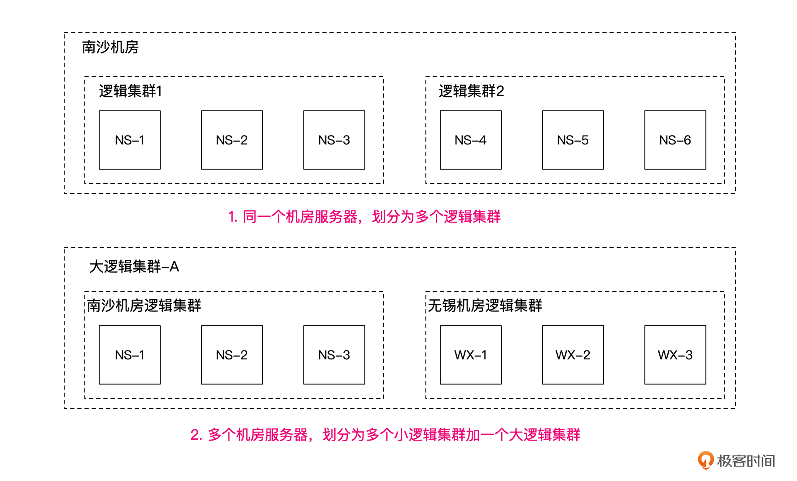
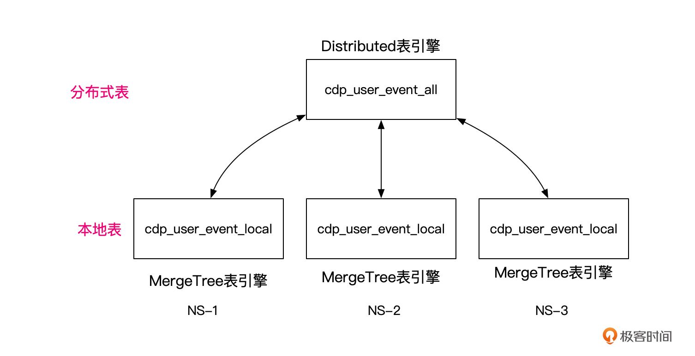
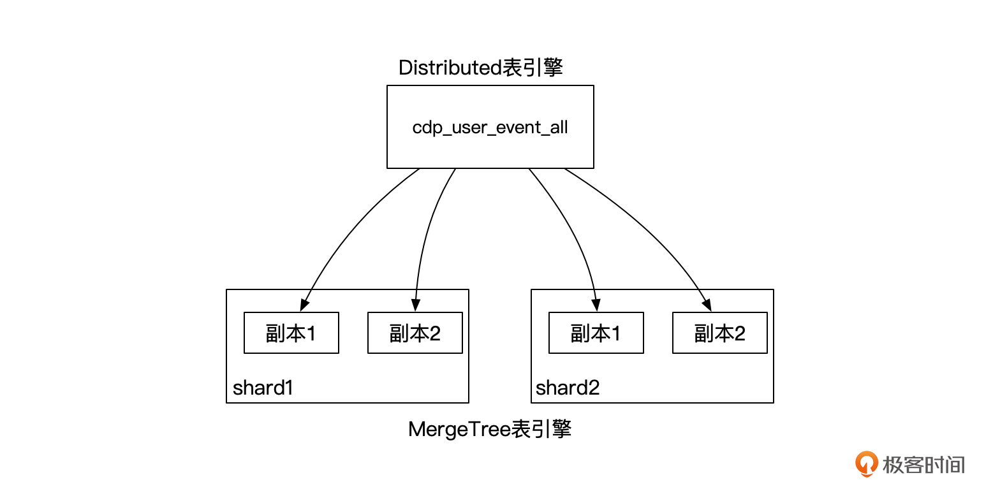
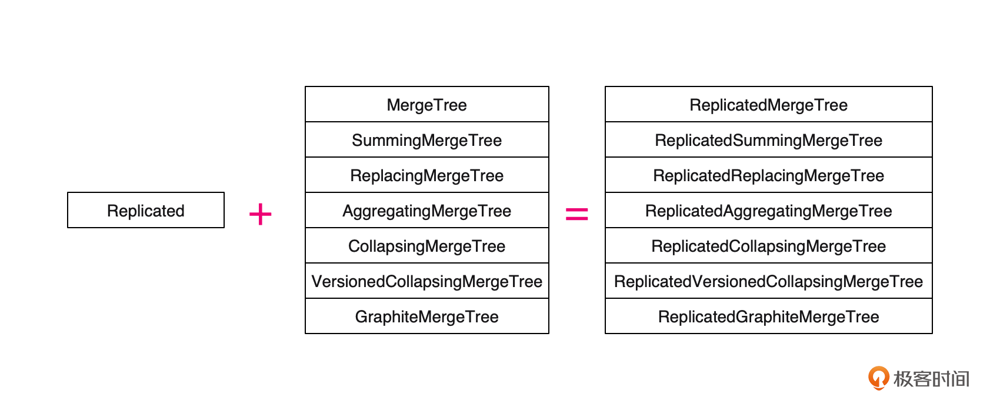
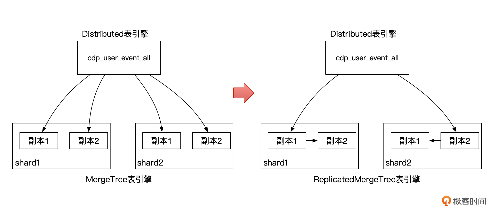
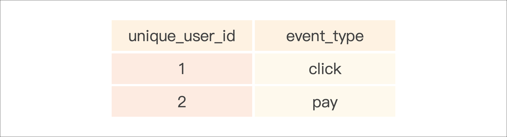
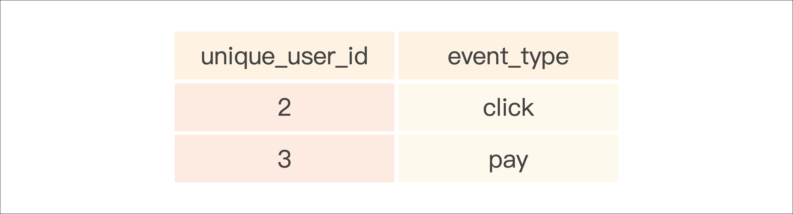

# 19 | 如何在ClickHouse利用集群能力实现并行计算？

你好，我是彭旭。

上节课我们介绍了 ClickHouse 的 MergeTree 表引擎系列，但是还只涉及单节点。

这节课我们就来看看，既然 ClickHouse 是分布式数据库，那么它是如何利用集群多节点、数据分片、数据多副本的能力，来实现并行计算，加速查询的呢？

## 集群概览

HBase、StarRocks 一般是配置一个大集群，所有服务器节点，数据都存储在大集群中，像HBase 也可以配置多机房多集群，然后集群间配置数据实时复制。

ClickHouse 的集群配置则非常灵活，你可以将所有的物理服务器配置成一个大的集群，也可以根据业务、部门等隔离，划分多个小的逻辑集群。每个小集群都可以配置自己的节点、副本、分片，甚至一个节点可以被多个逻辑集群包含。

你也可以每个机房配置成一个逻辑集群，然后配置一个包含了所有机房所有服务器的大的逻辑集群，用来汇总统计所有数据。不过这时候要注意，统计数据就可能涉及多机房之间大量的数据传输了。

举个例子，比如我们南沙与无锡数据中心分属不同的业务，各有 3 台服务器，平时业务能够在本数据中心机房完成闭环。假设总部需要统计所有的业务数据，这时候你可以分别统计两个数据中心的数据，然后汇总。但是如果数据中心较多，统计内容与查询也较多，这样就会很麻烦。

这时候我们就可以用一个大的逻辑集群，假设为 A，把所有机房的服务器都包含在内，这样我们就只需要查询这个大的逻辑集群，就能一次将数据全部查出来。



ClickHouse 集群的配置很简单，只需要修改配置文件 /etc/clickhouse-server/config.xml，在配置文件的 <remote_servers> 标签下，增加集群的节点配置即可。比如下面的配置片段，就描述了我们上图中第 2 种集群划分的方式。

```xml
<remote_servers>
      <nansha>
           <shard>
               <replica>
                   <host>NS-1</host>
                   <port>9002</port>
               </replica>
           </shard>
           <shard>
               <replica>
                   <host>NS-2</host>
                   <port>9002</port>
               </replica>
           </shard>
           <shard>
               <replica>
                   <host>NS-3</host>
                   <port>9002</port>
               </replica>
           </shard>
       </nansha>
       <wuxi>
           <shard>
               <replica>
                   <host>WX-1</host>
                   <port>9002</port>
               </replica>
           </shard>
           <shard>
               ...
           </shard>
       </wuxi>
       <all>
           <shard>
               <replica>
                   <host>NS-1</host>
                   <port>9002</port>
               </replica>
           </shard>
           <shard>
               ...
           </shard>
           <shard>
               <replica>
                   <host>WX-3</host>
                   <port>9002</port>
               </replica>
           </shard>
       </all>
<remote_servers>
<!-- 分片和副本标识，shard标签配置分片编号，replica配置分片副本主机名-->
<macros>
   <shard>01</shard>
   <replica>NS-1</replica>
</macros>
```

你可以看到，在配置文件中，我们配置了 nansha、wuxi、all 3 个集群，将南沙机房 3 节点、无锡机房 3 节点分别配置成两个逻辑集群，然后所有的 6 个节点又配置成 all 这个大的逻辑集群。

这里提一下，ClickHouse 依赖 ZooKeeper 来进行分布式 DDL 的执行与数据的复制，所以集群化配置之后，同样需要在配置文件中，增加 ZooKeeper 的集群地址。

```xml
   <zookeeper>
       <node>
           <host>zk-1</host>
           <port>2181</port>
       </node>
       <node>
           <host>zk-2</host>
           <port>2181</port>
       </node>
       <node>
           <host>zk-3</host>
           <port>2181</port>
       </node>
   </zookeeper>
```

不过，划分好集群之后，ClickHouse 并不能直接利用集群能力并行计算，而是需要通过分布式表来将数据分片，然后保存到多个节点，从而支持并行查询。

## 本地表与分布式表

在 StarRocks、HBase 中，创建表，指定分区键后，数据库就会默认将表数据分片，并将数据分片均衡分布到不同的节点，方便后续并行处理。而 ClickHouse 默认创建的是一个本地表，数据与计算都发生在单个节点。当然，在单节点上，ClickHouse 也会利用多核的能力，并行处理查询以提升性能。但是即使单节点性能再强，也会有遇到瓶颈的时候。这时候，就需要用到多服务器分布式处理了。

在 ClickHouse 中，可以使用分布式表，将数据分片 shard 保存到不同的服务器上，查询可以并行地在所有 shard 上进行。

不过 ClickHouse 的分布式表其实只是一个代理，并不真正存储数据，还是依赖本地表存储数据。所以你会发现，ClickHouse 的分布式表类似关系型数据库中常用的分库分表中间件MyCat。

ClickHouse 的本地表命名一般会加一个 _local 的后缀，而分布式表会加一个 _all 的后缀，比如下面的脚本，就为我们 CDP 的用户事件表在南沙集群（nansha）创建了本地表，然后基于本地表创建了分布式表。

```sql
CREATE TABLE cdp_user_event_local on cluster nansha (
   event_time DateTime64 COMMENT '事件发生时间',
   event_type String COMMENT '事件类型，pay,add_shop_cat,browse,recharge等',
   unique_user_id UInt64 NOT NULL COMMENT '用户全局唯一ID，ONE-ID',
   order_no String COMMENT '订单唯一编号',
   page_id UInt64 COMMENT '浏览事件页面ID',
   item_id Array(UInt64) COMMENT '浏览、加购、下单事件中商品ID',
   total_amount DECIMAL(18, 2) COMMENT '订单金额',
   device_type String COMMENT '设备类型',
   event_param String COMMENT '事件相关参数，比如购买事件商品ID、支付金额等',
   location VARCHAR(100) COMMENT '发生地点，如城市、门店等'
) ENGINE = MergeTree()
PARTITION BY date_trunc('day', event_time)
ORDER BY (event_time,event_type);
drop table cdp_user_event_all on cluster nansha;
CREATE TABLE cdp_user_event_all on cluster nansha as cdp_user_event_local
ENGINE = Distributed(nansha, 'cdp', 'cdp_user_event_local', unique_user_id);
```

你可以看到，在创建分布式表的时候，选用的引擎是 Distributed。

Distributed 引擎建表的语法如下：

```sql
CREATE TABLE [IF NOT EXISTS] [db.]table_name [ON CLUSTER cluster] AS [db2.]name2
```

如果你对这些细节不是很熟悉，下面我放了几个参数的介绍，你可以看下。

- cluster：在上面 config.xml 中配置的集群名。

- database：集群中数据库名。

- table：集群中本地数据表名。

- sharding_key：（可选) 分片 key，这里我们使用 unique_user_id 作为分片 key。

- policy_name：（可选) 存储策略的名称。

此外，还有一些 setting 参数，用来配置数据插入后，是同步还是异步写入到其他分布式节点，是否立即刷新到磁盘等。



使用分布式表将数据分片存储后，意味着每个服务器节点都只是存储了表的一部分数据，这样又会带来数据单点的问题，如果一个节点出现故障，表数据就不可用，甚至丢失，该怎么办呢？不用担心，ClickHouse 也提供了多副本机制，来保障数据的高可用。

## 数据副本

ClickHouse 同样可以在配置文件 /etc/clickhouse-server/config.xml 中配置多副本。比如下面的配置，在南沙集群配置了 2 个分片，1 个副本。

这里要注意的是，ClickHouse 的副本数量不会将原来的数据分片统计在内，所以这里其实 1个数据分片有两份数据，但是我们说是只有 1 个副本。

```xml
<nansha>
   <shard>
       <replica>
           <host>NS-1</host>
           <port>9002</port>
       </replica>
       <replica>
           <host>NS-2</host>
           <port>9002</port>
       </replica>
   </shard>
   <shard>
       <replica>
           <host>NS-3</host>
           <port>9002</port>
       </replica>
       <replica>
           <host>NS-4</host>
           <port>9002</port>
       </replica>
   </shard>
</nansha>
```

配置好副本之后，在我们上面的例子中，数据的写入，包括原分片数据与副本数据，都会由Distributed 节点写入，像下面这张图。



显然，这种情况下，Distributed 节点需要同时负责分片数据与副本数据的写入，复杂度大大提升，网络压力也很大，很容易就成为瓶颈。

这里又有两种解决办法。

第一种是在写入程序里面，将数据按分片键预先分组，然后按照分片键与集群节点的映射关系，直接分组写入本地表。这种方式因为是直接点对点写入，其实性能较好，但是依赖外部程序。

第二种就是利用 ClickHouse 的 Replicate 机制，不过只有 MergeTree 系列表引擎支持。



你可以看到上面这个图，我们只需要在 MergeTree 系列表引擎前面加一个 Replicated 前缀，就可以开启表的多副本。使用之前需要调整一下 /etc/clickhouse-server/config.xml 文件的配置。

```xml
<nansha>
   <shard>
       <internal_replication>true</internal_replication>
       <replica>
           <host>NS-1</host>
           <port>9002</port>
       </replica>
       <replica>
           <host>NS-2</host>
           <port>9002</port>
       </replica>
   </shard>
   <shard>
     ......
   </shard>
</nansha>
<!-- 分片和副本标识，shard标签配置分片编号，replica配置分片副本主机名-->
<macros>
   <shard>01</shard>
   <replica>NS-1</replica>
</macros>
```

注意，这里增加了一个 internal_replication=true 的配置，用来配合 ReplicatedMergeTree 实现内部的复制。

同时，我们用 macros 标签定义了一个分片与副本的唯一名称，这个叫做宏变量，在创建Replicated 系列引擎表的时候需要用到。

比如，下面的 DDL 使用 ReplicatedMergeTree 表引擎来创建本地表 cdp_user_event_local，分布式表的创建脚本则和之前相同。

```sql
CREATE TABLE cdp_user_event_local on cluster nansha (
   event_time DateTime64 COMMENT '事件发生时间',
   event_type String COMMENT '事件类型，pay,add_shop_cat,browse,recharge等',
   unique_user_id UInt64 NOT NULL COMMENT '用户全局唯一ID，ONE-ID',
   order_no String COMMENT '订单唯一编号',
   page_id UInt64 COMMENT '浏览事件页面ID',
   item_id Array(UInt64) COMMENT '浏览、加购、下单事件中商品ID',
   total_amount DECIMAL(18, 2) COMMENT '订单金额',
   device_type String COMMENT '设备类型',
   event_param String COMMENT '事件相关参数，比如购买事件商品ID、支付金额等',
   location VARCHAR(100) COMMENT '发生地点，如城市、门店等'
) ENGINE = ReplicatedMergeTree('/clickhouse/tables/{shard}/cdp_user_event_local',
PARTITION BY date_trunc('day', event_time)
ORDER BY (event_time,event_type);
```

这个时候，如果我们向分布式表插入数据，副本的数据就由节点之间自行复制了。下面这个图对比了一下通过 Distribute 引擎直接写入多副本，与通过 ReplicatedMergeTree 系列表引擎写入多副本的区别。



ClickHouse 的多副本，除了用来容灾之外，还可以提升查询的并发，也就是每个副本都可以承担数据查询的职责。

## 小结

ClickHouse 集群配置非常灵活，可以根据业务需求，将不同的节点划分、组合形成集群，你可以按业务不同，规划多个小集群。同时也可以规划一个大集群用来汇总全局统计。

默认情况下，ClickHouse 创建的都是本地表，只能利用单节点，多线程并发提升查询性能。

通过在 ClickHouse 配置文件中配置集群分片与副本，使用 ClickHouse 分布式表，可以将数据划分为不同分片，然后分布到集群不同的服务器节点上。同时也根据配置的副本策略，在不同节点上存储分片的数据副本。

ClickHouse 的副本并不是全局的，而是表级别的，所以如果一个表需要支持多副本，可以使用 Distributed 引擎 +MergeTree 或者 Distributed 引擎 +ReplicatedMergeTree 两种方式写入。

## 思考题

假如一个分布式表存在多个数据分片，比如事件表有两个分片，分片数据如下所示。

CK-1 节点数据：



CK-2 节点数据：



现在要找出同时存在 click 与 pay 事件的用户。

这里可以使用 JOIN 或者 IN 子查询，如果使用 IN 子查询，那在子查询中应该使用分布式表还是本地表？你知道为什么吗？

欢迎你在留言区和我交流。如果觉得有所收获，也可以把课程分享给更多的朋友一起学习。欢迎你加入我们的读者交流群，我们下节课见！
