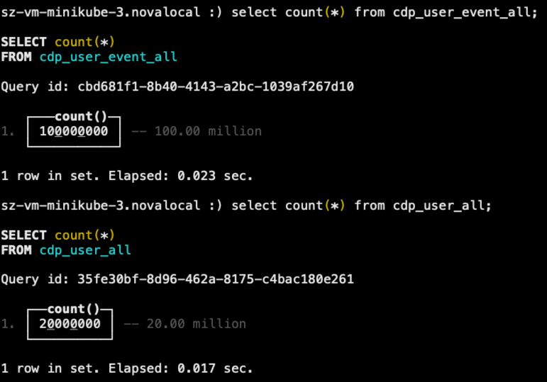
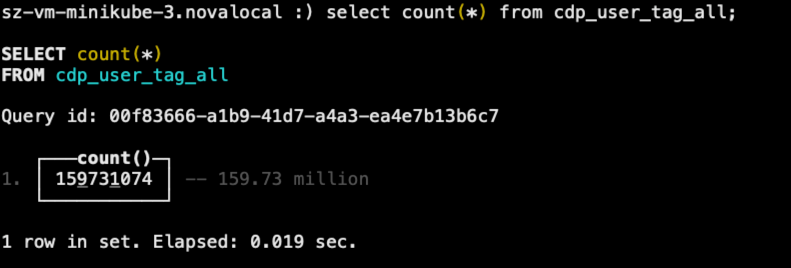
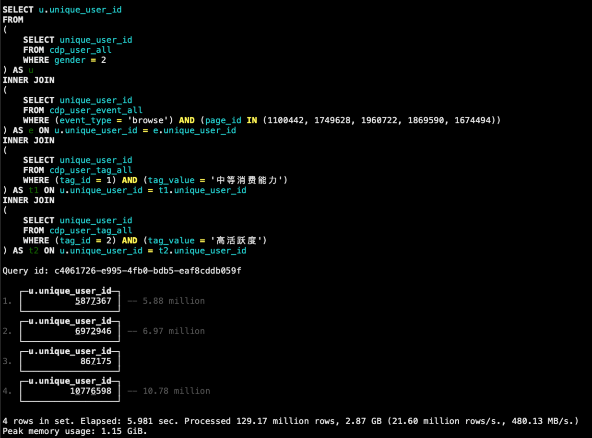
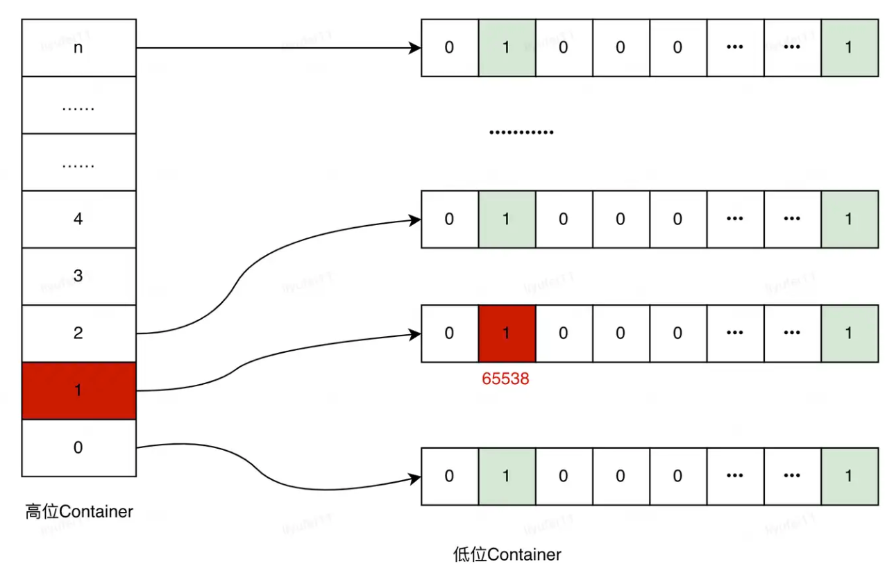
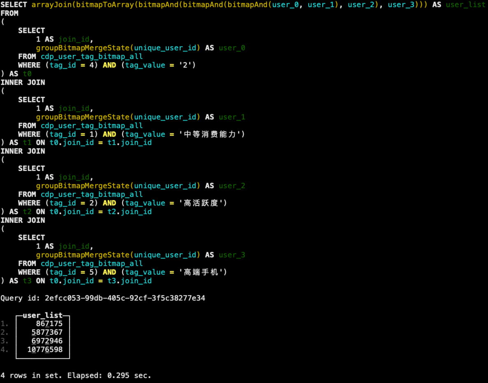

# 20 | 如何用ClickHousebitmap加速人群计算

你好，我是彭旭。

上节课我们介绍了 ClickHouse 应该怎么配置集群，以及怎么用分布式表和集群的能力，并行处理数据的写入与查询。

通过利用分布式并行计算，ClickHouse 的性能与扩展性得到了进一步提升，之前我们也用CDP 场景测试过了 StarRocks 的性能。

所以这节课，我们在相同的集群机器配置中，先来对比一下 ClickHouse 与 StarRocks 的性能。然后再给你介绍一个能够加速标签 AND、OR 计算的数据结构 bitmap。

## CDP 在 ClickHouse 下的性能表现

首先，我们在一个与前面 StarRocks 相同配置的集群中，使用分布式表，将之前的 2 千万用户与 1 亿行为事件导入，看看在 CDP 的几个场景中，ClickHouse 的性能表现如何。

### 数据准备

我给你准备好了几个建表脚本，是在 ClickHouse 中使用分布式表引擎，创建 CDP 相关的几个表。

至于数据，你仍然可以复用之前在 StarRocks 中的测试数据集。

ClickHouse 客户端工具 clickhouse-client 可以快速地将 csv 格式的数据导入表，下面这个命令就将文件 cdp_user_data.csv 的数据导入到了 cdp.cdp_user_all 表中。

```sql
clickhouse-client --port 9002 --query="INSERT INTO cdp.cdp_user_all FORMAT CSV" -
```

在 ClickHouse 里，其实不建议表分区数量太多。默认情况下一次插入数据的分区超过 100个，就会报下面的错误。

```sql
Received exception from server (version 24.3.2):
Code: 252. DB::Exception: Received from localhost:9002. DB::Exception: Too many p
(query: INSERT INTO cdp.cdp_user_all FORMAT CSV)
```

那怎么办呢？你可以通过修改 /etc/clickhouse-server/users.xml 配置文件的max_partitions_per_insert_block 的值来调大每次 INSERT 可以承载的分区数量。

```xml
<profiles>
   <!-- Default settings. -->
   <default>
       <max_partitions_per_insert_block>10000</max_partitions_per_insert_block>
   </default>
</profiles>
```

注意，由于我们之前 cdp_user_event 表的 csv 数据是用 # 作为分隔符的，所以导入的时候需要指定分隔符。如下。

```sql
clickhouse-client --port 9002 --query="INSERT INTO cdp.cdp_user_event_all FORMAT
```

导入完成后，检查一下数据，如下图所示。



### 标签生成

你应该还记得基于用户行为，我们为用户生成了一些标签，这里我们同样将标签生成 SQL 转成了 ClickHouse 的版本，你可以从这里下载这些 SQL 脚本。

我也整理了一下这些 SQL 执行的截图，你可以在这里查看这些 SQL 执行的时间，基本上这些 SQL 也是秒级能够执行完成，性能其实比 StarRocks 稍有优势。

执行完成之后，同样标签表里，有约 1.6 亿行标签记录。



### SQL 人群圈选

基于同样的基础数据，回到我们 CDP 的场景，同样以“给浏览过高端手机、女性、中消费、高活跃的用户群体推送一个 100 无门槛手机抵扣券”为例。

注意，如果直接用之前在 StarRocks 中圈人的 SQL 来在 ClickHouse 中执行，会有两个问题。

第一个是需要将之前的表改成 ClickHouse 中的分布式表，这样才能查询全量数据。

第二个是改成分布式表后，SQL 会由于存在多个分布式表之间的 JOIN 而出错。下面我列出了出错的详细信息。

```
Code: 288. DB::Exception: Double-distributed IN/JOIN subqueries is denied (distri
```

所以，最后我们需要修改一下圈人 SQL，改为先分别对不同的表进行子查询，然后将这些子查询结果作为虚拟表，再通过 INNER JOIN 将这些虚拟表连接在一起。

下面这段代码列出了最终的圈人 SQL。

```sql
SELECT u.unique_user_id
FROM
(
   SELECT unique_user_id
   FROM cdp_user_all
   WHERE gender = 2
) AS u
INNER JOIN
(
   SELECT unique_user_id
   FROM cdp_user_event_all
   WHERE event_type = 'browse'
   AND page_id IN (1100442, 1749628, 1960722, 1869590, 1674494)
) AS e ON u.unique_user_id = e.unique_user_id
INNER JOIN
(
   SELECT unique_user_id
   FROM cdp_user_tag_all
   WHERE tag_id = 1
   AND tag_value = '中等消费能力'
) AS t1 ON u.unique_user_id = t1.unique_user_id
INNER JOIN
(
   SELECT unique_user_id
   FROM cdp_user_tag_all
   WHERE tag_id = 2
   AND tag_value = '高活跃度'
) AS t2 ON u.unique_user_id = t2.unique_user_id;
```

改造完成之后的 SQL，执行结果如下。



从结果可以发现，相比之前 StarRocks 圈人不到 1 秒就能出结果，这里 ClickHouse 花费了 6秒左右的时间，这里也印证了我们之前所说的，ClickHouse 在多表 Join 的情况下表现相对没那么好。

那么这个场景中，我们还有什么优化手段吗？

## 使用 Bitmap 加速人群计算

其实在 CDP 的人群圈选中，我们经常会使用 bitmap，通过位计算来加速多个标签的 AND 和OR 等条件计算。

### 什么是 Bitmap？

我们经常会碰到各种关于大量数据去重的面试题，比如 50 亿个正整数，如何找出其中重复的数字？给定 50 亿个正整数的集合，如何快速判断某个正整数是否在该集合内？

如果我们是用 Set 去做去重判断，假设每个正整数占用 4 字节，50 亿个正整数就是 200 亿字节，约占用空间 18.6GB，这个开销太大了。

位图就是用来快速解决这类快速查找、去重、集合操作的问题的。比如例子中，我们用第 0 个比特表示数字 0，第 1 个比特表示数字 1，以此类推。将给定集合内所有的正整数，在它对应的位图上，将比特设置为 1，不存在则保持为 0。这样就能很方便地查询某个正整数是否存在或者重复。

使用位图的情况下，50 亿个正整数，只需要 50 亿个位即可存储完整，存储空间占用约等于600M。只有之前的百分之几。

而且位操作，如 and 求交集、or 求并集，比字符串匹配等操作的效率更高。所以，位图经常被作为索引用在数据库、查询引擎和搜索引擎里。

但是，位图也有一个缺陷，那就是不管业务中实际存储了多少个元素，它占用的内存空间都恒定不变。比如前面的例子中，不管集合中只有 {1、50 亿} 这两个元素，还是集合中有 50 亿个元素，占用的空间都是 600M。所以在位图中，数据越稀疏，空间浪费越严重。

为了降低位图在存储稀疏数据时，占用空间仍然较大的问题，出现了多种多稀疏位图压缩的算法，其中具备代表性的就是 RoaringBitmap。

### 什么是 RoaringBitmap？

RoaringBitmap 是一种高效的压缩位图实现，以 32 位的 int 整数为例，RoaringBitmap 将数据分成高 16 位和低 16 位两部分，高 16 位作为桶的编号 Container，低 16 位不变，作为数据位 Container。

比如，如果要存储 65538 这个值，则高位为 65538>>16=1，低位为 65538-65536*1=2，即存储在 1 号桶的 2 号位置。

就像下面这张图。



- 图片源自网络

有没有发现这个其实就是一个进制的表示？给你两个空格，之前一个空格只能填充一个数字，那就只能容纳两个数字。现在将一个空格作为十进制位，另外一个作为个数位，这样最多就能容纳 100 个数字了。

在很多数据库，像 StarRocks、ClickHouse 中，都提供了 bitmap 的实现。接下来我们就看看，如何用 bitmap 来在 ClickHouse 中，加速人群计算。

### ClickHouse 使用 bitmap 加速人群计算

之前针对标签的存储，我们是用高表，一个用户的一个标签值都会存储一行数据。其实一个标签值对应多个用户 ID，这些用户 ID，我们就可以视为一个集合，用 bitmap 来存储。所以用bitmap 来存储的标签记录表 cdp_user_tag 就像这样：

```sql
CREATE TABLE cdp_user_tag_bitmap_local on cluster default
(
   tag_id         UInt64 COMMENT 'tag唯一标识符',
   tag_value      String COMMENT 'tag值',
   tag_name       String COMMENT 'tag名称',
   unique_user_id AggregateFunction(groupBitmap,UInt64) COMMENT '使用位图存储用户全
   tag_category   UInt8 COMMENT 'tag分类'
   ) ENGINE = AggregatingMergeTree()
   PARTITION BY tag_id
   ORDER BY (tag_id,tag_value,tag_name,tag_category);
CREATE TABLE cdp_user_tag_bitmap_all on cluster default as cdp_user_tag_bitmap_lo
   ENGINE = Distributed(default, 'cdp', 'cdp_user_tag_bitmap_local', tag_id);
```

这里我们直接从原有的标签表查询数据，插入到这个新的使用了 bitmap 的标签表，下面是具体 SQL 语句。

```sql
INSERT INTO cdp_user_tag_bitmap_all (tag_id, tag_value, tag_name, unique_user_id,
SELECT
   tag_id,
   tag_value,
   tag_name,
   bitmapBuild(cast([unique_user_id] as Array(UInt64))),
   tag_category
FROM cdp_user_tag_all
GROUP BY tag_id, tag_value, tag_name, tag_category, unique_user_id;
```

为了使用 bitmap 来计算标签，原来圈人 SQL 里面需要从事件表查询浏览过高端手机的用户，这里我们把这部分用户也给打上高端手机的标签。

```sql
INSERT INTO cdp_user_tag_bitmap_all (tag_id, tag_value, tag_name, unique_user_id,
SELECT
   5,
   '高端手机',
   '手机偏好',
   bitmapBuild(cast([unique_user_id] as Array(UInt64))),
   5
FROM cdp_user_event_all
WHERE event_type = 'browse'
 AND page_id IN (1100442, 1749628, 1960722, 1869590, 1674494)
```

好了，到这里新的 bitmap 标签表与数据都已经准备完成，你可以从这里找到所有的 SQL 脚本。接下来就看看优化后的人群圈选 SQL 性能有多大的提升。

```sql
SELECT arrayJoin(bitmapToArray(bitmapAnd(bitmapAnd(bitmapAnd(user_0,user_1),user_
FROM
   (
       SELECT 1 as join_id, groupBitmapMergeState(unique_user_id) as user_0
       FROM cdp_user_tag_bitmap_all
       WHERE tag_id = 4 and tag_value = '2'
   ) t0
       INNER JOIN
   (
       SELECT 1 as join_id, groupBitmapMergeState(unique_user_id) as user_1
       FROM cdp_user_tag_bitmap_all
       WHERE tag_id = 1
         AND tag_value = '中等消费能力'
   ) AS t1 ON t0.join_id = t1.join_id
       INNER JOIN
   (
       SELECT 1 as join_id, groupBitmapMergeState(unique_user_id) as user_2
       FROM cdp_user_tag_bitmap_all
       WHERE tag_id = 2
         AND tag_value = '高活跃度'
   ) AS t2 ON t0.join_id = t2.join_id
       INNER JOIN
   (
       SELECT 1 as join_id, groupBitmapMergeState(unique_user_id) as user_3
       FROM cdp_user_tag_bitmap_all
       WHERE tag_id = 5
         AND tag_value = '高端手机'
   ) AS t3 ON t0.join_id = t3.join_id;
```

使用 bitmap 后的圈人 SQL 逻辑也很简单，同样按标签分别圈出对应的用户 ID 列表，最后将所有的用户 ID 取交集。执行结果如下，可以看到性能有了一个巨大的提升，从原来的 6 秒左右提升到了 300 毫秒不到。



此外，在选择不同的标签构建 CDP 人群包时，我们也经常需要统计圈选出来人群的数量，使用动态 SQL 加上 bitmap 的优化，在 ClickHouse 中，很容易就可以在亿级数据下实现亚秒级的人群预估与圈人。所以基于 ClickHouse，其实已经可以构建一个小型的在线实时 CDP 平台。

## 小结

从准备数据与 SQL 人群圈选过程中，其实可以发现，ClickHouse 的数据写入、导入速度，要比 StarRocks 快很多，但是在多表 Join 查询中，却又大幅落后于 StarRocks。

所以，如果你的数据模型是星型模型、雪花模型，一般考虑可以使用 StarRocks。如果一张大宽表就能够满足你的业务，那么 ClickHouse 则是一个较优的选择。

bitmap 是一种常用的数据库索引结构，同样也可以用来做整数的数据存储，RoaringBitmap 则优化了 bitmap 在存储稀疏数据时空间占用的问题。bitmap 在位计算场景下，性能比字符串、整数的直接对比有一个巨大的提升。很适合像 CDP 这种通过标签圈出多个用户 ID 的集合，然后取交集、并集的场景。

## 思考题

你知道 bitmap 可以用来做字符串的计算吗？如果可以，有没有什么限制？

欢迎你在留言区和我交流。如果觉得有所收获，也可以把课程分享给更多的朋友一起学习。欢迎你加入我们的读者交流群，我们下节课见！
