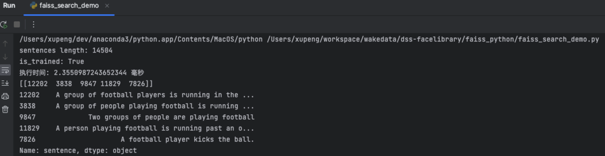
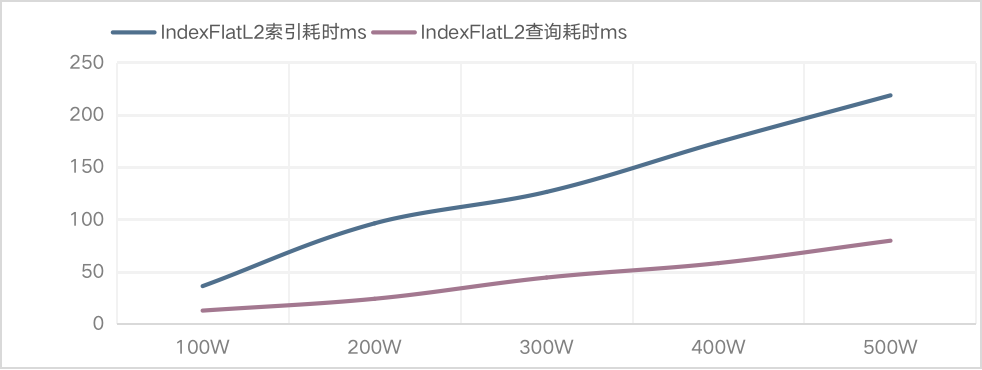
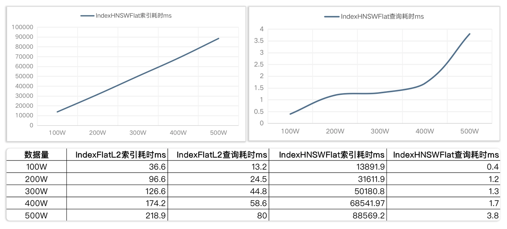
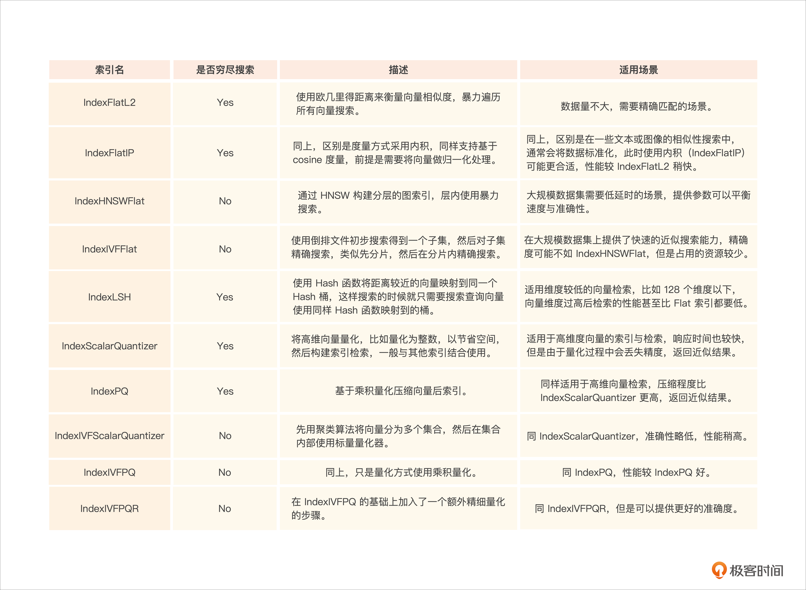

# 22 | Faiss是一个向量数据库吗？

你好，我是彭旭。

在上一讲中，我们探讨了人工智能领域对于数据的向量化表达以及相应的存储和检索需求，这极大地促进了向量数据库技术的发展。

自从 2017 年 FaceBook 开源了 Faiss 后，从 2019 年到 2020 年，市场上诞生了许多优秀的向量数据库，据 DBRanking 对向量数据库的排名所示，最新流行的纯向量数据库排名靠前的包括如 Pingcone、Chroma、Weaviate、Milvus 等。

让人奇怪的是，这个榜单竟然没有把 Faiss 包含在内。在我看来，这是因为 Faiss 其实不能算是一个完整的数据库。

为什么呢？

我们先来看一下 Faiss 提供了什么能力。

## Faiss 是什么？

官方对 Faiss 的介绍是“Faiss 是一个用于高效相似性搜索和密集向量聚类的库”。注意，这里说 Faiss 是一个库，而没有说是一个数据库。

事实上，Faiss 是用 C++ 编写的，并提供了一个 Python 的封装，而 Faiss 对外提供的服务就是一个 Python 的依赖库，所以它并不具备一个完整的数据库的功能，甚至不具备数据的持久化能力、数据的管理能力。

比如说 Faiss 每次在程序中访问之前，都需要重新加载数据，然后基于这些数据在内存中构建索引。但是程序一旦结束，这些数据就在内存中消亡了，并不会被持久化存储。除非手动调用Faiss 的 API 将构建好的索引数据，以文件的形式存储到磁盘。但是，就算存储下来，也没有一个管理工具可以查看这些数据，只能在 Faiss 重新启动后，再去加载这个文件。

看到这里，你也会觉得 Faiss 并不是一个完整的数据库了吧。

Faiss 号称能够处理百万千万级数据量，但是刚刚又说数据全部是加载到内存构建索引，那么我们需要多大的内存来支持这么大体量的数据呢？

其实，Faiss 通常使用 32 bit 的浮点数来代表向量，向量的维度通常从几十到几百，这里我们假设向量维度为 128，这样我们可以简单地用下面的公式来计算向量占用内存的大小。

```
内存占用 = 向量数 * 向量维度 * 每个向量的字节大小
```

公式中向量数就是我们需要存储的数据量大小，向量维度 = 128，一个 32 bit 的向量字节大小为 4 byte，所以最终一百万向量占用内存的大小如下：

```
内存占用 = 1,000,000 * 128 * 4 bytes = 512,000,000 bytes ≈ 488 MB
```

当然，实际上需要存储到内存的数据并不仅仅是向量本身，还可能需要包括向量编号、原始的数据等等，某些索引也需要额外的内存。但是即使这样，一台 16 G 以上的服务器，也基本都能承载百万级向量数据的索引与检索。

Faiss 的安装使用也很简单，接下来我用一个简单的例子带你体验一下 Faiss 的向量化检索。

## 简单使用 Faiss

前面提到 Faiss 就是一个 Python 的库，最新版本推荐使 用 conda 来安装，在服务器上安装好 conda 之后，只需执行一条命令即可安装 Faiss 库。

```
# CPU-only version
$ conda install -c pytorch faiss-cpu=1.8.0
# GPU(+CPU) version
$ conda install -c pytorch -c nvidia faiss-gpu=1.8.0
# GPU(+CPU) version with NVIDIA RAFT
$ conda install -c pytorch -c nvidia -c rapidsai -c conda-forge faiss-gpu-raft=1.
```

这里提一下现在 Faiss 的 CPU 版本支持 Mac、Linux、Window 操作系统，但是 GPU 版本只能在 Linux 上运行。

接下来我们就来看一下如何使用 Faiss 来添加数据构建索引，然后进行向量检索。

```python
import pandas as pd
data = pd.read_csv("/Users/xupeng/Downloads/sentence.csv", sep='\\t')
data.head()
sentences = data['sentence'].tolist()
print("sentences length: {}".format(len(sentences)))
from sentence_transformers import SentenceTransformer
# 初始化文本向量化模型
model = SentenceTransformer('bert-base-nli-mean-tokens')
# 将文本向量化
sentence_embeddings = model.encode(sentences)
# 获取向量化后向量的维度
d = sentence_embeddings.shape[1]
import faiss
# 创建faiss索引
index = faiss.IndexFlatL2(d)
# flat索引无需训练，所以这里输出为true
print("is_trained: {}".format(index.is_trained))
# 将数据添加到faiss索引
index.add(sentence_embeddings)
k = 5
xq = model.encode(["Someone sprints with a football"])
import time
start_time = time.time()
# 搜索TOP 5最相似向量
D, I = index.search(xq, k)  # search
end_time = time.time()
execution_time = (end_time - start_time)*1000
print(f"执行时间: {execution_time} 毫秒")
print(I)
# 根据搜索结果位置找出原数据
print(data['sentence'].iloc[I.flatten().tolist()])
```

上面的代码是从 csv 文件中读取了一个 sentence 列表，将 sentence 向量化后，通过 Faiss建立索引，最后用一个句子转化为向量来检索。

你可以从这里下载这个 csv 文件。

注意，第 10 行我们初始化了一个文本向量化模型，这是一个提供用于自然语言处理（NLP）任务的 BERT 类型模型。

因为其实大部分向量数据库都不提供向量化模型，基本都依赖外部的向量化模型来将文本、图片向量化。当然其中也有一些特例，比如 Weaviate 就提供了各种内置的模型，包括 text2vec-transformers、multi2vec-bind 等，也支持与各种外部模型集成。

这里我们同样可以使用 pip 命令来安装这个模型，不过这个模型需要科学上网。为了防止你无法访问这个模型，我也准备了一个用 Python Numpy 来生成一些随机向量测试的代码，你可以在这里找到这个测试代码。

```
pip install sentence-transformers
```

代码上面我都添加了注释，容易理解，这里我就不展开说明，代码运行结果如下图所示：



从运行结果中可以看到，搜索结果匹配的 Top5 基本上都是跟 football 相关的句子。

好了，到这里你基本了解了 Faiss 是什么，如何使用 Faiss，但是 Faiss 的功能远不止这么强大。

Faiss 提供了非常丰富的索引和相似度度量方法。上一讲我们讲到了 FLAT 类型的向量索引，其实采用的是暴力的搜索方式，所以可能存在性能问题，只在小数据集的场景下适用。

比如我们的 demo 中，在 14504 个向量中搜索最匹配的 5 个，在我的 Apple M2 Max+32G 的Mac 上面耗时稳定在 2.4 毫秒左右。

在这个数据体量下，即使我们使用 FLAT 类型索引，Faiss 的性能还是很好的，但是可能随着数据量的增加，FLAT 索引的响应时间基本上就是一个线性增长了。

下面这个图就是我在使用 IndexFlatL2 在 100 万 -500 万数据量的情况下统计的耗时。可以看到，结果跟预期一样，索引时间跟搜索时间基本都是一个线性增长。



当然，Faiss 也提供了性能高的索引方式，毕竟 Faiss 强大之处就是提供了各种类型的索引方式以及相似度的度量方法。

比如，如果需要使用我们前面提到的 HNSW 方式来构建与检索，只需要修改构建索引的一行代码。

注意，这里多了一个 M 参数。M 控制了 HNSW 图中各个层级中每个节点可以保持的最大邻居数。M 值越大，索引构建时间与检索时间越长，但是结果越精确。反过来，M 值越小则索引构建时间与检索时间越短，但是结果越模糊。

```
# 创建一个 HNSW 索引
index = faiss.IndexHNSWFlat(d, 16) # 这里的 16 是 HNSW 的 M 参数
```

在实际测试过程中，比如 M 从 16 调整到 32，构建索引时间可能翻 3 倍以上。当然这个跟代码运行的机器配置也是相关的。

同样我也基于这段测试代码，验证了一下 HNSW 的性能，你可以参考下面的图表来做个对比。



到这里你应该已经了解 Faiss 如何使用不同的索引，其实向量的索引可以由索引的方式与相似度度量的方式组合来决定。

为了方便你理解 Faiss 支持的各种索引方式，我整理了一下 Faiss 支持的索引与其适用场景，你可以参考下面这个表。



看完后，你应该可以根据业务的准确度要求、性能要求、资源占用情况来选择合适的索引。

## 小结

Faiss 虽然不能被称之为一个向量数据库，但是它还是提供了完整的向量索引与检索能力，只是需要在检索之前，将数据集添加到索引。

Faiss 索引默认基于内存存储，但是也可以调用接口将内存中建好的索引保存到磁盘，以便下次服务启动的时候重新加载，以节省初始化时间。

向量引擎或者向量数据库通常不直接提供向量化的能力，所以我们通常需要找一个向量化模型来先将数据向量化。

在 Faiss 中，最常用的索引方式其实还是 Flat 类型的索引，因为基于内存构建的索引，我们通常也不会加入超过百万的数据。如果数据过多，其实也可以将数据分片，然后不同分片由不同的 Faiss 进程服务来提供。

通过组合不同的索引方式与相似度度量方式，Faiss 提供了很多种索引的支持，我们可以根据不同的业务场景来选择不同的索引。比如在人脸识别场景，准确度要求高，那么 Flat 类型就比较适用。比如视频搜索场景，性能要求较高，就可以采用 HNSW 类型索引。甚至可以组合不同的索引方式。

好了，到这里相信你已经对 Faiss 有了一定的了解，包括如何使用 Faiss，什么场景下用什么样的索引与度量方式来平衡性能与搜索结果的准确性。下一讲，我们就进入 Faiss 的一个实战，用 Faiss 构建一个人脸识别应用。

## 思考题

当 Faiss 需要索引的数据过多时，需要考虑数据分片，在门店客流人脸识别场景下，你觉得应该如何做数据分片？

欢迎你在留言区和我交流。如果觉得有所收获，也可以把课程分享给更多的朋友一起学习。欢迎你加入我们的读者交流群，我们下节课见！
