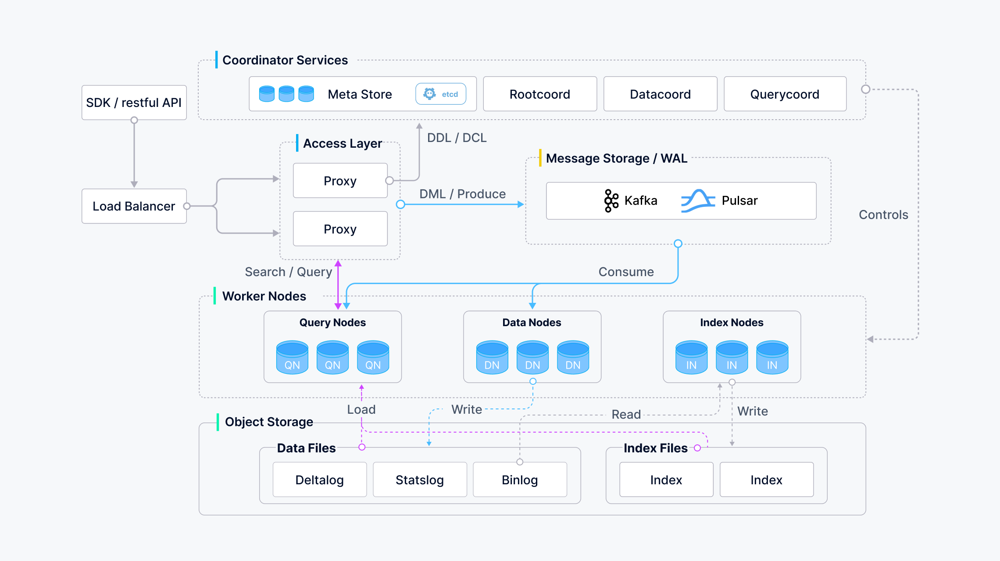
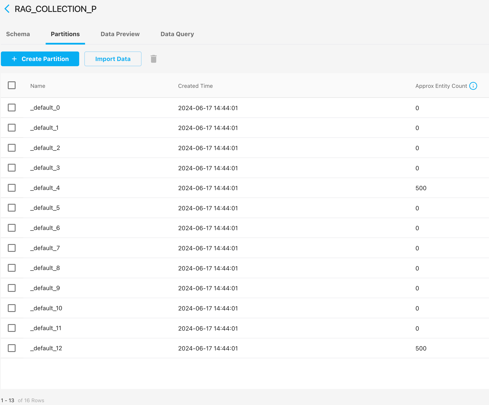
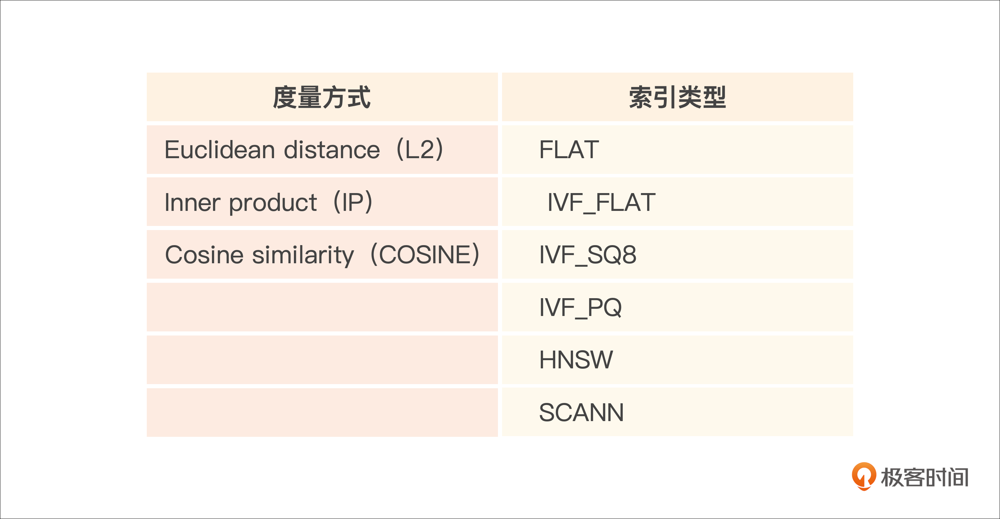
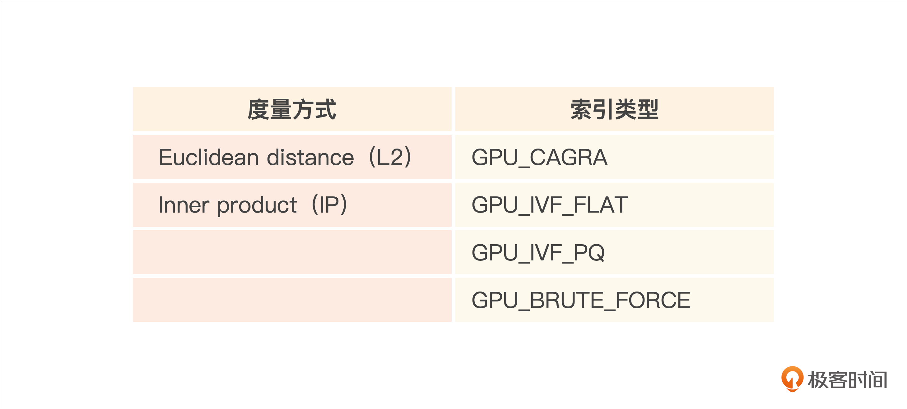

# 24 | 带你看一个完整的向量数据库Milvus

你好，我是彭旭。

前面几节课我们介绍了 Faiss，学习了使用 Faiss 构建索引与向量化检索，也用 Faiss 来搭建了一个简单的人脸识别应用。

通过对 Faiss 的介绍，你应该知道，Faiss 不像数据库一样持久化存储向量化数据，而是每次使用之前，都需要从硬盘等持久化设备读取数据，加载索引。并且 Faiss 也没有一个数据库所需要的数据管理功能。所以 DBRanking 对向量数据库的排名，并没有将 Faiss 包括在内。

那有没有一个具备完整的数据存储、管理功能的向量数据库产品呢？

有，就是我们这节课要介绍的 Milvus。

## Milvus 是什么？

Milvus 其实是基于 Faiss、HNSW、DiskANN、SCANN（Scalable Approximate NearestNeighbor）等这些向量检索库构建的，被设计用来做稠密向量的相似性检索。它可以支持十亿，甚至万亿以上向量化数据的存储检索。

Milvus 支持数据分片、动态 Schema、单向量检索、多向量检索、向量与标量混合检索以及许多其他高级功能。

与 StarRocks 类似，Milvus 也支持存算分离。因为 Milvus 使用 MinIO 对象存储来存储日志文件的快照、索引文件、数据以及一些查询的中间结果，所以能够快速地部署在兼容 MinIO 协议的 AWS S3 和 Asure Blob 上。

最后，作为一个具备完整数据管理功能的向量数据库，GUI 也是必不可少的一项，Milvus 提供了一个 attu 的 Web GUI 工具，你可以在这里下载部署。

## Milvus 架构



- 图片源自网络

从架构上来看，Milvus 服务包括四层：访问层、协调服务层、工作节点和存储。这几个分层在弹性伸缩与故障恢复上可以相互独立。

访问层由一组无状态的代理服务组成，接收客户端的请求，有点类似 StarRocks 的 FE，访问层使用负载均衡工具（比如 Nginx、Kubernetes Ingress、NodePort 等）来提供一个统一的服务地址。Milvus 也采用了大规模并行处理（MPP）架构，请求被并发地发送到后端处理，然后在访问层做一个汇总，最终将结果返回给客户端。

协调服务层是 Milvus 的“大脑”，又可以分为三种类型的协调服务。

1. Root coordinator：用来处理 DDL 和 DCL 请求，比如创建、删除 Collection、Partition、Index 等，在 Milvus 里面，Collection 就相当于关系型数据库里面的表。

2. Query coordinator：负责管理和协调查询操作，包括查询的拓扑结构管理、负载均衡、查询节点之间的通信和数据传输等。

3. Data coordinator：负责管理和协调数据的存储和访问，包括数据的分片、索引构建、数据迁移等工作。 确保数据的高效存储和检索，是实现数据的快速查询的核心。

工作节点是 Milvus 的手脚，由于 Milvus 是存储与计算分离，所以工作节点是无状态的，会无脑执行从代理传来的数据操作语言（DML）命令。同样地，工作节点也可以分为三种类型。

1. Query Node：主要负责接收用户的查询请求，并进行向量相似度搜索和数据分析等操作。查询节点负责对数据进行检索和计算，返回查询结果给用户。

2. Data Node：Milvus 数据的 DML 操作，同样会生成类似 Redo Log 的预写入日志，然后写入消息中间件，Data Node 就从消息中间件订阅这些日志消息，处理变更请求，并将日志数据打包成日志快照，存储在对象存储中。

3. Index Node：负责构建索引，管理索引。

存储层是 Milvus 的骨架，负责数据的持久化，存储层包含三种类型的数据存储。

1. Meta Storage 存储元数据的快照，比如数据库 schema、日志消费 checkpoint 等，为了保障存储元数据需要极高的可用性、强一致性和事务支持，Milvus 使用 etcd 存储元数据。

2. Object Storage 使用 MinIO 对象存储日志文件的快照、索引文件、数据以及一些查询的中间结果。

3. Log Broker 是 Milvus 的脊椎。它负责数据持久性和读写分离，系统数据的操作，都会以日志的形式写入 Log Broker, 然后给到下游消费去更新本地数据。Milvus 集群使用 Pulsar 作为 Log Broker，单机版采用 RocksDB 作为 Log Broker。

从架构上看，Milvus 就是一个大数据时代常用的分布式架构模式，不过 Milvus 作为向量数据库，不支持 SQL 查询，反而提供了丰富了 SDK，比如 Python、Java、Go 等。

接下来，我们就来看一下 Milvus 的逻辑模型，在这个过程中使用 Python SDK 来演示下与Milvus 的交互过程。

## Milvus 的逻辑模型

Milvus 的逻辑模型与关系型数据库类似。

首先，你可以创建 database，然后给特定用户分配权限，来管理这个 database。

```python
from pymilvus import connections, db
conn = connections.connect(host="127.0.0.1", port=19530)
database = db.create_database("RAG")
```

与其他数据库直接授权给用户的方式不同，Milvus 使用 RBAC（Role-Based AccessControl，基于角色的权限控制）来控制资源的访问，比如 database、collection，甚至是partition。你可以新建一个角色，然后授予这个角色一些权限，最后将这个角色跟用户关联起来。

```python
from pymilvus import MilvusClient
client = MilvusClient(
   uri='http://127.0.0.1:19530',
   token='root:Milvus' # username:password
)
client.create_role(
   role_name="roleA",
)
client.grant_privilege(
   role_name='roleA',
   object_type='User',
   object_name='SelectUser',
   privilege='SelectUser'
)
client.create_user(
   user_name='rag_user',
   password='P@ssw0rd'
)
client.grant_role(
   user_name='rag_user',
   role_name='roleA'
)
```

其次，database 里面可以有多个 collection。Collcection 就类似关系型数据库的表。Milvus创建 collection 的时候，需要指定字段 field。它也同时支持动态字段，插入时，新增的动态字段会以 Key-Value 的形式存储在一个叫做 $meta 的特殊字段当中。

```python
from pymilvus import MilvusClient, DataType
# 2. Create schema
schema = MilvusClient.create_schema(
   auto_id=False,
   enable_dynamic_field=True,
)
schema.add_field(field_name="pk", datatype=DataType.INT64, is_primary=True, auto_
schema.add_field(field_name="user_id", datatype=DataType.INT64, description='user
schema.add_field(field_name="file_sha1", datatype=DataType.VARCHAR, description='
schema.add_field(field_name="file_size", datatype=DataType.INT64, description='fi
schema.add_field(field_name="file_name", datatype=DataType.VARCHAR, description='
schema.add_field(field_name="text", datatype=DataType.VARCHAR, description='the o
schema.add_field(field_name="vector", datatype=DataType.FLOAT_VECTOR, description
# 3、创建index
index_params = client.prepare_index_params()
index_params.add_index(
   field_name="vector",
   index_type="IVF_FLAT",
   metric_type="IP",
   params={"nlist": 128}
)
# 4、创建collection，同时加载index
client.create_collection(
   collection_name="RAG_COLLECTION",
   schema=schema,
   index_params=index_params
)
```

注意，创建 collection 的时候，一般需要同时创建好索引。像关系型数据库一样，创建一个表的时候，就需要考虑怎么样去访问这个表，根据使用场景设计好索引。当然，你也可以先创建collection，然后再添加一个索引。collection 在开始写入数据与查询之前，需要先 load，load的过程就会将索引加载到内存。

```
# 5. Load the collection
client.load_collection(
   collection_name="RAG_COLLECTION",
   replica_number=1
)
```

在 load collection 的时候，可以设置一个 collection 数据需要加载的副本数 replica_number，在单机版本下，这个副本数最大值是 1，在集群模式下，最大值则是 queryNode.replicas 这个配置的值。

在集群模式下启用多副本，Milvus 会将同一个数据片段分布到多个 queryNode，这样可以用来容灾与提升查询性能。

然后，当你创建一个 collection 时，Milvus 会为这个 collection 默认创建一个叫做 _default的分区 partitions。在一个 collection 下，最多可以创建 4096 个分区。

Milvus 有两种创建 partition 的方式。

第一种是在创建完 collection 后，手动再创建分区。

```
# 4、创建分区
client.create_partition(
   collection_name="RAG_COLLECTION",
   partition_name="partition_technology"
)
```

第二种是在创建 collection 的时候，使用一个字段，作为分区键来分区。

```
schema = MilvusClient.create_schema(
   auto_id=False,
   enable_dynamic_field=True,
   partition_key_field="user_id",
   num_partitions=16 # Number of partitions. Defaults to 16.
)
```

Milvus 使用分区键来创建分区的方式跟其他分布式数据库一样。使用分区键查询的时候，同样可以用分区键来“裁剪”查询时需要扫描的数据量。

## 数据写入与读取

一个 collection 里面一般会定义多个标量字段，以及至少 1 个向量字段。创建好 collection 并load 后，就可以开始向 collection 写入与读取这些标量与向量数据了。

```sql
import random
from pymilvus import MilvusClient
# 2. Insert randomly generated vectors
data = []
for i in range(1000):
   user_id = i % 2 + 1
   file_sha1 = ''.join(random.choices('abcdef0123456789', k=128))
   file_size = random.randint(1, 10000)
   file_name = ''.join(random.choices('abcdefghijklmnopqrstuvwxyz', k=20))
   text = ''.join(random.choices('abcdefghijklmnopqrstuvwxyz', k=100))
   vector = [random.random() for _ in range(1536)]
   data.append({
       "user_id": user_id,
       "file_sha1": file_sha1,
       "file_size": file_size,
       "file_name": file_name,
       "text": text,
       "vector": vector
   })
res = client.insert(
   collection_name="RAG_COLLECTION_P",
   data=data
)
```

上面的代码片段，为两个用户随机准备了 1000 条记录，然后插入了我们之前创建的以user_id 作为 partition key 的 collection。从下面的图可以看到，这两个用户的数据，就是分布到了两个 partition。



接下来就可以开始检索数据了，在 Milvus 中，基于标量字段的查询被称为 Query，基于向量字段的查询被称为 Search。

在 2.3.x 版本中，同时基于标量字段与向量字段的查询被叫做 Hybrid Search。

```
query_vectors = [[random.random() for _ in range(1536)]]
result = client.search(
   collection_name="RAG_COLLECTION_P",
   data=query_vectors,
   filter="user_id == 1 && file_name like 'pmp%'",
   search_params={"metric_type": "IP", "params": {"nprobe": 10}},
   output_fields=["user_id", "file_name", "text"],
   limit=3
)
```

比如上面的代码片段，通过标量字段过滤了 user_id=1 , 文件名以 pmp 开头的数据，然后再进行向量化检索，找到与向量 query_vectors 近似的数据行，就是一种 Hybrid Search。

注意，向量化检索时，度量方式 metric_type 的取值必须与创建索引时指定的值一样，这里使用 IP（Inner Product，内积）的度量方式。

但是在 2.4.x 版本里，“Hybrid Search”被用在一个 collection 中存在多个向量字段，并且多个向量字段被同时检索的场景。

多个向量字段同时检索时，需要选择一个 Ranking 的策略，用来决定结果的排序，比如WeightedRanker 策略，会为每个向量字段分配一个权重，结果就基于这个权重来排序。

2.4.x 版本，还增加了一个基于主键列，作为 id Get 数据行的方法。

```
# 4. Get entities by ID
res = client.get(
   collection_name="RAG_COLLECTION_P",
   ids=[0, 1, 2]
)
```

好了，到这里你已经对 Milvus 的逻辑模型有一定了解，能够使用 Milvus 去存储数据、查询数据了，你还可以使用各种索引来调优数据的读取性能。

## Milvus 的索引

Milvus 支持给向量字段、标量字段创建索引。具体怎么索引呢？

首先，collection 的数据由多个不可变的数据片段组成，这些数据片段被称为 segment。

当给标量字段创建索引后，向量化检索的时候如果带上这个索引字段作为过滤条件，Milvus 会检查每个 segment 是否包含查询的数据，然后构建一个 segment 是否存在数据的 bitset。向量检索的时候，会把这个 bitset 作为查询参数传递，用来“裁剪”需要检索的 segment。看到这里，是不是又想起了布隆过滤器？

好，再说向量字段的索引。Milvus 支持几种模式：In-Memory Index、On-Disk Index、GPUIndex。分别适用不同的场景。

比如我们的人脸识别场景，正常情况下使用 In-Memory Index，查询的响应时间能够控制在几十到几百毫秒。

In-Memory Index 是最常用的向量索引方式，向量索引基于内存存储。其实跟 Faiss 类似，支持多种 ANNS 算法索引与度量方式，两者组合就形成了一个索引类型。以浮点数向量索引为列，你可以参考下表：



```
index_params.add_index(
   field_name="vector",
   index_type="IVF_FLAT",
   metric_type="IP",
   params={"nlist": 128}
)
```

当人脸图片数量增加到一定程度，它向量化后的数据，在内存中已经放不下了，这时候就可以考虑使用 On-Disk Index，但是相应地也会带来性能的下降。

创建 On-Disk Index 的时候，只需要指定 index_type 为 DISKANN。

```
index_params.add_index(
   field_name="vector",
   index_type="DISKANN",
   metric_type="IP"
)
```

如果需要进一步提升性能与吞吐量，就可以考虑 GPU Index，使用 GPU Index 的吞吐量可以是 In-Memory Index 的几倍，性能上通常也能够得到提升，不过 GPU 机器一般比较贵，所以会带来成本的上升。

同样你可以参考下表 GPU 索引支持的索引类型与度量方式。



你可以在这里找到完整的代码清单，帮你理解、测试 Milvus。

## 小结

在 DBRanking 对纯向量数据库的排名中，Milvus 排名第 2，仅次于 Pinecone。这里我认为有很多方面的考量，比如 Milvus 的性能突出、分布式集群架构，能够支撑的数据体量巨大、简单易用、支持多语言 SDK 访问、同时支持私有化与 SaaS、支持 GPU 索引等。所以 Milvus号称全球用得最广的向量数据库，被超过 5000 家企业使用。

此外，Milvus 有多种多租户支持的方式，比如基于 database 隔离、基于 collection 隔离、基于 partition 隔离、基于字段隔离。如果你需要构建一个在线的 SaaS 系统，Milvus 也为多租户、多用户的数据隔离，提供了非常灵活的支持。

同时，Milvus 架构也吸取了分布式关系型数据库的优点，比如支持数据分片、多副本等等。Milvus 的数据片段写入后不可变，但也支持 upsert 来更新数据。它也和 LSM 类似，也会有后台 compact 任务来合并 segment，同时清理删除的数据。

Milvus 支持内存索引、磁盘索引、GPU 索引。如果使用内存索引，索引节点会在 collection加载的时候，把索引数据写入内存。

说了这么多优点，再说说我的感受。上节课我用 Faiss 构建了人脸识别系统，对比用 Milvus构建个人知识库的时候，会感觉到 Milvus 在响应上更快。而且 SDK 的支持种类比较多，API设计简单，用起来确实便捷。下节课，我们就一起上手体验 Milvus。

## 思考题

Milvus 的标量索引，其实是以搜索引擎的逻辑来构建的，你知道它用的是什么数据结构吗？

欢迎你在留言区和我交流。如果觉得有所收获，也可以把课程分享给更多的朋友一起学习。欢迎你加入我们的读者交流群，我们下节课见！
