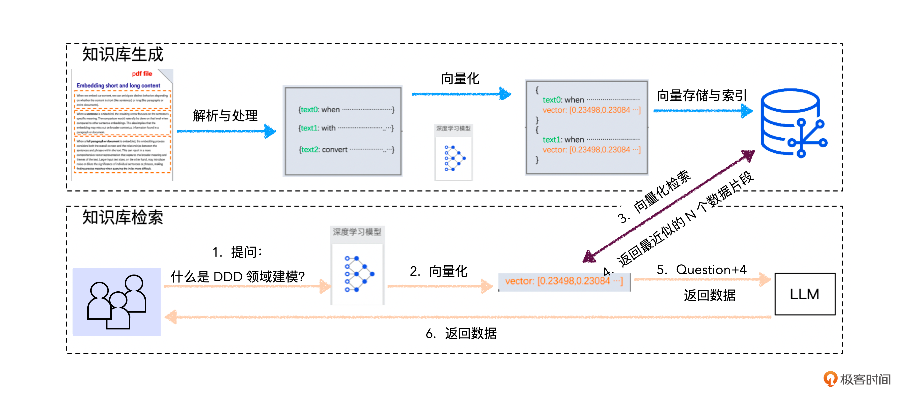
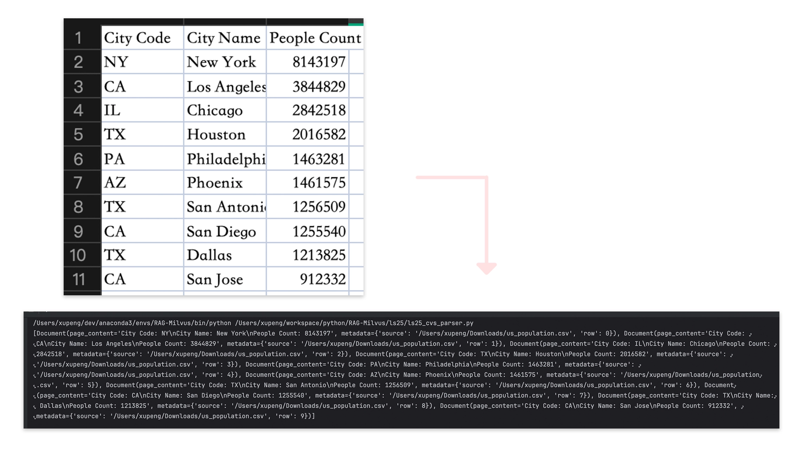
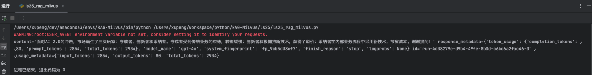
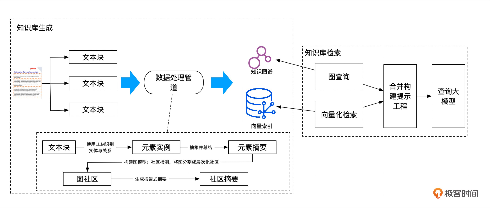
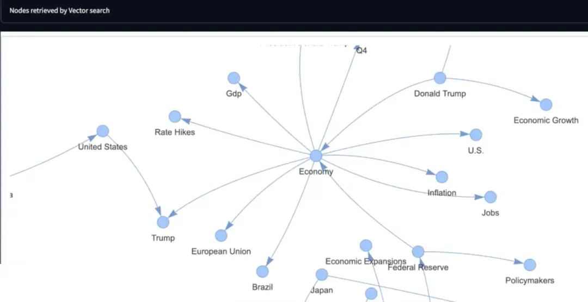

# 25 | 案例：RAG+Milvus+大模型，搭建个人知识库

你好，我是彭旭。

这节课我们用 Milvus 向量数据库，加上当前大火的大模型，来搭建一个知识库。

为什么大模型需要结合向量数据库呢？主要是因为当前大模型存在一些局限性。

1. 训练知识的时间局限性：大模型的知识定格在训练时的特定时间点，因此需要一个地方来存储新的知识或私有数据。而向量数据库正好可以存储这些非结构化数据，并在检索增强生成（RAG）过程中，将相关信息带入模型提示词中。

2. 缺乏长期记忆：大模型无法记住和利用之前的对话信息，每次对话都需要传递上下文提示词，但上下文长度也有限。不过，向量数据库可以检索相关内容片段并组装为提示词，辅助大模型理解和回答。

3. 知识准确性：大模型有时会产生不准确的回答，也就是我们说的大模型的“幻觉”。基于自有数据问答可以提高结果的准确性。

此外，数据安全性和知识更新频率等因素，也推动了向量数据库在大模型应用中的广泛使用，使其成为 AI 应用的重要方向。

## 知识库有哪些使用场景？

很多企业都有许多垂直领域的私有知识数据，比如军工企业、电力企业、高精尖技术企业等。这些私有知识过去都分散在本地文件、Wiki、私有文件存储等系统中。这种分散的方式导致了知识查找成本非常高。因此，需要一个集中的知识库来解决这些问题。

举个例子，如果公司里有一个统一的知识库系统，员工们就可以快速找到需要的信息，而不必在不同的文件夹和系统中反复搜索。这不仅提高了工作效率，还能保证信息的准确性和一致性。

对于个人来说，也可以在一些专业领域构建自己的知识库。比如说，之前我们团队在推广领域驱动设计（DDD）的时候，就把一本经典的 DDD 红宝书进行了向量化处理，构建了一个专门的 DDD 知识库。

构建了专有知识库之后，你就可以随时随地快速查找、访问你需要的信息。假设你在做一个项目，突然遇到一个概念不太清楚，打开你的个人知识库，输入关键词，一下子就能找到相关的章节和解释，比翻书方便多了。

这节课我们先来看一下，如何使用 Milvus、OpenAI 大模型，使用 LangChain 框架，搭建一个知识库。

## 如何搭建 RAG 个人知识库

我们看下 RAG 个人知识库的搭建和使用流程图。



虽然图上的内容不少，但大致来看，搭建、使用基于 RAG 的知识库一共有 4 步。

1. 上传文件解析处理

2. 向量化处理

3. 将内容存入向量数据库。

4. 问答和向量检索。

我们一步步来说。

### 第一步，文件上传与解析处理

因为你上传的文件种类可能有多种，比如 PDF、HTML、Excel、TXT 等，所以需要为每个文件准备一个对应的文件解析类。幸运的是，Python 为我们提供了各种类型文件的处理工具。

比如下面代码就展示了如何用 WebBaseLoader 来加载一个 Web URL，以及用 PyPDFLoader来加载一个 PDF 文件。

```
# 1. web url parser
from LangChain_community.document_loaders import WebBaseLoader
loader = WebBaseLoader(
   web_paths=("https://lilianweng.github.io/posts/2023-06-23-agent/",),
   bs_kwargs=dict(
       parse_only=bs4.SoupStrainer(
           class_=("post-content", "post-title", "post-header")
       )
   ),
)
docs = loader.load()
# 2.pdf parser
from LangChain_community.document_loaders import PyPDFLoader
loader = PyPDFLoader("/Users/xupeng/Downloads/启明创投x未尽研究 生成式AI报告.pdf")
docs = loader.load()
```

### 第二步，向量化处理

这些文件加载器读取到你上传的文件后，就会默认给文件分段。当然，我们也可以根据段落大小，把分段好的数据再次分段，然后对每一段内容分别做向量化，存储到向量数据库当中。

在查询的时候，每一段内容都能用来做相似性检索。这里我们同样使用 OpenAI 的文本向量化模型 text-embedding-3-small 来将文本转换为向量。

```python
from LangChain_text_splitters import RecursiveCharacterTextSplitter
text_splitter = RecursiveCharacterTextSplitter(chunk_size=1000, chunk_overlap=200
splits = text_splitter.split_documents(docs)
OPENAI_API_BASE = "https://proxyhost:port"
embeddings = OpenAIEmbeddings(
   model="text-embedding-3-small",
   openai_api_key=OPENAI_API_KEY,
   openai_api_type="openai",
   openai_api_base=OPENAI_API_BASE
)
```

这里的文件分段需要注意，不同类型的文件可能需要不同的分段策略。

比如，处理 CSV 文件时，每行数据都应该作为一个独立的分段，这样才能确保数据的连贯性。幸运的是，LangChain 已经为你提供了专门处理 CSV 分段的工具。

这样一来，你就不用担心数据被分割得乱七八糟了。LangChain 会帮你处理好这些细节，让你可以专注于业务的处理。

```
from LangChain_community.document_loaders import CSVLoader
loader = CSVLoader("us_population.csv")
docs = loader.load()
print(docs)
```

比如这个 CSV 有 10 行数据，被 CSVLoader 读取出来后，就生成了 10 个文档。



### 第三步，存入向量数据库

在将数据存入向量数据库之前，一定要确保你已经在 Milvus 里面创建好了 collection。这里我们可以直接使用上节课创建的 collection，你可以在这里找到创建对应的脚本。

```python
from LangChain_milvus import Milvus
from LangChain_core.documents import Document
vector_db = Milvus(
   embeddings,
   COLLECTION_NAME,
   connection_args={"host": MILVUS_HOST, "port": MILVUS_PORT},
   auto_id=True
)
for doc in splits:
   metadata = {
       "user_id": 1001,
       "file_sha1": file_name,
       "file_size": len(splits),
       "file_name": file_name,
       "chunk_size": 500,
       "chunk_overlap": 200,
       "date": "2023-06-03"
   }
   doc_with_metadata = Document(
       page_content=doc.page_content, metadata=metadata)
   vector_db.add_documents([doc_with_metadata])
```

你可以看到上面的代码中，我们用到了一个叫做 LangChain 的框架。事实上，LangChain 在开发大模型驱动的 AI 应用程序中，几乎是一个必备的选择。

LangChain 的核心思想是围绕大模型的输入输出，将不同的组件和模型连接在一起，形成一个“链”（chain），每个组件负责不同的任务，或者处理步骤，通过连接不同组件形成一个完整的应用流程。

如果说大模型是 AI 应用程序的“大脑”，那么 LangChain 就像“神经网络”，把“大脑”跟“手脚”联系起来，比如调用某个 Agent 组件获取信息等。其实最开始，LangChain 只是一个开发框架，提供各种利于集成的组件，现在已经发展成为了一个 AI 开发平台，它的各种组件我们这里先不展开。

最后回到我们的程序。你可以看到，其实向量化的过程，LangChain 帮你串起来了，你并不需要手动调用 OpenAI 来将 Doc 内容向量化，只需要将 Embedding 向量化模型传递到 Milvus，然后在数据写入的时候，LangChain 就会帮你调用向量化模型，然后写入数据库。

### 第四步，问答与向量检索

好了，现在数据文件分好段了，也在向量化后写入了 Milvus 之后，你可以基于这些数据进行问答了。

在这个问答过程中，数据库是怎么运行的呢？

首先，你的问题会被转化为向量，然后基于这个向量，在 Milvus 里面做相似性检索，找到TopN 个最匹配的数据行，也就是从你上传的数据文件里面 split 出来的段落。接下来，个人知识库会把从 Milvus 里面检索出来的内容，构建好提示词，然后封装起来，发送给大模型。大模型就会基于你提供的内容，进行逻辑推理、理解、总结，最终回答你的问题。

```python
from LangChain_core.runnables import RunnablePassthrough
from LangChain_openai import OpenAIEmbeddings, ChatOpenAI
from LangChain.prompts import PromptTemplate
llm = ChatOpenAI(model="gpt-4o", api_key=OPENAI_API_KEY,
                base_url=OPENAI_API_BASE)
retriever = vector_db.as_retriever()
template = """Use the following pieces of context to answer the question at the e
If you don't know the answer, just say that you don't know. Use three sentences m
Always say "thanks for asking!" at the end of the answer.
{context}
Question: {question}
Helpful Answer:"""
rag_prompt_custom = PromptTemplate.from_template(template)
rag_chain = ({"context": retriever, "question": RunnablePassthrough()} | rag_prom
result = rag_chain.invoke("生成式人工智能不仅意味着技术变革，还意味着流程再造。面对AI2.0的冲
print(result)
```

下面的图就是上面程序的执行结果，你就会发现，我们已经实现了一个简单的基于你个人知识文件的问答与检索。



注意，代码中定义了一个 rag_chain，就是我们说的 LangChain 的“链”。它类似 Linux 的管道，通过特殊字符“｜”来连接不同组件，构成一个输入输出的“链”条。数据在链条中流转，实现复杂的数据处理流程。这个链条就是用 LangChain 表达式 (LCEL) 来定义的。

这里我们调用的大模型是 OpenAI。其实 LangChain 还提供了近百种大模型的支持，你可以在LangChain_community.llms 包下面找到这些大模型的声明，只需要传入这些大模型需要的密钥之类的参数，即可使用。

在提示词使用上，我们用 LangChain 提供的 PromptTemplate 来动态生成统一、标准化的提示。提示内容中，也强调了使用上下文的内容来回答问题，不知道就直接回答不知道，不要捏造内容。这样能够一定程度避免大模型“一本正经地胡说八道”。

好了，到这里我们基本已经走通了一个从 RAG 数据处理到检索的流程。当然，要实现一个完整的产品，我们还有很多事情要做，比如多类型文件处理、多模型接入、提示词的调优等。你可以在这里找到我们这节课的完整代码。

## 开源 RAG 框架介绍

最后，我再给你介绍几个开源的 RAG 框架，你可以直接部署这些开源框架代码，直接使用。

第一个是 Quivr。Quivr 是一个开源的 RAG 高效检索增强生成框架，可以用来构建基于GenAI 的个人第二大脑，绝对的生产力助手。使用的是 Python，基于 LangChain 框架开发。支持 OpenAI、Anthropic、Ollama 等大模型。向量数据库是用 supabase 提供的云服务，支持的文档类型包括 PDF、CSV、Doc、Markdown、Html 等。

第二个是 Dify（Do It For You）。它是国内团队开发的一个开源的 LLM 应用开发平台。提供从 Agent 构建到 AI workflow 编排、RAG 检索、模型管理等能力，可以用来构建和运行生成式 AI 的原生应用。

相比而言，Quivr 更侧重于构建个人知识库，以 RAG 框架为核心，支持多种大型模型和文档类型。而 Dify 则更专注于提供从代理构建到 AI 工作流程编排的能力，以及 RAG 检索和模型管理等功能。你可以理解为 Dify 相对来说概念更大，已经上升为了一个 AI 应用开发平台。

## RAG 的增强版本 GraphRAG

看到这里，你应该也发现 RAG 其实也没什么技术门槛与壁垒了，所以个人知识库的关键还是你的私有数据，以及如何基于这些数据让 RAG 能够给出更准确，更全面的答案。

这部分我们展开一下。如果你已经理解了 RAG 的原理，那么也应该能够发现 RAG 基于向量的近似邻近搜索有个缺点。那就是只能搜索出与问题关联密切的 TopN 个数据片段，无法跨文档，综合信息来回答。所以如果你需要检索一个全局性的或者总结性的问题，RAG 表现就没那么好了。

比如，如果我们爬取“小米”相关的舆情新闻，构建一个知识库，如果我们问题是“小米于哪一天发布了“小米 SU7”，那么通过 RAG 一般都能够很好地给出答案。但是如果我们问题是“小米发布 SU7 后，舆情趋势怎么样？”这个问题就需要将不同数据片段的知识点连接起来，然后做出总结性的结论。显然，RAG 在这种情况下表现就一般了。

业内其实很早就在研究这个问题怎么解决了。最近微软开源了 RAG 知识库开源方案GraphRAG，项目上线即爆火。GraphRAG 的原理是在构建向量检索的同时，利用大模型根据输入的知识库内容创建一个知识图谱。这个图谱结合了社区摘要和图机器学习的输出，在查询时起到增强提示的作用。

具体流程大概是这样。



但我们这里要思考的重点是，GraphRAG 与 RAG 有什么不一样的地方呢？

首先，将文件内容拆分为多个文本块之后，GraphRAG 会调用 LLM，从文本块内容中提取实体（人、事、物）与关系，形成元素实例。

然后对元素进行简要总结，提取中心思想。其实 Quivr 里面也有类似的做法。Quivr 将文本分块后，会用 LLM 提取这个分块内容的摘要。这样后续检索时，能够先检索摘要，匹配更多、更全面的内容，交给 LLM 来进行推理总结，回答问题。

接下来，通过使用图算法（如 Leiden 算法），将这些元素实例进行分类，识别出相互关联的节点簇群，也就是图社区。这与领域建模中的方法类似，就是在识别多个实体后，将这些实体归类到一个聚合根下，形成一个领域的限界上下文。

最后对图社区进行总结，提炼出社区中的主要信息和关系。这样的摘要有助于 GraphRAG 理解数据集的整体结构和语义，从而辅助回答全局性的问题。

GraphRAG 检索的时候，会同时构建图查询与向量检索，然后将查询与检索到的内容，合并作为上下文构建提示工程，最终发给大模型来推理总结，形成最终的全局答案。

据微软的报告，利用生成的知识图谱，GraphRAG 可以为上下文窗口填入相关性更高的内容，得到更好的答案并获取证据来源，同时 GraphRAG 所需的 token 数量可以减少 26% 到97%。也就是说，GraphRAG 不仅能给出更好的答案，而且成本更低，扩展性也更好。如果你有精力，也可以试试用它来搭建知识库。



- 图片源自网络：将从 10,000 篇金融文章提取出的实体载入知识图谱

## 小结

向量数据库为大模型提供了存储能力，是大模型的“外脑”，可以为大模型补充私有的、专业的知识，能够解决大模型结果出现“幻觉”的问题。

对于企业来说，为了数据安全，也不可能把企业的经营数据、核心技术文档、合同文件等上传到大模型，通过外挂向量数据库的方式，企业可以保持数据的私有化，大模型仅用来做分析处理，而不会上传、备份数据。

当然我们还有其他方式可以解决大模型的“幻觉”“知识不更新”等问题，比如通过 Fine-tuning 的方式，让大模型学到更多的知识。但是相比使用向量数据库 RAG 的方案，成本要大很多。

GraphRAG 在 RAG 的基础上结合了知识图谱的概念，将知识图谱引入上下文窗口，使得检索到的信息不仅仅是文档，还包括结构化的知识图谱节点和关系，尤其在全局性问题上，能够提高回答质量和准确性。

## 思考题

其实 RAG 在调用大模型进行推理的过程中，我们仍然需要把私有的数据片段发送给大模型。你觉得在这个过程中，会产生数据安全问题吗？

欢迎你在留言区和我交流。如果觉得有所收获，也可以把课程分享给更多的朋友一起学习。欢迎你加入我们的读者交流群，我们下节课见！
