# 第1章分布式架构设计的特征与问题

随着业务的飞速发展，IT 软件架构也在不断更迭：从原先的单体架构，到集群架构，再到现在的分布式和微服务架构。本章中，我先带大家一起了解软件架构的演化过程，然后通过每个阶段的问题来反推原因，从而发现新的问题。分布式架构是 IT 软件架构演化的必然产物，并不是演化的终点，只是停靠点。它具备分布性、自治性、并行性、全局性等特性，这些特性会带来一些问题。接着，我以一个简单的例子作为切入点来看看有哪些问题需要解决，再从逻辑上将这些问题串联起来：为了应对请求的高并发和业务的复杂性，需要对应用服务进行合理拆分，将其从原来的大而集中变成小而分散；要想让这些分散的服务共同完成计算任务，就需要解决它们之间的通信与协同问题；和服务一样，负责存储的数据库也会有分散的情况，因此需要考虑分散存储；如果说所有的服务、数据库都需要硬件资源作为支撑，那么对资源的管理和调度也是必不可少的；此外，软件系统上线以后，还需要对关键指标进行监控。最后，我会给出阅读本书的一些建议。

## 1.1　架构设计的演进过程

业务驱动着技术发展是亘古不变的道理。最开始的时候，业务量少、复杂度低，采取的技术也相对简单，能够基本满足用户对功能的需求。随着 IT 信息化的普及，更多交易被放到了网络上，增加的信息量和频繁的业务访问就变成了需要解决的问题。因此，逐渐产生了缓存、集群等技术手段，同时对业务扩展性和伸缩性的要求也变得越来越高。高并发、高可用、可伸缩、可扩展、够安全一直都是架构设计所追求的目标。下面我们来看一下架构设计经历了哪些阶段，以及每个阶段分别解决了哪些问题，又引出了哪些新问题。

### 1.1.1　应用与数据一体模式

最早的业务应用以网站、OA 等为主，访问人数有限，单台服务器就能轻松应付，利用 LAMP（Linux、Apache、MySQL、PHP）技术就可以迅速搞定，并且这几种工具都是开源的。在很长一段时间内，有各种针对这种应用模式的开源代码可以使用，但这种模式基本上没有高并发的特性，可用性也很差。有些服务器采用的是托管模式，上面安装着不同的业务应用，一旦服务器出现问题，所有应用就都罢工了，不过其开发和部署成本相对较低，适合刚刚起步的应用服务。图 1-1 描述了单个应用和数据库运行在单台服务器上的模式，我们称这种模式为应用与数据一体模式。

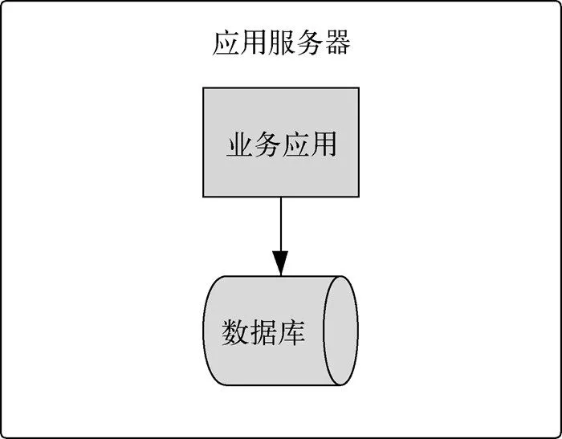

- 图 1-1　应用与数据一体模式

### 1.1.2　应用与数据分离模式

随着业务的发展，用户数量和请求数量逐渐上升，服务器的性能便出现了问题。一个比较简单的解决方案是增加资源，将业务应用和数据分开存储，其架构图如图 1-2 所示。其中，应用服务器由于需要处理大量的业务请求，因此对 CPU 和内存有一定要求；而数据服务器因为需要对数据进行存储和索引等 IO 操作，所以更多地会考虑磁盘的转速和内存。这种分离模式解决了性能问题，相应地，也需要扩展更多硬件资源让两种服务器各司其职，使系统可以处理更多的用户请求。虽然业务应用本身没有进行切分，业务应用内部的业务模块依旧存在耦合，但硬件层面的分离在可用性上比一体式设计要好很多。

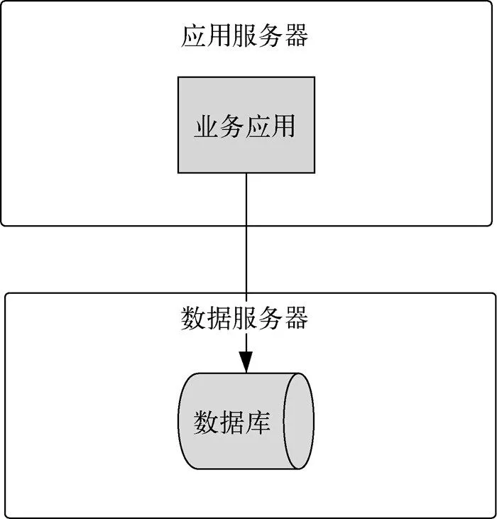

- 图 1-2　应用与数据分离模式

### 1.1.3　缓存与性能的提升

随着信息化系统的发展和互联网使用人数的增多，业务量、用户量、数据量都在增长。同时我们还发现，用户对某些数据的请求量特别大，例如新闻、商品信息和热门消息。在之前的模式下，获取这些信息的方式是依靠数据库，因此会受到数据库 IO 性能的影响，久而久之，数据库便成为了整个系统的瓶颈。而且即使再增加服务器的数量，恐怕也很难解决这个问题，于是缓存技术就登场了，其架构图如图 1-3 所示。这里提到的缓存技术分为客户端浏览器缓存、应用服务器本地缓存和缓存服务器缓存。

- 客户端浏览器缓存：当用户通过浏览器请求应用服务器的时候，会发起 HTTP 请求。如果将每次 HTTP 请求都缓存下来，就可以极大地减小应用服务器的压力。

- 应用服务器本地缓存：这种缓存使用的是进程内缓存，又叫托管堆缓存。以 Java 为例，这部分缓存存放在 JVM 的托管堆上面，会受到托管堆回收算法的影响。由于它运行在内存中，对数据的响应速度很快，因此通常用于存放热点数据。当进程内缓存没有命中时，会到缓存服务器中获取信息，如果还是没有命中，才会去数据库中获取。

- 缓存服务器缓存：这种缓存相对于应用服务器本地缓存来说，就是进程外缓存，既可以和应用服务部署在同一服务器上，也可以部署在不同的服务器上。一般来说，为了方便管理和合理利用资源，会将其部署在专门的缓存服务器上。由于缓存会占用内存空间，因此这类服务器往往会配置比较大的内存。

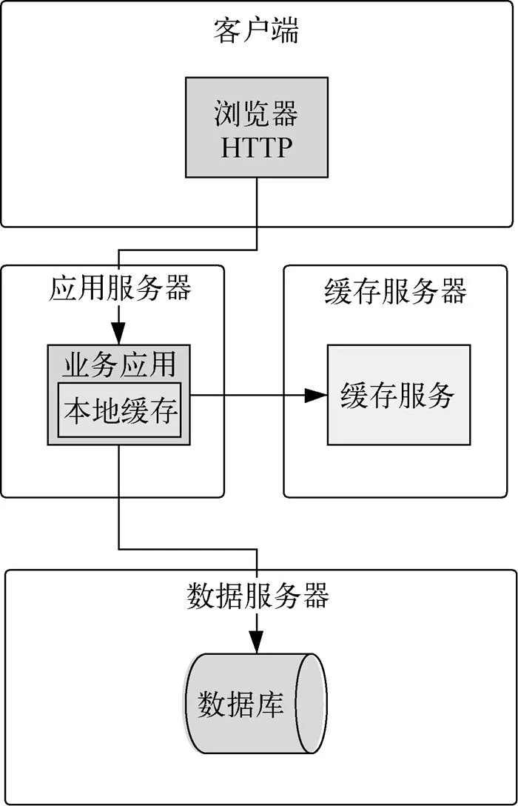

- 图 1-3　缓存技术的加入

图 1-3 描述了缓存的请求次序，先访问客户端浏览器缓存，然后是进程内的本地缓存，之后是缓存服务器，最后才是数据库。只要在其中任意一个阶段获取到了缓存信息，就不会继续往下访问了，否则会一直按照这个次序获取缓存信息，直到访问数据库。

用户请求访问数据的顺序为客户端浏览器缓存→应用服务器本地缓存→缓存服务器缓存。如果按照以上次序还没有命中数据，才会访问数据库获取数据。

加入缓存技术后，系统性能得到了提高。这是因为缓存位于内存中，而内存的读取速度要比磁盘快得多，能够很快响应用户请求。特别针对一些热点数据，优势尤为明显。同时，在可用性方面也有明显改善，即使数据服务器出现短时间的故障，在缓存服务器中保存的热点数据或者核心数据依然可以满足用户暂时的访问。当然，后面会针对可用性进行优化。

### 1.1.4　服务器集群处理并发

经过前面三个阶段的演进，系统对用户的请求量有了很好的支持。实际上，这些都是在逐步提高系统的性能和可用性，这一核心问题会一直贯穿于整个系统架构的演进过程中。可随着用户请求量的增加，另外一个问题又出现了，那就是并发。把这两个字拆开了来看：并，可以理解为“一起并行”，有同时的意思；发，可以理解为“发出调用”，也就是发出请求的意思。合起来，并发就是指多个用户同时请求应用服务器。如果说原来的系统面对的只是大数据量，那么现在就需要面对多个用户同时请求。此时若还是按照上一个阶段的架构图推导，那么单个应用服务器已经无法满足高并发的要求了。此时，服务器集群加入了战场，其架构图如图 1-4 所示。服务器集群说白了，就是多台服务器扎堆的意思，用更多服务器来分担单台服务器的负载压力，提高性能和可用性。再说白一点，就是提高单位时间内服务处理请求的数量。原来是一台服务器处理多个用户的请求，现在是一堆服务器处理，就好像银行柜台一样，通过增加柜员的人数来服务更多的客户。

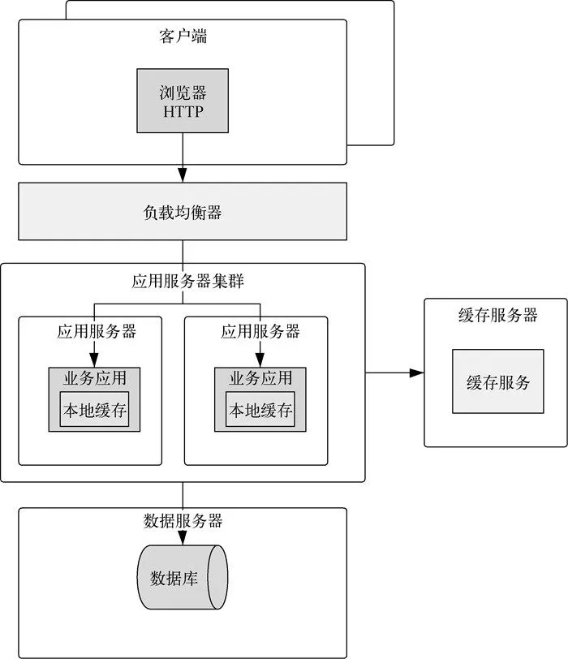

- 图 1-4　服务器集群的加入

这次的架构演进与上次相比，增加了应用服务器的个数，用多台应用服务器形成服务器集群，单台应用服务器中部署的应用服务并没有改变，在用户请求与服务器之间加入了负载均衡器，以便将用户请求路由到对应的服务器中。这次解决的系统瓶颈是如何处理用户的高并发请求，因此对数据库和缓存都没有做更改，仅通过增加服务器的数量便能缓解并发请求的压力。服务器集群通过多台服务器分担原来一台服务器需要处理的请求，在多台服务器上同时运行一套系统，同时处理大量并发的用户请求，有点三个臭皮匠顶个诸葛亮的意思，因此对集群中单台服务器的硬件要求也随之降低。此时需要注意负载均衡器采用的均衡算法（例如轮询和加权轮询）要能保证用户请求均匀地分布到多台服务器上、属于同一个会话的所有请求在同一个服务器上处理，以及针对不同服务器资源的优劣能够动态调整流量。加入负载均衡器之后，由于其位于互联网与应用服务器之间，负责用户流量的接入，因此可以对用户流量进行监控，同时对提出访问请求的用户的身份和权限进行验证。

### 1.1.5　数据库读写分离

加入缓存可以解决部分热点数据的读取问题，但缓存的容量毕竟有限，那些非热点的数据依然要从数据库中读取。数据库对于写入和读取操作的性能是不一样的。在写入数据时，会造成锁行或者锁表，此时如果有其他写入操作并发执行，就会出现排队现象。而读取操作不仅比写入操作更加快捷，并且可以通过索引、数据库缓存等方式实现。因此，推出了数据库读写分离的方案，其架构图如图 1-5 所示。这种模式设置了主从数据库，主库（master）主要用来写入数据，然后通过同步 binlog 的方式，将更新的数据同步到从库（slave）中。对于应用服务器而言，在写数据时只需要访问主库，在读数据时只用访问从库就好了。

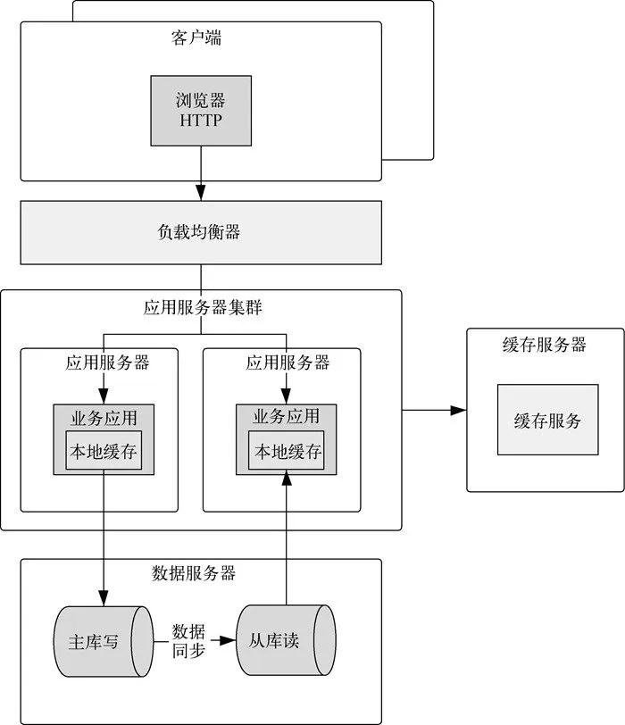

- 图 1-5　数据库读写分离

数据库读写分离的方式将数据库的读、写职责分离开来，利用读数据效率较高的优势，扩展更多的从库，从而服务于请求读取操作的用户。毕竟在现实场景中，大多数操作是读取操作。此外，数据同步技术可以分为同步复制技术、异步复制技术和半同步复制技术，这些技术的原理会在第 6 章中为大家介绍。体会到数据库读写分离带来的益处的同时，架构设计也需要考虑可靠性的问题。例如，如果主库挂掉，从库如何接替主库进行工作；之后主库恢复了，是成为从库还是继续担任主库，以及主从库如何同步数据。这些问题的解决方案在第 6 章会讲述。

### 1.1.6　反向代理和 CDN

随着互联网的逐渐普及，人们对网络安全和用户体验的要求也越来越高。之前用户都是通过客户端直接访问应用服务器获取服务，这使得应用服务器暴露在互联网中，容易遭到攻击。如果在应用服务器与互联网之间加上一个反向代理服务器，由此服务器来接收用户的请求，然后再将请求转发到内网的应用服务器，相当于充当外网与内网之间的缓冲，就可以解决之前的问题。反向代理服务器只对请求进行转发，自身不会运行任何应用，因此当有人攻击它的时候，是不会影响到内网的应用服务器的，这在无形中保护了应用服务器，提高了安全性。同时，反向代理服务器也在互联网与内网之间起适配和网速转换的作用。例如，应用服务器需要服务于公网和教育网，但是这两个网络的网速不同，那么就可以在应用服务器与互联网之间放两台反向代理服务器，一台连接公网，另一台连接教育网，用于屏蔽网络差异，服务于更多的用户群体。图 1-6 中的公网客户端和校园网客户端分别来自公网与校园网两个不同的网络，由于两者访问速度不同，因此会分别设置公网反向代理服务器和校园网反向代理服务器，通过这种方式将位于不通网络的用户请求接入到系统中。

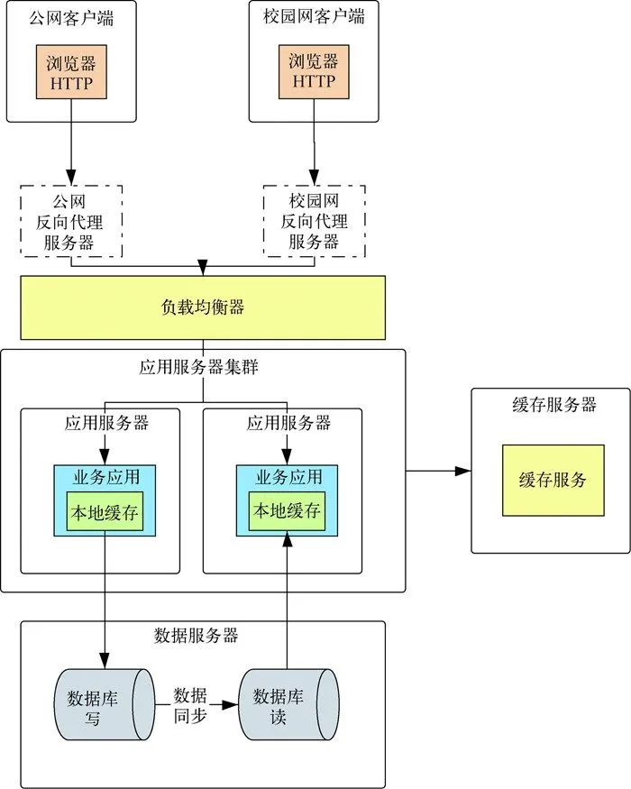

- 图 1-6　加入反向代理服务器

聊完反向代理，再来说 CDN，它的全称是 Content Delivery Network，也就是内容分发网络。如果把互联网想象成一张大网，那么每台服务器或者每个客户端就是分布在这张大网中的节点。节点之间的距离有远有近，用户请求会从一个节点跳转到另外一个节点，最终跳转到应用服务器获取信息。跳转的次数越少，越能够快速地获取信息，因此可以在离客户端近的节点中存放信息。这样用户通过客户端，只需要跳转较少的次数就能够触达信息。由于这部分信息更新频率不高，因此推荐存放一些静态数据，例如 JavaScript 文件、静态的 HTML、图片文件等。这样客户端就可以从离自己最近的网络节点获取资源，大大提升了用户体验和传输效率。加入 CDN 后的架构图如图 1-7 所示。

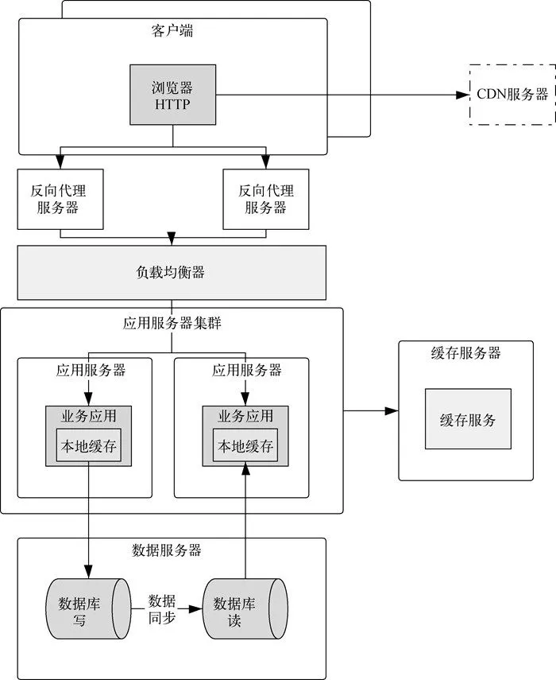

- 图 1-7　加入 CDN

CDN 的加入明显加快了用户访问应用服务器的速度，同时减轻了应用服务器的压力，原来必须直接访问应用服务器的请求，现在不需要经过层层网络，只要找到最近的网络节点就可以获取资源。但从请求资源的角度来看，这种方式也有局限性，即它只对静态资源起作用，而且需要定时对 CDN 服务器进行资源更新。反向代理和 CDN 的加入解决了安全性、可用性和高性能的问题。

### 1.1.7　分布式数据库与分表分库

经历了前面几个阶段的演进后，软件的系统架构已经趋于稳定。可是随着系统运行时间的增加，数据库中累积的数据越来越多，同时系统还会记录一些过程数据，例如操作数据和日志数据，这些数据也会加重数据库的负担。即便数据库设置了索引和缓存，但在进行海量数据查询时还是会表现得捉襟见肘。如果说读写分离是对数据库资源从读写层面进行分配，那么分布式数据库就需要从业务和数据层面对数据库进行分配。

- 对于数据表来说，当表中包含的记录过多时，可将其分成多张表来存储。例如，有 1000 万个会员记录，既可以将其分成两个 500 万，分别放到两张表中存储，也可以按照业务对表中的列进行分割，把表中的某些列放到其他表中存储，然后通过外键关联到主表。注意被分割出去的列通常是不经常访问的数据。

- 对于数据库来说，每个数据库能够承受的最大连接数和连接池是有上限的。为了提高数据访问效率，会根据业务需求对数据库进行分割，让不同的业务访问不同的数据库。当然，也可以将相同业务的不同数据放到不同的数据库中存储。

如果将数据库资源分别放到不同的数据库服务器中，就是分布式数据库设计。由于数据存储在不同的表 / 库中，甚至在不同的服务器上面，因此在进行数据库操作的时候会增加代码的复杂度。此时可以加入数据库中间件来实现数据同步，从而消除不同存储载体间的差异。架构如图1-8 所示，将数据拆分以后分别放在表 1 和表 2 中，两张表所在的数据库服务器也不相同，库与库之间还需要考虑数据同步的问题。因为数据的分散部署，所以从业务应用获取数据时需要依靠数据库中间件的帮忙。

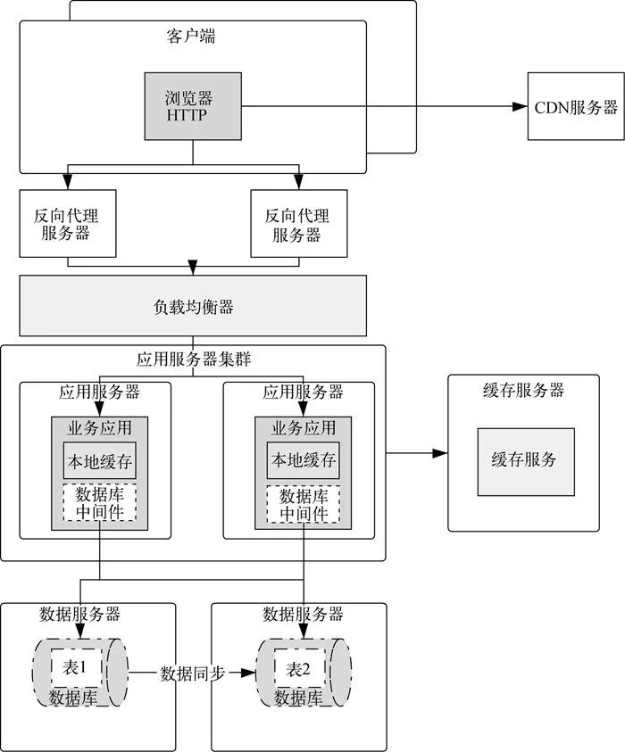

- 图 1-8　分布式数据库与分表分库

数据库的分布式设计以及分表分库，会给系统带来性能的提升，同时也增大了数据库管理和访问的难度。原来只需访问一张表和一个库就可以获取数据，现在需要跨越多张表和多个库。

从软件编程的角度来看，有一些数据库中间件提供了最佳实践，例如 MyCat 和 ShardingJDBC。此外，从数据库服务器管理的角度来看，需要监控服务器的可用性。从数据治理的角度来看，需要考虑数据扩容和数据治理的问题。

### 1.1.8　业务拆分

解决了大数据量存储问题以后，系统就能够存储更多的数据，这意味着能够处理更多的业务。业务量的增加、访问数的上升，是任何一个软件系统在任何时期都要面临的严峻考验。通过对前面几个阶段的学习，我们知道系统提升依靠的基本都是以空间换取时间，使用更多的资源和空间处理更多的用户请求。随着业务的复杂度越来越高，以及高并发的来临，一些大厂开始对业务应用系统进行拆分，将应用分开部署，此时的架构图如图 1-9 所示。如果说前面的服务器集群模式是将同一个应用复制到不同的服务器上，那么业务拆分就是将一个应用拆成多个部署到不同的服务器中。此外，还有的是对核心应用进行水平扩展，将其部署到多台服务器上。应用虽然做了拆分，但应用之间仍旧有关联，存在相互之间的调用、通信和协调问题。由此引入了队列、服务注册发现、消息中心等中间件，这些中间件可以协助系统管理分布到不同服务器、网络节点上的应用。

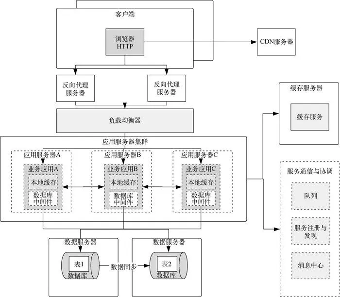

- 图 1-9　业务拆分

业务拆分以后会形成一个个应用服务，既有基于业务的服务，例如商品服务、订单服务，也有基础服务，例如消息推送和权限验证。这些应用服务连同数据库服务器分布在不同的容器、服务器、网络节点中，它们之间的通信、协调、管理和监控都是我们需要解决的问题。

### 1.1.9　分布式与微服务

近几年，微服务是一种比较火的架构方式，它对业务应用进行了更加精细化的切割，使之成为更小的业务模块，能够做到模块间的高内聚低耦合，每个模块都可以独立存在，并由独立的团队维护。每个模块内部可以采取特有的技术，而不用关心其他模块的技术实现。模块通过容器的部署运行，各模块之间通过接口和协议实现调用。可以将任何一个模块设为公开，以供其他模块调用，也可以热点模块进行水平扩展，增强系统的整体性能，这样当其中某一个模块出现问题时，就能由其他相同的模块代替其工作，增强了可用性。

大致总结下来，微服务拥有以下特点：业务精细化拆分、自治性、技术异构性、高性能、高可用。它像极了分布式架构，从概念上理解，二者都做了“拆”的动作，但在下面这几个方面存在区别，直观展示见图 1-10。

- 拆分目的不同：提出分布式设计是为了解决单体应用资源有限的问题，一台服务器无法支撑更多的用户访问，因此将一个应用拆解成不同的部分，然后分别部署到不同服务器上，从而分担高并发的压力。微服务是对服务组件进行精细化，目的是更好地解耦，让服务之间通过组合实现高性能、高可用、可伸缩、可扩展。

- 拆分方式不同：分布式服务架构将系统按照业务和技术分类进行拆分，目的是让拆分后的服务负载原来单一服务的业务。微服务则是在分布式的基础上进行更细的拆分，它将服务拆成更小的模块，不仅更专业化，分工也更为精细，并且每个小模块都能独立运行。

- 部署方式不同：分布式架构将服务拆分以后，通常会把拆分后的各部分部署到不同服务器上。而微服务既可以将不同的服务模块部署到不同服务器上，也可以在一台服务器上部署多个微服务或者同一个微服务的多个备份，并且多使用容器的方式部署。

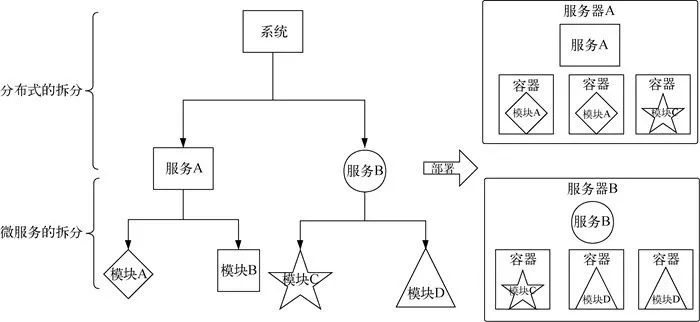

- 图 1-10　分布式与微服务的区别

虽然分布式与微服务具有以上区别，但从实践的角度来看，它们都是基于分布式架构的思想构建的。可以说微服务是分布式的进化版本，也是分布式的子集，因此它同样会遇到服务拆分、服务通信、协同、管理调度等问题，这也是我在后面要给大家讲解的内容。

## 1.2　一个简单的例子：分布式架构的组成

1.1 节介绍了软件架构的演进历史，说明了软件架构是沿着高性能、高可用、可扩展、可伸缩、够安全的方向发展的，其中最重要的是高性能和高可用。在分布式时代，服务的分布式部署还带来了一系列其他问题，诸如服务的拆分、调用、协同以及分布式计算和存储。这里通过一个简单的分布式示例带大家了解分布式架构的特征和问题，然后针对发现的问题进行拆解，找到解决方案。首先介绍一下例子的业务流程，如图 1-11 所示，该图描述了从浏览商品，到下单、付款以及扣减库存，最后通知用户的整个过程。由图 1-12 可以看出，系统架构会根据以上业务提供对应服务：在用户通过商品服务浏览商品，通过订单服务下单，通过支付服务付款以后，会通知库存服务扣减相应的库存，订单完成以后，通知服务会向用户发送订单完成的消息。这是对业务背景的描述，接下来会以架构分层为主线，介绍技术实现以及在分布式架构中会遇到的问题。

- 图 1-11　一个简单例子的业务流程

### 1.2.1　架构概述与分层

为了完成上面的订单业务流程，将分布式系统分为了四层，如图 1-12 所示，下面从上到下依次介绍一下这四层。

- 客户端：这是用户与系统之间的接口，用户在这里可以浏览商品信息，并且对商品下单。为了提升用户体验，会利用 HTTP 缓存手段将部分静态资源缓存下来，同时也可以将这部分静态资源缓存到 CDN 中，因为 CDN 服务器通常会让用户从比较近的网络节点获取静态数据。

- 负载均衡器（以下称接入层）：分布式应用会对业务进行拆分，并将拆分后的业务分别部署到不同系统中去，又或者使用服务器集群分担请求压力。假设我们的案例使用的是服务器集群，这里分别为华南和华中地区的用户设置两个应用服务器集群，那么负载均衡器可以通过

- 用户 IP 将用户的请求路由到不同的服务器集群。另外，在负载均衡这一层，还可以进行流量控制和身份验证等操作。

- 应用服务器（以下称应用层）：这一层用于部署主要的应用服务，例如商品服务、订单服务、支付服务、库存服务和通知服务。这些服务既可以部署到同一台服务器上，也可以部署到不同服务器上。当负载均衡器将请求路由到应用服务器或者内网以后，会去找对应的服务，例如商品服务。当请求从外网进入内网后，需要通过 API 网关进行再次路由，特别是微服务架构中服务拆分得比较细，就更需要 API 网关了。API 网关还可以起到内网的负载均衡、协议转换、链式处理、异步请求等作用。由于应用服务（一个或者多个）部署在多个服务器上，这些服务器要想互相调用，就要考虑各服务间的通信、协调等问题，因此加入了服务注册中心、消息队列消息中心等组件。同时由于商品服务会经常被用户调用，因此加入了缓存机制。

- 数据服务器（以下称存储层）：由于商品信息比较多，所以对其进行分片操作，分别存放到商品表 1 和商品表 2 这两张表中来保证数据库的可用性。这里加入了主、备数据库的设计，这两个数据库服务器会进行同步，当主数据库服务器挂掉的时候，备数据库服务器就会接管它的一切。

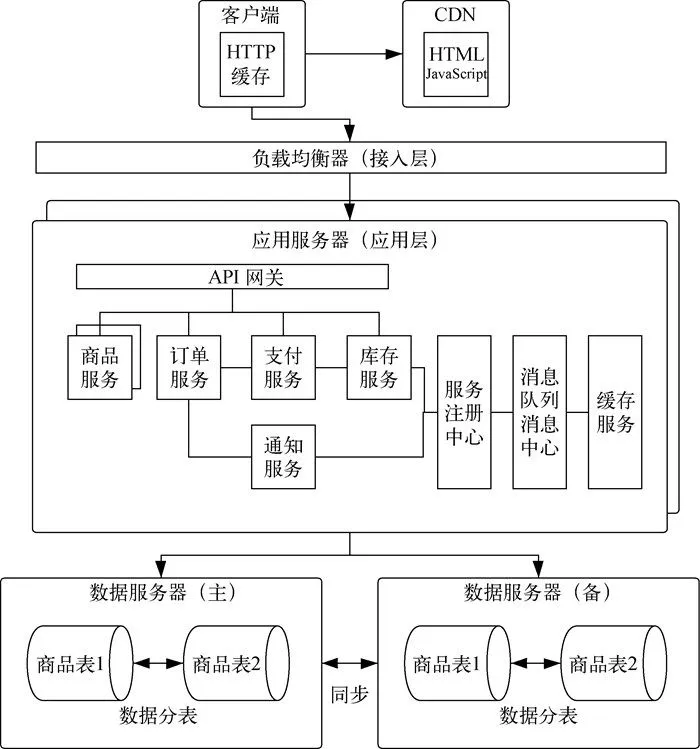

- 图 1-12　订单业务架构图

### 1.2.2　客户端与 CDN

对于一个电商网站而言，商品信息是用户访问最多的内容。电商网站拥有海量商品，用户每次请求后，它都会返回诸如商品的基本参数、图片、价格和款式等信息。而商品一经发布，某些信息被修改的频率并不是很高，例如商品描述和图片。如果用户每次访问时都需要请求应用服务器，然后再访问数据库，那么效率是非常低的。在大多数情况下，用户访问时使用的协议是HTTP，或者说用户使用浏览器访问电商网站时会发起 HTTP 请求，因此我们把每次的 HTTP请求都缓存下来，就可以减小应用服务器的压力。加入缓存后的用户请求过程如图 1-13 所示，在用户第一次发出请求的时候，客户端缓存会判断是否存在缓存，如果不存在，则向应用服务器发出请求，此时应用服务器会提供数据给客户端，客户端接收数据之后将其放入缓存中。当用户第二次发出同样的请求时，客户端缓存依旧会判断是否存在缓存。由于上次请求时已经缓存了这部分数据，因此由客户端缓存提供数据，客户端接收数据以后返回给用户。备注：图中实线部分表示没有缓存的流程，虚线部分表示存在缓存的流程。

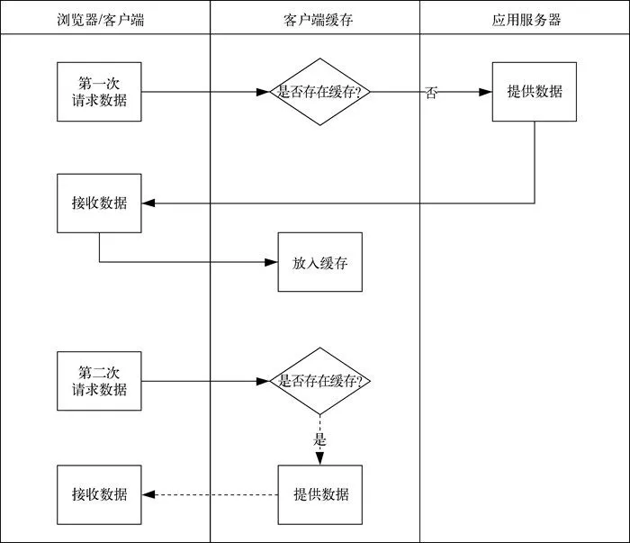

- 图 1-13　客户端通过发送 HTTP 请求缓存数据

一般信息的传递通过 HTTP 请求头来完成。目前比较常见的缓存方式有两种，分别是强制缓存和对比缓存。细节在这里暂不展开，第 8 章会介绍不同应用场景中缓存的具体用法。HTTP 缓存主要是对静态数据进行缓存，把从服务器拿到的数据缓存到客户端 / 浏览器中。如果在客户端和服务器之间再加上一层 CDN，就可以让 CDN 为应用服务器提供缓存，有了 CDN 缓存，就不用再请求应用服务器了。因此可以将商品的基本描述和图片等信息放到 CDN 中保存，还可以将一些前端通用控制类的 JavaScript 脚本也放在里面。需要注意的是，在更新商品信息（例如商品图片）时，需要同时更新 CDN 中的文件和 JavaScript 文件。

### 1.2.3　接入层

用户浏览商品的请求一般是一个 URL，这个 URL 被 DNS 服务器解析成服务器的 IP 地址，然后用户的请求通过这个 IP 地址访问应用服务器上的服务，这是早期的做法。如果读了 1.1 节的架构演进，应该就会知道，这样让应用服务器暴露在互联网上是非常危险的，为了解决这个问题，在应用服务器和客户端之间加入了反向代理服务器，它负责对外暴露服务的入口地址，保护内网的服务。从我们举的例子出发，用户浏览商品的请求有可能来自不同的网络，这些网络的访问速度不尽相同，比如有两个用户分别来自华中地区和华南地区，那么就可以针对这两个地区分别设置两个反向代理服务器提供服务。

上面说了反向代理服务器可以服务于不同网络的用户，同样，来自不同网络的用户也可以被负载均衡器路由到不同的应用服务器集群。浏览商品的请求经过负载均衡器的时候，是不知道会被路由到哪台应用服务器的。由于分布式部署，位于华中地区的集群服务器和华南地区的集群服务器都能提供商品信息的服务。此时负载均衡器可以协助路由工作，但其功能不仅仅局限于路由，它的主要功能是将大量的用户请求均衡地负载到后端的应用服务器上。特别是在有集群的情况下，负载均衡器有专门的算法可供选择。如果用户请求量再次加大，大到系统无法承受的地步，负载均衡器还可以起到限流作用，将那些系统无法处理的请求流量阻断在系统之外，如图 1-14 所示。

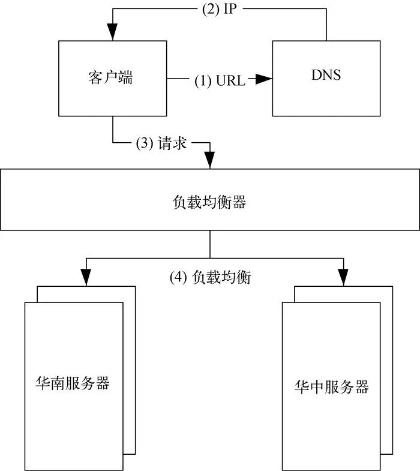

- 图 1-14　负载均衡

客户端请求服务器的过程可以分为如下四个步骤：

(1) 客户端向 DNS 服务器发出 URL 请求；

(2) DNS 服务器向客户端返回应用服务器入口的 IP 地址；

(3) 客户端向服务器发送请求；

(4) 负载均衡器接收请求以后，根据负载均衡算法找到对应的服务器，并将请求发送给此服务器。

### 1.2.4　应用层

这一层中包含具体的业务应用服务，例如商品服务、订单服务、支付服务、库存服务和通知服务。这些服务之间有的可以独立调用，例如商品服务，有的存在相互依赖，例如调用订单服务的时候会同时调用库存服务。接下来，我们从 API 网关、服务协同与通信、分布式互斥、分布式事务这 4 个方面来分析应用层的情况。

1. API 网关经过负载均衡之后的用户请求一般会直接调用应用服务，但是随着分布式的兴起，特别是微服务的广泛应用，服务被切割得非常精细，有可能分布在相同或者不同的服务器中，同一个服务也会被做水平扩展，也就是将同一个服务复制为多个，以面对高并发请求。比如商品服务被调用的次数是最多的，因此从高性能和可用性的角度来看，会做水平扩展，此时用户在请求商品服务的时候需要有个中介，以便将请求路由到对应的服务。当然，这个中介也会起到负载均衡和限流的作用。另外，由于存在很多服务之间的调用，并且这些服务存在技术异构性，因此为了消除技术异构性，可以在 API 网关中进行协议转换。现在，我们把 API 网关要做的事情总结为如下几条，并通过图 1-15 来介绍 API 网关的功能。

- 内容为浏览商品的用户请求要想接触到商品服务，需经过 API 网关，由网关充当路由为其找到对应的服务。

- 如果存在水平扩展的商品服务，API 网关需要起到负载均衡的作用。例如，用户请求商品服务时，同时存在着 2 个商品服务，此时 API 网关就需要帮助用户决定让哪个商品服务响应其请求。

- 如果用户需要对商品进行下单操作，则 API 网关要对用户身份进行鉴权。

- 一个服务调用其他服务的时候，如果两个服务使用的传输协议不一致，那么 API 网关需要对协议进行转换。例如，订单服务需要调用库存服务和支付服务完成业务需求，但订

- 单服务与其他两个服务使用的是不同协议，此时 API 应负责做它们之间的协议转换。

- 一旦大量用户同时请求浏览商品，其流量超出系统承受的范围，API 网关就需要完成限流操作。

- 对于浏览商品的操作，API 网关系统要记录相应的日志。

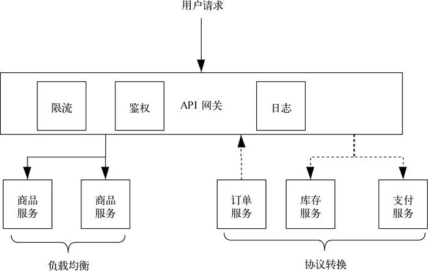

- 图 1-15　API 网关的功能

- 如果把请求看成水流，API 网关就像一个控制水流的水阀。它控制水的流向、大小，调整不同蓄水池存储水流的方式，记录水流的信息。API 网关和负载均衡器在原理上是相同的，区别在于前者更多是在服务器内部服务之间实现，而后者是在互联网与服务器之间实现。

2. 服务协同与通信用户在浏览完商品详情以后，会通过订单服务下单，然而订单服务又需要调用支付服务。订单服务和支付服务分别运行在不同的进程、容器甚至是服务器中，两者如何发现对方并进行通信呢？在没有进行服务切割和分布式部署的时候，一个模块调用另外一个模块需要在代码中耦合，在代码中描述调用条件，并且调用对应的方法或者模块。这些属于进程内调用，但是随着分布式和微服务的兴起，服务或者应用从原有的单进程切分到多个进程中，这些进程

- 又运行在不同的容器或者服务器上。这时服务之间又该如何得知其他服务的存在以及进行调用呢？

- 下面以订单服务为例来介绍，具体如图 1-16 所示。假设订单服务需要调用支付服务为商品买单。订单服务和支付服务事先会在服务注册中心注册自己。订单服务在调用支付服务之前，会先去注册中心获取所有可用服务的调用列表，然后根据列表上的地址对支付服务进行调用。此时订单服务会对支付服务发起一个 RPC 调用，把需要传递的订单信息以序列化的方式打包，并经过网络协议传递给支付服务，支付服务在接收到信息以后，通过反序列化工具解析传递的内容，然后执行接下来的付款操作。再跟着图 1-16 将这个过程梳理一遍。

- (1) 支付服务到服务注册中心注册自己。

- (2) 订单服务从注册中心获取可用服务的列表。

- (3) 订单服务在列表中找到支付服务的地址和访问方式，并调用支付服务。

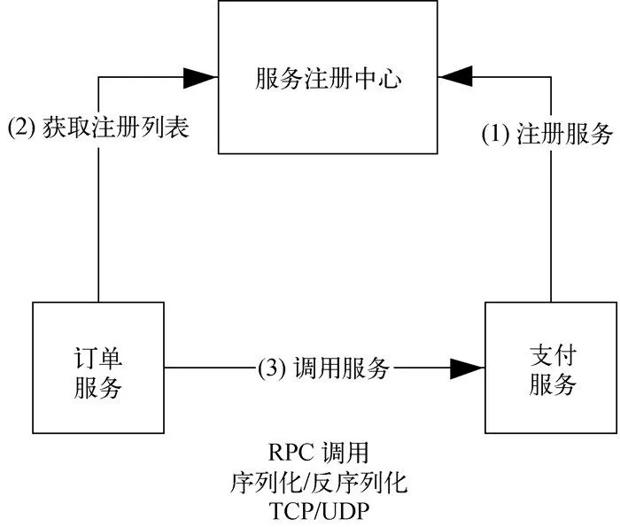

- 图 1-16　服务注册、服务发现和服务调用

- 通常在支付完成以后，系统会通过短信或者 App 推送的方式通知用户，此时就需要调用通知服务。由于通知服务属于基础功能服务，与业务的关联性不强，会被其他业务系统调用，因此，将其单独部署，甚至作为单独的系统进行维护。支付系统在支付成功以后，会将成功的消息发送到消息队列，而通知服务会将该信息按照配置好的通知方式发送给用户，如图1-17 所示。

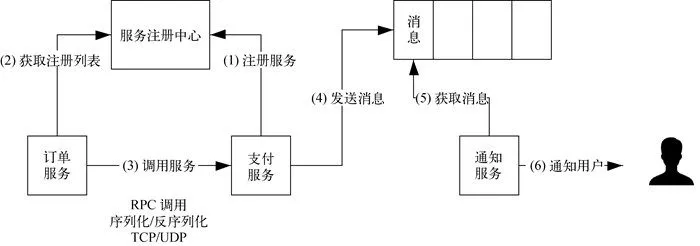

- 图 1-17　通知服务通过消息队列通信

3. 分布式互斥在上一部分中，订单服务只调用了支付服务，但是大家知道在下订单的同时会对库存进行扣减，因此订单服务也会调用库存服务。库存服务针对商品库存进行操作，如果有两个用户同时对同一商品下单，就会形成对同一商品库存同时进行扣减的情况，这当然是不行的。我们将此处的商品库存称作临界资源，扣减库存的动作称作竞态。如果是在进程内，可以理解为两个线程（两个用户请求）在争夺库存资源，最简单的解决办法就是在这个资源上加一把锁，如图 1-18 所示。当线程 B 访问的时候，让其持有这把锁，这样线程 A 就无法访问，并且进入等待队列。当线程 B 执行完库存扣减的操作以后，释放锁，由线程 A 持有锁，然后进行库存扣减操作。

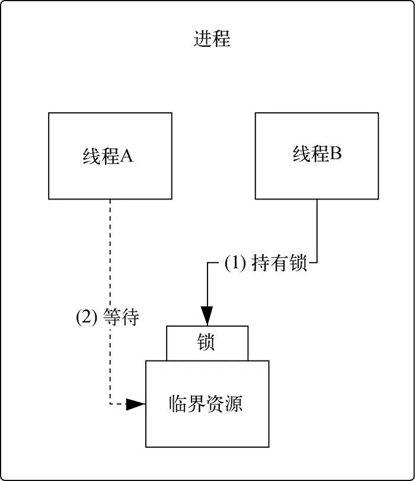

- 图 1-18　多线程访问临界资源

- 由于分布式服务是分散部署的，而且可以实现水平扩展，因此问题发生了变化，原来是一个进程内的多线程对临界资源的竞态，现在变成应用系统中的多个服务（进程）对临界资源的竞态。接下来这种情况对库存服务进行了水平扩展，将其从原来的一个扩展成两个。库存服务 A 和库存服务 B 可能会同时扣减库存，这里通过 ZooKeeper 的 DataNode 保证两个进程

- 的访问顺序，两个库存扣减进程会在 ZooKeeper 上建立顺序的 DataNode，节点的顺序就是访问资源的顺序，能够避免两个进程同时访问库存，起到了锁的作用。具体的做法是在ZooKeeper 中建立一个 DataNode 节点起到锁（locker）的作用，通过在此节点下面建立子DataNode 来保证访问资源的先后顺序，即便是两个服务同时申请新建子 DataNode 节点，也会按照先后顺序建立。图 1-19 中的具体步骤如下。

- (1) 当库存服务 A 访问库存的时候，需要先申请锁，于是在 ZooKeeper 的 Locker 节点下面新建一个 DataNode1 节点，表明它可以扣减库存。

- (2) 库存服务 B 在库存服务 A 后面申请库存的访问权限，由于其申请锁操作排在库存服务 A后面，因此其按照次序建立的节点会排在 DataNode1 下面，名字为 DataNode2。

- (3) 库存服务 A 在申请锁成功以后访问库存资源，并进行库存扣减。在此期间库存服务 B 一直处于等待状态，直到库存服务 A 完成扣减操作以后，ZooKeeper 中 Locker 下面的DataNode1 节点被删除，库存资源被释放。

- (4) DataNode1 被删除以后，DataNode2 成为序号最靠前的节点，库存服务 B 因此得到了对库存的访问权限，并且可以完成库存扣减操作。

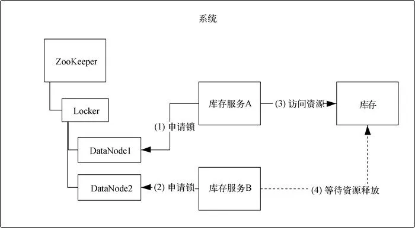

- 图 1-19　多个库存服务访问库存资源

4. 分布式事务下订单和扣减库存两个操作通常是同时完成的，如果库存为 0 则表示没有库存可以扣减，那么下订单的操作也将无法执行。如果把订单服务中的下订单操作和库存服务的扣减库存操作当作一个事务，那么由于这两个操作跨越了不同的应用（服务器），因此可以将这个事务视为分布式事务。类似的情况在分布式架构中比较常见。由于应用服务的分散性，操作也会分散，如果这些分散的操作共同完成一个事务，就需要进行特殊处理。一般做法是在订单服务和库存服务上建立一个事务协调器，用来协调两个服务的操作，保证两个操作能在一个事务中完成。事务协调器会分两个阶段来处理事务。

- 事务提交第一阶段如图 1-20 所示。

- (1) 事务协调器分别向订单服务和库存服务发送“CanCommit?”消息，确定这两个服务是否准备好了。准备好的意思是订单服务已准备好添加订单记录以及库存服务已准备好扣减库存。

- (2) 订单服务接收到消息以后，检查订单信息，并准备增加商品订单记录，同时将消息 Yes回复给事务协调器。如果库存服务在准备过程中发现库存不足，就向事务协调器回复 No，意思是终止操作。

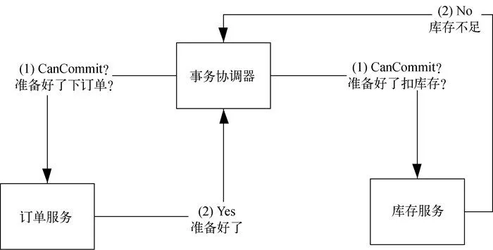

- 图 1-20　事务提交第一阶段

- 事务提交第二阶段如图 1-21 所示。

- (1) 事务协调器接收到库存服务操作不成功的消息后，向订单服务和库存服务发送 DoAbort消息，意思是放弃操作。订单服务在接收到此消息后，通过日志回滚增加商品订单的操作并释放相关资源。

- (2) 这两个服务在完成相应操作后，向事务协调器发送 Committed 消息，表示完成撤销操作。

- 说明倘若两个服务都准备好了，事务协调器就会发送执行的命令，两个服务会分别执行对应的操作，共同完成事务。

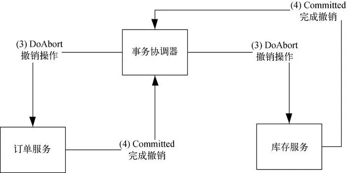

- 图 1-21　事务提交第二阶段

- 看到这里，有些朋友会说：“这不就是 2PC 吗？”是的，这是一种简单的处理分布式事务的方式，这里我们只做一个引子。在 4.3 节中，还会介绍 ACID、CAP、TCC 等处理分布式事务的方法。

### 1.2.5　存储层

存储层用来存放业务数据。和单体应用不同的是，分布式存储会将数据分别放置在不同的数据表、数据库和服务器上面。如果说单体应用是通过直接访问数据库，针对某张数据表的方式来获取数据，那么分布式数据库获取数据的方式就要复杂一些。这里先看一个例子，理论和实践方法会在第 6 章中详细说明。

1. 分布式存储电商系统中商品信息的数据量比较大，为了提高访问效率，通常会将数据分片存放，被拆分以后的商品表会分布到不同的数据库或者服务器中。例如，商品表中有 1000 条数据，我们将它分成两张表来存储，将商品 ID 为 1～500 的记录分配到商品表 1，ID 为 501～1000 的记录分配到商品表 2。假设 ID 是顺序增长的，查询商品时会传入其 ID。如果按上述那样划分数据，在查询商品信息的时候就需要从两张表中获取数据，这两张表可能存储在相同数据库中，也可能存储在两个数据库中。如果存储在两个数据库中，那这两个数据库既可能存在于同一台服务器上，也可能存在于两台不同的服务器上，因此，还需要在代码中建立两个数据库的连接，分别做两次查询，这样的效率会很低。此时可以加入 MyCat 数据库中间件，它的作用是解决由数据分片带来的数据路由、SQL 解析等问题。如图 1-22 所示，当接收到商品查询请求之后，MyCat 对 SQL 进行解析，获得需要获取的商品表的信息。假设 SQL中传入的商品 ID 是 100，100 在 1～500 的范围内，通过数据分片的路由规则可以知道，返回的商品信息需要从“数据库服务器 1”中的“商品表 1”中获取。

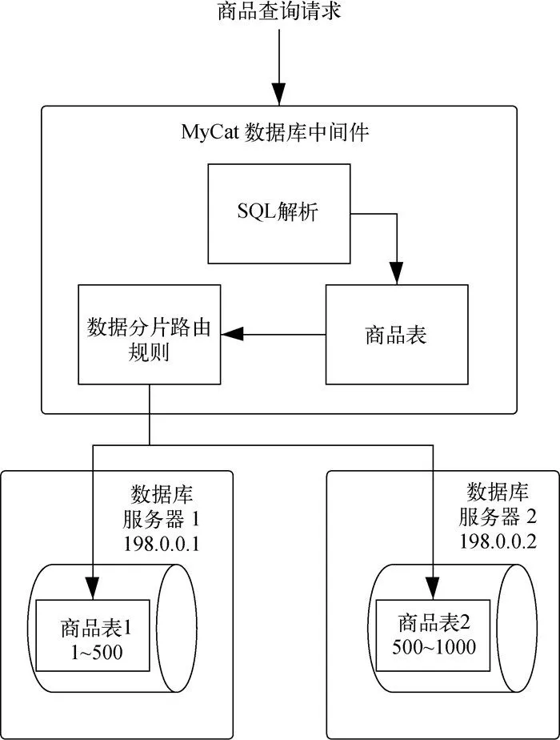

- 图 1-22　MyCat 实现商品表分片

- 以此类推，也可以定义其他的数据库分片规则，例如根据区域、品类等。

2. 读写分离与主从同步针对商品表的数据量比较大这一点，对其进行了分片操作。同样商品表被读取的机会也比较大，更新的机会相对较小，对此可以设置读写分离。还是分析上面商品表的例子，由于这里主要讲读写分离和主从同步，因此只针对“商品表 1”进行操作。如图 1-23 所示，配置主节点 writeHost 来负责写入操作，配置从节点 readHost 来负责读取操作。图中处于上方的MyCat 数据库中间件会通过 ZooKeeper 定期向两个节点服务器发起心跳检测（虚线部分）。图 1-23 中实线部分描述的信息有：MyCat 开启读写分离模式之后，中间件接收到商品读 / 写的请求时，会通过 SQL 解析，将写入请求的 DML（Data ManipulationLanguage）SQL 发送到 writeHost 服务器上，将读取请求的 Select SQL 发送到 readHost服务器上。writeHost 在完成写入信息以后，会和 readHost 进行数据同步，也就是主从复制。由于存在心跳检测机制，当 writeHost 挂掉时，如果在默认N次心跳检测后（N可以配置）仍旧没有恢复，MyCat 就会发起选举，选举出一台服务器成为新的 writeHost。它会接替之前的 writeHost，负责处理写入数据的数据同步。当之前的 writeHost 恢复以后，会成为从节点 readHost 并且接收来自新 writeHost 的数据同步。

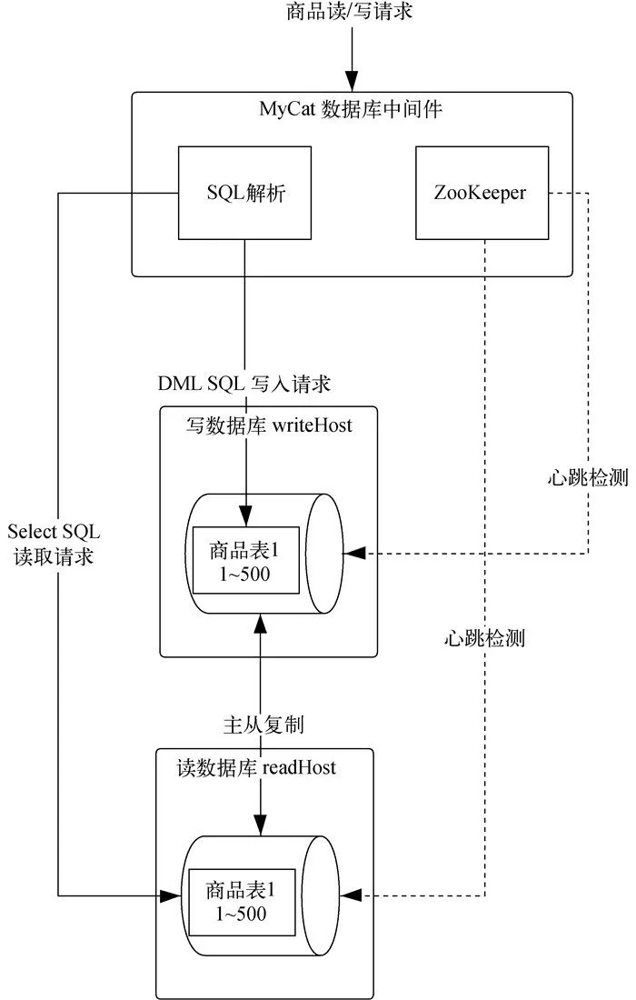

- 图 1-23　读写分离与主从复制

## 1.3　分布式架构的特征

前面我们介绍了一个简单的分布式系统，相信大家已经对它有了感性的认识。和集中式架构相比，分布式架构将资源、服务、任务、计算分布到不同的容器、服务器、网络节点中，它们需要协同完成一个或者多个任务。接下来，我们总结一下分布式架构的特征。

- 分布性。将分布两字分开来看，“分”指的是拆分，可以理解为服务的拆分、存储数据的拆分、硬件资源的拆分。通过前面的例子可以看出，电商系统针对客户浏览商品并下订单这个业务过程，被拆分了商品服务、订单服务、库存服务和支付服务；它会根据商品 ID 对商品数据进行拆分，并存放到不同的数据库表中；对应用服务器和数据库服务器也会进行拆分。“布”指的是部署，也指资源的部署。既有计算资源，例如订单服务、库存服务，它们被部署到不同的容器或者应用服务器中，也有存储资源，例如将商品数据水平分布到不同的数据库服务器。简单来说，分布性就是拆开了部署。如果说单体架构是将计算和存储任务（应用）都分配到同一个物理资源上，那么分布式架构就是将这些任务（应用）放到不同的硬件资源上，并且这些硬件资源有可能分布在不同的网络中。

- 自治性。从分布性的特征来看，资源分散了，以前一份资源做的事情，现在由多份资源同时完成。这样提高了系统的性能和可用性，这也是设计分布式架构的目的。分布性导致了自治性。简单来说，自治性就是每个应用服务都有管理和支配自身任务和资源的能力。例如，订单服务拥有自己的硬件资源，包括容器或者应用服务器，同时还处理商品下单的任务。对内，它可以采用自己的技术来实现，并不受其他服务的影响，业务上专注于处理订单业务；对外的沟通则使用服务注册中心和消息队列，与其他服务是平等关系。

- 并行性。自治性导致每个应用服务都是一个独立的个体，拥有独立的技术和业务，占用独立的物理资源。这种独立能够减小服务之间的耦合度，增强架构的可伸缩性，为并行性打下基础。商品服务是被调用最为频繁的服务，特别在用户访问量增大时，需要进行水平扩展，从原来的 1 个服务扩展成 2 个，甚至更多。扩展后的这些服务完成的功能相同，处理的业务相同，占用的资源也相同，它们并行处理大量请求，相当于将一个大任务拆解成了若干个小

- 任务，分配到不同的服务器上完成，因此并行性也会被称为并发性。其目的还是提高性能和可用性。

- 全局性。分布性使得服务和资源都是分开部署的，自治性说明单个服务拥有单独的业务和资源，多个服务通过并行的方式完成大型任务。多个分布在不同网络节点的服务应用在共同完成一个任务时，需要有全局性的考虑。例如，商品服务在调用支付服务时，需要通过服务注册中心感知支付服务的存在；多个库存服务对商品库存进行扣减时，需要考虑临界资源的问题；订单服务在调用支付服务和库存服务的时候需要考虑分布式事务问题；当主数据库服务器挂掉的时候，需要及时切换到从数据库服务器，这些都是全局性的问题。说白了，就是分散的资源要想共同完成一件大事，需要沟通和协作，也就是拥有大局观。

## 1.4　分布式架构的问题

通过前面的介绍，我们了解到为了解决由业务访问量增长和并发场景带来的问题，分布式架构将应用服务部署到了分散的资源上面，从而支持高性能和高可用。我们还从这一过程中总结出了分布式架构的四个特征——分布性、自治性、并行性和全局性，这四个特征密切相关。知道了分布式架构的特征和优势之后，接下来聚焦分布式架构的问题，例如服务如何拆分、分散的服务如何通信及协同，以及如何处理分布式计算、调度和监控。

### 1.4.1　分布式架构的逻辑结构图

分布式架构按照拆分的原则，将应用分配到不同的物理资源上。借助这个思路，我们对分布式架构遇到的问题进行层层剖析，根据四个特征把问题进一步细化，将其拆分成具体的问题。通过为什么、是什么、怎么办的步骤来掌握分布式结构的核心思想，从而对其进行应用。

既然分布式是从拆分开始的，那我们的问题也从拆分入手。任何一个系统都是为业务服务的，所以首先根据业务特点对应用服务进行拆分，拆分之后会形成一个个服务或者应用。这些服务具有自治性，可以完成自己对应的业务功能，以及拥有单独的资源。当一个服务需要调用其他服务时，需要考虑服务之间通信的问题。同理，多个服务要完成同一件事时，需要考虑协同问题。当遇到大量任务需要进行大量计算工作的时候，需要多个同样的服务共同完成。任何应用或者计算架构都需要考虑存储的问题。实现了对应用与资源的管理和调度，才能实现系统的高性能和可用性。此外，加入指标与监控能够保证系统正常运行。图 1-24 将分布式架构需要解决的问题按照顺序列举为如下几步。

(1) 分布式是用分散的服务和资源代替几种服务和资源，所以先根据业务进行应用服务拆分。

(2) 由于服务分布在不同的服务器和网络节点上，所以要解决分布式调用的问题。

(3) 服务能够互相感知和调用以后，需要共同完成一些任务，这些任务或者共同进行，或者依次进行，因此需要解决分布式协同问题。

(4) 在协同工作时，会遇到大规模计算的情况，需要考虑使用多种分布式计算的算法来应对。

(5) 任何服务的成果都需要保存下来，这就要考虑存储问题。和服务一样，存储的分布式也可以提高存储的性能和可用性，因此需要考虑分布式存储的问题。

(6) 所有的服务与存储都可以看作资源，因此需要考虑分布式资源管理和调度。

(7) 设计分布式架构的目的是实现高性能和可用性。为了达到这个目的，一起来看看高性能与可用性的最佳实践，例如缓存的应用、请求限流、服务降级等。

(8) 最后，系统上线以后需要对性能指标进行有效的监控才能保证系统稳定运行，此时指标与监控就是我们需要关注的问题。

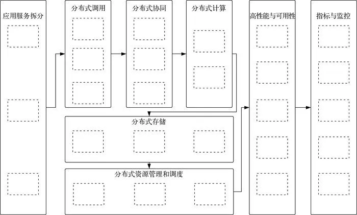

- 图 1-24　分布式架构需解决问题的结构图

后面我们会根据图 1-24 中箭头指示的顺序，介绍每个问题的具体内容，并将虚线框的部分补齐，也就是将每个问题细化。

### 1.4.2　应用服务拆分

分布式架构确实解决了高性能、高可用、可扩展、可伸缩等问题。其自治性特征也让服务从系统中独立出来，从业务到技术再到团队都是独立的个体。但在分布式架构的实践过程中，产生了一些争论和疑惑，例如应用服务如何划分？划分以后如何设计？业务的边界如何定义？应用服务如果拆分得过于细致，就会导致系统架构的复杂度增加，项目难以推进，程序员学习曲线变得陡峭；如果拆分得过于粗旷，又无法达到利用分布式资源完成海量请求以及大规模任务的目的。一般来说，应用服务的划分都是由项目中的技术或者业务专家凭借经验进行的。即使有方法论，也是基于经验而得，究其根本，我们还是不清楚业务的边界在什么地方。换言之，定义业务的边界是划分应用服务的关键。说白了，就是先划分业务，再针对划分后的业务进行技术实现。

既然技术的实现来源于业务，那么对业务的分析就需要放在第一位。我们可以利用 DDD（Domain-Driven Design，领域驱动设计）的方法定义领域模型，确定业务和应用服务的边界，最终引导技术的实现。按照 DDD 方法设计出的应用服务符合“高内聚、低耦合”的标准。DDD 是一种专注于复杂领域的设计思想，其围绕业务概念构建领域模型，并对复杂的业务进行分隔，再对分隔出来的业务与代码实践做映射。DDD 并不是架构，而是一种架构设计的方法论，它通过边界划分将业务转化成领域模型，领域模型又形成应用服务的边界，协助架构落地。

这部分内容如下。

- 领域驱动设计的模型结构：包括领域、领域分类、子域、领域事件、聚合、聚合根、实体和值对象的介绍。

- 分析业务需求形成应用服务：包括业务场景分析、抽象领域对象、划定限界上下文。

- 领域驱动设计分层架构：包括分层原则、每层内容和特征，以及分层实例。

### 1.4.3　分布式调用

服务与资源一旦分散开，要想调用就没有那么简单了。需要针对不同的用户请求，找到对应的服务模块，比如用户下订单就需要调用订单服务。当大量用户请求相同的服务，又存在多个服务的时候，需要根据资源分布将用户请求均匀分配到不同服务上去。就好像用户浏览商品时，有多个商品服务可供选择，那么由其中哪一个提供服务呢？服务之间的调用也是如此，服务如何找到另外一个服务，找到以后通过什么方式调用，都是需要思考的问题。针对调用的问题，在不同架构层面有不同的处理方式：在用户请求经过互联网进入应用服务器之前，需要通过负载均衡和反向代理；在内网的应用服务器之间需要 API 网关调用；服务与服务之间可以通过服务注册中心、消息队列、远程调用等方式互相调用。因此可以将分布式调用总结为两部分，第一部分是感知对方，包括负载均衡、API 网关、服务注册与发现、消息队列；第二部分是信息传递，包括 RPC、RMI、NIO 通信。

- 负载均衡分类：针对接入层硬件和软件负载均衡的实现原理和算法进行介绍。

- API 网关：介绍 API 网关的技术原理和具体功能，并且通过对比的方式介绍流行的 API 网关。

- 服务注册与发现：介绍相关的原理和概念，以及它与发布 / 订阅模式的区别。

- 服务间的远程调用：介绍 RPC 调用过程、RPC 动态代理、RPC 序列化、协议编码和网络传输，还会介绍 Netty 是如何实现 RPC 的。

### 1.4.4　分布式协同

分布式协同顾名思义就是大家共同完成一件事，而且是一件大事。在完成这件大事的过程中，难免会遇到很多问题。例如，同时响应多个请求的库存服务会对同一商品的库存进行“扣减”，为了保证商品库存这类临界资源的访问独占性，引入了分布式锁的概念，让多个“扣减”请求能够串行执行。又例如，在用户进行“下单”操作时，需要将“记录订单”（订单服务）和“扣减库存”（库存服务）放在事务中处理，要么两个操作都完成，要么都不完成。再例如，对商品表做了读写分离之后，产生了主从数据库，当主库发生故障时，会通过分布式选举的方式选举出新的主库，以替代原来主库的工作。我们将这些问题归纳为以下几点。

- 分布式系统的特性与互斥问题：集中互斥算法、基于许可的互斥算法、令牌环互斥算法。

- 分布式锁：分布式锁的由来和定义、缓存实现分布式锁、ZooKeeper 实现分布式锁、分段加锁。

- 分布式事务：介绍分布式事务的原理和解决方案。包括 CAP、BASE、ACID 等的原理；DTP 模型；2PC、TCC 方案。

- 分布式选举：介绍分布式选举的几种算法，包括 Bully 算法、Raft 算法、ZAB 算法。

- 分布式系统的实践：介绍 ZooKeeper 的基本原理和组件。

### 1.4.5　分布式计算

在大数据和人工智能时代，有海量的信息需要处理，这些信息会经过层层筛选进入系统，最终形成数据。要想让数据产生商业价值，就离不开数据模型和计算。针对海量数据的计算，分布式架构通常采用水平扩展的方式来应对挑战。在不同的计算场景下计算方式会有所不同，计算模式分为两种：针对批量静态数据计算的 MapReduce 模式，以及针对动态数据流进行计算的Stream 模式。我们会展开介绍这两种模式。

- MapReduce 模式：介绍其特点、工作流程和示例。

- Stream 模式：通过 Storm 的最佳实践介绍其要素和流程。

### 1.4.6　分布式存储

简单理解，存储就是数据的持久化。从参与者的角度来看，数据生产者生产出数据，然后将其存储到媒介上，数据使用者通过数据索引的方式消费数据。从数据类型上来看，数据又分为结构化数据、半结构化数据、非结构化数据。在分布式架构中，会对数据按照规则分片，对于主从数据库还需要完成数据同步操作。如果要建立一个好的数据存储方案，需要关注数据均匀性、数据稳定性、节点异构性以及故障隔离几个方面。因此，我们组织以下内容来讲解分布式存储。

- 数据存储面临的问题和解决思路：RAID 磁盘阵列。

- 分布式存储概念：分布式存储的要素和数据类型分类。

- 分布式关系数据库：分表分库、主从复制、数据扩容。

- 分布式缓存：缓存分片算法、Redis 集群方案、缓存节点之间的通信、请求分布式缓存的路由、缓存节点的扩展和收缩、缓存故障的发现和恢复。

### 1.4.7　分布式资源管理与调度

如果把每个用户请求都看成系统需要完成的任务，那么分布式架构要做的就是对任务与资源进行匹配。首先，我们会介绍资源调度的过程。然后，通过介绍 Linux Container 让大家了解资源划分和调度策略是如何工作的。最后，介绍三类资源调度的架构，以及 Kubernetes 的最佳实践。具体为如下内容。

- 分布式调度的由来与过程。

- 资源划分和调度策略。

- 分布式调度架构。

- 中心化调度的特点是由一个网络节点参与资源的管理和调度。

- 两级调度在单体调度的基础上将资源的管理和调度从一层分成了两层，分别是资源管理层和任务分配层。

- 共享状态调度，通过共享集群状态、共享资源状态和共享任务状态完成调度工作。

- 资源调度的实践：介绍 Kubernetes 的架构及其各组件的运行原理。

### 1.4.8　高性能与可用性

高性能和可用性本身就是分布式架构要达成的目的。分布式架构拆分和分而治之的思想也是围绕着这个目的展开的。这部分主要从缓存、可用性两个方面展开。在分布式架构的每个层面和角度，都可以利用缓存技术提高系统性能。由于技术使用比较分散，在第 8 章中我们会做一个总结性的描述。对于可用性来说，为了保证系统的正常运行会通过限流、降级、熔断等手段进行干涉。本部分的结构如下。

- 缓存的应用：HTTP 缓存、CDN 缓存、负载均衡缓存、进程内缓存、分布式缓存。

- 可用性的策略：请求限流、服务降级、服务熔断。

### 1.4.9　指标与监控

判断一个架构是好是坏时，有两个参考标准，即性能指标和可用性指标，分布式架构也是如此。性能指标又分为吞吐量、响应时间和完成时间。由于系统的分布性，服务会分布到不同的服务器和网络节点，因此监控程序需要在不同的服务器和网络节点上对服务进行监控。在分布式监控中会提到监控系统的分类、分层以及 Zabbix、Prometheus、ELK 的最佳实践。本部分的结构如下。

- 性能指标：延迟、流量、错误、饱和度。

- 分布式监控系统：创建监控系统的步骤、监控系统的分类、监控系统的分层。

- 流行监控系统的最佳实践：包含 Zabbix、Prometheus。

## 1.5　本书的阅读方式

分布式架构的特征引发了若干问题，按照根据问题进行拆分的思路，我们将问题分为了 1.4.2节至 1.4.9 节的 8 大类，并且针对每个具体问题进行了详细的拆分，同时提供了对应的原理和实践。将上面细分得到的问题回填到 1.4.1 节的逻辑图中，就会得到图 1-25。

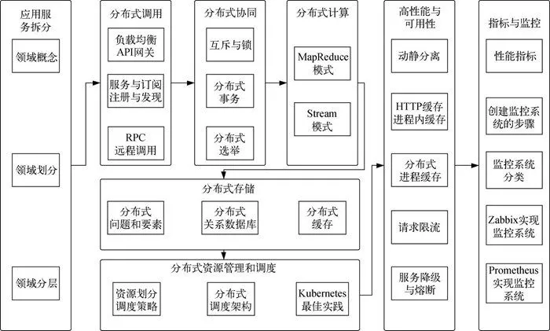

- 图 1-25　分布式架构 8 个问题的细分以及阅读顺序

后面的 8 章会围绕上面 8 个问题展开讨论。按照“拆分→调用→协同→计算→存储→调度→高性能与可用性→指标与监控”的逻辑关系，顺序推进。可以顺着一个一个看，也可以直接跳到感兴趣的部分阅读。在本书最后，我们还会加入架构设计思路和要点作为整体内容的扩展。本章既是探索分布式架构之旅的开始，也是全书的索引，大家读完以后可以针对自己感兴趣的部分进行延展阅读。

## 1.6　总结

本章从软件架构的演变过程入手，讲解了每个阶段架构变化的特点，让大家了解软件架构演变到分布式架构的过程和原因。接着通过一个简单的分布式架构的例子，让大家对分布式架构有一个感性的认识。通过分析分布式架构的 4 个特征——分布性、自治性、并行性和全局性，得到分布式架构需要解决的 8 个问题，并将这 8 个问题一一拆解。在下一章中，我们将介绍分布式应用服务的拆分。
