# 第3章分布式调用(2)

## 3.3　服务注册与发现

3.1 节和 3.2 节中提到的负载均衡、API 网关都是分布式系统外部的请求对其内部服务进行调用的方式。顺着微服务的思路向下延伸，分布式系统内的服务之间是如何相互调用的呢？最简单的想法是服务 A 只需要知道服务 B 的地址和输入参数就可以对其调用了。如果服务 B 进行了水平扩展，则由多个服务 B 共同完成一个业务功能，此时服务 A 就有可能只调用多个服务B 中的一个。至于具体调用哪一个可以通过负载均衡算法确定。示例代码如下：

```
http {
   upstream sampleservers{
       server 192.168.1.1:8001 weight 2;
       server 192.168.1.2:8002 weight 1;
   }
   server {
       listen 80;
       location /serviceB {
           proxy_pass http://sampleservers;
       }
   }
}
```

在上述代码中，当服务 A 请求服务 B 时，通过 Nginx 的负载均衡配置，将服务 A 的请求分别路由到 192.168.1.1:8001 和 192.168.1.2:8002 这两个服务器上。换句话说，服务 B 作为被调用方，会把自己的调用地址发送到服务 A，服务 A 在自己的 Nginx 上配置访问服务 B 的地址，也就是说服务 A 知道该如何访问服务 B。

这样的配置方法虽然看上去解决了服务之间的调用问题，但是作为被调用方的服务 B 如果地址进行了不当调整，例如新增了服务或者有的服务已下线，就需要通知调用方服务 A 修改路由地址。服务的调用方和被调用方之间需要长期维护这样一个关于调用的路由关系，在服务比较多的情况下需要维护很多这样错综复杂的关系，势必会增加系统的负担，因此引入了服务注册与发现的概念。

### 3.3.1　服务注册与发现的概念和原理

分布式系统（或者说微服务系统）中存在着各种各样的服务，这些服务存在调用其他服务和被其他服务调用的情况。被调用的服务称作服务提供者，调用其他服务的服务称作服务消费者。一般来讲，一个服务有可能既是服务提供者，又是服务消费者。可以想象一下，在一个系统中如果存在若干这样的服务，服务之间都存在互相调用的关系，那么如何让这些服务感知对方的存在，并且进行调用就是服务注册与发现需要解决的问题。如图 3-16 所示，在服务提供者和服务消费者中间加入服务注册中心的概念，假设存在一个服务提供者和一个服务消费者，当服务提供者启动时，会主动到服务注册中心注册自己提供的服务。同样服务消费者启动时，也会根据自己消费的服务向服务注册中心订阅自己需要的服务，通常服务消费者会在本地维护一张服务访问的路由表，这个路由表中记录着访问服务提供者需要的路由信息。假如服务提供者不提供服务了，或者有新的服务提供者加入服务注册中心，服务注册中心将会更新服务提供者列表，与此同时主动通知服务消费者这一变更。服务消费者接收到变更信息以后，会刷新本地存储着的路由表，始终保证用正确的路由信息去调用服务提供者。

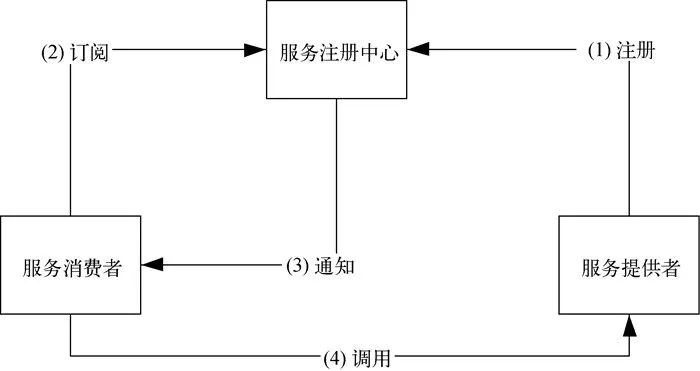

- 图 3-16　服务注册与发现

### 3.3.2　服务注册中心的可用性

上面介绍了服务提供者、服务消费者和服务注册中心之间的关系，即使系统中有若干个服务消费者和服务提供者，它们之间的调用也会遵循这个原则。这种服务之间的调用方式，看上去对服务注册中心具有很强的依赖，服务注册中心负责存储、通知服务调用路由，因此在实现时有必要考虑其可用性。通常来说，服务注册中心需要支持对等集群。

数据复制一般存在两种模式，第一种是 Master-Slave，即主从复制，Master 负责写入、读取，Slave 负责读取；另一种是 Peer to Peer，即对等复制或对等集群模式，这种模式下副本之间不分主从，每个服务注册中心的节点都可以处理读写请求，比如 Eureka Server 就是使用的这种模式。对等集群模式会配置多个服务注册中心，这些注册中心形成集群，相互之间是对等关系，客户端只需要连接其中一个就可以完成注册、订阅等操作。这些注册中心之间会定期进行数据同步，当其中一个注册中心出现问题不能提供服务时，由其他注册中心顶替其工作。

### 3.3.3　服务注册中心的服务保存

从服务消费者和服务提供者的角度来看，需要保持服务注册中心的可用性。反过来，站在服务注册中心的角度，也要时刻关注服务消费者和服务提供者的健康状况，如果将这两者统称为服务，那么服务注册中心就需要定期检查服务的情况。由于在分布式系统中，服务都分布在不同服务器以及不同网络环境中，因此服务会因为网络抖动或者自身问题导致出现不可用的状态。由于不可用的状态无法避免，因此服务注册中心需要通过某种方式检测这种状态，并且及时维护服务路由列表，保证服务消费者在调用服务提供者时不会遇到问题服务。通常，服务会主动向服务注册中心发送心跳包以维持联系，如果说这种联系是租约，那么发送心跳包的行为就是续约。服务注册中心接收到续约心跳包后会更新服务的最近一次续约信息，并且隔一段时间后会根据续约信息更新服务访问的路由列表，如果在这时间段内没有收到服务续约的申请，就会把该服务从服务列表中移除，同时通知其他服务无法访问该服务了。

## 3.4　服务间的远程调用

无论 API 网关，还是服务注册和发现，都在探讨服务与服务如何发现对方、如何选择正确路径进行调用，描述的是服务之间的关系。厘清关系后，我们再来谈谈服务之间的调用是如何完成的。沿着 3.2 节和 3.3 节的思路，在分布式系统中，应用或者服务会被部署到不同的服务器和网络环境中，特别是在有微服务的情况下，应用被拆分为很多个服务，每个服务都有可能依赖其他服务。如图 3-17 所示，客户端调用下单服务时，还会调用商品查询服务、扣减库存服务、订单更新服务，如果这三个服务分别对应三个数据库，那么一次客户端请求就会引发 6 次调用，要是这些服务或者数据库都部署在不同的服务器或者网络节点，这 6 次调用就会引发 6次网络请求。因此，分布式部署方式在提高系统性能和可用性的前提下，对网络调用效率也发起了挑战。

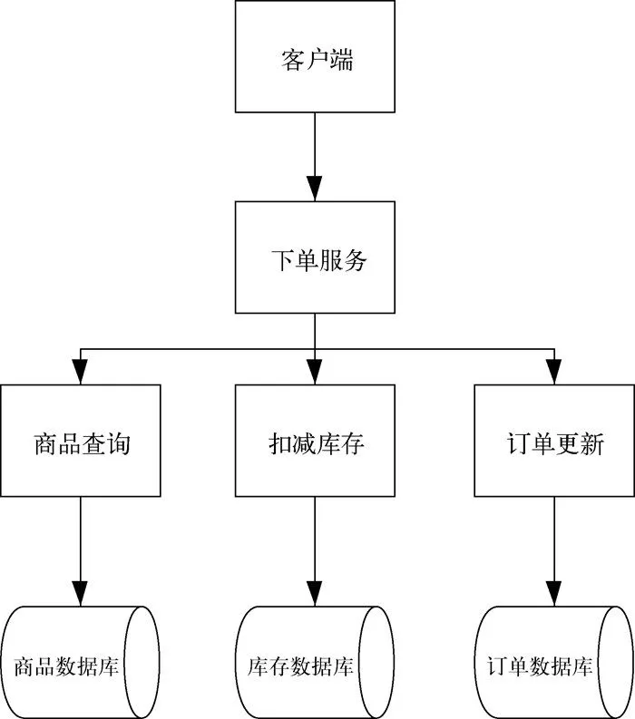

- 图 3-17　微服务调用的场景，一个服务依赖其他服务，导致网络调用次数增加

为了面对这种挑战，需要选择合适的网络模型，对传输的数据包进行有效的序列化，调整网络参数优化网络传输性能。为了做到以上几点我们需要引入 RPC，下面就来介绍 RPC 是如何解决服务之间网络传输问题的。

### 3.4.1　RPC 调用过程

RPC 是 Remote Procedure Call（远程过程调用）的缩写，该技术可以让一台服务器上的服务通过网络调用另一台服务器上的服务，简单来说就是让不同网络节点上的服务相互调用。因此RPC 框架会封装网络调用的细节，让调用远程服务看起来像调用本地服务一样简单。由于微服务架构的兴起，RPC 的概念得到广泛应用，在消息队列、分布式缓存、分布式数据库等多个领域都有用到。可以将 RPC 理解为连接两个城市的高速公路，让车辆能够在城市之间自由通行。由于 RPC 屏蔽了远程调用和本地调用的区别，因此程序开发者无须过多关注网络通信，可以把更多精力放到业务逻辑的开发上。

下面看一下 RPC 调用的流程。图 3-18 描述了服务调用的过程，这里涉及左侧的服务调用方和右侧的服务提供方。既然是服务的调用过程，就存在请求过程和响应过程，这两部分用虚线圈出来了。从图左侧的服务调用方开始，利用“动态代理”方式向服务提供方发起调用，这里会制定服务、接口、方法以及输入的参数；将这些信息打包好之后进行“序列化”操作，由于 RPC是基于 TCP 进行传输的，因此在网络传输中使用的数据必须是二进制形式，序列化操作就是将请求数据转换为二进制，以便网络传输；打好二进制包后，需要对信息进行说明，比如协议标识、数据大小、请求类型等，这个过程叫作“协议编码”，说白了就是对数据包进行描述，并告诉数据接收方数据包有多大、要发送到什么地方去。至此，数据发送的准备工作就完成了，数据包会通过“网络传输”到达服务提供方。服务提供方接收到数据包以后，先进行“协议解码”，并对解码后的数据“反序列化”，然后通过“反射执行”获取由动态代理封装好的请求。此时随着箭头到了图的最右边，顺着向下的箭头，服务提供方开始“处理请求”，处理完后就要发送响应信息给服务调用方了，之后的发送过程和服务调用方发送请求的过程是一致的，只是方向相反，依次为序列化→协议编码→网络传输→协议解码→反序列化→接收响应”。以上便是整个 RPC 调用的请求、响应流程。

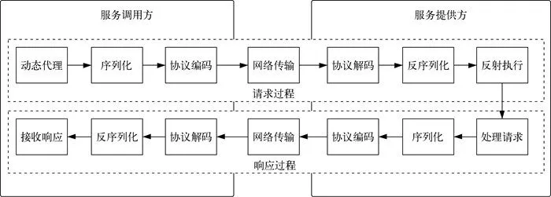

- 图 3-18　服务调用方调用服务提供方的过程

分析上述的 RPC 调用流程后，发现无论是服务调用方发送请求，还是服务提供方发送响应，有几个步骤都是必不可少的，分别为动态代理、序列化、协议编码和网络传输。下面对这四个方面展开讨论。

### 3.4.2　RPC 动态代理

服务调用方访问服务提供方的过程是一个 RPC 调用。作为服务调用方的客户端通过一个接口访问作为服务提供方的服务端，这个接口决定了访问方法和传入参数，可以告诉客户端如何调用服务端，实际的程序运行也就是接口实现是在客户端进行的。RPC 会通过动态代理机制，为客户端请求生成一个代理类，在项目中调用接口时绑定对应的代理类，之后当调用接口时，会被代理类拦截，在代理类里加入远程调用逻辑即可调用远程服务端。原理说起来有些枯燥，我们通过一个例子来帮助大家理解，相关代码如下：

```java
public interface SeverProvider   ①
{
   public void sayHello(String str);
}
public class ServerProviderImpl implements SeverProvider  ②
{
   @Override
   public void sayHello(String str)
   {
       System.out.println("Hello" + str);
   }
}
public class DynamicProxy implements InvocationHandler  ③
{
   private Object realObject;  ④
   public DynamicProxy(Object object)  ⑤
   {
       this.realObject = object;
   }
   @Override
   public Object invoke(Object object, Method method, Object[] args)  ⑥
   {
       method.invoke(realObject, args);
       return null;
   }
}
public class Client
{
   public static void main(String[] args)
   {
       SeverProvider realSeverProvider = new ServerProviderImpl();  ⑦
       InvocationHandler handler = new
           DynamicProxy(realSeverProvider);  ⑧
       SeverProvider severProvider = (SeverProvider)
           Proxy.newProxyInstance(  ⑨
               handler.getClass().getClassLoader(),
               realSeverProvider.getClass().getInterfaces(),
               handler);
       severProvider.sayHello("world");
   }
}
```

下面简要解释上述代码的含义。

```
① 声明服务端，也就是服务提供者 ServerProvider，这是一个接口，其中定义了
sayHello 方法。
② 定义 ServerProviderImpl 类，实现 ServerProvider 接口，其中 sayHello 方法
的功能是打印传入的参数。我们假设 ServerProvider 和 ServerProviderImpl 都定义
```

在远程服务端。

```
③ 此时有一个客户端要调用第②步中远程服务里的 sayHello 方法，需要借助一个代理类
```

（因为服务部署在远端，但是客户端需要在本地调用它，所以需要用代理类）。于是定义代理

```
类 DynamicProxy，它实现了 InvocationHandler 接口（每一个动态代理类都必须实现
InvocationHandler 接口）。
④ 定义变量 realObject，用于存放在代理类的构造函数中接收的需要代理的真实对象。注
```

意这就是实现所谓的动态代理。

```
⑤ 代理类的构造函数 DynamicProxy 的功能是将代理类和真实调用者（服务端实例）绑定到
```

一起，绑定后就可以通过直接调用代理类的方式完成对远程服务端的调用。每个代理类的实

```
例，都会关联到一个 handler，其中代理类的实例指的是需要代理的真实对象，也就是服务
端实例；handler 实际就是 DynamicProxy 类，它在实现 InvocationHandler 接口后
```

通过反射的方式调用传入真实对象的方法，由于是通过反射，因此对真实对象没有限定，成为动态代理。

```
⑥ 当代理对象（DynamicProxy）调用真实对象的方法时，调用会被转发到 invoke 方法中
执行。在 invoke 方法中，会针对真实对象调用对应的方法并执行。
```

⑦ 最后来看客户端。对于客户端而言，只需要指定服务端对应的调用接口，这个接口服务端就会通过某种方式暴露出来。所以，这里首先声明要调用的真实服务端

```
realSeverProvider。
```

⑧ 客户端只知道接口的名称，以及要传入的参数，通过这个接口生成调用的实例。然后在客

```
户端声明一个代理类（DynamciProxy），其将真实对象的实例在构造函数中进行绑定。所以
```

此处在动态代理初始化的时候，将真实服务提供者传入，表明对这个对象进行代理。

```
⑨ 再通过 newProxyInstance 方法生成代理对象的实例，最后调用实际方法 sayHello 完
成整个调用过程。通过 Proxy 的 newProxyInstance 创建代理对象的几个参数的定义如
```

下。

```
第一个参数 handler.getClass().getClassLoader()，我们这里使用 handler 类
的 ClassLoader 对象来加载代理对象。
```

```
第二个参数 realSeverProvider.getClass().getInterfaces()，指定服务端（也
```

- 就是真实调用对象）的接口。

```
第三个参数 handler，将代理对象关联到 InvocationHandler 上。
```

回顾上述调用过程不难发现，在客户端和服务端之间加入了一层动态代理，这个代理用来代理服务端接口。客户端只需要知道调用服务端接口的方法名字和输入参数就可以了，并不需要知道具体的实现过程。在实际的 RPC 调用过程中，在客户端生成需要调用的服务端接口实例，将它丢给代理类，当代理类将这些信息传到服务端以后再执行。因此，RPC 动态代理是对客户端的调用和服务端的执行进行了解耦，目的是让客户端像调用本地方法一样调用远程服务。

### 3.4.3　RPC 序列化

序列化是将对象转化为字节流的过程，RPC 客户端在请求服务端时会发送请求的对象，这个对象如果通过网络传输，就需要进行序列化，也就是将对象转换成字节流数据。反过来，在服务端接收到字节流数据后，将其转换成可读的对象，就是反序列化。如果把序列化比作快递打包的过程，那么收到快递后拆包的过程就是反序列化。序列化和反序列化的核心思想是设计一种序列化、反序列化规则，将对象的类型、属性、属性值、方法名、方法的传入参数等信息按照规定格式写入到字节流中，然后再通过这套规则读取对象的相关信息，完成反序列化操作。下面罗列几种常见的序列化方式供大家参考。

- JSON。JSON 是一种常用的序列化方式，也是典型的 Key-Value 方式，不对数据类型做规定，是一种文本型序列化框架。利用这种方式进行序列化的额外空间开销比较大，如果传输数据量较大的服务，会加大内存和磁盘开销。另外，JSON 没有定义类型，遇到对 Java 这种强类型语言进行序列化的场景，需要通过反射的方式辅以解析序列化信息，因此会对性能造成一定影响。可以看出，在服务之间数据量传输量较小的情况下，可以使用 JSON 作为序列化方式。

- Hessian。Hessian 是动态类型、二进制、紧凑，并且可跨语言移植的一种序列化框架。和JSON 相比，Hessian 显得更加紧凑，因此性能上比 JSON 序列化高效许多，简单来说就是 Hessian 序列化后生成的字节数更小。又因为其具有较好的兼容性和稳定性，所以Hessian 被广泛应用于 RPC 序列化协议。

- Protobuf。Protobuf 是 Google 公司内部的混合语言数据标准，是一种轻便、高效的结构化数据存储格式，可用于结构化数据的序列化操作，支持 Java、Python、C++、Go 等语

- 言。使用 Protobuf 时需要定义 IDL（Interface description language），IDL 用于分离对象的接口与实现，剥离了编程语言对硬件的依赖性，提供了一套通用的数据类型，并且可以通过这些数据类型定义更为复杂的数据类型，从而更好地协助 Protobuf 完成序列化工作。从结果表现来看，Protobuf 序列化后需要的存储空间比 JSON、Hessian 序列化后需要的更小，因为 IDL 的描述语义保证了应用程序的类型描述的准确性，所以不需要类似 XML 解析器的额外描述；Protobuf 序列化、反序列化的速度更快，因为有了 IDL 的描述，不需要通过反射获取数据类型。同时，Protobuf 支持消息格式升级，因此在兼容性方面也有不错的表现，可以做到向后兼容。

- Thrift。Thrift 是 facebook 开源的高性能、轻量级 RPC 服务框架。其中也包括序列化协议，相对于 JSON 而言，Thrift 在空间开销和解析性能上有较大的提升。由于 Thrift 的序列化封装在 Thrift 框架里面，同时 Thrift 框架并没有暴露序列化和反序列化接口，因此其很难和其他传输层协议共同使用。

### 3.4.4　协议编码

有了序列化功能，就可以将客户端的请求对象转化成字节流在网络上传输了，这个字节流转换为二进制信息以后会写入本地的 Socket 中，然后通过网卡发送到服务端。从编程角度来看，每次请求只会发送一个请求包，但是从网络传输的角度来看，网络传输过程中会将二进制包拆分成很多个数据包，这一点也可以从 TCP 传输数据的原理看出。拆分后的多个二进制包会同时发往服务端，服务端接收到这些数据包以后，将它们合并到一起，再进行反序列化以及后面的操作。实际上，协议编码要做的事情就是对同一次网络请求的数据包进行拆分，并且为拆分得到的每个数据包定义边界、长度等信息。如果把序列化比作快递打包过程，那么协议编码更像快递公司发快递时，往每个快递包裹上贴目的地址和收件人信息，这样快递员拿到包裹以后就知道该把包裹送往哪里、交给谁。当然这只是个例子，RPC 协议包含的内容要更为广泛。

接下来一起看看 RPC 协议的消息设计格式。RPC 协议的消息由两部分组成：消息头和消息体。消息头部分主要存放消息本身的描述信息，如图 3-19 所示。

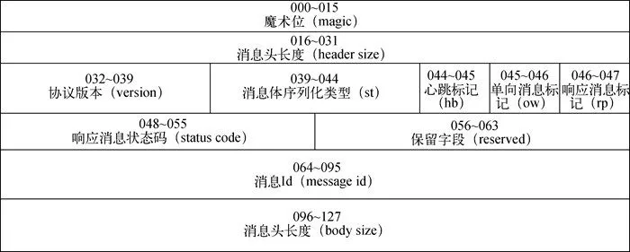

- 图 3-19　定义 RPC 协议的消息头

其中各项的具体介绍如下。

- 魔术位（magic）：协议魔术，为解码设计。

- 消息头长度（header size）：用来描述消息头长度，为扩展设计。

- 协议版本（version）：协议版本，用于版本兼容。

- 消息体序列化类型（st）：描述消息体的序列化类型，例如 JSON、gRPC。

- 心跳标记（hb）：每次传输都会建立一个长连接，隔一段时间向接收方发送一次心跳请求，保证对方始终在线。

- 单向消息标记（ow）：标记是否为单向消息。

- 响应消息标记（rp）：用来标记是请求消息还是响应消息。

- 响应消息状态码（status code）：标记响应消息状态码。

- 保留字段（reserved）：用于填充消息，保证消息的字节是对齐的。

- 消息 Id（message id）：用来唯一确定一个消息的标识。

- 消息头长度（body size）：描述消息体的长度。

从上面的介绍也可以看出，消息头主要负责描述消息本身，其内容甚至比上面提到的更加详细。消息体的内容相对而言就显得非常简单了，就是在 3.4.3 节中提到的序列化所得的字节流信息，包括 JSON、Hessian、Protobuff、Thrift 等。

### 3.4.5　网络传输

动态代理使客户端可以像调用本地方法一样调用服务端接口；序列化将传输的信息打包成字节码，使之适合在网络上传输；协议编码对序列化信息进行标注，使其能够顺利地传输到目的地。做完前面这些准备工作后就可以进行网络传输了。RPC 的网络传输本质上是服务调用方和服务提供方的一次网络信息交换过程。以 Linux 操作系统为例，操作系统的核心是内核，独立于普通的应用程序，可以访问受保护的内存空间，还拥有访问底层硬件设备（比说网卡）的所有权限。为了保证内核的安全，用户的应用程序并不能直接访问内核。对此，操作系统将内存空间划分为两部分，一部分是内核空间，一部分是用户空间。如果用户空间想访问内核空间就需要以缓冲区作为跳板。网络传输也是如此，如果一个应用程序（用户空间）想访问网卡发送的信息，就需要通过应用缓冲区将数据传递给内核空间的内核缓冲区，再通过内核空间访问硬件设备，也就是网卡，最终完成信息的发送。下面来看看 RPC 应用程序进行网络传输的流程，希望能给大家一些启发。

如图 3-20 所示，整个请求过程分为左右两边，左边是服务调用方，右边是服务提供方，左边是应用程序写入 IO 数据的操作，右边是应用程序读出 IO 数据的操作。从左往右看这张图，图的最左边是服务调用方中的应用程序发起网络请求，也就是应用程序的写 IO 操作。然后应用程序把要写入的数据复制到应用缓冲区，操作系统再将应用缓冲区中的数据复制到内核缓冲区，接下来通过网卡发送到服务提供方。服务提供方接收到数据后，先将数据复制到内核缓冲区内，再复制到应用缓冲区，最后供应用程序使用，这便完成了应用程序读出 IO 数据的操作。

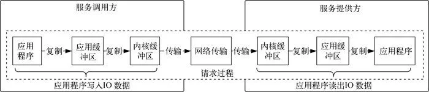

- 图 3-20　RPC 应用程序读写 IO 数据

通过上面对 RPC 调用流程的描述，可以看出服务调用方需要经过一系列的数据复制，才能通过网络传输将信息发送到服务提供方，在这个调用过程中，我们关注更多的是服务调用方从发起请求，到接收响应信息的过程。在实际应用场景中，服务调用方发送请求后需要先等待服务端处理，然后才能接收到响应信息。如图 3-21 所示，服务调用方在接收响应信息时，需要经历两个阶段，分别是等待数据准备和内核复制到用户空间。信息在网络上传输时会被封装成一个个数据包，然后进行发送，每个包到达目的地的时间由于网络因素有所不同，内核系统会将收到的包放到内核缓冲区中，等所有包都到达后再放到应用缓冲区。应用缓冲区属于用户空间的范畴，应用程序如果发现信息发送到了应用缓冲区，就会获取这部分数据进行计算。如果对这两个阶段再做简化就是网络 IO 传输和数据计算。网络 IO 传输的结果是将数据包放到内核缓冲区中，数据从内核缓冲区复制到应用缓冲区后就可以进行数据计算。

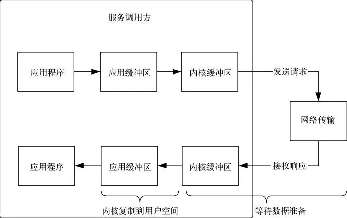

- 图 3-21　获取远程服务数据的两个阶段

可以看出网络 IO 传输和数据计算过程存在先后顺序，因此当前者出现延迟时会导致后者处于阻塞。另外，应用程序中存在同步调用和异步调用，因此衍生出了同步阻塞 IO（blockingIO）、同步非阻塞 IO（non-blocking IO）、多路复用 IO（multiplexing IO）这几种 IO 模式。下面就这几种 IO 模式的工作原理给大家展开介绍。

1. 同步阻塞 IO（blocking IO）如图 3-22 所示，在同步阻塞 IO 模型中，应用程序在用户空间向服务端发起请求。如果请求到达了服务端，服务端也做出了响应，那么客户端的内核会一直等待数据包从网络中回传。此时用户空间中的应用程序处于等待状态，直到数据从网络传到内核缓冲区中，再从内

- 核缓冲区复制到应用缓冲区。之后，应用程序从应用缓冲区获取数据，并且完成数据计算或者数据处理。也就是说，在数据还没到达应用缓冲区时，整个应用进程都会被阻塞，不能处理别的网络 IO 请求，而且应用程序就只是等待响应状态，不会消耗 CPU 资源。简单来说，同步阻塞就是指发出请求后即等待，直到有响应信息返回才继续执行。如果用去饭店吃饭作比喻，同步阻塞就是点餐以后一直等菜上桌，期间哪里都不去、什么都不做。

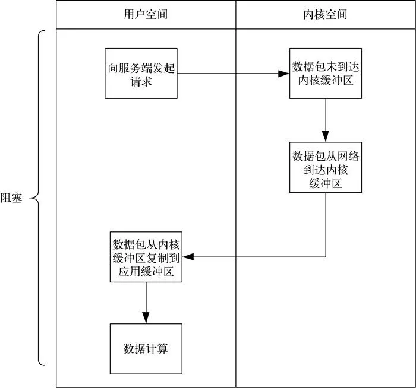

- 图 3-22　同步阻塞 IO 模型

2. 同步非阻塞 IO（non-blocking IO）同步阻塞 IO 模式由于需要应用程序一直等待，在等待过程中应用程序不能做其他事情，因此资源利用率并不高。为了解决这个问题，有了同步非阻塞，这种模式下，应用程序发起请

- 求后无须一直等待。如图 3-23 所示，当用户向服务端发起请求后，会询问数据是否准备好，如果此时数据还没准备好，也就是数据还没有被复制到应用缓冲区，则内核会返回错误信息给用户空间。用户空间中的应用程序在得知数据没有准备好后，不用一直等待，可以做别的事情，只是隔段时间还会询问内核数据是否准备好，如此循环往复，直到收到数据准备好的消息，然后进行数据处理和计算，这个过程也称作轮询。在数据没有准备好的那段时间内，应用程序可以做其他事情，即处于非阻塞状态。当数据从内核缓冲区复制到用户缓冲区后，应用程序又处于阻塞状态。还是用去饭店吃饭作比喻，同步非阻塞就是指点餐以后不必一直等菜上桌，可以玩手机、聊天，时不时打探一下菜准备好了没有，如果没有准备好，可以继续干其他，如果准备好就可以吃饭了。

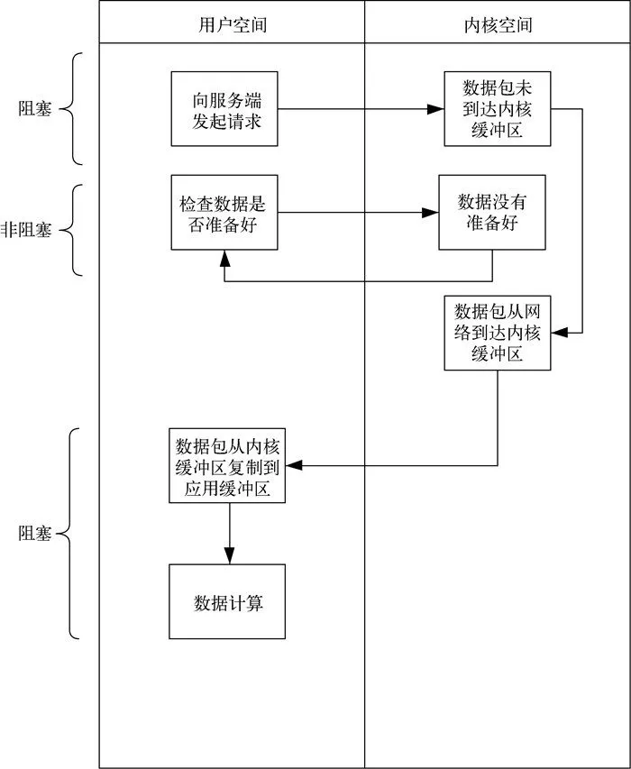

- 图 3-23　同步非阻塞 IO 模型

3. IO 多路复用（IO multiplexing）

- 虽然和同步阻塞 IO 相比，同步非阻塞 IO 模式下的应用程序能够在等待过程中干其他活儿，但是会增加响应时间。由于应用程序每隔一段时间都要轮询一次数据准备情况，有可能存在任务是在两次轮询之间完成的，还是举吃饭的例子，假如点餐后每隔 5 分钟查看是否准备好，如果餐在等待的 5 分钟之内就准备好了（例如：第 3 分钟就准备好了），可还是要等到第 5 分钟的时候才去检查，那么一定时间内处理的任务就少了，导致整体的数据吞吐量降低。同时，轮询操作会消耗大量 CPU 资源，如果同时有多个请求，那么每个应用的进程都需要轮询，这样效率是不高的。要是有一个统一的进程可以监听多个任务请求的数据准备状态，一旦发现哪个请求的数据准备妥当，便立马通知对应的应用程序进行处理就好了。因此就有了多路复用 IO，实际上就是在同步非阻塞 IO 的基础上加入一个进程，此进程负责监听多个请求的数据准备状态。如图 3-24 所示，当进程 1 和进程 2 发起请求时，不用两个进程都去轮询数据准备情况，因为有一个复用器（selector）进程一直在监听数据是否从网络到达了内核缓冲区中，如果监听到哪个进程对应的数据到了，就通知该进程去把数据复制到自己的应用缓冲区，进行接下来的数据处理。

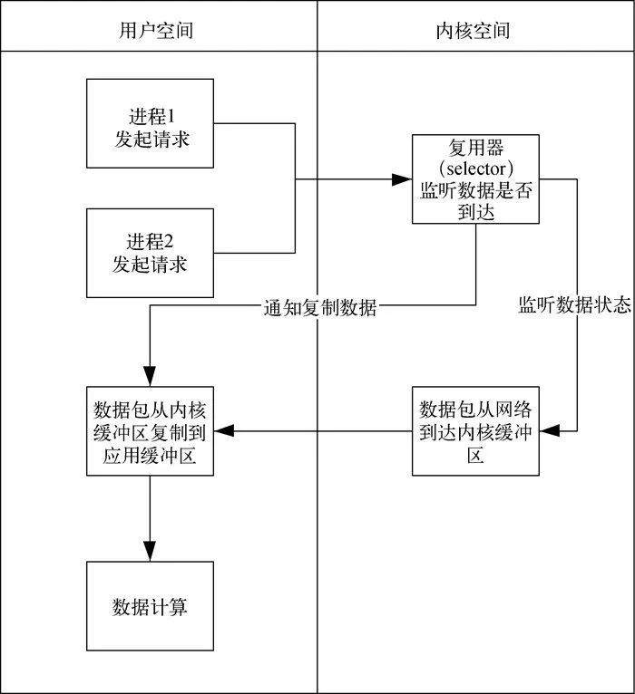

- 图 3-24　IO 多路复用模型

- 上面提到的复用器可以注册多个网络连接的 IO。当用户进程调用复用器时，进程就会被阻塞。内核会监听复用器负责的网络连接，无论哪个连接中的数据准备好，复用器都会通知用户空间复制数据包。此时用户进程再将数据从内核缓冲区中复制到用户缓冲区，并进行处理。这里有所不同的是，进程在调用复用器时就进入阻塞态了，不用等所有数据都回来再进行处理，也就是说返回一部分，就复制一部分，并处理一部分。好比一群人吃饭，每个人各

- 点了几个菜，而且是通过同一个传菜员点的，这些人在点完菜以后虽然是在等待，不过每做好一道菜，传菜员就会把做好的菜上到桌子上，满足对应客人的需求。因此，IO 多路复用模式可以支持多个用户进程同时请求网络 IO 的情况，能够方便地处理高并发场景，这也是RPC 架构常用的 IO 模式。

### 3.4.6　Netty 实现 RPC

前面 4 节分别介绍了 RPC 的四大功能：动态代理、序列化、协议编码以及网络传输。在分布式系统的开发中，程序员们广泛使用 RPC 架构解决服务之间的调用问题，因此高性能的 RPC框架成为分布式架构的必备品。其中 Netty 作为 RPC 异步通信框架，应用于各大知名架构，例如用作 Dubbo 框架中的通信组件，还有 RocketMQ 中生产者和消费者的通信组件。接下来基于 Netty 的基本架构和原理，深入了解 RPC 架构的最佳实践。

1. Netty 的原理与特点Netty 是一个异步的、基于事件驱动的网络应用框架，可以用来开发高性能的服务端和客户端。如图 3-25 所示，以前编写网络调用程序时，都会在客户端创建一个套接字，客户端通过这个套接字连接到服务端，服务端再根据这个套接字创建一个线程，用来处理请求。客户端在发起调用后，需要等待服务端处理完成，才能继续后面的操作，这就是我们在 3.4.5 节中介绍的同步阻塞 IO 模式。这种模式下，线程会处于一直等待的状态，客户端请求数越多，服务端创建的处理线程数就会越多，JVM 处理如此多的线程并不是一件容易的事。

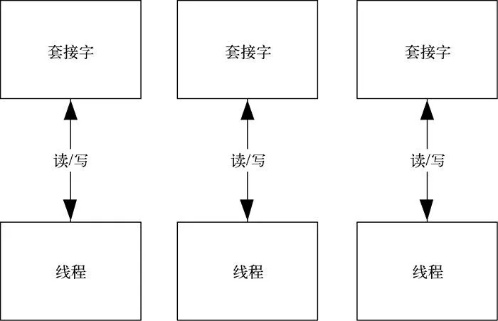

- 图 3-25　使用同步阻塞 I/O 处理多个连接

- 为了解决上述问题，使用了 IO 多路复用模型。正如 3.4.5 节中提到的复用器机制就是其核心。如图 3-26 所示，每次客户端发出请求时，都会创建一个 Socket Channel，并将其注册到多路复用器上。然后由多路复用器监听服务端的 IO 读写事件，服务端完成 IO 读写操作后，多路复用器就会接收到通知，同时告诉客户端 IO 操作已经完成。接到通知的客户端就可以通过 Socket Channel 获取所需的数据了。

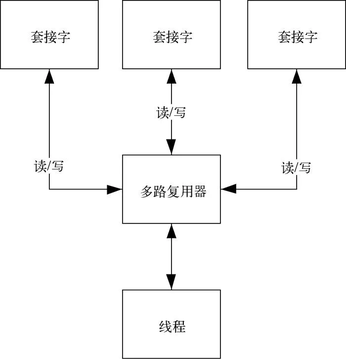

- 图 3-26　Netty 的多路复用机制

- 对于开发者来说，Netty 具有以下特点。

- 对多路复用机制进行封装，使开发者不需要关注其底层实现原理，只需要调用 Netty 组件就能够完成工作。

- 对网络调用透明，从 Socket 和 TCP 连接的建立，到网络异常的处理都做了包装。

- 灵活处理数据，Netty 支持多种序列化框架，通过 ChannelHandler 机制，可以自定义编码、解码器。

- 对性能调优友好，Netty 提供了线程池模式以及 Buffer 的重用机制（对象池化），不需要构建复杂的多线程模型和操作队列。

2. 从一个简单的例子开始学习架构最容易的方式就是从实例入手，这里我们从客户端访问服务端的代码来看看 Netty是如何运作的，再一次对代码中调用的组件以及组件的工作原理做介绍。假设现在有一个客户端去调用一个服务端，客户端叫 EchoClient，服务端叫 EchoServer，用 Netty 架构实现调用的代码如下。

- 服务端的代码下面构建一个服务端，假设它需要接收客户端传来的信息，然后在控制台打印出来。首

```java
先生成 EchoServer 类，在这个类的构造函数中传入需要监听的端口号，然后执行
start 方法启动服务端，相关代码如下：
public class EchoServer {
1
   private final int port;
2
   public EchoServer(int port) {
3
       this.port = port;
4
   }
5
   public void start() throws Exception {
6
       final EchoServerHandler serverHandler = new EchoServerHandler();
7
       EventLoopGroup group = new NioEventLoopGroup();  ①
8
       try {
9
           ServerBootstrap b = new ServerBootstrap();   ②
10
           b.group(group).channel(NioServerSocketChannel.class).  ③
11
               localAddress(new InetSocketAddress(port)).   ④
12
               childHandler(new ChannelInitializer<SocketChannel>()  ⑤
13
               {
14
                   @Override
15
                       public void initChannel(SocketChannel ch) throws Exc
16
                           ch.pipeline().addLast(serverHandler);
17
                       }
18
                   });
19
           ChannelFuture f = b.bind().sync();   ⑥
20
           System.out.println(EchoServer.class.getName() +
21
                   " started and listening for connections on " + f.channel
22
           f.channel().closeFuture().sync();   ⑦
23
       } finally {
24
           group.shutdownGracefully().sync();   ⑧
25
       }
26
   }
27
28
}
29
在上述代码里，执行 start 方法的过程中调用了一些组件，例如 EventLoopGroup、
Channel。这些组件会在 3.6.4.3 节详细讲解，这里有个大致印象就好。接下来是对上
```

- 述代码的分步解析。

```
① 创建 EventLoopGroup 对象。
② 创建 ServerBootstrap 对象。
③ 指定网络传输的 Channel。
```

- ④ 使用指定的端口设置套接字地址。

```
⑤ 添加一个 childHandler 到 Channel 的 Pipeline。
⑥ 异步绑定服务器，调用 sync 方法阻塞当前线程，直到绑定完成。
⑦ 获取 channel 的 closeFuture，并且阻塞当前线程直到获取完成。
⑧ 关闭 EventLoopGroup 对象，释放所有资源。
```

- 服务端启动以后会监听来自某个端口的请求，接收到请求后就需要进行处理了。在 Netty中，客户端请求服务端的操作被称为“入站”，可以由

```java
ChannelInboundHandlerAdapter 类实现，具体代码如下：
@Sharable
1
public class EchoServerHandler extends ChannelInboundHandlerAdapter {
2
   @Override
3
   public void channelRead(ChannelHandlerContext ctx, Object msg) {
4
       ByteBuf in = (ByteBuf) msg;
5
       System.out.println(
6
           "Server received: " + in.toString(CharsetUtil.UTF_8)); ①
7
       ctx.write(in);   ②
8
   }
9
10
   @Override
11
   public void channelReadComplete(ChannelHandlerContext ctx)
12
           throws Exception {
13
               ctx.writeAndFlush(Unpooled.EMPTY_BUFFER)
14
               .addListener(ChannelFutureListener.CLOSE);   ③
15
   }
16
17
   @Override
18
   public void exceptionCaught(ChannelHandlerContext ctx,
19
       Throwable cause) {
20
       cause.printStackTrace();    ④
21
       ctx.close();  ⑤
22
   }
23
}
24
```

- 对上述代码的分步解析如下。

- ① 将接收到的信息记录到控制台。

- ② 将接收到的信息写给发送者，而不冲刷“出站”信息。

```
③ 将未决消息冲刷到远程节点，并且关闭该 Channel。
```

- ④ 打印异常栈跟踪信息。

```
⑤ 关闭该 Channel。
```

- 从上述代码可以看出，服务端处理接收到的请求的代码包含 3 个方法。这 3 个方法都是由事件触发的，分别是：

```
(1) 当接收到信息时，触发 channelRead 方法；
(2) 信息读取完成时，触发 channelReadComplete 方法；
(3) 出现异常时，触发 exceptionCaught 方法。
```

- 客户端的代码客户端和服务端的代码基本相似，在初始化时需要输入服务端的 IP 地址和 Port，需要配

```
置连接服务端的基本信息，并且启动与服务端的连接。客户端的启动类 EchoClient 中
```

- 包括以下内容：

```java
public class EchoClient {
1
   private final String host;
2
   private final int port;
3
4
   public EchoClient(String host, int port) {
5
       this.host = host;
6
       this.port = port;
7
   }
8
   public void start()
9
       throws Exception {
10
       EventLoopGroup group = new NioEventLoopGroup();
11
       try {
12
           Bootstrap b = new Bootstrap();   ①
13
           b.group(group)   ②
14
               .channel(NioSocketChannel.class)   ③
15
               .remoteAddress(new InetSocketAddress(host, port))   ④
16
.handler(new ChannelInitializer<SocketChannel>() {  ⑤
17
                   @Override
18
                   public void initChannel(SocketChannel ch)
19
                       throws Exception {
20
                       ch.pipeline().addLast(
21
                           new EchoClientHandler());
22
                   }
23
               });
24
           ChannelFuture f = b.connect().sync();   ⑥
25
           f.channel().closeFuture().sync();
26
       } finally {
27
           group.shutdownGracefully().sync();  ⑦
28
       }
29
   }
30
}
31
```

- 对上述代码的分步解析如下。

```
① 创建 Bootstrap 对象。
② 指定 EventLoopGroup 对象，用来监听事件。
③ 定义 Channel 的传输模式为 NIO（Non-Blocking Input Output）。
④ 设置服务端的 InetSocketAddress 类。
⑤ 在创建 Channel 时，向 Channel 的 Pipeline 中添加一个
EchoClientHandler 实例。
⑥ 连接到远程节点，调用 sync 方法阻塞当前进程，直到连接完成。
⑦ 阻塞当前进程，直到 Channel 关闭。关闭线程池并且释放所有的资源。
```

- 客户端完成以上操作后会与服务端建立连接，从而能够传输数据。同样，客户端在监听

```java
到 Channel 中的事件时，会触发事件对应的方法，相应代码如下：
public class EchoClientHandler
1
   extends SimpleChannelInboundHandler<ByteBuf> {
2
   @Override
3
   public void channelActive(ChannelHandlerContext ctx) {
4
       ctx.writeAndFlush(Unpooled.copiedBuffer("Netty rocks!",
5
               CharsetUtil.UTF_8));   ①
6
   }
7
8
   @Override
9
   public void channelRead0(ChannelHandlerContext ctx, ByteBuf in) {
10
       System.out.println(
11
               "Client received: " + in.toString(CharsetUtil.UTF_8));   ②
12
   }
13
14
   @Override
15
   public void exceptionCaught(ChannelHandlerContext ctx,
16
       Throwable cause) {   ③
17
       cause.printStackTrace();
18
       ctx.close();
19
   }
20
}
21
在上述代码中，channelActive、channelRead0 等方法能够响应服务端的返回值，
例如 Channel 激活、客户端接收到服务端的消息，或者捕获了异常。代码从结构上看
```

- 还是比较简单的。服务端和客户端分别初始化，创建监听和连接，然后分别定义自己的

```
Handler 类来处理对方的请求。
① 客户端当被通知 Channel 是活跃的时候，发送一条信息。
```

- ② 客户端记录接收到的信息。

```
③ 当捕获到异常时，记录并关闭 Channel。
```

- 这里对上述代码稍做总结，如图 3-27 所示。使用 Netty 进行 RPC 编程，只需要分别定

```
义 EchoClient 类以及对应的 EchoClientHandler，和 EchoServer 类以及对应
的 EchoServerHandler 即可。
```


- 图 3-27　客户端 / 服务端的初始化和事件处理组件

3. Netty 的核心组件通过上面的简单例子，不难发现有些组件在服务初始化以及通信时经常被用到，下面就来介绍一下这些组件的用途和关系。

- Channel 组件

```
当客户端和服务端连接的时候会建立一个 Channel。我们可以把这个 Channel 理解为
Socket 连接，它负责基本的 IO 操作，例如 bind、connect、read 和 write 等。简
单点说，Channel 代表连接——实体之间的连接、程序之间的连接、文件之间的连接以
及设备之间的连接。同时，Channel 也是数据“入站”和“出站”的载体。
```

- EventLoop 组件和 EventLoopGroup 组件

```
Channel 让客户端和服务端相连，使得信息可以流动。如果把从服务端发出的信息称作
```

- “出站信息”，服务端接收到的信息称作“入站信息”，那么信息的“入站”和“出站”就会产生事件（Event），例如连接已激活、信息读取、用户事件、异常事件、打开连接和关闭连接等。信息有了，信息的流动会产生事件，顺着这个思路往下想，就需要有一个机制去监

```
控和协调这些事件。这个机制就是 EventLoop 组件。如图 3-28 所示，在 Netty 中，每
个 Channel 都会被分配到一个 EventLoop 上，一个 EventLoop 可以服务于多个
Channel，每个 EventLoop 都会占用一个线程，这个线程会处理 EventLoop 上产生
```

- 的所有 IO 操作和事件（Netty 4.0）。


```
图 3-28　Channel 与 EventLoop 的关系
了解了 EventLoop 组件，再学 EventLoopGroup 组件就容易了，EventLoopGroup
组件是用来生成 EventLoop 的。如图 3-29 所示，一个 EventLoopGroup 中包含多个
EventLoop。EventLoopGroup 要做的就是创建一个新的 Channel，并为它分配一
个 EventLoop。
```

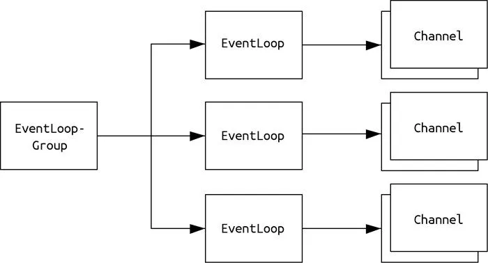

```
图 3-29　EventLoopGroup，EventLoop 和 Channel 之间的关系
```

- EventLoopGroup，EventLoop 和 Channel 的关系

```
在异步传输的情况下，一个 EventLoop 可以处理多个 Channel 中产生的事件，其主
要负责发现事件以及通知服务端或客户端。相比以前一个 Channel 占用一个线程，
Netty 的方式要合理很多。客户端发送信息到服务端，EventLoop 发现这个事件后会通
知服务端“你去获取信息”，同时客户端做其他的工作。当 EventLoop 检测到服务端返回
```

- 的信息时，也会通知客户端“信息返回了，你去取吧”，然后客户端去获取信息。在这整个

```
过程中，EventLoop 相当于监视器加传声筒。
```

- ChannelHandler，ChannelPipeline 和 ChannelHandlerContext

```
如果说 EventLoop 是事件的通知者，那么 ChannelHandler 就是事件的处理者。在
ChannelHandler 中，可以添加一些业务代码，例如数据转换，逻辑运算等。之前的例
子中也展示了，服务端和客户端分别有一个 ChannelHandler，用来读取信息，例如网
```

- 络是否可用，网络异常之类的信息。如图 3-30 所示，“入站”和“出站”事件对应不同的

```
ChannelHandler，分别是 ChannelInBoundHandler（入站事件处理器）和
ChannelOutBoundHandler（出站事件处理器）。ChannelHandler 作为接口，
ChannelInBoundHandler 和 ChannelOutBoundHandler 均继承自它。
```

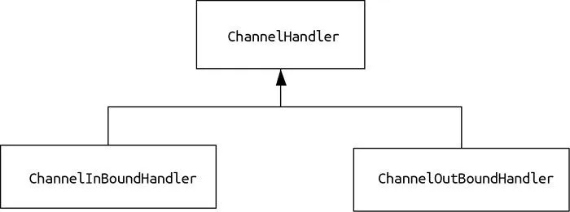

```
图 3-30　ChannelHandler、ChannelInBoundHandler、ChannelOutBoundHandler 之间的关系
每次请求都会触发事件，ChannelHandler 负责处理这些事件，处理的顺序由
ChannelPipeline 决定。如图 3-31 所示，ChannelOutBoundHandler 处理“出站”
事件，ChannelInBoundHandler 负责处理“入站”事件。
```

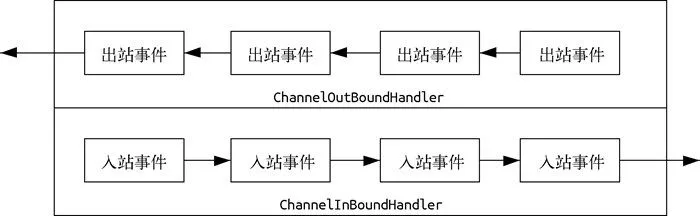

```
图 3-31　ChannelHanlder 处理“出站”事件 /“入站”事件
ChannelPipeline 为 ChannelHandler 链提供了容器。当创建 Channel 后，Netty
框架会自动把它分配到 ChannelPipeline 上。ChannelPipeline 保证
ChannelHandler 会按照一定的顺序处理各个事件。说白了，ChannelPipeline 是
负责排队的，这里的排队是待处理事件的顺序。同时，ChannelPipeline 也可以添加
或者删除 ChannelHandler，管理整个处理器队列。如图 3-32 所示，
ChannelPipeline 按照先后顺序对 ChannelHandler 排队，信息按照箭头所示的方
向流动并且被 ChannelHandler 处理。
```

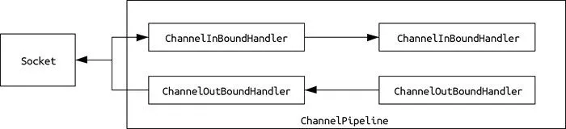

```
图 3-32　ChannelPipeline 使 ChannelHandler 按序执行
ChannelPipeline 负责管理 ChannelHandler 的排列顺序，那么它们之间的关联就
由ChannelHandlerContext 来表示了。每当有 ChannelHandler 添加到
ChannelPipeline 上时，会同时创建一个 ChannelHandlerContext。它的主要功
能是管理 ChannelHandler 和 ChannelPipeline 之间的交互。
不知道大家注意到没有，在 3.4.6.2 节的例子中，往 channelRead 方法中传入的参数
就是 ChannelHandlerContext。ChannelHandlerContext 参数贯穿
ChannelPipeline 的使用，用来将信息传递给每个 ChannelHandler，是个合格的
```

- “通信使者”。

- 现在把上面提到的几个核心组件归纳为图 3-33，便于记忆它们之间的关系。

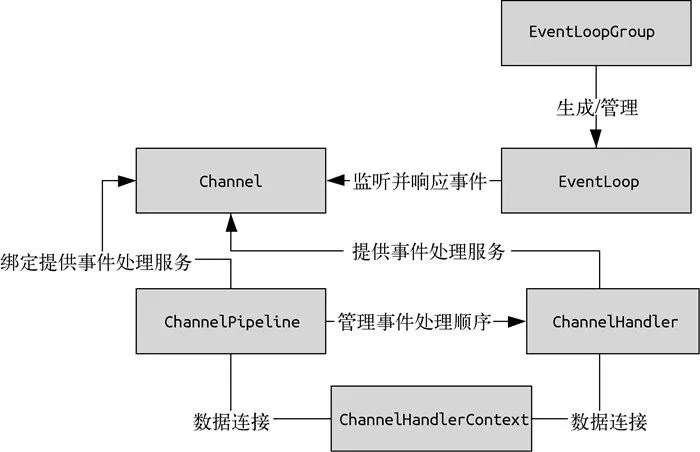

- 图 3-33　Netty 核心组件的关系图

```
EventLoopGroup 负责生成并且管理 EventLoop，Eventloop 用来监听并响应
Channel 上产生的事件。Channel 用来处理 Socket 的请求，其中
ChannelPipeline 提供事件的绑定和处理服务，它会按照事件到达的顺序依次处理事
件，具体的处理过程交给 ChannleHandler 完成。
ChannelHandlerContext 充当 ChannelPipeline 和 ChannelHandler 之间的通
```

- 信使者，将两边的数据连接在一起。

4. Netty 的数据容器了解完了 Netty 的几个核心组件。接下来看看如何存放以及读写数据。Netty 框架将

```
ByteBuf 作为存放数据的容器。
```

- ByteBuf 的工作原理

```
从结构上说，ByteBuf 由一串字节数组构成，数组中的每个字节都用来存放数据。如图
3-34 所示，ByteBuf 提供了两个索引，readerIndex（读索引）用于读取数据，
writerIndex（写索引）用于写入数据。通过让这两个索引在 ByteBuf 中移动，来定
位需要读或者写数据的位置。当从 ByteBuf 中读数据时，readerIndex 将会根据读
取的字节数递增；当往 ByteBuf 中写数据时，writerIndex 会根据写入的字节数递
```

- 增。

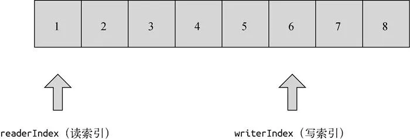

```
图 3-34　ByteBuf 的读写图例
需要注意，极限情况是 readerIndex 刚好到达 writerIndex 指向的位置，如果
readerIndex 超过 writerIndex，那么 Netty 会抛出 IndexOutOf-
BoundsException 异常。
```

- ByteBuf 的使用模式

```
学习了 ByteBuf 的工作原理以后，再来看看它的使用模式。根据存放缓冲区的不同，
```

- 使用模式分为以下三类。

```
堆缓冲区。ByteBuf 将数据存储在 JVM 的堆中，通过数组实现，可以做到快速分
```

- 配。由于堆中的数据由 JVM 管理，因此在不被使用时可以快速释放。这种方式下通过

```
ByteBuf.array 方法获取 byte[] 数据。
```

- 直接缓冲区。在 JVM 的堆之外直接分配内存来存储数据，其不占用堆空间，使用时需要考虑内存容量。这种方式在使用 Socket 连接传递数据时性能较好，因为是间接从缓冲区发送数据的，在发送数据之前 JVM 会先将数据复制到直接缓冲区。由于直接缓冲区的数据分配在堆之外，通过 JVM 进行垃圾回收，并且分配时也需要做复制操作，因此使用成本较高。

- 复合缓冲区。顾名思义就是将上述两类缓冲区聚合在一起。Netty 提供了一个

```
CompsiteByteBuf，可以将堆缓冲区和直接缓冲区的数据放在一起，让使用更加方
```

- 便。

- ByteBuf 的分配

```
聊完了结构和使用模式，再来看看 ByteBuf 是如何分配缓冲区中的数据的。Netty 提供
了两种 ByteBufAllocator 的实现。
PooledByteBufAllocator：实现了 ByteBuf 对象的池化，提高了性能，减少了
```

- 内存碎片。

```
Unpooled-ByteBufAllocator：没有实现 ByteBuf 对象的池化，每次分配数据
```

- 都会生成新的对象实例。

- 对象池化的技术和线程池的比较相似，主要目的都是提高内存的使用率。池化的简单实

```
现思路是在 JVM 堆内存上构建一层内存池，通过 allocate 方法获取内存池的空间，
通过 release 方法将空间归还给内存池。生成和销毁对象的过程，会大量调用
allocate 方法和 release 方法，因此内存池面临碎片空间的回收问题，在频繁申请
```

- 和释放空间后，内存池需要保证内存空间是连续的，用于对象的分配。基于这个需求，产生了两种算法用于优化这一块的内存分配：伙伴系统和 slab 系统。

- 伙伴系统，用完全二叉树管理内存区域，左右节点互为伙伴，每个节点均代表一个内存块。分配内存空间时，不断地二分大块内存，直到找到满足所需条件的最小内存分片。释放内存空间时，会判断所释放内存分片的伙伴（其左右节点）是否都空闲，如果都空闲，就将左右节点合成更大块的内存。

- slab 系统，主要解决内存碎片问题，对大块内存按照一定的内存大小进行等分，形成由大小相等的内存片构成的内存集。分配内存空间时，按照内存申请空间的大小，申请尽量小块的内存或者其整数倍的内存。释放内存空间时，也是将内存分片归还给内存集。

```
Netty 内存池管理以 Allocate 对象的形式出现。一个 Allocate 对象由多个 Arena
组成，Arena 能够执行内存块的分配和回收操作。Arena 内部有三类内存块管理单元：
TinySubPage、SmallSubPage 和 ChunkList。前两个符合 slab 系统的管理策略，
ChunkList 符合伙伴系统的管理策略。当用户申请的内存空间大小介于 tinySize 和
smallSize 之间时，从 tinySubPage 中获取内存块；介于 smallSize 和
pageSize 之间时，从 smallSubPage 中获取内存块；介于 pageSize 和
chunkSize 之间时，从 ChunkList 中获取内存块；大于 ChunkSize（不知道分配内
```

- 存的大小）时，不通过池化的方式分配内存块。

5. Netty 的 Bootstrap

```
回到 3.4.6.2 节的例子，在程序最开始的时候会新建一个 Bootstrap 对象，后面的所有配
```

- 置都基于这个对象而展开。

```
Bootstrap 的作用就是将 Netty 的核心组件配置到程序中，并且让它们运行起来。如图 3-
35 所示，从继承结构来看，Bootstrap 分为两类，分别是 Bootstrap 和
ServerBootstrap，前者对应客户端的程序引导，后者对应服务端的程序引导。
```

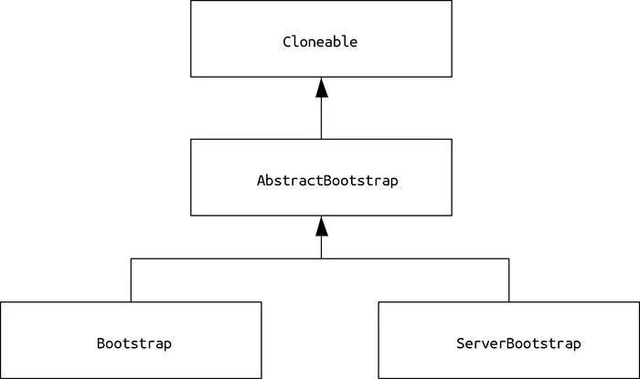

- 图 3-35　分别支持客户端和服务端的程序引导

```
客户端的程序引导 Bootstrap 主要有两个方法：bind 和 connect。如图 3-36 所示，
Bootstrap 先通过 bind 方法创建一个 Channel，然后调用 connect 方法创建
Channel 连接。
```

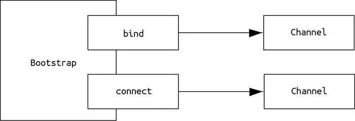

```
图 3-36　Bootstrap 通过 bind 方法和 connect 方法创建连接
服务端的程序引导 ServerBootstrap 如图 3-37 所示，与 Bootstrap 不同的是，这里
会在 bind 方法之后创建一个 ServerChannel，它不仅会创建新的 Channel，还会管理
已经存在的 Channel。
```

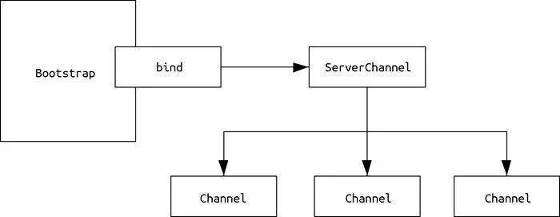

```
图 3-37　ServerBootstrap 通过 bind 方法创建 / 管理连接
```

- 通过上面的描述，可以发现服务端和客户端的引导程序存在两个区别。第一区别是

```
ServerBootstrap 会绑定一个端口来监听客户端的连接请求，而 Bootstrap 只要知道
服务端的 IP 地址和 Port 就可以建立连接了。第二个区别是 Bootstrap 只需要一个
EventLoopGroup，而 ServerBootstrap 需要两个，因为服务器需要两组不同的
Channel，第一组 ServerChannel 用来监听本地端口的 Socket 连接，第二组用来监听
```

- 客户端请求的 Socket 连接。

## 3.5　总结

应用或者服务拆分之后会遇到调用和通信的问题，这章主要介绍了分布式系统是如何解决这些问题的。从外到内看，客户端需要通过负载均衡的方式调用系统中的服务，负载均衡从范围上分为 DNS 负载均衡、硬件负载均衡和软件负载均衡；从算法上来说有 round-robin 算法、weight 算法、IP-hash 算法和 hash key 算法。对于流行的微服务而言，由于服务拆分，会通过 API 网关来解决服务聚合的问题，本章从原理上介绍了协议转换、链式处理、异步请求的内容。请求从客户端进入分布式系统内部后，为了解决系统内服务之间的调用引入了服务注册与发现的机制，我们从原理、可用性和服务保存三方面对此机制展开描述。前面三个方面主要说的是服务应用之间的关系，它们之间的通信需要利用远程调用解决。这里介绍了 RPC 的调用过程，其主要功能包括：RPC 动态代理、序列化、协议编码、网络传输。最后以 RPC 的最佳实践——Netty 作为本章的收尾。
