# 第5章分布式计算

在介绍本章内容之前，先回顾一下前面的内容。分布式系统需要将应用服务分别部署在不同的服务器以及网络中，从而提高整个系统的性能和可用性。第 2 章介绍了如何拆分应用服务，第3 章介绍了拆分以后的应用服务如何相互调用，第 4 章介绍了应用服务之间如何协同工作。实际上应用服务拆分、调用、协同都是为了交换和计算信息，从而更好地服务客户，而分布式计算是其中非常重要的一部分。由于业务在不断发展，信息系统中积累了大量的数据，为了处理这些数据，计算机需要调动大量的计算资源。在单机时代，这些计算资源集中在单个服务器上，到了分布式时代，单个服务器资源已经无法满足海量数据的计算，因此要通过分布在不同网络节点上的计算资源来完成信息的计算工作。如果把用户输入的数据和想要得到的结果比作一条河的两岸，那么分布式计算就是连接两岸的桥梁，也是计算问题和解决方案之间的桥梁。针对静态数据和动态数据的处理，本章会依次介绍分布式计算的两种模式，分别是MapReduce 模式和 Stream 模式。

## 5.1　MapReduce 模式

MapReduce 模式起源于 2004 年 Jeff Dean 和 Sanjay Ghemawat 发表的论文“MapReduce：Simplified Data Processing on Large Clusters”。此后，Nutch 系统实现了分布式 MapReduce框架，但随着时间的推移，Hadoop 从 Nutch 中独立出来，并成为 Apache Foundation 的顶级项目。

### 5.1.1　MapReduce 的策略和理念

1. MapReduce 的策略前面提到随着业务量的增加，数据量也在不断增长，一个系统的数据量级从原来的 GB 扩展到了现在的 TB 甚至 PB。面对这样海量的数据，计算操作势必会消耗大量的系统计算资源，此时如果还是使用单机模式进行计算，显然难以实现，因此产生了分布式计算。分布式计算以分布在网络中的服务器为计算单位，对海量数据进行拆分，然后对拆分后的小块进行计算，这也是 MapReduce 分而治之的计算策略。这种策略在现实生活中也比较常见，例如

- 学校要统计每个班参加春游的人数，校长将这个统计任务分配给各个年级的各个班，由各个班的班长分别统计，最后这些统计结果汇总到校长手上，校长就知道有多少人参加春游了。

- 如图 5-1 所示，MapReduce 的具体做法是对大数据集做拆分，将拆分成的小块数据集交给一个个独立的计算任务，这些计算任务分布在不同的服务器上，这些服务器并行执行拆分后的计算任务，最后将所有计算任务的结果合并起来，就产生了最后的计算结果。

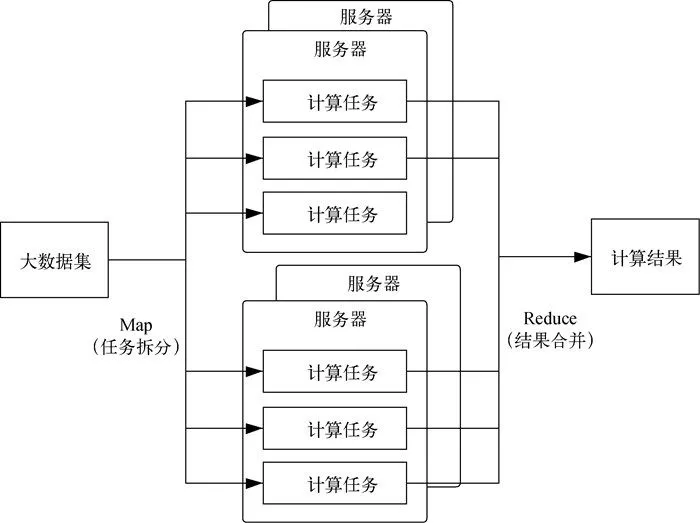

- 图 5-1　MapReduce 的拆分策略

- 上述过程中，拆分数据集的过程称为 Map，对计算好的结果进行合并的过程是 Reduce。

2. MapReduce 的理念MapReduce 要求计算围绕数据展开，这是什么意思呢？先看看之前的计算方式，假设数据分散在不同的网络节点中，此时要对这些数据进行计算，就需要将这些数据从各网络节点收集到计算节点上，此处提到的计算节点本身也是一个网络节点。这种把数据从一个网络服务

- 器拉取到另一个服务器上进行计算的方式就是计算围绕数据展开的模式。这种模式的核心是计算，数据的拉取和收集都是以计算为目的和核心展开的。但是到了分布式系统中，数据分布在不同的网络节点上，而且随着数据量的增加，对存储空间的要求也变得更多，要想存储这些数据，就得扩充更多的网络节点。此时若是还从那么多网络节点中拉取数据进行计算，将会变得非常低效，因为这么做无疑会涉及大量的网络 IO 传输，而且计算也无法并行实现。于是根据上面提到的拆分和合并的思路，我们将大块数据集拆分到不同网络节点上存储后，让 Map 任务和 Reduce 任务运行在同一个服务器上，这样不但省去了网络传输的时间，还可以做到并行计算每个分块的数据，因此我们把这种做法称为计算围绕数据展开的模式，这是分布式存储和计算发展的产物。

### 5.1.2　MapReduce 的体系结构

上一节基于 MapReduce 的策略和理念对其概念进行了介绍，说明了为什么要使用MapReduce 这种分布式计算模式。海量的数据导致数据分布式存储，要对这些分布式数据进行计算就需要遵守拆分、计算、合并的思路，同时要按照计算围绕数据展开的模式进行。本节接着介绍 MapReduce 的构造，要想实现上面描述的分布式计算过程，需要以怎样的组件和结构做支撑。这里以 Hadoop MapReduce 为例给大家介绍其体系结构。

如图 5-2 所示，先从整体上认识一下 MapReduce 的架构以及组件。客户端（Client）将计算命令发送给作业跟踪器（JobTracker），作业跟踪器接收到命令以后交给任务跟踪器（TaskTracker），其中会有专门的 Map 任务、Reduce 任务执行计算操作。在计算期间，各任务跟踪器通过心跳检测（Heartbeat）保持沟通，同时作业调度器（JobScheduler）与作业跟踪器一直保持联系，以获取任务跟踪器的执行进度和资源状况，为作业跟踪器管理资源提供帮助。最后，作业跟踪器在任务跟踪器完成计算以后将结果返回给客户端。

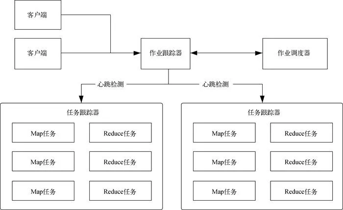

- 图 5-2　MapReduce 的体系结构

了解了 MapReduce 的整体架构以后，下面对各个组件的功能进行描述。

- 客户端：提交用户编写的应用程序，例如计算双十一期间，全国每种商品的销量各是多少，由作业跟踪器把应用程序交给任务跟踪器处理。客户端还可以提供一些接口去查看当前正在执行的作业的运行进度和状态。

- 作业跟踪器：负责监控资源和调度作业。由于拆分后的计算任务需要在不同的网络节点上运行，因此作业跟踪器需要对这些节点上的计算任务进行监控和调度。如果发现其中某个节点出现了问题，就需要将分配到这个节点上的任务转移到其他节点上完成。

- 作业调度器：协助作业跟踪器完成对任务跟踪器的资源分配和管理。

- 任务跟踪器：主要负责接收作业跟踪器发出的计算命令，并且根据命令利用所在服务器的资源执行计算任务，同时还要通过心跳检测的方式不断地和作业跟踪器同步命令执行的进度和情况。如图 5-3 所示，任务跟踪器对服务器上的所有计算资源，包括 CPU、内存等进行等分，等分的单位是槽（slot）。也就是说，每个槽上面都包含一小部分 CPU 资源（运算资源）和内存资源（存储资源），而且每个槽的资源都是相等的，这样做的目的是更好地分配

- 和管理资源，这些资源在将来都会被用到数据计算中。槽也分为两种：map 类型的槽和reduce 类型的槽，分别存放 Map 任务和 Reduce 任务用到的资源。

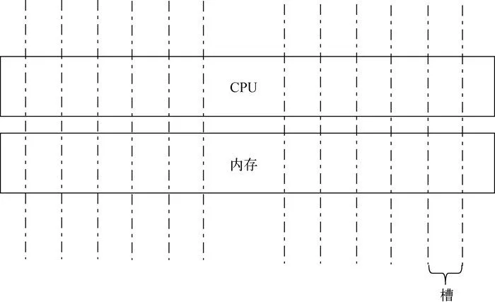

- 图 5-3　任务跟踪器的槽划分

下面解释一下上述提到的几个名词。

- 任务（task）：就是执行计算的最小单元。这里分为 Map 任务和 Reduce 任务两类，分别

```
对应 Map 函数和 Reduce 函数。在实际开发的过程中，也是通过这两个函数实现数据拆分
```

- 和合并的，这两个函数在帮助实现分布式计算的同时，也屏蔽了并行编程、分布式存储、工作调度、容错处理等棘手的问题。

```
Map 函数：其输入格式为 <Key1,value1>，输出格式为 List(<Key2,Value2>)。该
```

- 函数的输入源头是分布式文件系统的文件块，这些文件块可以是文档或者二进制文件，通过

```xml
Map 函数转化以后生成 List(<Key2,Value2>) 格式的输出。假设有这样一句话
"Hello World Good World"，要将其转化为输入格式 <Key1,value1>，则 Key1 可
以取这句话的行号，如果这句话是第一行，那么输入可以写成 <1, "Hello World Good
World">。由于 Map 函数会记录每个单词出现的次数，因此输入格式就是
<"Hello",1>，<" World ",1>，<" Good ",1>，<" World ",1>，即把每个单词
作为 Key2，单词出现的次数作为 Value2，得到一个 List(<Key2,Value2>) 的数组，
该数组的长度为 4。通常来说，Map 函数的输出数据会首先放到内存缓冲区中，然后再写
到磁盘上，等待 Reduce 函数来获取。
Reduce 函数：其输入格式是 <Key2,List<Value2>>，输出格式是 <Key3,Value3>。
Map 函数的输出会作为 Reduce 函数的输入。继续用上面 Map 函数中的例子，就是将
<"Hello",1>，<" World ",<1,1>>，<" Good ",1> 作为输入送进 Reduce 函数，
由于 World 这个单词出现了 2 次，因此根据 <Key2,List<Value2>> 的格式，这项就显
示成了 <" World ",<1,1>>。在 Reduce 函数处理完毕以后，数据会以
<Key3,Value3> 的格式输出到分布式文件系统中。这个例子的具体输出为
<"Hello",1>，<" World ",2>，<" Good ",1>，此处同样对" World " 做了合
并，因此其对应的值为 2。
```

### 5.1.3　MapReduce 的工作流程

前面对 MapReduce 的构成和组件做了介绍，我相信各位对其已经有了大致的了解，接下来再来看看 MapReduce 的工作流程。了解了 MapReduce 的工作步骤后，再针对细节进行拆分讲解。如图 5-4 所示，这个图和 MapReduce 体系结构图（如图 5-2 所示）相似，只是加入了数据的处理过程，我们可以从图的左下方开始往右边看，这个方向也是 MapReduce 处理数据的方向。处理的数据一般来源于分布式文件系统。在系统中，数据是以数据块的形式存放的。对

```
于 Map 任务而言，需要先对这些数据块进行分片处理。通过 Map 任务中的 Map 函数处理以
```

后，会生成 Map 结果文件，此文件一般保存在 MapReduce 应用的本地磁盘中，此时要想保存 Map 结果文件，就需要做分区的操作。这里提到的分区是对数据进行逻辑上的划分，其目

```
的是方便 Reduce 函数处理，一个 Map 结果分区文件对应一个 Reduce 任务。Reduce 任务
获取本地磁盘上的 Map 结果文件，并交给 Reduce 函数进行后续处理，Reduce 函数处理完
```

毕后会再将结果保存到分布式系统中。

整理了 MapReduce 的工作流程后，可以发现客户端并不能显式地指定由集群中哪一台服务器完成计算操作，请求计算的命令发送以后，由 MapReduce 执行整个计算过程。Map 任务和Reduce 任务之间是不会通信的，Map 任务从分布式文件系统中获取数据，Reduce 任务计算出的最终结果也会放到分布式文件系统中。不过中间的 Map 结果文件是放在本地磁盘上的，也就是放在运行 Map 任务的服务器的磁盘上。根据 MapReduce 计算围绕数据的原则，Map任务、Reduce 任务会尽量运行在分布式存储结果文件的服务器节点上或者邻近的节点上。

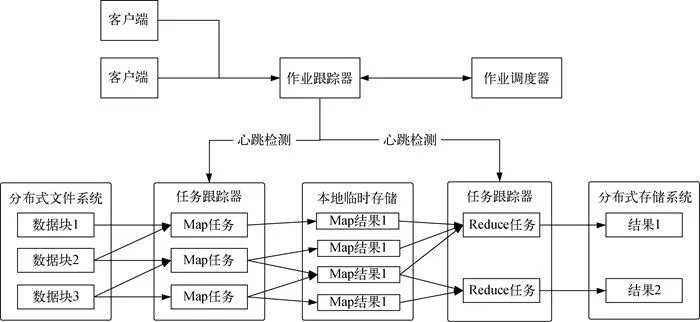

- 图 5-4　MapReduce 的工作流程

浏览了 MapReduce 的大致工作流程之后，再来看看其经历的几个阶段。

先从 Map 阶段开始，如图 5-5 所示，分为 7 个步骤。

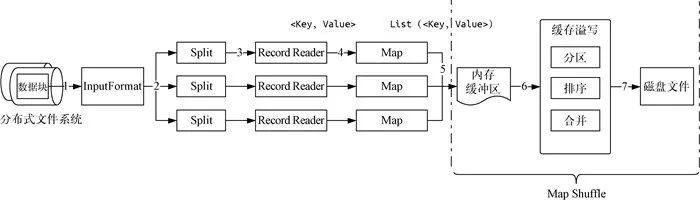

- 图 5-5　Map 阶段的详细步骤

(1) MapReduce 框架从分布式文件系统中读取数据，需要通过 InputFormat 模块对数据进行预处理。由于分布式文件系统中的数据都是以数据块的物理形式存在的，因此 InputFormat 模块会对其进行逻辑上的划分。

(2) InputFormat 模块进行逻辑划分后，数据块变成 Split，每个 Split 的大小都是数据块大小的整数倍，记录的通常是数据的位置和长度信息。Split 作为 Record Reader 的输入，传到下一个阶段。

```
(3) Record Reader 的主要工作是将 Split 的内容转化为 <Key,Value> 键值对形式，作为
```

Map 任务的输入参数。

```
(4) Map 函数做的事情是将输入的 <Key,Value> 转化为 List(<Key,Value>)。
(5) List(<Key,Value>) 会作为 Map 任务的中间结果文件保存起来，供 Reduce 任务使
```

用。这个中间结果文件会先放到内存缓冲区中保存。

(6) 随着中间结果不断地写入缓冲区，超过一定数量后，就会发生溢写（spill），也就是将 Map任务的中间结果批量写入磁盘。这种一次性写入的方式减少了频繁访问磁盘的次数，提高了写入效率。

(7) 在把结果文件写入磁盘之前，MapReduce 架构还会完成分区、排序、合并操作，这些由一个单独的线程完成，并不会影响 Map 任务的执行，这会在下面详细介绍。

上述的 (5)、(6)、(7) 三个步骤也称为 Shuffle，由于它们在 Reduce 任务中也有对应的动作，因此这里称为 Map Shuffle。Map Shuffle 除了将 Map 任务的中间结果写入缓冲区，并在缓冲区将满的时候将结果文件溢写到磁盘上，在溢写之前还会执行以下几个操作。

- 分区（partition）：其目的是让 Reduce 任务能够方便地获取对应的数据，由 Partitioner 完

```
成。主要是采用散列函数对 Key 进行散列运算，然后再对 Reduce 任务数量取模。假设
Reduce 任务的数量是 R，那么公式就是 Hash(Key) mod R。换句话说，存在多少个
```

- Reduce 任务，就要划分多少个分区。

```
排序（sort）：对于每个分区以后的 <Key,Value>，Map Shuffle 都会进行排序，这是
MapReduce 框架的默认操作，经过这步后，每个分区的 <Key,Value> 都将是有序的。
合并（combine）：在排序完毕后，会对 Key 相同的 <Key,Value> 进行合并。例如将 <"
World ",1> 和 <" World ",1> 合并为 <" World ",2>。由于 Map 任务的中间结果
```

- 需要先写入磁盘，再被 Reduce 任务读出进行后续处理，因此这里合并以后就不用在Reduce 中再合并了，并且减小了写入文件的大小。如果不选择在 Map 端完成合并操作，

```
那么 Map 端就会对上面的 <Key,Value> 进行归并，得到 <" World ",<1,1>> 的结
```

- 果，之后 Reduce 任务读取到该数据时再完成合并。另外，是否启动合并操作和写入磁盘的文件的大小有关系。通常来说，系统会设置一个磁盘文件大小的默认值，当读取到的文件大小大于这个默认值时才发起合并操作，否则不发起合并操作，因为合并操作也是有代价的。

- 文件归并（merge）：在溢写操作完成后，磁盘中会生成新的归并文件，这个文件的内容已经做好了分区。Reduce 任务会按照这个分区拉取数据，并且进行后续的处理。

看完了 Map 任务的执行阶段，再来看看 Reduce 任务的执行阶段，如图 5-6 所示。

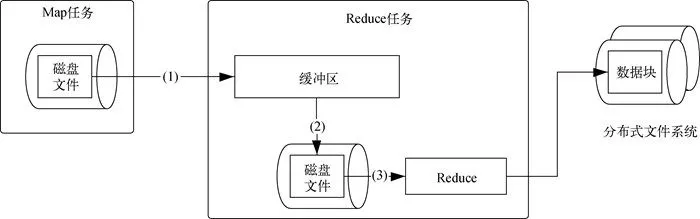

- 图 5-6　Reduce 阶段的详细步骤

(1) 拉取。Reduce 任务会向作业跟踪器询问自己需要的数据是否已经准备好，同时作业跟踪器会一直检测 Map 任务产生的中间结果，一旦发现中间结果写入磁盘，就通知 Reduce 任务去获取。收到通知后的 Reduce 任务会把 Map 任务所在服务器的磁盘中的文件拉取到自己所在的机器的缓冲区中。根据计算围绕数据的原则，通常作业跟踪器所在的服务器和数据很可能处在同一个网络节点。一个 Reduce 任务可能会同时面对多个 Map 任务产生的中间结果，因此 Reduce 任务会根据 Map 阶段的分区操作产生的数据分区进行拉取。

(2) 归并。在拉取 Map 中间结果的分区数据以后，Reduce 任务会进行归并操作。归并操作在Map 任务中已经执行过一次了，但那是在单个分区中执行的，此时 Reduce 任务会对多个分区的数据进行再次归并。例如有两个 Map 中间结果，分别来自数据分区 A 和数据分区 B，两

```
者中都存在 <" World ",1>，Reduce 任务获取到这两个分区的数据以后就进行归并，生成
例如 <" World ",<1,1>> 这样的归并集合。如果把这个过程定义为合并，那么数据会被记
录为 <" World ",2>，且同样会针对 Key 相同的 <Key,Value> 进行排序。
(3) Reduce。将归并后的数据集丢给 Reduce 函数进行处理，整个处理过程都是在缓冲区中
```

进行的。和 Map 任务的 Shuffle 过程类似，当数据集大小超过设定的缓冲区大小时，会存在溢写操作，溢写生成的文件会写到分布式文件系统中去。

### 5.1.4　MapReduce 的应用实例

上一节介绍了 MapReduce 的工作流程分为 Map 阶段和 Reduce 阶段，我们对这两个阶段进行了详细的讲解，其中 Shuffle 过程在两个阶段中都存在。如果对这两个阶段进行简化，可以将 MapReduce 的工作流程分为 Splitting、Mapping、Shuffling、Reducing 四个步骤，这样做是为了方便记忆，通常来说程序员关注这几个阶段就足够了。下面我们通过一个统计电商平台商品销量的例子带大家看看这几个阶段都做了什么。

假设表 5-1 是电商平台在城市 A、B、C 关于家电、数码、日用品的销量（单位：万台）清单。这个表中的数据作为源数据被 MapReduce 框架调用。

表 5-1　电商平台销量统计　　　　　　　　销量（单位：万台）

- 商品

日期

- 城市家电数码日用品

2020-07-10

- A201812

2020-07-10

- B8117

2020-07-10

- C1254

2020-07-11

- A19710

2020-07-11

- B14511

图 5-7 展示了 MapReduce 工作流程中的几个阶段。

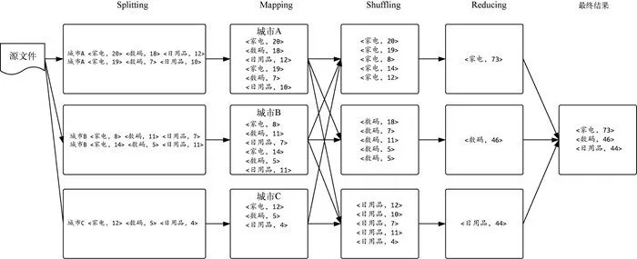

- 图 5-7　统计电商平台商品销量的例子

下面详细介绍一下各个阶段。

- Splitting 阶段：Map 过程中的这个阶段主要是对源数据进行分割。在分布式文件系统中存储的数据，其格式不像关系型数据库中的那么规整，其存储方式千差万别，记录和记录之间、字段和字段之间通常会用特定的分隔符分开。Splitting 过程就是根据某种规则对源数据进行分割，把数据以元组的形式提供给 MapReduce 框架调用。针对本节所讲的例子，假设从 3 个城市的服务器上分别获取了对应城市的家电、数码和日用品销量信息，即表 5-1 中的数据，然后启动 3 个 Map 任务分别处理这 3 部分数据。下面举个例子来展示这个阶段的数据格式：

```
城市 A <家电，20> <数码，18> <日用品，12>
1
Mapping 阶段：此阶段通过调用 Map 函数，统计每种类型商品的销量情况。这个阶段的输
入就是 Splitting 阶段的输出，Key 是商品的分类，Value 是商品的销量数据（单位：万
```

- 台）。例如：

```xml
<家电，20>。
1
```

- Shuffling 阶段：此阶段是对 Mapping 阶段和 Reducing 阶段的 Shuffle 过程的化简，主要完成分区的划分，以及排序、合并、归并等操作。在这个阶段，Map 端的输出会先写到缓

```
冲区，然后通过溢写的方式进入磁盘，再供 Map 函数获取分区数据。这里为了方便展示，
```

- 我们假设 Map 任务的输出结果根据商品分类（家电、数码、日用品）进行分区，也就是为每类商品分别设置一个分区，每个分区各对应一个 Reduce 任务。同时 Reduce 端会获取这部分分区后的数据进行后续排序、归并操作。由于是按照商品分类进行分区的，因此这个阶段拿到的数据都是分好类的，也就是针对某一分类的元组信息。

- Reducing 阶段：此阶段只需要对 Shuffling 阶段分类的元组信息进行合并，再将合并所得的多个文件归并成一个大文件写入到分布式文件系统中就可以了。

## 5.2　Stream 模式

在 5.1 节中，我们对 MapReduce 的体系结构和工作流程做了介绍，可以体会到其分而治之的思想，即对大量数据进行拆分、计算然后合并，每个计算任务都是并行且互不关联的，这些数据通常是分布式系统上已经存在的，依据计算围绕数据展开的原则。在计算过程中，数据经过了分布式文件系统、Map 缓冲区、Map 本地磁盘、Reduce 缓冲区、Reduce 本地磁盘，最后又输出到分布式文件系统中。虽然数据是从分布式文件系统中来，再回到分布式文件系统中去的，但是中间经历了磁盘与缓冲区的不断转换，这种计算方式比较适合数据在磁盘中已经存在并且对实时性要求不高的场景。假设 MapReduce 处理的数据都已经存储到了分布式文件系统中，可以将这些数据理解为系统中的历史数据，MapReduce 的计算过程则是对历史数据进行拆分、计算、合并的过程。由于其使用场景对实时性要求不高，因此称为静态数据。随着互联网业务的发展，针对数据的实时性分析越来越普遍，例如电商网站对用户行为的实时采集和分析、IoT 平台对工业设备生产及制造过程的实时监控，这些场景对数据采集和分析的实时性要求都很高，通常需要在短时间内处理大量的数据流信息。这些数据的特点如下。

- 数据如流水般持续流入系统，流入速度快。

- 流入系统的数据量级可达到 TB 甚至 PB。

- 数据的类型繁多，包括结构化数据（关系型数据库）、半结构化数据（JSON、XML）、非结构化数据（文本、图片、音频、视频）。

- 数据处理对实时性的要求较高，数据需要在流入系统的瞬间马上被处理。处理完的数据或是被丢弃，或是存储到数据库中。

- 无法保证数据流入系统的顺序，系统具有处理乱序数据的能力。

我们将具备此类特点的数据称为动态数据。显然对这类数据进行处理的过程和静态数据是不同的。如果说静态数据对应的是批量计算（例如 MapReduce），那么动态数据对应的就是实时计算。动态数据流入系统的速度快、数据量大，这导致实时计算需要在短时间内处理海量数据，这对系统来说是巨大的挑战，Stream 计算（流计算）模式作为实时计算的一种形式便呼之欲出。

### 5.2.1　Stream 模式的处理过程及特点

Stream 计算又称为流计算，其作用是实时获取来自不同数据源的海量数据，然后实时分析处理，获取有价值的信息。Stream 模式和 MapReduce 模式的区别在于处理数据的实时性，后者是先将数据存放在分布式文件系统中，再通过 MapReduce 框架对数据进行分析和查询，而Stream 计算是先处理从各个采集端流入的数据，对有价值的数据进行分析和处理以后，再对数据进行归档。

图 5-8 演示了 Stream 模式下的数据处理过程，其中数据从左边流入，从右边流出。

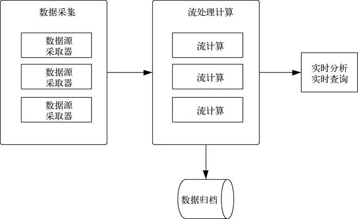

- 图 5-8　Stream 模式的数据处理过程

下面为图 5-8 中各步骤的具体解释。

- 数据采集：数据采集端可以对互联网应用、IoT 设备的参数信息、视频监控等不同的信息源进行数据收集。收集的数据包括结构化、半结构化和非结构化数据。来自不同采集源头的数据具有多样性和分布性，这导致采集器需要适配不同的文件格式，并分布在不同的物理空间，各采集器通过网络与流处理计算系统相连。

- 流处理计算：其功能是实时处理数据采集端采集到的数据信息。传统的数据分析和查询是先存储数据，用户再根据条件对数据进行查询，属于用户找数据。而流处理计算是在数据流入系统的同时，对其进行的分析和查询操作就已经完成，并且结果被推送到了用户面前，属于数据找用户。

- 数据归档：由于流计算每次处理的信息量都大，处理时间短，难免会存在没有“照顾到”的数据，因此在计算实时数据的同时，会对流入的数据进行归档处理，便于以后进行批量查询。

从上述过程来看，Stream 模式更加关注数据处理的实时性，比较适用于注重实时分析结果的场景，例如用户行为分析、IoT 设备信息的监控、环境监控、灾难报警等。鉴于 Stream 模式可以处理大量实时数据，各个公司开发了对应的流计算框架，例如 Yahoo 开发的分布式流计算系统 S4（Simple Scalable Streaming System）、IBM 开发的 InfoSphere、TIBCO 的StreamBase，以及 Twitter 开源的 Apache Storm 流计算框架。Storm 是一个分布式、可靠、具有容错性的数据流处理系统，下面就以它为蓝本来介绍 Stream 模式。

### 5.2.2　Storm 的体系结构与工作原理

在介绍 Storm 的体系结构之前，先对其中的一些技术术语进行介绍，包括 Tuple、Stream、Spout、Bolt、Topology。

- Tuple：这是 Storm 处理流数据的最小数据单位，因此也可以称为数据元组。它是一个有序

```
数据列表，结构类似于 <FieldName,FieldValue>，其中 FieldName 是定义的字段名
字，FieldValue 可以是任何类型的值，比如动态类型。Tuple 支持的字段类型有 int、
float、double、long、short、string、byte、binary（byte[]），还支持私有
类型、字符串、字节数组等。此外，也可以将序列化的值保存在 FieldValue 中。正如其
结构，Tuple 是一个 Key-Value 形式的 Map，实际上在传输信息时，Tuple 的 FieldName
字段就已经定义好，只要按照此字段的顺序填入 FieldValue 即可，因此最终看到的
Tuple 是一个关于 FieldValue 的列表。
```

- Stream：理解了 Tuple 以后，再来看 Stream。Stream 是由 Tuple 组成的数据序列，Storm 就是针对这个数据序列进行数据处理。图 5-9 进行了直观的展示，Storm 需要处理来自数据源头的数据，这些数据以 Tuple 的形式存在，Stream 描述的是这些数据形成的序列。由于数据是源源不断流入系统的，所以形成的序列是一个无限序列。Storm 在处理数据的过程中，会根据不同的源头定义不同的 Stream，也就是说系统中会存在多个需要被处理的 Stream。

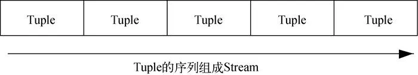

- 图 5-9　Stream 的组成

- Spout：数据的源头就是 Spout。Storm 体系将数据的源头抽象为 Spout，Spout 从队列、数据库等外部系统获取流数据，然后通过 Stream 传递给 Tuple。Spout 中还有一个

```
nextTuple 函数，每隔一段时间，Spout 就调用一次这个函数，从而生成 Tuple，源源不
```

- 断地供给 Stream 使用。说白了，Spout 是数据的入口，充当数据采集器的角色，将采集到的数据转换为一个个 Tuple，然后将 Tuple 作为数据流发送出去。需要注意，Spout 并不会处理具体的业务逻辑，只负责采集和转换数据。多了 Spout 后，图 5-9 扩展成了图 5-10，其中形象地展示了 Spout 像水龙头一样不断地为 Stream 序列中的 Tuple 提供数据。因为系统中存在多个 Stream，所以使用 Spout 会为多个 Stream 提供源头数据。

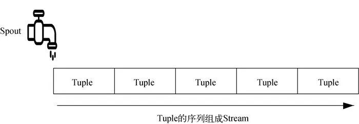

- 图 5-10　增加了 Spout

- Bolt：有了数据源头和数据序列，接下来要思考的就是如何处理数据了。Bolt 可以理解为对数据进行计算的函数，如图 5-11 所示，它可以将一个或者多个数据流作为输入参数，计算完毕后输出一个或者多个数据流，其中提到的计算包括过滤、连接、聚合以及读写数据等操作。Bolt 负责对 Stream（Tuple 列表）进行处理，因此业务逻辑通常写在这里，它里面存

```
在一个 execute 方法，输入参数是 Tuple，当有 Tuple 到达 Bolt 时，Bolt 就根据方法中
的逻辑对 Tuple 进行自动处理。Bolt 的输出也是 Stream（Tuple 列表），这些 Stream 可
```

- 以作为输入交给下一个 Bolt 进行处理。一般来说，一整套流处理过程都需要经过 Bolt。

- Topology：上面讲到的数据传输载体（Tuple）、数据传输通道（Stream）、数据源头（Spout）以及数据处理模块（Bolt）组成了一个网状的流数据处理网络。Topology 便是Storm 系统概念层次上的网络结构，是对整个 Storm 体系结构的抽象。其本质是一个有向无环图，如图 5-12 所示，图中的点代表 Bolt，即计算单元；边代表由 Tuple 组成的Stream，起点是数据入口 Spout。每开启一个流计算任务，就会生成一个 Topology，同时生成这张图。在 Topology 中，Bolt 会分布到不同的机器上执行。图中除了具有前后关系的Bolt 外，其他 Bolt 都是并行执行的。每个 Bolt 在执行任务时，可以生成多个 Task 与其对应，这些 Task 可以在不同的机器上并行执行。对于 Task 平行度的设置，需要在 Topology中完成。

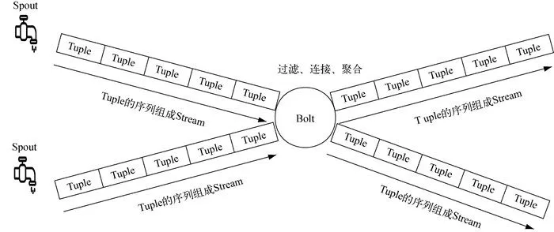

- 图 5-11　Bolt 处理 Stream 中的数据

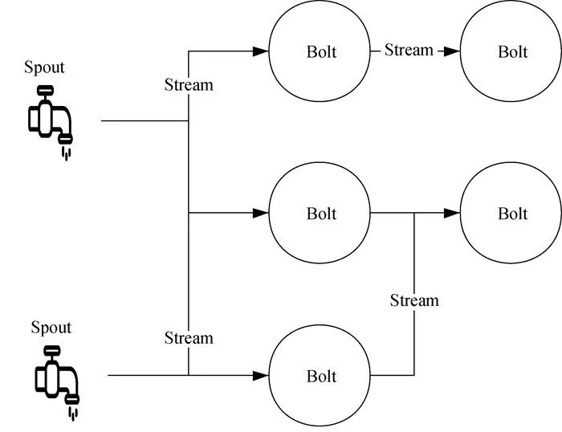

- 图 5-12　Topology 结构示意图

### 5.2.3　Storm 的并发机制

经过对上一节内容的学习，我们知道了在 Storm 系统中，数据是如何从源头进入数据流，然后被处理和存储的。回想一下在 MapReduce 模式下，处理大量数据的时候会将 Map 任务和Reduce 任务分布到不同服务器节点上运行，最后再对计算的结果进行归并。同样，Storm 系统在处理大量并发请求的时候，也需要进行分布式部署，利用其分布式系统的并发特性处理大量并发数据。Storm 系统支持将服务器水平扩展成多个，将流计算切分成多个独立的计算任务，然后在服务器集群中完成这些任务。这里提到的每个任务都可以理解为服务器节点上运行着的 Spout 或者 Bolt。下面介绍 Storm 系统并发计算机制的几个组成部分。

- Node：指的是 Storm 集群中的服务器，它会执行 Topology 的计算任务。一个 Storm 集群包含一个或多个 Node。

- Worker：指在 Node 上面运行着的独立的 JVM 进程，一个 Node 上可以运行一个或者多个Worker。Worker 是用来执行 Topology 中计算任务的 JVM 进程。

- Executor：指运行在 Worker 进程中的 Java 线程。一个 Worker 进程中可以运行一个或者多个 Executor 线程，每个 Executor 线程中又可以运行一个或者多个 Spout 实例或者 Bolt实例。

- Task：指 Spout 实例或者 Bolt 实例。它在 Executor 线程中执行，具体地，Executor 线程

```
会调用实例中的 nextTuple 和 execute 方法。
```

图 5-13 把上面几个组成部分绘制到了一张图中，以帮助大家更好地理解。每个服务器节点（Node）中包含一个或者多个 Worker 进程。Worker 进程中运行着一个或者多个 Executor 线程，每个 Executor 线程负责执行一个或者多个 Task，这些 Task 包括 Spout 实例和 Bolt 实例。

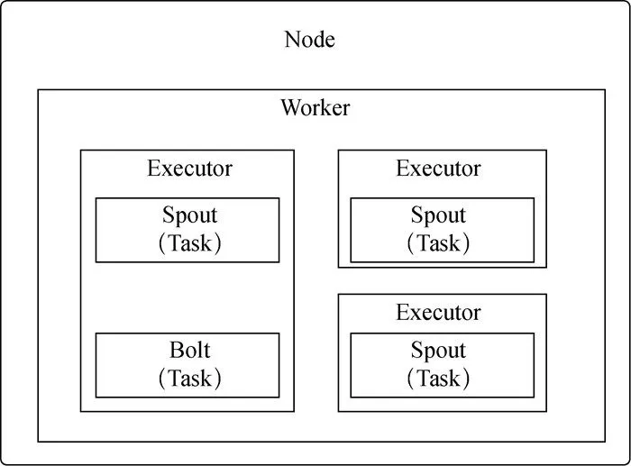

- 图 5-13　Storm 并发机制的组件结构图

如果说 Topology 是 Storm 系统处理流数据在逻辑层面的表现，那么并发机制就是物理层面的表现。如何将这两个层面的表现打通，帮助我们理解 Storm 系统处理流数据的过程是接下来要探讨的问题。先来看下面这个例子，假设我们的需求是获取文章中的一段文字，然后统计这段文字中有多少个单词，以及每个单词出现的次数，并且汇总起来。

根据上述需求，按如下步骤设计 Topology。

- 建立一个 Spout 作为数据源，用来收集文章中的句子。我们将这个 Spout 命名为SentenceSpout。

- SentenceSpout 获取句子后，通过 Bolt 对句子进行拆分。我们将这个 Bolt 命名为SentenceSplitBolt。

- 对拆分得到的单词进行计数，将这里使用的 Bolt 命名为 WordCountBolt，这个 Bolt 输出的单词就是以 <"单词","次数"> 形式展示的元组信息。

- ReportBolt 接收到单词出现次数的信息以后，进行汇总，生成最后的单词出现次数信息。这个过程和 MapReduce 模式中的归并操作比较像。

如图 5-14 所示，一个 Node 下面有一个 Worker 进程，Worker 进程中启动了 4 个 Executor线程，这些线程依次执行 SentenceSpout、SentenceSplitBolt、WordCountBolt 和ReportBolt。

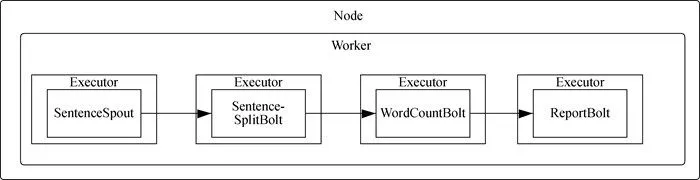

- 图 5-14　单个 Worker 进程中运行多个 Executor 线程的模式

遇到高并发数据流时，可以提供多个 Worker 进程并行处理。如图 5-15 所示，设置两个Worker 进程，SentenceSplitBolt 将句子拆分后生成 2 个 Task，分别交给两个不同的Executor 线程运行。WordCountBolt 负责计算单词数量，它将这个工作拆分成 3 个 Task，其中 1 个在上方的 Executor 中运行，另外 2 个在下方的 Executor 中运行。最后，ReportBolt在 1 个 Executor 中运行，运行的 Task 数量是 2。

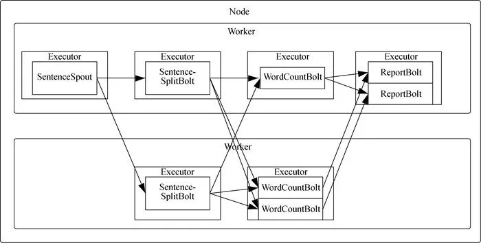

- 图 5-15　一个 Node 中运行两个 Worker 进程

将图 5-15 转化成如下伪代码：

```
Config conf = new Config();
TopologyBuilder builer = new TopologyBuilder();  ①
conf.setNumWorkers(2);        ②
builder.setSpout(, SentenceSpout);       ③
builder.setBolt(, SentenceSplitBolt,2);       ④
builder.setBolt(, WordCountBolt,2).setNumTasks(3);      ⑤
builder.setBolt(, ReportBolt).setNumTasks(2);       ⑥
```

下面按序号分析一下这段代码。

```
① 生成 TopologyBuilder 的实例 builder。
② 通过 Topology 的配置类实例 conf 设置 Worker 进程的数量为 2。
③ 通过 setSpout 方法设置 builder 对应的 Spout，需要在参数中指定 Spout 的 ID 和实
```

例。这步设置的是作为数据源的 SentenceSpout，它在一个 Executor 线程中执行，使用的是

```
默认的 setSpout 方法。
④ 通过 setBolt 方法设置 builder 对应的 Bolt，需要在参数中指定 Bolt 的 ID 和实例，这
步设置的是用于拆分句子的 SentenceSplitBolt。同时还需指定执行线程数为 2，也就是开启 2
```

个 Executor 线程，每个线程分别运行一个 SentenceSplitBolt 实例。

```
⑤ 通过 setBolt 方法设置 builder 对应的 Bolt，需要在参数中指定 Bolt 的 ID 和实例，这
步设置的是用于统计单词数量的 WordCountBolt。同时还需指定执行线程数为 2，也就是开启
```

2 个 Executor 线程，每个线程分别运行一个 WordCountBolt 实例。另外，在 Bolt 对象的

```
setNumTasks 方法中传入 3 作为参数，表示运行了 3 个 WordCountBolt。
⑥ 最后通过 setBolt 设置 ReportBolt，这步没有定义 Executor 线程的数量，所以默认在一
个 Executor 线程中运行。另外，在 setNumTasks 方法中传入参数 2，表示 Executor 中共运
```

行 2 个 ReportBolt 实例。

### 5.2.4　Stream Grouping

正如上一节所示，引入并发请求后，对 Storm 系统中的 Topology 结构进行了水平扩展，Spout、Bolt 根据并发程度部署到不同的 Worker 进程、Executor 线程，甚至是不同的 Node中。在进行水平扩展之前，Topology 知道每个 Stream 分别在哪两个 Spout、Bolt 之间传递。扩展之后，这种传递过程变得复杂起来，为了解决 Stream 的路由问题，Storm 推出了Stream Grouping，其目的是告诉 Spout、Bolt 两个组件如何传递 Stream。Stream Grouping在分布式部署的 Spout、Bolt 环境中非常有用，这里我们介绍以下几种实现方式。

- Shuffle Grouping（随机路由分配）。指 Stream 的流动是随机分配的，只需要保证 BoltB中的每个 Task 接收到的 Tuple 的量基本相等即可。如图 5-16 所示，BoltA 中包含 Task1、Task2 和 Task3，BoltB 中也包含 Task1、Task2 和 Task3，并且两个 Bolt 中的所有 Task都是完成同样的功能。在路由选择的时候，只需要保证 Task 之间有路径相连，并且连接的数据量大致一致就行了。由于路由是随机选择的，因此 Tuple 在选择对应 Task 的时候代价比较小，Task 之间的负载比较均衡。但随机性也导致上下游 Task 之间的逻辑关系不明确。

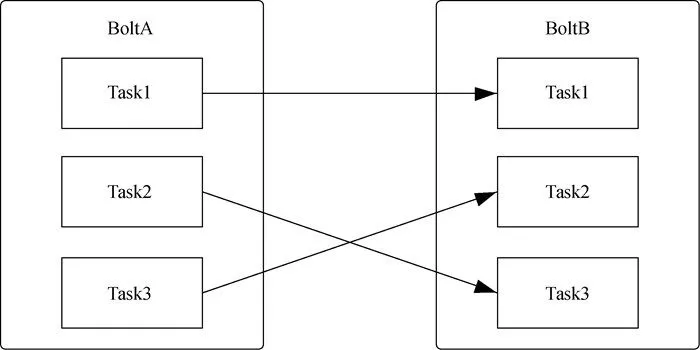

- 图 5-16　Shuffle Grouping

```
Fields Grouping（按照字段分配）。鉴于 Tuple 是一个由 FieldName 和 FieldValue 组
成的 Map 对象。对 FiledName 取值为 word 的 Tuple 进行字段分配，拥有相同
FieldValue 取值的字段被分配给同一个 Task 处理。如图 5-17 所示，BoltA 中的 Task1
处理的是 "good" 字段，分配给 BoltB 中的 Task1 处理，而 BoltA 中的 Task2 和 Task3 处
理的是 "morning" 字段，统统交由 BoltB 中的 Task2 处理。由于上下游 Task 是根据字段
```

- 进行路由分配的，因此它们之间的关系比较明显。不过因为 Tuple 在选择 Task 时，需要根

```
据 FieldValue 的取值来确定，所以会付出一定的选择代价，同时还无法保证下游 Task
```

- 的负载是均衡的。

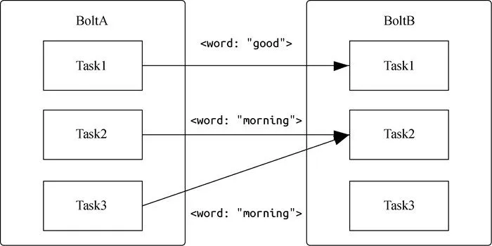

- 图 5-17　Fields Grouping

- All Grouping（全复制分组路由，也叫广播分组路由）。将所有 Tuple 各复制一份后分发给所有的 Task。如图 5-18 所示，BoltA 中的 Task1、Task2、Task3，会分别被路由到 BoltB中的 Task1、Task2、Task3。这种模式下，上游 BoltA 发送的所有数据，下游 BoltB 都会接收到，消息不会遗漏。可是缺点也很明显，就是会处理大量冗余数据，增加了系统的性能损耗。实际上，这种路由方式在现实工作中用得很少，只有在上游 Bolt 输出的 Tuple 需要通知到下游的每个 Task，且每个 Task 可能会做出不同的处理时才会用到。

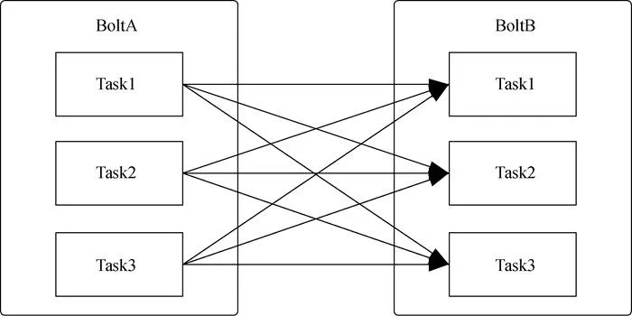

- 图 5-18　All Grouping

- Global Grouping（全局分组路由）。指上游 Spout、Bolt 输出的 Tuple 会由下游 Bolt 中的同一个 Task 处理。如图 5-19 所示，BoltA 中的 3 个 Task 通常会被路由至 BoltB 中 ID 最小的 Task 进行处理，因此 3 个 Task 中对应的 Tuple 都汇总到了 BoltB 中的 Task1。这种方式应用在需要合并、汇总的场景，例如计算文字中数量排名前 10 的单词出现的频率。这种方式会导致计算资源的不平均分配，比如图 5-19 中的 Task1 就承受着过重的计算任务。

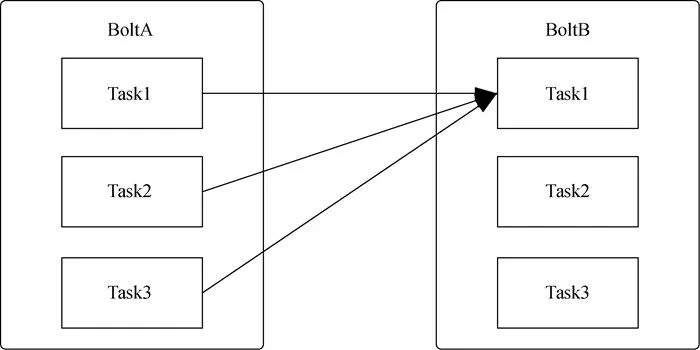

- 图 5-19　Global Grouping

- Local Or Shuffle Grouping，这种方式是 Shuffle Grouping 的一种补充。学习了 5.2.3节的内容后，我们知道 Spout 或者 Bolt 运行的实例都存在于 Executor 线程中，而Executor 线程又包含在 Worker 进程的 JVM 中。如图 5-20 所示，Local Or ShuffleGrouping 方式就是让运行在同一个 Worker 进程中的两个实例（BoltA 和 BoltB）进行路由传输，如果同一个 Worker 进程中存在多个 Bolt，就按照随机原则对 Task 进行路由。这种路由方式的好处是让 Tuple 的传输尽量在一个进程内完成，避免网络传输带来的损耗。

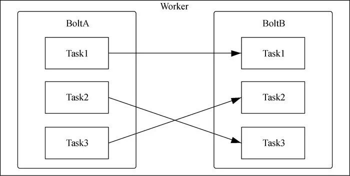

- 图 5-20　Local Or Shuffle Grouping

- Direct Grouping（指向型路由分配）。上游 Spout 或者 Bolt 中的 Task 可以通过调用

```
emitDirect() 方法来指定输出的 Tuple 由下游哪个 Task 处理。如图 5-21 所示，BoltA
```

- 中的 Task1、Task2 和 Task3 分别由 BoltB 中对应的 Task1、Task2 和 Task3 来处理。这种路由模式下，Topology 路由的可控性很强，上下游的 Task 路由调用是完全可控的。但这样会使代码变复杂，还会导致实际负载与预估不符。

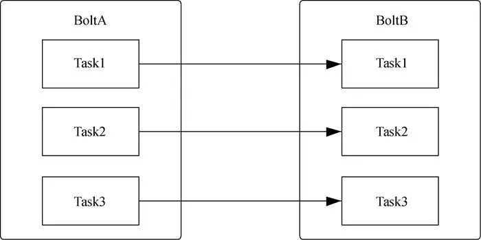

- 图 5-21　Direct Grouping

### 5.2.5　Storm 集群架构

我们已经知道了 Stream 模式的处理过程和原理，并且以 Strom 为例介绍了如何对流数据进行处理，通过 Tuple、Stream、Spout、Bolt 组成了数据源获取、数据传输、数据处理的Topology 架构。为了处理并发流数据，通过 Storm 的并发机制对数据源单元和计算单元进行了水平扩展，从而引出 Node、Worker、Executor、Task 的概念，以及这些概念之间的包含关系。为了实现 Storm 的并发机制，需要将数据源单元和计算单元部署到不同的 Worker 进程，甚至是不同的网络节点（Node）中。那么这些分布式部署的数据源单元和计算单元如何协调工作就是本节将要介绍的内容。由于 Storm 并发机制需要同时管理多个 Node、Worker、Executor 和 Task 资源，以承载并发的流数据，因此需要一套管理机制。

如图 5-22 所示，Storm 通过主 / 从（Master/Slave）方式来管理整个集群中的节点和进程。Storm 集群有一个主节点 Nimbus 和多个从节点 Supervisor（工作节点）。Nimbus 作为主节点进程，负责管理、协调和监控运行在集群上的 Topology 计算实例，包括 Topology 的发布、任务指派，以及计算出现问题时的任务重新指派。Supervisor 作为从节点进程，需要等待Nimbus 分配计算任务，再到 Node 上生成 Worker 进程，然后由 Worker 进程执行 Executor线程，完成 Spout 和 Bolt 的任务。Nimbus 和 Supervisor 都是以进程的方式存在于一个或者多个 Node 节点上，它们之间有主从区别，需要互相传输数据以及协调工作。因此，引入ZooKeeper 作为分布式协调组件，负责 Nimbus 和 Supervisor 之间的协调和选举工作。

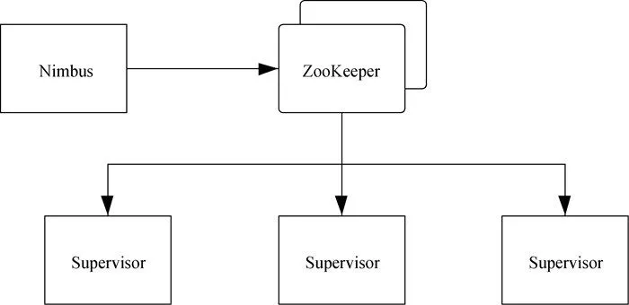

- 图 5-22　Nimbus、Supervisor、ZooKeeper 构成的 Storm 集群

接下来看看 Nimbus、ZooKeeper、Supervisor 组成的 Storm 集群架构是如何工作的。如图 5-23 所示，整个工作流程分为 4 部分。

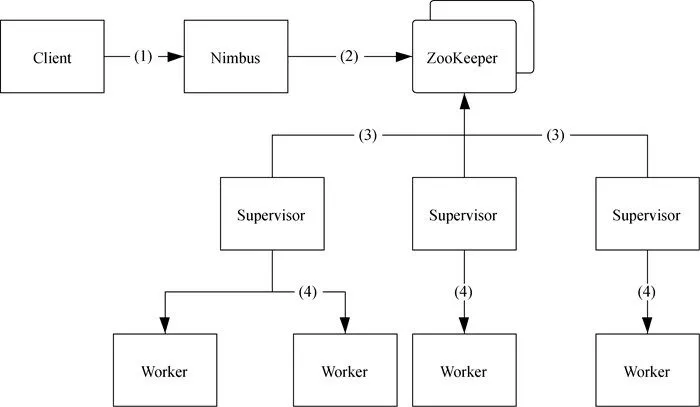

- 图 5-23　Storm 集群工作流程

如下为 4 部分的具体解释。

(1) 我们知道每个计算任务都是一个 Topology，Topology 会描述 Spout（数据从哪里来）、Tuple（数据使用什么格式）以及 Bolt（如何处理数据）信息。客户端会将 Topology 打包成jar 文件，和配置信息一并提交给 Nimbus。

(2) Nimbus 接收到 Topology 的计算任务以后，会将任务分配给对应的 Supervisor 完成。由于Topology 中已经指定了 Worker、Executor 的数量，因此 Nimbus 只需要下达命令即可，让Supervisor 去完成计算任务。但命令并不是直接发送给 Supervisor 的，会先通过 ZooKeeper保存，再由 Supervisor 主动监听并获取。需要注意的是，ZooKeeper 管理着集群中的所有节点，如果发现某个 Supervisor 出现故障便会告知 Nimbus，Nimbus 会重新对 Supervisor 分配任务。Nimbus 并不会处理具体的计算任务，只负责任务的分发与监控，是一个单点进程。一旦出现问题，ZooKeeper 就会发起选举，用其他的进程替换它。

(3) Supervisor 主动从 ZooKeeper 中获取任务的分配信息，接到任务以后，生成对应的Worker 进程去执行。这里的 Supervisor 和 Worker 都是独立的 JVM 进程，前者由ZooKeeper 进行监控和管理，而后者由 Supervisor 生成和管理。

(4) Worker 进程接收到 Supervisor 分配的任务以后，会生成 Executor 线程，由此线程执行Spout 和 Bolt 实例等。

至此，整个 Stream 模式就介绍完了，最后我们来一起总结一下。Stream 模式处理动态数据与静态数据的过程不同，处理动态数据对实时性有要求，体现在实时采集、实时处理、实时获得结果。为了了解流数据的处理过程，我们以 Storm 系统为例，介绍了流计算的组件结构Topology。Topology 可以称为流计算逻辑方案，其包括 Spout（数据采集）、Tuple（数据格式）、Stream（数据流动通道）和 Bolt（数据处理单元）。为了使 Topology 应对并发场景，增加了网络节点（Node），其上通过运行 Worker 进程、Executor 线程以及 Spout、Bolt 实现其具体的运算过程。由于引入了并发场景，需要对计算组件进行水平扩展，水平扩展以后引出了Tuple 数据路由选择的问题，为此介绍了 Stream Grouping 的 6 种方式，解决了 Tuple 与Spout、Bolt 的路由问题。最后，从网络集群结构的角度考虑了 Storm 集群是如何工作的。Storm 集群实际上就是 Storm 并发机制的具体实践，使用了 Master/Slave（主 / 从）架构，通过 ZooKeeper 来协调管理 Nimbus、Supervisor 和 Worker 进程的工作。

## 5.3　总结

由于资源的分布式存储，分布式系统在处理高并发、大流量数据时需要将计算任务拆分成多个子任务，然后并行处理这些子任务，最后再汇总结果。分布式计算在扩展整个系统计算大量并发数据的能力的同时，也带来了一些问题，例如任务拆分、任务并行处理、任务协调以及协调者的可靠性问题。本章以静态数据和动态数据作为切入点，分别介绍了 MapReduce 模式和Stream 模式的原理和实践方法。对于批量静态数据的处理，以 MapReduce 为例展开介绍，从结构上看，由 JobTracker 跟踪作业完成情况，由 TaskTracker 执行具体计算任务，而JobScheduler 完成作业调度工作；从处理流程上看，经历了格式化预处理、数据块拆分、数据读取与转换、Map、Shuffle、Reduce 以及归并过程。对于实时动态数据的处理，引出了Stream 模式，它分为数据采集、流处理计算、数据归档、实时分析和查询几个阶段，此外还以 Storm 系统为例，从三个方面进行了详细介绍，首先是计算的逻辑结构 Topology，它包含Tuple、Spout、Bolt；其次讲了 Storm 如何处理并发数据，介绍了 Node、Worker、Executor以及 Task 之间互相包含的关系，还有 Stream Grouping 是如何处理并发场景下数据路由问题的；最后，将计算的逻辑结构 Topology 与计算的并发机制落地到集群的实现，介绍了集群架构中的 Nimbus、ZooKeeper、Supervisor、Worker 之间如何通过控制、监督、协调完成并发计算任务的数据处理。
