# 第6章分布式存储

本书从第 2 章到第 5 章，分别介绍了分布式系统的拆分、调用、协同和计算。这几章都是按照从概念到实施、从系统外到系统内的过程推进的。无论计算静态数据还是计算动态数据，都是在内存中完成的，在计算完毕后，除了要把结果展示给用户以外，还需要对数据归档，也就是将数据存储起来。随着业务量的不断增加，数据作为业务的最直观表现，同时作为企业资产，其面临的存储容量、读写速度、数据可靠性等问题越来越得到人们的关注。本章将通过RAID 讲解单机如何存储海量数据、提高读写时间、保证数据的可靠性。然后从 RAID 中得到启发，单机磁盘阵列的扩展能力是有限的，因此需要从数据的跨磁盘存储过渡到跨服务器存储。为了在存储海量数据的情况下实现高性能和可靠性，引入了数据分片和数据复制，这里会描述数据的使用者如何根据分片规则对数据进行读写，以及数据如何通过主从复制机制保证可靠性。期间还会引入分布式存储的三要素：数据的使用者、数据的存储者、数据的索引者。介绍完分布式存储的思想以后，会展开说明分布式存储的实践，从数据类型入手介绍如何实现结构化数据、半结构化数据、非结构化数据的分布式存储，与这些相对应的存储结构是分布式数据库、分布式键值对系统、分布式文件系统。根据上述思路，本章将会介绍如下内容。

- 数据存储面临的问题以及解决思路

- 分布式数据库

- 分布式缓存

## 6.1　数据存储面临的问题以及解决思路

IT 系统的工作总结一下就是获取数据、计算（处理）数据、存储数据。业务复杂度在提升，系统用户在扩张，因此 IT 系统中存储的数据也在不断增加。随着物联网以及人工智能的发展，数据的源头从之前的交易数据扩展到了用户行为数据、从系统内数据扩展到了其他应用以及互联网数据，人们需要对更多数据进行分析，这驱动着业务不断发展。在单机系统时代，如果数据量不断增加，以致撑满了数据库磁盘，最简单的解决办法就是扩大磁盘容量。但是，从磁盘中读写数据始终是 IO 操作，为了提高读写速度，会将数据分成几部分，并分别写入不同的数据库磁盘上，此外还提供冗余的数据库磁盘进行备份。如果说数据的存储或者读写需要消耗系统资源，那么增加其性能的办法就是扩展这部分系统资源。对资源进行扩展的方式分为垂直扩展和水平扩展。垂直扩展是增强单个服务器的处理能力，例如提升 CPU、内存、磁盘的性能。水平扩展是用多个相对廉价的服务器代替单个服务器存储、响应数据。本节先会介绍RAID 的垂直扩展，看看 RAID 是如何解决存储空间、速度、可用性问题的。从中得到启发以后再推广到水平扩展，即分布式存储。

### 6.1.1　RAID 磁盘阵列

RAID（Redundant Array of Independent Disks）即独立磁盘冗余阵列，通常简称为磁盘阵列，是由多个独立的高性能磁盘驱动器组成的磁盘子系统，提供比单个磁盘更高的存储性能和数据冗余技术。它是一类多磁盘管理技术，向主机环境提供成本适中、数据可靠性高的高性能存储，主要能够改善磁盘的存储容量、读写速度，增强磁盘的可用性。在 RAID 出现之前，要想使用大容量、高可用、高速访问的存储系统，需要有专门的存储设备，但是存储设备容量再大，也会有装满的一天，于是出现了 RAID 方式，可以提供更大的存储空间。在 RAID 中，不仅可以将数据分别存放到不同磁盘上，还可以将相同数据存放到不同的磁盘空间中，即冗余存储，起到备份的作用。若其中某个磁盘存放的数据出现了问题，可以通过复制冗余数据的方式重建问题数据。

为了解决存储空间、读写速度、可用性的问题，RAID 使用了三个技术，分别是镜像、数据条带和数据校验。

- 镜像（mirroring），就是将数据复制到多个磁盘中，一方面提高系统的可靠性，另一方面可使数据的读操作并发进行，也就是同时从多个磁盘副本中读取数据，从而提高读写性能。这里需要注意的是镜像的写性能稍低，因为确保数据正确地写入到多个磁盘中是一个耗时的操作。

- 数据条带（data stripping），对一整块数据分片，并保存在多个不同的磁盘空间，就是将大块数据拆分存放。遇到并发读写请求时，可以同时对处于不同磁盘上的数据进行操作，从而提升 I/O 性能。

- 数据校验（data parity），正是由于上面的镜像存储，同一份数据被存放到多个磁盘空间。这种冗余存储数据的方式有助于数据的错误检测和修复。冗余数据通常采用海明码、异或操作等算法生成。数据校验能够提高 RAID 的可靠性和容错能力。

聊完了 RAID 使用的技术，再来看看其等级。SNIA、Berkeley 等机构定义了 RAID0、RAID1、RAID2、RAID3、RAID4、RAID5、RAID6 等几个等级，这里我们不全部阐述，仅挑选几个比较有代表性的等级了解一下，看能否给分布式存储带来一些启发。

RAID0 是一种简单、无数据校验的数据条带化技术（数据分片），由于没有利用镜像技术，所以不提供任何冗余策略。RAID0 将整块数据分成 n 份存储到不同的磁盘空间中，访问数据时需要根据存放数据的磁盘分别进行读写操作，由于可以并发执行 IO 操作，总线带宽得以充分利用。如图 6-1 所示，整个数据集由 A1~A6 六个数据块组成，根据 RAID0 的存放原则对这些数据块进行拆分，A1、A3、A5 存放在磁盘 1 中，A2、A4、A6 存放在磁盘 2 中。

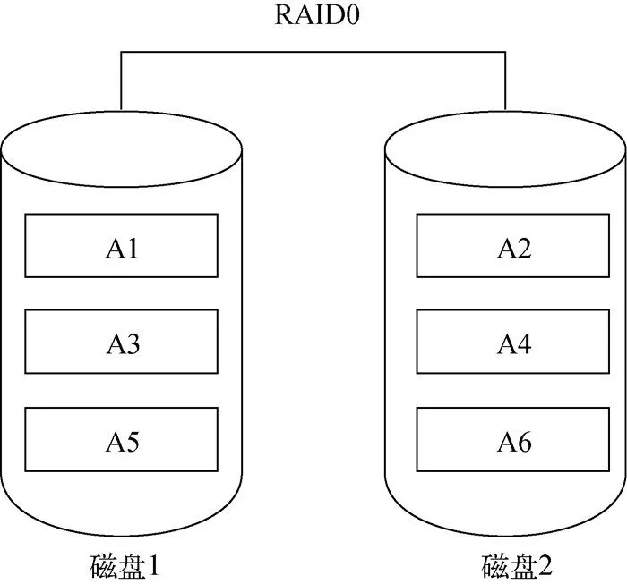

- 图 6-1　RAID0 的结构示意图

RAID1 完全实现了镜像技术，把数据集全部复制一份，然后将原数据集和副本分别存放在两个磁盘上，因此其磁盘空间利用率为 50%。读取数据时可以从任一磁盘上获取数据，在写入数据时由于需要写入两块磁盘，因此响应时间会有所影响。RAID1 模式大大提高了数据的可靠性，如果一块磁盘发生故障，用户可以从镜像磁盘读取数据，不会影响工作。如图 6-2 所示，RAID1 模式将数据集中的数据块 A1、A2、A3 在两块磁盘中分别存放了一份，无论哪块数据出现问题都可以在镜像磁盘中获取数据。

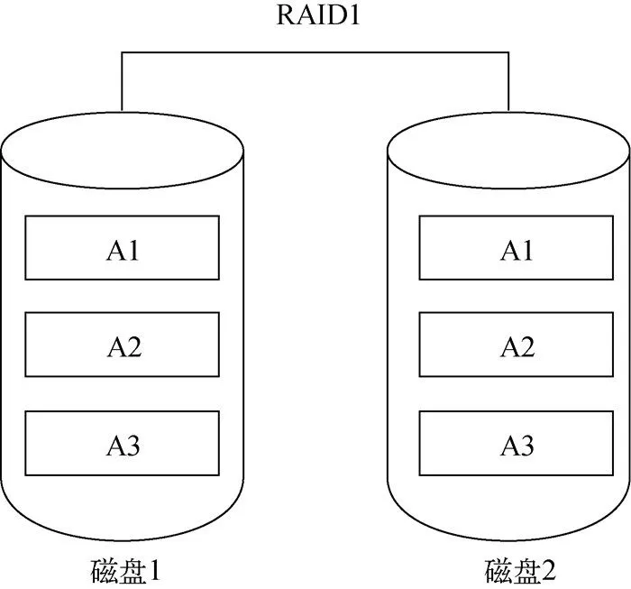

- 图 6-2　RAID1 的结构示意图

RAID01 由 RAID0 和 RAID1 两种模式组合而成。它将大数据集分成多份，分别写入不同的磁盘，然后再将每份数据镜像存储在另一个磁盘中，说白了就是数据分片 + 数据镜像。这种方式不仅提高了读写效率，也增加了数据的可靠性。不过 RAID01 用一半磁盘来备份数据，这对磁盘利用率是一个挑战。如图 6-3 所示，RAID01 将一个数据集分为 A1~A6 六个数据块，分别在磁盘 1 和磁盘 2 中存放 A1、A3、A5 和 A2、A4、A6。作为镜像，将磁盘 1 和磁盘 2 中的数据块分别复制到磁盘 3 和磁盘 4 中。需要注意这里是先进行的条带（分片）用的是 RAID0模式，再进行的镜像用的是 RAID1 模式，所以这种模式叫作 RAID01。如果先进行镜像（RAID1）再进行条带（RAID0），就应该叫作 RAID10。从数据存储和读写性能的角度看来看，RAID01 和 RAID10 是完全一样的，两者没有区别。但当某磁盘出现故障时，RAID10 的读性能要优于 RAID01，由此看来在安全性方面 RAID10 比 RAID01 要强。

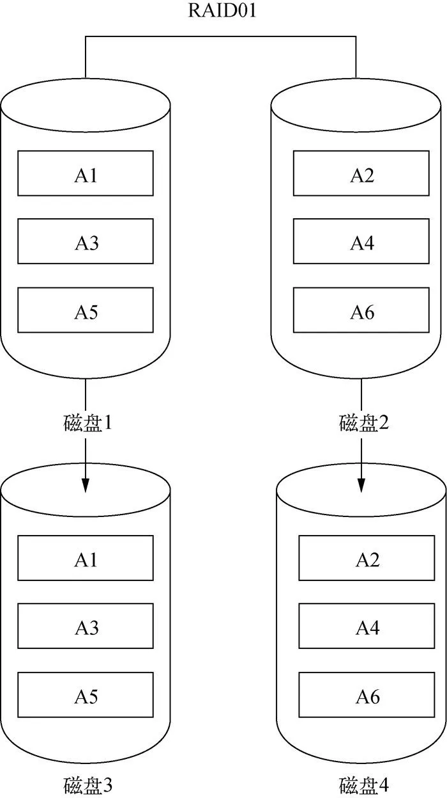

- 图 6-3　RAID01 的结构示意图

上面介绍了 RAID 的几种技术方案，从处理的数据量、读写效率和可靠性角度考虑，使用了数据镜像和分片技术。RAID 主要聚焦于单机服务器的扩容，通过增加磁盘数量提高数据的读写效率和可靠性。但单机磁盘的扩容毕竟是有尽头的，如果数据的存储容量持续增大、并发读写量持续增大、对数据可靠性的要求持续提高，简单的垂直扩容就无法再满足以上需求。此时分布式存储进入了我们的视野，下面一节就来其思路和组成要素。

### 6.1.2　分布式存储的组成要素

如果说 RAID 是单机垂直扩展，分布式存储就属于集群水平扩展。随着业务的不断发展，系统数据量和访问量与日俱增，单机已远远不能满足用户需求，分布式集群存储逐渐进入人们的视野。分布式存储将数据分布在多台服务器节点上，为大规模应用提供大容量、高性能、高可用、高扩展的存储服务。受 RAID 的启发，分布式存储就是将数据以分片或者副本的方式存储在不同的服务器节点上，存储过程遵循某种规律，之后在读取数据的时候也需要遵循这个规律。从整个分布式系统的读写过程来看，分布式存储由三个要素组成，分别是数据的使用者、数据的索引者、数据的存储者。

- 数据的使用者：顾名思义就是使用数据的用户，从分布式存储系统写入和读取数据。数据分为三类，分别是结构化数据、半结构化数据和非结构化数据。结构化数据指关系型数据库，每个字段都有严格的类型定义，多个字段组成表，多张有关联的表组成库。半结构化数据有固定的结构模式，数据之间的关系相对简单，并不符合关系型数据严谨的数据类型和强关联的数据模型，而是通过标记对语义元素进行分隔，对记录和字段进行分层，因此它也被称为

- 自描述的结构，例如 HTML、JASON、XML 等。非结构化数据没有固定的数据结构，例如文档、图片、视频等，这类数据相互之间的关联性不强。

- 数据的索引者：在分布式系统中，需要找到正确路径，才能完成数据的读写操作，比如往哪个服务器的哪个库中写入数据、如何读取这些数据，这些工作都需要数据索引者完成。分布式特点使得一个数据集分布存储在不同服务器上，需要通过算法才能找到，算法有 Hash 算法、一致性 Hash 算法等。

- 数据的存储者：存储者将数据使用者产生的数据保存起来，相当于容器。通常来说数据有放到磁盘上面的，也有存放到内存中的。结构化数据、半结构化数据、非结构化数据对应的存储容器分别是分布式数据库、分布式键值系统、分布式文件系统。

使用者对结构化数据、半结构化数据、非结构化数据进行读写操作。索引者将使用者与存储者连接到一起，并作为数据存储的媒介保存数据。正如 RAID，对数据使用复制和分片的技术，将数据分别存放到不同的服务器中。本章后面从存储数据的结构入手，重点讨论分布式数据库（结构化数据）和分布式缓存（半结构化数据），这两个也是目前应用架构中使用最多的分布式存储系统。

## 6.2　分布式数据库

分布式数据库存储针对的是结构化数据，这里主要讲解关系型数据库，例如 SQL Server、MySQL 等。单机时代的关系型数据库就是使用单表单库存储业务数据，但随着业务的发展，数据量和并发量不断增多，再加上物理服务器的资源（CPU、磁盘、内存、IO 等）有限，数据库所能承载的数据量、数据处理能力终将遭遇瓶颈。当然通过前面对垂直扩展的介绍，可以使用 RAID 的方式缓解这一问题，但这始终只是缓兵之计，对分布式数据库进行水平扩展才是正道，因此需要对关系型数据库进行合理的架构设计，这便是分表分库的设计初衷，分表分库之后的数据库可以跨服务器节点，存放在网络的任意节点中，目的就是缓解数据库压力，最大限度地提高数据操作效率。

### 6.2.1　分表分库

1. 数据分表如果单表存储的数据量过大，例如达到千万级甚至更多，那么在操作表的时候就会大大增加系统开销，每次查询都会消耗数据库的大量资源，要是需要多表联合查询，这种劣势就更加

- 明显了。以 MySQL 为例，在插入数据的时候，会对表进行加锁，锁定方式分为表锁定和行锁定。无论哪种方式，都意味着请求在操作表或者行中数据的时候，后面的请求需要排队等待，访问量增加后，势必会影响效率。

- 既然一定要分表，那给每张表分配多大的数据量比较合适呢？这里建议根据业务场景和实际情况具体分析。一般情况是 MySQL 数据库中的单表记录最好控制在 500 万条，这是个经验数字，根据硬件资源和数据结构得不同会有偏差，这里只做参考。将数据从一个表分放到多个表中，有下面两种分表方式。

- 垂直分表垂直分表是指根据业务把一个表中的字段（Field）分到不同表中。分出去哪部分数据通常需要根据业务进行选择，例如分出去一些不是经常使用的字段、长度较长的字段。

- 一般被拆分的表中字段数比较多，主要是避免查询时因为数据量大出现“跨页”问题。这种拆分在设计数据库之初就应该考虑，尽量在系统上线之前做调整，已经上线的项目做这种操作是需要经过慎重考虑的。

- 水平分表水平分表对一个表中的数据，按照关键字（例如 ID）进行 Hash 计算以后，以得到的值作为分表依据。计算出的 Hash 值可读性并不强，这里为了简化计算过程，以及方便理解，假设 Hash 计算是对一个具体的数字取模，得到的余数就是数据存放到新表中的位置。假设数据表中有 4 条记录，ID 分别是 01~04，如果把它们分配到 3 个表中，那么对ID 做模 3 运算得到的结果和记录存放的新位置分别如下，新旧表的对应关系如图 6-4 所示。

- 01 对 3 取模之后，结果为 1，存到表 1。

- 02 对 3 取模之后，结果为 2，存到表 2。

- 03 对 3 取模之后，结果为 0，存到表 0。

- 04 对 3 取模之后，结果为 1，存到表 1。

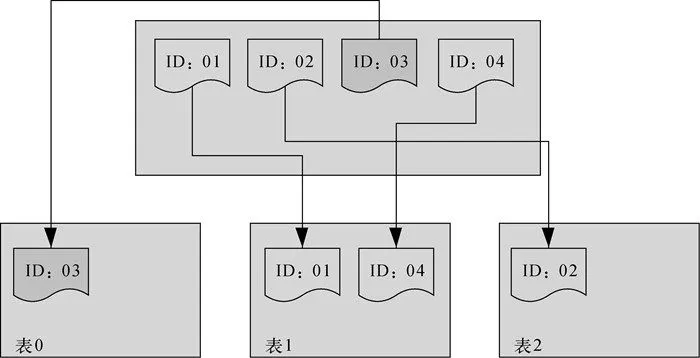

- 图 6-4　用对 ID 取模的方式分配记录

- 当然这只是一个例子，实际情况中需要对 ID 做 Hash 运算。水平分表还可以根据不同表所在的不同数据库中的资源，来设置每个表存储多少数据，为每个表所在库中的资源设置权值。

- 回到刚刚的那个例子，用这种方式存放数据以后，在访问具体数据时需要通过 Mappingtable 获取要响应的数据来自哪个数据表。目前比较流行的数据库中间件已经帮助我们实现了这部分功能，也就是说不需要自己去建立 Mapping table，在查询的时候中间件已经帮忙实现了 Mapping table 的功能，这里我们只需要了解 Mapping table 的实现原理就可以了，如图 6-5 所示。

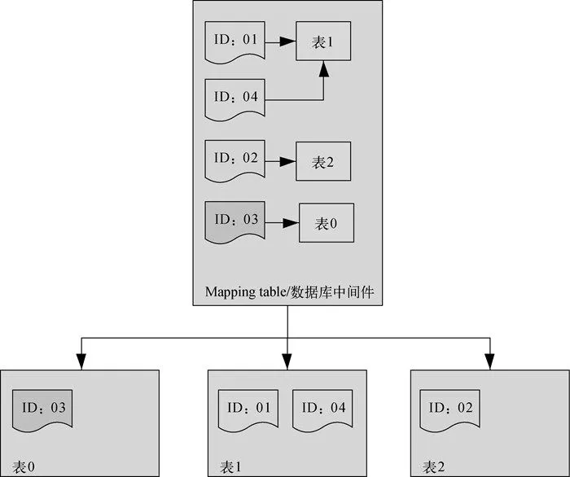

- 图 6-5　Mapping table 协助分表的原理

- 水平分表的另一种情况是根据数据的产生顺序来拆分并存放表。如图 6-6 所示，主表只存放最近 1~2 个月的数据，其他比较老旧的数据则拆分到其他表中。这个例子是通过时间区分数据的，更有甚者通过服务的地域来区分。

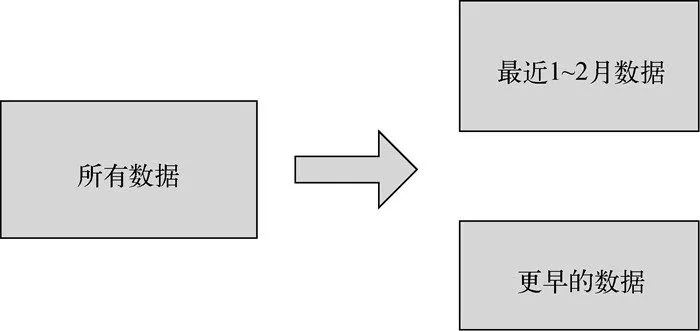

- 图 6-6　按照时间拆分数据表

- 需要注意分表会造成一系列记录级别的问题，例如跨表数据之间的 Join、ID 生成、事务处理，也需要考虑跨数据库的情况。针对这些问题，会采取以下应对办法。

- 跨表（库）数据之间的 Join：需要做两次查询，在应用层把这两次查询的结果合并在一起。这种做法是最简单的，在设计应用层的时候需要考虑。

- 跨表（库）数据生成 ID：可以用 UUID 或者一张表存放生成的 Sequence，不过效率都不算高。UUID 实现起来比较方便，但是占用的空间比较大。Sequence 表的方式节省了空间，可是所有 ID 都依赖于单表。这里介绍一个大厂用的方式——snowflake。如图 6-7所示，snowflake 是 Twitter 开源的分布式 ID 生成算法，结果是一个 long 类型的 ID，其核心思想是使用 41 个 bit 位作为毫秒数，10 个 bit 位作为机器 ID（其中前 5 个 bit 位代表数据中心，后 5 个 bit 位代表机器），12 个 bit 位作为毫秒内的序列号（意味着每个节点在每毫秒产生 4096 个 ID），还有一个符号位永远是 0。

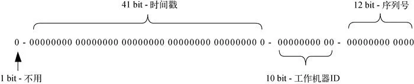

- 图 6-7　snowflake 示意图

- 跨表（库）数据的排序 / 分页：由于一个表的数据量过于庞大，因此需要将数据分配到其他几个表中，但是这些数据在业务上又是一个整体，如果对这个整体数据进行排序、分页或者一些聚合操作（求和、求平均），就需要跨多张表操作。这里根据经验介绍两种方法：对分表中的数据先排序、分页、聚合，再合并；对分表中的数据先合并，再排序、分页、聚合。

- 跨表（库）事务：存在分布式事务的可能，需要考虑补偿事务或者由 TCC（Try ConfirmCancel）协助完成，这部分内容我们在 4.3.6 节中介绍过。

2. 数据分库说完了分表，接下来谈分库。每个物理数据库能支持的数据量都是有限的，每一次数据库请求都会产生一个数据库连接，当一个库无法支持更多访问请求的时候，需要把原来的单个数据库分成多个，分担压力。

- 这里有几类分库的原则，可以根据具体场景具体选择。

- 根据业务分库，这种情况一般会把主营业务和其他业务区分开，划分结果如订单数据库、核算数据库、评价数据库。

- 根据冷热数据进行分库，用数据访问频率来划分冷热数据，例如一个月以内的交易数据划分为高频数据，2~6 个月以内的交易数据划分为中频数据，大于 6 个月以前的数据划分为低频数据。

- 根据访问数据的地域、时间范围进行分库。

- 如图 6-8 所示，表 1 由表 1-1 和表 1-2 组成，分库时将表 1-1 分配到库 1 中，将表 1-2 分配到库 2 中。

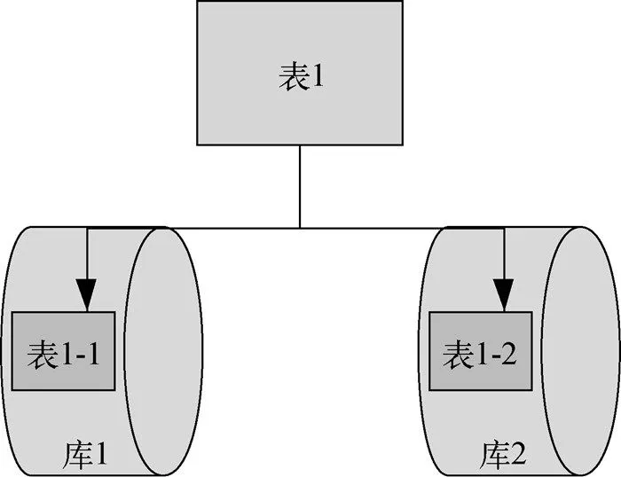

- 图 6-8　单个表分配到不同数据库中

- 通常数据分库之后，每一个数据库中均包含多个数据表。如图 6-9 所示，多个数据库组成一个集群（Cluster/Group），应用通过负载均衡代理访问两个集群中的数据库，这样不仅提高了数据库的可用性，还可以把读写操作分离开。

- 图 6-9 中，主库主要负责写操作，从库主要负责读操作。应用访问数据库时先经过一个负载均衡代理，通过判断请求的是读还是写操作，把用户请求路由到对应的数据库，如果是读操作，会平均分配请求或者根据数据库设置的权重分配。另外，数据分库还设有健康监控机制，定时发送心跳包，检测数据库的健康状况。如果从库出现了问题，就启动熔断机制停止对其的访问；如果主库出现问题，则通过选举机制选出新的主。

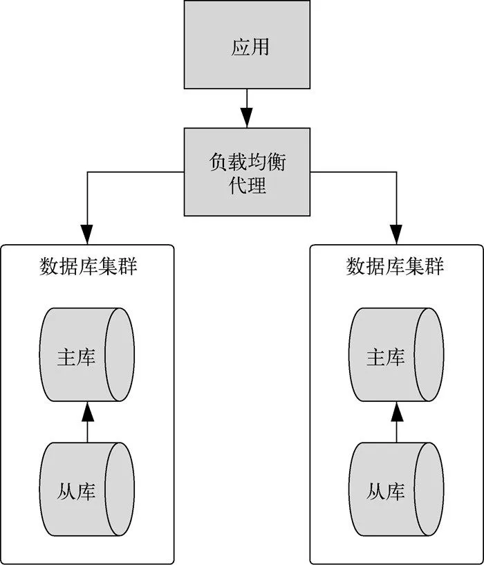

- 图 6-9　主从数据库简图

### 6.2.2　主从复制

由于读写数据库属于 IO 操作，因此会对系统的性能产生影响，特别是在高并发的情况下，单一数据库根本无法承载海量的读写请求。通过分析业务，我们可以将读、写同一份数据的操作分别放在不同数据库中执行。比如在秒杀系统中，读的频率相对较高（如查看商品详情），写针对的主要是更新订单和库存，所操作的数据量没有读的大。将负责读写的数据库分离开，会涉及数据同步，负责读的库需要从负责写的库那里同步最新的数据，这样就引出了主从复制以及主从库的可用性问题，当主库挂掉以后通过何种方式从剩下的从库中选举新的主库。沿着上述思路，本节将要介绍的内容如下。

- 读写分离的架构设计

- 数据复制

- 读写分离的架构设计我们的应用服务通常只对应一个数据库，根据应用逻辑对数据库进行读写操作，但是随着业务量的增加，会对应用服务进行扩展。特别是面对高并发访问的时候，会针对个别应用进行水平扩展。可即使应用服务做了扩展，对应的依旧是一个数据库服务，此时数据库就会变成系统的瓶颈，于是就需要扩展数据库，将一个库扩展成多个，那么按照什么扩展呢？根据业务系统中读操作和写操作的数量，对数据库进行读写分离。也就是把同一个数据库复制成多个，某些库负责写，某些库负责读。如图 6-10 所示，图左边显示的是读写集中的场景。应用服务 1、2、3 对同一个数据库读写，一旦读写压力增大，单一的数据库很难支撑住，瓶颈在于数据库。顺着蓝色箭头往右看，读写集中改造成了读写分离，此架构将原来的一个数据库扩展成了两个。一个用来处理写操作，称为主库，另一个用来处理读操作，称为从库。这样从库就可以分担主库的压力了，毕竟在真实的生产环境中，读数据的比例还是要高些。当读数据的压力增加以后，还可以通过扩展从库的方式分担压力。

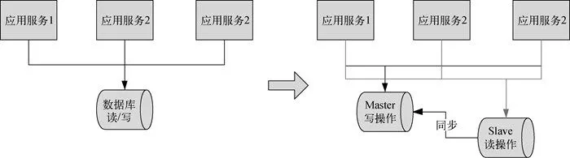

- 图 6-10　从读写集中到读写分离

- 数据复制读写分离的架构帮助我们增强了数据库的能力，把针对同一份数据的读写压力分担给不同的数据库。可这样的设计也引出了新的问题，由于从库（负责读）是不知道写入信息的，因此需要定时从主库中同步最新的数据信息，这种同步操作就叫作数据复制。说白了，这就是一种数据备份技术。比如有 A 和 B 两个数据库节点，A 上存储了 100MB 数据，数据复制技术就是将这 100MB 数据复制到 B 上，从而保证两个节点存储着相同的数据，当 A 出现故障后，由于 B 中有相同的数据，因此可以马上替代 A，保证了数据库的可用性。下面介绍几种数据复制方式。

- 同步数据复制同步数据复制是指应用服务请求对主库进行写操作时，主库要先将数据同步到从库，再给用户返回结果。在没有同步到从库之前，应用服务将一直等待同步结果，此时应用服务的写操作会一直阻塞。虽然这种方式保证了主从库数据的一致性，但牺牲了可用性，导致用户体验很差。如图 6-11 所示，是同步数据复制的处理过程。

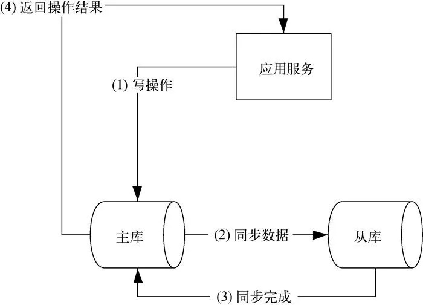

- 图 6-11　同步数据复制的处理过程

- (1) 应用服务对主库发起写操作。

- (2) 主库服务器更新了操作的这部分数据以后，将数据同步到从库，也就是对从库发起数据同步请求。

- (3) 从库接收到数据同步的请求，完成数据同步，同时给主库发送同步完成的响应信息。

- (4) 主库收到从库的数据同步响应信息后，向应用程序返回操作结果。

- 从上述步骤也能发现应用服务在发起写操作以后，就一直等待，直到主库返回操作结果。

- 异步数据复制异步数据复制是指应用服务请求主库进行写操作，主库处理完以后直接返回操作结果给应用服务，不必等待从库完成数据同步，此时从库异步完成数据复制。应用服务的写操作不会因为从库未完成数据同步而阻塞。可如果有应用服务访问从库，读取刚刚写入的数据，而从库还未完成同步，那么这个应用服务是无法成功获取数据的。总结一下，异步数据复制保证了系统的可用性，但是牺牲了数据的一致性。如图 6-12 所示，是异步数据复制的处理过程。

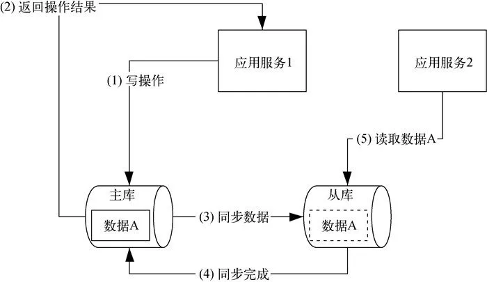

- 图 6-12　异步数据复制的处理过程

- (1) 应用服务 1 对主库发起写操作请求，要写入数据 A。

- (2) 主库接收到操作请求，更新数据 A，并且马上给应用服务 1 返回响应结果。

- (3) 主库对从库发起数据同步的请求。

- (4) 从库完成数据同步后，返回结果给主库。

- (5) 应用服务 2 访问从库，获取数据 A。此时会遇到两种情况，第一种是数据 A 同步到从库了，此时应用服务 2 拿到的就是最新的数据 A；第二种是数据 A 还没有同步到从库，此时应用服务 2 是无法拿到最新的数据 A 的，这就会造成应用服务 1 和应用服务 2 获取的数据不一致。

- MySQL 实现主从复制在高并发的秒杀系统中，数据量大、并发高，在设计架构时通常会把可用性和高性能摆在第一位，在一定程度上放宽对数据一致性的要求，因此大多数情况下会采用异步数据复制的方法。下面就来看看在 MySQL 中是如何实现主从复制的。如图 6-13 所示，是MySQL 实现主从复制的处理过程。

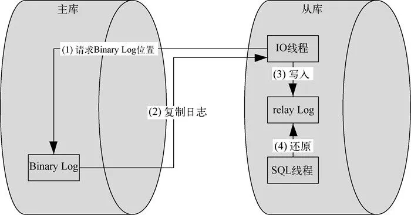

- 图 6-13　MySQL 实现主从复制流程

- (1) 从库的 IO 线程主动连接到主库上，目的是获取 Binary Log 的指定位置。因为对MySQL 中每一条数据的更新都会记录在 Binary Log 中，所以从库和主同步数据时，Binary Log 就是重要的参考依据。从库的 IO 线程需要知道应该同步主库中的哪个 BinaryLog，以及从这个 Binary Log 的什么位置开始读取数据，完成同步，提到的这个位置就是 Binary Log 的偏移量。

- (2) 从库连接上主库之后，主库就知道了有从库会同步自己的信息。一旦主库的数据更新了，Binary Log 里的记录就会增加，主库把这个更新通知从库，从库获取 Binary Log 的名字，并开始读取日志信息的位置。由于在第 (1) 步中已经获取了初始的 Binary Log 和位置，因此这次获取的就是更新后的 Binary Log 和位置，作用是同步信息增量。

- (3) 从库中的 IO 线程获取到主库上的日志信息后，放到 realy Log 中保存起来，等待从库中的 SQL 线程前来获取并解析。同时还会将日志的文件名和位置记录到 master-info 文件中，以便下次做增量更新的时候，知道从什么地方开始更新。

- (4) 从库中的 SQL 线程会定时检查 relay log 里的内容，并和 master-info 文件中记录的做匹配，要是发现 relay Log 里有新内容，就将 Binary Log 中的内容还原成主库中执行的 SQL 语句，并且在从库上执行该语句，从而实现数据复制。

- MySQL 提供了两种实现主从复制的方式，可以根据 Row Level 也就是行记录的方式复制，也可以根据 Statement Level 也就是语句的方式复制。

- Row Level，Binary Log 会记录每条数据被修改的方式，并根据这个记录修改从库中的数据。这种复制方式的好处是不需要记录执行的 Query 语句的上下文相关信息，只需要记录哪条数据被修改过、修改结果是什么即可。可缺点也很明显，只要更新数

```
据，就会记录所有数据的变化，这样无疑会增大 Binary Log 的容量。特别是 alter
table 之类的操作会更改很大的记录量。
```

- Statement Level，记录的是对数据进行修改的 Query 语句，从库完成复制以后，会将Query 语句再执行一遍。优点是不用记录每条数据的变化，节省了 Binary Log 的空间，以及 IO 操作的成本。缺点是重新执行 Query 语句就好像重新播放一遍电影，播

- 放的功能需要一致才能达到同样的效果，换句话说如果两个电影院的设备不同，那么即便是播放同样的影片，观影感受也不一样。如果主从数据库的版本有差异，特别是从库不支持一些新功能的时候，执行 Query 语句就会报错。因此建议在这种复制方式下，主库部署的 MySQL 版本要低于从库的版本。

- MySQL 主从复制的实践上面聊到了通过 MySQL 的主从复制达到读写分离、提高数据库性能的目的。现在我们来具体演示一下如何在 MySQL 中配置主从复制，主要是分别在两个服务器上安装MySQL，然后配置主库和从库，再通过主从链路将两个服务器连接起来，实现同步。

- 先准备两个服务器，分别承担主、从的角色。操作系统我这里使用的是 CentOS 7。两个服务器的配置信息分别如下：

- 主服务器：192.168.0.252

- 从服务器：192.168.0.253

- 数据库使用 MariaDB 5.5.64，这实际是 MySQL 完全兼容的版本，由开源社区维护，和MySQL 完全画等号。

- (1) 在两个服务器上面分别安装 MySQL，并尝试启动。然后设置 MySQL 的 root 用户名和密码，以及尝试登录 MySQL：

```
Yum install mysql*
1
Yum install mariadb-server
2
#启动 MySQL
3
Systemctl start mariadb.service
4
#查看 MySQL 是否启动
5
Ps -ef | grep mysql
6
Netstat -anp | grep 3306
7
#重置 MySQL 中 root 用户的密码为 root
8
Mysqladmin -u root password root
9
#登录 MySQL
10
Mysql -uroot -proot
11
Show databases;
12
(2) 修改主 MySQL 上的 server.cnf 文件，在 [mysqld] 下加入 server-id 和 log-bin
```

- 配置信息：

```
Vi /etc/my.conf vi /etc/my.cnf.d/server.cnf
1
#BINARY LOGGING#
2
server-id = 252
3
log-bin = mysql-bin
4
其中，server-id 是 MySQL 集群中服务器的唯一标识，log-bin 用来配置存放
```

- Binary Log 的目录，从库需要从这个目录中同步日志文件，完成数据复制。

```
(3) 在主服务器上通过 show master status; 命令登录 MySQL，查看主库的状态。
如图 6-14 所示，其中最重要的是日志文件的名字 File 和读取位置 Position，后面
```

- 建立主从链路的时候需要用到这两个参数。

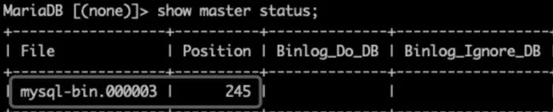

- 图 6-14　主库状态

- (4) 在主库中创建用户，用来访问从库，并授予该用户复制权限。这里我们建立一个叫

```
repl 的用户，用来同步主从数据库之间的数据。由于两个服务器都是配置在 192.168.0
这个网段，因此赋予 repl 用户访问这个网段的权限，并且设置密码。注意在配置完毕
```

- 以后要刷新权限，退出 MySQL 命令行的时候顺手关闭防火墙，否则会影响主从数据库之间的同步。最后记得重新启动 MySQL 服务。相关代码如下：

```
create user 'repl'@'192.168.0.%' identified by '123456';
1
grant replication slave on *.* to 'repl'@'192.168.0.%';
2
flush privileges;
3
exit
4
systemctl stop firewalld
5
systemctl restart mariadb
6
(5) 配置从 MySQL 的 server-id。同样在配置文件 server.cnf 中的 [mysqld] 下加入
server-id 和 log-bin 配置信息：
vi /etc/my.cnf.d/server.cnf
1
#BINARY LOGGING#
2
server-id = 253
3
log-bin = mysql-bin
4
(6) 在从库中创建与主库中一样的用户 repl，也是用于同步：
create user 'repl'@'192.168.0.%' identified by '123456';
1
grant replication slave on *.* to 'repl'@'192.168.0.%';
2
flush privileges;
3
exit
4
systemctl stop firewalld
5
systemctl restart mariadb
6
(7) 在从库上建立主从连接。这里指定 MASTER_HOST 为主服务器的地址，用户
MASTER_USER 为 repl，密码 MASTER_PASSWORD 为 123456。比较重要的是
MASTER_LOG_FILE 和 MASTER_LOG_POS 是从主库中获取的信息，也就是将第 (3) 步
在主服务器上使用 show master status; 命令获取的信息，添加在这里，表示从哪个
文件的哪个位置开始做复制。之后执行 start slave; 命令，启动从库，并且通过
show slave status\G 命令查看主从连接的情况：
```

```
CHANGE MASTER TO MASTER_HOST='192.168.0.252', MASTER_USER='repl', MASTER_PAS
1
Start slave;
2
show slave status\G
3
```

- 如图 6-15 所示，从服务器正在连接主服务器，对应的日志文件是 mysql-bin.000003、位置是 245。

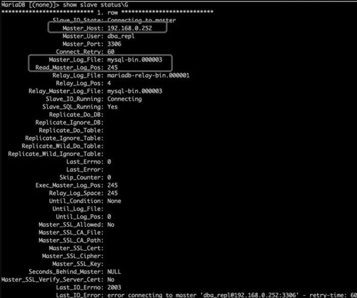

- 图 6-15　主从连接情况

- 通过上面 7 步就完成了主从复制的配置，此时到主库中建立一个数据库repl_test_db_1：

```
create database repl_test_db_1;
1
如图 6-16 所示，执行 show databases; 命令切换到从库中，就能查看到这个数据更
```

- 新。

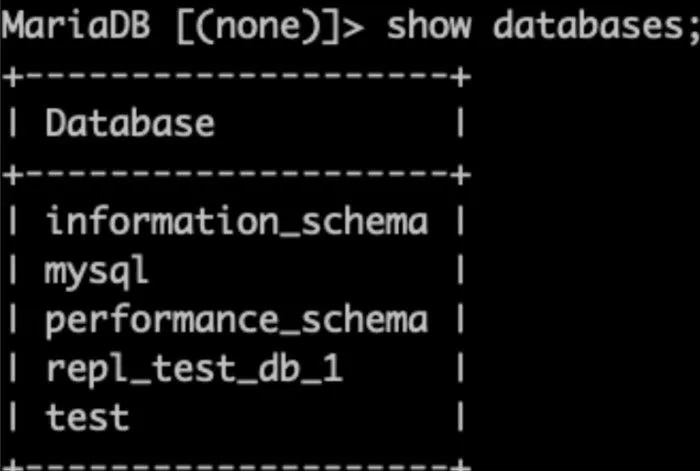

- 图 6-16　主从服务器同时增加了数据库 repl_test_db_1

- MySQL 主主切换和选举除了上面介绍的 MySQL 实现主从复制以外，还有主主模式（也就是双主模式，DualMaster）、级联复制架构以及双主结合级联复制架构等。当主从架构中的主服务器出现问题时，并不能马上将从服务器切换为主服务器，这对运维来说是一个挑战，这时可以使用主主模式，一个主服务器负责写入另外一个主服务器，另一个主服务器负责复制第一个主服务器上的数据，同时将这些数据复制给其他的从服务器。我们将提到的两个主服务器依次记作 A 和 B，当 A 出现故障以后，B 直接成为主服务器，处理写入操作，这时如果 B 也出现了故障，依旧由 A 来承担写入和数据同步的责任。这种保证高可用的方案

- 就是主主切换，两个主服务器对外只会暴露一个 VIP（Virtual IP，虚拟 IP），这个 VIP 可以指向 A，也可以指向 B，根据两个服务器的健康状况做切换，这个过程对于使用者来说是透明的。

- 除了主主切换这种模式以外，还可以通过其他中间件实现高可用。例如使用 MyCat 和ZooKeeper 的组合，通过 ZooKeeper 中的 DataNode 在剩余节点中发起选举，选择新的主服务器替换挂掉的那个。

- MyCat 是目前最流行的、基于 Java 语言编写的数据库中间件，协助我们实现分布式数据库系统。它实现了遵循 MySQL 协议的服务器，核心功能是分表分库以及完成主从模式下的读写分离。

- 如图 6-17 所示，主节点配置为 writeHost，负责写入操作，从节点配置为 readHost，负责读取操作。图中上方的 MyCat 数据库中间件会通过 ZooKeeper 定期向两个节点服务器发起心跳检测（虚线部分）。图中的实线部分描述了 MyCat 开启读写分离模式之后，中间件接收到请求时，会通过 SQL 解析，将写入请求的 DML（Data ManipulationLanguage）SQL 发送给 writeHost 节点；将读取请求的 Select SQL 发送给 readHost 节点。writeHost 在完成写入信息以后，会和 readHost 进行数据同步，也就是主从复制。由于存在心跳检测机制，因此当 writeHost 挂掉时，如果在默认的 n 次心跳检测后（可以配置）仍旧没有恢复，MyCat 就发起选举，选出一个服务器作为 writeHost，新的writeHost 负责处理写入数据和同步数据。当之前的 writeHost 恢复以后，会成为从节点readHost，并且接收来自 writeHost 的数据同步。

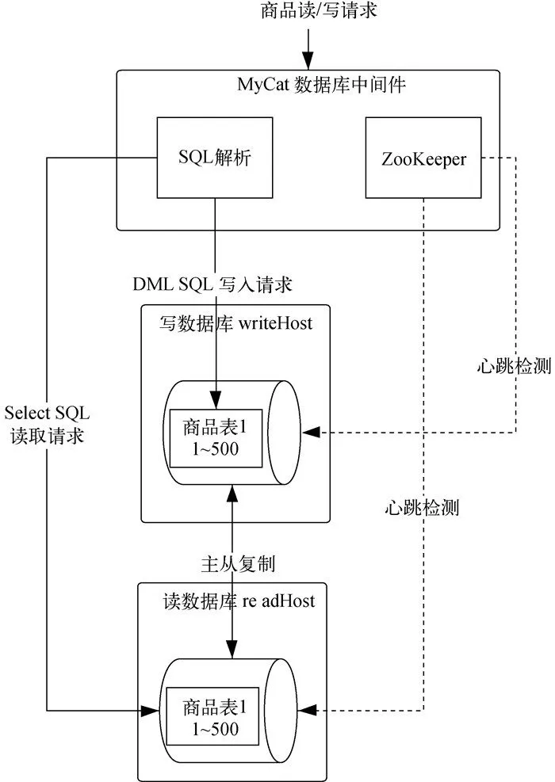

- 图 6-17　MyCat 和 ZooKeeper 结合实现主节点选举

- 选举机制有两种，都是利用 ZooKeeper 中的 DataNode 节点的添加顺序来实现。每个MySQL 上都会配置 ZooKeeper 的 Agent，当这些 Agent 启动的时候，会到 ZooKeeper中名为 Leader 的节点下面建立自己的数据节点。ZooKeeper 如果监测到节点对应的MySQL 服务器挂掉了，就把对应的数据节点删除，其他 Agent 发现数据节点被删除后有两种策略选出新的主节点。

- 第一种是从剩下的节点中随机选择一个，其他节点全部成为从节点，跟新的主节点同步数据。

- 第二种是根据节点的序号，选择序号最小（排在最前面）的节点作为主节点。

### 6.2.3　数据扩容

无论是分表分库策略还是主从复制策略，数据量增加后，都需要面对数据扩容。这里以主从数据库扩容为例，给大家讲解数据扩容的过程。

如图 6-18 所示，假设有两个数据库集群，它们中分别有 M0、S0 和 M1、S1 作为主备。回顾6.2.1.1 节数据分表中讲的水平分表知识，对数据库中记录的 ID 进行取模操作，依据操作结果将数据存放到数据库集群中。这里提供了 2 个数据库集群，于是对 ID 做模 2 运算，将数据按照运算结果分别放到两个数据库集群中，取模结果为 0 的数据放到 M0 和 S0 所在的集群中，取模结果为 1 的数据放到 M1 和 S1 所在的集群中。根据 6.2.2 节提到的，数据写入主库 M0（M1）后，从库 S0（S1）会主动同步 M0（M1）写入的数据，保证最终 M0（M1）和 S0（S1）中的数据是一致的。

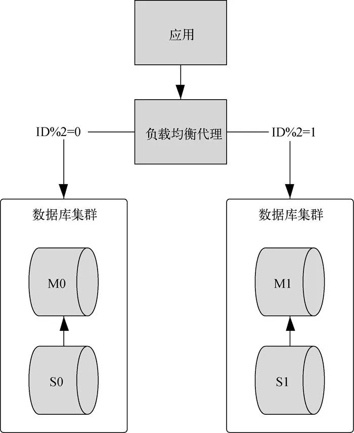

- 图 6-18　两个数据库集群的示意图

由于取模运算的目的是实现分表，因此如果将原来的 2 个集群扩展为 4 个，就需要调整取模方式，也就是将模 2 运算切换成模 4 运算。

如图 6-19 所示，原来 2 个集群中作为从库的 S0 和 S1 变成了主库，负责写入数据。负载均衡器根据取模算法 ID%4，将部分数据路由到 S0 和 S1 上（图中虚线部分），同时 S0 和 S1停止与 M0 和 M1 的数据同步，单独作为主库（写操作）存在。

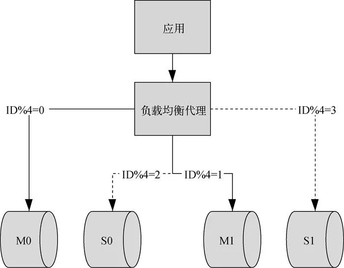

- 图 6-19　两个集群扩展成四个集群

以上修改不需要重启数据库服务，只需要修改代理配置就可以。4 个数据库中存在一些冗余数据，可以用后台服务将这些数据删除掉，这并不会影响数据使用。

完成数据库扩容以后，再来考虑一下数据库可用性。如图 6-20 所示，对扩展得到的 4 个主库进行主从复制，针对每个主库分别建立对应的从库，主库负责写操作，从库负责读操作。下次如果需要扩容，也可以参照此操作进行。

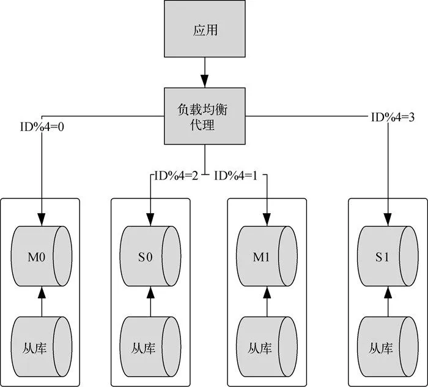

- 图 6-20　考虑数据库可用性

## 6.3　分布式缓存

经常使用的信息通常会以键值对的形式被存放到缓存中，这一节以分布式缓存为例介绍分布式键值对系统。缓存又可分为进程内缓存和进程外缓存。进程内缓存运行在 JVM 中，缓存量受单机 JVM 大小的限制。进程外缓存独立于应用程序的 JVM，部署在单独的缓存服务器中，一般来说一个缓存服务器就已经能够满足日常使用了，针对高并发的应用场景，为了提高处理性能和可用性会对缓存服务器进行水平扩展，将缓存信息分放到多个服务器节点上，也就是我们所说的分布式缓存。

分布式缓存是与应用程序相分离的缓存服务，其最大的特点是自己本身是一个独立的应用 / 服务，与本地应用相分离，多个应用可直接共享一个或者多个缓存应用 / 服务。

如图 6-21 所示，缓存数据分布在不同的缓存节点上，注意每个缓存节点缓存多少数据通常是有限制的。由于数据被缓存到不同的节点中，为了能够方便地访问这些节点，引入了缓存代理，比如 twemproxy、Redis 集群。缓存代理的作用是帮助请求找到对应的数据缓存节点，如果新增了缓存节点，这个代理只能识别并把新的缓存数据分片给新节点，做横向扩展。为了提高缓存的可用性，会在原有的缓存节点上加入主从节点的设计。在把缓存数据写入主节点的同时，也要同步一份给从节点。这种情况下一旦主节点失效，可以通过代理直接切换到从节点，这时从节点就变成了主节点，保证了缓存的正常工作。缓存节点还会提供缓存过期机制，并且把缓存内容定期以快照的方式保存到文件中，以便缓存崩溃之后，启动预热加载。

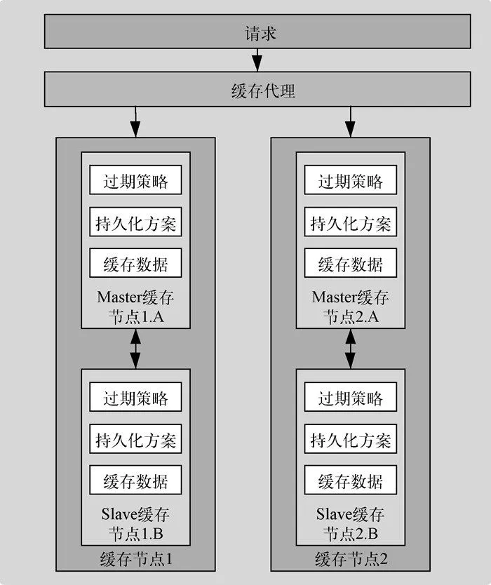

- 图 6-21　分布式缓存的结构示意图

### 6.3.1　缓存分片算法

将缓存实现成分布式后，数据会根据一定的规律被分配到每个缓存应用 / 服务上，我们把这些缓存应用 / 服务称作缓存节点，每个缓存节点只能缓存一定容量的数据，例如 Redis 集群中的一个节点可以缓存 2GB 数据。当需要缓存的数据量比较大时，就需要扩展多个缓存节点，面对这么多节点，客户端请求怎么知道该访问哪个呢？缓存数据又如何放到这些节点上？缓存代理服务已经帮助我们解决了这些问题，这里介绍两种缓存分片算法，缓存代理根据这两种算法可以方便地找到分片数据。同时也可以将缓存理解为内存中的数据库，缓存分片算法就是将同一类数据分别存放到不同的存储空间中，这里的分片算法同样适用于关系型数据库中的数据分片。下面就来看看算法的具体内容。

- Hash 算法Hash 表是一种常见的数据结构，其实现方式是对数据记录的关键值进行 Hash 计算，然后再对需要分片的缓存节点个数进行取模，根据取模结果分配数据。此算法在 6.2.1 节中提到过，如图 6-22 所示，有 10 条数据，ID 依次为从 1 到 10 的数字，我们将根据 Hash 算法把这些数据存放到 3 个缓存节点（也就是 3 个缓存服务器）中。为了使数据均匀放置在 3个缓存节点中，我们对 ID 进行模 3 运算，得到每条数据分别应该存放到哪个节点（这里是为了简化计算过程，把模 3 运算当作 Hash 算法）。如图 6-22 所示，数据 3、6、9 由于 ID对 3 取模的结果是 0，因此被放置到缓存节点 0 所在的服务器上，依此类推，数据 1、4、7、10 放置到缓存节点 1，数据 2、5、8 放置到缓存节点 2。

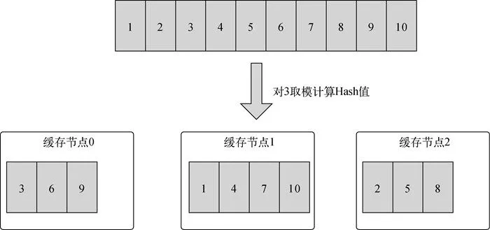

- 图 6-22　Hash 算法

- Hash 算法在某种程度上算是平均放置，较为简单，如果新增了缓存节点，那么已经存在的数据会产生较大的变动。

- 一致性 Hash 算法一致性 Hash 算法是将数据按照特征值映射到一个首尾相接的 Hash 环上，同时将缓存节点也映射到这个环上。为什么要这么放呢？我们先看看上面讲的 Hash 算法会带来什么问题。顺着刚才的例子继续说，如果 3 个缓存节点已经无法满足缓存要求了，需要增加 1 个缓存节点，那么缓存服务器的数量就由 3 变成了 4。对数据 ID 取模的数字也由原来的 3 变成了4，意味着数据对应的缓存节点也发生了变化。如图 6-23 所示，原来的缓存节点 0、1、2变成了缓存节点 0、1、2、3，多出一个缓存节点 3。而数据还是 10 条，并且 ID 也不变，Hash 计算变成了 ID 对 4 取模，每条数据存放的缓存节点发生了变化。数据 4、8 由于对 4取模的结果是 0，被放置到缓存节点 0 所在的服务器上，数据 1、5、9 放置到缓存节点 1上，数据 2、6、10 放置到缓存节点 2 上，数据 3、7 放置到缓存节点 3 上。对比图 6-22与图 6-23，我们将各缓存节点中存放位置没有变化的数据用绿色标出，有变化的数据则用红色标出，会发现有 8 条数据变换了存放位置，只有 2 条没有。

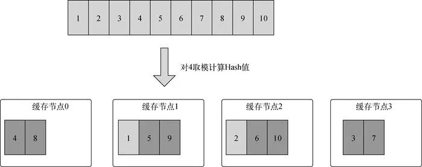

- 图 6-23　增加缓存节点后，Hash 算法出现缓存迁移

- 缓存节点的增加，使有些数据的缓存位置发生了改变，这样会导致部分缓存数据（指图 6-23 中红色的部分）失效，至少在应用程序第一次访问这些数据的时候会失效。假设发生缓存迁移后，请求第一次从原来的缓存节点中获取缓存信息，那么标红色的那部分数据是无法命中的，而且这个未命中的范围还比较大，这种情况会导致大量的请求到数据库中获取数据。众所周知，对数据库的读写属于 IO 操作，不仅请求时间长，效率也不高，大量请求集

- 中到一起访问数据库会导致数据库压力瞬间增大，甚至造成数据库服务器崩溃。以上是增加缓存节点后的情况，同理减少缓存节点也会遇到同样的情况。原来有 3 个缓存节点，假设现在有 1 个缓存节点出现了故障，无法正常工作，因此将其移除，缓存节点从 3 个变成了2 个。同样 Hash 算法也发生了改变，由 ID 对 3 取模变成对 2 取模，这会引起大量的缓存数据迁移，并给数据库服务器带来压力。为了解决上述问题，一致性 Hash 算法出现了。

- 一致性 Hash 算法的基本思路也是对被缓存的数据 ID 进行取模操作。只不过 Hash 算法是3232对缓存节点的个数取模，而一致性 Hash 算法是对 2取模。我们把一个圆平均分割为 2份，为了便于操作和展示，这里只简单得把圆分为 8 等份，如图 6-24 所示。

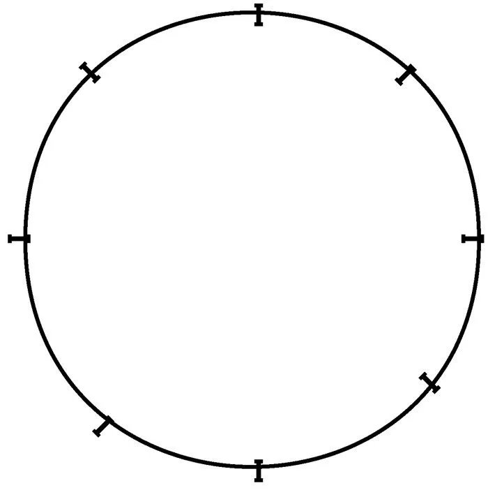

- 图 6-24　将圆平均分割为 8 份

- 32然后对缓存节点的 IP 进行模 2运算，得到的结果就是对应缓存节点存放的位置。如图 6-25 所示，将缓存节点 0、1、2 根据取模结果放入环中。

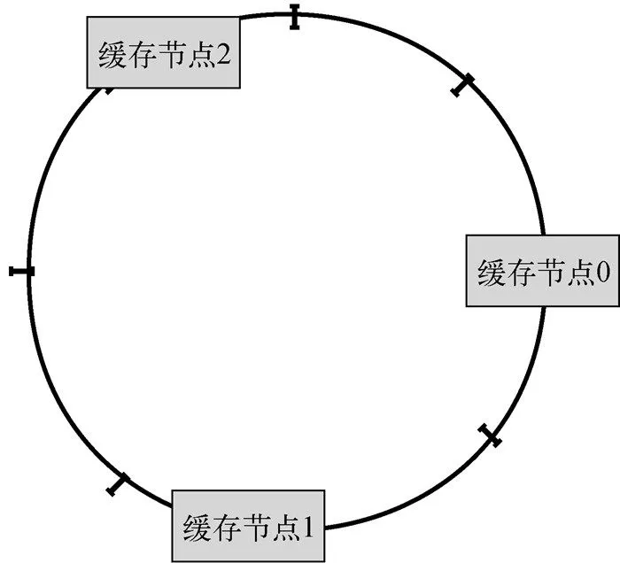

- 图 6-25　将缓存节点放入环中

- 32将缓存节点放入环中后，再对需要缓存的数据的 ID 进行模 2运算，根据运算结果将缓存数据放到环中对应的位置。如图 6-26 所示，我们放了 4 条数据，ID 分别为 1、2、3、4。然后，按顺时针方向找到离每条数据最近的一个缓存节点，并将数据放到对应的节点中去。

- 例如数据 3 放入缓存节点 0，数据 1 放入缓存节点 1，数据 2、4 放入缓存节点 2。注意图6-26 中四条数据的摆放只是举例，实际位置以取模结果为准。

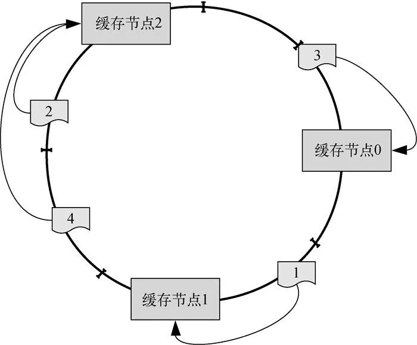

- 图 6-26　将缓存数据放入缓存节点中

- 现在加入一个缓存节点 3，如图 6-27 所示。这样原来指向缓存节点 2 的数据 4，现在指向了新加入的缓存节点 3，而其他记录依旧存放在原来的缓存节点中。这也是一致性 Hash 算法的优势，在缓存节点发生变化（增加、减少）时，只需要迁移部分数据。

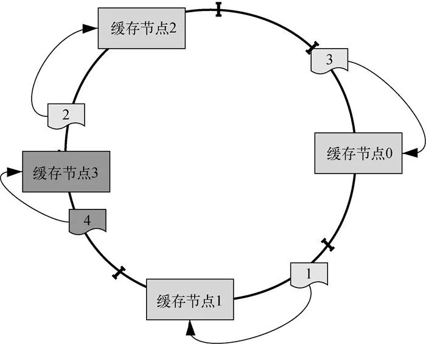

- 图 6-27　一致性 Hash 算法的优势

- 和 Hash 算法比起来，一致性 Hash 算法在缓存节点变更时，减少了缓存数据的迁移、保证不会出现大量缓存数据失效的情况，从而减少了大规模请求访问数据库时的尴尬场面，保证了系统的稳定性。秒杀系统在使用分布式缓存时，多数情况下会使用这种数据分片策略。

### 6.3.2　Redis 集群方案

正如前面提到的，分布式数据库就是将整块数据按照规则分配给多个缓存节点，解决单个缓存节点处理大量数据的问题，会使用一定的分片算法，例如 Hash 算法和一致性 Hash 算法，还要让访问者知道数据具体存放的位置。Redis 是一个高性能的键值对（key-value）缓存数据库，这里以它为例介绍分布式缓存方案。Redis 分布式缓存方案实际是用集群方式实现的，也就是 Redis 集群。Redis 集群采用 Hash 算法对数据进行分片，采用了槽（Slot）这一概念。

- 14

槽是存放缓存信息的单位空间，Redis 将存储空间分成 16 384（2

- ）个槽，也就是说 Redis

集群中槽的 ID 范围是 0~16 383。缓存信息通常以键值对的形式存放，在存储信息的时候，集群会对键进行 CRC16 校验，并对 16 384 取模（slot = CRC16(key)%16 384），得到的结果就是键值对要放入的槽，这样就可以自动把数据分配到不同的槽上，再将这些槽分配到不同的缓存节点中保存。

如图 6-28 所示，假设有 3 个缓存节点，标号分别是 1、2、3。Redis 集群将用于存放缓存数据的槽分别放入这 3 个节点中。缓存节点 1 存放的是槽为 0~5000 的数据，缓存节点 2 存放的是槽为 5001~10 000 的数据，缓存节点 3 存放的是槽为 10 001~16 383 的数据。假设此时Redis 客户端要根据一个键获取对应的值，则首先通过 CRC16(key)%16 384 计算出槽的值，然后根据槽和缓存节点的对照表得到缓存节点，最后从缓存节点中获取值。假设根据公式计算出的槽是 5002，将这个数据传送给 Redis 集群，集群接收到后去对照表中查看 5002 属于哪个缓存节点，因此得到缓存节点 2，于是顺着红线所指的方向调用缓存节点 2 中存放着的键值对内容，并且返回给 Redis 客户端。

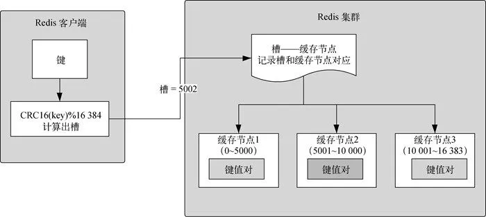

- 图 6-28　Redis 集群中的数据分片

### 6.3.3　缓存节点之间的通信

如果说 Redis 集群的虚拟槽算法解决的是数据拆分和存放问题，那么各缓存节点之间是如何通信的呢？接下来我们讨论这个问题。在 Redis 集群中，缓存节点会被分配到一个或者多个服务器上，还可能根据缓存的数据量和支持的并发量扩展缓存节点的数目。如图 6-29 所示，假设Redis 集群中本来只有缓存节点 1，此时由于业务扩展，新增了缓存节点 2。缓存节点 2 会通过 Gossip 协议向老节点，也就是缓存节点 1 发送一个 meet 消息。收到消息以后，缓存节点1 礼貌性地回复一个 Pong 消息。此后缓存节点 2 就会定期给缓存节点 1 发送 Ping 消息，同样地，缓存节点 1 每次都会回复 Pong 消息。

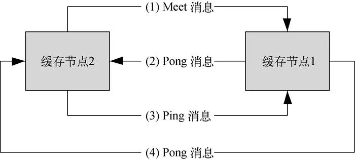

- 图 6-29　新上线的缓存节点 2 和缓存节点 1 通信

上面这个例子说明，Redis 集群中的缓存节点是通过 Gossip 协议相互通信的。节点之间通信的目的是维护彼此保存的元数据信息，元数据就是每个节点包含哪些数据、是否出现了故障。各节点通过 Gossip 协议不断地交互这些信息，就像一群人围坐在一起各种八卦，用不了多久每个节点就都会知道集群中所有节点的情况。整个传输过程大致分为以下几步。

(1) Redis 集群中的每个缓存节点都会开通一个独立的 TCP 通道，用于和其他节点通信。

(2) 存在一个节点定时任务，负责每隔一段时间从系统中选出发送节点。这个发送节点按照一定频率（例如 5 次 / 秒）随机向最久没有通信的节点发送 Ping 消息。

(3) 接收到 Ping 消息的节点向发送节点回复 Pong 消息。

(4) 不断重复上述步骤，让所有节点保持通信。

Gossip 协议中有如下 4 种消息。

- Meet 消息：用于通知旧节点加入了新节点。比如上面例子中提到的，缓存节点 2 上线后会给老节点 1 发送 Meet 消息，表示有新成员加入。

- Ping 消息：这个消息使用得最为频繁，其中封装了节点自身和其他节点的状态数据，被有规律地发给其他节点。

- Pong 消息：节点在接收到 Meet 消息和 Ping 消息以后，需要将自己的数据状态发送给对方，需要用到 Pong 消息。节点也可以对集群中所有的节点广播此信息，告知大家自己的状态。

- Fail 消息：当一个节点发现另外一个节点下线或者挂掉时，会向集群中其他节点广播这个消息。

Gossip 协议的结构如下所示：

```
typedef struct
{   char sig[4];        /* 信号标识 */
   uint32_t totlen;    /* 消息总长度 */
   uint16_t ver;       /* 协议版本 */
   uint16_t port;      /* TCP 端口号 */
   uint16_t type;      /* 消息类型，包括 Meet、Ping、Pong、Fail 等消息 */
   uint16_t count;     /* 消息体包含的节点数 */
   uint64_t currentEpoch;  /* 当前发送节点的配置纪元 */
   uint64_t configEpoch;   /* 主从节点的配置纪元 */
   uint64_t offset;    /* 复制偏移量 */
   char sender[CLUSTER_NAMELEN]; /* 发送节点的节点名称 */
   unsigned char myslots[CLUSTER_SLOTS/8]; /* 发送节点的槽信息 */
   char slaveof[CLUSTER_NAMELEN];
   char myip[NET_IP_STR_LEN];    /* 发送节点的 IP */
   uint16_t flags;      /* 发送节点标识，区分主从角色 */
   unsigned char state; /* 发送节点的集群状态 */
   unsigned char mflags[3]; /* 消息标识 */
   unionclusterMsgData data; /* 消息正文 */
} clusterMsg;
其中 type 定义了消息的类型；myslots 数组定义了节点负责的槽信息，每个节点通过
```

Gossip 协议与其他节点通信时，最重要的就是将该数组发送给其他节点。另外，消息体通过

```
clusterMsgData 对象传递消息正文。
```

### 6.3.4　请求分布式缓存的路由

分布式缓存系统中的节点对内通过 Gossip 协议互相发送消息，保证彼此之间都了解对方的情况。那么对外，一个 Redis 客户端如何通过分布式节点获取缓存数据，就是分布式缓存路由需要解决的问题了。上节提到 Gossip 协议会将每个节点管理的槽信息发送给其他节点，其中用

```
到了 myslots 这样一个存放每个节点槽信息的数组。
myslots[CLUSTER_SLOTS/8] 是一个二进制位数组（bit array），其中 CLUSTER_SLOTS
的取值是 16384，表示这个数组的长度是 16 384/8=2048B，由于 1B=8bit，所以数组共包含
```

16 384 个 bit 位（二进制位）。每个节点分别用 1 个 bit 位来标记自己是否拥有某个槽的数据。如图 6-30 所示，这个图表示缓存节点所管理的槽的情况，如果下标对应的二进制值是 1，表示该节点负责存放 0、1、2 三个槽的数据；如果下标为 0，就表示该节点不负责存放对应槽的数据。图中 0、1、2 三个数组下标对应的二进制值是 1，表示它们分别存放 0、1、2 三个槽的数据。

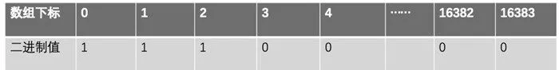

- 图 6-30　通过二进制数组存放槽信息

用二进制数组存放槽信息的优点是判断效率高，例如对于编号为 1 的槽来说，节点只要判断二进制序列的第二位是否为 1 就能知道是否存放了 1 号槽的数据，为 1 的时候表示存放了 1 号槽的数据，为 0 的时候表示没有存放 1 号槽的数据，判断槽数据存放的时间复杂度为 O(1)。

如图 6-31 所示，当收到发送节点的槽信息以后，接收节点会将这些信息保存到本地的

```
clusterState 结构中，其中的 slots 数组用于存放每个槽分别对应哪些节点信息。
clusterState 结构如下：
typeof struct clusterState{
   clusterNode *myself; /* 节点自身。ClusterNode 节点结构体 */
   clusterNode *slots[CLUSTER_SLOTS]; /* 16384 个槽点映射的数组，数组下标代表对应的槽
}
如图 6-31 所示，ClusterState 中保存的 slots 数组里面，每个下标分别对应一个槽，一
个槽信息对应一个 clusterNode，即缓存节点。缓存节点对应一个实际存在的 Redis 缓存服
```

务，其中包括 IP 地址和 Port 信息。

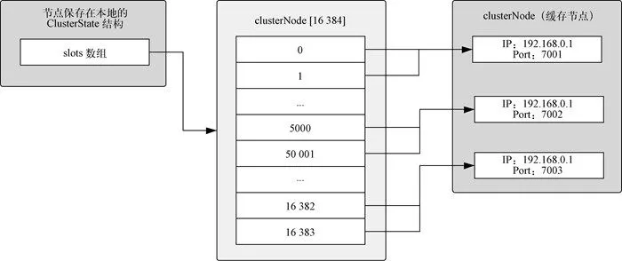

```
图 6-31　ClusterState 的结构以及槽与缓存节点的对应
```

Redis 集群的通信机制实际上保证了每个节点都清楚集群中其他节点和槽数据的对应关系。Redis 客户端无论想访问集群中的哪个节点，都可以通过路由规则找到该节点，因为每个节点

```
中都有一份 ClusterState，其中记录着所有槽和节点的对应关系。下面来看看 Redis 客户
```

端是如何通过路由调用缓存节点的。

如图 6-32 所示，Redis 客户端根据 CRC16(key)%16 383 计算出槽的值，得知需要找缓存节点 1 读、写数据，但是由于缓存数据迁移或者其他原因，这个对应的槽数据迁移到了缓存节点2 上，此时 Redis 客户端就无法从缓存节点 1 中获取数据了。而缓存节点 1 中保存着集群中所有缓存节点的信息，因此它知道这个槽的数据在缓存节点 2 中保存着，于是向 Redis 客户端发送了一个 MOVED 的重定向请求。这个请求会告诉客户端应该访问的缓存节点 2 的地址，客户端根据拿到的地址访问缓存节点 2，并且拿到数据。

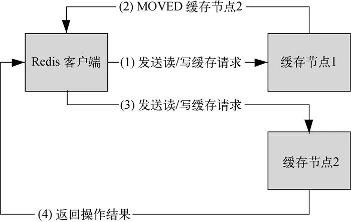

- 图 6-32　MOVED 重定向请求

上面的例子说明槽数据从一个缓存节点迁移到另一个缓存节点后，客户端依然可以找到想要的数据。那么如果 Redis 客户端访问的时候，两个缓存节点正在做数据迁移，此时该如何处理呢？如图 6-33 所示，Redis 客户端向缓存节点 1 发出请求，此时缓存节点 1 正向缓存节点 2迁移数据，如果没有命中对应的槽，缓存节点 1 会给客户端返回一个 ASK 重定向请求，并且告诉它缓存节点 2 的地址。收到返回消息后，客户端向缓存节点 2 发送 Asking 命令，询问需要的数据是否在缓存节点 2 上，缓存节点 2 接收到消息以后返回数据是否存在。

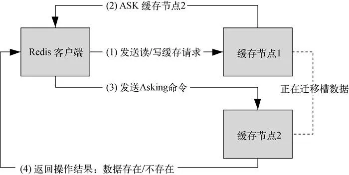

- 图 6-33　ASK 重定向请求

### 6.3.5　缓存节点的扩展和收缩

分布式部署的缓存节点总会因为扩容和故障问题，而上线和下线。由于每个缓存节点中都保存着槽数据，因此当缓存节点出现变动时，系统会根据对应的虚拟槽算法将此节点保存的槽数据迁移到集群中其他缓存节点上。如图 6-34 所示，集群中本来只存在缓存节点 1 和缓存节点2，此时缓存节点 3 上线，并且加入了集群中，根据虚拟槽算法，缓存节点 1 和缓存节点 2 中的槽数据会迁移到新加入的缓存节点 3 上。

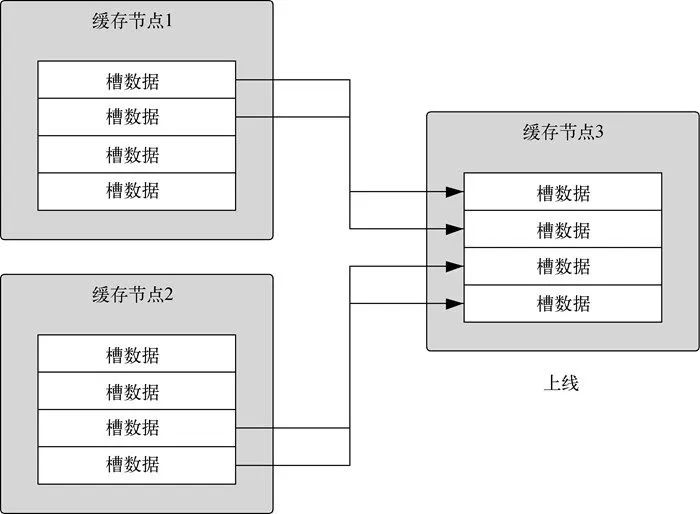

- 图 6-34　分布式缓存扩容

对于节点扩容问题，由于新加入的节点需要运行在集群模式下，因此其配置最好与集群内其他节点的配置保持一致。新节点刚加入集群时，作为孤儿节点是无法和其他节点通信的，因此它

```
会执行 cluster meet 命令加入集群中（在集群中执行 cluster meet 命令的作用是加入
```

新节点）。假设新节点是 192.168.1.1 5002，老节点是 192.168.1.1 5003，运行以下命令让新节点加入集群中：

```
192.168.1.1 5003> cluster meet 192.168.1.1 5002
```

这个命令是由老节点发起的，类似于老成员欢迎新成员加入。新节点刚加入，自然还没有建立槽及对应的数据，也就是说还没有缓存任何数据。如果这个节点是主节点，需要对其进行槽数据的扩容；如果是从节点，则需要同步主节点上的数据。总之就是要同步数据。

如图 6-35 所示，由客户端发起节点之间的槽数据迁移，数据从源节点往目标节点迁移。

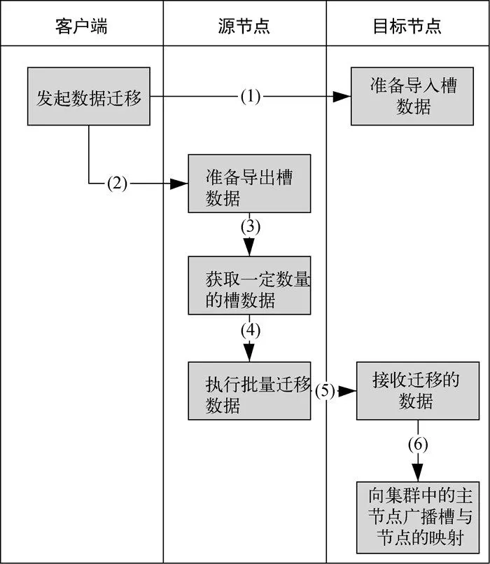

- 图 6-35　节点迁移槽数据的过程

(1) 客户端对目标节点发送准备导入槽数据的命令，让目标节点准备好。这里使用的命令是

```
cluster setslot  importing 。
(2) 客户端对源节点发送命令，让其准备迁出对应的槽数据。这里使用的命令是 cluster
setslot  importing 。
```

(3) 此时源节点准备迁移数据了，在迁移之前把要迁移的数据获取出来。使用的命令是

```
cluster getkeysinslot  ，其中 count 表示迁移的槽个数。
(4) 在源节点上执行 migrate   "" 0  keys 命令，把获取的键通过流水线批量迁移到目标
```

节点。

(5) 重复 (3) 和 (4) 两步，一点点将数据迁移到目标节点。目标节点接收迁移的数据。

```
(6) 数据迁移结束后，目标节点通过 cluster setslot  node  命令通知对应的槽被分配
```

到哪个目标节点，并且把这个信息广播给全网的其他主节点，更新自身的槽节点对应表。

缓存节点既然能上线，就会有下线。下线操作和上线操作正好相反，是把要下线的缓存节点中的槽数据分配到其他缓存主节点中。数据迁移的过程也与上线操作相类似。不同之处在于下线

```
时需要通知全网的其他节点忘记自己，此时用到的命令是 cluster forget。节点收到
forget 命令以后，会将下线节点放到仅用列表中，之后就不用再向这个节点发送 Gossip 协
```

议的 Ping 消息了。不过这个仅用列表的超时时间是 60 秒，超过这个时间，节点还是会对刚

```
下线的节点发送 Ping 消息。可以使用 redis-trib.rb del-node  命令帮助我们完成下线
```

操作，尤其是在下线节点是主节点的情况下，会安排对应的从节点接替主节点。

### 6.3.6　缓存故障的发现和恢复

上一节提到，缓存节点收缩时会有一个下线的动作。有些时候是为了节约资源或者计划性的下线，但更多时候是节点出现了故障导致下线。针对故障导致下线这种情况，有两种确定下线的方式。

第一种是主观下线，当缓存节点 1 向缓存节点 2 例行发送 Ping 消息的时候，如果缓存节点 2正常工作，就返回 Pong 消息，同时记录缓存节点 1 的相关信息。接收到 Pong 消息以后，缓存节点 1 也会更新最近一次与缓存节点 2 通信的时间。如果某时刻两个缓存节点由于某种原因断开了连接，那么过一段时间，缓存节点 1 会主动连接缓存节点 2，要是一直通信失败，缓存节点 1 就无法更新与缓存节点 2 的最后通信时间了。当缓存节点 1 的定时任务检测到与缓

```
存节点 2 的最后通信时间超过 cluster-node-timeout 设置的值时，就更新本地保存的节
点状态，将缓存节点 2 更新为主观下线。这里的 cluster-node-timeout 是节点挂掉被发
```

现的超时时间，如果超过这个时间还没有获得节点返回的 Pong 消息，就认为该节点挂掉了。这里的主观下线是指 缓存节点 1 主观地将缓存节点 2 未返回 Pong 消息视作缓存节点 2 下线，这只是缓存节点 1 的主观认识而已，真正原因可能是缓存节点 1 与缓存节点 2 之间的网络断开了，其他节点依旧可以和缓存节点 2 正常通信，因此主观下线并不等于某个节点真的下线。

与主观下线相对应的是客观下线。由于 Redis 集群中的节点都在不断地与集群内其他节点通信，因此下线信息也会通过 Gossip 消息传遍集群，集群内的节点会不断地收到下线报告，当半数以上持有槽的主节点标记某个节点是主观下线时，便会触发客观下线的流程。也就是说当集群内半数以上的主节点认为某个节点主观下线时，才会启动客观下线流程。这个流程有一个前提，就是直针对主节点，忽略从节点。接下来具体阐述集群中的节点每次接收到其他节点的主观下线报告时都会做哪些事情。

```
将收到的主观下线报告保存到本地的 ClusterNode 结构中，并检查报告的时效性，如果报
告从发送到接收的时间超过 cluster-node-timeout*2，就忽略这个报告；否则记录报告
```

内容，并且比较被标记下线的主观节点的报告数量与持有槽的主节点数量，当前者大于等于后者时，将前者标记为客观下线，同时向集群中广播一条 Fail 消息，通知所有节点将故障节点标记为客观下线，这个消息只包含故障节点的 ID。此后，集群内所有的节点都会标记这个故障节点为客观下线，如果这个故障节点存在从节点，还需要通知它的从节点进行故障转移，也就是故障的恢复。说白了，客观下线就是整个集群中只要有一半的节点认为某节点是主观下线，那么这个节点就被标记为客观下线。

主节点被标记为客观下线后，需要从它的从节点中选出一个节点替代它，此时下线主节点的所有从节点都担负着恢复义务。从节点会定时监测主节点是否下线，一旦发现下线便执行如下恢复流程。

```
(1) 资格检查。所有从节点都检查自己与主节点断开的时间，如果这个时间超过 cluster-
node-timeout*cluster-slave-validity-factor（从节点有效因子，默认取 10）的
```

值，意味着对应的从节点没有故障转移的资格。也就是说这个从节点和主节点断开的时间太久了，已经很久没有和主节点同步数据了，而成为主节点后，其他从节点会同步自己的数据，显然这个从节点不适合成为新主节点。

(2) 触发选举。通过上面资格检查的从节点都可以触发选举，而且触发选举是有先后顺序的，这里按照复制偏移量的大小来排序。复制偏移量记录了执行的字节数。主节点每向从节点发送n 个字节，就将自己的复制偏移量加 n，从节点在接收到主节点发送的 n 字节命令时，也将自己的复制偏移量加 n。复制偏移量越大，说明从节点延迟越低，也就是和主节点沟通得更频繁，保存的数据也更新一些，因此由复制偏移量大的从节点率先发起选举。

```
(3) 发起选举。首先每个主节点都去更新配置纪元（clusterNode.configEpoch），此值是
```

一个不断增加的整数。各节点交互 Ping、Pong 消息时，也会更新这个值，它们都会将最大的值更新到自己的配置纪元中。这个值记录着各个节点和整个集群的版本，每当发生重要事件（例如出现新节点、从节点竞选）的时候，都会增加全局的配置纪元并且赋给相关的主节点，用来记录这个事件。说白了，更新这个值目的是保证所有主节点对“大事”的记录保持一致。大家的配置纪元都统一成一个整数的时候，就表示大家都知道这个“大事”了。更新完配置纪元以

```
后，向集群内广播发起选举的消息（FAILOVER_AUTH_REQUEST），注意要保证每个从节点
```

在一次配置纪元中只能发起一次选举。

(4) 投票选举。参与投票的只能是主节点，从节点没有投票权，当超过半数的主节点把票投给

```
一个从节点时，该从节点成为新的主节点，投票完成。如果在 cluster-node-timeout*2
```

的时间内，从节点没有获得足够数量的票数，意味着本次选举作废，进行下一轮选举。在这一步中，每个候选的从节点都会收到其他主节点投的票，复制偏移量大的从节点因为触发选举的时间更早一些，通常会获得更多的投票。

总结一下上述过程，先选择满足投票条件的从节点，由这个从节点触发替换主节点的操作，从而选择新主节点。当新主节点选出后，删除原主节点负责的槽数据，把槽数据添加到新主点上，同时向其他从节点发送广播消息：“新的主节点诞生了”。

## 6.4　总结

本章主要介绍分布式存储技术。从单机时代遇到的问题入手，引出了在业务量激增、请求并发量日益增长的情况下，数据存储需要解决大数据量、读写效率和可靠性的问题。为了解决这些问题，提出了数据库存储的垂直扩容和水平扩容。以 RAID 为代表的垂直扩容在单机时代崭露头角。以分布式数据库和分布式缓存为代表的水平扩容通过集群方式出色地完成任务，其中分布式数据库利用分表分库的方式进行水平扩展，在可靠性方面利用读写分离的架构实现主从复制。分布式缓存中介绍了缓存分片的算法，以 Redis 集群为例介绍了缓存集群的实现原理，包括集群中节点的通信、路由、扩展收缩以及故障恢复。
