# 第7章分布式资源管理和调度(2)

## 7.3　分布式调度架构

我们知道了资源是如何划分的，计算任务又是如何通过调度策略与资源相匹配的，以及三类调度策略是如何工作的。通过 7.2 节的介绍发现，调度器在分布式调度中占有非常重要的位置，它就是任务和资源之间的纽带。本节就来介绍一下分布式调度架构，也就是如何构建分布式调度器。在 Malte Schwarzkopf 的关于集群调度架构演进过程的论文中，提到了调度器的架构经历了中央式调度器、两级调度器和共享状态调度器，这里我们也基于这三部分进行介绍。

### 7.3.1　中央式调度器

中央式调度器（Monolithic Scheduler），是指在集群中只有一个节点能够运行调度程序，要保证该节点对集群中的其他节点都有访问权限，该节点可以获取其他节点的状态信息和资源，并且管理这些节点。中央式调度器同时也作为用户请求执行任务的入口，每当用户发起计算任务时，调度器就会对请求任务与自己管理的资源进行匹配，然后将计算任务分配给指定的资源节点，这就完成了调度工作。从这个过程描述来看，中央式调度器需要维护资源列表和任务列表，以便对资源和任务进行约束并执行全局调度策略。有很多集群管理系统采用了中央式调度器的设计，例如 Google Borg、Kubernetes 等。与分布式资源调度的架构相似，中央式调度器一边接收计算任务的申请，一边对管理资源，同时通过任务调度策略将两者匹配在一起。如图 7-15 所示，图中上方的调度器就是中央式调度器，其位于单个网络节点上，由资源状态管理和任务调度策略量两大模块组成。

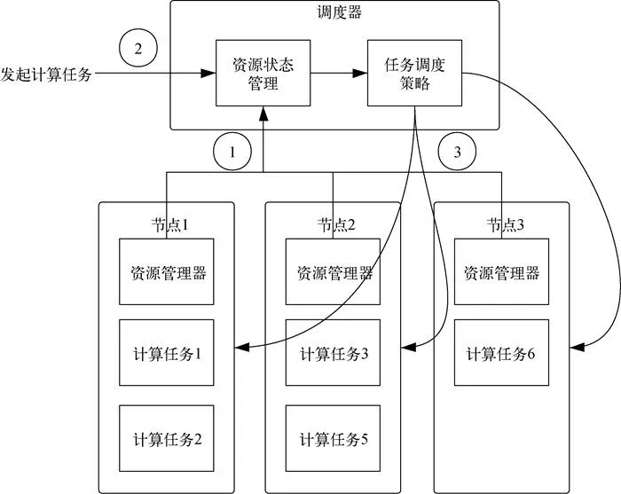

- 图 7-15　中央式调度策略

从图 7-15 也可看出，中央式调度器的调度过程分为以下三个步骤。

① 调度器的资源状态管理模块通过集群中节点上的资源管理器收集节点的资源信息。位于节点 1~3 上的资源管理器会将节点本地的资源信息汇集给调度器。

② 调度器的资源状态管理模块会接收用户发起的计算任务，并通过对集群中节点的资源掌握情况，将任务交由任务调度策略模块处理。

③ 任务调度策略模块根据具体的调度策略将任务分配给集群中的节点，使其运行。

要说中央式调度器的最佳实践，Borg 算得上是比较经典的一款了。Borg 是 Google 内部的集群资源管理系统，其上可以运行十万级的作业以及上千级的应用程序，同时还管理着数万级的服务器资源。Borg 的优势在于能够隐藏资源管理的细节，让用户聚焦于应用开发；支持应用的高可靠和高可用；管理数万节点，使其有效运行作业。在 Borg 系统中，用户以作业（Job）的形式向 Borg 提交任务并且请求运行，每个作业包含一个或多个任务（Task）。它们之间的关系如图 7-16 所示，多个作业运行在同一个 Borg 单元（Cell）中，这里说的单元是一组机器的集合。一个集群包括一个大单元和若干个小单元，大单元主要用来运行作业，小单元用来做测试和运行其他特殊应用。

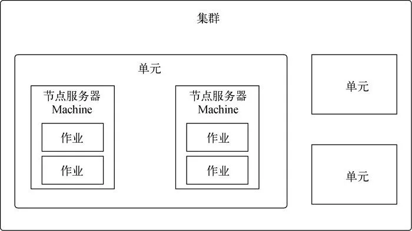

- 图 7-16　Borg 中集群、单元、节点服务器与作业的关系

一旦有作业提交，Borg 便会将其记录下来，并将作业中的所有任务加入执行队列中。调度器会去扫描这些任务，当有足够资源且符合作业限制条件的时候，就将任务部署到服务器节点上。这里的作业具有约束（Constraint）能力，能够强制任务在特定的服务器节点上运行，例如约束处理器架构、OS 版本、IP 地址等。之所以有这样的约束，是出于对资源异质性和工作负载异质性的考虑。

从资源异质性的角度看，集群中的各个服务器并无法保证硬件配置的一致性，会出现有些服务器配置较高，有些配置较低的情况。因此在进行资源分配的时候，需要考虑这种由硬件资源不均衡带来的差异性，需要对资源分配单位做进一步的拆分，然后针对较小的资源单元进行资源限制，以解决问题。

从工作负载异质性的角度看，用户申请的计算任务各异，有的是计算密集型任务，有的是 IO密集型任务；有的任务需要实时响应，有的任务需要长时间处理。同时，计算任务使用的框架和占用的资源也各有不同，因此对资源的需求也是有差异的。这也是为什么在调度的时候需要对资源匹配做限制的原因。

交代了 Borg 架构的基本概念以后，下面来看看其架构原理。如图 7-17 所示，是一张经典的Borg 系统架构图。

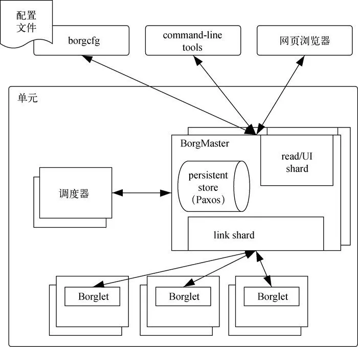

- 图 7-17　Borg 系统架构图

正如上面提到的，Borg 的单元（Cell）是包含一组服务器的集合。单元中包含一个BorgMaster，是逻辑中央控制器，其主要责任是处理客户的计算任务请求，管理系统对象的状态。这里的系统对象包括服务器节点、作业、任务。从图中的上方可以看到，BorgMaster 负责读取 borgcfg 文件中的配置信息，接收来自 command-line tools 的命令，以及与网页浏览器进行沟通。从下方可以看到，BorgMaster 还需要与 Borglet 保持通信，以随时获取服务器节点的信息。这里的 Borglet 是一个类似于资源管理器的角色，负责不断收集服务器上的资源情况，并且将收集结果汇总给 BorgMaster。

BorgMaster 拥有 5 个副本，每个副本都维护着单元状态的一份内存副本，从而实现了 Borg系统的高可用。当有作业提交时，persistent store（Paxos）中会增加一条记录，persistentstore 就是图 7-17 中类似数据库模样的组件。同时，作业中的任务会被增加到等待队列中。此时调度器，也就是图中左边的矩形组件会浏览该任务队列，并将任务分配给对应的服务器。

图 7-17 中调度器的调度算法包括可行性检查和打分。

可行性检查做的动作就是找服务器。这里会根据计算任务的情况找到满足任务约束、具备足够资源的服务器，结果可以是一个服务器也可以是多个。可行性检查之后，就是打分了，也就是通过打分的方式从可行性检查找到的服务器中选择、找寻最合适的那一个。在这里，Borg 使用了不同的打分策略。其中一种是 worst fit，这种策略会把任务分散到不同的服务器上执行，造成的问题是在服务器集群中留有大量碎片资源。相反，另一种叫作 best fit 的分配策略，会尽全力把任务塞到服务器中，以减少资源碎片，这样就可以空出未被作业占用的服务器，这些服务器可以用来存放大型任务。

再往下看图 7-17，每个服务器节点上都有一个 Borglet，它是用来管理本地的任务和资源的。BorgMaster 会周期性地向每个 Borglet 拉取任务和资源的状态。为了处理 BorgMaster 与Borglet 之间的通信，每个 BorgMaster 副本都会运行一个 link shard。当 Borglet 多轮没有响应资源查询时，BorgMaster 就会把这个 Borglet 所在的服务器资源标记为 down，并且将运行在这个服务器上面的任务重新分配给其他服务器。一旦出故障的 Borglet 恢复与 BorgMaster的通信，BorgMaster 就会通知新服务器上的 Borglet 杀死已经重新调度的任务，从而保证任务执行的一致性。

### 7.3.2　两级调度器

上一节给大家介绍了中央式调度器，其核心思想是由同一服务器管理和调度集群中所有的节点资源以及计算任务。好处是实现起来容易，缺点是负责管理和调度的服务器会成为性能瓶颈，限制调度规模和服务类型。为了解决这个问题，需要将资源管理和任务调度分开，也就是说一层调度器负责资源管理，一层调度器负责任务与资源的匹配。于是，两级调度（Two-LevelScheduler）应运而生。

将原来中心化的单个调度器分成两级，目的是更好地应对复杂的计算框架和高并发的计算任务。一级调度器的任务原来是管理资源和任务的状态，而面向不同的计算架构扩展出多个二级调度器后，一级调度器的主要任务就是匹配任务与资源，也就是执行调度策略。二级任务调度器又称为框架调度器，是面向不同类型的计算框架对一级调度器的扩展，假设调度架构需要处理 Spark、MapReduce、Storm 三类不同的计算任务，就可以在二级任务调度器中对调度框架进行扩展，既起到了与调度策略解耦的效果，又可以应对高并发的计算任务。下面就来看看两级调度器的结构和工作原理。两级调度器的结构如图 7-18 所示。

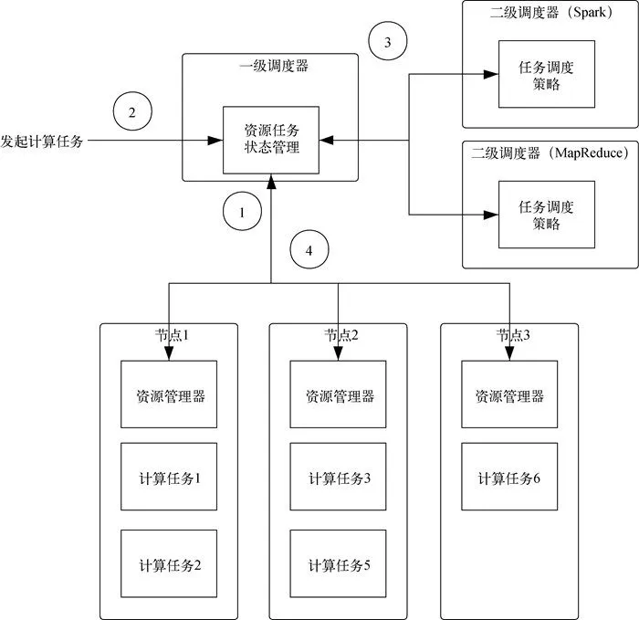

- 图 7-18　两级调度器的结构

这张图与图 7-15 的不同之处在于原来的中央式调度器被拆成了两级。一级调度器负责管理资源和任务的状态。根据计算框架的不同，对一级调度器做拆分，就得到了二级调度器，图 7-18 中是拆分成了 Spark 计算框架调度器和 MapReduce 计算框架调度器。同样是针对三个服务器节点进行任务和资源的匹配工作，这里分四步来完成。

① 一级调度器的资源任务状态管理模块通过集群中节点上的资源管理器收集各节点的资源信息，位于节点 1~3 中的资源管理器会将节点本地的资源信息汇集到一级调度器上。这个过程和中央式调度器是一样的，管理资源信息的工作依旧是由一级调度器完成。

② 一级调度器的资源任务状态管理模块会接收用户发起的计算任务，通过对集群中节点的资源掌握情况，将计算任务交由二级调度器对应的任务调度策略器处理。

③ 二级调度器接收到任务调度请求后，根据计算框架的调度策略对资源和任务进行匹配。通常来说，这也是两级调度器和中央式调度器的最大区别。图中创建了 Spark 计算框架调度器和MapReduce 计算框架调度器，会针对这两种计算框架对计算任务进行分类。在高并发的场景下，二级调度器也可以起到水平扩展的作用，提高节点的处理能力。

④ 二级调度器在处理完任务调度以后，会将结果返回给一级调度器，然后根据调度策略的结果将任务分配到对应的服务器节点上运行。同时，一级调度器会不断地监控资源和任务运行情况，保证任务的顺利运行。

Hadoop YARN 是两级调度架构的经典代表，下面就来看看它是如何实现两级调度框架的吧。

早在 Hadoop MapReduce 1.0 的时候，是通过中央式调度的方式对任务和资源做匹配。而从上面的介绍很容易知道，中央式调度器具有局限性，包括扩展性差、可靠性差、资源利用率低以及对无法支持多种计算框架等。YARN（Yet Another Resource Negotiator，另一种资源协调者）是 Hadoop 2.0 中的资源管理系统，其通用的资源管理模块为计算任务提供了统一的资源管理和调度。这一点从 MapReduce 2.0 的设计思路就可见一斑，它主要是将 JobTracker 的两个主要功能，即资源管理和作业控制，拆分成了两个进程，使得资源管理与作业运行无关。资源管理进程只负责集群资源的管理工作，作业的运行工作则由作业控制进程负责。这种拆分的方式正好与两级调度的思想相符合，不仅减轻了 JobTracker 的负载，还可以支持更多的计算框架。

从这个角度看，MapReduce 2.0 框架的变迁衍生出了资源管理系统 YARN。那么就从 YARN的组成结构和工作流程两方面来了解它的运行机制吧。YARN 总体上是 Master/Slave（主 /从）结构，其中 Resource Manager 作为全局资源的管理者，位于 Master（主服务器）上；Node Manager 作为节点资源的管理者，位于 Slave（从服务器）上。Resource Manager 负责管理和调度 Node Manager 上的资源。当用户通过客户端提交计算作业的时候，会通过Resource Manager 启动一个 Application Master（单任务管理器），Application Master 会跟踪并管理这个计算作业，同时会向 Resource Manager 申请资源，并通过 Node Manger 分配资源并且启动计算任务。这里简单描述了一下 YARN 的资源调度过程，其中提到了 YARN 的一些基本组件，这些组件构成了整个 YARN 系统，下面就逐个介绍它们。

- Resource ManagerResource Manager 顾名思义是 YARN 架构中的资源管理器，负责资源管理和作业分配。它由一系列组件组成，例如 Client Service、Administration Service、Application MasterService、Application Manager、Scheduler 等。其中后面两个组件尤为主要，即应用程序管理器和调度器。

- Scheduler 会根据资源容量、作业队列等条件，将资源分配给各个作业。它只负责调度，不负责作业的监控和跟踪以及作业状态的更新，具体作业运行失败之后的重启工作也不关注，这些工作都会交由 Application Master 完成。YARN 提供了多种 Scheduler，例如 FIFOScheduler、Fair Scheduler 和 Capacity Scheduler 等，用户也可以根据具体的要求自定义Scheduler。

- Application Manager 主要负责管理系统中提交的作业，包括作业提交、与调度器协商资源以及启动 Application Master、监控 Application Master 的运行状态并在运行失败时重新启动它等相关操作。

- Application MasterApplication Master 负责管理和监控单个应用程序 / 作业。用户每提交一个应用程序 / 作业，就需要注册生成一个 Application Master。其主要功能包括：与 Resource Manager 协商，以获取资源，这里的资源以 Container 的形式获取；将作业拆分成任务运行；与 NodeManger 联系，从而启动或者停止具体的任务；监控所有任务的运行状态，在任务运行失败时为其重新申请资源。

- Node Manager每个服务器节点上都存在一个 Node Manger（节点管理器），用来管理节点上的资源和任务。它会定时向 Resource Manager 获取节点上资源的状况和 Container 的运行状态。同时，接收来自 Application Master 的请求，启动或者停止对应的 Container。

- Container

- Container 是对 YARN 系统中资源做的抽象，在 7.2.1 节中，我们详细讲解了资源划分的原理，这里 Container 对服务器节点上的资源（例如 CPU、内存等）进行了封装。当Application Master 向 Resource Manager 申请资源时，Resource Manager 会根据Application Master 申请的作业情况，返回对应的资源容器，也就是 Container。针对不同的任务，Resource Manager 会分配不同的 Container。从资源隔离的原理可以知道，每个任务只能使用自身 Container 中的资源。YARN 中的 Container 使用了动态资源划分，是根据应用程序 / 作业的需求动态生成的。其资源隔离的机制来源与 CGroup 理论基本相同。

YARN 分两个阶段运行应用程序：第一个阶段是启动 Application Master；第二个阶段是由Application Master 创建应用程序，并为它申请资源以及监控它的整个运行过程，直到运行结束。如图 7-19 所示，上方是 Resource Manager，下方是服务器节点以及 Node Manager、Application Master 和 Container。

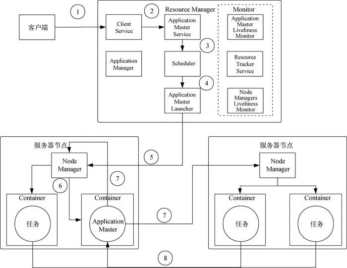

- 图 7-19　YARN 调度架构

沿着图 7-19 中的序号，YARN 的工作流程分为以下几个步骤。

① 客户端向 YARN 系统提交需要计算的应用程序 / 作业。客户端会生成 Application Master 程序、启动 Application Master 的命令等信息，交由 Resource Manager 中的 Client Service 处理。

② Client Service 在接收到客户端提交的信息后，产生应用队列等信息，交给 ApplicationMaster Service 进行注册。

③ Application Master Service 根据接收到的 Application Master 信息完成注册操作，同时异步传送给 Scheduler，以便进行后续的资源调度工作。

④ Scheduler 主要负责应用与资源的匹配，依据的调度策略有 FIFO、Fair、Capacity 等。在Scheduler 完成匹配以后，由 Application Master Launcher 执行分配资源以及运行Application Master 的操作。

⑤ Application Master Launcher 获取应用的调度信息后，负责通知 Node Manager，告知其需要分配的资源，并且加载 Application Master。

⑥ Node Manager 作为服务器节点上的管理者，接到资源调度的请求后，根据要求建立并启动Container，同时根据 Application Master 管理应用运行时需要的依赖包，以及相关配置文件。

⑦ 此时，Application Master 已经顺利在 Container 中运行了，由于每个作业都可能会被拆分成多个任务运行，就好像 MapReduce 作业需要拆分成多个 Map 任务和 Reduce 任务一样。此时，Application Master 会向集群中的 Node Manager 申请执行的任务，Node Manager 会在每个服务器节点上分配对应的 Container 以及在节点上运行的任务。

⑧ 分布在不同服务器节点上的任务会不断将自己的状态信息同步到 Application Master 上，直到任务执行完毕。同样，当作业执行完毕以后，Application Master 会向 Resource Manager发起注销申请，并且关闭自己。

除了 YARN 的整个调度流程之外，在图 7-19 的右上方还有一个用虚线框出的部分，这是YARN 架构的监控机制，其中的组件都属于 Resource Manager，下面是对这几个组件的介绍。

- Application Master Liveliness Monitor 负责接收 Application Master 发送的心跳消息，倘若Application Master 在规定时间内没有发送心跳信息，就判定作业运行失败，其资源将会被回收。然后 Resource Manager 会重新分配一个 Application Master 运行该作业。

- Resource Tracker Service 用来注册节点，节点在上线的时候会主动到 Resource TrackerService 中注册自己的信息，告诉它自身的资源持有情况。

- Node Managers Liveliness Monitor 负责监控服务器节点的心跳消息，与 Node Manager 进行通信。同其他的 Monitor 一样，如果规定时间没有收到心跳消息，则认为该节点无效。由于每个节点上都存在多个 Container，因此当认为某节点无效时，会将次节点上所有的Container 都标记成无效，从而不会调度任何作业到该节点上运行。

上面通过 YARN 调度系统，深入了解了两级调度器的实现原理，虽然两级调度器解决了调度器扩展和处理大数据量任务请求的问题，但是作为调度器来说，还是无法看到系统的所有资源。说白了，调度器没有全局视角，无法知道作业可以被分配到哪个服务器节点上运行，仅能感知资源管理器收集并提供的资源，以及资源管理器分配给应用程序 / 作业的部分资源。此问题可以总结为以下两点。

- 无法进行全局优化这点是站在优化角度看的，一般在任务开始运行的时候，并不需要知道系统　　资源的分配情况，但是会发生一种情况，即在集群资源紧张的时候，其中一个任务运行失败了，此时调度器需要做出是更换运行任务的资源节点还是继续在当前节点运行任务的选择？如果选择换一个资源节点运行任务，比如执行这个任务需要 4GB 资源空间，恰好此时其他节点的空间由于被分配出去，还剩下 2GB 资源空间，不够该任务运行，就会导致这个任务进入等待状态，从而任务的运行效率不高。如果此时调度器能够获取整个系统的资源情况，就不会将该任务分配给其他资源节点，而是继续在本节点上运行这个任务，这样可以优化资源调度。

- 悲观锁导致并发量受限在匹配任务与资源的时候，为了避免资源抢占冲突，也就是避免不同的作业抢占同一个资源，通常会对资源做加锁操作。两级调度器采用的是悲观锁并发调度，也就是事前预防资源

- 抢占的情况。具体地，在任务运行之前首先检查是否存在资源冲突的情况，如果不存在冲突就继续运行，否则等待或者进行回滚操作。在调度过程中，会将所有资源依次推送给每个计算框架，让这些框架依次匹配资源，从而保证不会出现多个计算框架使用同一块资源的情况。这种做法虽然避免了资源抢占冲突，但同时也减少了系统任务的处理并发量。

### 7.3.3　共享状态调度器

针对两层调度系统存在的全局优化和并发调度受限问题，推出了共享状态调度器（Shared-State Scheduler）。它提供了两点措施以完善二级调度器，第一，让集群全局资源对每个调度器均可见，也就是把资源信息转化成持久化的共享数据（状态），这里的共享数据就等于集群资源信息；第二，采取多版本并发访问控制（multi-version concurrency control）的方式对共享数据进行访问，也就是常说的乐观锁。乐观锁并发调度，强调事后检测，会在任务提交的时候检查资源是否存在冲突，如果不存在冲突就继续运行，否则进行回滚操作或者重新运行。也就是说，它是在执行匹配调度算法之后进行冲突检测，优点是能够处理更高的并发量。

共享状态调度的理念最早是 Google 针对两层调度器的不足而提出的。其典型代表有 Google的 Omega、微软的 Apollo，以及 Hashicorp 的 Nomad 容器调度器。

这里就以 Google 的 Omega 架构为例给大家介绍，内容的主要思想来自于论文“Omegaflexible, scalable schedulers for large compute clusters”，有兴趣的读者可以参考阅读。

Omega 由于使用了共享状态调度的思想，因此将资源分组、限制资源使用量、限制用户资源使用量等功能都交由调度器进行管理和控制，只是将优先级限制放到了共享数据的验证代码中，也就是说当多个作业同时申请同一份资源时，优先级最高的作业将获得该资源，其他资源限制全部下放给各个调度器执行。

Omega 架构

Omega 架构中没有中心资源分配器，所有资源分配决策都由应用的调度器自己完成。与 Borg架构类似，Omega 中也有一个单元（Cell）的概念，每个单元分别管理集群中的一部分服务器节点，一个集群由多个单元组成。单元中资源的状态由 Cell State 记录，同时 Omega 会在State Storage 里维护 Cell State 的主复制，每个调度器中都会维护一个 Cell State 的备份信息，用来和 State Storage 保持同步，从而保证每个调度器都能够获得全局的资源信息。Omega 调度架构如图 7-20 所示。

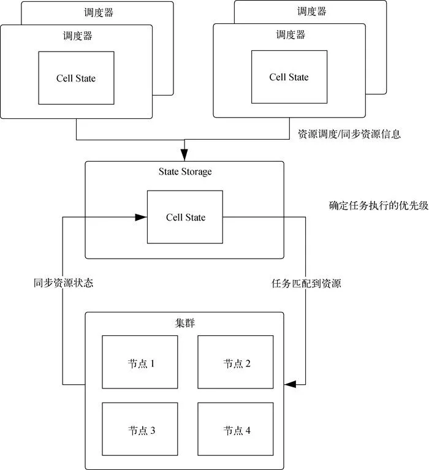

- 图 7-20　Omega 调度架构

图中上面的部分是多个调度器，主要负责作业和资源的调度工作，会和图中间的 StateStorage 同步 Cell State 的主复制，通过不断地同步可以获得集群中所有节点的资源情况。

State Storage 会不断地从集群中搜集 Cell State 信息，用作调度器同步。当调度器确定了作业与资源的分配方案后，会通过原子的方式更新共享的 Cell State，也就是通过乐观锁的方式将分配方案提交给 Cell State。之后，调度器会重新同步本地的 Cell State 到 State Storage 的Cell State 中，此时其他调度器可以通过同步 State Storage 中的 Cell State，得知全局资源的使用情况。

在分布式架构中，往往会将一个较大的计算任务拆分成多个小的任务并行处理。Omega 架构的资源调度也是如此，在执行应用程序或者计算作业时，调度器会将这个作业拆分成多个任务，然后对这些任务和资源进行匹配。由于根据任务复杂度和分配资源情况的不同，各任务完成的时间也不尽相同，因此先完成的任务会释放资源，让其他任务使用该资源。这也造就了任务与资源之间多对多的关系。再由于一个作业的完成依赖全部任务的完成，因此调度器会设置多个 Checkpoint 来检测资源是否都已经被占用，当作业的所有任务都匹配到可用资源的时候，才能调度该作业。

这里的作业相当于一个事务，也就是说，当所有任务都匹配成功后，这个事务就会被成功提交，如果存在匹配不到可用资源的任务，这个事务就需要执行回滚操作，作业调度失败。Omega 作业调度的示意图如图 7-21 所示。

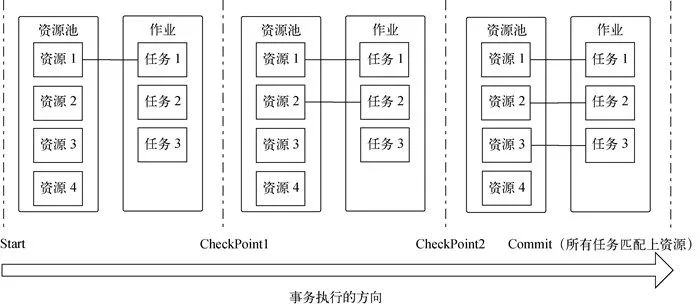

- 图 7-21　Omega 作业调度

图 7-21 中，从左往右是 Omega 作业调度执行的方向。从最左边开始看，在虚线 Start 之后，Omega 开始进行作业的调度工作。可以看到资源池中已经收集好了集群中各资源的信息，作业也分成了三个任务（Task1~3）。在开始调度之后，资源 1 和 任务 1 匹配在了一起，完成资源匹配以后会设置 CheckPoint1 作为检查点，用来检查资源 1 是否有被其他任务占用，如果没有，就将资源 1 分配给任务 1，继而进入后面的资源分配。如果说无法获取资源 1，或者在资源 1 执行任务 1 的时候失败了，就会回滚到上一个状态，也就是回滚到 Start 状态，重新开始资源分配工作。以此类推，在 CheckPoint1 之后，调度器继续进行资源分配，让资源 2 与任务 2 相匹配，并且设置 CheckPoint2 作为检查点。如果资源 2 被占用或者任务 2 执行失败，就会回滚到 CheckPoint1 继续进行资源调度。如果成功，则进入第三步，让资源 3 和任务 3 相匹配，并且同样设置检查点。如果上述匹配都完成，就提交整个作业的调度结果，表示整个作业调度完成。

上述这个例子相对来说较为理想化，其实在整个调度过程中可能会出现资源的占用和释放，任务和资源之间有多对多的对应关系，以及其他一些情况，例如当任务 1 执行失败的时候，再次分配给它的资源可能是资源 2，而非先前的资源 1。又例如，在 CheckPoint1 之后，为任务 2分配资源的时候，有其他任务释放了资源 5，此时将资源 5 分配给了任务 2。这里 Omega 调度使用了乐观锁，也就是说在申请资源的时候不会立刻将资源加上排他锁，只有在真正分配资源或者执行任务的时候才上锁，同时检查资源是否被占用。只有发现资源被占用或者任务执行失败，相关的 CheckPoint 才会被回滚。只有当作业中的所有任务都被分配了资源，才认为整个作业被成功提交了，这里借助了数据库中事务的设计思路。

到此为止，我们介绍了分布式调度架构中的三种调度方式，分别是中央式调度、两级调度和共享状态调度，这里做一个小结。

- 中央式调度，由中央调度器管理整个集群的资源和任务，资源的管理和任务的调度集中于单个调度器中心。优点是中央调度器拥有整个集群的资源，能够实现调度的全局优化。缺点是面对大量并发任务的时候，存在单点瓶颈问题，所有的任务请求和调度都需要由一个调度器处理，导致这种方式受限于并发量小的集群调度场景。

- 两级调度，是将资源管理和任务调度分为两层。一层调度器负责管理集群资源，将资源信息发送给调度层。另一层调度器负责任务调度，接收第一层发送过来的资源信息，然后进行具体的任务调度工作。这种模式增加了任务的并发量，缺点是调度层对全局资源不可见，导致调度算法无法实现全局最优。这种调度模式适合于中等规模的集群调度。

- 共享状态调度，每个调度器都可以获取集群中所有的资源信息，进行调度。可以实现资源与任务匹配的算法最优，由于任务与节点匹配具有多对多的关系，会出现资源竞争的状况，因

- 此引入乐观锁的方式协助调度。这种调度方式更适用于大规模的集群调度。

## 7.4　Kubernetes——资源调度的实践

分布式的资源调度在软件开发领域应用得很广泛，除了前面提到的大数据计算的MapReduce、Spark 等总被使用到以外，分布式应用部署在微服务时代也有被用到。特别是高并发的应用场景使得微服务架构成为了各个公司的标配。微服务以容器形式发布，随着业务的发展，系统中遍布着各种各样的容器。于是，容器的资源调度、部署运行、扩容缩容就变成了我们要面临的问题。Kubernetes 作为容器集群的管理平台，得到了广泛应用，下面就来看看 Kubernetes 的架构及其各组件的运行原理，作为对本章分布式资源调度理论的补充。

### 7.4.1　Kubernetes 架构概述

Kubernetes 是用来管理容器集群的平台。既然是管理集群，就一定存在被管理的节点，针对每个 Kubernetes 集群，都有一个负责管理和控制集群节点的 Master，Master 可以向每个节点发送命令。简单来说，Master 是管理者，节点就是被管理者。节点可以是一个服务器或者一个虚拟的资源容器。在节点上面，可以运行多个 Pod，Pod 是 Kubernetes 管理的最小单位，每个 Pod 可以包含多个资源容器。图 7-22 为 Kubernetes 的架构简图，通过这张图可以看到 Master 和节点的关系。

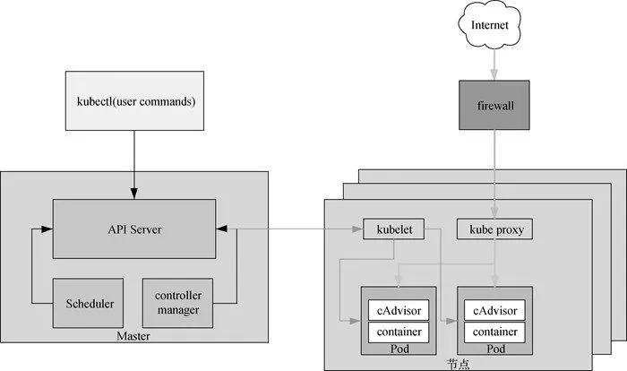

- 图 7-22　Kubernetes 架构简图

如图 7-22 所示，用户通过图左上方的 kubectl 对 Kubernetes 下命令，kubectl 通过 APIServer 调用各个进程，来完成对集群中节点（图右边部分）的部署和控制。API Server 的核心功能是对核心对象（例如 Pod、Service）做增删改查操作。API Server 同时也是集群内模块之间数据交换的枢纽，包含常用的 API、访问（权限）控制、注册和 etcd（信息存储）等功能。在它的下面，我们可以看到 Scheduler，它负责将待调度的 Pod 绑定到节点上，并将绑定信息写入 etcd 中。etcd 是用来存储资源信息的。接下来是 controller manager，如果说Kubernetes 是一个自动化运行的系统，那么就需要一套管理规则来控制这个系统，controllermanager 就是这个管理者，或者说控制者。controller manager 包括 8 个 controller，分别对应副本、节点、资源、命名空间、服务等。紧接着，Scheduler 会把 Pod 调度到节点上，调度完后就由 kubelet 来管理节点了。kubelet 用于处理 Master 下发到 Node 上的任务（即Scheduler 的调度任务），同时管理 Pod 及 Pod 中的容器。在完成资源调度以后，kubelet 进程也会在 API Server 上注册节点信息，定期向 Master 汇报节点信息，并通过 cAdvisor 监控容器和节点资源。由于微服务的部署都是分布式的，所以对应的 Pod 以及容器的部署也是分布式的。为了能够方便地找到这些 Pod 或者容器，引入了 Service（kube proxy）进程，负责反向代理和负载均衡的实施。

以上就是对 Kubernetes 架构的简易说明，涉及一些核心概念以及简单的信息流动。图 7-22简单介绍了 Kubernetes 的工作原理和架构，其中涉及一些组件和工作方式，为了更加清楚Kubernetes 的运行过程和工作原理，我们后面会用一个简单的例子把这些组件串起来。

### 7.4.2　从一个例子开始

假设要使用 Kubernetes 把 Tomcat 和 MySQL 应用部署到两个节点上。如图 7-23 所示，其中Tomcat 应用生成了两个实例，也就是两个 Pod，用来对 Tomcat 应用做水平扩展。这里的Pod 是资源容器的最小单位，作为容器用来承载应用程序。MySQL 应用只部署了一个实例，包含在一个 Pod 中。可以通过外网访问 Tomcat 应用，而 Tomcat 应用可以在内网访问MySQL 应用。

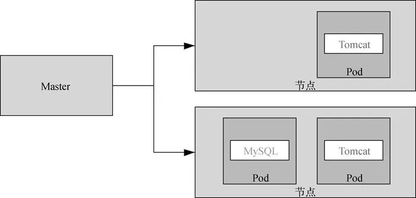

- 图 7-23　Kubernetes 例子的部署示意图

上图为了介绍部署和资源调用的过程，对部署过程做了简化。下面重点看 Kubernetes 是如何部署和管理容器的。

### 7.4.3　kubectl 和 API Server

既然我们要完成 7.4.2 节的例子，就要先部署两个应用。

首先，根据要部署的应用建立 Replication Controller（后面会简称为 RC）。RC 用来声明应用副本的个数，也就是 Pod 的个数。按照上面的例子，Tomcat 应用的 RC 就是 2，MySQL 应用的 RC 就是 1。kubectl 作为用户接口，负责向 Kubernetes 下发命令，命令是通过名称后缀为 .yaml 的配置文件编写的。在下述代码中，我们定义一个名为 mysql-rc.yaml 的配置文件，来描述 MySQL 应用的 RC：

```
apiVersion: V1
kind: ReplicationController
metadata:
   name: mysql     ①
spec:
   replicas:1           ②
   selector:
app: mysql
   template:           ③
metadata:
   labels:
       app:mysql     ④
spec:
   containers:      ⑤
       -name:mysql
       Image:mysql     ⑥
       Ports:
       -containerPort:3306   ⑦
       Env:          ⑧
       -name:MYSQL_ROOT_PASSWORD
       Value:"123456"
```

下面按序号分析一下这段代码。

① RC 的名称，这个也是 RC 在集群中的唯一名称。

② 定义期待的 Pod 副本的数量，由于这里是配置 MySQL 的 RC，所以根据前面的介绍配置为 1。

③ 配置 Pod 的模板，这里可以通过模板的方式创建 Pod，只不过在这个例子中暂时为空。

④ 针对 Pod 副本设置标签。

⑤ 对容器进行具体的定义。

⑥ 定义容器对应的具体镜像的名称。如果使用 Docker 作为镜像，这里就填写 Docker 镜像的名称。

⑦ 配置容器应用监听的端口号。

⑧ 注入容器的环境变量，例如容器访问的用户名、密码等。

从上面的配置文件可以看出，需要为这个 RC 定义一个名字，期望的副本数，以及容器中的镜像文件。如图 7-24 所示，以 kubectl 作为客户端的 cli 工具，执行这个配置文件。


- 图 7-24　利用 kubectl 命令执行 yaml 文件

通过 kubectl 执行 RC 配置文件

执行了上面的命令以后，Kubernetes 会帮助我们把副本 MySQL 的 Pod 部署到服务器节点。回到最开始的架构图，如图 7-25 中虚线包围的部分，可以看到 kubectl 会向 Master 中的 APIServer 发起命令。

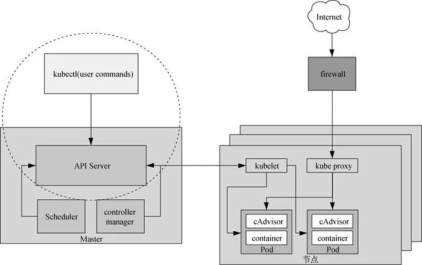

- 图 7-25　kubectl 与 API Server 部分

Kubernetes API Server 通过一个名为 kube-apiserver 的进程提供服务，该进程运行在 Master上。可以通过 Master 的 8080 端口访问 kube-apiserver 进程，该端口提供 REST 服务，因此可以通过命令行工具 kubectl 来与 Kubernetes API Server 交互，它们之间的接口是 RESTfulAPI。

如图 7-26 所示，API Server 的架构从上到下分为四层。

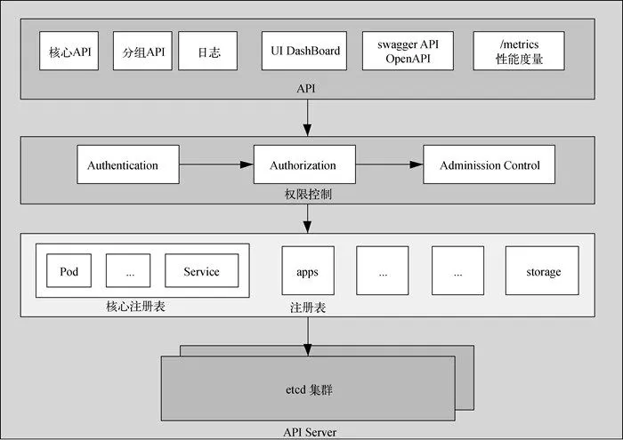

- 图 7-26　API Server 分层架构图

- API 层：主要以 REST 方式提供各种 API 接口，有针对 Kubernetes 资源对象的 CRUD（增删改查）和 Watch（监听）等主要 API，以及健康检查、UI、日志、性能指标等与运维监控相关的 API。

- 权限控制层：负责身份鉴权（Authentication），核准用户对资源的访问权限（Authorization），设置访问逻辑（Admission Control）。

- 注册表层：选择要访问的资源对象。注意：Kubernetes 把所有资源对象都保存在注册表（Registry）中，例如 Pod、Service、Deployment 等。

- etcd 集群：保存所创建副本的信息，是用来持久化 Kubernetes 资源对象的 Key-Value 数据库。

当 kubectl 利用 Create 命令建立 Pod 时，先通过 API Server 中的 API 层调用对应的 RESTAPI 方法，然后进入权限控制层，通过 Authentication 获取调用者的身份，通过 Authorization获取权限信息。在 Admission Control 中可以配置权限认证插件，通过插件来检查请求约束。

例如：在启动容器之前，需要下载镜像，或者检查具备某命名空间的资源。还记得我们在mysql-rc.yaml 文件中将需要生成的 Pod 个数配置为 1 吧，到了注册表层会从核心注册表资源中取出 1 个 Pod 作为要创建的 Kubernetes 资源对象。之后将 Node、Pod 和 Container 的信息保存到 etcd 中去。这里的 etcd 可以是一个集群，由于里面保存着集群中各个 Node、Pod、Container 的信息，因此在必要时需要备份，或者保证其可靠性。

### 7.4.4　controller manager、Scheduler 和 kubelet

前面讲了 kubectl 和 API Server。实际上还没有真正地开始部署应用，这里需要 controllermanager、Scheduler 和 kubelet 的协助才能完成整个部署过程。

在介绍它们的协同工作之前，需要介绍一下 Kubernetes 中的监听接口。从上面的操作知道，所有的部署信息都会写到 etcd 中保存下来。实际上，etcd 在存储部署信息的时候，会给 APIServer 发送 Create 事件，而 API Server 会监听 etcd 发过来的事件，其他组件会监听 APIServer 发出来的事件。Kubernetes 就是用这种 List-Watch 的机制保持数据同步。如图 7-27所示，图上面列出了 kubectl、kube-controller-manager、kube-scheduler 和 kubelet 组件，中间是 kube-apiserver，最下面是 etcd。由虚线框起来的部分代表 3 个 List-Watch。

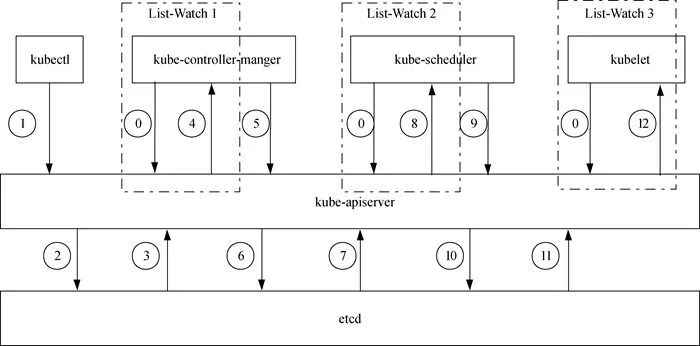

- 图 7-27　kubectl、kube-controller-manager、kube-scheduler、kubelet、kube-apiserver、etcd 之间的调用关系

这里有三个 List-Watch（1~3），分别是 kube-controller-manager（运行在 Master 上），kube-scheduler（运行在 Master 上），kublete（运行在服务器节点上）。进程一启动，它们就会监听API Server 发出来的事件。让我们跟随图中线段上的数字标号来看看几个组件之间的调用过程吧。

① kubectl 通过命令行工具，在 API Server 上建立一个 Pod 副本。

② 这个部署请求被记录到 etcd 中并保存起来。

③ 当 etcd 接收到创建 Pod 的信息后，会发送一个 Create 事件给 API Server。

④ 由于 kube-controller-manager 一直在监听 API Server 中的事件，因此 API Server 接收到Create 事件后，又会发送给 kube-controller-manager。

⑤ kube-controller-manager 在接到 Create 事件后，会调用 replication controller 来保证服务器节点上需要创建的副本数量。在上面的例子里，MySQL 应用的副本数量是 1 个，Tomcat应用的副本数量是 2 个。一旦副本数量少于 RC 中定义的数量，replication controller 就会自动创建副本。总之，replication controller 是用来保证副本数量的控制器（扩容缩容的担当）。

⑥ kube-controller-manager 创建 Pod 副本以后，API Server 会在 etcd 中记录这个 Pod 的详细信息。例如 Pod 的副本数量是多少，Container 的内容是什么。

⑦ 同样地，etcd 会将创建 Pod 的信息以事件形式发送给 API Server。

⑧ kube-scheduler 在监听 API Server，并且它在系统中起“承上启下”的作用，“承上”是指它负责接收创建的 Pod 事件，为其安排服务器节点；“启下”是指安置工作完成后，由服务器节点上的 kubelet 服务进程接管后继工作，负责 Pod 生命周期中的“下半生”。换句话说，kube-scheduler 的作用是将待调度的 Pod 按照调度算法和策略绑定到集群中的服务器节点上，并将绑定信息写入 etcd 中。

⑨ kube-scheduler 调度完毕以后，会更新 Pod 的信息。此时的信息更加丰富了，我们除了知道 Pod 的副本数量、Container 的内容，还知道 Pod 部署到了哪个节点上。

⑩ 同样，将上面的 Pod 信息更新到 etcd 中，保存起来。

⑪ etcd 将信息更新成功的事件发送给 API Server。

⑫ 注意，这里的 kubelet 是在服务器节点上运行的进程，它也会通过 List-Watch 的方式监听API Server 发送的 Pod 更新事件。实际上，创建 Pod 的工作在第 ⑨ 步就已经完成了。为什么 kubelete 还要一直监听呢？原因很简单，假设这个时候 kubectl 发命令，要把原来的MySQL 的 1 个 RC 副本扩充成 2 个，那么这个流程又会触发一遍。作为服务器节点的管理者，kubelet 也会根据最新的 Pod 部署情况调整节点端的资源。又或者 MySQL 应用的 RC 个数没有发生变化，但是其中的镜像文件升级了，kubelet 也会自动获取最新的镜像文件并加载。

通过上面对 List-Watch 的介绍，大家可以发现除了之前引入的 kubectl 和 API Server 以外，又引入了 controller manager，Scheduler 和 kubelet。回到 Kubernetes 的架构图，下面聚焦于图 7-28 中的虚线部分，介绍这三个组件的作用和原理。

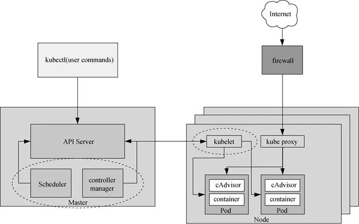

- 图 7-28　controller manager、Scheduler、kubelet

1. controller ManagerKubernetes 需要管理集群中的不同资源，所以针对不同资源建立了不同的控制器。每个控制器都是利用监听机制获取 API Server 中的事件（消息），它们通过 API Server 提供的（List-Watch）接口监控集群中的资源，并且调整资源的状态。可以把 controller manager想象成一个尽职的管理者，负责随时管理和调整资源。比如 MySQL 应用所在的节点意外死机了，controller manager 中的 Node Controller 就会及时发现故障，并执行修复流程。在部署着成百上千个微服务的系统中，这个功能极大地减轻了运维人员的负担。从此可以看出，controller manager 是 Kubernetes 的资源管理者，是运维自动化的核心。

2. Scheduler 与 kubeletScheduler 的作用是按照算法和策略将待调度的 Pod 绑定到服务器节点上，同时将信息保存在 etcd 中。如果把 Scheduler 比作调度室，那么它需要关注的事情有三件：待调度的Pod、可用的服务器节点、调度算法和策略。简单地说，就是根据调度算法和策略把 Pod放到合适的服务器节点中去。此时，服务器节点上的 kubelet 通过 API Server 监听到Scheduler 产生的 Pod 绑定事件，然后通过 Pod 的描述装载镜像文件，并且启动Container。也就是说 Scheduler 负责思考把 Pod 放在哪个 Node 中，然后将决策告诉kubelet，kubelet 负责把 Pod 加载到服务器节点中。说白了，Scheduler 就是老板，kubelet 则是干活的工人，它们通过 API Server 交换信息。如图 　　7-29 所示，Scheduler与 kubelet 通过 4 个步骤进行资源调度。

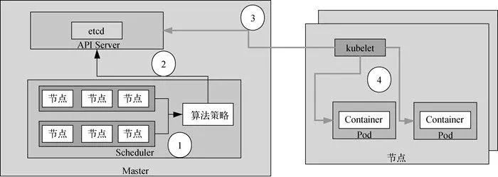

- 图 7-29　Scheduler 和 Kubelet 的协同工作图

- 下面是对 4 个步骤的详细阐述。

- ① Scheduler 收集 Pod 和节点信息，并且将信息交给算法策略。

- ② 算法策略进行资源匹配，把 Pod 与节点的匹配结果保存到 etcd 中，这个过程也叫绑定信息。

- ③ kubelet 作为节点上的管理者，通过 API Server 获取 Pod 的分配信息。

- ④ kubelet 接收到资源调度信息后，在节点上对 Pod 信息进行分配，完成 Container 的装载。

### 7.4.5　Service 和 kubelet

至此，我们介绍了通过 kubectl 向 API Server 下达部署指令，由 controller manager 管理集群中的资源，Scheduler 负责对资源与部署的应用进行匹配，通过 API Server 告知 kuebelet，从而部署应用。如图 7-30 所示，正如本节开始提到的部署 MySQL 应用和 Tomcat 应用的例子，Kubernetes 已经按照上面的流程将 MySQL 应用部署到对应的节点上了。

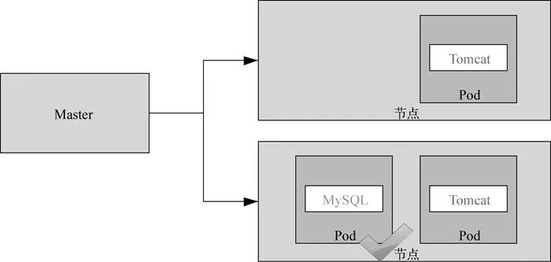

- 图 7-30　MySQL 部署成功

我们如法炮制，还是按照这个流程，将 Tomcat 应用部署到节点的 Pod 中。假设现在 Tomcat应用需要访问 MySQL，在 Kubernetes 中该如何实现呢？实际上可以把这个问题抽象成一个Pod 中的应用如何访问其他 Pod 中的应用？对此，Kubernetes 提供了 Service 机制，可以帮助 Pod 相互访问。Kubernetes 中的 Service 机制定义了一个服务的访问入口地址，也就是 IP地址和端口号，Pod 中的应用可以通过这个地址访问一个或者一组 Pod 副本。Service 与后端Pod 副本集群之间通过 Label Selector 连接在一起。Service 访问的一组 Pod 会有同样的Label，通过这样的方法就能知道哪些 Pod 属于同一个组。在 Pod 中可以实现服务的水平扩展，如果对多个 Pod 打上相同的 Label，实际上就表示它们提供相同的服务。如图 7-31 所示，图中最左边是 Tomcat 应用的 Pod，顺着向右的箭头看，Pod 调用了 Service，并且在调用的时候带上了 Label 为 MySQL 的信息，说明要调用 MySQL 应用的 Pod。箭头经过Service 以后，指向了 Label Selector 框，Label Selector 负责描述和管理 Label。由Replication Controller 中的 replica=3 我们可以知道，MySQL 的 Label 有三个副本。箭头经过Label Selector 之后，向右连接到了三个 MySQL Pod 上，它们都带有 MySQL 的 Label，表明这些 Pod 都提供 MySQL 的应用，都可以被 Tomcat 应用的 Pod 调用。

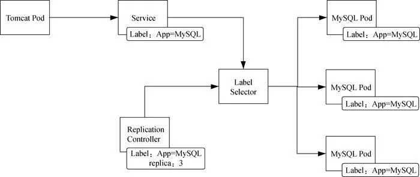

- 图 7-31　一个 Pod 通过 Service 访问其他 Pod

上面将 Tomcat 应用调用 MySQL 应用的过程描述了一遍，可知 MySQL 需要以 Service 的方式暴露给其他应用并被调用，因此这里对 MySQL 应用的配置文件做一个声明，具体如下：

```bash
apiVersion : v1
kind: Service     ①
metadata:
   name: mysql     ②
spec:
   prots:
-port: 3000      ③
targetPort:3306
   selector:            ④
       app: MySQL
```

下面按序号分析一下这段代码。

```bash
① 在配置文件中，声明类型为 Service，这也是所创建的资源对象的类型。
② 为服务起一个全局的名字 mysql。
③ 设置 Service 对外暴露的端口号，也就是在集群内调用 Service 的端口号，这里是 3000。
targetPort 是 Service 对应调用的 Pod 的端口号，这里是 3306。回到 7.4.3 节，注意看
代码中的第 ⑦ 步，会发现这里定义的端口号和 MySQL 定义的 RC 的 containerPort:
3306 是一样的。也就是说，Service 通过对外的 3000 端口将请求转接给了 MySQL Pod 的
```

3306 端口。

④ 定义 Service 对应的 Pod 标签，用来对 Pod 分类。拥有相同标签的 Pod 能够提供相同的应

```
用服务，这里设置标签为 MySQL。
运行 kubectl，创建 Service，并且显示服务创建成功。通过 create 命令行，以上面定义的
mysql-svc.yaml 作为参数。回车以后显示 service "mysql" created。相关代码如下：
# kubectl create -f mysql-svc.yaml
service "mysql" created
创建完服务以后，通过 get svc 命令查看 Service 的信息，如下面的代码所示：
```

```
# kubectl get svc
NAME     CLUSTER-IP        EXTERNAL-IP           PORT(S)          AGE
mysql    192.168.1.1       <none>                3000/TCP         20s
在命令行返回的信息中，Cluster-IP 192.168.1.1 和 PORT 3000 是由 Kubernetes 自
```

动分配的。也就是说，集群内的 Pod 可以通过地址 192.168.1.1 和端口号 3000 访问 MySQL

```
服务。这里的 Cluster-IP 和 Port 是 Kubernetes 集群的内部地址，是提供给集群内的
Pod 相互访问时使用的，外部系统无法通过这个 Cluster-IP 来访问 Kubernetes 中的应
用。这一点可以从 EXTERNAL-IP 为 <none> 看出来。
```

上面提到的 Service 只是逻辑概念，真正将 Service 落实的是 kube-proxy 进程。只有理解了kube-proxy 的原理和机制，才能真正理解 Service 背后的实现逻辑。

上面提到，一组 Pod 通过 Label 的方式抽象成一个 Service，Service 会提供统一接口对外提供服务。因此每个 Service 都会有一个虚拟 IP 地址和端口号，供客户端访问。kube-proxy 就是运行在各个节点上，作为 Service 功能的具体实现，实现的场景分为两种：第一种，集群内的客户端 Pod 访问 Service；第二种，集群外的主机通过 NodePort 等方式访问 Service。在Kubernetes 中，kube-proxy 默认使用的是 iptables 模式，由于 kube-proxy 进行运行在集群中的各个节点上，因此要对每个节点配置 iptables 的规则，从而实现 Service 的负载均衡。可以说 Kube-proxy 就是 Kubernetes 集群的负载均衡器。

如图 7-32 所示，节点上运行着一个 kube-proxy 服务进程，别的节点既可以通过内部的 Pod访问 kube-proxy，也可以通过节点之外的客户端访问。无论通过哪种方式访问，都需要通过

```
集群自动分配的 Cluster IP 和 Port，然后通过 iptables 规则做 DNAT（Destination
```

Network Address Translation）的转换，也就是将地址转换为 Pod 的真实 IP 和端口号。通过这种方式让请求传递到真实的 Pod 上面，完成整个调用过程。

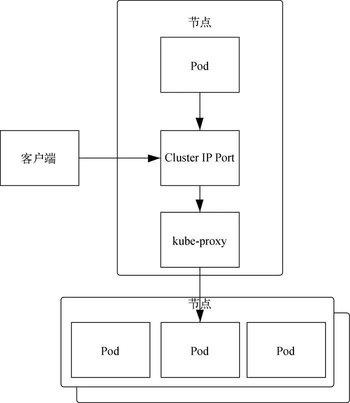

- 图 7-32　通过 kube-proxy 访问 Pod

图 7-31 的例子说明了集群内部的 Tomcat Pod 如何调用同处集群内部的 MySQL Pod。这属于集群内部 Pod 之间的调用，那么集群外部的客户端如何调用 Pod 呢？首先肯定要生成对应的RC 文件，具体的操作步骤和生成 MySQL 的 RC 文件相似，这里我们把关注点放到 Service文件的编写上：

```
apiVersion : v1
kind: Service
metadata:
   name: myweb
spec:
   prots:
-port: 8080
nodePort: 30001     ①
   selector:
       app: myweb
注意观察 ① 标记的部分，Tomcat 的 Service 中多了一个 nodePort 的配置，值为 30001。
```

也就是说，外网通过 30001 这个端口和 Node IP 的组合就可以访问 Tomcat 了。由于例子中我们部署了两个 Tomcat 应用，如果要在集群之外访问它们，需要通过 Kubernetes 集群的 IP地址，我们称之为 Cluster-IP，这是一个虚拟的 IP，仅供 Kubernetes 内部的 Pod 之间相互通

```
信。节点作为一个物理节点，需要使用节点 IP 地址和 nodePort 的组合来从 Kubernetes 外
```

面访问内部应用。如图 7-33 所示，Kubernetes 集群之外的外部网络用户需要通过负载均衡器（Load Balancer）访问集群内部的 Pod 资源。

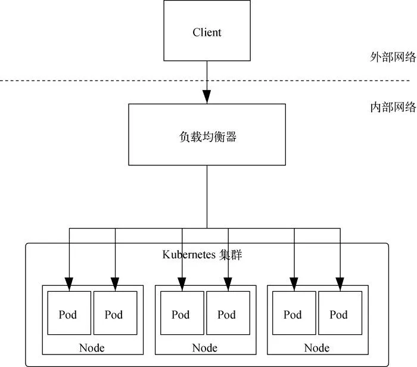

- 图 7-33　外部网络与 Kubernetes 集群之间的负载均衡器

如图 7-34 所示，MySQL（RC 1）和 Tomcat（RC 2）已经部署在 Kubernetes 里了。并且，Kubernetes 内部的 Pod 之间是可以互相访问的，从外网也可以访问到 Kubernetes 内部的Pod。

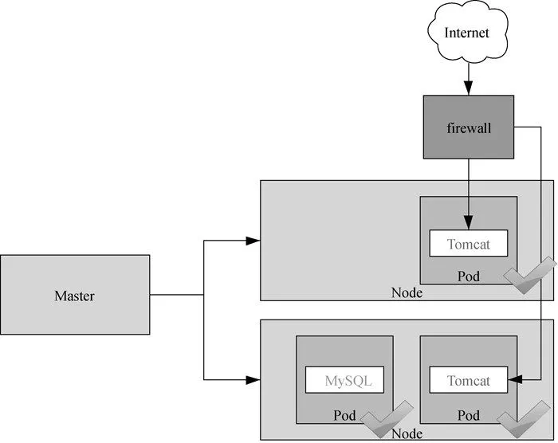

- 图 7-34　Kubernetes 内部的 Pod 互相访问，从外网访问 Pod

由于这一节提到了几个 Port 的概念，大家容易弄混，因此这里做一个统一的解释。

- nodePort。为集群外部的客户端提供了访问 Service 的端口，也就是外部的客户端需要通过节点 IP 和节点端口号的方式访问集群中的资源。

- Port。是 Cluster IP 上的端口，也就是集群内部用户通过集群 IP 和端口的方式访问集群中的资源。

- targetPort。是 Pod 上的端口，通过 Port 和 nodePort 的方式，经过 kube-proxy 进程流入对应 Pod 的 targetPort 上，从而实现访问资源。

本节从一个简单的创建应用副本的例子入手，介绍了各个重要组件的概念和基本原理。Kubernetes 是用来管理容器集群的，Master 作为管理者，包含 API Server、Scheduler、controller manager 组件。Node 作为副本部署的载体，包含多个 Pod，每个 Pod 又包含多个container。用户通过 kubectl 给 Master 中的 API Server 下达部署命令，命令主体是以 .yaml为结尾的配置文件，包含副本的类型、副本个数、名称、端口、模板等信息。API Server 接收到请求以后，会依次进行以下操作：权限验证（包括特殊控制），取出需要创建的资源，保存副本信息到 etcd。API Server 和 controller manager，Scheduler 以及 kubelete 之间通过List-Watch 的方式通信（事件发送与监听）。controller manager 通过 etcd 获取需要创建资源的副本数，交由 Scheduler 进行策略分析，最后 kubelet 负责最终的 Pod 创建和容器加载。

## 7.5　总结

本章从资源调度的原理切入，提出了资源调度需要解决的问题。介绍了静态资源调度和动态资源调度，以及动态资源调度的优势。分布式资源调度的内容包括任务的组织和管理，调度策略和资源的组织和管理，从过程上主要分为资源划分和调度策略（任务与资源的匹配），因此以这两点为起点展开讨论任务和资源是如何匹配的。资源划分以 Linux Container 为基础，说明了其隔离性、安全性、透明性、扩展性。而后通过介绍 Linux Container 的实现机制了解了多种隔离模式，包括主机隔离、文件系统隔离、进程间通信隔离、进程隔离、用户隔离、网络隔离。还介绍了处在隔离资源内部的进程是如何管理的，这里主要讲了 CGroup 的实现机制。花开两朵，各表一枝，说完了资源的划分，接着聊了一下调度策略，这里主要从任务队列和资源池切入，介绍了三大资源调度策略，包括 FIFO 调度、Capacity 调度和 Fair 平调度。有了资源划分和调度策略以后，使用什么样的框架让它们协同工作呢？于是引出了分布式调度的三个框架：中央式框架调度框架、两级调度框架和共享状态调度框架。分布式调度不仅仅是用在计算任务的资源调度中，也用在微服务的部署和调用中。最后，通过一个应用部署的例子，介绍了 Kubernetes 是如何实现分布式部署和管理的，分别介绍了 kubectl、API Server、controllermanager、Scheduler 等 Kubernetes 组件的实现。
