# 第8章高性能与可用性(2)

## 8.2　可用性

8.1 节从缓存的角度介绍了分布式系统的高性能，本节要讲可用性是分布式系统已经具备的性质。将应用或者服务分布式部署本身就是在保证系统的可用性，当某一个节点上的服务挂掉时，其他节点上的水平扩展服务仍旧会提供相同的服务，提高用户的使用体验。在高并发、大数据的应用场景中，分布式系统的可用性体现得尤为明显。可用性需要保证在遭遇高并发时，整个系统中的应用程序依旧保持可用，如果从服务可用、服务部分可用和服务完全不可用三方面来看待这个问题，那么分别对应的是请求限流、服务降级和服务熔断。请求限流是从流入系统的请求角度，看如何限制单位时间内的请求数，来保证系统的稳定性。服务降级是从服务的角度，定义服务等级并且针对服务等级实施降级策略。服务熔断是对无法正常提供服务的应用程序采取特定的干预措施，保证其不会影响到其他应用程序。下面展开介绍这三个问题。

### 8.2.1　请求限流

随着业务量的增加，常常会遇到高并发场景，即便是并发处理能力很强的架构，也会因此遇到瓶颈。为了保证业务系统能够正常运行，在请求量超出系统承受范围的时候，就需要对流入系统的请求进行限制了。保证现有系统正常运行就是限流的意义。

系统的流量通常通过 QPS 来衡量。QPS（Queries-per-second，每秒查询率）是衡量系统每秒能够处理多少查询次数的标准，其数值越大，表示系统能够处理的并发查询数越高。这个数值如果过高，就会影响系统的处理效率，特别是秒杀系统瞬间迎来高并发时，对系统是一个挑战。为了保证系统的平稳运行，需要对流量进行限制。由于流量从客户端出发，先流经接入层，再到应用服务器，最后到应用服务，会经历几个过程，因此每个层次都需要考虑限流的问题。下面将展开讲解限流算法、接入层限流、单点限流、集群限流几方面。

1. 限流算法漏桶算法：有一个容量固定的桶，数据报按照固定的速度从中流出，但可以按照任意的速度流入桶中，如果数据报的量超过了桶的容量，那么再流入的数据报将会被丢弃。按照这个规

- 则，需要设置限流的区域、桶的容量，以及是否延迟。这种算法的如图 8-21 所示。

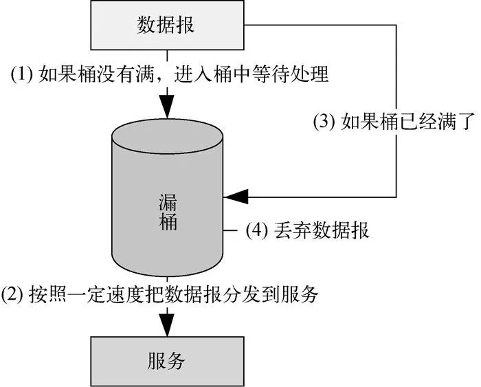

- 图 8-21　漏桶算法示意图

- 其中各步分别如下。

- (1) 数据报流入漏桶的时候，先判断桶是否满了。如果桶没有满，则进入桶中等待处理（桶中的数据会按照一定的速度被处理）。

- (2) 漏桶按照一定速度把数据报分发到各个目标服务。

- (3) 随着数据报不断加入，漏桶会被装满。

- (4) 如果漏桶被装满了，再流入的数据报就会被丢弃，那么请求这些数据的用户就会收到错误信息。

- 令牌桶算法：这里也有一个容量固定的桶，并以固定的速度往这个桶里放置令牌，桶满之后，就无法再添加令牌。当数据报到来时，先从桶中取令牌，如果桶中有令牌，那么数据报就凭借令牌处理请求，处理完毕后，令牌销毁；如果桶中没有令牌，那么该请求将被拒绝。请求在发往令牌桶之前，需要经过过滤器（分类器），目的是对报文进行分类，例如某类报文可以直接发往应用服务器、某类报文需要经过令牌桶获取令牌以后才能发，又例如 VIP请求可以直接发往服务器，无须经过令牌桶。令牌桶算法的示意图如图 8-22 所示。

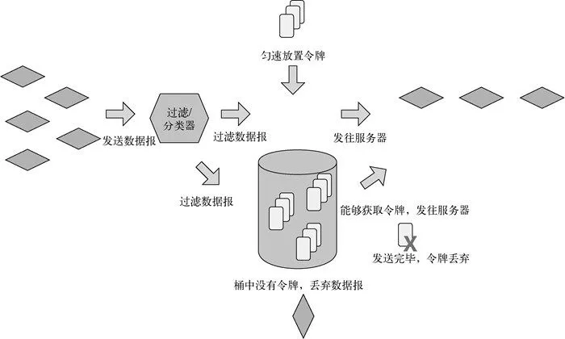

- 图 8-22　令牌桶算法示意图

- 漏桶算法能够限制数据报的传输速度，使数据报按照平滑的速度流入桶中，对突发流量不做额外处理；令牌桶算法通过放置令牌的方式限制数据报的流入速度，可以应对流量突然增大的情况，当请求流量增大时，可以加快放入令牌的速度，使两个速度相匹配。

- 因此，漏桶算法和令牌桶算法最明显的区别在于对突发流量的处理，这方面令牌桶略占上风。

2. 接入层限流限流算法只是实现限流功能的基础，具体限流操作的实践是多种多样的。Nginx 作为接入层，是应用服务与客户端之间的中介者，负责反向代理和负载均衡工作。接入层把客户端请求路由到不同的服务器上，这些服务器再分别响应请求。在这一层可以对整个系统进行限流操作，这里我们来看看 Nginx 是如何应用限流算法的。

- 限制访问频率的 ngx_http_limit_req_module 模块

```
ngx_http_limit_req_module 模块的功能是根据每个客户端的 IP 地址，限制客户
```

- 端每秒发出的请求数，并且定义一块内存空间作为缓冲区，将超过请求频率的客户端请求暂时缓存起来。

- 下面来看看对应的参数定义，Nginx 配置文件如下：

```
http{
1
   limit_req_zone $binary_remote_addr zone=limit:10m rate=2r/s;        ①
2
}
3
server {
4
   location / {
5
       limit_req zone=limit burst=5 nodelay;      ②
6
       proxy_pass http://192.168.1.1:8888
7
   }
8
}
9
```

- 从上述配置内容可以看出以下两点。

```
① http 中的 limit_req_zone 表示限制请求的区域，后面跟着的
$binary_remote_addr 表示发出请求的客户端 IP 地址。zone=limit 用来定义一个
名为 limit 的缓冲区，此缓冲区用于存放服务器无法即时处理的请求。10m 的意思是
```

- 缓冲区的大小是 10MB。在并发量高的情况下，大多数请求会由于没有得到响应而被放在这个缓冲区，可以考虑适当扩大其空间。对于 64 位系统来说，这里的 10MB 缓冲区可以存放约 16 万个 IP 地址。

```
再后面的 rate=2r/s 表示每秒处理来自同一个 IP 地址 2 个请求。这里可以根据 IP 地
址设计用户的请求频率，rate 配置的就是漏桶的流出速度。
② location 中的 limit_req zone=limit，对应第 ① 步中 http 里定义的缓冲
区。burst=5 用来配置如何处理超额请求，假设一秒内，有 7 个来自同一 IP 地址的请
```

- 求，那么服务器只处理其中 1 个，另外有 5 个放在缓冲区中等待处理，这 5 个请求既不

```
会被拒绝也不会被丢弃，还剩下 1 个请求则失败。配置的这个 busrt 就是桶的大小，如
果配置为 0，表示桶中不会存放任何请求，请求以一定的速度漏出桶外；如果配置具体
的值，那么当同时到达多个请求时，会暂存相应数量的请求。最后的 nodelay 表示超
过 rate 配置的流出速度的请求不会被延迟处理。
```

- 限制并发数的 ngx_stream_limit_conn_module 模块

```
与 ngx_http_limit_req_module 模块不同，ngx_stream_limit_conn_module
```

- 模块是通过控制资源的连接数来限制请求的。例如支持同一个 IP 地址与 Nginx 之间有 n个连接。

- 下面来看看对应的参数定义：

```
http{
1
   # 分别通过 IP 和 server 来限制同时连接的个数，在 zone 中配置缓存的大小
2
   limit_conn_zone $binary_remote_addr zone=perip:10m;       ①
3
   limit_conn_zone $server_name zone=perserver:10m;
4
}
5
server {
6
   location / {
7
       limit_conn perip 20;            ②
8
       limit_conn perserver 100;   ③
9
   }
10
}
11
```

- 从上述配置内容可以看出以下三点。

```
① http 中的 limit_conn_zone 表明限制请求的区域，后面跟着的
$binary_remote_addr 表示发出请求的客户端 IP 地址，这个定义和
ngx_http_limit_req_module 模块的配置是一样的。通过 zone=perip:10m 来指
定缓冲区的大小。同理，下面的一条规则是通过 server_name，即服务器名字实现的
限制，通过 zone=perserver:10m 来指定缓冲区的大小。
② limit_conn perip 20 对应的 key 是 $binary_remote_addr，表示限制单个
```

- IP 地址同时最多能持有 20 个连接。

```
③ limit_conn perserver 100 对应的 key 是 $server_name，表示虚拟主机同
```

- 时能够处理的并发连接总数。注意，只有当请求头被后端服务器处理后，这个连接才能参与计数。

- 从 Nginx 的配置文件可以看出，两个模块的配置基本相似。下面总结一下。

```
ngx_http_limit_req_module 模块限制了同一个 IP 地址在同一时间访的问频率。
ngx_stream_limit_conn_module 模块限制了同一个 IP 地址在同一时间的连接总
```

- 数。

3. 单点限流Nginx 实现的是接入层限流，那到了应用层，针对单个应用服务又该如何实现限流呢？这些有很多最佳实践，例如 Sentinel、Guava 等工具都提供限流功能。思路和接入层一样，我们以 Sentinel 为例给大家介绍单点限流如何实现。Sentinel 是阿里巴巴开源的一套工具集，以流量为切入点，从流量控制、熔断降级、系统负载保护等多个维度保证服务的稳定性。这里我们着重介绍 Sentinel 的限流功能，内容分两个部分：规则定义和规则应用。

- 先来看规则定义。

```
Resource：限流规则针对的资源名称，这个资源可以是某个服务、方法或者代码段。
```

- 在 Sentinel 中，资源被抽象出来执行具体的限流操作，可以限流代码和服务。这种方式使得 Sentinel 屏蔽了复杂的逻辑，用户只需要为受保护的代码或者服务定义资源，然后

- 定义规则就可以了，剩下的事情由 Sentinel 完成。并且资源和规则是解耦的，甚至可以在运行时动态修改规则。

```
Grade：限流类型。例如 QPS（FLOW_GRADE_QPS）、线程数
（FLOW_GRADE_THREAD）。
Count：限流阈值。例如限流类型填写的是 FLOW_GRADE_QPS，那么这里填写 20 指的
```

- 是 QPS 若为 20，就达到了阈值。

```
LimitApp：限流来源，指具体的服务或者方法，可以用逗号分割。取值为 default 的
```

- 时候，表示所有调用请求都要参与限流统计。这里可以填写具体调用方，之后会针对这个具体的调用方进行限流。

```
Strategy：限流策略，是基于调用关系的流量控制策略。其包括三种限流模式，
STRATEGY_DIRECT 对于所有调用者进行限流；STRATEGY_RELATE 表示关联流量限
```

- 流，给两个资源设置关联关系后，可以避免两个资源之间的过度争抢；

```
STRATEGY_CHAIN 表示根据链路入口限流，假设有两个不同的请求都调用了资源，可以
```

- 指定其中一个请求进行限流，而对另一个不限流。

```
ControlBehavior：限流行为。CONTROL_BEHAVIOR_DEFAULT 表示满足条件以后
直接拒绝，例如 QPS 超过 20，就拒绝请求；CONTROL_BEHAVIOR_WARM_UP 表示排
```

- 队等待，在流量突然增加的时候通过缓慢提高系统请求量的方式让请求通过，不至于因

```
为流量瞬间猛增而压垮系统，也就是慢慢预热；CONTROL_BEHAVIOR_RATE_LIMITER
```

- 表示按照一定的速度让请求通过，类似漏桶算法。

- 把上面配置资源与规则的过程总结一下，结果如图 8-23 所示。

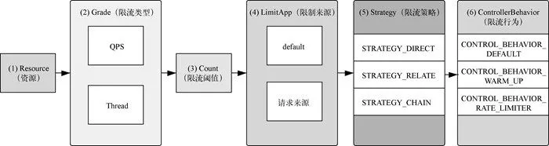

- 图 8-23　单点限流的配置过程图

```java
下面的代码块通过 initFlowRules 方法设置限流规则：
private static void initFlowRules(){
1
   List<FlowRule> rules = new ArrayList<>();
2
   FlowRule rule = new FlowRule();
3
   rule.setResource("HiResource");       ①
4
   rule.setGrade(RuleConstant.FLOW_GRADE_QPS);   ②
5
   rule.setCount(20);     ③
6
   rule.setStrategy(STRATEGY_DIRECT);     ④
7
   rule.setControlBehavior(CONTROL_BEHAVIOR_DEFAULT)   ⑤
8
   rules.add(rule);
9
   FlowRuleManager.loadRules(rules);       ⑥
10
}
11
```

- 下面按照标号简要介绍上述代码的含义。

```
① 设置 HiResource 作为限流资源。
```

- ② 设置限流类型为 QPS。

- ③ 设定限流阈值为 20。

```
④ 设置限流策略 Strategy 为 STRATEGY_DIRECT。
⑤ 设置限流行为是 CONTROL_BEHAVIOR_DEFAULT。
⑥ 通过 FlowRuleManager 中的 loadRules 方法加载规则。
```

- 再来看规则应用，相关代码如下：

```java
public static void main(String[] args) {
1
   initFlowRules();         ①
2
   while (true) {
3
       Entry entry = null;
4
       try {
5
           entry = SphU.entry("HiResource");    ②
6
           /*你的业务逻辑 - 开始*/
7
               System.out.println("hello world");
8
           /*你的业务逻辑 - 结束*/
9
       } catch (BlockException e1) {
10
           /*限流逻辑处理 - 开始*/
11
               System.out.println("block!");
12
           /*限流逻辑处理 - 结束*/
13
       } finally {
14
           if (entry != null) {
15
               entry.exit();
16
           }
17
       }
18
   }
19
}
20
```

- 下面按照标号简要介绍上述代码的含义。

```bash
① 调用业务逻辑之前先通过 initFlowRules 方法加载限流规则。
② 执行 entry 方法指定限流的资源 HiResource。在执行 SphU.entry() 后，会返回
一个 Entry，Entry 表示一次资源操作。这段代码默认有一个上下文环境，也就是
Context，每个资源操作，即对 Resource 进行的 entry、exit 操作，都必须对应一个
Context。如果程序中未指定 Context，就会创建 name 为
sentinel_default_context 的默认 Context。一旦满足了限流条件，便会进入 try
catch，所做的限流处理就是对资源进行保护。注意这里的限流逻辑是通过 try catch
```

- 硬编码的方式实现的，还可以用注释等其他方式完成。

4. 集群限流接入层限流和单点限流介绍完后，自然而然出现了一个问题。接入层和单点服务能否合作实现限流呢？例如接入层限制 QPS 为 100，单点服务有 10 个，就可以让每个服务分别限制QPS 为 10；又或者让其中 5 个服务每个限制 QPS 为 12，另外 5 个每个限制 QPS 为 8。针对这种情况，我们就可以使用集群限流了。当然，集群限流可以通过接入层限流和单点限流相结合的方式完成。为了更加方便地执行集群限流，我们先介绍 Sentinel 的集群限流方案，当然使用 Nginx+Lua 的解决方案也可以搞定。由于各个服务节点是分散部署的，在实

- 现单点限流的同时还要兼顾整体的流量，因此需要在独立于集群的地方开辟一个存储空间，让单点在进行流量限制的时候记录流过自身的流量，以便限制集群的整体流量。下面是Sentinel 的集群限流方案，Sentinel 集群限流由两部分组成。

- token server：集群流控服务端，用来存放限制整个集群的流量数，例如集群限流100QPS，单点 1 限流 50QPS，单点 2 限流 50QPS。同时它还用来处理来自 tokenclient 的请求，token client 每次处理请求之前都会找 token server 获取一个 token。token server 根据 token client 配置的限流 QPS 给它发放 token。当请求节点的请求数超过单点配置的请求数时，或者接入层传入集群的请求数超过集群中节点配置请求数之和时，token server 会拒绝发放 token。同样地，token client 每次处理完一个请求以后，都会归还 token。

- token client：集群流控客户端，安装在单点应用上。每当有请求到达的时候，它就会主动向 token server 请求获取 token。拿到 token 以后才能处理请求，如果没拿到就拒绝处理请求。

- 由于 token server 是单点设计，因此一旦它挂掉，集群限流便会退化成单点限流模式。Sentinel 的集群限流方案如图 8-24 所示。

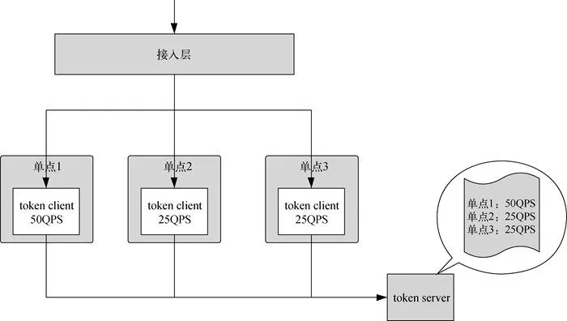

- 图 8-24　Sentinel 的集群限流方案

- 由图 8-24 能够看出，token server 负责配置整个集群和单点的限流情况。当接入层接收到客户端请求并交给单点进行处理的时候，单点先从 token server 上获取 token。如果不超过单点 QPS 和不超过集群 QPS 这两个条件都满足，token server 就会给单点发送 token，继而单点可以处理请求。否则 token server 不给单点发送 token，单点拒绝处理客户端请求。

- 在实现集群限流时，限流规则的定义会在第三方配置中心（例如 Consul、Redis、SpringCloud Config、Nacos 等）实现。token client 和 token server 会主动注册到配置中心设置、拉取配置信息。

```
同时，FlowRule 添加了两个字段用于配置集群限流。
clusterMode 用于标识是否是集群限流配置。
clusterConfig 是与集群限流相关的配置项，其中 flowId 代表全局唯一的规则 ID，
由集群限流管控端统一分配；thresholdType 代表阈值模式，可以设置单机均摊阈值
和全局阈值；fallbackToLocalWhenFail 表示在 token client 连接失败或通信失败
```

- 时，是否退化到本地的限流模式。

- 至此，请求限流的相关内容已经全部介绍完毕，这里做一个小小的总结。限流的目的是保护系统不会因为大流量的冲击而出现故障。对于限流的实践，基于的都是漏桶算法和令牌桶算法。接入层作为流量的入口，通过 Nginx 对客户端的请求频率和并发数进行限流。应用服务作为单点，也可以进行限流操作，具体通过 Sentinel 的限流规则定义和限流规则应用来实施。服务器集群限流的实现则需要依赖 Sentinel 的 token server 和 token client。

### 8.2.2　服务降级

请求限流可以提高系统对高并发请求的可用性，然而如何保证整个系统架构的可用性呢？众所周知，一个复杂的业务系统由大大小小多个应用服务组成，这些服务根据业务的重要性被分为核心服务和非核心服务。在面临高并发请求的时候，系统如何保证所有服务都正常运行是一个巨大的挑战。一旦请求量到达系统的承受极限，势必要放弃一些非核心服务，以保证核心服务的正常运行。系统这种弃卒保车的行为被称为服务降级。为了保证核心服务能够正常运行，选择暂停运行一些非核心服务，或者关闭非核心服务的部分功能、只返回部分数据等。考虑到整个系统的稳定性，需要对服务降级进行预判，也就是对有可能出现问题的地方设置降级方式。具体的方式就是开关机制，这个开关可以配置在本地文件中，也可以配置在 Redis、ZooKeeper 或者数据库中。鉴于分布式部署以及微服务的应用，开关的配置得到了广泛应用。接下来会依次介绍降级等级与分类、降级开关分类与设计、降级开关实现策略。

1. 降级等级与分类如果把降级理解为应对系统异常的处理方式，那么具体的降级行动就是对异常做出的响应。在设计降级之前，我们需要对异常处理进行规划，针对不同的异常情况采取不同的降级等级。降级等级有以下几种。

- 一般：服务出现网络抖动，或者服务刚刚上线还没有预热的时候就遭遇了比较大的访问量。

- 警告：在一段时间内出现服务访问错误的情况，这种情况虽然会返回错误，但是不影响服务的整体运行，此时可以发出警告信息，运维人员会通过网络、系统、应用的参数分析如何对服务进行处理。这里可以设置一个出错率，例如 5%~10%。

- 错误：当服务的出错率增加，例如 20%~30%，或者在某一时间段出现大量超时问题的时候，就需要分析监控数据，查看是哪个服务或者数据库出现了瓶颈。这里需要人为干预，进行服务的暂停和切换。

- 严重：服务完全不可用。需要人为干预，进行服务的替换、自动导流，甚至服务器重启。

- 降级等级是告诉我们如何有针对性地处理不同情况下的系统异常，接下来降级分类是告诉我们在哪些地方需要考虑实施降级。

- 页面降级：如果某些页面出现了访问无效的问题，就需要对其进行降级处理。例如多人同时下单导致商品下单页面处于不可用的状态时，需要对此页面进行降级处理，可以返回一个“友好”的写着订单正在处理中的简单页面（可以把这个页面设置成一个完全静态的页面，然后放在 CDN 缓存中作为兜底页面）。又例如用户点击下单以后，服务没有响应，那么此时就需要将下单按钮设置为失效，不让用户再点击使用这个按钮，以免更多请求涌入服务器。

- 读降级：在高并发场景下，数据库会成为瓶颈，当数据库的响应时间变长时，可以不去读取数据库中的数据，转而读取缓存中的数据。当分布式缓存服务器的响应时间变长时，可以读取本地缓存中的数据。如果本地缓存都出现了问题，还可以读取 CDN 缓存中

- 保存的兜底数据。总之，无论哪一层数据读取出现了问题，都不能给用户返回冷冰冰的错误代码，而是尽量返回用户可以理解的、与业务相关的数据。

- 写降级：在写入数据，在更新库存的时候，会出现数据库瓶颈。此时可以先在缓存中扣减库存，然后通过队列将数据同步到数据库中。

2. 降级开关分类与设计降级能够保障系统正常运行，其实现手段就是开关机制。在日常的使用中，有两种降级开关，分别是自动降级开关和手动降级开关，它们分别应用在不同场景中。

- 自动降级开关系统在运行时根据运行状态或者条件自动触发降级开关，此类开关的降级等级并不高，都处在一般和警告级别。

- 超时降级开关：远程调用非核心服务时，如果服务响应过慢，就自动降级，先停止调用。例如在调用商品详情服务的时候，需要调用商品推荐服务或者商品评价服务，如果此时后两个服务出现调用超时的情况，就暂时停止调用，不返回相关信息，或者起用兜底数据做替代。这里需要根据超时的规则，配置好超时时间以及超时次数，只有达到条件才会触发降级开关。

- 失败降级开关：当服务调用一些不稳定的服务时，这些服务在某些时候会返回失败信息。例如付款的时候会调用第三方支付接口，如果调用不成功，通常会收到失败信息，系统便会再次调用。如果调用一定次数以后，依旧无法获得正确响应，就需要果断进行降级处理，甚至采用熔断机制。在关闭服务的时候，也需要发送通知，让运维团队介入调查。当然，如果失败一定次数之后，服务又恢复了，则需要关闭降级开关，让服务继续接受访问。

- 故障降级开关：故障表示对应的服务或者服务器已经无法正常工作。例如服务或者服务器挂掉了、完全不可用了，需要立即进行降级处理，此时果断使用兜底数据，或者由其他服务替代其工作。这种降级的等级比较高，需要人为参与才能解决问题。

- 限流降级开关：这类降级通常设置在接入层或者 API 网管上，负责不断监控流入系统的流量。在秒杀高峰到来的瞬间，流量会激增，对秒杀系统造成巨大的压力，此时就可以打开限流降级开关。针对整个系统，这个开关可以显示访问流量的进入量，或者指定一定流量的数据可以进入到系统，其他的流量则会被拒绝。单个服务能够处理的流量也是有限的，当此开关打开的时候，多出的流量会被拒绝。秒杀系统通常会使用

- 限流机制作为保护，当达到限流阈值时，后续请求就自动被降级，例如将用户导流到排队页面，提示过会儿重试，或者直接告知用户没货了。

- 手动开关降级设计自动降级是为了减缓运维压力，让一些日常规则性的降级处理由降级规则决定，同时由于压力测试在之前就已经进行过，因此运维人员对系统的瓶颈心知肚明，可以根据系统的最大承载能力设计这个降级规则。除了自动开关降级，还有一些手动开关降级，会用在一些特殊场景中。例如即便系统暂时没有出现问题，也还是想降级某些服务。特别是秒杀将要开始的时候，可以大致预知访问量。此时，可以慢慢调整降级开关，把流量放进来，以预热系统。还有做灰度测试的时候，不清楚新业务会对系统造成什么影响，也可以先通过降级开关把业务指向新服务。如果出现问题，也可以通过开关把业务指向老服务，保持整个系统交付的稳定性。

3. 降级开关实现策略无论是自动降级开关还是手动降级开关，都需要在代码中加入对应的开关。在单机模式下，通常将这个开关写到配置文件中，然后在代码中监控配置文件中对应值的改动。程序中原有的流程会受这个配置开关的影响，分别调用不同的服务或者数据。这种方式对于单机应用来说是实用的，但在分布式系统中，服务做了水平扩展，此时对配置的读取就不能通过本地配置文件来实现。一般来说，每个服务的配置信息可以存放到分布式的配置文件系统、数据库、Redis、ZooKeper 等地方，然后通过某种机制进行同步操作。分布式系统中还会有一个配置中心，对整个系统中的降级开关进行集中管理，并且提供 Web UI 界面便捷用户的操作。目前有一些开源方案可以选择，例如 ZooKeeper、Diamond、Etcd 3、Consul。降级开关在分布式系统中的实现方案如图 8-25 所示。

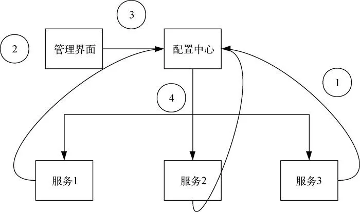

- 图 8-25　降级开关在分布式系统中的实现方案

- 图中上半部分是管理界面和配置中心，下半部分是三个服务。

- ① 分布式服务（1~3）启动的时候，从配置中心获取最新的配置信息，并把这些配置信息作为降级开关加载到服务中。

- ② 打开或者关闭降级开关，例如规则被触发（自动）、手动打开或者关闭降级开关（手动）。注意这里是通过管理界面触发的降级开关，也可以通过规则触发开关，总而言之是满足一定条件以后把开关打开或者关闭。无论哪种方式，都会把这个更改操作通知给配置中心。

- ③ 配置中心收到更改开关的信息。

- ④ 配置中心将开关的更改信息发送给各个在配置中心注册过的服务。服务收到这个信息以后，会改变自身内部的业务流程，实现降级开关对应的业务逻辑。

- 需要注意的是，从配置中心获取降级开关信息的操作有很多种方式。这里列举两种。

- 主动拉取配置。服务会根据配置中心的地址信息，按照一定的时间周期主动到配置中心获取降级开关的更改信息。这种方式会对服务端的性能造成损耗，因为服务端需要不断地请求配置中心，检查降级开关的值，即使这个开关没有变化也要定期访问。

- 发布订阅配置。服务端会订阅配置中心对于降级开关的消息，配置中心接收到更改开关的命令时，就触发发布消息事件，服务端接收到消息后再从配置中心获取相应的信息。这种方式对服务端比较友好，使得服务端只在需要更新的时候去获取降级开关的信息即可。

- 这里我们以 Consul 作为配置中心，来看看作为服务来说是如何从配置中心获取配置信息

```
的。通过 startWatch 方法实现定时获取 Consul 中定义的降级开关配置信息，该方法的
```

- 代码如下：

```
pulic void startWatch() {
1
       final String system = "switchs";
2
       Consul consul = Consul.builder().withHostAndPort(HostAndPort.
3
           fromString("192.168.0.1:8588")).withConnectTimeoutMillis(1000).
4
           withReadTimeoutMillis(30 * 1000).
5
           withWriteTimeoutMillis(5000).build();    ①
6
       final KeyValueClient keyValueClient = consul.keyValueClient();    ②
7
       final AtomicBoolean needBreak = new AtomicBoolean(true);
8
       Thread watchThread = new Thread(() -> {           ③
9
           BigInteger index = BigInteger.ZERO;
10
           while (true) {
11
               Properties _properties = new Properties();
12
               try {
13
                   List<Value> values = keyValueClient.getValues(system,
14
                       QueryOptions.blockSeconds(30, index).build());     ④
15
                   for (Value value : values) {
16
                       _properties.put(value.getKey().substring(system.length
17
                           + 1), value.getValueAsString());
18
                       logger.info("key:{}, value:{}",value.getKey().
19
                           substring(system.length() + 1),value.
20
                           getValueAsString().get());
21
                       index = index.max(BigInteger.valueOf(value.
22
                           getModifyIndex()));    ⑤
23
                   }
24
                   properties = _properties;            ⑥
25
               } catch (ConsulException e) {
26
27
               }
28
               if (needBreak.get()) {
29
                   break;
30
               }
31
           }
32
       });
33
       watchThread.run();
34
       needBreak.set(false);
35
       watchThread.setDaemon(true);
36
       watchThread.start();
37
   }
38
```

- 下面简要介绍上述代码的含义。

- ① 连接 Consul，需要指定 IP 地址和 Port，并设置连接超时时间、读超时时间和写超时时间。

```
② 通过 KeyValueClient 访问 Consul 中的 Key、Value 信息。
```

- ③ 启动线程，用于定时访问 Consul。

```
④ 每隔三十秒从 Consul 里对应的 Key 中获取 Value。这里的 index 从 0 开始不断累
加，直到获取到 Key 对应的所有的 Value。
⑤ 记录 index 的位置，以便下次获取值的时候从上次的最后获取位置继续获取。
⑥ 更新服务中的 properties 配置。
```

- 上面代码实现的就是主动拉取配置，服务端每隔一段时间就主动向 Consul 配置中心拉取降级开关的数据。

- 降级的目的是保证核心服务顺利执行，以及整个系统的稳定性，于是本节针对问题的严重程度对降级进行了分级，并且针对问题发生的不同位置对降级进行了分类。为了达到降级的目的，需要通过开关的方式控制服务行为，例如访问数据库还是缓存、在流量为多少的时候拒绝访问。于是针对不同的场景，对自动降级开关和手动降级开关进行了描述和定义。开发分布式系统时，为应对高并发的场景，需要通过配置中心来更改降级开关配置的信息，还通过Consul 的例子展示如何具体实施降级开关信息的更改。

### 8.2.3　服务熔断

本节我们把视角从整个系统聚焦到单个服务商，一个复杂的分布式系统往往由无数个服务组成，各服务之间存在千丝万缕的联系。服务之间互为依赖、共同依存，必然免不了相互调用。一旦系统中有一个服务因为各种原因无法继续工作，那么依赖于这个服务的其他服务也有可能受阻，这种情况会导致其他服务的调用无法顺利完成。服务熔断机制就是在服务无法正常提供调用的时候，断开与其他服务的连接，以保证其他服务不受自己的影响。下面我们会讲到：服务不可用的现象和原因、应用隔离、熔断模式、熔断工作流、Hystrix 实现熔断。

1. 服务不可用的现象和原因分布式系统中的服务都不是独立存在的，服务之间会相互调用。作为服务提供者的服务如果本身出现问题，是会拖垮其他服务调用者的。如图 8-26 所示，商品详情服务会调用商品描述服务、商品价格服务和评论服务。评论服务作为服务的提供者如果出现故障，导致无法提供服务，就会影响商品详情服务的调用。

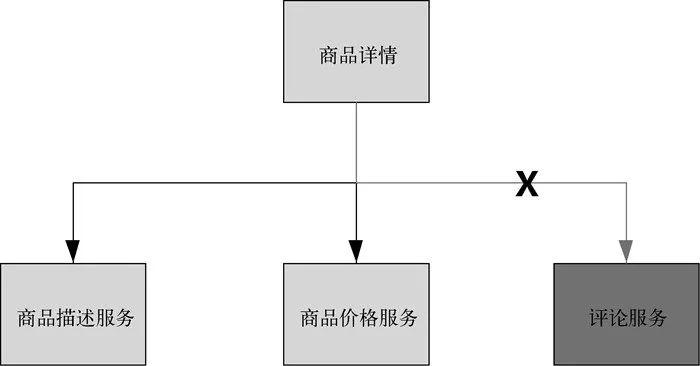

- 图 8-26　服务提供者出现问题，影响服务调用者

- 即便我们对秒杀系统中的部分核心服务进行了高可用处理，实现了水平扩展，核心服务还是可能由于一些非核心服务的故障而出问题。如图 8-27 所示，为了应对高并发，对商品详情服务进行了水平扩展，作为非核心服务的评论服务虽然访问量不大，但是一旦出现异常就会影响商品详情服务的业务。

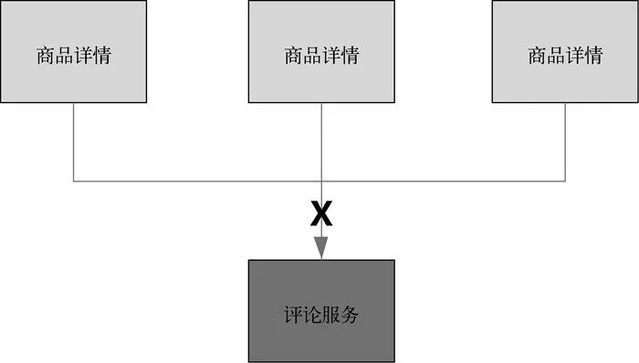

- 图 8-27　经过水平扩展之后的核心服务调用非核心服务

- 服务提供者无法正常提供工作的原因有多种。

- 硬件故障。部署服务的硬件服务器出现问题，导致服务调用者无法获得响应。

- 缓存问题。多数服务都会使用缓存，如果遇到缓存击穿、缓存雪崩、缓存穿透的情况，导致请求无法命中缓存，而从数据库中直接获取数据，就会造成响应缓慢。这样的缓慢会使服务调用者的大量请求处于等待状态，服务提供者一边要获取数据库的信息，一边还要处理服务调用者的请求，此时会导致服务不可用。

- 重试流量。无论是从用户请求还是服务请求的角度，如果请求以后没有得到响应，都会进行重试操作。好比用户在发现页面没有返回值时，不断刷新页面一样，服务调用者在没有得到服务提供者的响应时，也会启动重试机制。在高并发场景下，服务提供者如果没有及时响应调用者的请求，就会被重试流困扰。本来服务提供者对大流量的处理就捉襟见肘，现在迎来了重试的流量，更是变得雪上加霜。

- 调用者资源耗尽。如图 8-28 所示，服务调用者使用同步调用，而服务提供者又无法给予及时的响应，因此服务调用者这端会产生大量等待线程，这些线程会占用系统资源。一旦线程资源被耗尽，服务调用者就会进入不可用状态，以此类推，这种现象会影响整个调用链条的服务，这就是服务雪崩。

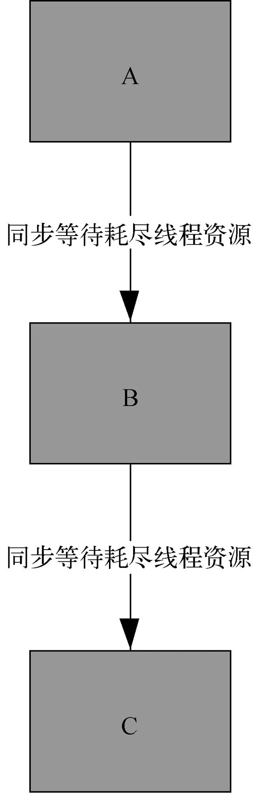

- 图 8-28　同步等待耗尽线程资源

2. 应用隔离（线程池隔离和信号量隔离）针对上面提到的问题，是有多种解决方案的，例如前面讲过的缓存、限流。但是如果这些办法都想过，也都采用了，依然存在不可用的服务，该如何处理？我们的想法是假如有部分服务不可用了，绝不能让这些服务影响其他服务的正常运行，特别是那些核心服务。因此需要对不可用的服务和其他服务进行隔离，也就是应用隔离。这里推荐使用“舱壁隔离”模式，我们以 Spring Cloud 搭建 Hystrix 为例，来看看这种模式是如何实现的。先使用舱壁隔离模式实现线程池的隔离，它会为每个服务提供者分别创建一个独立的线程池，之后就算某个服务提供者出现延迟过高的情况，也只是影响自己的服务调用，而不会拖累其他服务。如图 8-29 所示，Hystrix 在商品详情服务和评论服务之间加入了线程池，这个线程池可以设置大小。当商品详情服务发起请求时，这些请求会通过线程池中的线程访问评论服务，每完成一次访问就释放一个线程。当评论服务无法立即响应时，请求会在线程池中等待处理。一旦线程池填满，后面的请求将被立即拒绝，不会继续等待，服务调用者会在第一时间获得反馈。这种设计不会让服务调用者进入无休止的等待，直到耗尽自身资源。

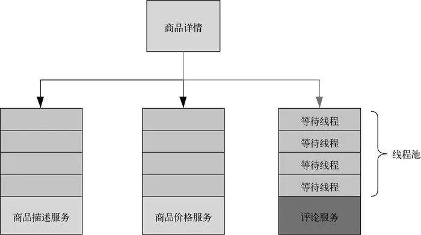

- 图 8-29　线程池隔离

- 线程池隔离支持同步和异步操作，由于请求线程和处理线程不是同一个，因此会出现线程上下文切换情况。Hystrix 中还有一种隔离方式是信号量隔离，其提供一个计数器来限制并发的线程数，这里的请求线程和处理线程是同一个，所以不存在线程的上下文切换。如图 8-30 所示，当多个商品详情服务并发调用评论服务时，每个请求都需要获得一个信号量后才能调用，这里由一个计数器来维护信号量的个数（默认是 10 个，可通过

```
maxConcurrentRequests 配置）。如果并发请求数大于信号量个数，那么多余的请求进
```

- 入队列排队。如果多余的请求数量超出队列上限，则直接拒绝超过数量的那些请求。

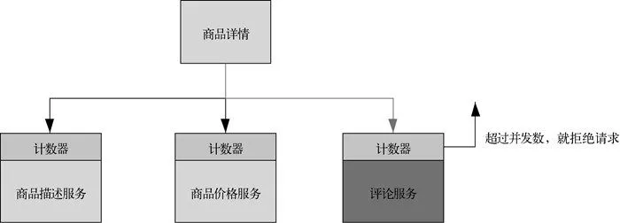

- 图 8-30　信号量隔离

- 有了线程池隔离和信号量隔离，就可以把不可用的服务和可用的服务分离开，这个思路正好和秒杀系统中的应用隔离不谋而合。

3. 熔断模式得益于隔离，针对服务不可用，我们可以说是进可攻、退可守，如果服务不可用，便启动隔离机制，让它不要影响其他服务；如果服务可用，再重新开放，让其他服务访问。说白了就是如果你正常，就让你工作；如果你不正常，就让你与世隔绝。这个就是熔断模式要做的事情，它是在隔离的基础上执行具体的操作，或者可以理解为，以应用隔离为基础设置熔断开关。这个熔断开关好像服务之间调用的开关。如图 8-31 所示，熔断模式其实是在原来的应用隔离上加了一层开关，Hystrix 负责监控服务的健康状态，然后决定开关是打开、关闭还是半打开。当这个开关打开的时候，说明服务已经隔绝访问了，也就是已经被熔断了。

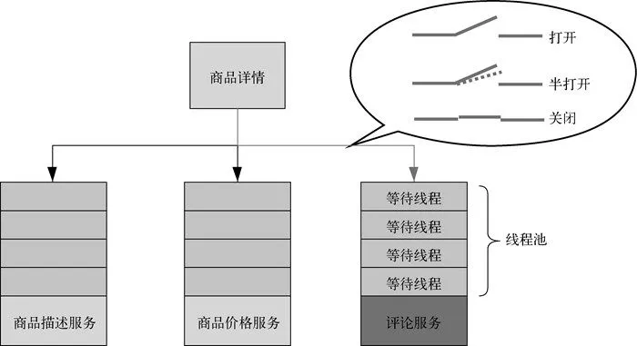

- 图 8-31　熔断模式

- 如图 8-32 所示，一起来看看熔断模式的状态变迁都经历哪几个步骤。

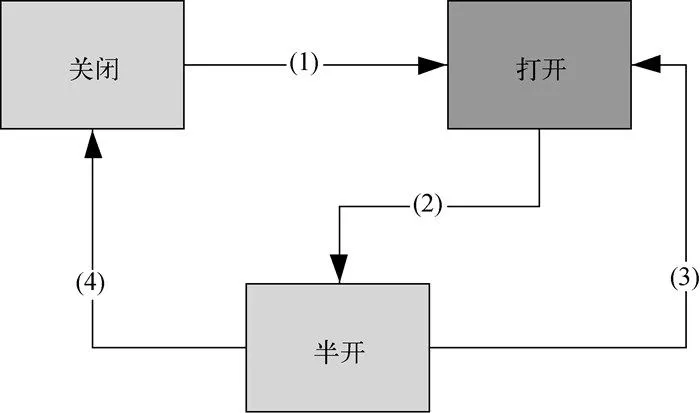

- 图 8-32　熔断模式的状态变迁

- (1) 关闭 → 打开。在熔断模式下，熔断器开关默认是关闭的，并且会判断以下两个参数的值。

```
requestVolumeThreshold：熔断的最少请求数，默认值是 10。只有当一个统计窗
```

- 口内处理的请求数量达到这个阈值时，才会判断是否进行熔断。也就是当一段统计时间内的请求数量达到 10 的时候，才会进行熔断与否的判断。

```
errorThresholdPercentage：熔断的阈值，默认值是 50。表示当一个统计窗口内
```

- 有 50% 的请求处理失败时，就会触发熔断。

- 当上面两个参数同时达到阈值时，触发熔断，将关闭的熔断器开关打开。

```
(2) 打开 → 半开。熔断器打开之后，可以通过 sleepWindowInMiliseconds 设置一个
```

- 休眠期，默认值是 5 秒。在这 5 秒内，熔断器处于开启状态，也就是说这 5 秒内的服务请求都会被拒绝。5 秒到了，熔断器暂时进入半开状态，这个状态的意思是熔断器发送一个命令给服务提供者，尝试和它连接，看看是否可用了，此时依旧会检查第 1 步提到的两个参数。

- (3) 半开 → 打开。如果在半开状态下，熔断器发送命令给服务提供者以后，仍然收到超时或者访问异常的响应信息，就会返回打开状态，等待 5 秒后再进入半开状态。

- (4) 半开 → 关闭。在半开状态下，熔断器发送命令给服务提供者以后，发现服务访问正常，同时那两个阈值也没有都达到。就说明服务提供者能够正常工作，于是关闭（闭合）熔断器，允许流量正常流入。

4. 熔断工作流这里我们来看看在 Hystrix 中，熔断模式是如何处理请求的。Hystrix 官网上有一张看起来比较复杂的流程图，我对其进行了优化，化简以后的流程图如图 8-33 所示。

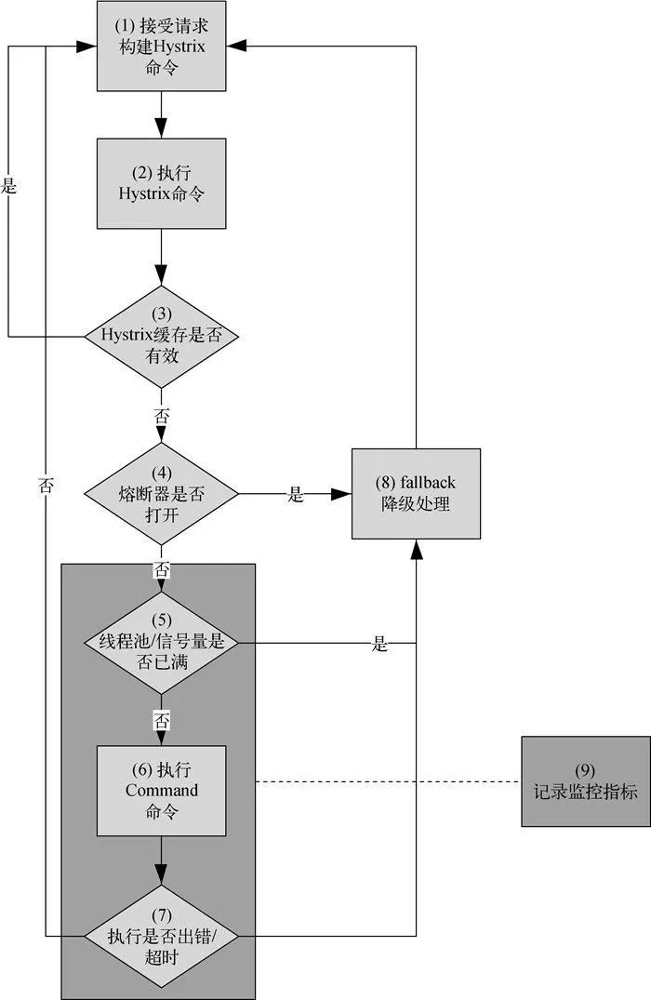

- 图 8-33　熔断工作流

- 下面顺着步骤给大家讲解这个流程图。

```
(1) 构建命令。构建一个 HystrixCommand 或 HystrixObservableCommand 对象（表
```

- 示向服务提供者发送的请求），同时传递所有需要的参数。从命名方式就能知道，这里采用命令模式实现对服务调用操作的封装。命令模式把来自客户端的请求封装成一个对象，从而使不同请求参数化，实现了行为请求者与行为实现者的解耦。

```
(2) 执行命令。Hystrix 中存在 4 种执行命令的方式，会在执行时根据 Command 对象以及具
体情况从中选择。HystrixCommand 对象实现了下面两种执行方式。
execute()：同步执行，调用程序所依赖的服务并返回结果对象，若发生错误，就抛出
```

- 异常。

```
queue()：异步执行，返回一个 Future 对象，其中包含服务执行结束时要返回的结果
```

- 对象。

```
HystrixObservableCommand 对象实现了另外两种执行方式。
observe()：返回 Observable 对象，代表操作的多个结果，这里返回的
Observable 对象是一个 Hot Observable，意思是无论是否有订阅者，都会发布事
```

- 件。

```
toObservable()：同样会返回 Observable 对象，也代表操作的多个结果，不过这
里的 Observable 对象是一个 Cold Observable。表示在没有订阅者时，不会发布
```

- 事件，而是等待，直到发现订阅者。

- (3) 缓存是否有效。在高并发情况下，服务提供者会被频繁调用，为了提高响应速度，

```
Hystrix 通过命令的方式提供了缓存模式。HystrixCommand 对象或
HystrixObservableCommand 对象可以重载 getCacheKey() 方法来开启请求缓存模
```

- 式。开启以后，如果 Hystrix 命令命中缓存，就直接返回缓存中的数据，而不再去请求服务

- 器。这里需要注意的是，读操作可以直接从缓存中获取数据，写操作则需要在更新服务器中数据以后同时更新缓存中的内容。

- (4) 熔断器是否打开。由于熔断模式中的熔断器会根据服务提供者的具体情况，而打开、关闭或者半开。因此在客户端请求访问服务提供者的时候，需要判断其状态。如果是打开，则说明服务有异常，无法提供服务，此时进入降级处理阶段，直接拒绝请求或者返回兜底数据。如果是没有打开，说明服务运行正常，访问可以继续进行。

- (5) 线程池 / 信号量是否已满。8.2.3.2 节曾提到，可以分别从线程池和信号量的角度对高并发请求进行限制，并且熔断器是放在应用隔离之前的。因此判断完熔断器是否打开后，就迎来了应用隔离，此时如果线程池和信号量都被占满了，则表示服务不可用，需要进行降级处理。

- (6) 执行命令。如果前面 5 步都没有出现问题，说明服务是可用的，因此这里执行命令，可以返回服务提供者的信息。

- (7) 命令执行是否出错 / 超时。命令执行如果出错，需要通过降级处理给服务调用者返回出错消息，并让其终止调用。如果命令执行没有问题，就向服务调用者返回正确信息。

- (8) fallback 降级处理。针对第 (4)、(5)、(7) 步中出现的服务异常或者命令执行异常情况，这里统一使用 Hystrix 中的 fallback 进行降级处理，降级处理的方式有很多种。例如返回错误信息、返回服务不可用，或者使用兜底数据代替服务提供者返回的信息。

- (9) 记录监控指标。这一步 Hystrix 会计算熔断器的健康度。第 (5)、(6)、(7) 步中出现的调用成功、失败、拒绝、超时等信息都会记录到这里。记录的信息就是监控指标，监控指标是决定打开或者关闭熔断器的依据。如果健康度不达标，就会对服务提供者进行熔断（打开熔断器）。恢复期（半开）过去后，如果服务提供者恢复了正常的健康度，就关闭开关，允许调用服务提供者，否则再次熔断（打开）。

5. Hystrix —— 服务熔断的最佳实现这里看看熔断流程中提到的 Hystrix 命令是如何执行请求操作的。相关代码如下：

```java
public class CommandHystrixDemo extends HystrixCommand<String> {    ①
1
   private final String name;
2
   protected CommandHystrixDemo(String name) {
3
       super(HystrixCommandGroupKey.Factory.asKey("GroupName"));      ②
4
       this.name = name;
5
   }
6
   @Override
7
   protected String run() throws Exception {
8
       //处理的业务逻辑    ③
9
       int a= 1/0;
10
       return "Hello" + name ;
11
   }
12
13
   @Override
14
   protected String getFallback() {         ④
15
       return "降级处理";
16
   }
17
   public static void main(String[] args) throws Exception{       ⑤
18
       CommandHystrixDemo commandHystrixDemo = new CommandHystrixDemo(
19
           "hystrix-demo");
20
       String s = commandHystrixDemo.execute();
21
       System.out.println(s);
22
       System.out.println("主函数" + Thread.currentThread().getName());
23
   }
24
}
25
```

- 下面顺着序号给大家讲解上述代码。

```
① 首先通过继承 HystrixCommand 类实现自己的 Command 类 ——
CommandHystrixDemo。
② 通过 HystrixCommandGroupKey.Factory 中的 asKey 方法定义命令的组名。
③ 在重写的 run 方法中编写需要处理的业务逻辑。为了演示服务不可用的情况，这里使用
int a=1/0; 产生一个异常。run 方法中如果产生异常，是会进入 getFallBack 方法中
```

- 进行降级处理的。

```
④ getFallBack 方法直接返回降级处理这四个字。也可以直接返回错误码，把服务提供
```

- 者不可用的消息告诉服务调用方。

```
⑤ 在 main 函数中，通过 new CommandHystrixDemo 传入命令组名，然后直接调用
execute 方法执行调用服务提供者的请求。这里使用的是同步调用的方法，当然也可以使
```

- 用异步调用。

- 8.2 节主要围绕着请求限流、服务降级和服务熔断三方面展开。请求限流是以流入系统的请求为出发点，通过限制流量保证系统的可用性。其中介绍了限流算法、接入层限流、单点限流和集群限流。服务降级是站在整个系统的角度，根据业务的重要性将服务分为核心服务和非核心服务，立足于保证核心服务的可用性，放弃部分非核心服务的功能。服务熔断关注的点要更细一些，主要关注那些被依赖的服务，当这些服务出现问题时，通过熔断的方式保证其他服务不受影响、正常工作。总体脉络是从流入系统的请求开始，到整个系统的可用性，再到单个服务可用性，是按照从外到内、从大到小的顺序进行描述的。

## 8.3　总结

本章的主旨是分布式系统的高性能和可用性，这两方面的内容实际在前面的章节中都有介绍，这里单独提炼为一章是为前面的内容做补充。本章的两大节内容已分别在节尾做了总结，这里不再赘述。
